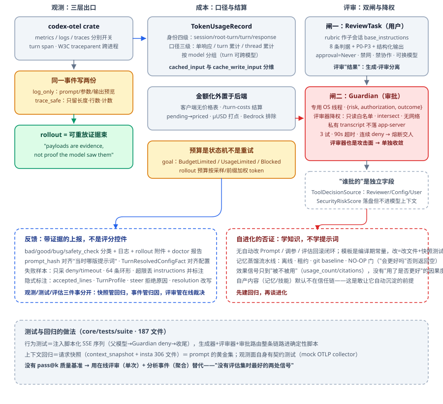

# 评估与反馈：把"好不好"变成可验证的工程问题

前两篇里，检索和上下文都有了各自的预算与判据，但都绕不开同一个追问：**你怎么知道系统变好了，还是变坏了？** 这个问题不回答，前面所有优化都只是"改动"，算不上"改进"。

先看五个生产里真出过的问题——没有一个是系统 bug。

- 用户投诉 Agent 未经授权取消了订单，还替他发了一封措辞强硬的邮件。翻日志，四行全是 `Success(200)`，没有 500、没有超时、没有堆栈。
- 离线测试集 95 分，上线以后用户骂声一片。两个数字都真实，到底哪个在撒谎？
- 评审模型给一份算错了的月报打了 96 分。你把提示词写严，它降到 88 分——照样放行，盲区一寸没动。
- 平均对话轮数从 3 涨到 5。先别高兴：是用户更爱聊了，还是三轮能解决的事五轮没解决？
- 你让 Agent 自己优化 Prompt，它最省事的走法，是学会故意一次不把问题说完。

这几件事在监控面板上都长得像正常业务。这一篇的骨架就一句话：**测试是刹车，管死活；评估是仪表盘，管好坏**——而仪表盘要能用，你得先回答"什么叫好"。

---

## 一、评估什么：指标分层与归因

### 1.1 三层指标是骨架

指标得分层，不然你连该盯哪个数都不知道：

- **目标指标**：用户最终要达成的那件事本身，电商就是下单转化；
- **过程指标**：证明用户正在朝它走过去，点击、停留、收藏、加购都算；
- **护栏指标**：防止你刷某一个分、顺手把系统带歪，退货率、用户纠正率。

写指标前先承认：**任何单一指标都能骗人**。一条可信的结论要三个数一起说："下单转化 +8%、退货率持平、用户纠正率 −12%"——+8% 可能只是连哄带骗推出来的，退货率持平说明没把不该卖的卖出去，纠正率 −12% 说明用户不用反复改口。这比"满意度提升 10%"可信得多。负向指标还往往比正向诚实：**用户懒得点赞，但被惹毛了会用行为投票**。

### 1.2 局部服从整体，整体服从终态

步骤成功、工具返回 200、计划走完，都不是"任务成功"的证据，只是必要条件，中间两个陷阱。

一个是**平均数陷阱**。pass_rate 85% 听着健康，可它本来就是"每 100 条让 15 条不过"：这 15 条若全落在付款场景，付款的真实通过率就是 0，不是 85%。同理，四个维度取平均，一维塌到底也会被其余三维抬回及格线。解法不是调权重，是**先把维度分成阻断与趋势两类**：红线用布尔判定，出现禁止工具、越权动作，文本再漂亮也直接挂；趋势维度才用连续分加权。

另一个是**抵消陷阱**：一人多付、一人少付，金额正好对冲，看总额、看人数全对。聚合数字会掩盖互相抵消的错误，必须按场景分组看。

阈值也不能一刀切。报表排版和付款操作共用一条 85% 健康线等于没设：排版错了重生成一次，付款错了是资损。按**风险、可逆性、能否人工介入**分别定，才有 P0 权重 1.5、闲聊 0.8 这种价格标签；核心场景退化 5%，就是比一百个边缘场景各退 1% 更值得你半夜爬起来

### 1.3 归因到模块：六问定位置

用户说"帮我订个 8000 以内的酒店"，Agent 最后推了一家 9999 的。沿链问六遍：**输入里有 8000 吗 → 槽位抽出 budget_max 了吗 → 上下文里还留着吗 → 推理时带上了吗 → 动作参数传了吗 → 工具返回越界了吗**。

按错误口径怎么判？看运行指标：意图识别、上下文组装、召回、下单工具全成功，9999 这价也合法——六环全绿，投诉无处安放。按正确口径，第二环就断了：槽位没抽出 budget_max，模型把"8000 以内"当成了"8000 左右"，后面四环只是在一个空约束下跑。断点在理解层：该改抽取逻辑，不是换更贵的模型。任一环断结论就错——**"系统全绿"与"决策正确"是两个世界**。

四条工程依赖：

- **Checkpoint 是事后排查的锚**：找"最后一个可信点"和"第一个不可信点"，错必在两点之间；只记 `step_success=true` 的检查点毫无用处。
- 先切哪儿：前科最多的节点 > 关键节点（上下文突变、关键产物、路径切换、外部调用、Replan）> 直觉可疑点；区间缩到三五步以后，改成自后向前追因果。
- **偏差识别 ≠ 根因归因**。应冲正 800、账上躺着 798，对账一眼看出差 2，够你拒绝放行；但"差 2"证明不了原因是旧快照、字段映射错还是漏冲正——三种根因指向三处代码，现在动手很可能改在没病的地方。偏差升级为"证据"的门槛是受控回放 + 针对性干预，看着结果翻转才算。
- 四类行为漂移分开抓，需要的字段不同。拿"查单 → 风控 → 退款"说：偷步是该做风控没做，加戏是多调了个不相干的工具，这两种靠集合差就能抓；**替换**是动作集合看着没变、却把风控接口换成一个更弱的东西，乱序是三件事都做了但先退款后风控，这两种非得逐位有序比对不可——少记一个字段就漏一种漂移。

### 1.4 "意图错但答对"怎么算分

判据：**过程违规、结果蒙对，仍判失败。**

同一句"处理这笔退款"，同一条用例跑两遍。第一遍：查订单 → 校验能不能退 → 发起退款 → 回复"退款成功"。第二遍跳过前两步直接调退款接口，也回复"退款成功"。这次恰好对了，可"本来就该退"是运气：没查单，它可能退了一笔已退过的、退了早该发货的、甚至金额都不对。

- 只看输出：断言写"回复包含'退款成功'"，两遍都满足，2 跑 2 过，100%，绿灯。
- 终态 + 轨迹：断言写禁止集合——"未经状态校验不得调用退款工具"，第二遍直接挂，1/2，50%。

该按哪个？第二个。你要测的是"这套系统能不能反复正确地退款"，不是"这次运气好不好"。那个 100% 是把一次隐形失败记成了成绩，而这类用例最阴的就在这儿：第二次没人替你蒙对。反向情形同样要抓——意图理解对了、执行链半路断了，用户拿到一句看着没错的话，事情其实没办。

顺带一条能带走很久的断言哲学：**正确的路径有无穷多种，枚举不完；违规的路径种类有限，能一条条写清楚**。先查哪张表、要不要跟用户确认一句，怎么都对，写不成标准答案；不许越权、不许跳过校验、不许碰那几个工具，是数得过来的。所以断言写成"禁止集合"，别写成"参考答案"。

分数要打在两个平面上：终态（最后成了没有）和轨迹（一路走没走对）——每一步都成功返回、整条流程仍在执行一条过期规则，这种事只有双平面看得见。归因结论留两个状态：叙事态记 Agent 认为做了什么，机械态记系统实际发生了什么；轨迹里写着"已为您取消订单"、库里订单还挂在待发货，这种分歧只在两边对照时才现形。**算分用机械态，解释用叙事态**。

### 1.5 pass@k 与 pass^k：能力上限和可靠性是两条曲线

同一个模型跑 k 次，可以问两个完全不同的问题，而这两个问题的答案经常差一个数量级：

```
Pass@k = 1 − (1 − p)^k      # k 次里"至少成一次"，量的是能力上限
Pass^k = p^k                # k 次"全都成、且不触发安全/合规/幻觉一票否决"，量的是可靠性
```

拿 p=0.6、k=5 算一遍：Pass@5 ≈ 99.0%，Pass^5 ≈ **7.8%**。同一套系统，两个数字都"属实"，一个说明它做得到，一个说明它靠不住。**给 C 端选型的报表写 Pass@k，给生产写 SLA 的报表必须写 Pass^k**——用户不会给你五次机会。连续打分（0~1 的质量分）时对应的是 Best@k 与 Mean@k，别再套二值公式。

三条口径纪律，少写一条这张表就会骗人：

1. **说清 k 次是"同一任务独立采样 k 次"还是"流水线上连续 k 个任务"**——后者混入了任务难度方差，数字不可比。
2. **有副作用的操作必须在可回滚环境里采样**，否则第二次根本跑不了，Pass^k 会被环境本身压低。
3. **每一次失败都要计入可靠性**，包括"这次没被抽到"的那几次；只挑成功样本做分母，是把 Pass^k 算成了 Pass@k。

顺带一个便宜但很灵的归因动作——**模型替换实验**：固定 Harness 不动，只换强/弱模型跑同一套题。换强模型分数不涨，瓶颈在 Harness；分数随模型大幅波动，瓶颈在模型。它和"关掉某个组件看退化"的消融是两种方法，前者问"是谁的问题"，后者问"是哪块的问题"，评审会上别互相顶替。

## 二、测试集工程

### 2.1 三条来源与各自的坑

用例从哪来就三条路，各有坑。**手写**：起步你只有这一条，效率低，但它是后面一切自动生成的"参照卷"。**AI 生成**：前提是手工用例已被验证过，不放心就加个人工监督位。**线上回流**：自动流程跑，或者告警响了之后人工整理。测试集的天花板明摆着：**你自己准备的题，模拟不出千奇百怪的真实输入**，更养命的是回流的活水。

事故即用例，可**凭记忆手写复现不了真实事故**：根因藏在当时的逐步推理、精确的工具顺序、上下文那点微妙状态里，你照着印象写一条"相似的"，测的是想象中的那场事故。正解是**录放**：事故后用真模型重跑一遍，逐轮请求/响应落盘成卡带，CI 里零网络、零随机回放。一条 Trace 收进 Dataset 拆四件：原始输入→task、完整工具序列→参考轨迹、当时 Prompt 版本→环境标记、红线工具与业务约束→断言依据。**卡带耗尽必须抛错提示重录，绝不给虚假绿灯。**用例集中在平台层做单一事实源，别散在各仓库的 tests 目录：产品补业务约束、SRE 补故障场景、开发补边界，谁都不必排队合并。

### 2.2 用例的数据结构：三层分离

```text
{
  input: {                      # 按下播放键就能跑的完整快照
    schema_version, messages, tools, model_config(含 temperature=0),
    context: { session_history, user_profile, external_state }
  },
  expectedOutput: {             # "什么叫正确"的完整定义
    reference_answer,
    reference_trace: { tool_sequence, match_strategy: subsequence, allowed_extra_tools },
    acceptance: { 字段包含, 最大轮数: 8 },
    forbidden: { 禁止工具, 自然语言约束 }
  },
  metadata: { tags, difficulty, priority, domain, owner,
              source_type, source_trace_id,
              confidence, review_status,            # 审核状态，见下
              item_version, replaces, regression_weight }
}
```

为什么不能只存一句题面？Agent 的行为同时取决于提示词、工具面、会话历史、模型配置，题面只是最小一片。只存题面，上下文就得每次现拼，于是同一条用例今天 85 分、明天 72 分——你分不清是模型变了还是输入变了，而这两种原因指向两处不同的修法。**多轮题把 session_history 写进快照；上下文依赖题把画像与外部状态写进快照，禁止运行时现取**，否则不可复现。

### 2.3 版本与审核状态

- **数据集整体有内容哈希版本锁**：任一条改一个字段版本号就变。回归对比前先确认 baseline 与 current 同版本——否则"卷子换了，却以为学生退步"。
- `schema_version` 是格式演化的防火墙：新旧格式混存，解析器要么当场崩，要么静默吞掉不认识的字段，后者贵得多。
- **Prompt 版本随调用落库**（Generation 记 promptName/promptVersion），才能回答"这个决策是在哪版指令下做出的"。
- 知识/规则侧的"验证通过"是**关系**不是属性：版本 × 验证集 × 政策快照 × 工具契约 × 运行环境 × 时间，任一项变了都得重说。只给技能盖一个"已验证"章等于没验。
- 生产 Trace 进测试集默认 `confidence=0.5, review_status=pending`：它只证明"当时确实这么做了"，不证明"做对了"，甚至可能正在犯错；**审核通过才升 gold**。整条链路里最容易被省掉的就是人工审核，因为它最慢、最没人邀功——可数据集的可信度来自这个字段，不来自它叫"黄金数据集"。
- 改题不删旧：`item_version + replaces`，旧版标 archived，回归检测能认出"已被替代"而不误报退化。

### 2.4 开放式问题判分

改写简历、生成方案这类题没有字符串可比。标准做法是：**裁判按维度打分，再加一个 Pairwise 二选一**。Pairwise 值得单说一句：让评审者分别打 83 分和 87 分，它得先凭空造一把标尺；让它就着 A 和 B 选一个，它只要答"哪个更好"——人和裁判模型都更在行、更稳定，评分的方差基本都来自那把不存在的标尺。断言分两层：硬护栏先判，越界直接出局；软评分只对通过者运行。顺序反了，你就会看到一条越权用例因为文笔好拿了高分。

### 2.5 评估环境：考卷要能重置，判分要看终态

用例写得再规范，只要还停在"文本进、文本出"，测的就只是一次问答。Agent 的评估需要一个**可重置的世界**。五要素缺一条，分数就不能重复：

| 要素 | 要能回答 | 常见的坑 |
| --- | --- | --- |
| Dataset | 题从哪来、版本怎么锁 | 题面写死参数，被测方背题 |
| Environment State | 怎么回到初始态 | 没有重置脚本，第二轮继承上一轮的脏状态 |
| Tools | 两侧工具是否原子 | 给 Agent 一个"顺手的高层工具"，测的是工具不是规划 |
| Rubric | 四层检查如何聚合成一个分 | 只看终态，过程违规不可见 |
| Interaction Protocol | 怎么结束一轮、模拟用户什么时候失去耐心 | 没有轮数上限与"用户不配合"分支，跑分虚高 |

按能力递进有四类验证器：**SingleTurnEnv**（无状态、无工具）→ **ToolEnv**（多轮工具但无状态）→ **StatefulToolEnv**（有状态）→ **SandboxEnv**（状态 + 隔离）。选到哪一类，取决于你的任务里"世界会不会被改变"。工具失败必须返回**明确的错误信息**，不是一个布尔 flag——模型拿到 `false` 无法修正，拿到"账户不存在"才能改参数。

**双控**是这批设计里最值得抄的一件事。τ²-bench 的 telecom 域把工具分成两栏：Agent 侧与**用户侧**（`check_status_bar`、`toggle_airplane_mode`、`run_speed_test` 这些操作的是用户设备，Agent 没有权限）。用户模拟器同时扮演三个角色：**知识边界**（故障原因写在 `unknown_info` 里，Agent 只能靠提问一层层问出来）、**情绪与验收口径**（"只有 excellent 才算通过，poor/fair/good 都算失败"）、**事实锚定**（禁止编造工具结果——否则评估退化成两个模型互相点头）。

判分口径要单独盯：任务里 `reward_basis: ["ENV_ASSERTION"]` 意味着**只按终态断言给分**。于是一条满分轨迹里出现了这样一步——第 4 条消息一次发出两个工具调用，直接违反政策首段的"only make one tool call at a time"。它没被扣分，因为终态是对的。**二元奖励的固有代价就是过程违规不可见**，想让政策进分数，就得加动作序列断言。

"做对了但说错了"更隐蔽，而且它有一组很扎手的数：τ²-bench 公开基线里含 `communicate_info` 的 704 次运行失败 240 次，其中 162 次是信息告知错，而**80 次（约占全部失败的三分之一）环境状态完全正确、只有告知是错的**。另一例更值得背下来：AndroidWorld 的 T3A 一条 32 步轨迹零报错，第 8 步思考里已经写了"cannot actually see the content"，第 11 步却凭空产出 4 条金额——首错落在 assistant message 而不是工具调用。根因是 T3A 的观察空间只有元素树、没有像素。**这是 Harness 的观察通道缺失，记成"模型不会 OCR"你就会去换模型，换了也一样。**

### 2.6 轨迹前缀回归：生产里比端到端更常用

端到端任务验的是完整工作流，缺点是很贵且难定位。另一层任务便宜得多：**冻结上下文、工具返回与环境状态，只测"下一步该做什么"这个决策边界**。答案不写成唯一解，写成**可接受动作集合 + 禁止动作**。

它的价值在归因精度：端到端挂了，你不知道是理解错、检索错还是策略错；前缀任务挂了，定位就是那一步。生产级 Agent 里这层往往比端到端更重要，因为绝大多数线上退化发生在"下一步决策"上。

有个实验把这条讲得很清楚：11 个边界用例 × 三种上下文表示（JSON Cards / Markdown / Python-like）= 33/33 单元全部执行、0 API 错误。结果**三种表示总分都是 6/11，但失败的位置各不相同**，而且三者都过不了同三题：论文风格过度泛化、过时的用户偏好覆盖当前指令、高风险删除前未确认。**换表示方式不会自动修复应用策略**——想修"该问不问"，得改策略，不是改序列化格式。

最后一件是数据集的**维护账**，立项时最容易被漏：SWE-bench Verified 由 93 名 Python 开发者人工审了 1699/2294 题，最后只留 500（淘汰 71%），换来评估成本降约 80%；OSWorld 发布 15 个月里暴露 300+ 问题，类型覆盖环境、任务描述、验证器与初始状态。所以防泄漏与淘汰机制作爲一等工作：多源组合 + 专有附件、模板随机实例化、题面嵌 canary GUID，并定期回到原始数据核查——**评估集是活资产，不是一次性交付物**。

## 三、LLM-as-a-Judge

### 3.1 为什么用、什么形态

大量输出没有标准答案：正确性、完整性、约束满足只能语义判断。裁判的优势是便宜、可规模化——但"便宜"有三个前提：批量接口、业务低峰调用、mini/flash 档，**它仍然花钱**。测试集管稳定回归，裁判管语义评估，专家管校准，用户反馈与 A/B 管线上真实效果。

三种形态，按触发时机、数据面、权限递增：

1. **单次调用**：一个 Prompt 打一次分，跑离线批量回归；
2. **在线 Evaluator（Workflow）**：Trace 落盘即异步触发，结果以 Score 写回并驱动告警。注意定位：裁判只是评测流水线的第二关，前面有确定性硬护栏，后面有阻断判定与加权回归；
3. **评估子 Agent**：常驻观察进程，周期性读纠正率、点赞点踩、成功率、裁判分、Replan 次数、工具失败率、新增 Bad Case，自己抽会话、找共性、给个初步归因。

从形态 1 到 3，加的不是智能，是**触发时机、数据面和权限**——权限越大，越要回答：它能不能给自己放行。

### 3.2 输入输出设计

输入必须五段齐喂：**任务、约束、实际轨迹、参考轨迹、最终输出**。少一段，裁判就开始凭感觉给分：少给一条参考轨迹，它就只能判断"这话像不像好话"，判断不了"这条路走得对不对"。

输出四维度各 0.0~1.0，每维强制一句 reasoning：任务完成度、安全合规、轨迹质量、输出质量；只回 JSON。**维度之间不要合成一个总分再决策**（回到 1.2 那个 85% 假象）：一求和，红线就被打磨成小数点。

裁判真正不可替代的价值，是抓"语义层越权"：没查根因就重启、没走审批就回滚。这类动作从返回码看全是正当操作，规则要么写不全要么误伤一片，人眼看得累——只有读懂语义的裁判干得来，前提是你给了它账本。

### 3.3 校准：裁判自己错了怎么办

- **同源问题**：裁判和被测不能同一个模型——模型认得出自己的文风还会偏爱它，你等于让考生批自己的卷子。实践：换厂家，或者用更强模型评较弱模型。
- 但**跨模型只解决认知独立，不解决事实独立**：两个模型都没读过账本，会一起批准错误数字；同一模型如果在评审阶段独享一次外部查询（对账 SQL、测试报告），反倒能形成事实对抗。**裁判和运动员不同队，而且裁判手里得有账本。**
- 专家不全量审，做三件事：撰写评审业务规则、抽样审核、用专家结论校准裁判。
- 裁判质量要度量：错误放行率、误拦率、风险证据覆盖率、版本逃逸率。**通过率很高不代表评审有效，它可能是橡皮图章；退回率很高也不代表严格，它可能在批量制造垃圾问题。** 必须与人工抽检、环境终态、真实业务结果并看。
- 一个可复现的体检：链路、提示词、模型全不动，只掐掉裁判的事实通道，看它是不是立刻放行错误结果。它照样高分通过，说明它看的是文采不是事实——也就解释了"提示词写严、96 变 88"为什么白干：你只改了它对措辞的挑剔度，证据一条没多。
- 稳定性：temperature=0 不等于完全确定（服务端批处理、算子实现仍有微幅抖动），这是必须做统计检验、而不是拿两个平均分比大小的原因；含模型判断的端到端评估要重复跑，看成功率、波动、失败分布。裁判自身故障记 error **不否决**，别让基础设施抽风劫持业务决策。
- 评分器要纳入治理契约：负责人、校准周期、回归套件引用、有效期。否则 Agent 只会越来越擅长通过旧指标。

### 3.4 Rubric 的四条准则，和裁判被钻空子的那条路

裁判要打分，就得有 Rubric。Rubric 写得含糊，判分就只是把模型的口味重新打印一遍。四条准则可以直接当验收单（源自 Scale AI 把 Rubric 当奖励用的那套做法）：

1. **基于专家指导**——维度由懂业务的人定，不由写评测脚本的人定；
2. **全面覆盖，且必须含 Pitfall 项**——"容易做错的那几件事"要单列，否则评分只奖励"做了对的事"，不惩罚"踩了坑"；
3. **按重要性加权，含一票否决档**——`Essential / Important / Optional / Veto` 四级，幻觉、越权、泄密放 Veto；
4. **评价项自包含**——把"展示了深刻的理解"改写成"引用至少两个权威理论"。**能被两个人独立打分的句子才是评价项。**

这套标准落地会抓出意外结果。同一套四档 Rubric（维度＝事实正确性 Essential / 信息完整性 Important / 思考正确性 Important / 幻觉检测 Veto）跑 60 用例 × 3 系统 = 180 条真实轨迹：Advanced JSON Cards 68.3%、RAG 48.3%、混合方案 66.7%——**混合没有胜出**：它在 3 道题上做到了两个单一方案都没做到，却在 8 道题上不如表现更好的那一个。180 次评判里幻觉否决触发 28 次。这类结论只有在 Rubric 拆到维度级才浮得出来，总分制只会告诉你"三者差不多"。

**裁判最大的结构性风险是同源**：让被测模型的同族当裁判，短期省事，长期会喂出一个刷分机器——Agent 会学会钻评分器的偏好、绕开它的检测盲区，这就是古德哈特定律在评估里的形态。可行的缓解不是"换个更强的裁判"，是**让偏差方向近似正交**：多源异构评判（Claude Agent 的产出交给 GPT-5 与 Gemini 判），同一份 Rubric，再按加权平均或一致性聚合。运行期用单模型快评（便宜、快），**定期用多源做审计**（慢、准），两条通道不要互相替代。

长度偏差有三种治法，配合使用：Rubric 里显式惩罚冗长并给同任务长度上限；配对比较前先把两边对齐到同长度；定期审计"分数与长度的相关性"，相关系数爬升就是裁判在改口味的信号。

多模态裁判另有一课：**参考选择本身就是评估设计**。8 条音频交 Voxtral 四维评审（准确 / 自然 / 情感 / 音色一致），两家在准确 5.00、自然 4.00 上完全相同，情感 4.00 对 3.75、音色 3.00 对 2.75——看着是结论，但**参考音频取自被测的一家**，音色维度天然偏它。正确做法：做通用比较就不计音色，做声音克隆比较就统一目标说话人，并且**用人工盲听去校准模型评分**。（顺带一句，语音质量用四维评审比 WER 更贴近验收——WER 只答"字对不对"，不答"听起来像不像人"。）

失败归因也要落到字段级，不能只留一句话。记录项至少含：主因类别、首错步号、工具名或消息序号、原文证据、**区分根因与后果**、是否可恢复、置信度；多类并存时按"最早且能解释后续失败"取主因，其余留作次因。有三类可以先用规则筛、再交模型定位，比全量交给模型判便宜得多：完成声明与真实执行命令交叉核对（说了"已跑测试"但轨迹里没有命令）、diff 是否触及断言或把用例标 skip、diff 是否改了公开 API / schema 却没有迁移。

## 四、多轮对话评价

**轮数是双向指标**。客服聊到二十轮，多半不是舍不得你，是二十轮还没解决（三轮不行就该转人工）；陪伴类愿意聊二十轮本身就是成功。教育类更绕：只看满意度会诱导 Agent 直接给答案，皆大欢喜、学习归零，所以要盯后续相似题正确率、提示次数、独立完成率——**有时候"用户当下觉得麻烦"，恰恰说明它在逼着人思考**。同一个数字换个业务就换个符号，指标必须绑定业务解释。

**无效轮次**给一个可操作定义（四判据组合）：本轮没有新工具调用也没有新信息，只是重述上一轮或者自我反思；失败签名与修法指纹都和上一轮相同；用户上一轮给过的信息本轮再索取；该调的检查被跳过、结论重说一遍。成本上账不是平的：**第 40 轮的单轮输入可能是第 1 轮的 10 倍**，无效轮次的代价随轮次递增。判"真推进"要看信息增益：单拎一轮出来看往往无辜，一串调用摆在一起才留得出痕——真推进带来新的状态变化，表演式忙碌只是把已知信息重新排列一遍。

**用户纠正**：统计"不是这个意思""你理解错了""重新来"这类话的占比，打标要赶在用户输入到达后立刻做，别等会话结束再翻。约束违反率一般采不到现成的，通常是发现不满之后让裁判归因一次。

分母必须固定：按请求、按会话、按用户三种口径分别报。一次会话里用户纠正三回，按请求算是三次，按会话算只是一次——换分母就是作弊，你的"纠正率下降"可能只是口径从"按请求"换成了"按会话"，用户一次也没被少惹毛。会话级指标（是否达成、总轮数、总成本、纠正次数）在 Session 层聚合；分歧也只在会话级 + 终态对照时才现形：轨迹说"已订好"，库里没这条记录。

## 五、满意度：好 ≠ 喜欢

先接受一件事：**显式反馈是一个抽样严重偏航的样本**。点赞点踩是用户亲口说的，可信度拉满，可反馈率极低，而且最不满意那批人往往连踩都懒得踩——他们直接关掉页面，再也不来。所以它能定性，不能定量，更不能只靠它。

**隐式信号**这边能采得多：重新生成、反复改问法、明确纠错语、是否继续用、是否真去执行了建议、是否完成最终任务、转人工率。电商还要往链路深处钻：点击 → 详情停留 → 收藏 → 加购 → 下单 → 退货（最后这个是护栏）——**每往一级就更靠近真实目标，也更接近真金白银的表态**。隐式数据量大，代价是必须解释：连续十轮是"好聊"还是"没解决"？要靠语义分析，所以常与裁判结合。

两头都得防。**好但被讨厌**：疯狂推便宜爆款能把转化刷上去，短期好看而用户未必满意（护栏兜住）。**被喜欢但不好**：教育 Agent 直接给答案，满意度飙升、学习归零，所以目标指标要选"学会"不能选"爽"。指标本身会被模型走捷径满足——你去要求"最大化平均轮数"，最省事的实现就是一次不把问题说完。

**离线高分、线上挨骂**的归因八清单，逐条对号：题目偏差（测试集分布≠真实流量）、平均数偏差（85% 假象）、断言偏差（只看输出，对过程违规无感）、裁判偏差（同源自偏好/缺外部事实/橡皮图章）、版本偏差（线上早换了 Prompt 和知识库，评测跑的是旧配置）、时间偏差（退货、资损、口碑滞后显现）、粒度偏差（单轮高分而会话失败；会话完成而环境无记录）、反馈偏差（只有点踩被计入，沉默流失没被观测）。对策是一套组合拳：线上反馈回流测试集 + 影子模式 + 生产采样评估 + 护栏指标 + 按风险分层的阈值。方法论收口一句：**先确定用户真正要达到的目标 → 找出达成时必然外显的行为 → 再配负向指标和护栏**。反过来从"我能采什么数据"出发，你只会优化最方便测量的那个东西——体验指标的本质，是用可观测行为反推不可观测的心理。

## 六、A/B、灰度与因果

**分流粒度**先想清楚一次实验的边界在哪儿：单轮问答这种无状态服务可以按请求分桶，每个请求各过各的；多轮、带画像、带会话状态的 Agent，**必须按用户或按会话分桶**——不然你不是测不准，是根本测不出来。

一个 case：用户在同一会话里问酒店，前三轮分到 A 版，第四轮重新分桶落到 B 版。B 版接手的是 A 版一路写下来的会话历史和画像，它没参与这些内容的生成，轻则读不懂，重则照着错的下手；它一挂，你记一笔"B 版成功率低"——可 B 版从没被公平测过一次。第二个 case 更隐蔽：同一用户上午走 A、下午走 B，B 明显好——不是 B 的 Prompt 写得好，是他被 A 版那套含糊追问训练过一遍，说话清楚多了，**这份学习效应被错记到版本头上**。若两版对上下文的要求不同（比如画像 schema 换了），上下文里也要带版本标记分别供给。

**版本对齐**是实验可解释的前提：每次调用记 promptName/promptVersion 并与分组对齐；评测集哈希锁版本；能力和评审回执绑定到"版本 × 证据快照 × 规则版本 × 时间"。最难守住的是最后这条：上午 10 点签的回执，不能用来批准 11 点冲正之后的状态。

**上线前后直接比较为什么不成立**？一层原因在里面：Agent 的计算路径本来概率性、成本非线性（失控系数 1~50，见 8.3），前后差异可能全来自路径波动；另一层在外面排成一排：流量结构、用户构成漂移、季节性、知识库更新、下游抖动、模型侧静默升级、用户学习效应——任何一个动了，都够你把功劳或锅记错人。参照事故：某旧政策技能没走验证就进了路由，800 条请求里 209 条算错——四分之一还多，而**它每一步都返回成功**。只要你还在拿运行指标做上线前后的对比，两边读到的错误率都是 0，比较结果完美无瑕，事故正在发生。

**排除混杂的因果原语是单变量消融**：说不出"其他都不变、只有这一项变了"，就还没资格谈因果。四个能照着抄的对照范式：只切断事实通道、其余链路原样（测裁判是不是橡皮图章）；同员工、同任务、同构建代码，只改"有没有验证闸"；固定数据与任务，只改"要不要召回历史经验"；固定初始故障和故障序列，只改"有没有停止与回滚约束"。统计侧：小样本（n<30）用 Wilson 置信区间、区间不重叠才判显著，大样本两比例 z 检验，连续值 t 检验、不正态就换 Mann-Whitney U，**比例指标别套 t 检验**。门禁三态，**先判方向再判显著**：方向没变坏就别谈阻断，确实是退的才看退得多确定——p>0.10 通过，0.05~0.10 警告放行，≤0.05 判定显著退化、阻断。

**同用户双版本对比**的正确姿势只有一个：**影子模式**。新版本在真实流量上旁观运行，不产生副作用，只记录"若用它会发生什么"，再跟线上版逐项比成功率、token、反馈，攒够大约百次不劣于线上才转正。同类工具还有：Pairwise 让用户或裁判二选一，多臂老虎机做多版本并行择优，上线后靠**生产采样评估**持续抓长期退化。发布机制得配套上，不然前面全白做：**版本内容不可变 + 活跃指针切换**，回滚就是一行 UPDATE，秒级生效；反过来把新版本直接覆盖在旧文件上，回滚就得改代码、重发布、过 CI——这一路走完之前，事故一直按秒计费。

## 七、生成评审与对抗评审

### 7.1 角色、权限与最小单元

四个角色一条链：生成者 → 评审者 → 策略闸 →（可选）修订器。关键不在名字，在三种权限分头持有：**提案与修改权**归生成和修订，**观察与举证权**归评审，**裁决权**归策略闸。于是三条铁律：生成者不能给自己盖章，评审者不能直接改发布状态，策略闸不能顺手改被审内容——与金融 maker-checker 同构。最小单元纪律：**一次调用只审一个版本、只产一次裁决**；修订稿要不要再提交，由外层显式安排，别留隐式内循环。"评审完自动改、改完自动算过"不叫评审，叫自我盖章机。

### 7.2 结论必须绑版本

最常见的错误写法：`critic(draft) → revise → return final`。错在哪：critic 看过的是 draft，发布的是 final，审查状态却挂在同一个 task_id 上——final 读到"已审"就上线了，**新版本这样继承了旧徽章**。错误口径下这条链处处合规：评审过、修订过、发布过；正确口径下 final 从没被审过——你审的是那一版正文，不是这个编号。差别只在数据结构拆没拆开：`decision / reviewed_artifact / critique / revision_draft / trace` 各归各位；revision_draft 一存在就是 `requires_re_review`；修订稿离开本轮时状态必须是 UNREVIEWED。对抗评审说得更硬：**审批状态不是工件的属性，而是"某版本在某套规则与证据下曾经通过"的历史事实**——APPROVED 的工件被改动，状态立刻 STALE，回到 IN_REVIEW。状态机：`DRAFT → IN_REVIEW → CHANGES_REQUESTED → REVISED → IN_REVIEW / ESCALATED / APPROVED → RELEASED`。回执绑定"正文 + 来源引用"的联合摘要——**改一个字，旧批准就该作废**。

### 7.3 异议要能挡住，不只是记下

两种运行放一起看：`review as comments`，blockers=2，published=true；`review as gate`，v1 被拒，v2 零 blocker 之后才生成回执并发布。前者不是评审宽松，它压根没评审，只是留了两句备注。现实同构故障：PR 挂着待改评论却允许强制合并；扫描出高危报告，流水线只看构建是否成功；评审 Agent 标了风险，付款函数只检查"审批字段是否存在"。**评审不是"有人看过"，而是"有人能挡住"。** 要真挡住，四条对象一条不能少：候选工件、结构化异议、裁决策略、版本回执——少一条就退化成评论。

意见还得有最低证据标准：`check（哪道检查产生）+ evidence（看到了什么）+ severity（blocker/warning/info）`，三件套齐了才能自动推动修订；**裸低分同样要交代依据**。无据意见不删除，改放 `dropped_issues` 并留计数——审计时能看到"提过什么、为何没生效"。构造阶段把意见重新分桶并冻结成不可变序列，防两头：上游把有据 blocker 塞进丢弃桶，以及裁决后偷偷追加证据。最后，**有依据 ≠ 风险被覆盖**："报告含标题和结论"是真证据，check、evidence 都填得满，可它证明的事跟你担心的事不是同一件：跟支付数量无关。

### 7.4 独立性：数量不等于覆盖

两个方向别混着谈：**事实独立**（能否拿到数据库、测试、规则、外部回执）与**认知独立**（干净上下文、不同提示词、不同模型、独立的人）。排列组合出四种配置，各有盲区：同模同事实只剩角色分工，同源偏见全在；异模同事实多了视角，可能一起缺事实；同模+外部事实能核对环境，表达偏好还在；异模+外部事实两头兼得，成本治理最复杂。用了多个 Agent 不能证明独立：同一个模型、继承同一段上下文、读同一份错误摘要，只会在同一个盲区里互相点头。**换个模型只多了视角，不多事实。**

风险覆盖表只问一句：**删掉它，哪类风险失去观察者？** 答得出来就不可替代，答不出来就是重复角色。分层据此而定：普通内容一个评审者够；重要工件加独立证据 + 确定性闸门；高风险动作再留人工授权。关键不是多一个评审者，而是它新增了什么。

### 7.5 边界：评审、自愈、技能、回放各改什么

别按自动化程度排阶梯，按**它改变了哪种系统对象**划分：**生成评审**改当前产出（链式，单次版本）；**技能包**改可复用能力的准入资格（路由，跨任务）；**经验回放**改后续任务看到的经验上下文（层级，跨任务）；**自愈循环**改代码、配置和运行状态（循环，系统级）。细则：已经被测试、lint、build 判坏、要一直修到转绿的，是自愈的活儿；只裁决当前版本能不能通过的，是评审的活儿——让评审去修代码，它迟早学会改测试期望值。什么时候升级到对抗评审？错误代价高、需要审计、需要职责分离：付款、公开结论、安全方案，还有"测试全过但权限扩大"——它太像好消息，所以最容易漏。内容与规则也照同一思路分工：有没有说过头、结论有没有超出证据、局部都对拼起来却错，交给懂语义的评审；格式、类型、余额、身份、版本绑定，交给确定性程序——它们更稳、更便宜，也不会被一段漂亮话劝服。

## 八、全链路监控与成本

### 8.1 传统监控为什么失效

开头那起事故已经把答案给了：**Agent 的故障大多是认知故障，不是运行故障；系统正常运行不等于 Agent 正确运行**。三件套（logs/metrics/traces）要回答的新问题是：它当时**看到了什么**、**为什么这么决定**、**从哪一步开始错**。只记"系统做了什么"的监控去测"为什么这么做"，相当于拿体温计测脑电波。而且 Prompt 改了不会有任何东西变红：路全都通，只是更慢、更贵、复杂场景开始抄近路——**退化是温吞的**；等你从账单和投诉里察觉，它已经跑了两个版本。

### 8.2 观测模型：五个对象

Trace（端到端一次请求）/ Span（有时长的工作单元）/ **Generation**（LLM 调用特化：model、promptName、promptVersion、usage、cost、参数）/ Session（多轮分组）/ **Score**（挂在 Trace 或节点上的质量信号：boolean/numeric/categorical）。Generation 和 Score 是传统监控里根本没有的两维：前者是意图溯源的地基，没它你问不出"这决策是谁在哪版指令下做的"；后者是通用质量货币，让告警、断言、评分共用一套语义。

决策链要记七类：输入与理解结果、注入的 Context、决策与理由、工具调用、Observation/证据、状态变化、最终输出。**意图字段必须实时富集**——promptVersion、CoT、召回内容散在瞬时事件里，窗口一滚过去现场就没了。埋点生命周期：SESSION_START 建 Trace → llm.request 建 Generation → llm.think 富集推理 → memory.recall 建检索 Span → TOOL_CALL/TOOL_RESULT 开闭 Span。采集走异步队列 + 批量刷盘，不因埋点加延迟；异构栈走标准协议避免锁定。完整 Prompt 和工具返回**不能全量永久存**（数据量与隐私），只对抽样与异常全存或短期存；写入不可变，补信息靠新增关联记录。多团队按业务线独立 Project，成本可按 Project/用户/会话/Prompt 版本/标签任意维度分账。一条 Trace 上要说人话："这条任务花了 3.2 元，子 Agent 占 2.8，第 7 轮触发降级，缓存命中率 45%。"

漂移检测要挪到线上。黄金轨迹四个字段：expected_tool_sequence 做子序列匹配、forbidden_tools 出现即挂、constraints 用自然语言、tags 负责聚合。每条 Trace 落盘就触发评估器，结果以 Score 写回，Score=0 直接推值班，发现延迟从小时级降到分钟级；平时看漂移率、偷步率、乱序率的趋势提前介入。告警按对象分组：重试率和耗时按工具分，检查点失败率按 Checkpoint 分，LLM 耗时按意图/Plan/Replan/Rerank/生成节点分。**别把所有指标都监控起来**：RAG 重的盯空结果率和证据覆盖率，长任务重的盯 Replan 率、检查点失败率、循环次数。

### 8.3 成本：网格化账本

成本失控的根因不是"量大了"，是**不确定性没被计价**：推理路径不确定、子任务层层派生、上下文边际成本递增，这三样都不在"用户量 × 单次成本"里。成本模型因此是"用户量 × 单次成本 × **失控系数**"，系数可以是 1 也可以是 50——真出过的事故里没攻击、没刷接口，就一名用户提了个模糊需求，Agent 自我修正二十多轮，token 是常规任务的几十倍，而所有告警都没响：技术上全都合法。

只看总账会踩两个盲区。**子 Agent 隐蔽性**：主循环记了几百 token，底下已经烧掉几万——回到 8.2 那条 Trace：总账上是个漂亮的 3.2 元，翻开子账本才看见 2.8 元是子 Agent 花的、主循环只占 0.4 元。你拿总账能调的，恰好是最小那块。**步骤独立性**：诊断一次调用、验证跑几百次，总账里两者糊成一团，看不出谁是吞金兽。解法是把记账抬到架构一等公民：每个执行单元（主循环、每个 Step、每个子 Agent）实时维护微账本再往上汇总，像合并报表。落地三个动作：每轮循环前后各查一次账（不能"跑完所有 Step 才发现炸账"）；子账本折叠回父；每条记录带维度标签。核心度量是**单位任务成本**——总账随用户量涨正常，单位成本飙升才是病灶。

四轴硬熔断（轮数/时间/token/金额）全部阻断，但地位不等：轮数防死循环、时间防挂死，都是"钱"的粗糙代理，**只有金额轴直接对着账单**；阻断按层来，子超子停、主超全家停。动态预算是**用进度换预算**：里程碑追加得过评估器，判据是近 5 轮有无新工具调用和新信息，原地打转的拒绝；超初始 2 倍要人工审批。降级四动作：换小模型、跳过昂贵工具、压缩上下文、提前交付"最佳努力"——原则是在约束下最大化产出，不是追求无限成本。模型路由按档位看（1x/5x/20x/50x），小模型连续两次失败就渐进升级。业务定价要能回答"**你愿意为 1% 的质量提升付多少钱**"：客服单次上限 0.5 元级、80 分够用；代码审查 5 元级、要 95 分（漏个 bug 损失更大）；研究报告 20 元级、90 分（深度重于速度）。

最后一笔隐性浪费：System Prompt 里一个动态时间戳，会让它后面那几千个本来完全静态的 token 一起失去前缀缓存——缓存按前缀匹配，前缀一断，后面再稳也不算命中，几万次共享的折扣变成每次全额。排布判据不是笼统的"静态在前"，而是"**只追加不改写的放前面，每轮重写的甩到最后**"。

### 8.4 崩溃恢复：三不丢

`while True` + 无限重试的结局有三种。**丢钱**：第 17 次重试时防重放在并发下失效，同一笔退款扣了两次。**丢状态**：重启就失忆，订单查了又查、通知发了又发。**丢数据**：重试间隙上下文撑爆，滑窗一截断，最先丢掉的恰好是用户最初那句诉求。

丢钱的成因反直觉：幂等键只要带着"当前第几轮"，崩溃重跑时多烧几轮，键就漂了——同一笔退款在网关眼里成了两把不同的键，两次都"合法"，用户被扣两次。所以病根不是"少加重试"，是**状态与计算绑死**：历史在内存对象里、计数器是局部变量、待审批动作挂在实例属性上，进程一死全部蒸发。

原则：**Agent 是无状态 Reducer**，只负责"由当前状态算下一步"，状态一律外置；一切容错能力都是"状态可重建"的推论。要外置的六层状态：

- 推理轨迹，也就是 LLM 的记忆；
- 会计账本：轮数/token/累计费用；
- 动作指纹：工具名+关键参数计数，熔断依据；
- 待审批动作：暂停键按在了哪里；
- 崩溃现场：last_error，带"可重试 / 不可重试 / 应降级"标签；
- 计划锚点：Plan 状态、稳定序号、幂等发号器。

缺哪层就来哪种下场：无快照则失忆，无指纹则永久故障被反复重试，**无稳定序号则重跑时幂等键变了、动作被执行两遍**，无账本则崩溃后预算清零爆掉。

存储用混合式：读最近 Checkpoint + 重放其后增量事件（重放是确定性 Reducer 逐条应用，不过模型、不花钱）。Checkpoint 间隔由 RPO/RTO 决定：资金类要求已确认交易零丢失（配幂等键+事件同步持久化），内部工具接受丢最近 10 步就每 10 步一存。exactly-once 三条件缺一不可——**稳定幂等键、外部系统支持幂等、Agent 侧指纹去重**——系统天然 at-least-once，最容易踩的就是上面那个用"当前第几轮"算键的坑。悬挂的 StepStarted 恢复时公认选"重跑"而非"跳过"（跳过可能漏执行其实没成功的动作），于是防重复扣款的担子全压在幂等键上。故障分四类分流：瞬态（5xx/429）指数退避设上限，永久（403/400）立即中止，降级（主模型限流）切备用，级联（DB 挂依赖全挂）熔断；分类结论要存进崩溃现场，否则跨进程传不出去。最后，**低峰期主动把故障演一遍，远好过高峰期被动挨打**：四项混沌演练——跑到第 7 步 Kill 进程验续跑、支付接口 100% 超时验熔断降级、切断状态存储验优雅降级、同一调用投递两次验幂等——每次都量 RTO/RPO。

### 8.5 节省率不能相加：一笔成本的完整拆解

"缓存省 28%，压缩省 17%，两个都做就是 45%"——这句话几乎每次评审都会被人说出来，而它几乎每次都是错的。拿一次 8 轮客服退款任务、gpt-4o-mini 实测一遍（书中实验 7-10）：

| 配置 | 输入 token（缓存命中量） | 成本 | 相对基线 |
| --- | --- | --- | --- |
| 基线（都不开） | 20,700 | $0.003776 | — |
| 仅稳定前缀 + 缓存 | 20,386（13,568 命中） | $0.002707 | **省 28.3%** |
| 仅压缩历史 | 16,177（0 命中） | $0.003115 | **省 17.5%** |
| 两者同开 | 16,035（6,144 命中） | $0.002643 | **省 30.0%，不是 45.8%** |

原因写在上表的括号里：**压缩历史同时缩短了可命中缓存的前缀**——你把第 3 轮之后的内容改写了，那段就再也不逐字节相等，命中量从 13,568 掉到 6,144。两个优化在**同一份字节序列上竞争**，所以只能整任务合并实测，不能拿各自单项的节省率做加法。

同一笔账里还有两个漏点值得单独指出来。一是**累积计费**：三轮分别产生 1000、2000、3000 token 的上下文，你付的是 6000，不是 3×1000——历史是滚雪球，不是每次都重来。二是**工具返回会被每轮重复计费**：一次搜索返回 2000–5000 token，之后每一轮都还在窗口里，第 8 轮的输入里躺着第 1 轮的那份结果。

优化手段就五条，按见效顺序排：前缀稳定换缓存、历史压缩、分层选模（简单题走便宜模型）、异步批处理（离线任务不必抢在线配额）、预算上限（循环或探索过深自动终止）。**每条都要单独实测、再合并实测**，写进方案时给的是合并数字。

### 8.6 选型看的是预算曲线，不是单次分数

评估驱动的选型有一套自己的度量口径，跟榜单不一样：

- **延迟拆两段**：Prefill 决定 TTFT（= 排队 + Prefill，随上下文增长而变差），Decode 的 tokens/s 决定"思考要等多久"。50 tokens/s × 2000 个思考 token = **40 秒**，这就是为什么"思考 token 数"必须自己测——它跨模型能差数倍，而且**与效果不正相关**。看分位别看均值，p95 才有意义。
- **成本按任务算，不按调用算**：便宜的模型成功率低，重试之后可能更贵。要报的是每任务平均成本与成本-性能比。
- **短预算的领先不能外推**：RE-Bench 的预算-能力曲线是——2 小时预算下最佳 Agent 约当人类专家的 4 倍，8 小时人类略超，累计到 32 小时人类的约当 2 倍——**时间给得越足，优势越薄**。拿"某榜单第一"论证"我们的工单会更快"，中间缺的就是这条曲线。
- **行动阈值会随模型变**：同一个中性 Harness、3 仓库 × 2 模型 × 3 次 = 18 条轨迹实测，一个模型首次修改前平均 6.89 次工具调用、读 4.67 个文件，另一个 4.56 次 / 3.56 个；跨模块任务上收敛到 7.00 对 6.67，两者首补丁与最终测试通过率都 100%，首次修改耗时 15.01 秒对 14.48 秒。这组数支持"行为策略随模型变"，**不支持"读得多更好"**。所以"我们的 Agent 特别爱先读十个文件"多半不是产品风格，是模型属性，改提示词改不动。

## 九、反馈闭环与"自进化"

### 9.1 闭环骨架与 Bad Case 判定

最小闭环是线上运行 → 采集反馈 → 定位问题 → 修复 → 用例入库 → 每次改动重跑回归；完整口径：**评估 → 发现 → 优化 → 验证 → 灰度 → 再评估**。回流的首要价值：**同一个坑只踩一次**。

Bad Case 靠九个信号判：点踩、要求重新生成、明确纠错语、同问题反复改问、多次 Replan、工具连续失败、任务失败或中断、裁判明显低分、核心业务指标异常——优先回流的只有**强负反馈与异常样本**，全存会被噪声淹没。更进一步是**主动按指标找异常**：正常三四轮结束的场景里，某批用户平均十五轮，就把整批抽出来分析——回流不是等用户告诉你哪里错。案例记录必须含完整推理路径（任务、结局、工具序列、最终输出、纠正后的正确答案、完整对话）；存储要全量（审计要），喂给合成时"头尾保留、中间截断"。

### 9.2 什么值得沉淀，沉淀成什么

三类原料价值递增：成功案例（路径对，提炼正向规范）、失败案例（路径错，提炼陷阱）、**纠正案例**（同时给出错答案与对答案，天生是偏好对，价值最高）。但注意四个边界：

- **经验不是结论，是带出处、等待被结果验证的假设**。是否值得留下，不看召回次数，看采用证据与复用后的真实结果——被召回一百次却没有采用证据，仍然没证明价值。**只写不回写的经验库，就是一面越来越长的意见墙**：六个月后，有效和无效的经验都还停在初始中位值。
- 经验只提醒"该查什么"，当前事实得由机械状态回答"现在是什么"——把会变的状态写成永久教训，就会把过期事实稳定带进后续任务。
- 转化出口分四类：稳定多步做法 → 技能；可机械断言的禁区、前置条件 → 硬守卫；稳定业务事实 → 知识库；过期或长期无效 → 归档。
- 技能包纪律：一次成功只产候选；入库一律 TRIAL（**徽章来自验证，不来自作者身份**，人写的也一样）；复验先撤销旧 VERIFIED；空验证集不得保留旧资格；新版本必须开新的复用观察窗口；路由器只看 VERIFIED，没有合适技能要**显式回退**——悄悄挑个相近的顶上，是把能力不足伪装成正常执行。

### 9.3 自动改 Prompt 的验证链

你可以允许优化 Agent 生成新规则（例："用户明示的否定条件必须贯穿召回、排序与输出"），但它生成后**绝不能直接替换线上**。必走链路：回归测试（历史成功案例集，曾成功的用例变差即打回）→ 影子模式（约百次不劣于线上才转正）→ 灰度 → 秒级回滚待命。更新用滚动 patch，不攒批次：`skill(N) = patch(skill(N-1), 新案例)`，patch 强制四步——扫描矛盾、冲突不覆盖而是改写成条件分支、补全新暴露的陷阱、升 minor 版本号。**语义漂移是静默失效**：两条相反指令并存会互相抵消，文档看着变厚、其实作废；冲突要显式吐成 `contradictions_detected` 落盘给运维审查——从"静默"变成"可见告警"。攒到数千条偏好对，再走离线 DPO 慢通道：快通道当天生效改规则，慢通道改权重——把"不确定时不编造"从提醒内化成本能。

两道保险不可省：**护栏指标**——核心涨的同时关键指标不得明显恶化；**人工审批**——System Prompt、工具权限、安全策略、资金操作的变更，不许 Agent 自主改。

### 9.4 自愈循环：本事不在修好，在及时停手

自愈边界四个字：**修、验、停、退**。四类必须停手：补丁本身不该被应用（改测试期望值、诊断一个文件却改十几个目录）；无进展（同签名故障 + 同指纹补丁重复）；越修越大（影响文件超初始两倍）；轮数耗尽（独立策略控制最大轮数与影响半径）。终态有五种：FIXED 保留补丁，其余一律回滚交人。而回滚要**证明**：应用顺序 [c1,c2] 回滚记录必须 [c2,c1]，且这只证明"提交账"完整——生产还要回滚后重读文件/数据库/部署状态与基线比对生成恢复证明；回滚自身失败（Git 冲突、补偿超时）升最高优先级立即交人。**代码能回滚，世界不能回滚**：钱到账不会因 git revert 消失，通知发出去收不回来——自愈适合边界清楚、可验证恢复的对象（沙箱代码与配置、未发布的计划、快照可恢复的部署、设计好补偿路径的受控状态）；涉及不可逆的业务副作用，早点停下交人工。四个近邻概念别混：重试（原动作再来一次）、重规划（换一条合法路径）、自愈（改代码再测）、补偿（发起反向业务动作）。

### 9.5 反刷分与"为什么不做全自动自进化"

刷分是有形态学的，逐条对治：

| 刷分姿势 | 对治 |
| --- | --- |
| 优化目标本身歪：最大化轮数→故意不说完 | 目标指标+护栏+人工定义"好" |
| 裁判偏爱自家文风 | 裁判与被测异源 |
| 裁判只看文本自洽（格式完整、数字互洽）就给 96 分 | 给裁判外部事实通道；把提示词写严只是 96→88，盲区仍在 |
| 评审器空口打分/裸低分 | 意见必须带 check+evidence；无据进 dropped 留计数 |
| 自愈改测试不改代码 | 评审器应用前拦截、验证器独立给绿、测试合理性归策略管 |
| 版本数量当进展 | 证据没变，修订不继承旧裁决 |
| 轨迹里喊"已完成" | 终态对照；叙事态不得覆盖机械态 |

反刷分的组合拳：裁判与运动员异源 + 裁判有外部事实通道 + **确定性硬护栏先跑**（越界者不进裁判，既省钱又避免"话说得漂亮拿高分"）+ 风险覆盖表证明关键失败面有人看 + 评分器自身有负责人/校准周期/有效期 + 护栏指标与人工审批兜底。

最后回答"为什么不直接做成全自动自进化"：**根本理由是连"怎么评价一个 Agent 好不好"都还没解决——评价本身是错的，自动化只会加速跑偏**。现实里能把"评估—优化—灰度—回滚"这套闭环做成熟的团队不多，主流形态还是部分自动化 + 人工决策；自动演进是方向，不是标准答案。反思能力越强，权限越多；权限每深入一层，外部信号、验收、停止线、回滚责任都得跟着加重。反思上线该看的不是"反思了多少轮"，而是七类结果指标：结果信号覆盖率、轨迹与终态分歧率、错误放行率、越权改变率、无进展循环率、基线恢复率、经验与技能的复用增益。而三条线永远不可缺：**目标线**——每次改动后回看它是否还服务最初目标，而不是只灭眼前报错；**证据线**——每个判断都能追溯到记录、测试、规则或人工意见，并且知道用的是哪个版本；**恢复线**——失败时知道该回到哪个干净状态，回不去就及时停手交人。

### 9.6 先有能证伪的信号，才谈得上学习

保存经历不等于从经历学习。学习发生在**评价 → 对照 → 归纳 → 验证**之后，而这三步都要先有信号。信号来自三层验证器，顺序不能倒：

| 层 | 判什么 | 手段 | 为什么优先 |
| --- | --- | --- | --- |
| 结果验证器 | 任务到底成了没 | 读测试、数据库状态、工具返回 | 最便宜、最不会被说服，**最该先建** |
| 过程验证器 | 是不是用允许的路径达成 | 查政策库、权限表、动作序列 | 区分"已达成"与"以允许路径达成" |
| 质量验证器 | 好不好 | LLM 按 Rubric 判，且**必须引用轨迹证据** | 唯一能评语义的一层，也最容易被花言巧语骗 |

第二层之所以不能省，是因为有两类东西只有它能抓：删掉失败的测试也能让流水线变绿；口头承诺能换来用户暂时的满意。评价维度按七条铺开——任务结果（结果层）、规则遵从 / 隐私边界 / 承诺—行动一致性（过程层）、表达质量 / 合规变通（质量层）、事实可靠性横跨两层（**能对齐工具返回的那部分归代码**）。

验证器的输出必须是四件而不是一分：**成功/部分/失败标签、各维度独立结论、每条结论的证据位置（哪轮对话、哪次工具调用）、失败类型标签**；并且允许**证据不足时拒评**，低置信的案例直接排除出学习集。**一个总分不能当学习信号**——它把"错在哪"这个唯一有用的信息抹平了。

### 9.7 四种载体：学习信号该写进哪一层

拿到信号之后，第一个决策不是"怎么改"，是"**写到哪儿**"。按能力的表示性质路由，四条路各有代价（路由结果只是提案，没拿到发布资格之前不算数）：

| 载体 | 适合装什么 | 强项 | 代价 |
| --- | --- | --- | --- |
| 经验知识库 | 事实、例外、来源 | 更新快、可追溯 | 依赖检索命中与正确应用 |
| Prompt / Skill | 能用自然语言说清的判断原则 | 可解释、可回滚 | 容易膨胀、条目互相冲突 |
| 程序 / Harness | 可确定解析的硬约束 | 可测试、单次成本低 | 维护贵，改动要走发布 |
| 模型参数 | 高维感知、风格、隐式策略 | 泛化强、推理省 | 更新与回归成本最高 |

四者不互斥：医疗影像诊断可以是参数识病灶 + 知识库供指南 + 代码算风险指标。**"稳不稳定"只影响更新频率，不决定载体**——选哪一层，看的是这条能力能不能被外部符号充分表达。

一条完整、可抄的进化案例（书中实验 9-2）：τ²-bench 的 telecom 域用弱模型时，提炼集 20 个任务里 **19 个以转接人工收场**。做法是把这 19 条失败轨迹直接交给模型自己归纳规则，追加到政策末尾；三臂实验只替换策略文件、用户模拟器不变。结果迁移集 114 条通过率 **12.3% → 19.3%，原本通过的任务无一被改坏**，两个行为指标——"越界调用用户侧工具的次数"与"参数缺失即发出的调用次数"——**各降约八成**。

同一条案例里有三个坑，比结论更值钱：

1. **模型会把"观察到的行为"当成"应然行为"**。第一版规则写出了"连续三次调用失败即转接人工""用户两次未提供号码即转接人工"——而在这个评估里转接必判失败，等于**把失败写进了规范**。所以提炼产物必须经过与提炼者**相互独立**的验证。
2. **提炼材料决定结论**。只给失败摘要和报错文本，模型归纳出"同一工具反复报错就不该继续调用"（一条教训）；把两侧工具清单一起给它，它归纳出"网络状态/SIM/APN 属用户设备侧，应引导用户自行操作"（一条职责归属）。同一个数据源，第二种结论才是能用的。
3. **被修复的常是极朴素的缺陷**。这条链路的原始故障是：Agent 把"请您提供您的电话号码"这句话填进了查询工具的参数位，连续报错五次后转人工。

沉淀成程序也有硬规矩。浏览器工作流固化（PreAct 在重复任务上端到端加速 **8.5–13 倍**）要求同时具备**动作前验证 + 动作后验证 + 独立回放验证**，缺一就出现"每个按钮都点过，但某个字段其实是空的"这种危险假象。改动要带一份**可证伪的变更契约**：失败证据、推断根因、归属组件、修改提案、预期修复的行为、可能受损的既有行为、分别验证两者的用例——七项齐了才叫提案，缺了就叫许愿。自我修改的流程就是软件发布流程：稳定版建隔离分支 → 最小补丁 → 静态检查 → 单元测试 → 安全扫描 → 失败轨迹重放 → 旧任务回归 → 灰度。**运行内生成的插件重启即失效，不能被自动提升为正式能力。**

### 9.8 进化要分四层量，安全要留三道锁

端到端分数不能反推更新器的好坏。要拆成四层分别看：

| 层 | 问的是 | 看什么数据 |
| --- | --- | --- |
| 更新提案有效率 | 生成的改动有没有价值 | 独立验证中的接受率与增益 |
| 产物激活率 | 后续任务找得到它吗 | 检索命中与工具调用轨迹 |
| 遵循成功率 | 加载之后按不按它做 | 动作序列与过程验证器 |
| 保留任务集增益 | 没参与进化的任务变好了吗 | 迁移、质量与成本 |

前两层加起来叫 **harness-updating**（能不能产生有价值的持久修改）与 **harness-benefit**（后续运行能不能找到、激活并正确遵循）的区分。一个 Skill 可能写得完全正确，却因为弱模型不加载、或加载后不遵循而表现为"没有进化"——这时该修的是路由，不是内容。

**安全边界三道，缺一道就不许全自动**：

1. **证据与指令隔离**——原始网页、工具输出、以及它们的 LLM 摘要全都算不可信证据，不得当指令执行，也不得直接纳入 Skill。**总结只是可读性转换，不是净化**；按固定 schema 提取主张、原文位置、采集时间，并保留原文与来源；**模型自己报的置信度只是未验证的估计，不能充当批准门槛**。发布前过确定性 schema + 允许列表 + 来源检查，再以版本化 PR 提交，由与生成者独立的评审者对照原始证据审，高风险 Skill 上线前人工批准。
2. **待验证与正式能力隔离**——新知识、Prompt、Skill、程序、参数先进一个不能服务真实流量的待验证区；新代码与外部依赖要过沙盒、权限检查、供应链扫描与行为测试。
3. **安全机制不可自我修改**——业务 Agent 可以改 Prompt / Skill / 知识库 / 工具，**不可以改验证器、测试用例、发布门槛、审计日志、稳定版本备份**。否则把测试阈值调低一格、删掉一条失败用例，就能把退化伪装成进步。

长期运行的形态是**双循环**：在线执行循环只完成任务并追加不可变证据，**不直接改写正式 Agent**；离线进化循环聚合轨迹、诊断根因、生成提案、过门槛后发布；两者之间靠**版本化的经验库与评估集**连接。离线那一段就是"睡眠学习"五步：**触发**（时间间隔 / 新增轨迹数 / 存储容量 / 错误频率四道门槛达到，且确认没有高优先级在线任务）→ **定向**（先读正式知识、Prompt、Skill 目录与版本，认清哪些不可修改）→ **采集与整合**（从已评价的近期轨迹找新信号、合并重复、标冲突与适用条件，优先生成局部补丁）→ **验证与审批**（在迁移集、保留集、安全集上评待验证版本，高风险写入等人工批准）→ **修剪与索引**（更新检索索引，把长期不用或被新证据推翻的标过期/归档/删除，保留来源与回滚版本）。采集与整理分开，后者可以用更大的批量和更便宜的模型。

配套的"反无限增长"清单六条，每次整理都过一遍：合并重复经验并保留来源与版本 / 把局部规则从全局 Prompt 下移到领域 Skill 以保持全局整洁 / Prompt 与 Skill 保持结构清晰 / 重新验证长期未用的工具 / 删除被新证据推翻的知识 / 防灾难性遗忘（参数侧从原始基座重新训 LoRA，而不是在旧 LoRA 上叠）。

## 十、踩坑清单

1. 只看运行指标做验收——日志全绿、事故照发，Agent 的故障是认知故障。
2. 用"满意度 +10%"这种单指标汇报——没有护栏数字的结论不可信。
3. 断言写"标准答案"不写"禁止集合"——正确路径枚举不完，违规路径是有限的。
4. 意图错但答对的 Case 算成功——绿灯掩盖越界，第二次就没人蒙对了。
5. 测试用例只存题面——上下文现拼，分数波动无法归因。
6. 线上 Trace 直接进测试集当 gold——"当时这么做了"≠"做对了"，默认 pending。
7. 裁判与被测同模型同 Prompt——考生批自己的卷子。
8. 以为换模型就有独立性——换了视角，没换事实；给裁判账本比换裁判有用。
9. 评审意见不绑版本——final 继承 draft 的徽章。
10. 评审只记录不拦截——blockers>0 照样发布。
11. 多轮实验按请求分流——同一会话跨版本，上下文互相投毒。
12. 上线前后直接比——路径波动+混杂变量，赢了也不是你的功劳。
13. 成本看总账——单位任务成本才是病灶，子 Agent 会藏账。
14. 幂等键用运行时轮次——崩溃重跑键漂移，重复扣款。
15. 状态存在内存里——Agent 是无状态 Reducer，状态必须外置可重建。
16. 经验库只写不回写——六个月后好坏经验都停在初始值。
17. 自动优化直接替换线上 Prompt——回归+影子+灰度+回滚，一步不能省。
18. 自愈改测试期望值让红灯变绿——验证器必须独立于修复者。
19. 把"轮数多"当体验好、把"版本涨"当进展——指标不绑业务解释就是数字迷信。
20. 全自动自进化当目标——评价没解决之前，自动化只放大错误方向。

## 十一、扩展阅读：Codex 的观测、成本与评审机制

OpenAI Codex CLI（`openai/codex`，commit `44b857c`，2026-09-22）把本篇的"监控、成本、评审、反馈"四件事都做成了运行时机制，同时对"自动评估、自进化"保持了刻意的克制——正反两面都值得读。路径以 `codex-rs/` 为根。



### 11.1 可观测性：三条出口、两条互斥事件通道、"证据不是证明"

遥测独立成 crate（`otel/`）。先纠正一个常见说法——这里不是"双通道"，而是**三条 exporter 再叠一个后端**：logs / traces / metrics 各自独立开关（`OtelSettings` 有三个 exporter 字段，`otel/src/config.rs:56-58`），第四路是 analytics 的 HTTP POST（`analytics/src/client.rs:143`）。默认值很关键：**logs 与 traces 都是 `None`，只有 metrics 指向 Statsig 开着**（`core/src/config/otel.rs:17`、`:20`、`:21`）。不改配置就以为"事件都在"，其实大部分根本没export。

所谓"双通道"，准确说法是**事件按 tracing target 被严格二分**：`codex_otel.log_only` 只进日志、`codex_otel.trace_safe` 只进 trace，由 `is_log_export_target` / `is_trace_safe_target` 分流（`otel/src/targets.rs:5-11`），而且这个互斥被两条单测钉住（`provider.rs:669-681`）。最有辨识度的设计是 `log_and_trace_event!`：**同一个逻辑事件发两遍，但两边字段不一样**——`conversation_starts` 在日志里带 MCP 服务名列表，在 trace 里只给 `mcp_server_count`（`session_telemetry.rs:611-616`）；`codex.tool_result` 在日志里带参数与输出正文，在 trace 里只给 `arguments_length` / `output_length`（`otel/src/tool_result.rs:66-77`）。**隐私分级不是靠一个脱敏函数，是靠"哪些字段允许进可共享的那条通道"决定的。**

这条分流有两个容易踩的后果，都值得记：`codex.turn_cost` 用的是 `log_event!`，**只进日志**（`:347-357`）——开了 trace exporter 也拿不到成本事件，进 metrics 的只有 `codex.turn.cost_microusd` 这个计数；`codex.retry` 正相反，target 写死 `trace_safe` 且级别是 TRACE（`codex-client/src/retry.rs:70-78`）——**日志通道永远看不到重试**。事件名共 18 个、指标名 43 个，集中列在 `otel/src/metrics/names.rs`，命名面本身就是文档。

那为什么不用"更细的 dashboard"来解决"日志全绿、事故照发"？仓库里 `rollout-trace/README.md` 给了认识论答案：*"runtime payloads are evidence, not proof that the model saw the same bytes"*。Agent 监控的核心不确定性是**模型当时看到了什么**，所以它的三件套是事件（哪次审批、哪次提权、第几轮）+ 全量可重放的 rollout + "先观测后解释"的离线 reducer，而不是更密的曲线。

### 11.2 成本：用量落盘、按模型分账、金额外置

每次 `response.completed` 落一条 `TokenUsageRecord`（`protocol/src/protocol.rs:2241-2251`）。这里必须按代码读准：**它只有 7 个字段，既没有 `model`，也没有任何金额字段**——它的身份是"每条 response 一条的累计快照"，作为 `RolloutItem::TokenUsageRecord` 写进 rollout（写点 `session/mod.rs:4671`），聚合规则是同 `turn_id` 续加、换 turn 清零、thread 总量无条件续加（`state/session.rs:221-257`）。把它当账单看，跨模型的那一轮一定算错。

**按模型分账在另一个地方**：`TurnTokenUsage { by_model: BTreeMap<String, (SessionTelemetry, TokenUsage)> }`（`core/src/state/turn_token_usage.rs:12`），emit 时每个模型 × 6 种 `token_type` 各出一个直方图样本，文件头注释还专门交代"同一模型在一个 turn 内的多条响应只贡献一个样本"。缓存也单独占维度：`cached_input_tokens` 与 `cache_write_input_tokens` 是两个字段（`protocol.rs:2218-2237`）——**"token 数 ≠ 成本，缓存要单独看"这句话在这里落到了字段级**。

金额化很克制，而这份克制很值得抄：**客户端没有价格表**。`TurnCostWorker` 只做三件事——上报 usage、按 150 秒一轮去轮询服务端定价（`analytics/codex/turn-costs`）、只在 `status == Priced` 时落账（`app-server/src/turn_cost_worker.rs:462`），并且校验 `response_count` 不少于预期的 response 数，防止拿到半个 turn 的价（`:479-482`）。USD 字符串转微元走定点 6 位、第 7 位四舍五入（`session_telemetry.rs:309-330`）；Bedrock provider 直接不启动这个 worker。还有最坦率的一行：连续 5 次轮询拿不到结果就 warn 一声、**把这条 turn 的成本丢掉**（`:510-518`）。**成本视图是尽力而为的估算，不是账本**——这句话你的成本面板也适用。

预算终态是目标系统里的枚举（`BudgetLimited / UsageLimited / Blocked`）——**预算耗尽是一种状态，不是一次重试**。

### 11.3 评审：两条"生成-评审分离"与评审器的评审器

**用户侧 ReviewTask**：`/review` 起一个子会话，rubric（`prompts/templates/review/rubric.md`）作为子会话的 base_instructions——8 条"是否算 bug"判据 + 优先级 `[P0..P3]` + 强制结构化输出 + "不得生成修复"；子代理 `approval=Never`、禁网、禁协作工具，模型可独立配置。**审批侧 Guardian** 得按代码读准三件事。

**它默认不接管。** 谓词只有一行：`(OnRequest | Granular) && approvals_reviewer == AutoReview`（`ext/guardian-reviewer/src/routing.rs:52-60`），而 `ApprovalsReviewer` 的默认值是 `User`——**默认组合下 Guardian 根本不在链上**。但"没有评审贡献者"不等于放行，注释原话是 *"No contributor is never an implicit allow"*（`core/src/guardian/decision.rs:44`）。反向的锁也在：若管理端策略不允许把 reviewer 设回 `User`，用户就关不掉评审（`require_guardian` 的三个来源之一，`decision.rs:64-71`）；而 `full_access` 时又完全跳过评审，只做一次 `validate_action()` 直接 `Approved`（`routing.rs:79-84`）。

**它降的是自己的权**，三层：工具白名单只有 5 个、权限取 `intersect_with_read_only()` 兜底为只读限网、自己那个子会话的审批策略锁成 `Never`（`guardian/settings.rs:31-52`、`:82`）。更狠的是**输出空间是用户决策集的真子集**：`complete_review` 只可能产出 `Approved / Denied / TimedOut / Abort`（`completion.rs:92-179`），**永远给不出 `ApprovedForSession`，也给不出任何 amendment 变体**——评审者无权把一次性放行升级成持久授权。先收敛审查者的攻击面、再限制审查者的权限增量，顺序不能反。

**它失败一律 fail-closed。** 超时→`TimedOut`、取消→`Abort`、prompt 构建/会话/解析失败→`Denied` 并标 `FailedClosed`，拒绝文案还要补一句"这是评审失败，不代表动作不安全，不要绕过审批检查"（`completion.rs:20-24`、`:84-139`）。唯一例外：输入超预算且非强制评审时返回 `decision: None`，**回落去问用户**（`:70-83`）。重试最多 3 次、整体 90 秒超时、退避 200ms×2ⁿ 带 0.9~1.1 抖动（`lib.rs:40-41`、`retry.rs:63-68`）；连续 deny 3 次（特定模型只容 1 次）、或最近 50 次里 deny 满 10 次（同模型 1 次）就**熔断打断这一轮，把决定权交还人类**（`circuit_breaker.rs:3-7`）——评审器反复说不，就不该继续问它。用户仍能反向推翻：`Op::ApproveGuardianDeniedAction`（`session/handlers.rs:592`）。

裁决来源在事件里显式区分（`ToolDecisionSource::{Config, AutomatedReviewer, User}`，`tools/approvals.rs:868-880`）：**"谁批的"和"批没批"是两个字段**。`SecurityRiskScore` 会落 rollout，但要 `persist_scores` 打开且非 ephemeral 才写，且永不进模型可见上下文——**评分是给审计看的，不是给下一轮模型看的**。

最后一个诚实提醒：**评审输出的 schema 只 required `outcome` 一个字段**，`risk_level` 缺失时按 outcome 兜底（allow→Low、deny→High）、`user_authorization` 缺失兜 `Unknown`，连 `rationale` 都会填模板句（`assessment.rs:41-61`）。所以看板上的"风险等级分布"里，有一部分是推断值而不是模型真给的值——**当趋势看可以，当证据看不行**。

### 11.4 测试与回归：脚本化模型 + 上下文快照，但没有质量基准

行为测试的做法值得抄：`core/tests/suite/` 一百八十个文件，模式是**注入脚本化 SSE 序列**（父模型发起提权调用 → Guardian 模型返回 deny → 父模型收尾），把"生成器+评审器+审批路由"整条链路放进确定性脚本；上下文回归靠**快照**（`context_snapshot.rs` 把捕获的请求规范化渲染 + insta，306 个文件引用）——这就是 prompt/context 的黄金集回归；观测面自身也有契约测试（mock OTLP collector 断言指标真的落地）。同时它**没有** pass@k 类质量评估 harness（pass@k：同一任务跑 k 次，至少一次通过即算通过——业界常用的能力型指标）——仓库内搜 eval/benchmark 只有性能基准。替代信号正是本篇讲的两个：在线的结构化评审（单次）+ 分析事件与用户反馈（聚合）。

### 11.5 反馈：带证据的上报，不是评分控件

用户反馈的分类是 `bad_result | good_result | bug | safety_check | other`（前三类映射到 Sentry Error 级），提交的是**证据包**：日志环形缓冲 + rollout 附件 + doctor 报告 + 失败评审记录 `auto-review-failures.jsonl`，事件 tag 带 `prompt_hash`——**每条反馈能对齐"当时是哪版提示词"**。失败样本采集有界且会降级：只记 deny/invalid/timeout 等（allow 不记）、64 条环形、超 4MiB 先丢 instructions/history 并标 `context_omitted`。隐式标注更有意思：`accepted_lines`（从 diff 统计用户接受量——最接近"接受率"的自动信号）、`TurnResolvedConfigFact`（这个结果是哪套配置产生的）、`TurnProfile`（模型时间/工具阻塞/压缩时间拆开）、steer 的接受/拒绝原因。评审质量则抽象成五元组事件：`subject × reviewer × trigger × status × resolution`——**"人推翻机器判定"本身就是被记录的对象**。

### 11.6 自进化的否证：学知识，不学提示词

全仓没有自动改 Prompt/自动调参/自动评估回滚的闭环：提示词模板是 `include_str!` 编译期常量，改动只能改文件过快照测试。存在的是一条**离线、异步、可回滚**的记忆蒸馏流水线（rollout → Phase1 抽取（有 NO-OP 门："未来的 agent 会因此写得更好吗"否则返回空）→ Phase2 全局整合（git baseline、workspace diff、租约与水位线、整合子代理无网无审批禁协作防递归）），效果信号只到"被不被用"（`usage_count / last_usage / has_citations`），没有"用了是否更好"的因果度量。技能包是人工资产（`SKILL.md` + 渐进披露），自动化程度刻意压得低。可迁移的是它的三条纪律：**分层（证据/知识/行为指令）；自产内容默认不进信任链（记忆与技能输出按不可信证据处理）；采集有界、降级显式**。反面教材同样清楚：没有评估集时，"模型自动写记忆"是不可验证的——**先建回归，再谈进化**。

### 11.7 对照小结

| 本篇观点 | Codex 的实现证据 |
| --- | --- |
| 监控要回答"它当时看到了什么" | 事件 + 可重放 rollout + reducer；"evidence, not proof" |
| 成本记单位不记总账、缓存单独看 | 四级×三级×按模型口径；cached/cache_write 分维 |
| 预算要有停止态 | goal 的 BudgetLimited/UsageLimited 枚举 |
| 评审器要降权、隔离、可被熔断 | 只读白名单 + intersect + 私有 transcript + deny 熔断 |
| 谁批的必须可区分 | ToolDecisionSource 三值建模 |
| 反馈对齐 prompt 版本 | prompt_hash + TurnResolvedConfigFact |
| 失败样本采集要有容量策略 | 64 条环形 + 降级标记 + 只采失败 |
| 自进化前必须有评估闭环 | 否证：无自动学习；记忆流水线离线可回滚 |

## 总结

这一篇的次序感很重要：**先定义好（三层指标+阻断维度），再造考卷（快照化测试集+录放），然后才是裁判（异源+外部事实）、实验（分桶+消融+统计）、防线（监控+账本+恢复）、闭环（回流+patch+人审）**。跳过前两步直接上大模型评审，得到的只是昂贵的数字迷信。

三句话带走：**测试是刹车，评估是仪表盘；绿灯只证明系统活着，不证明 Agent 做对了；评审不是"有人看过"，而是"有人能挡住"。**

## 思考题

1. 给你的 Agent 画三层指标：目标/过程/护栏各一个，并写出各自防哪种"刷分姿势"。
2. "意图理解错，但用户满意离开"的 Case，按 1.4 的双平面打分，你打几分？为什么？
3. 用 3.3 的"切断事实通道"实验设计一次你的裁判体检：切掉哪条通道、预期它放行什么错误？
4. 你的系统崩溃恢复目前缺 8.4 六层状态里的哪几层？先补哪一层收益最大？
5. 假设老板要求"下周上线全自动 Prompt 自进化"，用 9.5 的框架写一段反对意见——或者说明在什么条件下你会同意。
