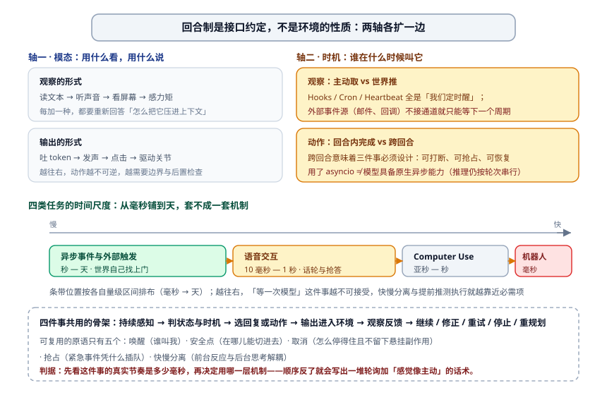
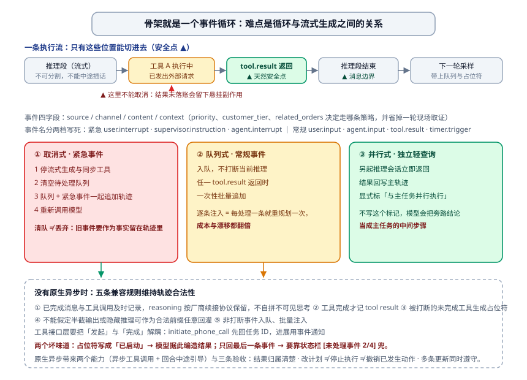
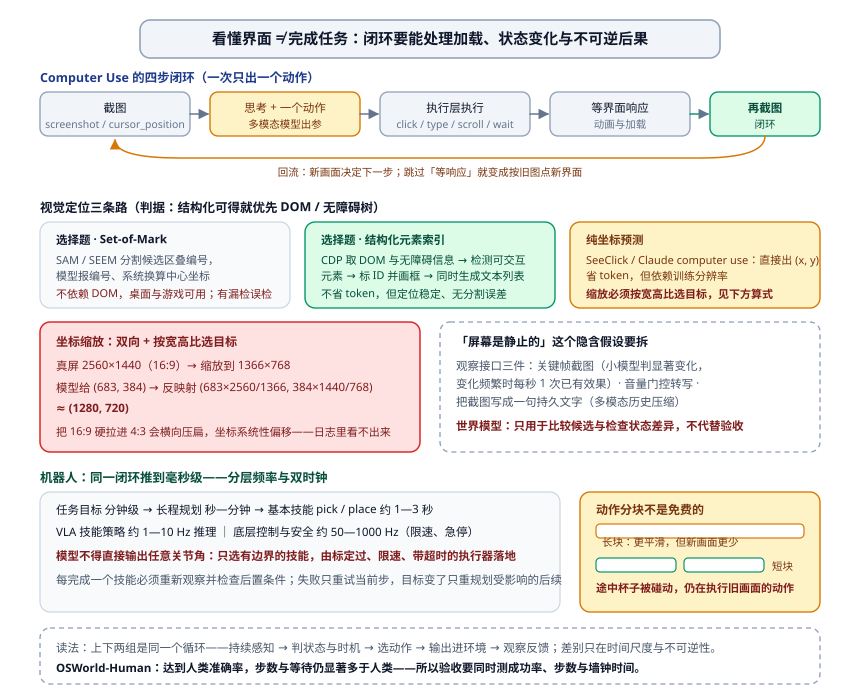

# 触发时机与交互：把观察和动作扩展到真实世界的时间尺度上

前面八篇都默认一件事：**你和 Agent 轮流说话**。它想一轮、做一轮、看一眼结果，再想下一轮。这个默认在 demo 里毫无问题，在真实系统里会立刻撞墙：

- 用户中途改口："预算改成 6000，别太重"。你的 Agent 正卡在第三次工具调用上——它听得见吗？
- 一封客户邮件在任务执行到一半时到达，要求立刻停止昨天的批量操作。你的事件在哪一"拍"被消费？
- 语音助手在用户报手机号报到一半时抢答了，因为 VAD 判定"说完了"。
- Agent 在屏幕上点了 12 步，第 13 步弹了个窗，界面全变了，它还在按旧截图算坐标。

这些都不是"模型不够聪明"，是**时间不对**。这一篇讲的就是时间的工程化：**触发时机（什么时候被叫起来）与模态（用什么看、用什么说）**，两轴各扩一边，观察空间和动作空间就同时被撑开。



---

## 一、先定位：回合制是接口约定，不是环境的性质

一句话立论：**"轮流行动"是模型与接口之间的约定，环境本身从不等待。** 这个区分之所以重要，是因为它决定了你把异步写在哪一层——写在大模型外面的 Harness 里，还是指望模型自己有原生异步能力。

两轴先钉死：

- **模态轴**：观察的形式（读文本 / 听声音 / 看屏幕 / 感力矩）与输出的形式（吐 token / 发声 / 点击 / 驱动关节）。
- **时机轴**：观察是**主动取**还是**世界推过来**；动作是**回合内完成**，还是**跨回合、可打断、可抢占**。

时机轴最容易被忽略，因为它不改变模型能力，只改变接口形状。而它恰好是"会不会被叫起来"的分界线。四类任务的时间尺度**从毫秒一直铺到天**，混不成一套机制：

| 场景 | 时间尺度 | 谁在催 | 失效的样子 |
| --- | --- | --- | --- |
| 异步事件与外部触发 | 秒 — 天 | 世界自己找上门 | 只能等下一个周期，"主动服务"变成轮询 |
| 语音交互 | 10 毫秒 — 1 秒 | 对话节奏与抢话 | 静音窗设长了钝，设短了切句子 |
| Computer Use | 亚秒 — 秒 | 界面动画与加载 | 按旧截图点新界面 |
| 机器人操作 | 毫秒 | 物理世界的连续性 | 计划还没生成，物体已经被碰走 |

**判据：先看这件事的真实节奏是多少毫秒，再决定用哪一层机制。** 把"秒—天"级的机制套到毫秒级任务上，得到的不是慢，是错。

顺带把[动作空间](./08-动作空间.md)那条"事件触发工具"接上：那篇讲的是**这类工具长什么样**（`set_timer` / `monitor_shell` / `connect_channel`，触发条件 + 过滤规则 + 载荷自带上下文）；这一篇讲**事件进来之后的处置规则**——在哪一点被消费、能不能打断正在跑的推理、被打断的工具怎么在轨迹里收口。

---

## 二、事件骨架：安全点、消费时机与结构化事件

### 2.1 骨架就是一个事件循环

别被"异步 Agent"吓到，它的本体就是一个 event loop——和 Go 里那句 `for { select { ... } }` 是同一个东西：等事件、取出、分派、回到等待。难的不是循环本身，是**循环与模型生成之间的关系**。

模型一次生成是一段流式的、不可分割的推理。事件可以在任何时刻到达，但你不能在任意字节处切进去。**能切的地方叫安全点**：一段推理结束、一次工具返回、一个消息边界。在同步接口下，**事件只能在安全点被消费**——这一句写进设计文档，能省掉后面一半的争论。

### 2.2 事件必须结构化，四字段是底线

自由文本的"有变化了"没法路由。最小字段集：

```json
{
  "source":  "email | im | webhook | timer | agent",
  "channel": "具体来源，如 sales-inbox@corp",
  "content": "事件本体（可读文本 + 必要附件）",
  "context": { "priority": "high", "customer_tier": "vip", "related_orders": ["#4821"] }
}
```

`context.priority` 决定它走哪条消费策略；`related_orders` 这类**载荷自带上下文**决定它要不要再花一轮去查。上一节那条纪律在这儿复现：载荷里预置证据，比让模型现场取要便宜得多。

事件名建议分两档写死在常量里：**紧急**——`user.interrupt`、`supervisor.instruction`、`agent.interrupt`、紧急外部触发器；**常规**——`user.input`、`agent.input`、`tool.result`、`timer.trigger`。谁来判紧急？可以用规则（来源 + 关键词 + 优先级字段），也可以用一次轻量 LLM 分类做**事件路由器**——注意是路由器不是决策者，判错顶多早打断一次。

### 2.3 主动服务为什么容易做成轮询

两种实现路线的差别在这里：**内置渠道是推送**（Gateway 直接收到），而外部事件源（新邮件、第三方 API 回调）**只能等下一个周期**——你的定时器每 N 分钟醒一次去看。这就是很多"主动型 Agent"名不副实的根因：它的唤醒机制是 Hooks（生命周期）+ Cron（`0 9 * * 5`）+ Heartbeat（每 N 分钟），三者全都是"我们定时醒"，没有一个是"世界叫我"。

要真正做到推，就得有实时通道（IM 回调、webhook、电话接通事件），代价是要处理验证（OTP、三方通话几秒内接听）与安全（通道身份绑定）。**先把"这件事能不能被推"问清楚再设计 Agent 的作息表**，顺序反了就会写出一堆轮询加"感觉像主动"的话术。

---

## 三、三种消费策略：紧急度不同，处理方式完全不同

这是本篇第一件可复用的工程产物。同一批事件，三种处置，选错就出问题。

### 3.1 取消式：紧急事件要把当前推理掀掉

适用于：用户改目标、上级指令、安全停止。动作序列固定四步：

1. 停 LLM 流式生成与同步工具执行（拿到取消令牌，别硬等返回）；
2. **清空待处理队列**——旧事件描述的是旧目标，留着会污染新推理；
3. 把"清出去的队列 + 这条紧急事件"一起追加进轨迹；
4. 重新调用模型。

第 2、3 步是关键：**清队不是丢弃，是把它们作为事实留在轨迹里**，让模型知道"这些事被打断了"，而不是凭空消失。

### 3.2 队列式：常规事件不打断，批量注入

适用于：新消息到达、定时提醒、工具进展。入队不打断；等**任一 `tool.result` 返回时**（一个天然安全点）把队列**一次性批量追加**。为什么是批量而不是逐条？逐条注入会让模型每处理一条就重新规划一次，成本与漂移都翻倍。

### 3.3 并行式：独立轻量查询另起会话

适用于：与主任务不冲突的旁路查询（"顺手查一下这个客户等级"）。另起一个推理会话立即返回，结果回写主轨迹并**显式标记"与主任务并行执行"**——这个标记不写，模型会把旁路结论当成主任务的中间步骤，归因当场错。



### 3.4 两条硬约束

- **取消点必须是工具或推理能安全收尾的地方**。不能在一个已经发出外部请求、但结果还没落账的位置取消——那会留下悬挂副作用（动作空间篇那条"调用报错 ≠ 外部操作失败"在这里同样成立）。
- **未完成的 tool result 用显式占位符，绝不伪造成功**。

---

### 3.5 走一遍：一次改口、一封邮件、一次超时

规则背下来不算会，摊成一条轨迹才算。下面是示意（字段与顺序按 2.2 的四件套），场景是"帮客户改地址并重新发货"跑到一半：

```text
[1] assistant  tool_calls=[lookup_order(id=4821)]        ← 推理段结束，安全点
[2] tool       {"address":"旧地址…","status":"shipped"}   ← tool.result 返回，安全点
--- 此刻同时到达三条事件 ---
   E1 user.input        "等等，地址改成公司那个"           → 常规，入队
   E2 tool.result       来自 [1]，已在 [2] 落账            → 不属于新事件
   E3 user.interrupt    "先别发货！客户刚打电话说取消"     → 紧急
--- 处置 ---
[3] tool       {"placeholder":true,"note":"发起中的 cancel_shipment 尚未取得结果"}
[4] system/user 批量注入：E1 + E3 两条原文（E1 不单独占一轮）
[5] assistant  重新规划：先取消，取消成功后才改地址
```

四个细节，每个都对应一种故障：

- **E1 和 E3 一起注入，不是一人一轮**。分开注入的代价前面说过：模型每处理一条就重规划一次。
- **[3] 的占位符必须写明"尚未取得结果"**。写成"已发起"，模型下一步就会开始念取消成功的回执——编造就是这么来的。
- **[2] 已经落账，不要重发**。有些实现为了"让模型看清上下文"把 [2] 复制一份，结果同一条工具结果出现两次，模型会认为查了两遍并且两次一致，从此不再复查。
- **顺序上，取消的优先级来自事件本身，不来自注入位置**。如果你靠"把紧急事件放在消息末尾最后一条"来表达优先级，那么下一轮批量注入顺序一变，优先级就变了——**优先级要写在 `context.priority` 字段里，由策略消费**。

并行式的样子也顺便看一眼：主任务在改地址，旁路去查"公司那个地址是不是历史常用地址"。旁路回写时要长这样：

```json
{"role":"tool","content":"该地址为历史第 2 常用","meta":{"lane":"parallel","task_ref":"main#4821"}}
```

`lane: "parallel"` 这个字段不写，模型会把旁路结论当作"我主线上查到的一步"，将来出错你归因到检索层，其实是策略层——**旁路身份是归因的前提**。

## 四、兼容方案：没有原生异步时，怎么让轨迹仍然合法

绝大多数模型 API 是同步的、按轮次的。你照样要做打断，那就得**手工维护轨迹合法性**。五条规则，一条都省：

1. **及时记录已完成的 assistant 消息与工具调用项**；reasoning 的状态按厂商的续接协议保留，**不要自己拼接不可见思考**。
2. **工具完成才记 tool result**——半截不记。
3. **执行中被打断**：为未完成工具生成占位符（"工具正在后台执行，请优先处理新事件"）+ 追加打断事件 + 重新调用，使轨迹格式合法。
4. **无原生 steering 时**，取消未完成生成、只保留已确认消息；**不能假定半截输出或隐藏推理可以作为合法前缀任意回灌**。
5. **非打断事件入队、批量注入**。

两个已知的坏味道要提前防：

- **占位符风险**：模型看到"已启动"就以为"已完成"，然后开始编造结果。占位符文案必须明写"结果尚未取得"，并且让模型知道下一步该等还是该做别的。
- **注意力分散**：只把最后一条事件回给模型，前面的它就不知道存在。做法是状态栏标记 `[未处理事件 2/4]`，并在消息末尾汇总计数——**让"还有几件事没处理"成为模型可推理的前提**。

发起与完成的解耦要落到工具接口层：`initiate_phone_call` 立即返回任务 ID 与初始状态，进展通过 `phone_call_connected` / `phone_call_ended` 事件通知。工具自己异步，事件循环才有东西可分派。

**原生异步**（新一代模型 API 已经提供）把这件事变成两个能力：**异步工具调用**（发起与取结果分离，先去做不依赖结果的工作）与**回合中途引导**（同一任务内改约束）。三条可靠性检查随之而来，也正是验收点：结果归属与未完成状态是否清楚；**"修改计划"不等于"停止执行"，更不等于"撤销已发生的动作"**；多条更新能否同时遵守（预算改了、人数也改了，两个都要用）。

---

### 4.1 非法轨迹长什么样：三种会被当场拒掉的形态

兼容规则不是洁癖，每一条都对应一次真实失败。示意三种：

```text
① 有 tool_calls，没有配对的 tool 结果
   assistant {tool_calls:[{id:"call_9", name:"cancel_shipment", ...}]}
   <<< 直接发起下一轮 >>>            ← 服务端拒：请求格式非法；
                                       放行的厂商则会"自己脑补"结果

② 把上一段被截断的思考原样回灌
   新 system / 新工具集 + 旧 reasoning item
   ← 思考签名绑的是产生它时的前缀（见上下文篇 4.6），前缀变了就失效，
     轻则静默丢弃，重则报 400

③ 取消时清掉的队列没有落轨迹
   模型看到的世界：什么都没发生
   实际世界：cancel 已经发出
   ← 下一轮它会重新发起同一个取消，或者反过来以为已经取消过
```

第 ① 条最常见的来源就是打断：工具已经发起、结果还没回来，用户改口了。这时候**不能把那条 assistant 删掉**（删了就等于没发起过，而外部副作用已经发生），也不能就这么发出去（缺配对结果，格式非法）。正确动作是补一条占位结果，把"发起过、结果未取得"这件事写进轨迹——这正是第三节那张 `[3]`。

第 ③ 条的教训可以概括成一句：**取消改变的是执行，不改变事实记录**。凡是"清队列""停生成""撤销工具"，都要在轨迹里留下可读的痕迹，否则模型的世界和你的世界就分叉了。

### 4.2 状态栏是打断的"记事本"

只把最新一条事件回给模型，前几条它压根不知道存在。低成本的做法是状态栏常驻计数：`[未处理事件 2/4]`，并在消息末尾把队列摘要合并一次。**让"还有几件事没处理"变成模型可推理的前提**，而不是靠它在多轮之间自己记住——这和护栏、截断自述是同一条设计哲学：**看不见的状态等于没有状态。**

## 五、语音：最自然也最苛刻的接口

语音的时间尺度是 10 毫秒到 1 秒，比事件驱动严苛得多——那里等得起一个周期，这里等一次模型就错过了半句话。正常说话约为打字速度的 4 倍，且不占双手与视线，这是它值得做的原因，代价全在延迟与话轮上。

### 5.1 三种范式，先分清再谈优化

| 范式 | 链路 | 强项 | 主要问题 |
| --- | --- | --- | --- |
| 级联 | VAD → ASR → LLM → TTS | 模块清晰、可逐段调试、可分段替换模型 | 延迟串行累积；副语言信息（语气、犹豫、笑）在离散接口处丢失 |
| Omni（原生音频进出） | 单模型吃音频、吐音频 | 保留韵律与情感 | 多数仍按轮次走、靠 VAD 判话轮：**报数字时中途停顿，容易被判成"说完了"** |
| 全双工 | 持续听与说（Moshi 双流并行建模；交互模型按微轮次短音频块推进，可把整段对话委派给后台推理模型） | 重叠、打断成为模型行为而非工程补丁 | 训练与部署都新，可观测性差 |

级联的瓶颈是四条，逐条对：VAD 静音阈值（等待时长与误切分是一根跷跷板）、ASR 的识别延迟与上下文丢失、LLM 首 token 延迟（开了 reasoning 更长）、TTS 首包合成与播放缓冲。对照基线常用 600ms VAD + Whisper，**先把这条基线的瀑布图画出来，再谈你的优化省了哪一段**。

### 5.2 流式感知的四条实现路径

"听起来实时"不是把链路换掉，是把每段都改成增量：

1. **ASR 按固定间隔流式输出临时转录**——注意 Whisper 编码器需要完整音频段，"能流式调用"不等于"真流式"；
2. **LLM 推测执行**：如果最终文本与临时转录相同就不重发，不同则取消前序推测重跑；
3. **LLM 分段输出**：第一段可播报文本立刻交给 TTS；
4. **TTS 增量合成**：边合成边播。

一句话判据：**瀑布图上任何一段还在等整段完成，就不是流式。**

### 5.3 话轮、声学事件与快慢分离

端点判断（谁在什么时候说完）是语音交互的核心难题。有一条容易犯的错必须点出来：**把端点判断做进流式识别器时，标签只能用决策时刻可见的信息**——用事后完整音频标注"此处该判停"，就是上帝视角，线上必然复现不了。

输出侧也别只会吐文本。可以把声学事件与文字同流输出：`speak_start / speak_end / interrupt / emotion / laugh / sigh / noise`。更进一步，让主 LLM 额外输出 `THINKING`、`EMO:happy`、`SPEED:0.8x`，由 TTS 映射成停顿、韵律、语速、笑声与叹气——"更像人"这件事，一半是模型输出的信息量问题。

认知侧目前三条路，各有代价：

1. **快答 + 慢答后台**：几百毫秒先给一句即时回应，复杂问题后台继续想。难点不是快慢并存，而是**两个实例各自独立思考**，简单问题被重复处理、前后结论可能冲突。
2. **后台向前台提建议**（经状态栏传递）：更稳，但通信间接，前台看不到中间思考。
3. **端到端统一**：把快慢塞进一个模型（Step-Audio R1 的做法是 MGRD 模态锚定思考蒸馏——筛掉那些没真正引用音高、节奏、语调的思考再训，并用 RL 防止跳过思考直接猜；MPS 双脑——构思脑持续出片段、表达脑即刻出语音，流水线并行）。

这里有个反直觉结论值得带走：**解耦不天然落后**。截至 2026-08，采用快慢分离的方案在 τ³-Voice 榜上居首。工程红利也很实在：**前沿思考模型可以直接替换后台，而不必重训整条实时链路**。另外"端到端"这个词必须分两轴问：**语音通路端到端**（音频进出）与**认知架构端到端**（不分快慢脑），两者互相独立，混起来谈就会出现"我们也是端到端"的无效对比。

---

### 5.4 走一遍：一句被切成两半的手机号

场景很日常，用户报手机号："138……（想了 800 毫秒）……1234……（又停 400 毫秒）……5678"。

设 VAD 静音阈值 500ms，会发生的事：第一个停顿被判定为"说完了"，ASR 交出 `"138"`，LLM 拿到一段明显不完整的号码开始回复（"请提供完整的手机号"），而用户还在报中间四位。等 `"1234 5678"` 作为**第二条**输入进来时，模型面对的是两条独立 utterance——它要么以为用户改主意了，要么把两段当成两个号码，**最终写进系统的是错的号码**。

三种修法，代价各不相同：

1. **把阈值调长**（比如 1200ms）。最省事，但每一句话的响应都要多等那 700ms，整场对话变钝——这是"把 VAD 当万能旋钮"的代价。
2. **语义完整性判停**：位数不满 11 位就不判停，把判停条件从"静音时长"升级成"静音时长 × 语义槽位是否填满"。这与意图识别篇的 slot filling 是同一件能力，只是发生在语音层。**注意：判停模型的训练标签只能用决策时刻可见的信息**，拿事后完整音频去标"此处该停"，线上必然复现不出来。
3. **换范式**：Omni 或全双工。Omni 仍然多数靠 VAD 划发言权，报数字中途停顿同样危险；全双工把重叠与打断变成模型行为，但代价是训练、部署与可观测性都全新。

顺带一句工程红利：**快慢分离**（前台几百毫秒先应一句"好的，我在改"，后台慢慢查订单）让**前沿思考模型可以直接替换后台，而不用重训整条实时链路**。这条对预算的意义比榜单分数的意义大。

## 六、Computer Use：把屏幕当成观察通道

### 6.1 先分清两件事：看懂界面 ≠ 完成任务

一次截图问答能测"看懂"，测不出"完成"。**完成是一个闭环**：截图 → 多模态模型出思考与一个动作 → 执行层执行 → 等界面响应 → 再截图。设计维度就三个：**动作空间、视觉定位、模型架构**，评审时也照这三项问。

动作空间的三类工具：

- **computer**：`mouse_move`、左右中键点击、双击三击、`left_click_drag`、`left_mouse_down/up`、`scroll`（四向可配修饰键）、`type`（每字符间隔约 12ms）、`key` 组合键、`hold_key`；感知类是 `screenshot` / `cursor_position` / `wait`。
- **bash**：持久会话、120 秒超时、用哨兵字符串判断命令结束、`cd` 等状态跨调用保持。
- **str_replace_editor**：字符串匹配编辑，支持查看 / 创建 / 替换 / 插入 / 撤销。

### 6.2 视觉定位：两条路，一条按宽高比缩放

"让模型知道点哪儿"有两族做法：

**选择题式**（给候选区编号，模型报编号，系统换算坐标）：

- 原始 Set-of-Mark（微软研究院 2023）：用 SAM / SEEM 分割出候选区域叠编号。**不依赖 DOM**，因此原生桌面与游戏界面也适用；代价是分割的漏检与误检。
- 结构化元素索引（browser-use 的四步）：CDP 取 DOM 与无障碍信息 → 自动检测可交互元素 → 标唯一 ID 并在截图上画边界框 → 同时生成一份文本元素列表。**不省 token，但定位稳定、没有分割误差。**

**纯坐标预测**（SeeClick、Claude computer use）：模型直接输出 (x, y)。省 token，代价是依赖训练分辨率。

分辨率这件事是个硬坑，规则是：**双向缩放，且按宽高比选目标**。模型在 XGA 1024×768、WXGA 1280×800、FWXGA 1366×768 这类尺寸上训练，实际屏幕是 2560×1440（16:9）时要映射到 1366×768，模型给 (683, 384)，反映射回 (683×2560/1366, 384×1440/768) ≈ (1280, 720)。**把 16:9 硬拉进 4:3 会横向压扁，坐标系统性偏移**——这类 bug 极难从日志看出来，因为每一步看起来都"点了某个地方"。

选型逻辑一句话：**结构化信息可得就优先 DOM / 无障碍树；不可得再用视觉标注或坐标预测。**

### 6.3 屏幕是静止的？这个隐含假设要拆

默认实现假设"截图之后画面不动"，而真实屏幕会闪弹窗、会加载、会有倒计时。**观察接口（AOI）** 要主动处理这点，三件武器：

1. **关键帧截图**：用小模型判"画面有没有显著变化"，只在有变化时喂新帧；变化频繁的页面每秒 1 次就已经有不错效果。
2. **音量门控语音转写**：屏幕上有声音内容（视频、会议）时，把音频转写并入观察。
3. **把截图写成一句持久文字**：原图清出上下文后，那句描述还在——等于给多模态历史做了一次压缩。

**世界模型**（`桌面状态 + click/type/scroll/wait → 下一状态表示`）有三个务实用法：点击前比较候选、页面加载期提前准备下一步（推测执行）、弹窗闪过时按状态差异恢复。两条反面判据要记住：**目标不是生成逼真的未来截图，而是可检查的状态差异**；**预测只能帮助选择，不能代替验收**。OSWorld-Human 的结论也值得提前降低预期——即使达到人类准确率，Agent 的步数与等待时间仍显著多于人类。

移动端读元素下发手势（AccessibilityService）、同一 (x,y) 需要手势类型界定，这些不是真障碍；**真障碍是生态壁垒**：Agent 直奔目标会绕过广告与冲动消费，侵蚀的是流量变现的根基。

---

### 6.4 走一遍：第 13 步弹出 Cookie 横幅

任务："把默认收货地址改成公司地址并保存。"前 12 步顺利——找到设置页、点开地址列表、选中公司那条。第 13 步，模型要点"设为默认"按钮，坐标是按第 12 步那张截图算出来的。

**天真实现**：直接执行点击。此刻屏幕上刚弹出一个 Cookie 横幅，正好压住那个按钮——模型点到的是"接受全部"。界面接受了 Cookie，"设为默认"没发生，但第 14 步的截图看起来和预期差不多（页面并没有大改），模型于是报告"已保存"。这是一条**没有报错的失败轨迹**：外部副作用为 0，回复却是成功。

**加了观察接口之后**发生的事：

1. 关键帧检测发现画面有显著变化（横幅出现），于是**重新截图**而不是复用旧画面；
2. 模型在新截图里看到横幅，选择先关闭它——这一步是它自己决定的，不是你硬编码"先点关闭"；
3. 那句持久文字描述同步更新（"页面出现 Cookie 横幅，底部按钮被遮挡"）——**否则原图清出上下文后，模型后续轮次引用的还是旧描述**；
4. 如果要更稳，用世界模型在点击前比较两个候选的状态差异：点"关闭"→ 按钮可点；点"接受"→ 横幅消失但按钮仍未操作。**判据是可检查的状态差异，不是画面像不像。**
5. 最后，"已保存"必须由**后端状态**确认（重新读一次地址列表的默认标记），不能由界面观感确认。

这条例子的价值在于：它把"看懂界面"和"完成任务"的差距摊开了——第 12 步到第 13 步之间，模型不缺理解力，缺的是**一次重新观察的机会**。

## 七、物理世界：分层频率与动作分块

机器人这一节在本篇的作用不是教你控制机械臂，而是给出**时间尺度推到极限时的架构形状**。

先记住那个诊断实验：保持摄像头、机械臂、夹爪、桌面、成功条件全部不变，只把闭环交给人（键盘、Xbox、Joy-Con、VR 遥操作）——几百美元的机械臂就能完成多步任务整理桌面。**硬件不是瓶颈，算法才是。**

架构形状是一张频率阶梯：

| 层 | 时间尺度 | 决策内容 |
| --- | --- | --- |
| 任务目标 | 分钟级 | 整理桌面 |
| 长程规划 | 秒 — 分钟 | 先收杯子还是先收纸 |
| 基本技能 | 约 1—3 秒 | `pick(red_cup)` / `place(red_cup, tray)` |
| VLA / 技能策略 | 约 1—10 Hz 推理 | 当前观察 + 技能指令 → 动作 |
| 底层控制与安全 | 约 50—1000 Hz | 限速、急停、伺服 |

两条纪律：**模型不得直接输出任意关节角**，只能在有边界的技能里选（`observe_scene` / `pick` / `place` / `verify_state` / `stop`），由经过标定、限速、带超时的执行器落地；**每完成一个技能必须重新观察并检查后置条件**，失败只重试当前步，物体被挪动或用户改目标时只重规划受影响的后续步骤。

**动作分块**（一次生成一小段、控制线程高频执行、后台准备下一段）把推理等待藏进执行时间里，但它不是免费的：段越长越平滑、新画面越少——抓杯子途中杯子被碰动，机械臂仍在执行基于旧画面的动作。**这是平滑性与反应速度的取舍，不是加速。** VLA 的四项局限同源于此：演示数据有限、行为克隆只学"下一步怎么做"不学"造成什么结果"、机型不通换（自由度、坐标系、夹爪、执行器延迟）、观察可能过时。

动作本身怎么表示，还有第二条分岔，工程上很实际：**离散动作 token**（RT-2 / OpenVLA 把连续动作切成 token，逐个吐出来，好处是能直接和语言模型共用一套训练与推理栈）对**连续轨迹生成**（π₀ 一类直接出轨迹，动作更平滑，但要另搭解码与执行侧）。选哪条取决于你要不要复用语言模型的基建，而不是"哪个更先进"。

另一条值得知道的对照：长时序任务里的信用分配问题（一整段操作只在最后成功/失败，中间哪一步是关键），有工作在用**逐步反馈**缓解（V-IRL），并且它在跨城市分布外测试上仍然成立——这条思路与多轮 Agent 的 turn-level 优势归因是同一个问题，只是时间尺度换成了毫秒。

三种闭环对照着看：**开环**（一次生成完整序列、中途不重观察，局部失败会带到任务末尾）、**逐步检查**（每次 pick/place 后重读状态、失败重试当前技能）、**预测式**（加短期世界模型，先比较候选）。仿真到真机用四种同构视觉策略（固定画面 / 变背景 / 变外观 / 同时变背景+外观+光照+噪声）量动作判断的准确率；即便有改善，真机仍需要相机标定、执行器测试与安全闭环。



---

## 八、四件事共用的骨架与五个原语

把事件、语音、屏幕、机械臂放回同一张图，会发现它们是**同一个循环的四种时间尺度**：

> 持续感知 → 判断当前状态与时机 → 选择回复或动作 → 输出进入环境 → 观察反馈 → 继续 / 修正 / 重试 / 停止 / 重规划。

对应地，可复用的原语只有五个：**唤醒**（谁叫我）、**安全点**（在哪儿能切进去）、**取消**（怎么停得住且不留下悬挂副作用）、**抢占**（紧急事件凭什么插队）、**快慢分离**（前台反应与后台思考解耦）。

这五个原语在四种模态下的具体化，构成本篇全部工程内容。评审时可以直接按它们提问："你的安全点定义在哪一步？""抢占之后旧队列怎么处理？""快答和慢答冲突了信谁？"——三个问题答不上来，就说明异步只是把 `async` 关键字用了，模型并没有真的具备异步能力。

**"用了 asyncio 不等于模型具备原生异步能力"**，这条线要划清：一半的"异步 Agent"项目，异步只在 IO 层，推理仍然按轮次串行。

---

## 九、踩坑清单

| 现场 | 根因 | 处置 |
| --- | --- | --- |
| "主动型 Agent"实际上每 5 分钟醒一次 | 外部事件源只能轮询，却被写成了推送 | 先确认这件事能不能被推；不能就老实说清延迟下限 |
| 用户改口后 Agent 仍按旧目标继续 | 事件在任意字节处被塞进生成流 | 定义安全点：推理段结束、工具返回处才消费 |
| 打断后模型编造了那个工具的结果 | 占位符写成"已启动" | 占位符明写"结果尚未取得"，并给出下一步该等还是该做 |
| 旁路查询的结论被当成主任务的中间步骤 | 并行回写没标记来源 | 显式标"与主任务并行执行" |
| 清空事件队列后现场丢失 | 把清队实现成丢弃 | 清出的队列与紧急事件一起追加进轨迹 |
| 语音助手在报数字中途抢答 | VAD 静音阈值过短 / Omni 按轮次判话轮 | 用瀑布图定位是 VAD 还是首包；端点标签只用决策时刻可见信息 |
| 自称流式，实测首响仍 8–11 秒 | ASR 需要完整音频段，"能流式调用"≠"真流式" | 逐段实测，报告每段等待 |
| 快答与慢答结论互相矛盾 | 两个实例各自独立思考 | 慢答向前台提建议，而不是并行输出两个答案 |
| GUI Agent 在特定页面上系统性点偏 | 16:9 屏幕硬缩放进 4:3 训练尺寸 | 按宽高比选目标分辨率，双向线性缩放并校验 |
| 弹窗一闪，后续步骤全按旧截图执行 | 隐含假设"屏幕静止" | 关键帧触发 + 世界模型按状态差异恢复 |
| 界面任务成功率达标，仍被业务方判不可用 | 步数与等待远超人类（OSWorld-Human） | 把步数与墙钟时间列入验收，不只测成功率 |
| 抓取途中物体被碰动，机械臂继续执行旧动作 | 动作分块越长，新画面越少 | 缩短块长 / 提高重观察频率，明确这是平滑性与反应速度的取舍 |
| 世界模型预测"未来截图"很漂亮但没用 | 把视觉逼真当目标 | 只用于比较候选与检查状态差异，验收仍看真实观察 |
| 语音/屏幕方案对比无效 | "端到端"两轴混谈 | 分别声明语音通路是否端到端、认知架构是否端到端 |

---

## 十、扩展阅读：书里这些实验的实测与翻车

《深入理解 AI Agent》第六章带了 14 个实验，这一节只挑**能证伪某种浪漫说法**的那几条。✅ 表示本仓库自带、配 API Key 可跑；📖 需自行 clone 外部仓库；🚧 代码齐但真机需要设备与授权。

**"流式低延迟"没有测出来（实验 6-5 递增前缀 vs 600ms VAD + Whisper，✅）**：正文预期的行为只在 **6 条里复现了 2 条**，实测递增前缀耗时 **8.4–11.3 秒**。作者据此明确写了"不能称真流式低延迟"。这一条给所有语音方案泼的冷水很准：**换一种调用姿势不等于消除了串行等待**。

**端到端不是万能（实验 6-6 单卡跑 MiniCPM-o 4.5，✅）**：端到端与自级联都拿到 3/4，但**失败模式互补**。结论不是"端到端更好"，而是"两类错误不一样，选哪种取决于你能容忍哪一种"。

**可控 TTS 的一半预期没复现（实验 6-7，24 条参考音库 + Voxtral 盲评，✅）**：C 组最高（客服感 4.67/5），但正文预期的 **B > A 没复现**。加上第七章那条"参考音频取自被测一家、音色维度天然偏向它"，这组数据的使用方式必须是：先声明参考集来源，再谈排名。

**Computer Use 的两条真实轨迹（6-8 原生动作、6-9 开源模型驱动 browser-use，✅）**：前者 16 次响应、15 个原生动作，遇到 reCAPTCHA 时**改读 Open-Meteo 的 JSON 接口**答出 70.2°F——这既是"绕过障碍"的智能，也是"没有按用户设想操作界面"的偏离，评估时要按哪一类记账，取决于你的验收口径。后者 Qwen3-VL 32B 驱动 browser-use，16 步完成任务。

**异步与打断的对照（6-2 asyncio 框架 Flux、6-3 同步 / 原生异步 / 中途引导三方式，✅）**：6-3 把三条路径放在一起跑，检验点正是本篇第四节那三条——结果归属、"改计划 ≠ 停止执行"、多条更新同时遵守。

**语音与真机链路的验收边界（6-4 单轮真实链路 ✅，但无顶层 hash manifest、不代表并发基准；6-10/6-11 遥操作 ✅/📖；6-12/6-13 Gemini Robotics-ER 自主驱动真机与三种闭环对照 ✅/📖；6-14 RGB sim-to-real ✅）**：这些实验的共同点是**证据强度取决于门禁写得多严**——没有并发基准、没有设备授权记录、没有失败样本留档的"跑通了"，不能当成可迁移的结论。

还有一条口径提醒，比单个数字更值钱：**第六章的 6-10 到 6-13 需要真实机械臂与环境**，如果你只是想验证"分层与重观察"的机制，正文用的模拟器对照（📖 类）已经足够；反过来，只在模拟器里跑出来的成功率，不能直接写成"真机可部署"。

---

## 总结

这一篇讲的是一个此前没被覆盖的维度：**时机**。判据从"能不能做"变成"什么时候被叫起来、在哪儿能切进去"。

**事件驱动**这一侧：骨架是 event loop，核心概念是**安全点**；事件要结构化（source / channel / content / context），紧急度决定三种消费策略——取消式（停生成、清队列、队列与紧急事件一起入轨迹、重调用）、队列式（在 `tool.result` 处批量注入）、并行式（另起会话并标记旁路身份）。没有原生异步时靠五条兼容规则维持轨迹合法性，两个坏味道是"把已启动当成已完成"和"只回最后一条事件"。

**模态扩展**这一侧：语音是三范式（级联 / Omni / 全双工）加四条流式路径，关键约束是"端点判断只能用决策时刻可见的信息"，以及**端到端要分语音通路与认知架构两轴谈**；Computer Use 是四步闭环加视觉定位两条路，坑在**按宽高比缩放坐标**与"屏幕会动"；机器人给的是频率阶梯形状（1—10 Hz 推理对 50—1000 Hz 控制）和一条纪律——模型只选有边界的技能，每个技能之后必须重观察。

四件事共用五个原语：**唤醒、安全点、取消、抢占、快慢分离**。评审一个"异步 Agent"，就问这五件落在哪儿；问完自然会得到那个最常被回避的答案：**用了 asyncio 不等于模型具备异步能力。**

---

## 思考题

1. "回合制是接口约定，不是环境的性质"——用你自己系统里的一个场景说明：哪件事的真实节奏与你的接口假设不一致？
2. 你的安全点定义在哪一步？请给出至少两个具体位置，并说明为什么不能在其他位置打断。
3. 取消式策略里"清空队列"为什么必须把清出的事件一起追加进轨迹，而不是丢弃？丢弃会导致哪一类后续故障？
4. 未完成的工具调用被打断后，占位符文案该怎么写？写错会出现什么现象？
5. 为什么"并行旁路的结论必须标记与主任务并行执行"？不标记会让归因错在哪一层？
6. 一个语音助手在用户报手机号中途抢答。请按级联的四条瓶颈逐段排查，说出你的测量方法。
7. "把端点判断的标签用事后完整音频标注"为什么在线上必然复现不了？这条纪律推广到你的评估集设计上是什么？
8. 快慢分离会让前后结论冲突，端到端统一就不会吗？两条路各自的可观测性代价是什么？
9. 屏幕 2560×1440、模型训练在 1366×768，请写出坐标 (683, 384) 的反映射过程。如果有人图省事把画面等比压进 4:3，错会朝哪个方向偏？
10. "达到人类准确率但步数远多于人类"——为什么这条会让一个通过验收的 GUI Agent 在业务上被判不可用？验收指标该怎么改？
11. 机器人侧为什么禁止模型直接输出关节角？"每完成一个技能就重新观察"防的是哪两类故障？
12. 动作分块把推理等待藏进执行时间，为什么说它不是免费的？请给出一个真实失败场景。
13. 实验 6-5 只复现了 2/6 的预期行为。如果你团队里有人拿"我们已经流式化了"来汇报，你会要求他补哪三个数据？
