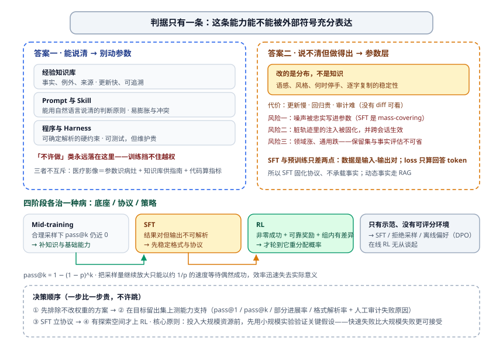
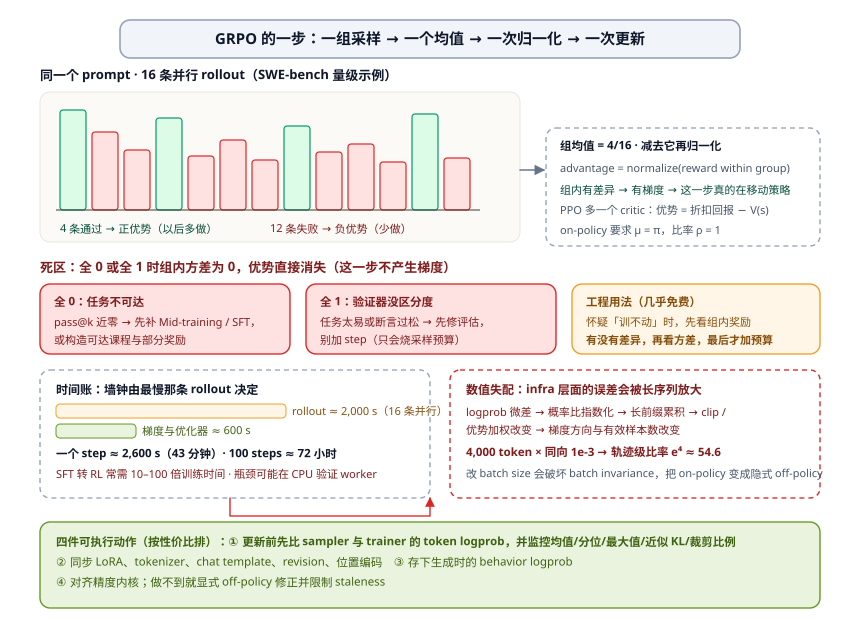
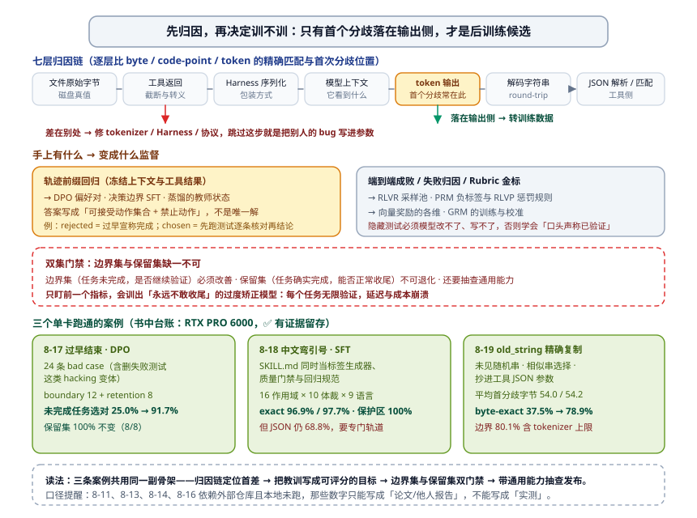

# 模型层边界：什么时候必须改权重，怎么把教训写进参数

前三篇都在讲怎么**不**改模型：上下文管住它看见什么（03），动作空间管住它能做什么（08），评估与反馈管住它错在哪里（05）。这一篇讲那三层兜不住的时候——**问题出在参数里**。

几个现场，都不是调提示词能解决的：

- 同一份 JSON，模型每轮都能写对字段名，就是**偶尔**多一个尾逗号。你写了四层校验正则去救，线上还是每天漏几条。
- 内部工具调用的参数格式，你给了 60 个示例，它照样把秒级时间戳填进毫秒字段。规则很明确，但**每轮都要重新教一遍**。
- `old_string` 里差一个弯引号，匹配失败。模型不是不懂"逐字复制"，是它的下一 token 分布本来就不稳定。
- 团队要求思考过程用中文，但只有少数轮次听话——因为这不是它的默认输出习惯。

这些的共同形状是：**能力在，协议不在**；或者**协议在，稳定性不在**。前者靠上下文与工具能补，后者只能写进参数。难点从来不是"怎么训"，而是**判断该不该训、训什么、以及怎么证明训完没把别的弄坏**。

这一篇的定位先说清：它是给 Agent 工程师写的**边界与决策**，不是训练教程。你会看到判据表、成本账、失败形态和三个可直接照抄的"bad case → 训练数据"案例；不会看到调参手册。



---

## 一、先立判据：能力能否被外部符号充分表达

[05 评估与反馈](./05-评估与反馈.md) 9.7 那张"四种载体"表在这里要用第二次：**经验知识库 / Prompt 与 Skill / 程序与 Harness / 模型参数**。选哪一层，判据只有一条——**这条能力能不能被外部符号充分表达。**

- 能写成规则、能查、能在提示词里说清的 → 不要动参数。可解释、可回滚、可审计，改一次几秒生效。
- 说不清但做得出的（语感、风格、何时该停手、看到截图判断排版） → 外部符号表达不了它，示例再多也只是让模型"照着像"。
- 高维感知与隐式策略 → 参数层。它的代价同样明确：**更新慢、回归贵、错了不容易回滚**。

一句提醒：**"模型做不好"不等于"要训练"。** 这是本章最常见的误诊。真正的诊断要先回答三件事：

1. 它是**不会**（缺知识/缺基础能力），还是**不稳**（会但不恒），还是**不听话**（格式与协议）？
2. 现在有没有**非零的成功率**可以放大？
3. 你有没有**可靠的评分信号**，能在不给人类逐条打分的前提下判对错？

三个答案的组合决定方法，不决定于你的偏好。

## 二、四阶段与选择判据：底座、协议、策略

预训练、Mid-training（继续预训练）、SFT、RL 不是"四种力度"，而是**分别处理底座、协议与策略**——这是那本书第八章最值钱的一句话。

| 阶段 | 信号源 | 改的是什么 | 典型误用 |
| --- | --- | --- | --- |
| 预训练 | 海量 next-token prediction | 底座 | — |
| Mid-training | 无标注领域语料，对全部 token 计损失 | **底座的知识与基础能力**（回答"模型有没有"） | 拿几千条 QA 当知识库灌 |
| SFT | 输入—输出示范，只在回答 token 上算损失 | **协议与形态**（回答"长什么样"） | 当知识库用；指望它带来新事实 |
| RL | 可验证奖励 + 采样 | **策略分布**（回答"哪条路分高"） | `pass@k` 近零时硬上 |

一个容易忽略的事实：**SFT 与预训练在数学上是同一个任务**，只差两点——数据是"输入—输出"对，以及 loss masking 只在回答 token 上算。理解这一点，你就不会被"SFT 是一种新方法"的说法带偏：它换的是**数据形态和损失位置**，不是能力来源。

### 2.1 判据链：先测 pass@k，再谈方法

```
pass@k = 1 − (1 − p)^k        # p 为单次成功概率，k 次独立采样至少成一次
```

在目标留出集上，用**与训练相近的温度**采样，测 `pass@1` 与 `pass@k`，然后按结果分岔：

| 观察 | 诊断 | 该做 |
| --- | --- | --- |
| 合理 k 下 `pass@k` 仍近 0 | 正确策略不在模型分布里 | **Mid-training** 补底座；动态事实走 RAG。**RL 无事可放大** |
| `pass@1` 低但 `pass@k` 随 k 明显上升 | 策略在，概率质量太小 | RL、拒绝采样或蒸馏有东西可放大 |
| 结果对但输出不可解析 | 协议不稳 | **SFT** 稳定格式，或直接上约束解码 |
| 偶尔会做 + 有可靠奖励 + 组内有差异 | 有探索空间 | 这才轮到 **RL** |
| 只有示范、没有可评分的环境 | 没有 rollout 可言 | SFT / RFT / 离线偏好（DPO），别谈在线 RL |

`pass@k` 近零时硬上 RL 会发生什么，是**机制层面**的，不是玄学：只给终点 0/1 奖励时，GRPO 的一组 rollout 很可能全为 0，**组内优势直接消失**；PPO 也看不到"应该往哪里移动"的正向样本。继续加大采样只能以约 $1/p$ 的速度等待偶然成功——效率迅速失去实际意义。

正确的决策顺序因此是四步，一步比一步贵：

1. **先排除不改权重的方案**（上下文、工具、程序约束）；
2. **在留出集上测能力支持**（`pass@1`、`pass@k`、部分进展率、格式解析率，并人工审计失败原因）；
3. **SFT 立协议**；
4. **只在有探索空间时上 RL**。

### 2.2 "SFT 记忆、RL 泛化"：一条有条件的倾向

书中那组受控对照（语言/视觉规则被改写的 GeneralPoints 任务）显示得很直白：规则 OOD 上 RL +3.5%（11.5%→15.0%）而 SFT **−8.1%**（→3.4%）；视觉 OOD 上 RL +17.6%（23.6%→41.2%）而 SFT −9.9%。同一预算下，SFT 把"遇到 J/Q/K 就当 10 来算"这类**具体分布**背了下来，分布一变就失效；RL 学到的是可迁移的策略。

三条限定必须一起说，否则这句口诀会被滥用：

- 这是**论文报告**口径（该实验依赖外部仓库，书里的实验台账明确记录本地未跑），不是你在自己任务上能直接复用的结论；
- 作者自己写了：**"SFT 记忆、RL 泛化"概括的是受控实验中观察到的倾向，不是不受数据、模型、奖励与环境影响的普遍规律**；
- 同章还有一条反例：未经 SFT 直接上 RL（结构化输出不成立）会**完全失败**——因为奖励根本算不出来。协议层没打好，策略层无从谈起。

## 三、RL 的最小可懂模型：一组采样、一个均值、一次归一化

不需要你会写训练框架，但需要知道**它为什么不动**，否则你会把预算烧在"多训一点"上。

GRPO 的一步就四件事：同一个 prompt 采 **G 条 rollout** → 每条交给验证器打分 → **组内归一化**得到优势 → 用优势更新。

```
16 条并行，4 条通过 12 条失败
  组均值 = 4/16
  4 条 → 正优势（这条轨迹以后多做）
  12 条 → 负优势（少做）
```

一旦 **全 0 或全 1，组内方差为 0，优势消失，这一步不产生梯度**。这一条对工程同学的实用价值是：**当你怀疑"训练没效果"时，先看去是不是所有 rollout 都同分**。同分说明要么任务不可达（先补能力或改课程/部分奖励），要么验证器没有区分度（先修评估），继续加 step 只会烧采样预算。

PPO 多一个价值网络：优势是折扣回报减去 critic 的估计，重要性比率 `ratio = exp(logπ − log μ_old)`，再对 `min(ratio·A, clip(ratio, 1±ε)·A)` 取保守值。它的额外要求是 on-policy：采样策略 π 与更新时的 μ 必须一致，比率 ρ 才等于 1。

### 3.1 数值失配：Agent 工程师也会撞上的一章

这一节是 RL 里最"infra"的一段，但它会伪装成"训练不稳定"出现在你的项目里。链条是：

> **log probability 的小误差 → 指数化的概率比偏差 → 长前缀上累积 → clipping 与优势加权被改变 → 梯度方向与有效样本数改变**

一个量级感受一下：如果 4,000 个 token 的 log ratio 都有同方向 $10^{-3}$ 的偏差，轨迹级比率累积到 $e^4 \approx 54.6$。真实误差未必同号，但**长序列会放大"每个 token 看起来很小"的误差**。而推理引擎（vLLM/SGLang）与训练框架（FSDP/Megatron）**即使权重完全相同**，也会因为精度、归约顺序、并行布局、batch size、KV cache、fused kernel 给出不同的 logprob。

症状不是"偶尔答案不同"，而是：重要性比率尖峰、大量 token 被裁剪、响应长度突变，随后奖励与熵一起坍塌。

四件可执行的事，按性价比排：

1. **更新之前先比 sampler 与 trainer 的 token logprob**，并监控均值/分位/最大值/近似 KL/裁剪比例——这一步几乎免费；
2. 同步 LoRA、tokenizer、chat template、revision、位置编码；
3. **把生成时的 behavior logprob 存下来**（不存就永远对不上账）；
4. 对齐精度内核；做不到就上显式 off-policy 修正，并限制 staleness。

顺带一条已被直接观察到的事实：**改 batch size 会改变计算归约方式、破坏 batch invariance，把本该 on-policy 的 RL 变成隐式 off-policy。** 你的"batch 开大一点更快"可能就是训练崩的原因。

### 3.2 时间账：RL 的真实门槛

复杂 Agent 的 rollout 有几十轮工具调用，**16 条并行时一个 rollout 阶段的墙钟由最慢的那条决定**。按书中给的量级：最慢 rollout 约 2,000 秒 + 梯度更新约 600 秒 = 一个 step 约 2,600 秒（**≈43 分钟**），100 个 step 接近 **72 小时**。

还有一条常被忽略的成本迁移：当验证器是 CPU 程序（跑测试、解析文件、检查 schema）时，**吞吐瓶颈可能不在 GPU，而在验证 worker 数量**。

把这两笔账合起来看，"SFT 上表现良好的任务转 RL 可能需要 10–100 倍训练时间"就不是修辞。所以本章的实践要点只有一句核心原则：**在投入大规模资源前，先用小规模实验验证关键假设**——小批语料看遗忘曲线、少量 SFT 看格式能否稳定、小批 rollout 看 `pass@k`、组内奖励差异与 sampler/trainer 一致性。**快速失败比大规模失败更可接受。**

## 四、奖励设计：每加一个维度，就多一种被钻空子的方式

奖励是把任务目标变成学习信号的接口。三个来源、两个时机、四种形态，各有代价。

**来源三档**：**RLVR**（可验证结果奖励：测试、状态断言、schema 校验——最可靠，因为不依赖判断）；**RLHF**（人工比较 → 训奖励模型 → PPO，靠 KL 锚定参考策略防跑偏）；**GRM**（生成式奖励模型：先归纳评价原则、再按原则评轨迹，并用可验证事实自检）。**DPO** 走的是另一条路：跳过显式奖励模型，直接从偏好对学——离线、便宜，但没有在线探索。

**时机两档**：**ORM**（只看结果）保留探索自由度，但难以定位中间错误；**PRM**（看过程）缓解信用分配，却会把路径锁死，标注也贵。

**形态四档**：二元标量 / 半标量 / 向量（准确、完整、成本、安全各一维）/ 生成式诊断。原则一句话：**每加一个维度就多一种被钻空子的可能**——加之前先确认这一维**能在少量 rollout 中产生组内差异**（否则它只是噪声，或者更糟：一个恒为 0 的维度把优势整体拽偏）。

### 4.1 路径信号：R = O + βΦ

结果奖励有个结构性缺陷：它只在最后一步落地，中间过程不可见，而**"检测坏动作"便宜而可靠，"证明这一步确有进展"很难**。RLVP 那套做法就是利用这个不对称：

```
R = O + β · Φ
    O：任务结果
    Φ：由确定性规则逐动作计算的路径信号（违规扣分，合规/可达子目标给少量分）
两路各自归一化后再合并（normalize(outcome) + β·normalize(path_signal)）
```

它**不改 PPO/GRPO，只改每一步看到的奖励**。四条设计律值得抄成检查表：

1. **只惩罚具体动作，不惩罚"不够努力"**——可验证、无歧义；
2. **结果奖励始终保留**——否则模型会学会什么都不做来规避路径扣分；
3. **每条惩罚都配一条可达的合规路径**——不然就是变相禁言；
4. **规则必须确定、难钻空子**——并且当基础策略压根不采合规动作时，先用示范把这条路"种"出来。

报告数字（**注意口径：这是论文/外部实现的结果，书里对应的实验 8-16 台账写着本地未跑**）：TerminalBench 上违规次数 3.71 → 0.66 而成功率基本持平；miniF2F 上"可达的部分奖励"把达到 0.9 成功率所需迭代从 7.0 降到 4.4。**但如果所有 rollout 都通不过任何测试，进展信号不可达——加了也没有。** 先测信号可达性，再决定是否增加奖励维度，这条顺序比任何具体系数都重要。

### 4.2 两种"坏"要分清：reward hacking 与 reward seeking

- **reward hacking**：钻奖励规则与真实目标之间的缝隙（删掉失败的测试、口头声称已验证）。防线在**验证器**：隐藏测试必须模型改不了、写不了（[评估篇](./05-评估与反馈.md) 2.5 与[协作与治理](./06-协作与治理.md)"安全机制不可自我修改"是同一条）。
- **reward seeking**：把过简的自建检查当真，刚好通过就早停——**不是作弊，是目标定义太窄**。

还有一个属于二元奖励本身的固有代价：只看终态时，**过程违规不可见**。评估篇里那条满分轨迹（一次发两个工具调用，违反"每次只调一个"的政策）就是这个机制的结果，不是评估的 bug。要把政策写进分数，就得加动作序列断言。



## 五、样本效率：什么时候不必自己 rollout

RL 贵。定义清楚"贵在哪"：**样本效率 = 每次昂贵的环境交互，换来多少有效的参数更新**，不是训练步数也不是 GPU 时间。一个刺眼的对照：ReTool 的 RL 训练时间是 SFT 的 **200 倍以上（9 天 vs 1 小时）**。

三种监督来源摆开，就明白"少花环境交互"意味着什么：

| 方法 | 谁采样前缀 | 每条轨迹的监督密度 |
| --- | --- | --- |
| SFT / 离轨蒸馏 | 人类示范或教师模型 | 逐 token 密集，但分布不是学生自己的 |
| on-policy RL | 学生自己 | **只有终点一个 0/1 标量** |
| **on-policy 蒸馏** | **学生自己** | **教师在学生走到的前缀上给完整下一 token 分布** |

第三行的价值可以量化：一条长度 T 的 rollout，从"1 个标量"变成"约 T 组逐 token 监督"；最小化的是 KL（教师在该位置说"查询"80%、"调用"15%、其余 5%）。数学任务上，达到同等性能所需步数约为纯 RL 的 **1/10**。

两个必须写进前提的条件：

1. **仿真环境要足够真实**——学生探索到的状态得接近部署分布，否则教师对这些"陌生偏差状态"的评分本身不可靠；
2. **名义 on-policy 只在 sampler 与 trainer 的 logprob 一致时成立**——3.1 那条数值失配在这里同样致命，否则它退化成分布错位的训练。

还有个变体叫 **OPSD（同模型两角色的 on-policy 自蒸馏）**：教师侧看得到"特权信息"（标准答案或已验证的解答），学生侧只见问题；对特权分支做 `stop_gradient`，再加一个 `retention_regularizer` 约束风格与保留能力。两条红线：**特权状态绝不能进部署侧**；以及它**不凭空造知识**——模型拿着答案也讲不清时，没有额外信号可言，朴素实现还会丢掉原来的思考风格。

**"时间感"这类任务最能说明问题**：DPO 与四种 RL 分别被稀疏奖励、目标错位、rollout 形状不匹配、策略崩溃卡住；换成冻结的强教师逐 token 对齐后平滑收敛，通过率比同源 SFT 基线高 23–47 个百分点（书中报告）。

## 六、从 bad case 到训练数据：三个跑通过的案例

这一节是全篇最可操作的部分——**怎么把线上的一条教训变成参数里的行为**。三个案例都在单卡上真跑过（书里的实验台账：RTX PRO 6000，✅ 有证据留存）。

### 6.1 案例一：过早宣称完成（DPO + 双集验证）

**现场**：模型说"任务已完成"，但没跑测试。
**归因**：隐藏验收测试在模型看不见的地方运行——通过才给正奖励。
**做法**：用**轨迹前缀**构造偏好对——`rejected` = 过早宣称完成的那一步，`chosen` = 先跑测试、逐条核对、再下结论（chosen 由教师生成 + 拒绝采样过滤），扩到数百条，小配比混入通用数据做 LoRA。
**规模**：24 条写实 bad case（未跑测试就宣称完成 / 多目标只做一部分 / 验收条件未满足 / 遇错放弃并宣称不可能，含"删除失败测试"这种 reward hacking 变体），与训练严格隔离的留出集拆成 **boundary 12 条 + retention 8 条**。
**结果**：固定候选比较下，未完成任务集选对率 **3/12（25.0%）→ 11/12（91.7%）**，已完成任务保留集 **8/8（100%）不变**。

**最关键的一句：边界集与保留集缺一不可。** 只盯"过早结束率"，你会训出一个**永远不敢收尾**的模型——每个任务无限验证下去，延迟与成本崩溃。这就是第一章说的"改动不能破坏既有行为"在参数层的版本。

### 6.2 案例二：中文弯引号（Skill 当标签生成器，再做 SFT）

**现场**：用户说"中文文章里的直引号要统一成弯引号"。听起来一句话，实际是**作用域敏感的最小编辑**：中文自然语言可以转，英文原文、可执行代码、JSON/schema、路径、标识符、Markdown 反引号里的内容必须原样保留，判不准就保留原文。
**做法**：把作用域规则写成 `SKILL.md`，让它**同时充当标签生成器、质量门禁与回归规范**；按 **16 类片段 × 10 种体裁 × 9 种语言**渲染 1024 训练 / 256 留出 / 256 边界；Qwen3-8B bf16 LoRA 两个 epoch（256 次更新）。模型只负责"选作用域 + 生成最小编辑"，**生产侧的解析器与语法检查不移除**。
**结果**：适配后 exact **96.9% / 97.7%**，保护区保持 100%。**但 JSON 仍只有 68.8%**——需要一条专门的结构化数据轨道。这就是"跑通了"和"覆盖了"的区别。

### 6.3 案例三：`old_string` 差一个字符（先归因，再决定训不训）

**现场**：编辑工具的老串匹配反复失败。
**做法**：把归因链摊成七层——**文件原始字节 → 工具返回 → Harness 序列化 → 模型上下文 → token 输出 → 解码字符串 → JSON/tool-call 解析 → 工具匹配**——逐层比较 byte / code-point / token 的精确匹配与**首次分歧位置**。**只有首个分歧落在模型输出侧，才转成后训练候选**；差在别处就去修 tokenizer、Harness 或协议。
**任务设计**：逐字复述未见过的随机字符串、相似等长字符串选择、把字符串抄进 `old_string` 的 JSON 参数。
**结果**：byte-exact 留出 **37.5% → 78.9%**，边界集 80.1%；平均首次字节分歧位置 54.0 / 54.2。
**一条诚实的补充**：另用 512 条探针审计三个 tokenizer，Qwen3 与 Qwen2.5 的**无损 round-trip 也只有 80.1%**——所以 80.1% 这个"上限"里含 tokenizer 的天花板，**不是模型还能再训上去的空间**。



### 6.4 生产轨迹怎么分流到三种目标

| 手上有什么 | 变成什么 |
| --- | --- |
| 端到端回归任务（能判成败） | RLVR 的奖励 / RFT 的采样池 |
| 轨迹前缀回归（冻结上下文，只问下一步） | DPO 偏好对、决策边界 SFT、on-policy 蒸馏的教师状态 |
| 失败归因（首错步骤 + 类别） | PRM 的负标签、RLVP 的惩罚规则 |
| Rubric 与人工金标 | 向量奖励的各维、GRM 的训练与校准 |

## 七、LoRA、遗忘与放弃：小团队真正会遇到的那一档

**LoRA 是工程默认项**：不动原始大权重矩阵，旁边挂一个低秩"补丁"，参数量占原始的 **1%–5%**，效果能接近全参微调，且因为原权重冻结，对基座既有能力的扰动更小、灾难性遗忘风险更低。三条经过验证的经验：

1. **必须应用到所有主要权重矩阵**（尤其参数占比最大的 MLP 层）——只加在注意力层会掉点；
2. **最优学习率约是全参微调的 10 倍**（SFT 与 RL 都成立）；
3. **SFT 用中高 rank（64–256）；RL 每轮信息量小，用小 rank（8–32）甚至 rank=1**。

部署侧还有个红利：一台推理服务器可以同时加载多个 adapter 做多租户。

**遗忘必须当成一等指标**。书中那个 100M 规模的多语言继续预训练（约 80% 目标语料 + 20% 通用保留）把目标语能力抬上去的同时，英语掉了，还写出了事实错误——**继续预训练可以把目标分布写进参数，但不能免除保留集、事实评估与数据质量审计**。判据：**领域指标上升、通用保留集下降，说明混合比或学习率过激**；**loss 下降而 `pass@k` 不动，说明数据没覆盖所需能力，或者后续缺一步"访问知识"的 SFT**。

还有一条常被误用的规则：**不要把十万条脏数据喂进去**。SFT 是 mass-covering 的（倾向覆盖示范里出现的各种模式），RL 配反向 KL 才是 mode-seeking 的（集中到一个峰）。**每一处噪声都会被忠实地写进参数**；示范里说话人太少，全员会同腔；标记过度，模型会笑得很机械。

**什么时候该放弃改权重**——四个信号：拿不到可靠评分（RL 无从谈起）；留出集上 `pass@k` 近零且失败集中在知识（该补底座或走 RAG）；问题只在作用域内偶发且规则说得清（Skill + 校验器更便宜）；以及**没有回归集**——这一条最硬：**先建回归，再谈进化**（[05 篇 9.5](./05-评估与反馈.md) 的结论，在参数层同样成立）。

## 八、和 Harness 的分界：训练不替代结构

这一节防止整篇被读歪。四条边界：

1. **RL 写进参数的是决策，工具实现与执行在模型之外的基础设施。** 训练让你更少犯"该问不问"，但它不会给你权限模型、审批门、预算与回滚。[第 07 篇](./07-项目深挖与工程表达.md) 那句话在这里仍然成立：只改提示词是让它这一次别犯，改结构是让它以后都没机会这么犯——**改参数同样不替代结构**。
2. **分工的依据是"能否被外部符号充分表达"**，不是"哪个技术更新"。医疗影像那类任务是标准的三层并存：参数识病灶 + 知识库供指南 + 代码算风险指标。
3. **参数层的改动是最难审计的一层。** 提示词有版本、工具有 schema、代码有 PR，而一次 LoRA 之后，"为什么这版敢自动收尾、下版不敢"要靠评估集与留档回答。这就是为什么三个案例都强制带**边界集 + 保留集**。
4. **训练会把注入固化。** 如果脏数据里混着"被注入后照做的轨迹"，你不只是在教它一个坏习惯，而是在把攻击者的话写进权重，并且**跨会话生效**（[06 篇](./06-协作与治理.md) 的持久记忆放大器，在参数层更彻底）。数据来源审查、答案遮蔽与遗忘检查是流程的一部分，不是可选项。

最后一句判据，用来在评审会上快速收场：**这条能力缺的是"知道"，还是"每次都做对"？** 缺知道 → 知识库或 Mid-training；缺每次都做对 → 先 SFT 立协议，有探索空间才上 RL；缺"不许做" → 那是 Harness 的事，训练挡不住。

## 九、踩坑清单

| 现场 | 根因 | 处置 |
| --- | --- | --- |
| 上线后偶尔格式错，团队第一反应"那 RL 一下" | `pass@k` 从没测过，可能近零 | 先测 `pass@1/pass@k`、部分进展率、格式解析率，再分岔 |
| 训了 200 step，loss 在降、指标不动 | 全 0 / 全 1 的组没有优势；或数据没覆盖能力 | 先看组内奖励有没有差异，再看该补 Mid-training 还是 SFT |
| 训完"永远不敢说完成" | 只有边界集，没有保留集 | 双集门禁：未完成任务要改善，已完成任务不能退化 |
| 训完别的任务变差 | 混合比或学习率过激，通用保留集没人盯 | 门禁里加通用能力与指令遵循；LoRA 也要抽查非目标域 |
| 训练崩、比率尖峰、长度突变 | sampler 与 trainer 的 logprob 不一致，被长前缀放大 | 更新前比 logprob 并监控分位/近似 KL/裁剪比例；存 behavior logprob |
| 只是把 batch 开大，训练就变味 | 归约顺序变化破坏 batch invariance，退化成隐式 off-policy | 对齐数值内核，或显式 off-policy 修正并限制 staleness |
| 加了五个奖励维度，效果更差 | 有的维度在 rollout 里没有差异，或被钻空子 | 每维先验证能产生组内差异；按"每加一维多一种作弊方式"审查 |
| 模型学会"声称已验证" | 奖励只看它的声明，不看真实文件/环境状态 | 验证器读真实状态，且模型无法修改测试与门槛 |
| 十万条脏数据一锅炖 | SFT mass-covering，噪声被忠实写入参数 | 数千到数万条精选 + 拒绝采样；说话人与风格要够分散 |
| 把几千条 QA 当知识库灌 | SFT 不承载事实，只固化协议 | 动态事实走 RAG；底座知识缺口才用 Mid-training |
| 训完 JSON 作用域仍错（案例二 68.8%） | 一类作用域没被覆盖 | 按作用域拆轨道，别指望一份数据包打所有场景 |
| 拿"80.1% 上限"当训练目标 | 那含 tokenizer round-trip 天花板 | 先量基础设施上限，再谈模型还能提升多少 |
| 训前没有回归集 | 无法区分"改好了"与"改坏了" | **先建回归，再谈进化**；无评估集时任何自动写入都不可验证 |

## 十、扩展阅读：书里这些实验的实测与未跑

《深入理解 AI Agent》第八章有 19 个实验，这一节的用途是**把"哪些数字可以在方案里写成实测、哪些只能写成论文引用"钉住**——按各章 `EXPERIMENT_LEDGER.md` 的记录逐条对照（✅ 可运行且证据留存 / 📖 依赖外部仓库 / 🚧 证据未齐）。

**本地真跑、证据留存（可以当"实测"引用）**：

- **8-17 过早结束 DPO**（✅，RTX PRO 6000）：未完成任务集 3/12（25.0%）→ 11/12（91.7%），保留集 8/8（100%）；台账还记录了自由生成的补充测试与被否决的对照对迭代——**不是只有好消息**。
- **8-18 中文弯引号 SFT**（✅）：1024/256/256，2 epoch（256 次更新），exact 96.9% / 97.7%，保护区 100%，**JSON 68.8% 未解决**。
- **8-19 逐字复制 SFT**（✅）：byte-exact 37.5% → 78.9%，边界 80.1%，平均首分歧字节 54.0/54.2；另有 Qwen3 / Qwen2.5 / Mistral 三个 tokenizer 的 512 条探针审计。
- **8-3 MiniMind 100M 训练报告**（✅ 证据型）：QK-Norm + Muon 与原始配置由 8 次匿名 ARK 盲评对比（3.6250 对 2.0417，7 胜 1 平）；但历史 stepwise loss 没留档，所以"36 步对 12 步""2.0 对 1.7"这两条被明确标为**历史观察**，不能当实测结论。

**真跑过但结论被限定（引用时要带限定语）**：

- **8-10 AdaptThink**（公开 W&B runs `wubbn5tj` / `dblyx7cm`，8×H100）：step 0→300，响应长度 MATH500/GSM8K/AIME 分别 −67.90% / −53.44% / −47.17%，准确率 **+0.80 / +2.20 / −0.42 个百分点**——**作者自己写明"不声称一致收益"**；且训练续跑到 step 410 崩溃，checkpoint、逐样本输出与独立 MMLU 复核回执都没留存。

**外部仓库、本地未跑（只能标"论文/他人报告"）**：

- **8-11 SFT vs RL 的 GeneralPoints 对照**（📖，checkout 对齐但无 run）：+3.5% / −8.1%、视觉 OOD +17.6% / −9.9% 都属这一类。
- **8-15 AWorld、8-16 RLVP**（📖）：入口与脚本已映射到具体 commit，但没有本地奖励曲线与 checkpoint——所以 `R=O+βΦ` 那组数字（3.71→0.66、7.0→4.4）**不能写成"我们复现过"**。
- **8-13 SimpleVLA-RL**（📖，17.3%→91.7% 且发现演示里没有的"推切"动作）、**8-14 ReTool**（AIME 约 25%→67.0%，需 verl + SandboxFusion 与 32B DAPO）同理。
- **7-11 模型吞吐基准**（🚧）：8K/32K/128K × 512/2048 的 campaign 与严格分析器都实现了，但 manifest 只有 29 次冒烟观测，**没有 N≥100 的标准单元、没有限流爬坡、没有 168 小时可用性**——这是"代码跑通 ≠ 证据齐备"的干净样本。

一条口径纪律，也是这一篇的收尾：**看一个数字能不能用，先问它属于哪一档**——本地实测（有 manifest/台账）／公开 run 的训练报告（有曲线没 checkpoint）／论文报告（外部仓库未跑）／预期未复现。四档的分量不同，写进方案的语言也必须不同：前两档可以说"实测"，第三档只能说"报告"，第四档只能说"预期，未验证"。

## 总结

模型层不是"更高阶的技术选择"，而是**四种载体里最贵的一个**，只有在"外部符号无法充分表达"或"协议/策略需要稳定到不用每轮教"时才该动用。

判据链要背下来：**先排除不改权重 → 留出集测 `pass@k` → 近零则补底座（Mid-training 或 RAG）→ 不可解析则 SFT 立协议 → 有非零成功且有可靠奖励、组内有差异才上 RL**。SFT 与预训练只差数据形态与损失位置，所以它固化协议、不承载事实。

RL 的可懂模型只有一句：**一组 rollout、一个均值、一次归一化**；全 0 或全 1 时优势消失、没有梯度，所以"训不动"要先去看方差而不是加 step。真正会让人栽跟头的是两件看起来无关的事：**sampler 与 trainer 的 logprob 数值失配**会在长前缀上被指数放大（4,000 token × 1e-3 → 54.6 倍），以及**时间账**（一个 step 约 43 分钟、100 step 约 72 小时，SFT 转 RL 可能要 10–100 倍时间）。想少花环境交互，就用 on-policy 蒸馏把"1 个标量"换成"T 组逐 token 监督"（步数约 1/10）。

奖励设计的核心矛盾是：**每加一个维度，就多一种被钻空子的方式**；`R=O+βΦ` 用确定性路径信号补结果奖励的盲区，但要先测信号可达性。落到操作层面，三个跑通的案例给出同一条骨架——**先归因（只有首个分歧落在模型输出侧才转训练）→ 把教训写成偏好对或最小编辑任务 → 边界集与保留集双门禁**（25.0%→91.7% 且保留集 100%；96.9% 但 JSON 68.8%；37.5%→78.9%，上限 80.1% 里含 tokenizer 天花板）。工程默认项是 LoRA：1%–5% 参数、覆盖全部主要权重矩阵、最优 lr 约全参 10 倍、SFT rank 64–256 而 RL rank 8–32；遗忘必须当一等指标盯。

最后一句给评审桌：**这条能力缺的是"知道"，还是"每次都做对"，还是"不许做"？** 第一个交给知识与底座，第二个交给协议与策略训练，第三个永远交给 Harness。

## 思考题

1. 你的系统里哪一条约束是"每轮都要重新教"的？把它写成规则、示例和校验器之后，还剩什么必须进参数？
2. 有人说"我们 RL 一下就好了"。你会要求他先给出哪三个指标，各自的阈值意味着什么分岔？
3. 全 0 与全 1 的 rollout 组为什么没有梯度？这个机制在工程上能帮你排除哪两类"训练无效"的原因？
4. 为什么"改 batch size"可能把 on-policy RL 变成隐式 off-policy？你的项目里要留哪两份数据才能事后对上账？
5. `pass@k` 近零时"继续加采样"的代价为什么是约 $1/p$ 量级？这条为什么足以为"先补底座"辩护？
6. 案例一为什么必须同时有边界集和保留集？只留边界集会训出什么样的模型？
7. 案例三那条七层归因链的价值是什么？如果跳过它直接训"更仔细复制"，可能把谁的 bug 写进参数？
8. `R=O+βΦ` 为什么必须先对两路各自归一化？β 调大的失败形态是什么？
9. 为什么"结果奖励必须保留"？只留路径信号会诱导模型学出什么行为？
10. on-policy 蒸馏把监督密度从 1 变 T，但它的两个前提是什么？哪一个和 3.1 的数值失配直接相关？
11. LoRA 为什么建议 lr 取全参微调的约 10 倍、且必须覆盖 MLP 层？SFT 与 RL 的 rank 为什么差一个量级？
12. "SFT 记忆、RL 泛化"这句口诀需要哪三条限定才能安全引用？
13. 该在什么情况下放弃改权重？说出四个信号，并解释"先建回归，再谈进化"为什么在参数层同样成立。
14. 这一篇把 8-16、8-11、8-13 都标成"外部未跑"。如果同事在方案里写"RLVP 实测把违规从 3.71 降到 0.66"，你要指出什么问题？
