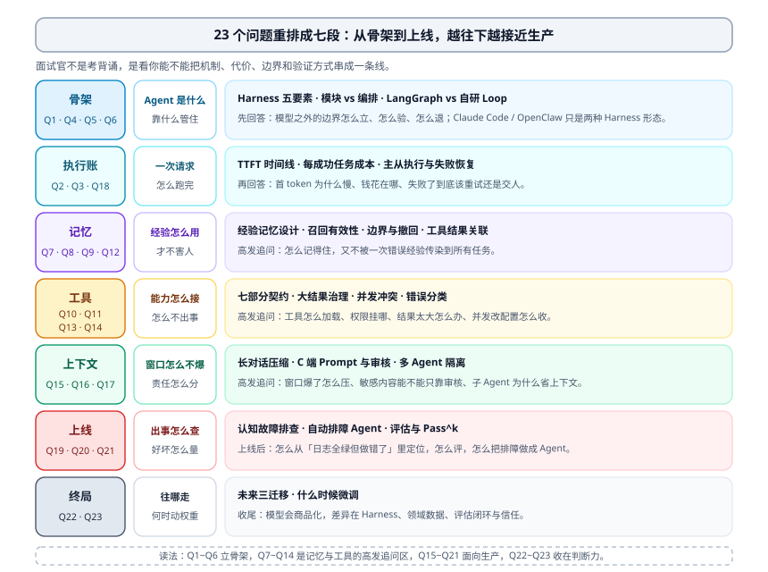
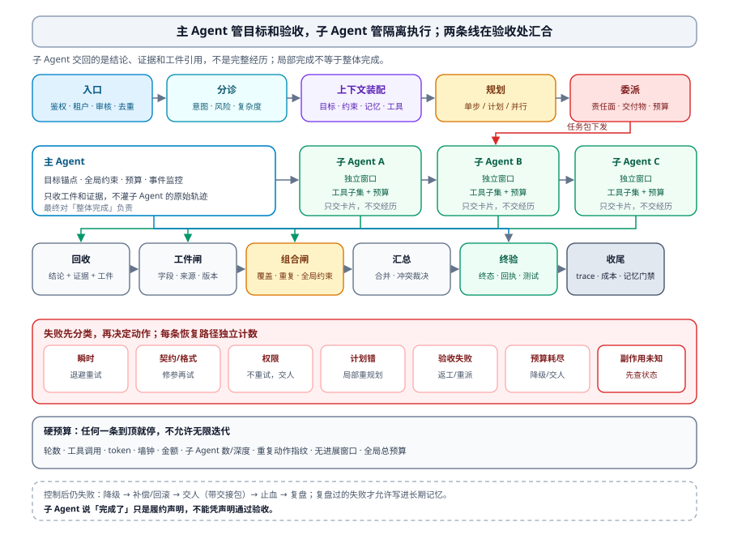
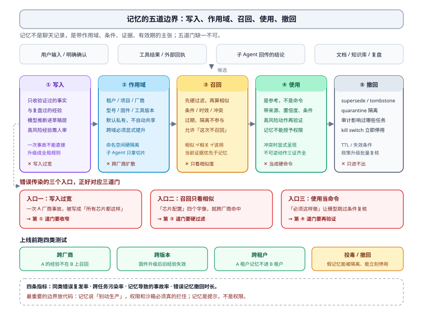
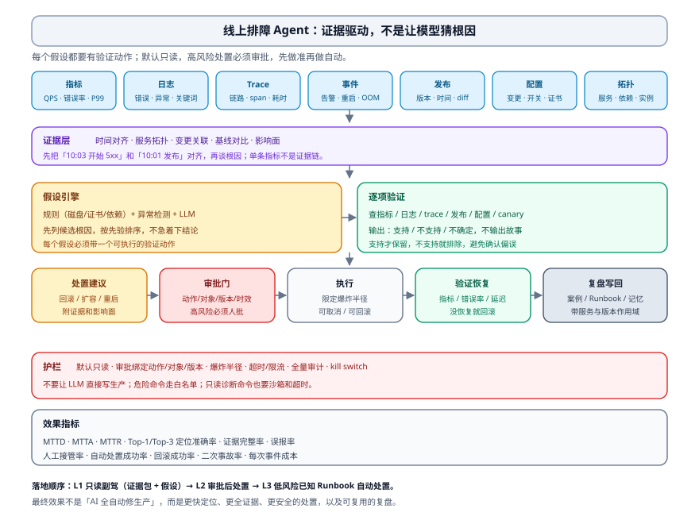

# Agent 高频 23 问：把面试题答成工程判断

这 23 个问题来自真实面试里的连续追问。乍看像 23 个知识点，其实是一条链：

> 模型怎么被管起来 → 一次请求怎么跑完 → 记忆怎么不害人 → 工具怎么不出事 → 上下文怎么不爆 → 上线怎么排障、怎么评估 → 最后才轮到未来和微调。

所以这篇不按 1~23 的顺序答。面试官不是在考你背定义，而是在判断三件事：**你有没有真做过、知不知道为什么这么做、出过事之后能不能兜住**。每一节都按同一个顺序写：

1. 先给一句大白话结论；
2. 再拆它怎么运转；
3. 给一个具体例子或反例；
4. 最后说代价、边界和怎么验证。

如果只剩十分钟，记住三句话也够用：

- **Agent = Model + Harness。** 模型负责想，Harness 负责让它别乱来、能回来、可审计。
- **记忆不是聊天记录，是「带适用条件、证据和有效期的主张」。** 没条件的经验，换个场景就是偏见。
- **工具、上下文、权限、评估，本质上都是「有界资源」问题。** 不是把提示词写得更温柔就能解决的。

这篇很长。先看下面的地图；赶时间可以直接跳到最后的「23 问速查表」。



---

## 一、怎么理解 Agent Harness

同一个模型，套两个产品，一个能干活，一个只会聊天。差别通常不在模型，而在模型外面那层东西：给它看什么、允许它动什么、做完算不算、错了怎么收场。

这层东西就叫 **Harness**。

### 1.1 一句话定义

模型是一个只会输出 token 的函数：它没有记忆、没有权限、不会自己停，也不知道自己刚才那句话会造成什么后果。Harness 是在模型思考之前、之中、之后，替它立边界、留痕迹、做审计的运行时。

一句更土的话：**模型负责花钱，Harness 负责管账。** token、上下文、工具调用、墙钟时间、用户信任、不可逆动作的风险，全是钱。模型天生擅长生成可能性，天生不擅长节制。

把 Harness 摊开，只有五项：

| 要素 | 合格的实现长什么样 | 常见的坏味道 |
| --- | --- | --- |
| Context | 每轮装配函数可复现：这一轮模型到底看到了什么，事后能拿出来 | 每次现拼 Prompt，说不清来源 |
| Tools | 描述写清「什么时候用、什么时候别用」，权限挂在工具名上 | 一堆同名不同义的接口，权限靠提示词嘱咐 |
| Constrain | 故障安全默认值：能力默认关闭，显式开放 | 默认全开，出事后逐个关 |
| Verify | 只看结构化证据：测试、数据库状态、外部回执 | 读模型自己写的「我已完成」 |
| Correct | 重试、回退、人工，三级各有熔断器 | 一个 retry 打到底，或者一出错就抛给人 |

这五项不是并列的功能模块，而是一条链：Context 决定模型看到的世界，Tools 决定它能伸出去的手，Constrain 决定手能伸多远，Verify 决定它说「做完了」算不算数，Correct 决定做错了之后能不能回来。缺一项，Agent 就从「能干活的工具」退化成「很贵且很会编故事的人」。

### 1.2 一个请求走一遍，Harness 到底在哪

拿一个具体任务说：**把 staging 环境的订单服务回滚到上一个版本。**

- **Context**：Harness 给它当前环境、服务名、当前版本、上一个版本、最近一次发布记录、变更窗口、回滚规范。它不会把生产环境的整棵服务树都塞进去——不是模型不想看，是 Harness 不该给。
- **Tools**：它能看到 `get_deployment`、`list_releases`、`rollback_deployment`，但 `rollback_deployment` 的参数里，`environment` 被 Harness 注入成 `staging`，模型改不了。它看不到「删除数据库」这个工具，不是提示词说「不许」，而是工具注册表里根本没有。
- **Constrain**：staging 的回滚可以自动放行；生产回滚必须人工审批。这个判断在代码里，不在模型的心情里。
- **Verify**：回滚发起后，Harness 不采信模型说的「已回滚」，它去查 deployment 状态、健康检查、错误率。三项都恢复，才算完成。
- **Correct**：健康检查没过，先自动回滚回原版本，再告警；而不是让模型「再想想还有没有别的办法」。

这一圈走完，模型只做了它擅长的事：理解目标、选择动作、解释结果。其余每一件事，都是 Harness 在管。

### 1.3 三层护栏，按「被绕过的难度」排

很多人一说护栏，就想到在系统提示词里加一句「不要做危险操作」。这层最便宜，也最先失守。

真正的护栏分三层，顺序不是处理顺序，而是**被绕过的难度**：

1. **上下文层**：相关性分类、安全分类、内容审核、规则黑名单。它最便宜，也最容易被一句精心构造的话绕过。
2. **执行层**：工具风险分级、参数校验、PII 过滤、输出验证。关键是**复核必须发生在模型上下文之外**——同一个上下文里的模型，很难判断自己是不是已经被注入。
3. **数据层**：行级安全、约束校验器、受控视图、不可伪造的访问上下文。它最难绕过，因为它不靠模型「自觉」。

一句话：**上下文层管「读它的时候别信它」，执行层管「就算信了也做不出危险动作」，数据层管「真做出来了也拿不走、改不了」。** 只做第一层，等于没做。

### 1.4 Harness 的四级演进

这四个词经常被混着用，其实是一层包一层：

> 提示工程 ⊂ 上下文工程 ⊂ Harness 工程 ⊂ Loop 工程 ⊂ Graph 工程

- 提示工程：把一句话说清楚；
- 上下文工程：决定这一轮给它看什么；
- Harness 工程：加上工具、权限、验证、纠正；
- Loop 工程：把「想—做—看」装进可恢复的循环；
- Graph 工程：把多个节点、类型化边、检查点状态组织起来。

讲项目经历时这个次序很有用：它说明你做的每一层都还在，只是被包进了更大的边界。反过来，一上来说「我们做了 Graph 工程」，却说不清 Loop 和 Harness 怎么落的，一追问就穿。

### 1.5 面试怎么答

先给一句结论，再给五项清单，最后落一个你亲手改过的边界。比如：

> 「我把 Harness 理解成模型之外的运行时。我们之前的退款 Agent 总把『已退款』当成完成，后来把 Verify 从读模型回复改成读支付网关回执，又把退款工具的幂等键从模型参数改成循环注入，重复退款率才降下来。Harness 的核心不是让模型更聪明，是让它的『完成』有外部证据。」

这段话里有定义、有机制、有例子、有指标，比背十句「Harness 是……」都管用。

---

## 二、Claude Code 和 OpenClaw 里，哪些设计值得抄，哪些坑要避

这两个产品代表两种 Harness 形态：**Claude Code 是终端里的编码 Agent，OpenClaw 是长期在线的个人 Agent 网关。** 一个把上下文和权限做进编码工作流，一个把多渠道、长期身份和记忆做进网关。它们都值得看，但都不该照抄。

### 2.1 Claude Code 的巧妙之处

**第一，上下文分层做得克制。** 它把「项目规矩」「技能知识」「当前任务」分开：项目规矩放在稳定前缀里，技能只在需要时展开正文，子 Agent 拿独立上下文。这个分法的价值不在省 token，而在**让稳定前缀可以缓存、让临时知识不污染主历史**。编码 Agent 一天要跑几十轮，前缀稳定不稳定，直接决定成本和首 token 延迟。

**第二，权限和工具绑在一起。** 它不是靠一句「不要改生产」来防越权，而是按工具、按参数、按模式来控制：计划模式只读，执行模式才允许写；高风险命令要审批；沙箱限制文件、网络和进程。模型可以提议，但「提议」和「执行」之间隔着一层代码。

**第三，Skills 是渐进披露，不是一次性塞满。** 目录里只露 `name + description`，命中才加载正文，正文里再按需引子文档。这样做的好处是：系统可以有一百个技能，但本轮模型只看见几个。**能力数量和本轮可见数量被拆开了。**

**第四，子 Agent 只带回结论，不回灌整段经历。** 子 Agent 在自己的窗口里探索、读文件、试错，最后交回一个压缩后的结论和证据。父 Agent 的上下文不会被几十次工具调用撑爆。这个设计比「在主上下文里硬压」干净得多。

**第五，Hooks 把确定性动作从模型手里拿走。** 格式化、lint、危险命令拦截、权限检查，这些事不该让模型每次现想。Hooks 挂在生命周期上，该拦的拦，该改的改，模型不需要「记住」。

### 2.2 Claude Code 的缺点

**第一，记忆还是偏「文本文件」。** `CLAUDE.md` 和自动记忆本质上是把一段话注入上下文，它没有强类型的 scope、置信度、有效期和证据链。用久了容易出现两种病：一是文件越写越长，注意力被稀释；二是一次局部经验被写成全局规则，换个项目还在生效。

**第二，压缩是有损的。** 长会话压缩能保住主线，但容易把「绝对不能动 A 接口」压成「尽量少动接口」。这不是实现 bug，是摘要的本质。所以关键约束不能只靠摘要，要单独存、每轮重申。

**第三，审批会疲劳。** 权限模式再细，只要一天弹两百次，第 201 次就会被肌肉记忆点过去。审批要稀缺、要绑定具体动作和版本，不能把一堆 JSON 甩给人。

**第四，工具面会膨胀。** MCP 接得越多，模型看到的 schema 越多。工具一多，选择准确率下降，token 也上去。需要延迟披露、命名空间和候选集治理，不能全量注入。

**第五，可观测性不是审计账本。** 它能看到会话和工具调用，但要做到「谁批的、批的是哪一版、执行了几次」这种追责粒度，还得自己补账本。

### 2.3 OpenClaw 的巧妙之处

OpenClaw 的公开文档把系统拆得比较清楚：**Gateway 管连接和路由，agent runtime 管一轮怎么跑，memory 分层，skills 按需加载。** 这个分法本身就很值得学——它没有把「接 WhatsApp」「调模型」「存记忆」揉在一个循环里。

几个具体设计值得抄：

**第一，Gateway 作为控制平面。** 各种消息渠道是适配器，统一进 Gateway，再路由到对应的 agent 和 session。这样加一个渠道不用改主循环，渠道的鉴权、限流、配对也在网关做。用大白话说：**门卫和大脑分开，换门不用换脑。**

**第二，长期身份和 workspace。** 每个 agent 有自己的 workspace、bootstrap 文件（如 `AGENTS.md`、`SOUL.md`）和会话。身份、规矩、记忆都是可版本化的文件，不是散在数据库里的隐式状态。对个人助手来说，这比「每次重新拼一个人格」可靠。

**第三，记忆分层 + 来源门禁。** 公开文档里提到 tiered memory、provenance gates、recall lanes：不可信来源的内容不能直接晋升到核心记忆；召回分低延迟通道和升级通道；「长期意图」会被编译成 cron/SQLite 这种确定性调度器，而不是每轮让模型自己记得。这几条都很实在：**记忆写入要有门，召回要有分层，意图要落到调度器。**

**第四，本地优先、可自托管。** 数据在自己手里，能长期在线，能接浏览器、文件、消息。对个人 Agent 来说，这是产品差异点，也是安全压力点。

### 2.4 OpenClaw 的缺点

**第一，攻击面天然大。** 消息渠道 + 浏览器 + shell + 文件 + 长期记忆，这几样凑在一起，正好凑齐注入攻击最喜欢的条件：能读私有数据、能接触不受信内容、能对外通信，外加持久记忆这个放大器。只要一个渠道的输入没隔离好，后面的工具和记忆都会跟着遭殃。

**第二，配置和运维复杂。** 多渠道、多模型、插件、技能、密钥、权限，任何一个配错都可能是安全洞。自托管意味着这些责任在你身上，不在厂商。

**第三，记忆的治理难度被低估。** Markdown 记忆灵活、可读，但规模一大，冲突、过期、作用域、污染都会出来。来源门禁只是第一道，后面还得有版本、撤回、隔离和评估。

**第四，权限粒度容易「为了好用而放宽」。** 个人助手要替你发消息、看文件、跑命令，很容易给一个大权限。一旦给宽了，模型的一次误判就是真实世界的动作。

**第五，跨渠道的可观测性难。** 一条请求可能从 WhatsApp 进来，经过 Gateway、agent、工具、cron，再回到 Telegram。没有统一的 trace id 和事件账本，出事后很难拼出完整时间线。

### 2.5 该抄什么，不该抄什么

该抄的是**结构**：

- 传输和认知分开（Gateway / runtime）；
- 稳定知识和临时知识分开（项目规矩 / 技能正文）；
- 记忆分层、写入有来源门禁；
- 长期意图编译成确定性调度，不靠模型记性；
- 权限挂在工具和参数上，不挂在提示词上；
- 子 Agent 隔离上下文，只回传结论和证据。

不该抄的是**默认值**：

- 默认给大权限；
- 用文本记忆承担全部治理；
- 用提示词当安全边界；
- 无限制地接插件和技能；
- 没有统一账本就上线。

一句话：**看别人的 Harness，学的是「边界放在哪」，不是「功能有多少」。**

---

## 三、做 Agent 落地，最核心的是流程编排，还是具体模块设计

这是一个典型的二选一陷阱。正确答案不是选一个，而是先看这两样各自决定什么。

### 3.1 用一家餐厅打比方

模块设计是厨房、菜谱、食材、收银台；流程编排是点单、传菜、退菜、结账的走法。

- 厨房不行，流程再顺也出不了菜；
- 流程不行，厨房再好也会上错桌、重复做、退不了菜；
- 最惨的是两边都还行，但没人定义「什么叫这桌菜上齐了」。

Agent 落地最核心的，是最后那句话：**定义一个可验收的闭环。** 用户要什么、什么算完成、拿什么证据验收、失败怎么退。模块和编排都是为这件事服务的。

### 3.2 模块决定上限，编排决定稳定性

**模块设计决定三件事：**

- 能力上限：工具能不能做、上下文能不能看见、记忆准不准；
- 安全边界：权限、沙箱、审计、数据隔离；
- 结果质量：工具返回是否结构化、错误是否可读、证据是否可追溯。

**流程编排决定三件事：**

- 稳定性：状态机、预算、重试、并发、恢复；
- 成本与延迟：路由、并行、缓存、停止条件；
- 可运营性：可观测、灰度、回滚、人工接管。

所以不是「哪个更重要」，而是「哪个阶段缺哪个」。

**0 到 1 的阶段，模块契约优先。** 因为这时候最大的风险不是流程不够花，而是工具契约不清、验收标准没有、权限没边界。你把退款工具做成一个「想退多少退多少」的接口，编排写得再漂亮也救不了。

**1 到 N 的阶段，编排优先。** 因为模块都有了，事故大多出在状态、重试、并发、交接和恢复上。一个工具没问题，两个工具并发就有问题；一个 Agent 没问题，主从一拆就互相污染。

### 3.3 一个退款例子，看清两边各自负责什么

任务：用户申请退一笔 8000 元的订单。

**模块侧要保证：**

- `get_order` 能拿到订单状态、金额、支付方式；
- `check_refund_policy` 能按商品类型、时间、是否已发货给出可退结论；
- `refund_order` 有金额上限、幂等键、权限校验、返回支付网关回执；
- 退款结果能落到账本，能按 `refund_id` 查。

**编排侧要保证：**

- 先查订单，再查政策，再决定要不要人工审批；
- 金额超过阈值，走审批门，不直接退；
- 退款调用带幂等键，重试不会退两次；
- 退款后查回执，不能只信模型说「已退」；
- 失败时知道停在哪一步、从哪一步恢复。

四种失败正好对应两边：

- 工具允许退任意金额 → 模块的锅，编排救不了；
- 编排跳过政策校验 → 编排的锅，工具不知道政策；
- 两边都对，但没有幂等键，重试退两次 → 模块契约和编排预算共同的锅；
- 都做了，但验收只看模型回复 → Verify 的锅。

### 3.4 面试怎么答

不要急着选边。可以这么答：

> 「这两个不是替代关系。模块决定能力上限和安全边界，编排决定稳定性和成本。落地最核心的是先把『什么叫完成』定义成可验收的证据，再决定哪些交给模型、哪些钉进代码，最后用编排把可验收的模块串起来。0 到 1 我会先补工具契约和评估，1 到 N 再重点补状态机、预算和恢复。」

如果对方追问「只能选一个呢」，就给一个判断：**高风险、强合规、工具边界复杂的业务，模块优先；开放式、多步骤、工具组合多的业务，编排优先。** 但无论哪种，验收标准都得先有。

---

## 四、LangChain 也能做状态图，为什么还要自研 Agent Loop

先把三个词分开，不然这题会吵成一锅粥：

- **LangChain / LangGraph**：一个编排框架，给你节点、边、状态、检查点、人工中断、流式输出；
- **Agent Loop**：模型调用 → 工具调用 → 观察 → 再调用的运行时循环；
- **Harness**：循环外面的上下文、权限、验证、恢复、审计。

状态图解决的是「控制流怎么表达」，Agent Loop 解决的是「一轮怎么跑」，Harness 解决的是「跑得对不对、能不能停、出事怎么办」。三者不是同一个东西。

### 4.1 框架给了你什么

LangGraph 这类框架确实把很多脏活干了：

- 用图表达分支、循环、并行；
- 状态持久化、检查点、断点恢复；
- 人工中断（human-in-the-loop）；
- 流式输出；
- 节点级观测和可视化；
- 生态里的模型、工具、检索器适配。

对一个标准工作流、一个小团队、一个快速验证的产品，这些很值钱。**不要为了「自研」两个字，把检查点、重试、流式、人工中断重新写一遍，还写得不如人家。**

### 4.2 框架没给你什么

框架给你的是「流程骨架」，不是「业务契约」。以下几件事，它通常替不了你：

**第一，工具的业务契约。** 框架能注册一个函数，但它不知道退款金额上限、幂等键、审批条件、支付回执长什么样。这些要你自己定义。

**第二，上下文的装配逻辑。** 框架能把 state 传进节点，但它不知道哪些记忆该召回、哪些工具描述该披露、哪些历史该压缩。上下文工程是你的业务资产，不是框架的默认值。

**第三，权限和数据隔离。** 框架能跑节点，但它不知道租户 A 的数据不能进租户 B 的窗口。行级安全、OBO 令牌、DLP 这些要在框架外面做。

**第四，业务幂等。** 框架的 checkpoint 存的是「线程状态」，不是「外部副作用发生了几次」。支付已经成功、本地没来得及写完成，重启后框架恢复 state，照样可能再退一次。**checkpoint ≠ 幂等账本。**

**第五，评估与回归。** 框架能跑 trace，但它不定义「什么叫这个任务成功了」。测试集、断言、Judge、AB、灰度，还是你的活。

**第六，记忆的治理。** 框架能存 state，不代表它知道什么该进长期记忆、什么该撤回、什么该隔离。

### 4.3 什么时候用框架，什么时候自研

一个实用的决策表：

| 场景 | 建议 |
| --- | --- |
| 标准工作流、快速验证、小团队 | 先用框架，别自研 |
| 需要图编排、检查点、人工中断 | 用框架，重点补业务契约 |
| 深度集成现有系统、强权限/多租户 | 框架 + 自研关键节点，或自研 Harness |
| 极端延迟/成本要求、边缘/私有化部署 | 自研或裁剪框架 |
| 需要完全掌控上下文、记忆、审计 | 自研 Harness，循环可以很短 |
| 团队没人维护框架升级 | 选稳定版本，或自研小内核 |

最常见的答案是**混合**：图编排用框架，关键节点（上下文装配、工具网关、验证器、账本）自己写。这样既不用重造轮子，也不会把业务边界交给框架的默认值。

### 4.4 「自研 Loop」到底难在哪

一个裸循环确实很短：

```text
while not done:
    response = model(context, tools)
    if response.tool_call:
        result = execute(tool, args)
        context.append(result)
    else:
        done = True
```

难的是循环外面这一圈：

- 这一轮的 context 怎么装、上一轮的 observation 怎么压；
- 工具候选集怎么选、描述怎么披露、权限怎么注入；
- 模型说要调工具，谁来判断这个工具在不在本轮候选、参数合不合法、要不要审批；
- 超时了算失败还是未知，重试会不会重复副作用；
- 模型说完成了，拿什么验证；
- 崩了之后从哪继续，外部副作用怎么对账；
- 成本、延迟、成功率怎么归因。

所以「自研 Loop」真正的门槛不在那几十行循环，而在 **Harness 的工程量**。如果说不清自己要比框架多做什么，自研大概率只是把框架踩过的坑再踩一遍。

### 4.5 面试怎么答

> 「LangGraph 解决的是控制流表达和状态持久化，不解决业务契约、权限、幂等、上下文装配和评估。Agent Loop 本身很短，真正的工程量在 Harness。我的选择标准是：标准工作流先用框架；如果框架在权限、上下文、成本或部署上卡住了，就把关键节点拿回来自己写，而不是把整个循环重写一遍。自研不是勋章，能说清自研多解决了什么才有意义。」

---
## 五、怎么减少 Agent 首 token 的响应时间

先拆一个常见的误会：**首 token 快，不代表 Agent 响应快。**

对普通聊天，首 token 就是用户看到第一个字的时间。对 Agent，用户真正感知到的「有反应了」可能是三种东西：

- 屏幕上出现第一个字；
- 出现一句「我先查一下订单」的进度提示；
- 第一个工具调用发出，或者第一个有用结论出现。

这三种的优化方法完全不同。面试时先把「你说的首 token 是哪一种」问清楚，比直接背「用流式」专业得多。

### 5.1 把时间线拆开

一个请求从进来到吐出第一个 token，通常要过这些站：

| 阶段 | 常见耗时来源 | 能做什么 |
| --- | --- | --- |
| 网络与接入 | DNS、TLS、网关排队、地域远 | 连接复用、就近接入、HTTP/2、预热连接 |
| 鉴权与租户 | 查用户、查权限、查配额 | 缓存身份、预取权限、并行校验 |
| 内容审核 | 同步审核模型、规则链 | 轻量规则先行、异步深审、审核结果缓存 |
| 意图识别 | 一次小模型调用、槽位抽取 | 小模型、规则前置、合并到主调用 |
| 检索/记忆 | 向量库、ES、数据库、多路召回 | 并行召回、预取、Top-K 收缩、缓存 |
| 上下文装配 | 拼 Prompt、序列化、超大工具结果 | 瘦身、稳定前缀、提前装配 |
| 模型排队 | 供应商排队、冷启动、限流 | 多供应商、预留容量、错峰 |
| Prefill | 输入越长越慢，缓存没命中更慢 | 前缀缓存、缩短输入、稳定前缀 |
| 首 token 解码 | 模型本身速度、输出长度 | 选型、流式、减少前置废话 |
| 工具调用/审批 | 工具冷启动、权限审批、人工等待 | 预热、预授权、异步审批、进度提示 |

这张表里，**Agent 的 TTFT 往往不是模型慢，而是前面站太多，或者第一站就要等一个工具。** 你优化模型解码 100 毫秒，不如砍掉一次不必要的意图调用。

### 5.2 优化顺序：先砍站，再提速

**第一刀：能不用 Agent 就不用。**

一个固定流程的「查订单状态」，没必要走「意图识别 → 规划 → 选工具 → 反思」。直接路由到工作流，一次查询就回。Agent 的灵活性是有成本的，简单任务上它只会增加延迟和不确定性。

**第二刀：把串行改成并行。**

用户输入进来后，身份、画像、知识库、工具 schema 预取，很多事可以同时做。检索也可以多路并发：向量、关键词、元数据各跑各的，最后融合。注意第三方限流，别为了快把人家打挂。

**第三刀：把能缓存的缓存。**

- **前缀缓存**：系统提示词、工具定义、稳定规则放前面，动态内容放末尾。不要在前面插 `Current time: ...`，那会让后面几千个 token 一起失去缓存。
- **身份/权限缓存**：短期缓存，带 TTL，权限变更时失效。
- **检索缓存**：常见问题、热门文档、工具 schema。
- **意图缓存**：高频表达的直接命中，别每次都调模型。

**第四刀：把一次调用合并掉。**

意图识别和槽位抽取可以一次出；简单路由可以用规则；审核可以用轻量模型先过。每少一次模型调用，就少一次排队和网络往返。

**第五刀：让用户先看到「有反应」。**

如果任务确实要 5 秒，不要憋着。可以先流式输出一句「我先查一下订单和退款政策」，再继续。注意：**进度提示要真实**，不能每轮都「正在思考」；用户很快会学会忽略它。

**第六刀：把审批从关键路径上挪开。**

低风险动作预授权；高风险动作可以先给方案、再等审批，不要卡住第一个 token。审批是延迟的一部分，设计时就要算进去。

### 5.3 一个具体的账

假设一个客服 Agent，优化前首 token 3.8 秒。拆开看：

- 审核 300ms；
- 意图识别 600ms；
- 检索 900ms；
- 上下文装配 200ms；
- prefill 1.2 秒（前缀没命中）；
- 模型排队 500ms；
- 解码 300ms。

做了四件事：

1. 把动态时间从系统提示词末尾移到请求尾部，前缀命中率从 40% 提到 90%，prefill 从 1.2 秒降到 400ms；
2. 身份、画像、知识库并行取，检索从 900ms 降到 500ms；
3. 意图识别换成小模型 + 规则前置，从 600ms 降到 250ms；
4. 第一帧先流式输出进度提示，400ms 用户就看到反应。

结果：首 token 从 3.8 秒降到约 1.4 秒，用户感知的「有反应」从 3.8 秒降到 0.4 秒。**但总完成时间不一定同比例下降**，因为工具执行和审批还在。所以指标要分开看：TTFT、首有用动作、总完成时间、成功率。

### 5.4 常见坑

- **只优化平均，不看 P95。** 平均 1 秒，P95 8 秒，用户照样骂。首 token 要看分位，不要只看均值。
- **为了首 token 牺牲正确性。** 先回一句「好的」再慢慢想，用户可能以为你在处理，结果结论是错的。首 token 快不等于体验好。
- **缓存被动态内容打穿。** 系统提示词里放当前时间、用户昵称、随机 ID，都会让前缀缓存失效。
- **工具没预热。** 第一次调用冷启动 2 秒，后面 200ms。可以在会话开始或空闲时预热。
- **审批卡在同步路径。** 人可能十分钟后才点，不能把首 token 押在审批上。
- **忽略工具调用本身的时间。** 对 Agent 来说，第一个工具调用可能就是「首响应」，工具慢，TTFT 再好也没用。

### 5.5 面试怎么答

> 「我先分清首 token、首有用动作和总完成时间。Agent 的 TTFT 通常不是模型解码慢，而是前面串行站太多，或者第一站就要调工具。我会先画时间线，按阶段量 P50/P95，然后按顺序砍：能走工作流的别上 Agent、能并行的别串行、能缓存的稳定前缀、能合并的模型调用合并、最后用流式给真实进度。如果任务本身要 10 秒，我不会假装 1 秒，而是把进度和可中断做好。」

---

## 六、Agent 场景下降本增效，具体有哪些手段

先把「降本」的定义改对：**不是把 token 单价换便宜，是把「每个成功任务的总成本」降下来。**

总成本包括：模型输入输出、缓存读写、工具/API 调用、沙箱算力、存储与出网、人工审核、评估监控、失败重试、重复副作用，以及用户等不及走掉的损失。只盯 token 单价，很容易降出更多人工和更多事故。

### 6.1 先记账，再动刀

至少按下面几笔分账：

| 账目 | 要回答的问题 |
| --- | --- |
| 模型账 | 哪个模型、多少输入/输出、缓存命中多少、每次任务几次调用 |
| 工具账 | 哪个工具、调用几次、失败几次、平均延迟、第三方单价 |
| 上下文账 | 系统提示、工具 schema、检索、历史、工具结果各占多少 token |
| 人工账 | 审批、复核、接管各花多少分钟 |
| 失败账 | 重试、重复调用、重复副作用、回滚成本 |
| 评估账 | 离线跑分、Judge、AB、监控的算力与人力 |

没有这本账，所谓优化就是猜。最常见的浪费不是「模型太贵」，而是**上下文里塞了不该塞的东西，或者同一个工具被反复调用**。

### 6.2 七把刀，按性价比排

**第一，模型分级。** 意图识别、槽位抽取、摘要、审核、简单分类，用小模型；复杂推理、规划、代码生成，用大模型。不要用大模型做格式转换，也不要让小模型硬扛复杂规划。级联要有置信度闸门，低置信度才升级。

**第二，上下文节食。** 检索 Top-K 不是越大越好；工具返回要截断；历史要压缩；系统提示不要写成长篇小说。一个中等模型读干净的三万 token，常常胜过最强模型淹在十八万噪声里。

**第三，缓存。** 前缀缓存、语义缓存、工具结果缓存、检索缓存、Embedding 缓存。缓存键要带用户身份和授权范围，否则会把 A 的权限结果喂给 B。天气、股价这类要设 TTL。

**第四，少轮次。** 很多成本不是单次贵，是轮次多。把停止条件写清楚、能并行工具就并行、能一次规划就别边想边试、不要在简单任务上开「深度思考」。轮次降下来，token、延迟、工具调用一起降。

**第五，工具结果治理。** 大结果写盘，窗口只留摘要和 handle；搜索返回候选和总数，不返回拼接全文；读文件支持 offset/limit。一次 8MB 的 JSON 拖进上下文，后面每一轮都在为它付费。

**第六，复用与批处理。** 离线任务批处理、异步队列、预计算、共享前缀、共享检索结果。能提前算的不要在线算。

**第七，蒸馏/微调。** 当某个窄任务量足够大、格式稳定、且有高质量轨迹时，把大模型的能力蒸馏到小模型。注意：训练本身有成本，且需要评估和回归；不要为了省 token 把质量训没了。

### 6.3 省的钱不能简单相加

一个真实的坑：两个优化分别报告省了 28.3% 和 17.5%，合在一起只省了 30.0%，不是 45.8%。原因不神秘：

- 两个优化砍的是同一块成本；
- 固定成本（系统提示、工具 schema、评估）没变；
- 省了 token，但重试和人工变多；
- 质量下降带来更多返工。

所以降本要做**组合实验**，不要拿单点节省率相加。指标也要看「每个成功任务成本」，不是「每次调用成本」。

### 6.4 增效不只是省钱

「增效」至少包括四件事：

- 延迟：首 token、首有用动作、总完成时间；
- 人工时间：审批、复核、接管；
- 成功率：一次做对，少返工；
- 用户体验：少问几轮、少改口、少等待。

一个 Agent 把 token 成本降了 40%，但用户纠正率翻倍，这不是增效，是把成本转嫁给了用户。

### 6.5 一个降本例子

假设一个客服 Agent 每天 10 万次会话，平均每次输入 30K token、输出 1K token，70% 的请求是常见问题。

可以这么做：

- 常见问题走小模型 + 知识库缓存，不进入大模型 Agent；
- 复杂问题才进 Agent，且只带相关历史；
- 系统提示和工具定义稳定，吃前缀缓存；
- 工具结果超过 8KB 写盘，只回摘要；
- 审批只留高风险动作，低风险自动放行；
- 对失败率高的工具加熔断，避免反复重试。

每一步都要配一个护栏指标：任务成功率、用户纠正率、退款差错率、P95 延迟。否则省下来的钱，迟早以事故的形式还回去。

### 6.6 面试怎么答

> 「我先算每个成功任务的总成本，不只看 token 单价。然后按性价比动刀：模型分级、上下文节食、缓存、少轮次、工具结果治理、复用/批处理，最后才考虑蒸馏。降本要做组合实验，因为节省率不能相加；同时盯成功率、纠正率和 P95，避免把成本转嫁给用户和人工。」

---

## 七、主从 Agent 的完整执行：从请求进来，到收尾

先把「主从」这个词拆掉。主 Agent 不是老板，它是**唯一对目标和最终验收负责的人**；子 Agent 不是员工，它是**一个带预算、工具和权限边界的执行上下文**。主从的价值不是「人多力量大」，而是**隔离上下文、并行独立工作、分开权限**。



### 7.1 一次请求的九个阶段

**第 0 段：入口。** 鉴权、租户识别、限流、去重、内容审核。这里要把 `tenant_id`、用户身份、任务 ID 定下来，后面所有工具和记忆都带这个作用域。入口不做，后面靠模型「注意不要串租户」是防不住的。

**第 1 段：分诊。** 判断意图、风险、复杂度，以及「这件事到底要不要 Agent」。简单查询走工作流，高风险动作走审批，只有开放式、多步骤、需要看情况决策的任务才进 Agent 循环。

**第 2 段：上下文装配。** 把目标、硬约束、用户画像、相关记忆、工具描述、当前状态装进窗口。这里要回答三个问题：这一轮必须看到什么、可以压缩什么、什么东西绝对不能丢。硬约束和当前目标要放在注意力高地，不能埋在中间。

**第 3 段：规划。** 决定是一步做完，还是拆成计划；要不要并行；要不要委派。计划不是一段「先分析、再执行、最后总结」的漂亮话，而是带成功标准、依赖、预算和检查点的运行时对象。

**第 4 段：委派。** 如果拆，给每个子 Agent 一张委派单：负责哪一块、要回答什么问题、交回什么工件、能用哪些工具、预算多少、截止时间、基于哪一版事实。**不要复制一段目标就完事，更不要把父的完整对话历史整包甩下去。**

**第 5 段：子执行。** 子 Agent 在自己的窗口里跑 TAO 循环：想、调工具、看结果、再想。它有自己的预算和工具集，父 Agent 通过事件看进度，不需要把子 Agent 的每一次工具调用都灌进自己的上下文。

**第 6 段：回收。** 子 Agent 交回的不是「我完成了」，而是：结论、证据、工件引用、未解决问题、用掉的预算。父 Agent 默认只收这些，原始轨迹留在子会话和审计存储里，真要调查再沿引用展开。

**第 7 段：验收。** 先过工件闸：字段齐不齐、来源有没有、版本对不对。再过组合闸：覆盖全不全、有没有重复、有没有违反全局约束。**局部正确推不出整体正确**，三个子任务都返回成功，不代表拼起来能交付。

**第 8 段：汇总与终验。** 合并结果、处理冲突、生成最终答复。终验要看终态，不只看模型说了什么：订单状态、支付回执、测试结果、发布状态。

**第 9 段：收尾。** 落 trace、算成本、抽评估样本、按门禁更新记忆、发审计事件。任务结束不等于系统结束，收尾决定下一次能不能做得更好。

### 7.2 失败怎么处理

失败不是一个「重试」按钮，而是一张分类表：

| 失败类型 | 典型现场 | 正确处理 |
| --- | --- | --- |
| 瞬时故障 | 429、5xx、网络抖动、模型过载 | 有上限的退避重试；幂等才重试 |
| 契约/格式 | 参数缺字段、JSON 不合法、工具返回不符合 schema | 修参数/修格式，带错误信息重试一次；仍失败就换路径 |
| 权限/身份 | 403、令牌过期、租户不匹配 | 不重试，升级授权或转人工 |
| 计划错误 | 选错路径、假设被推翻、依赖不成立 | 回到最近可信检查点，局部 Replan，失效下游工件 |
| 子任务失败 | 子 Agent 超时、结果不可验收 | 重派、缩小范围、换工具；保留证据 |
| 验收失败 | 测试不过、回执对不上、覆盖不全 | 返工；连续失败转人工 |
| 预算耗尽 | 轮数、token、时间、金额到顶 | 停止，交部分结果和交接包 |
| 副作用未知 | 超时但可能已执行、连接中断 | 先查外部真实状态，绝不盲目重试 |

这张表里最危险的是最后一行。**网络超时不等于远端没执行。** 支付、退款、发信、部署，凡是可能已经产生副作用的动作，超时后第一步是拿幂等键去查状态，不是再发一次。

### 7.3 无限迭代还是有限控制

必须是有限控制。一个能自主循环的系统，如果没有硬边界，迟早会把预算烧穿，或者在一个错误路径上反复打转。

至少要有这些闸门：

- **轮数上限**：单次任务最多多少轮；
- **工具调用上限**：每个工具、每个任务分别计数；
- **token/金额上限**：输入、输出、第三方调用费用；
- **墙钟上限**：最长跑多久；
- **子 Agent 上限**：并发数、递归深度、总数量；
- **重复动作检测**：同一工具 + 同一参数指纹重复超过 N 次，判定打转；
- **无进展检测**：连续几轮没有新事实、没有新工件、没有推进目标；
- **每条恢复路径独立熔断**：不要让一条路径的噪声熔断另一条；
- **全局总预算**：防止十个会话各自守规矩，加起来把一天跑穿。

还有一个容易被忽略的：**停止权不能只交给模型。** 模型说「完成了」只是提议，验收要通过外部证据。模型说「还需要再查一下」也要看预算和边际收益，不能无限自我加戏。

### 7.4 控制完还是失败，怎么办

按顺序走五步：

1. **降级**：给部分结果、缓存结果、只读结果，明确告诉用户「哪部分没完成」。
2. **补偿/回滚**：用 Saga 或幂等账本，把已经产生的副作用撤掉或标记；撤不掉的要说清楚。
3. **交人**：给一份交接包，不是一句「失败了」。交接包至少包含：目标、已完成、证据、试过什么、排除了什么、当前阻塞、建议下一步、已用预算、相关链接。
4. **止血**：关掉出问题的工具/租户/版本，保留现场，发事件。
5. **复盘**：把这次失败变成评估用例；只有经过复盘的结论，才允许进入长期记忆。

### 7.5 执行完之后呢

很多团队只做到「返回答案」，但一个生产级 Agent 还要做四件事：

- **验证**：终态对不对，副作用有没有落对；
- **记账**：这次花了多少 token、多少钱、多少人工；
- **评估**：抽一条样本进回归集，或者打一个分；
- **学习**：把可复用的经验写成有条件的记忆，把不可复用的错误写成测试用例。

这四件事不做，系统永远停在「这次跑通了」的阶段，下一次还得靠运气。

### 7.6 一个主从例子

任务：调研三家芯片厂商的配置方案，出一份对比报告。

- 主 Agent 定义责任面：厂商 A、厂商 B、厂商 C，各交一张卡，字段包括型号、配置项、限制、证据链接。
- 三个子 Agent 各自查资料、读文档、调工具，分别烧掉几万 token，但只各交回 2K 的卡。
- 子 Agent B 超时，主 Agent 重派给 B2，并缩小到只查两个关键配置。
- 子 Agent C 的卡里有一条结论没有来源，工件闸拒收，要求补证据。
- 组合闸检查：三家都覆盖了吗？有没有同一型号被算两次？有没有违反「只选量产型号」的全局约束？
- 终验通过后，主 Agent 汇总；不通过则退回对应子任务，而不是整份重跑。

这个例子里，主 Agent 的上下文始终只有几张卡和验收记录，没有被三家的原始资料撑爆。这就是主从结构真正的收益。

### 7.7 面试怎么答

> 「主从不是默认架构。主 Agent 负责目标、委派和最终验收，子 Agent 只拿任务包和预算，交回结论、证据和工件引用，不交完整经历。执行分入口、分诊、上下文、规划、委派、子执行、回收、验收、收尾九段。失败按瞬时、契约、权限、计划、验收、预算、副作用未知分类处理；所有循环都有轮数、token、时间、金额、子 Agent 数量和重复动作的硬上限。控制完还失败，就降级、补偿、交人、止血、复盘，不是无限重试。」

---
## 八、经验记忆系统：完整设计

先把一句话说死：**记忆不是把聊天记录存起来，那是日志。记忆是让下一次决策少走弯路的、可复用的主张。**

日志回答「当时发生了什么」，记忆回答「下次遇到类似情况，应该多知道什么」。两者混在一起，系统就会变成「什么都记得，但什么都用不对」。

### 8.1 先分三个轴：存多久、存什么、怎么用

**第一个轴：生命周期。**

- **工作记忆**：当前这一轮的目标、计划、临时观察。用完就丢，不跨轮。
- **会话记忆**：这次任务的状态、已确认事实、未完成事项。会话结束做一次收束，能升层的才升。
- **长期记忆**：用户偏好、项目事实、领域经验、失败教训。跨会话存在。
- **归档/工件**：原始文档、工具返回、日志、截图。不直接进模型窗口，用 handle 按需取。

**第二个轴：记忆类型。** 不同类型，写入和读取规则完全不同：

| 类型 | 例子 | 写入要求 | 读取方式 |
| --- | --- | --- | --- |
| 事实 | 订单 #123 已退款；A 型号芯片的电压是 1.8V | 有证据、有来源、有版本 | 精确查询/结构化过滤 |
| 偏好 | 用户喜欢先看结论；这个项目不允许改公共接口 | 用户明确表达或多次验证 | 按用户/项目作用域注入 |
| 程序 | 发布前要跑哪几个检查；某类故障先查什么 | 经过复盘、有成功/失败证据 | 作为技能/清单，按场景加载 |
| 决策 | 为什么选方案 B；哪条路已经排除 | 记录理由和代价 | 规划/Replan 时召回 |
| 禁止 | 不要直接改生产配置；某条路径已验证不可行 | 有证据、有触发条件、有人确认 | 作为硬约束/检查项 |

**第三个轴：使用方式。** 记忆是「参考」还是「命令」，差别巨大。事实和偏好可以作为参考；禁止项和硬约束应该进代码/规则，不要只靠记忆注入。**记忆不能代替权限系统。**

### 8.2 一条记忆长什么样

不要用一段自然语言存所有东西。一个可用的记忆条目至少要有这些字段：

```text
MemoryItem
  id
  type: fact | preference | procedure | decision | do_not_do
  claim: 一句话结论，例如「A 厂商 A1 芯片在固件 < 2.3 时，写配置前需要 200ms 延时」
  scope: { tenant, project, vendor, chip_model, tool_version, region }
  conditions:
    applies_when: [固件 < 2.3, 写配置, 使用官方 CLI]
    not_applies_when: [B 系列芯片, 只读操作, 固件 >= 2.4]
  evidence_refs: [trace_id, artifact_id, ticket_id, 测试记录]
  confidence: 0-1
  source: user_confirmed | tool_verified | postmortem_reviewed | inferred
  valid_from / valid_to
  supersedes / superseded_by
  sensitivity: public | internal | confidential
  status: draft | active | quarantined | archived
```

这些字段不是形式主义，每一个都对应一类事故：

- 没有 `scope`，记忆会串租户、串厂商、串项目；
- 没有 `conditions`，经验会变成「到哪儿都适用」的偏见；
- 没有 `evidence_refs`，错了无法回溯，也无法判断该不该信；
- 没有 `source`，模型自己的猜测会和用户确认的事实混在一起；
- 没有 `valid_to`，过期政策会一直生效；
- 没有 `supersedes`，新旧记忆会平权共存，模型靠概率猜；
- 没有 `status`，被污染的记忆无法隔离。

### 8.3 写入路径：不要每轮都写长期记忆

一条记忆从产生到进入长期层，走五步：

1. **候选抽取**：任务结束后，从目标、决策、工具结果、用户反馈里抽「可能值得复用」的内容。不是每轮抽，更不是把对话直接倒进去。
2. **规范化**：写成一句可判断真假的主张，而不是一段叙事。叙事适合人看，主张适合机器用。
3. **冲突检查**：先检索相似旧记忆，判断这是细化、补充还是矛盾。矛盾不能直接覆盖，要保留版本并裁决。
4. **写入门禁**：有没有证据？作用域清不清？是一次性事件还是可复用规律？高风险程序有没有人复核？
5. **分层落库**：先放草稿/候选层；经过重复验证、复盘或人工确认，才升到长期层。

一个反直觉但很重要的纪律：**实时抽取只写当前层，不直接改长期层。** 用户在某一轮说「今天想便宜点」，那是本轮约束，不是长期偏好；一次调试把 mock 地址写进项目规则，任务结束就该清掉。长期记忆是「熬」出来的，不是「当场拍」出来的。

### 8.4 读取路径：按任务特征找，不是按句子像不像找

召回时，不要只拿用户最后一句话做向量检索。至少用四类特征：

- **任务特征**：意图、动作类型、风险等级、当前步骤；
- **作用域**：租户、项目、厂商、型号、工具版本；
- **状态**：当前固件、当前环境、当前订单状态；
- **时间**：政策版本、有效期、最近一次确认。

然后做混合召回：结构化过滤 + 关键词/BM25 + 向量 + 实体匹配，最后 rerank。召回结果不要直接塞进窗口，要带三样东西：**来源、置信度、适用条件**。让模型知道「这是一条经验，不是一条命令」。

如果一条记忆和当前观察冲突，**当前证据优先**。记忆是先验，不是真理。比如记忆说「这个接口超时是 3 秒」，但这次工具返回 30 秒，先信工具。

### 8.5 遗忘：不是可选项

一个只进不出的记忆库，最后一定会变成垃圾场。遗忘至少有五种动作：

- **过期**：临时事实、短期政策，到 `valid_to` 自动失效；
- **替代**：新事实覆盖旧事实，旧条目标 `superseded`，不物理删除；
- **衰减**：长期无证据、无访问的偏好降权，但不一定删；
- **隔离**：可疑、冲突、被污染的记忆进 `quarantined`，不再参与召回；
- **归档**：原始材料退出常驻，保留 handle，需要时能取回。

注意一个细节：**偏好没有 TTL。** 偏好不会因为「三个月没提」就自动消失，它只会因为新的明确表达或冲突而改变。用时间硬删偏好，会把长期用户得罪光。

### 8.6 怎么评估记忆系统

记忆的评估要分三层，而且**只给记忆、不给原始对话**，否则测的是检索，不是记忆：

- **基础回忆**：给一个问题，能不能召回正确的事实；
- **多会话检索**：跨会话、跨时间，能不能找到相关经验；
- **主动服务**：用户没问，能不能在合适的时候提醒（例如「这个证书 30 天后过期」）。

指标至少包括：

- 召回层：Recall@K、Precision@K、作用域违规率、过期命中率；
- 使用层：被召回后真的被用了吗？用得对不对？
- 结果层：用了记忆之后，任务成功率、用户纠正率、成本有没有改善？
- 危害层：记忆导致的错误率、污染扩散率、撤回率。

一句判据：**从没被用过的记忆是成本，被用错的记忆是毒药。**

### 8.7 一个完整例子

场景：某厂商的芯片配置经验。

```text
type: procedure
claim: A 厂商 A1 芯片在固件 < 2.3 时，写配置前需要 200ms 延时，否则偶发写入失败
scope: vendor=A, chip_model=A1, firmware<2.3, operation=write_config
conditions:
  applies_when: 使用官方 CLI，写配置
  not_applies_when: 只读、固件 >= 2.4、B 系列
evidence_refs: [ticket-8821, trace-2026-09-18, 复现实验 3/3]
confidence: 0.92
source: postmortem_reviewed
valid_to: 固件 2.4 全面上线后（需复核）
status: active
```

这条记忆在召回时，会先过作用域（不是 A1 就不取）、过条件（只读就不取）、过版本（固件 2.4 就不取），然后用「经验」的口吻注入，而不是「必须」。到了写配置的动作前，Harness 还会再校验一次延时是否真的执行了。**记忆负责提醒，代码负责兜底。**

---

## 九、召回出来的记忆，怎么判断对当前任务有效、正相关

先记住三个「不等于」：

> 相似 ≠ 相关；相关 ≠ 该用；该用 ≠ 用了就一定好。

向量相似度只能回答「这两段话长得像不像」，回答不了「这条经验在当前任务上成不成立」。

### 9.1 四道硬门

**第一道：作用域门。** 这是硬过滤，必须在检索前做。租户、项目、用户、厂商、型号、工具版本，任何一个不匹配，直接不取。不要指望模型看了之后「自己判断」，它没有你的租户边界。

**第二道：条件门。** 记忆里写了 `applies_when` 和 `not_applies_when`，当前任务是否满足？比如记忆说「固件 < 2.3 才需要延时」，当前固件是 2.4，就不该取。条件判断优先用规则/结构化字段，模型只处理规则表达不了的部分。

**第三道：时效门。** `valid_from` / `valid_to` / `supersedes` 是否成立？政策、价格、接口版本、组织架构都会变。过期记忆不是「有点旧」，是「可能已经错了」。

**第四道：证据/冲突门。** 这条记忆有没有证据？当前工具返回、用户输入、最新文档是否和它冲突？冲突时，当前证据优先；如果无法裁决，把冲突显式呈现，不要偷偷选一个。

### 9.2 再加一道「效用门」

过了四道硬门，只能说明「可能适用」，还不能说明「值得用」。再加一层效用判断：

- **任务相关性**：它影响的是当前决策，还是只是背景知识？
- **历史有效性**：过去在相似任务里，用了它之后成功率有没有提升？
- **风险**：用错了代价多大？高风险动作宁可不注入，也不能注入一条来路不明的经验。
- **成本**：注入它要花多少 token？会不会挤掉更重要的证据？
- **反事实**：如果没有这条记忆，答案会不会不同？如果不会，它只是噪声。

这层可以用一个轻量 rerank 模型，也可以用规则加权。关键是**阈值化**：低于阈值就不注入，允许「这次不用记忆」。很多系统的问题是「召回必须用」，于是把不相关的东西硬塞进去。

### 9.3 注入方式决定它会不会被误用

同一条记忆，用不同口吻注入，效果完全不同：

- 命令式：「必须延时 200ms」——模型会把它当硬规则，哪怕条件不满足；
- 参考式：「有一条经验：在 A1 固件 < 2.3 写配置时，曾需要 200ms 延时；当前条件请核对」——模型更可能先验证；
- 证据式：「工单 #8821 记录了……；当前固件版本是 2.4，条件不满足，不建议套用」——最安全。

推荐第三种：**把来源、条件、冲突一起给模型**，而不是只给结论。对高风险动作，还要求模型在调用前显式确认「这条经验适用于当前对象」，并让 Harness 用代码复核。

### 9.4 用完怎么知道有没有效

记忆有没有效，不能靠模型自己说「这条记忆很有帮助」。要看结果：

- **采用率**：召回后有没有被引用/使用；
- **应用正确率**：用的时候条件对不对；
- **结果增益**：用记忆和不用记忆，任务成功率/质量有没有提升；
- **危害率**：因为记忆导致的错误、返工、事故；
- **纠正率**：用户是否纠正了基于记忆的结论。

最靠谱的是**反事实对比**：同一类任务，A/B 两组，一组开记忆，一组不开，看结果差异。线上做不到严格 AB，就用回放和分层分析，至少不要把「用了记忆的那次成功了」当成因果。

### 9.5 一个判断流程

```text
候选记忆
  → 作用域过滤（不匹配直接丢）
  → 条件匹配（不满足直接丢）
  → 时效/版本检查（过期直接丢）
  → 证据/冲突检查（冲突则降权或呈现）
  → 效用打分（低于阈值不注入）
  → 以「参考 + 来源 + 条件」注入
  → 任务结束后记录：是否使用、是否正确、结果如何
  → 更新效用/隔离错误/触发复核
```

### 9.6 面试怎么答

> 「我不会用相似度判断记忆是否有效。先过四道硬门：作用域、适用条件、时效版本、证据冲突；再过一道效用门：它会不会改变决策、历史上用它对不对、风险多大。注入时带来源和条件，不把它当命令。任务结束后记录采用率、正确率和结果增益，用反事实或 AB 验证，而不是让模型自评。」

---

## 十、记忆的边界：怎么防止「发挥过头」和错误传染

这一问是前面几问里最像真实事故的。先把场景复述一遍：

> 用 Claude Code 搭了一个基础 Agent，发现它会「发挥过头」；更麻烦的是，它会把一次错误操作记进记忆，下次遇到其他厂商的芯片也套用，像传染病一样，一次出问题后反复犯，还扩散到多个任务。

这不是「模型记性太好」，而是**记忆系统把一次局部事故升级成了全局规则**。

### 10.1 错误是怎么传染的

一条错误记忆的扩散，通常经过七步：

1. **过度概括**：一次 A 厂商芯片的失败，被写成「写配置前要延时」；
2. **丢失作用域**：没有记录厂商、型号、固件、工具版本；
3. **把推断当事实**：模型自己猜的原因，被当成已验证结论写入；
4. **召回只看相似**：下次遇到「芯片配置」就命中，不管是不是同一厂商；
5. **注入成命令**：「必须这样做」，模型不敢质疑；
6. **没有过期/撤回**：错误一直有效；
7. **成功后自我强化**：碰巧没出事，这条错误经验被再次确认。

只要其中三步同时成立，就会出现你说的「传染性」：一次错误，反复犯，跨任务扩散。

### 10.2 五道边界



**第一道：写入边界。**

- 只写经过验证的事实和复盘过的经验；模型自己的推断只能进草稿层，标 `inferred`；
- 一次成功/失败不能直接升级成程序性记忆，除非有重复证据或人工复核；
- 高风险操作（改配置、付款、删数据）的经验，必须有证据链和人工确认；
- 写「适用条件、例外、错误代价」，不要只写结论；
- 禁止项要写清触发条件和后果，例如「B 系列上这样做会导致写入失败（工单 #xxx）」，而不是一句「不要这样做」。

**第二道：作用域边界。**

- 默认私有：租户、项目、厂商、型号、固件、工具版本，至少带上真正会影响结论的那几个维度；
- 跨作用域使用必须显式提升，不能靠相似度自动扩散；
- 记忆库里要有命名空间，测试环境、生产环境、不同客户之间硬隔离；
- 子 Agent 默认不继承父的全部记忆，只拿任务相关的切片。

**第三道：召回边界。**

- 先硬过滤作用域，再谈相似度；
- 条件不满足就不取，不要「取回来让模型自己判断」；
- 过期、冲突、被隔离的记忆不参与召回；
- 允许「不召回」，不要为了覆盖率硬塞。

**第四道：使用边界。**

- 记忆是参考，不是命令；注入时带来源、置信度、适用条件；
- 高风险动作不能因为「记忆说可以」就跳过验证；记忆不能授予权限；
- 如果记忆和当前工具返回冲突，当前证据优先；
- 对不可逆动作，要求「记忆命中 + 当前条件复核 + 外部证据」三件事同时成立。

**第五道：撤回边界。**

- 记忆条目版本化，支持 `supersede`、`tombstone`、`quarantine`；
- 发现污染，先隔离，再回溯它影响过哪些任务；
- 有 TTL 和失效条件；政策/固件/工具升级时，相关记忆批量复核；
- 保留审计：谁写的、基于什么证据、被谁用过、什么时候撤回；
- 提供 kill switch：一条记忆出问题，能立刻停用，不用等发版。

### 10.3 一条「防传染」的记忆卡

把开头那个场景写成一张安全的记忆卡：

```text
type: procedure
claim: A 厂商 A1 芯片，固件 < 2.3，使用官方 CLI 写配置时，需要 200ms 延时
scope: vendor=A, chip_model=A1, firmware<2.3, operation=write_config
conditions:
  applies_when: 官方 CLI；写配置；固件版本 < 2.3
  not_applies_when: B 系列；只读；固件 >= 2.4；第三方工具
evidence_refs: [ticket-8821, trace-2026-09-18, 复现 3/3]
confidence: 0.92
source: postmortem_reviewed
valid_to: 固件 2.4 全面上线后复核
status: active
review_owner: 平台组
```

这张卡的关键不是「延时 200ms」，而是 **scope、conditions、not_applies_when、evidence、valid_to、review_owner**。没有这些，它就不该被写成长期记忆。

### 10.4 用 Claude Code 这类工具时，具体怎么落地

Claude Code 的记忆（`CLAUDE.md`、自动记忆）本质上是文本注入，灵活但缺强治理。可以用下面的办法补：

1. **分文件、分作用域**：项目根、子目录、个人偏好分开；不要把「某厂商芯片」的经验写进全局 `CLAUDE.md`。
2. **写条件，不写口号**：把「不要乱改配置」改成「A1 芯片、固件 < 2.3、写配置时，先延时 200ms；B 系列不适用」。
3. **区分事实/推断/一次性**：在记忆里标注来源；模型自己总结的，先放草稿，不要直接进长期。
4. **人工看 diff**：记忆文件的变更要像代码一样 review；尤其是「新增一条全局规则」这种改动。
5. **用 hooks/权限兜底**：记忆里写「不要动生产」，但真正拦住它的是权限和沙箱。**重要的边界放代码里，不要放记忆里。**
6. **定期清理**：过期的、矛盾的、没人用的、被证明错的，按月清理；不要让它长成一本越来越厚的「祖传笔记」。
7. **做污染测试**：故意写一条错误记忆，看系统会不会在别的厂商任务上召回它；会，就说明作用域或召回门没做好。

### 10.5 怎么治「发挥过头」

「发挥过头」通常不是模型胆子大，而是三个东西缺了：

- **目标边界**：没有写清「不做什么」；
- **动作边界**：工具权限太大，什么都能改；
- **验收边界**：做完没人检查，模型自己说完成。

对应的修法不是再写一句「请谨慎」，而是：

- 在任务契约里加 `non_goals` 和硬约束；
- 把高风险工具收窄、加审批、加沙箱；
- 每个关键动作后加验证闸门；
- 记忆里存「已排除的方案」和「触发条件」，而不是只存成功路径；
- 对跨厂商/跨项目的经验，默认不自动套用，必须显式确认。

一句话：**让它在结构上「没机会」乱来，而不是在提示词里「请它」别乱来。**

### 10.6 怎么验证边界有效

建一套「记忆安全」回归集：

- **跨厂商测试**：A 厂商的错误经验，不能在 B 厂商任务上被召回；
- **跨版测试**：固件升级后，旧经验自动失效；
- **跨租户测试**：A 租户的记忆不出现在 B 租户；
- **投毒测试**：注入一条假记忆，看它会不会影响高风险动作；
- **撤回测试**：标记一条记忆为错误，看它是否立刻停止使用；
- **复发率**：同类错误在 N 个任务里还出现几次。

指标不用多，四个就够：**同类错误复发率、跨任务污染率、记忆导致的事故率、错误记忆撤回时长。**

### 10.7 面试怎么答

> 「我会把记忆当成有作用域、有条件、有证据、有有效期的条目，而不是一段聊天总结。写入只收验证过的事实和复盘过的经验，模型推断先放草稿；召回先过硬作用域和条件，再谈相似度；使用时是参考不是命令，高风险动作还要重新验证；出错能隔离、能撤回、能追溯。对 Claude Code 这类文本记忆，我会分文件分作用域、人工 review diff，并用权限和沙箱兜底——重要的边界不能只写在记忆里。」

---

## 十一、工具调用返回结果，怎么和记忆关联；工具执行模块要不要独立记忆

先把三种东西分开，不然一定会混：

| 存什么 | 回答什么问题 | 生命周期 | 典型形态 |
| --- | --- | --- | --- |
| 事件日志 | 当时发生了什么 | 长期、只追加 | trace / rollout / audit log |
| 工件库 | 原始结果长什么样 | 按 TTL/权限 | 文件、对象存储、artifact id |
| 记忆 | 下次该多知道什么 | 长期、可撤回 | 结构化 claim + 证据引用 |

**工具结果首先是证据，不是记忆。** 一次 `query_order` 返回 8MB JSON，这里面 99% 是原始数据，直接进记忆库只会制造噪声。正确做法是：

1. 原始结果写工件库，拿一个 `artifact_id`；
2. 事件日志记录这次调用的工具、参数、状态、耗时、`artifact_id`；
3. 如果这次结果产生了可复用的事实，抽成一条 `MemoryItem`，`evidence_refs` 指向这次调用/工件；
4. 下次召回的是 claim，不是 8MB 原文；需要原文时，按 handle 取。

### 11.1 工具执行模块不是「记忆单元」

我的答案很明确：**不要把工具执行模块本身做成独立记忆单元。** 它是执行与审计单元，不是记忆单元。

原因有三：

- 工具执行模块的职责是「把动作安全地做出去」，它不该决定「什么值得记」；
- 工具的原始返回是证据，不是结论；让执行模块直接写记忆，等于把未消化的数据倒进长期层；
- 执行模块的状态（连接、缓存、重试计数）是运行时状态，不是跨会话知识。

但工具执行模块应该产出三类可被记忆系统消费的东西：

- **调用记录**：谁、在什么任务里、调了什么、参数是什么、结果状态；
- **工件引用**：原始结果存在哪、怎么取、权限是什么；
- **可抽取的候选**：这次调用产生了哪些新事实/新失败，供任务结束后的记忆抽取使用。

### 11.2 一张关系图

```text
Tool Call
  ├─ Event Log（call_id, tool, args_hash, status, latency, idempotency_key）
  ├─ Artifact Store（artifact_id, raw payload, ttl, access scope）
  └─ Candidate Claim（可选）
        └─ 经过写入门禁 → MemoryItem（claim, scope, conditions, evidence_refs）
```

这条链的好处是：上下文只装 claim，审计能回到 artifact，删除/合规能按 artifact 和 claim 分别处理，污染也能沿 `evidence_refs` 回溯。

### 11.3 一个例子

`query_order` 返回一个 8MB 的订单 JSON：

- 事件日志：`call_id=...`、`tool=query_order`、`order_id=123`、`status=success`、`artifact_id=A1`；
- 工件库：原始 JSON，保留 30 天；
- 记忆：`claim=订单 #123 已于 2026-10-01 退款`，`type=fact`，`valid_to=2026-12-31`，`evidence_refs=[A1]`；
- 下次用户问「123 退款了吗」，召回这条 claim；用户要「看原始记录」，按 `A1` 取工件，并检查权限。

如果这次调用失败了呢？记录失败事件，抽取一条 `do_not_do` 候选：「该接口在 X 条件下会超时」，但必须经过复盘/重复验证，才能进入长期记忆。**一次失败不是经验，验证过的失败才是。**

### 11.4 面试怎么答

> 「工具结果和记忆之间隔一层证据。原始结果进工件库，调用进事件日志，只有可复用的结论才抽成记忆，并带证据引用。工具执行模块是执行/审计单元，不是记忆单元；它产出调用记录和工件，记忆系统决定什么值得记。这样上下文只装结论，审计能回到原文，污染也能回溯。」

---
## 十二、工具设计包含哪些部分：加载、权限、调用、结果处理

工具不是「把 API 包一层，写个函数签名」就完了。对模型来说，工具是它伸手去碰真实世界的唯一通道；对系统来说，工具是权限、审计和副作用的边界。一个完整的工具，至少有七部分。

### 12.1 七部分清单

| 部分 | 要解决的问题 | 最低要求 |
| --- | --- | --- |
| 契约 | 模型怎么知道该不该用、怎么传参 | 名称、用途、何时用/何时不用、参数 schema、示例、返回 schema |
| 加载/披露 | 本轮模型能看见哪些工具 | 直接、延迟、检索、代码模式；可见数量受控 |
| 权限 | 谁允许它做、做到什么范围 | 身份、scope、风险等级、审批、沙箱、限流 |
| 调用 | 参数怎么校验、怎么执行 | 强校验、前置条件、幂等键、超时、并发安全 |
| 结果 | 返回什么、太大怎么办 | 结构化字段、摘要、游标、工件引用、错误分类 |
| 观测 | 出问题怎么查 | trace、指标、成本、审计事件 |
| 生命周期 | 怎么升级、怎么下线 | 版本、弃用、迁移、契约测试 |

下面挑最关键的四块展开。

### 12.2 契约：描述是给「概率调用者」看的文档

模型不是编译器，它不会严格按类型推导。工具描述要写「什么时候用」，不是「这个工具能做什么」。

一个退款工具的描述可以这样写：

```text
name: refund_order
description: 对已支付订单发起退款。仅在用户明确要求退款、且订单状态为 paid/shipped 时使用。
  不要用于取消未支付订单；不要用于修改收货地址；不要用于查询退款进度。
parameters:
  order_id: string，订单号，例如 "ORD-2026-10-001"
  amount: number，退款金额（元），不能超过订单实付金额；全额退款传 null
  reason: enum[user_request, damaged, wrong_item, duplicate, other]
  idempotency_key: string，由 Harness 注入，模型不要自己生成
returns:
  refund_id, status, gateway_receipt, estimated_arrival
risk: high
reversible: false
approval: amount > 500 或订单已发货时人工审批
```

这段描述里有六个关键信息：用途、适用条件、不适用场景、参数例子、风险/可逆性、审批条件。少一个，模型就可能用错。

**描述的三条纪律：**

- 写「何时用」而不是「能做什么」：触发条件才是召回锚点；
- 参数给具体例子，不要只给格式名；
- 写不适用场景和邻居工具的区别，负面示例往往比正面示例更有区分度。

### 12.3 加载与披露：系统有多少工具，不等于本轮看见多少

工具一多，模型的选择准确率会下降，token 也会上去。不要把全部 schema 一次性塞进系统提示词。

常见的四档：

- **直接（direct）**：核心工具，常驻，数量控制在 20 个以内；
- **延迟（deferred）**：默认不展示，模型通过 `tool_search` 检索到再加载 schema；
- **代码模式（code mode）**：不作为独立工具暴露，而是在代码沙箱里调用；
- **隐藏（hidden）**：只注册，不暴露给模型，供内部编排使用。

关键点：**「看见」和「能调」要分开。** 检索到 schema 只是让模型知道怎么调，不代表系统允许它调；权限仍然在网关和执行层。反过来，没暴露的工具也不一定没权限，可能是留给确定性代码调用的。

### 12.4 权限：不要写在提示词里

权限至少要有五层：

1. **身份**：谁在调用？用户、Agent、任务分别是谁？OBO（代客授权）令牌里 `sub` 是用户、`act` 是 Agent。
2. **范围**：任务级最小 scope，短 TTL；不要给 Agent 一个永久超级账号。
3. **风险分级**：读、写、删、付款、部署，风险不同；高风险动作必须审批。
4. **执行边界**：沙箱、文件白名单、网络白名单、密钥不挂载；venv 不是沙箱。
5. **运行时控制**：限流、熔断、DLP、审计；异常行为能秒级吊销。

审批要绑定五件事：**谁批的、批哪个动作、作用于哪些对象、多久有效、最多几次。** 只给一个「同意」布尔值，批准就会自己长大。

### 12.5 调用：提议和执行分开

模型输出「我要调 refund_order」只是提议。真正执行前，Harness 要过四关：

- **注册表**：这个工具在不在本轮候选？不在，拒绝；这能拦模型幻觉出来的工具。
- **参数校验**：类型、枚举、范围、必填、未知字段；参数不对，直接返回可读错误。
- **前置条件**：订单状态是不是最新？余额够不够？版本对不对？写入前重读一次。
- **权限/审批**：当前用户/任务有没有这个 scope？高风险动作要不要人批？

执行时还要有：幂等键、超时、重试策略、并发安全标记、取消信号。**模型不知道当前用户的权限边界，不给它注入，它就会「忠诚地越权」。**

### 12.6 结果：返回给模型的是「可决策的信息」，不是原始数据

工具结果至少要包含：

- 结构化字段：状态、关键 ID、金额、时间；
- 人类可读摘要：一句话说明发生了什么；
- 错误分类：可重试、不可重试、未知；
- 大数据：摘要 + 工件引用 + 查询方式；
- 分页：`next_cursor`、`has_more`、总数；
- 截断说明：明确告诉模型「你看到的不是全部」。

结果设计的目标不是「信息全」，而是「模型能据此做下一步决策，且不会被噪声淹没」。

### 12.7 自定义工具怎么封装、怎么对接大模型

三条常见路线：

**路线一：Function Calling / Tools API。**

把工具写成 JSON Schema，连同描述一起传给模型；模型返回工具名和参数；Harness 执行后把结果作为 tool message 回传。适合大多数业务工具。

**路线二：MCP Server。**

把工具封装成 MCP server，通过 `tools/list` 暴露 schema，通过 `tools/call` 执行。适合跨团队、跨进程复用；本地 stdio，远程 Streamable HTTP。注意 `tools/list` 默认是全量，披露策略归宿主，不归协议。

**路线三：代码工具 / 代码解释器。**

给模型一个沙箱和一组基础能力（读、写、执行、搜索），让它自己组合。适合探索、计算、批量处理；风险是出错面和攻击面都变大，必须配沙箱、网络白名单和资源配额。

**Skill 不是工具。** Skill 是流程知识，告诉模型「这件事该怎么做」；工具是「能做这件事的接口」。缺能力接工具，缺流程给 Skill，不要把所有流程知识都做成一个个伪工具。

### 12.8 一个完整例子

工具：`update_device_config`。

- 契约：参数 `device_id`、`config_key`、`config_value`、`expected_version`；描述写清只适用于 A1/B2 型号，固件 < 2.3 需要延时；
- 加载：核心工具常驻，但只在「设备运维」角色下可见；
- 权限：需要 `device:write` scope；生产设备需要审批；测试设备自动放行；
- 调用：参数校验、读当前版本、CAS 写入、幂等键、超时 10 秒；
- 结果：返回 `new_version`、`applied_at`、`warnings`；失败返回 `VERSION_CONFLICT` 或 `PERMISSION_DENIED`；
- 观测：记录谁改的、旧值、新值、审批单号；
- 生命周期：v2 增加 `expected_version`，旧客户端必须升级。

### 12.9 面试怎么答

> 「工具我会拆成契约、披露、权限、调用、结果、观测、生命周期七部分。契约写清何时用/何时不用、参数例子、风险和返回；披露控制本轮可见数量；权限挂在工具和参数上，用 OBO、scope、审批、沙箱、限流；调用前过注册表、参数、前置条件、权限四关；结果给结构化摘要和工件引用；全链路留审计。自定义工具可以走 function calling、MCP 或代码沙箱，Skill 只承载流程知识，不替代工具。」

---

## 十三、工具结果过大怎么处理，会频繁压缩吗

先纠正一个顺序：**工具结果太大，第一反应不是「怎么压」，而是「这个工具是不是设计错了」。**

一个 `read_file` 返回 8MB、一个 `query_logs` 返回十万行、一个 `search` 把十条网页正文拼起来，这些都是接口粒度问题。压缩是补救，不是设计。

### 13.1 三层处理，不要混为一谈

**第一层：工具边界，按契约截断。**

- 设硬上限，例如单次结果不超过 8–10KB 或 2K token；
- 超限时写工件库，返回 `artifact_id`、摘要、总数、分页游标；
- 截断必须显式：「已显示第 1–200 行，共 5000 行，可用 offset 继续读」；
- 错误堆栈、关键数字、路径、时间戳要保留，不能被普通摘要吞掉；
- 结构化数组按元素分配预算，溢出追加计数，不要静默丢弃。

**第二层：上下文边界，按意图压缩。**

- 搜索返回候选（标题、位置、摘要、总数），不返回拼接全文；
- 读文件支持 offset/limit；
- 日志返回时间窗 + 级别 + 关键字命中 + 游标；
- SQL 返回列、行数、样本、总数，不返回全表；
- 大结果默认不进上下文，模型需要时用 `query_artifact` 取。

**第三层：会话边界，按预算压缩。**

- 窗口占用到 60%–70% 再触发，不要每轮都压；
- 先压旧工具结果，再压旧对话，最后才压主题摘要；
- 硬约束、当前目标、错误、关键事实不压；
- 压缩后保留 anchor 和工件引用，细节可召回；
- 压缩要选安全点，别在模型已经糊涂的时候压。

### 13.2 会频繁压缩吗

如果工具契约设计得好，**不会频繁压缩**。因为大部分大结果在工具边界就被挡住了，根本进不了对话历史。

会频繁压缩的系统，通常有三个病：

- 工具返回全量数据，靠上下文压缩擦屁股；
- 检索 Top-K 太大，塞进一堆不相关的内容；
- 历史里重复堆同样的工具结果，没有去重/占位。

压缩本身有代价：有损、破坏前缀缓存、增加一次模型调用、可能把约束压没。所以「频繁压缩」不是勤奋，是设计不良的信号。

### 13.3 一个 8MB JSON 的处理

```text
工具返回 8MB 订单 JSON
  → 工具层：写 artifact store，返回 {artifact_id, summary, total_rows, schema}
  → 上下文：只放摘要、关键字段、前 3 条样本
  → 模型需要更多：调用 query_artifact(artifact_id, fields, filter, limit)
  → 会话压缩：旧结果只留 artifact_id 和一句结论
```

这样模型第一轮只花几百 token，需要细节时再取。**上下文成本从「每轮拖 8MB」变成「按需取几百字节」。**

### 13.4 指标

- 工具结果 token 的 P50/P95；
- 截断率、工件回取率；
- 错误信息保留率；
- 压缩比（after/before，常见 0.3–0.5）；
- 压缩触发频率；
- 缓存命中率；
- 因压缩导致的重复工具调用次数。

### 13.5 面试怎么答

> 「大结果先在工具边界解决：硬上限、结构化摘要、分页/游标、原文写工件库、返回 handle，截断要显式。上下文里按意图压缩，大块内容根本不进窗口。会话压缩是最后一层，60%–70% 才触发，先压旧工具结果，硬约束和错误不压。频繁压缩通常说明工具粒度或返回体设计有问题，不是压缩策略不够勤。」

---

## 十四、多个工具并发调用、同时改配置，冲突怎么解决

这题的关键是：**不要指望模型「注意一点」。** 并发写冲突是数据层问题，必须用数据层的办法解。

### 14.1 先给资源分类

| 资源类型 | 例子 | 并发策略 |
| --- | --- | --- |
| 只读 | 查订单、读文档、查指标 | 可并行，注意快照一致性 |
| 只追加 | 日志、事件、消息 | append 合并，避免整份覆盖 |
| 可覆盖但需版本 | 配置、文档、状态机 | 乐观锁/CAS，冲突重读 |
| 必须串行 | 付款、扣库存、发布 | 单写者/事务/队列 |
| 不可逆 | 删除、转账、部署 | 串行 + 审批 + 补偿 |

先分类，再选手段。不要给所有资源都上分布式锁，也不要所有资源都「让模型自己协调」。

### 14.2 冲突处理的五个档位

从轻到重：

1. **无锁**：只读、互不依赖，直接并行；
2. **隔离**：worktree、命名空间、会话副本，把冲突推迟到合并点；
3. **原子抢占**：`UPDATE ... WHERE status='pending'`，用 `rowcount` 判断谁抢到；
4. **乐观锁/CAS**：带 `expected_version` 写入，版本不符就返回冲突；
5. **悲观锁/事务**：短临界区、非 LLM 调用，才用数据库事务或分布式锁。

Agent 场景最容易犯的错，是在「读—改—写」中间夹一次模型调用。两个 Agent 都读到 v7，各自想半天，再分别写 v8，后写的把先写的覆盖掉。**LLM 调用越慢，冲突窗口越大。**

### 14.3 配置冲突的具体做法

假设两个工具同时改配置：

- 工具 A 改 `model`；
- 工具 B 改 `permission`；
- 两个工具都读整份配置 v7，各自改一个字段，再整份写回。

结果：A 写 v8（model 变了），B 也写 v8（permission 变了，但 model 还是旧的），A 的修改被静默覆盖。

正确做法有三种：

**做法一：单写者。** 所有配置修改走一个 `update_config` 工具，其他工具只能提交「变更提案」，由它串行应用。适合高风险配置。

**做法二：按 key 的 CAS。** 每个 key 带版本，`update_config(key, value, expected_version)`；B 发现版本冲突，重读、合并、再写。适合低频、可重试的配置。

**做法三：JSON Merge Patch + 版本。** 工具提交的是「要改的字段」而不是整份配置；服务端按版本应用 patch；冲突返回结构化错误：

```json
{
  "code": "VERSION_CONFLICT",
  "expected_version": 7,
  "actual_version": 8,
  "changed_keys": ["model"],
  "retryable": false
}
```

编排层拿到这个错误，重新读配置、重新规划，而不是让模型「再试一次」。**冲突不是异常，是一种正常结果。**

### 14.4 几个硬纪律

- **绝不在 Agent 层做「读—改—写」**：判断和写入要合并成一条原子操作；
- **乐观锁重试圈里不要夹 LLM 调用**：冲突一次，最贵的环节陪跑一次；写不回去就当场失败，交调度层重派；
- **写操作要有幂等键**：重试不会产生第二次副作用；
- **共享状态用 Reducer 合并**：比如 append、set union，而不是整份覆盖；
- **锁要有 TTL 和看门狗**：防止孤儿锁；续约跟主循环心跳绑定，别用裸后台线程；
- **高风险配置要审批 + 审计**：谁改的、旧值、新值、为什么；
- **冲突要可观测**：冲突率、重试率、丢失更新数、陈旧读次数。

### 14.5 一个例子

两个工具同时把 `device_config` 从 v7 改到 v8：

- 工具 A 想改 `timeout=30`；
- 工具 B 想改 `retry=3`；
- 使用整份覆盖：B 后写，A 的 timeout 丢了；
- 使用 merge patch + `expected_version=7`：A 成功写 v8，B 收到 `VERSION_CONFLICT`；
- 编排层让 B 重读 v8，提交 `{retry: 3, expected_version: 8}`，成功写 v9；
- 两次修改都保留，审计里能看到 v7→v8→v9。

如果 B 的修改和 A 冲突（比如两个都要改 `timeout`），就不能自动合并，要按策略裁决：谁优先、要不要人工确认、要不要回滚。**能自动合并的自动合并，不能合并的显式冲突，不要静默覆盖。**

### 14.6 面试怎么答

> 「先给资源分类：只读并行、只追加合并、可覆盖用 CAS、必须串行用单写者/事务、不可逆加审批。配置冲突不要让模型协调，用版本号/CAS 或 merge patch，冲突返回结构化错误，由编排层重读重规划。绝不在读改写中间夹 LLM 调用，写操作带幂等键，锁有 TTL 和看门狗。」

---

## 十五、错误处理：可重试、不可重试，以及必须叫人的情况

Agent 的「失败」不是一个东西。把所有失败都丢进一个 `retry`，会把小问题放大，把大问题拖炸。

### 15.1 先分四类

| 类型 | 例子 | 处理 |
| --- | --- | --- |
| 可重试 | 429、5xx、网络抖动、模型过载、锁等待超时 | 退避 + 抖动，限制次数；幂等才重试 |
| 不可重试 | 400/422、参数/schema 错、401/403、策略拒绝、404、业务规则不允许 | 修参数/换路径/升级权限，不要盲重试 |
| 未知 | 超时但可能已执行、连接中断、部分成功 | 先查外部真实状态，再决定 |
| 致命 | 数据损坏、安全事件、依赖彻底不可用 | 停止、止血、交人、留现场 |

最容易被误判的是「未知」。**网络超时不代表远端没执行。** 支付、退款、发消息、部署，这些动作超时后，第一件事是拿幂等键去查状态，不是再发一次。

### 15.2 恢复阶梯

1. **重试**：只对可重试、且幂等的动作；指数退避 + 抖动；尊重服务端 `Retry-After`。
2. **修复**：参数错、格式错，把错误信息喂回模型，让它改一次；不要原样重发。
3. **重规划**：路径/假设错了，回到最近可信检查点，失效下游结果，换一条路。
4. **重派**：子 Agent/工具实例失败，换一个执行者，保留证据。
5. **降级**：部分结果、缓存结果、只读结果；明确告诉用户缺什么。
6. **交人**：权限、资金、数据修复、政策例外、目标模糊。
7. **中止**：回滚/补偿，发事件，保留现场。

每一级都要有上限。重试最多 3 次、重规划最多 2 次、重派最多 1 次、总预算到顶就停。**恢复机制自己也会失效，所以每条路径独立熔断。**

### 15.3 卡死和超时怎么处理

- **超时语义分色**：红灯=永久失败，别重试，给替代动作；黄灯=等 N 秒再试；绿灯=成功。
- **区分 `rejected` 和 `failed`**：`rejected` 是副作用还没开始；`failed` 是已经执行但异常；两者恢复策略不同。
- **用 idle watchdog，不要只用连接超时**：SDK 的连接超时管不到流式响应卡在中途。
- **卡死要能取消**：取消令牌、杀沙箱、回收线程/进程；不要留孤儿。
- **工具级熔断**：连续失败 N 次，熔断一段时间；熔断中的工具从候选集移除，模型看不见就不会反复试。
- **死亡螺旋三闸**：错误路径上禁止再调模型的副作用、递归深度计数、全局预算/人工升级。

### 15.4 哪些情况必须叫人

- 权限/身份问题：需要授权、需要更高 scope；
- 资金/不可逆动作：付款、退款、删除、发布；
- 数据修复：生产数据错乱、需要人工判断；
- 目标模糊/需求冲突：模型无法在不猜测的情况下继续；
- 政策/合规例外：需要人解释规则；
- 外部系统没有 API：需要人操作；
- 连续失败：同一路径修了 N 次仍失败；
- 安全事件：注入、越权、数据泄露嫌疑。

交人不是「把问题丢回去」，要给一张交接单：发生了什么、证据、试过什么、排除了什么、可选方案、建议、预算、截止时间。**让人做判断，不是让人重新做一遍调查。**

### 15.5 一个支付超时的例子

Agent 发起退款，支付网关超时。

错误做法：直接重试 → 可能退两次。

正确做法：

1. 用 `idempotency_key` 查退款状态；
2. 如果已成功，补记结果，不再调用；
3. 如果明确失败，按可重试策略再发；
4. 如果状态未知，停止自动操作，交人工/对账；
5. 记录这次「未知」事件，加入监控。

### 15.6 面试怎么答

> 「先按可重试、不可重试、未知、致命分类。可重试的退避重试，但必须幂等；参数/权限/业务规则错不重试，修参数或换路径；超时后先查外部状态，绝不盲目重发；致命错误止血交人。恢复按重试、修复、重规划、重派、降级、交人、中止七级走，每级有上限，每条路径独立熔断。需要人的场景主要是权限、资金、数据修复、目标模糊和安全事件。」

---
## 十六、对话越来越长，上下文不会爆吗，有没有压缩机制

会爆，但不是「等它爆了再总结」就能解决。上下文管理从第一轮就开始了：**窗口是工作台，不是仓库。** 你把整个仓库都搬到台面上，模型反而找不到要用的那颗螺丝。

### 16.1 先算预算，不要放满

一个 200K 窗口，不要按 200K 设计。至少要扣掉：

- 输出预留：20K 左右；
- 安全余量：给工具结果、重试、召回留空间；
- 系统宪法/硬约束：常驻，永不压缩；
- 当前目标与计划：不压；
- 当前证据与工具结果：按需；
- 历史对话：可压；
- 召回/检索：按需。

真实系统里，常驻的可能只有几十 K，大部分窗口是「按需展开」的。**不要追求放满，放满的代价是没有容错、没有召回余地、注意力被稀释。**

### 16.2 五级压缩

一个实用的分档：

| 窗口占用 | 做什么 |
| --- | --- |
| < 50% | 不压，保持原文 |
| 50%–70% | 只压旧的工具结果：保头尾、保错误、保关键字段 |
| 70%–85% | 旧轮次转结构化摘要，保留目标、决策、约束、证据引用 |
| 85%–92% | 主题级摘要，只留结论、约束、未决问题、索引 |
| > 92% | 紧急模式：只留宪法、当前状态、最近一轮；准备交接/开新窗口 |

每一级只做「最小必要牺牲」，不要一上来就全文摘要。最被低估的是第二级：一次 5000 token 的工具返回，保住结构压到 700，关键信息几乎不丢。

### 16.3 什么绝对不能压

- 最新用户输入；
- 硬约束、禁止项、合规要求；
- 当前目标、成功标准、`non_goals`；
- 已确认的关键事实；
- 错误堆栈、失败测试、异常日志里的关键数字/路径；
- 输出格式与验收标准。

尤其注意「不能、不要、必须、不超过」这类词。它们很短，但承载的是约束。摘要时把它们删了，模型的行为就会跟着变。

### 16.4 不要做「摘要的摘要」

反复摘要像反复翻拍照片：第一次主体还在，第二次边缘糊，第三次细节永久丢了。

稳的做法是维护一份**持续演进的 anchor**，新信息做增量合并，而不是每轮重写整份摘要。Anchor 至少回答五件事：

- 用户要什么；
- 已经做了什么；
- 已经决定了什么；
- **已经排除了什么**（最容易漏）；
- 下一步做什么。

「已排除」非常重要。第 8 轮试过一个方案失败，换路走通；压到第 30 轮只剩一句「调整过实现方式」，模型 Replan 时很可能把那个坑再踩一遍。**失败路径也是资产，不能压没。**

### 16.5 压缩之外，还要会召回

压缩解决「放不下」，召回解决「不能忘」。两者要配套：

- 大块内容写工件库，窗口只留 `artifact_id`；
- 压缩时保留索引：原始材料在哪、怎么取；
- 模型发现信息不够，可以调用召回工具；
- 召回落盘：查过哪些、排除了哪些、还缺什么；
- 设最大迭代次数，不然「找资料」能烧掉一下午。

一条延迟原则：**当轮对话的细节不走召回。** 当轮的数据应该已经在窗口里；跨轮、跨天的才走检索。

### 16.6 缓存：压缩不能把前缀打穿

上下文管理不只是「压多少」，还有「怎么排」：

- 稳定内容放前面：系统提示、工具定义、项目规则；
- 动态内容放后面：当前时间、用户状态、检索结果；
- 只追加，不回头改历史；
- 不要用滑动窗口每轮平移前缀，那会让缓存全失效；
- 压缩选在安全点，不要每轮都压。

一个真实事故：系统提示词里加了一行 `Current time: {{now}}`，后面几千个本来静态的 token 全部失去缓存，首 token 从 0.5 秒涨到 3–5 秒，账单接近翻倍。**缓存只认字节，不认语义。**

### 16.7 状态栏：把「模型每轮要重算的东西」写出来

有些信息不是知识，是运行时状态：进度、剩余任务、调用次数、当前环境。这些不要指望模型自己数，也不该塞进静态前缀。

用一个状态栏，放在请求末尾，告诉它：

```text
<agent_status>
当前目标：完成三家厂商对比
已完成：A、B；未完成：C
工具调用：search 6 次，read 12 次
窗口占用：72%
未处理事件：1
</agent_status>
```

判据：**凡是模型每轮都要重新算一遍才知道的事实，都该由框架算好写进状态栏；凡是每轮都变的内容，都不许住进静态前缀。**

### 16.8 一个长任务例子

一个 40 轮的线上排障：

- 前 10 轮：保留完整日志和命令输出；
- 20 轮：窗口到 65%，开始压旧日志，保留错误堆栈、关键 ID、时间线；
- 30 轮：旧轮次转结构化摘要，anchor 记录「已排除：不是数据库连接池」「下一步：查 DNS」；
- 35 轮：需要第 8 轮的完整日志，按 `artifact_id` 召回，不重新跑命令；
- 40 轮：输出复盘，保留证据链。

这样窗口不会爆，关键线索也没丢。

### 16.9 面试怎么答

> 「先从第一轮就做预算，不放满；到 50%–70% 开始压旧工具结果，再压旧轮次，硬约束、目标、错误不压；用 anchor 做增量合并，避免摘要的摘要；大块内容写工件库，需要时按 handle 召回；稳定前缀不动，动态内容放末尾；运行时状态用状态栏显式写出来。压缩是有损的，所以关键事实要单独存、每轮重申。」

---

## 十七、C 端 Prompt 怎么定义、怎么匹配；前置内容审核能不能直接解决敏感问题

这题有两半，先答前半：**不要按「用户意图」定义几套大 Prompt，而是把 Prompt 拆成几层，按意图和风险装配。**

### 17.1 五层 Prompt

| 层 | 内容 | 谁维护 | 什么时候变 |
| --- | --- | --- | --- |
| L0 平台宪法 | 安全、合规、身份、语气、拒绝方式 | 平台/法务 | 很少 |
| L1 领域策略 | 医疗、金融、未成年人、心理危机等特殊规则 | 业务/合规 | 按政策 |
| L2 任务模板 | 某类意图的步骤、槽位、输出格式 | 业务/产品 | 按版本 |
| L3 运行时上下文 | 用户画像、当前状态、检索证据、工具结果 | 系统 | 每轮 |
| L4 输出契约 | 格式、引用、免责声明、下一步 | 产品/工程 | 按版本 |

意图匹配不是「选一整套 Prompt」，而是选 **L1 策略 + L2 模板 + L4 契约**。L0 永远在，L3 每轮装配。这样既不会为每个意图复制一份安全规则，也不会因为新增一个场景就把整个系统改一遍。

路由信号至少四类：**意图、风险、用户分层、渠道**。同一个问题，成年用户、未成年人、企业客户，策略可能不同；同一个意图，在聊天窗口和电话语音里，输出契约也不同。

### 17.2 「按风险分两套 Prompt」为什么不够

风险不是二值的。同一个敏感话题，至少有五种处理方式：

- 正常回答；
- 允许回答，但加约束/免责声明/安全替代；
- 只给有限信息，引导到专业渠道；
- 拒绝，并给出合法替代；
- 紧急干预（自伤、暴力、诈骗）。

两套 Prompt 只能表达「正常/敏感」，表达不了「允许但要有边界」。而且，敏感不是一个话题标签，它和用户身份、场景、动作、上下文都有关。**用一套「敏感 Prompt」包打所有敏感场景，最后要么过度拒绝，要么该拦的没拦。**

### 17.3 前置内容审核能解决什么

前置审核有用，而且必须有。它能解决：

- 明显违法/有害的输入；
- 已知的攻击特征、注入模板；
- 垃圾广告、辱骂、色情；
- 部分 PII/敏感信息；
- 高风险关键词和模式。

但它解决不了下面这些：

**第一，允许但敏感的内容。** 用户问「我该不该停药」「我最近总想自伤」「这笔钱该不该投」，这些不能被简单屏蔽。屏蔽会把用户推向更危险的地方。系统需要的是「安全回答 + 引导专业渠道」，不是「一律拒绝」。

**第二，多轮上下文。** 单轮审核看一句话，可能每个字都正常；放到十轮里，是在逐步套取信息、建立信任、诱导操作。**风险在序列里，不在单句里。**

**第三，输出风险。** 输入合规，不代表输出合规。模型可能幻觉出医疗建议、泄露隐私、给出危险操作步骤。输入审核管不到输出。

**第四，工具动作。** 用户说「帮我转 5 万」，内容审核可能完全通过；真正危险的是支付工具。**文字合规不等于行为合规。** 工具权限、金额上限、审批门才是这里的护栏。

**第五，绕过。** 编码、谐音、外语、图片、语音、分段、角色扮演，都能绕过关键词和单轮分类器。审核模型本身也可能被注入。

**第六，过度拦截。** 记者、医生、受害者、研究者，可能正常讨论敏感内容。一刀切会让业务停摆，也会逼用户离开。

### 17.4 正确的分层

一个 C 端 Agent 的敏感治理，至少五层：

1. **输入审核**：规则 + 模型，识别明显违规、攻击、PII；
2. **策略路由**：按意图、风险、用户分层，选择回答策略（正常/受限/拒绝/紧急）；
3. **上下文风控**：看多轮序列、用户脆弱性、是否在逐步诱导；
4. **工具权限**：敏感动作单独授权、限额、审批、沙箱；
5. **输出审核**：发布前检查隐私、危险建议、合规声明、引用。

再加一层**审计与申诉**：谁被拦了、为什么、能不能人工复核。没有申诉的审核，迟早会误伤。

### 17.5 两个例子

**例子一：医疗问题。**

用户：「我吃这个药两周了，能不能停？」

- 直接屏蔽：用户可能自己停药，风险更高；
- 正确做法：走医疗策略，说明「不能自行停药，建议咨询开药医生」，给出观察要点和就医信号，不替代诊断；
- 如果用户表达自伤/危机：升级到紧急策略，给求助渠道。

**例子二：转账。**

用户：「帮我给这个账户转 5 万。」

- 内容审核：通过；
- 策略路由：金融高风险；
- 工具权限：检查收款方、限额、二次确认、人工审批；
- 输出审核：确认信息、风险提示；
- 审计：谁批的、转给谁、凭证。

这里的核心不是「这句话敏不敏感」，而是「这个动作允不允许、由谁批、能不能撤销」。

### 17.6 面试怎么答

> 「Prompt 不是按意图准备几套大文本，而是分五层：平台宪法、领域策略、任务模板、运行时上下文、输出契约，按意图和风险装配。前置审核能挡明显违规输入，但解决不了允许但敏感的内容、多轮诱导、输出风险、工具动作和绕过，也会过度拦截。敏感治理要输入审核、策略路由、上下文风控、工具权限、输出审核五层一起做；审核是门卫，不是大脑。」

---

## 十八、多子 Agent 为什么可以缓解上下文窗口压力

先给结论：**子 Agent 不是把上下文「压缩」了，而是把一段过程搬到了另一个窗口里，只把结论带回来。**

### 18.1 机制

假设一个任务要读 20 份文档、跑 30 次搜索、试 5 个方案。单 Agent 做，这些原始材料、失败尝试、工具返回全都堆在主窗口里，越跑越重。

拆成 3 个子 Agent：

- 每个子 Agent 有自己的窗口，只装自己那一块任务；
- 子 Agent 在自己的窗口里读、搜、试错，原始过程不进主窗口；
- 子 Agent 最后只交回一张结构化卡片：结论、证据、工件引用、未解决问题；
- 主 Agent 的窗口只增加几张卡片，而不是几万 token 的原始轨迹。

这就是「缓解压力」的真正机制：**隔离过程，汇总结论。** 不是把同一堆内容压得更短，而是让大部分内容根本不进主窗口。

### 18.2 还有三个附带收益

- **并行**：互不依赖的子任务可以同时跑，缩短墙钟时间；
- **专注**：子 Agent 只拿自己那块的上下文和工具，不被无关信息干扰；
- **隔离**：一个子 Agent 跑偏/被注入，不容易直接污染主 Agent；权限也可以收窄。

### 18.3 但它是要付账的

子 Agent 不是免费的：

- **通信损失**：子 Agent 没看到父的全部上下文，可能漏掉约束；任务包要写清目标、边界、交付物、依据版本；
- **汇总成本**：主 Agent 要验收、去重、合并、处理冲突；收口往往比扇出更慢；
- **一致性**：多个子 Agent 可能基于不同版本的事实工作，需要版本化交接；
- **token/时间开销**：子 Agent 自己的系统提示、工具 schema、探索过程都要花钱。书里那个书籍翻译的管理者实验，Manager 上下文约 20.43 倍、token 约 6.48 倍、还慢了 6.57%，质量只是略优，术语一致率还是负结果。**这是书中实验条件下的实测，不是普适结论，但方向很清楚：多 Agent 的成本必须换来对应的收益。**
- **权限错觉**：上下文隔离不等于权限隔离。子 Agent 开了新会话，却照样继承付款工具和生产凭证，风险只是搬进了一个没人盯着的房间。

### 18.4 什么时候值得拆

值得拆的四种情况：

- 存在真正互不依赖的工作面（不同资料源、地区、代码目录、测试分片）；
- 过程信息超过一个上下文适合承载的量，且可以压缩成工件；
- 权限或专业责任需要分开（读料与发布分离、看数据与调接口分离）；
- 独立视角本身有价值（第二证据源、专职评审、竞争假设）。

不值得拆的情况：

- 任务很短，一个 Agent 就够；
- 步骤之间密布隐含依赖，每个人都要知道上一位的临场决定；
- 多人同改一份状态，又没有隔离和合并规则；
- 团队只能描述角色，定义不出交付物；
- 父 Agent 既拆解又凭感觉宣布「拆全了」。

### 18.5 怎么拆才不丢信息

- 委派单写清：责任面、问题、交付物、依据版本、工具范围、权限、预算、截止时间；
- 子 Agent 不继承父的完整历史，只拿任务包和相关切片；
- 回传结构化卡片：结论、证据、工件引用、未解决问题；
- 父 Agent 过两道闸：单卡验收（字段/来源/版本）+ 组合验收（覆盖/重复/全局约束）；
- 设并发上限、递归深度、子 Agent 总数；每个子 Agent 独立预算；
- 子 Agent 的工具权限是父的子集，不能靠自带配置提权。

### 18.6 一个对比

单 Agent 调研三家厂商：

- 主窗口：3 份资料 + 30 次搜索 + 5 次试错 ≈ 150K token；
- 结论：可能被中间噪声带偏，且接近窗口上限。

三个子 Agent：

- 每个子窗口 ≈ 50K token，只装自己那家；
- 回传 3 张 2K 的卡；
- 主窗口 ≈ 6K + 验收记录；
- 主 Agent 只做覆盖、冲突、全局约束。

但如果任务是「三家一起谈判、互相引用报价」，子 Agent 之间强依赖，拆开反而会增加交接成本。**拆不拆，看的是独立性，不是窗口大小。**

### 18.7 面试怎么答

> 「子 Agent 缓解上下文压力，不是因为它会压缩，而是因为它把探索过程隔离在子窗口里，只把结论和证据带回主窗口。附带收益是并行、专注和故障隔离。但通信、汇总、一致性、token 都有成本；只有任务可拆、状态可管、结果可验时才值得。上下文隔绝不等于权限隔离，子 Agent 的工具权限必须是父的子集。」

---
## 十九、Agent 出问题怎么排查

先分清两类故障：

- **运行故障**：报错、超时、崩溃、工具 500——传统监控能看见；
- **认知故障**：日志全绿、没有异常、任务「完成」了，但做错了——Agent 的大多数麻烦在这里。

认知故障的排查，不能只看日志，要看**模型当时看到了什么、做了什么决定、拿了什么证据**。

### 19.1 先止血，再定位

出问题第一步不是「改 Prompt」，而是：

1. 停掉出问题的工具/版本/租户；
2. 保留现场：trace、模型输入、工具结果、状态快照；
3. 判断影响面：哪些任务用了同一版本/同一记忆/同一工具；
4. 能回滚就回滚，不能回滚就降级。

先把损失止住，再慢慢找根因。很多团队一出事就急着「调一下试试」，结果把现场毁了。

### 19.2 七步排查法

**第一步：复现。**

- 用同一条输入、同一份上下文快照、同一组工具结果回放；
- 跑 k 次，看是稳定错还是概率错；
- 如果依赖外部系统，用录制的 cassette 回放，避免环境漂移。

**第二步：找「最后一个可信点」和「第一个不可信点」。**

- 从任务开始往后走，找到最后一个确定正确的状态；
- 从失败结果往回走，找到第一个明显不对的状态；
- 错误一定在两点之间，范围就缩小了。

**第三步：过六问。**

1. 输入里有没有关键信息？
2. 意图/槽位抽对了吗？
3. 上下文里还留着吗？
4. 计划/推理时用上了吗？
5. 工具参数传对了吗？
6. 工具返回被正确解读了吗？
7. 最终输出/验收看的是终态吗？

这七问其实覆盖了「理解 → 记忆 → 规划 → 行动 → 观察 → 输出」全链路。大多数「模型不行」的现场，会在第 2、3、5 问就露馅。

**第四步：分清模型问题和 Harness 问题。**

- 固定 Harness，换一个更强/更弱的模型跑同一套题：分数不涨，瓶颈可能在 Harness；分数大幅波动，瓶颈可能在模型；
- 关掉/替换某个组件做消融：检索、记忆、某个工具、压缩、评审；
- 看是「不知道」还是「知道但没做对」还是「不听话」。

**第五步：查环境和版本。**

- 模型版本、Prompt 版本、工具 schema 版本、知识库版本、记忆版本；
- 权限、租户、网络、依赖服务；
- 最近有没有发布、配置变更、数据迁移。

**第六步：最小复现。**

- 把问题缩到一条 Prompt、一个工具、一条记忆；
- 去掉无关上下文，看还能不能复现；
- 能复现，就写进回归集；不能复现，说明还有隐藏变量。

**第七步：修在正确的层。**

- 输入问题修规范化；
- 意图问题修抽取/路由；
- 上下文问题修装配/压缩；
- 工具问题修描述/契约/权限；
- 记忆问题修作用域/召回/写入门禁；
- 验收问题修 Verifier；
- 模型能力问题才考虑换模型/微调。

### 19.3 一张症状对照表

| 症状 | 更可能的问题层 | 先查什么 |
| --- | --- | --- |
| 答非所问 | 意图/上下文 | 槽位、约束、当前目标在不在窗口 |
| 反复问同样的问题 | 记忆/状态 | 记忆有没有写、有没有召回、状态栏 |
| 选错工具 | 工具描述/候选集 | 描述是否写清何时用、候选是否超过 20 |
| 参数总是错 | 工具 schema/示例 | 参数例子、枚举、前置条件 |
| 调用了不存在的工具 | 注册表/候选集 | 本轮候选校验、幻觉工具 |
| 重复执行同一动作 | 循环治理 | 动作指纹、无进展检测、预算 |
| 说完成了但没完成 | 验收 | 是否只看模型自述、有没有终态校验 |
| 长对话后变笨 | 上下文/压缩 | 约束是否被压、关键事实是否丢 |
| 换个环境就错 | 版本/数据 | 模型、Prompt、工具、知识库版本 |
| 平时好偶尔坏 | 概率/并发/超时 | 采样、重试、竞态、外部依赖 |

### 19.4 Trace 要记什么

一条能排查的 trace，至少要有：

- 请求 ID、会话 ID、任务 ID、租户 ID；
- 每一轮模型看到的完整消息（不是只记输出）；
- 工具调用：名字、参数、结果、耗时、状态、幂等键；
- 状态变化：计划、步骤、检查点、预算；
- 决策：为什么选这个工具/这条路；
- 记忆：召回了哪些、用了哪些、来源是什么；
- 权限：谁批的、scope 是什么；
- 版本：模型、Prompt、工具、知识库、代码。

一条硬纪律：**模型可见即必须入日志。** 只要有一块内容进了模型窗口却没被记录，你就无法重建「它当时为什么这么答」。

### 19.5 一个例子

用户投诉：退款金额应该是 8000，Agent 退了 9999。

六问走一遍：

1. 输入里有 8000 吗？有；
2. 槽位抽出了 `budget_max=8000` 吗？没有，抽成了「8000 左右」；
3. 上下文里还留着吗？没有，因为槽位就没生成；
4. 推理时用上了吗？没有；
5. 工具参数传对了吗？传了 9999；
6. 工具返回越界了吗？没有，9999 在订单金额内，工具认为合法；
7. 验收看终态了吗？只看了「退款成功」，没看金额。

根因不在模型「不聪明」，在意图/槽位抽取把硬约束弄丢了。修法是改抽取和校验，不是换更贵的模型。

### 19.6 面试怎么答

> 「先分运行故障和认知故障。认知故障我会用 trace 回放，找最后一个可信点和第一个不可信点，再过六问：输入、意图、上下文、计划、工具参数、结果解读、终态验收。然后用模型替换和组件消融分模型问题还是 Harness 问题，查版本和环境，最后最小复现、修在正确的层、补回归。排查时最忌讳一上来改 Prompt，那通常只是把症状挪走。」

---

## 二十、设计一个线上服务自动排障 Agent

这题考的不是「接几个监控 API」，而是**你怎么把一个开放式诊断任务，装进一个有证据、有边界、可验收的循环**。



### 20.1 线上服务常见的问题有哪些

先列全，再谈 Agent 怎么查。线上问题通常分这几类：

| 类别 | 典型现场 | 主要证据 |
| --- | --- | --- |
| 可用性 | 5xx 飙升、实例崩溃、OOM、Pod 重启 | 错误率、事件、K8s 状态、日志 |
| 延迟 | P99 上涨、GC 停顿、慢 SQL、锁等待、线程池满 | trace、指标、慢查询日志 |
| 容量 | CPU/内存/磁盘/连接数打满、队列积压 | 资源指标、队列深度、限流 |
| 依赖 | DB/Redis/MQ/第三方接口变慢或不可用 | 依赖指标、超时、错误码 |
| 变更 | 发布、配置、Feature Flag、证书、DNS 变更 | 发布记录、配置 diff、证书到期 |
| 数据 | 脏数据、迁移失败、缓存不一致、主从延迟 | 数据校验、binlog、对比 |
| 流量 | 突增、热点 key、刷接口、爬虫 | QPS、访问日志、限流 |
| 安全 | 攻击、凭证泄露、异常访问 | WAF、审计、异常行为 |
| 其他 | 定时任务、第三方故障、地域/网络 | 事件、探针、链路 |

排障 Agent 的价值不是「什么都能修」，而是**在最短时间里把范围缩小、把证据摆齐、把假设排掉**。

### 20.2 结构：六层

**第一层：信号接入。** 指标、日志、Trace、事件、发布记录、配置、拓扑。每条信号要有时间戳、服务、实例、环境、版本，否则没法对齐。

**第二层：证据层。** 做时间对齐、服务拓扑、变更关联、基线对比。比如「10:03 开始 5xx，10:01 有一次发布」，这个关联比单看指标有价值。

**第三层：假设引擎。** 规则 + 异常检测 + LLM。规则负责常见病（磁盘满、证书过期、依赖超时），异常检测负责找偏离，LLM 负责把证据串成假设、生成验证计划。不要让 LLM 一上来就「猜根因」，要让它先列候选、再逐个验证。

**第四层：验证工具。** 每个假设都要有可执行的检查：查指标、查日志、查 trace、查发布、查配置 diff、跑只读命令、做 canary。验证结果要结构化：支持/不支持/不确定。

**第五层：处置层。** 先建议，再审批，最后才执行。低风险动作（扩容、重启单实例、切只读）可以审批后自动；高风险动作（回滚、改配置、切流量）必须人批，且有爆炸半径限制。

**第六层：记忆与复盘。** 事故案例、Runbook、拓扑、已知坑，按服务/版本/环境作用域存；事后复盘写回，但必须经过验证，不能把一次猜测写成永久经验。

外面一圈是护栏：默认只读、审批、超时、限流、审计、kill switch。

### 20.3 一次排障的执行循环

```text
告警
 → 确定影响面（哪个服务、哪个环境、多少用户）
 → 拉时间线（指标/日志/trace/发布/config）
 → 关联变更（最近发布、配置、证书、流量）
 → 生成候选假设（按先验排序）
 → 逐个验证（只读工具，拿证据）
 → 排除/收敛
 → 给出结论和建议处置
 → 人工审批（高风险）
 → 执行并验证恢复
 → 复盘写回
```

关键点：**每个假设都要有验证动作，不能只靠 LLM 讲故事。** 比如「怀疑是 DB 连接池耗尽」，验证动作是查连接数、等待队列、慢查询、连接泄漏日志；证据支持才继续，不支持就排掉。

### 20.4 工具清单

一个最小可用的排障 Agent，工具不需要多，但要覆盖证据面：

- `query_metrics(service, metric, window)`：查指标；
- `query_logs(service, keyword, window, level)`：查日志，返回结构化候选；
- `query_traces(service, window)`：按服务和窗口查链路；
- `get_deployments(service, window)`：查发布；
- `diff_config(service, env, window)`：查配置变更；
- `get_topology(service)`：查依赖；
- `run_readonly_command(cmd)`：只读诊断命令，沙箱 + 白名单；
- `create_ticket/notify`：建单、通知；
- `propose_rollback(service, version)`：提议回滚，不直接执行。

注意结果治理：日志/指标查询要返回摘要 + 总数 + 游标，不要一次拉全量；trace 返回关键 span，不返回整棵树；命令输出截断要显式。

### 20.5 效果和指标

分三级看：

**L1：只读副驾。** Agent 只查证据、给假设、给人看。目标是缩短定位时间。
指标：MTTD（发现时间）、MTTA（响应时间）、Top-1/Top-3 定位准确率、证据完整率、误报率。

**L2：审批后处置。** Agent 提议回滚/扩容/重启，人批准后执行。目标是缩短 MTTR。
指标：MTTR、处置成功率、回滚成功率、人工接管率、二次事故率。

**L3：低风险自动处置。** 只对已知 Runbook、低风险动作自动执行，比如重启单实例、扩容、切只读。
指标：自动化率、自动处置成功率、误动作率、爆炸半径、成本/次。

不要一上来追求 L3。先把 L1 做准，让工程师愿意用；再逐步放开 L2/L3。

### 20.6 一个具体例子

10:03 告警：订单服务 5xx 从 0.2% 涨到 8%。

Agent 的动作：

1. 影响面：订单服务，生产环境，约 12% 用户；
2. 时间线：10:01 有一次订单服务发布；10:02 依赖的库存服务 P99 从 80ms 涨到 2s；
3. 关联：发布包含库存客户端升级；
4. 假设 A：新客户端连接池配置错误 → 验证：查连接数、等待队列、错误日志；支持；
5. 假设 B：库存服务自身故障 → 验证：库存服务自身指标正常，其他调用方也慢；不支持；
6. 假设 C：流量突增 → 验证：QPS 平稳；排除；
7. 结论：新版本连接池配置导致等待，建议回滚；
8. 人工审批 → 回滚 → 5xx 恢复；
9. 复盘：把「库存客户端升级后连接池默认值变化」写进 Runbook 和记忆，带版本作用域。

这个例子里，Agent 没有「猜」，每一步都有证据；也没有直接改生产，而是建议 + 审批。

### 20.7 面试怎么答

> 「我会把它做成一个证据驱动的诊断循环：信号接入、证据对齐、假设生成、逐个验证、建议处置、审批执行、复盘写回。工具以只读为主，高风险动作必须审批；记忆按服务和版本作用域存。效果分三级：只读副驾、审批后处置、低风险自动处置。指标看 MTTD/MTTA/MTTR、Top-1/Top-3 定位准确率、证据完整率、误报率、自动处置成功率。先做准，再做自动。」

---

## 二十一、如何评价 Agent 的效果

评价 Agent 不是打一个总分，而是回答三个问题：**任务成没成、过程对不对、代价能不能接受。**

### 21.1 三层指标

| 层 | 指标 | 说明 |
| --- | --- | --- |
| 结果层 | 任务成功率、质量分、用户满意度、业务转化 | 最终有没有解决用户的问题 |
| 过程层 | 轨迹合规、工具选择/参数、轮数、重规划率、越权率 | 是不是用正确的方式解决 |
| 代价层 | token、成本、延迟、人工介入、事故率 | 解决得划不划算、安不安全 |

任何单一指标都能骗人。一个可信的结论至少要有三个数一起看：任务成功率 + 护栏指标 + 成本/延迟。

### 21.2 离线评估

- **测试集**：人工 + 线上回流 + 模型生成；要锁版本、锁环境、锁工具结果；
- **模块指标**：意图 Top-1、拒识准确率、检索 Recall@K、工具选择准确率、参数准确率；
- **端到端**：任务成功率、pass@k、pass^k；
- **轨迹断言**：禁止工具、必须步骤、参数范围、最大轮数；
- **Judge**：按 Rubric 打分，加 Pairwise 对比；Judge 要校准，别用同源模型自评；
- **消融/替换**：换模型、关组件，定位瓶颈。

### 21.3 pass@k 和 pass^k

这两个指标经常被混：

```text
Pass@k = 1 − (1 − p)^k     # k 次里至少成一次，量能力上限
Pass^k = p^k               # k 次全都成，量可靠性
```

p=0.6、k=5：

- Pass@5 ≈ 99.0%；
- Pass^5 ≈ 7.8%。

同一套系统，两个数字都「属实」。**给 C 端选型可以看 Pass@k，给生产 SLA 必须看 Pass^k。** 用户不会给你五次机会。

### 21.4 过程违规、结果蒙对，怎么算

判失败。同一句「处理这笔退款」，一条轨迹查单、校验、退款，另一条跳过校验直接退，结果都成功。第二条只是这次运气好，下次可能退错。**你要测的是「系统能不能反复正确地退款」，不是「这次运气好不好」。**

断言写成「禁止集合」，不要写成「参考答案」：正确的路径有无穷多种，违规的路径是数得过来的。比如「未经状态校验不得调用退款工具」「不得修改测试文件」「不得调用生产写接口」。

### 21.5 在线评估

- A/B 实验：分流粒度、上下文版本对齐、排除混杂；
- 护栏指标：越权、PII 泄露、重复副作用、投诉率；
- 用户信号：纠正率、重问率、转人工率、退出率；
- 业务指标：解决率、转化、退款差错、工单时长；
- 成本/延迟：每个成功任务成本、P95 延迟。

「好 ≠ 喜欢」：离线分高，用户可能不喜欢；用户说好，也可能只是客气。要看行为，不只看评分。

### 21.6 一个评分卡

| 维度 | 指标 | 目标 |
| --- | --- | --- |
| 任务 | 成功率、Pass^k、质量分 | 核心场景达标 |
| 过程 | 工具选择准确率、参数准确率、轨迹合规率 | 不低于基线 |
| 安全 | 越权动作数、PII 泄露、注入成功率 | 零容忍/低于阈值 |
| 成本 | 每成功任务成本、token、工具调用 | 在预算内 |
| 体验 | 首响、总时长、纠正率、转人工率 | 不低于基线 |
| 可运维 | 重规划率、恢复成功率、MTTR | 可观测、可恢复 |

### 21.7 常见坑

- **平均数陷阱**：总体 85%，付款场景 0%；
- **只测成功路径**：失败、超时、并发、权限都没测；
- **测试集泄漏**：训练/调参用过的题拿来当考卷；
- **环境不可重置**：第二次跑不了，Pass^k 被环境压低；
- **Judge 偏差**：长度偏好、同源偏好、位置偏好；
- **只看结果不看过程**：越权但蒙对，被记成成功；
- **不看成本**：质量涨 1%，成本涨 10 倍；
- **没有版本绑定**：模型、Prompt、工具、知识库、环境任何一项变了，分数不可比。

### 21.8 面试怎么答

> 「我会从结果、过程、代价三层评。离线看模块指标、端到端 Pass@k/Pass^k、轨迹断言和 Judge；在线看 A/B、护栏、纠正率、转人工、成本和延迟。过程违规但结果蒙对，判失败。生产可靠性看 Pass^k，不看 Pass@k。所有结论要绑定模型、Prompt、工具、知识库和环境版本，否则不可比。」

---
## 二十二、Agent 未来发展方向是什么

这个问题很容易答成一串 buzzword。我的答法是把「未来」拆成三个正在发生的迁移，再说清楚什么不会变。

### 22.1 从「回答问题」到「承接工作」

第一代 Agent 更像一个会调工具的聊天框；现在正在变成「你交代一件事，它负责跑完」：

- 任务从单轮到长程，几十分钟、几百步；
- 输出从一段话变成一个可验收的工件：代码、报告、工单、部署；
- 交互从「问一句答一句」变成「委派—检查—接管」；
- 评价从「答得好不好」变成「事办成没办成、代价多大、出了事谁负责」。

这会带来两个硬要求：**长程可靠性**和**责任边界**。谁能把任务状态、权限、审计、回滚做好，谁才能真正落地。

### 22.2 从「提示词」到「Harness + 记忆 + 评估闭环」

模型会越来越强，也会越来越像水电：大家都能调用。真正拉开差距的，是模型外面的东西：

- 上下文怎么装配、怎么压缩、怎么召回；
- 工具怎么设计、怎么授权、怎么审计；
- 记忆怎么写、怎么取、怎么撤回；
- 失败怎么恢复、怎么评估、怎么回归；
- 领域数据和用户信任怎么积累。

一句话：**模型决定下限，Harness 决定上限，评估闭环决定能不能持续变好。** 这也是为什么同一个模型，不同产品的体验能差一个数量级。

### 22.3 从「单 Agent」到「Agent 系统」

多 Agent 不会消失，但会从「一群 Agent 聊天」变成「有协议、有分工、有治理的系统」：

- MCP 管 Agent 与工具的连接；
- A2A 这类协议管跨信任边界的 Agent 与 Agent；
- 子 Agent 按责任面、权限面、上下文面拆；
- 主 Agent 负责目标、验收和最终责任；
- 治理从「提示词约束」变成「身份、权限、审计、预算」。

但多 Agent 只在「独立工作、引入新信息、权限分离」时值得。为了显得先进而拆，只会把通信和汇总成本翻几倍。

### 22.4 什么不会变

- 上下文有上限，注意力会稀释；
- 模型会犯错，验证不能省；
- 动作有副作用，权限和审批不能省；
- 任务要有人负责，审计不能省；
- 成本和延迟是产品的一部分，不是技术细节。

所以「Agent 未来」不是「模型变强了，工程就不重要了」。恰恰相反：**模型越强，工程越要负责把它放到正确的边界里。**

### 22.5 面试怎么答

> 「我看到三个迁移：从回答问题到承接工作，从提示词到 Harness + 记忆 + 评估闭环，从单 Agent 到有协议和治理的 Agent 系统。模型会商品化，差异在 Harness、领域数据和信任。不会变的是上下文上限、验证、权限、责任和成本。所以我会把能力建在可评估、可治理的 Harness 上，而不是押注某个框架或某个模型。」

---

## 二十三、Agent 什么时候需要做模型微调

先给一句判据：**能用外部符号表达的能力，不要动权重。**

外部符号包括：提示词、上下文、RAG、Skill、代码规则、工具约束、验证器。它们可解释、可回滚、改一次几秒生效。模型微调更新慢、回归贵、错了不容易回滚，应该放在最后。

### 23.1 先诊断：不会、不稳、还是不听话

| 症状 | 更可能缺什么 | 优先做法 |
| --- | --- | --- |
| 不知道新政策/新事实 | 知识 | RAG、知识库、Mid-training |
| 会做，但格式总错 | 协议/形态 | SFT、约束解码、Schema 校验 |
| 偶尔会做对，但成功率低 | 策略概率 | RL、拒绝采样、蒸馏 |
| 知道但总是不按规矩做 | 约束/权限 | 代码、权限、审批，不是微调 |
| 风格/语气不对 | 表达 | 少量 SFT/LoRA、示例 |
| 太慢/太贵 | 效率 | 蒸馏、小模型、路由 |

一个常见误诊：**「模型做不好」不等于「要训练」。** 先看它是不是「不会」（补知识/补底座）、「不稳」（放大成功概率）、「不听话」（改协议/约束）。三个答案对应三种方法。

### 23.2 pass@k 是分水岭

在留出集上测 `pass@1` 和 `pass@k`：

- `pass@k` 近零：正确策略不在模型分布里。先 Mid-training 补底座，或 RAG 补知识；此时上 RL 没有东西可放大。
- `pass@1` 低，但 `pass@k` 随 k 明显上升：策略在，只是概率质量小。RL、拒绝采样、蒸馏有空间。
- 结果对但输出不可解析：SFT 稳格式，或约束解码。
- 偶尔会做 + 有可靠奖励 + 组内有差异：才轮到 RL。
- 只有示范、没有可评分环境：SFT/DPO，别谈在线 RL。

一个机制细节：GRPO 一组 rollout 如果全 0 或全 1，组内方差为 0，优势消失，这一步不产生梯度。所以「pass@k 近零时硬上 RL」不是训练不动，是没东西可学。

### 23.3 四种方法各治什么

| 方法 | 治什么 | 代价 |
| --- | --- | --- |
| SFT | 格式、协议、风格、示范 | 数据贵；可能背分布，不泛化 |
| RL | 策略、决策边界、可验证任务 | 采样贵、训练久、奖励设计难 |
| DPO | 偏好、排序、少量对比 | 离线、便宜，但没有在线探索 |
| 蒸馏 | 成本/延迟、把大模型能力搬到小模型 | 需要教师、仿真环境、分布匹配 |

「SFT 记忆、RL 泛化」这句话有前提：它是受控实验里的倾向，不是普适规律。SFT 可能把具体分布背下来，分布一变就失效；RL 可能学到可迁移策略，但前提是奖励可验证、探索有信号。**协议层没打好，直接上 RL 会完全失败，因为奖励根本算不出来。**

### 23.4 什么时候不该微调

- 没有评估集和回归集：训完不知道好坏，等于赌博；
- 知识是动态事实：今天训进去，明天就过期，应该走 RAG；
- 约束是权限/合规：写在代码和权限系统里，不要指望权重记住；
- 只有几十条样本：先做 Prompt/Skill/规则，别急着训练；
- 问题只在某个作用域偶发，规则说得清：Skill + 校验器更便宜；
- 没有可靠奖励：RL 无从谈起；
- 训练会破坏通用能力：需要保留集，且要有回滚方案。

一句硬话：**先建回归，再谈进化。**

### 23.5 一个决策顺序

1. 先排除不改权重的方案：上下文、工具、代码、权限、Skill；
2. 测 `pass@1`、`pass@k`、格式解析率、部分进展率；
3. 需要稳协议 → SFT / 约束解码；
4. 有探索空间 + 可验证奖励 → RL / DPO / 蒸馏；
5. 小规模验证：小数据看遗忘、小 rollout 看差异、小流量看回归；
6. 绑定版本、双集门禁（边界集 + 保留集）、灰度、回滚。

### 23.6 一个例子

「Agent 总是把 JSON 输出多写一个逗号。」

- 这是协议问题，不是知识问题；
- 优先：Schema 校验 + 失败重试 + 约束解码；
- 如果仍然高频，收集成功/失败轨迹做 SFT，或者用格式奖励做 RL；
- 不需要 Mid-training，也不需要换大模型。

另一个例子：「Agent 知道要检查退款政策，但 30% 的时候跳过。」

- 这是策略/概率问题，不是不知道；
- 先看 Harness 有没有强制校验；如果有，模型绕过不了；
- 如果没有，先加校验器，再考虑用 RL/DPO 提升「先查再退」的概率。

### 23.7 面试怎么答

> 「先看这条能力能不能被外部符号表达。能，就用 Prompt/RAG/Skill/代码/权限，不动权重。不能，再测 pass@k：近零说明缺底座或知识，先 Mid-training/RAG；pass@1 低但 pass@k 高，说明策略在、概率小，才考虑 RL/蒸馏；格式不稳用 SFT 或约束解码；权限/合规约束永远放代码。训练前必须有评估集、奖励信号和回归集，训练后要双集门禁和灰度。训练不替代 Harness。」

---

## 二十四、23 问速查表

面试前十分钟，看这张表就够了。每一行都能展开成前面的一节。

| # | 问题 | 一句话答案 | 章节 |
| --- | --- | --- | --- |
| 1 | 如何理解 Agent Harness | 模型之外的运行时：Context、Tools、Constrain、Verify、Correct，让模型能干活、能停、能恢复、可审计 | 一 |
| 2 | 如何减少首 token 响应时间 | 先拆时间线，分清首 token/首有用动作/总时长；砍串行、并行预取、稳定前缀缓存、模型分级、流式进度 | 五 |
| 3 | Agent 降本增效的手段 | 算每个成功任务总成本；模型分级、上下文节食、缓存、少轮次、工具结果治理、复用/批处理、蒸馏 | 六 |
| 4 | 落地核心是流程编排还是模块设计 | 不是二选一；先定义可验收闭环，模块定上限，编排定稳定性；0→1 补契约，1→N 补治理 | 三 |
| 5 | Claude Code 和 OpenClaw 的设计与缺点 | 抄结构：传输/认知分离、渐进披露、记忆分层、权限挂工具；避坑：默认大权限、文本记忆当治理、提示词当安全边界 | 二 |
| 6 | LangChain 能画状态图，为什么自研 Loop | 框架给控制流和检查点，不给业务契约、权限、幂等、上下文、评估；循环很短，Harness 才是工程量 | 四 |
| 7 | 经验记忆系统完整设计 | 带作用域、条件、证据、置信度、有效期的 claim；分层、写入门禁、混合召回、遗忘、评估 | 八 |
| 8 | 召回的记忆怎么判断有效 | 相似≠相关≠该用；过作用域、条件、时效、证据四道门，再加效用门；注入带来源，事后看结果 | 九 |
| 9 | 怎么控制记忆边界、避免错误传染 | 写入只收验证过的、作用域硬隔离、召回有条件、使用是参考、错误能隔离撤回；重要边界放代码 | 十 |
| 10 | 工具设计包含哪些部分，自定义工具怎么封装 | 契约、披露、权限、调用、结果、观测、生命周期；function calling/MCP/代码沙箱；Skill 只放流程知识 | 十二 |
| 11 | 工具结果过大怎么处理，会频繁压缩吗 | 工具边界截断+工件库+摘要/游标；上下文按意图压；会话 60%–70% 才压；频繁压缩是设计不良 | 十三 |
| 12 | 工具结果怎么和记忆关联，执行模块要不要独立记忆 | 原始结果进工件库，调用进事件日志，只把结论抽成记忆并带证据；执行模块是执行/审计单元，不是记忆单元 | 十一 |
| 13 | 多个工具并发改配置，冲突怎么解 | 资源分类；只读并行、只追加合并、配置 CAS/merge patch、不可逆串行+审批；冲突结构化返回，不在 LLM 重试圈里打转 | 十四 |
| 14 | 怎么区分可重试/不可重试，什么时候必须叫人 | 可重试退避、不可重试修参数/换路径、未知先查状态、致命止血；权限/资金/数据/模糊目标/安全事件交人 | 十五 |
| 15 | 对话越来越长，上下文会爆吗，怎么压缩 | 从第一轮做预算；五级压缩；硬约束/错误/目标不压；anchor 增量合并；大块写工件库；稳定前缀 | 十六 |
| 16 | C 端 Prompt 怎么定义匹配；前置审核能否解决敏感问题 | 五层 Prompt 按意图+风险装配；审核只挡输入，管不了允许但敏感、多轮、输出、工具动作和绕过 | 十七 |
| 17 | 多子 Agent 为什么缓解上下文压力 | 隔离过程、只回传结论；附带并行/专注/隔离；代价是通信、汇总、一致性、token；独立性够才拆 | 十八 |
| 18 | 主从 Agent 完整执行与失败处理 | 入口→分诊→上下文→规划→委派→子执行→回收→验收→收尾；失败分类处理；硬预算；失败后降级/补偿/交人/复盘 | 七 |
| 19 | Agent 出问题怎么排查 | 先止血；trace 回放找最后可信点/第一个不可信点；六问归因；模型替换/消融；修在正确的层；补回归 | 十九 |
| 20 | 设计线上服务自动排障 Agent | 信号→证据→假设→验证→处置→复盘；只读优先、审批后执行；指标 MTTD/MTTA/MTTR、Top-1/3、误报率 | 二十 |
| 21 | 如何评价 Agent 效果 | 结果、过程、代价三层；离线 Pass@k/Pass^k/轨迹断言/Judge，在线 AB/护栏/纠正率；过程违规蒙对判失败 | 二十一 |
| 22 | Agent 未来发展方向 | 从回答问题到承接工作；从提示词到 Harness+记忆+评估；从单 Agent 到有协议和治理的 Agent 系统 | 二十二 |
| 23 | 什么时候需要模型微调 | 外部符号表达不了才动权重；pass@k 分岔；SFT 稳协议、RL 学策略、RAG 补知识、代码管约束；先回归再训练 | 二十三 |

## 最后三句话

- **Harness 决定 Agent 能不能上岗。** 模型再强，没有上下文、工具、约束、验证、纠正，就只是一个会聊天的概率函数。
- **记忆决定 Agent 会不会越用越偏。** 记得有条件、取得有门、用得可验、错了能撤，才叫经验；否则只是把一次事故固化成教条。
- **评估决定 Agent 能不能持续变好。** 没有回归集、没有过程指标、没有成本账，所谓优化就只是换个姿势碰运气。

面试时不用急着证明自己什么都懂。挑一个你真做过的边界，讲清楚「原来怎么坏、我改了什么、代价是什么、怎么验证的」，比背完 23 个定义更有说服力。

---

## 思考题

1. 给你现在的 Agent 画一张 Harness 五要素表：哪一项最弱？如果明天出事故，最可能从哪一项漏？
2. 你系统的首 token 时间线拆得开吗？哪个阶段是 P95 的主要贡献？你打算先砍哪一站？
3. 找一条你系统里的「经验记忆」，检查它有没有 scope、conditions、evidence、valid_to、supersedes。缺哪一项最危险？
4. 设计一个「记忆污染」回归测试：A 厂商的错误经验，怎样证明它不会在 B 厂商任务上被召回？
5. 你系统里最容易被并发改写的三个资源是什么？各自该用隔离、CAS、单写者还是事务？
6. 挑一次最近的失败任务，用「最后可信点/第一个不可信点 + 六问」复盘一遍；你原先的归因错在哪一层？
7. 如果明天要上线一个线上排障 Agent，你会先做哪三个只读工具？为什么不是先做自动回滚？

