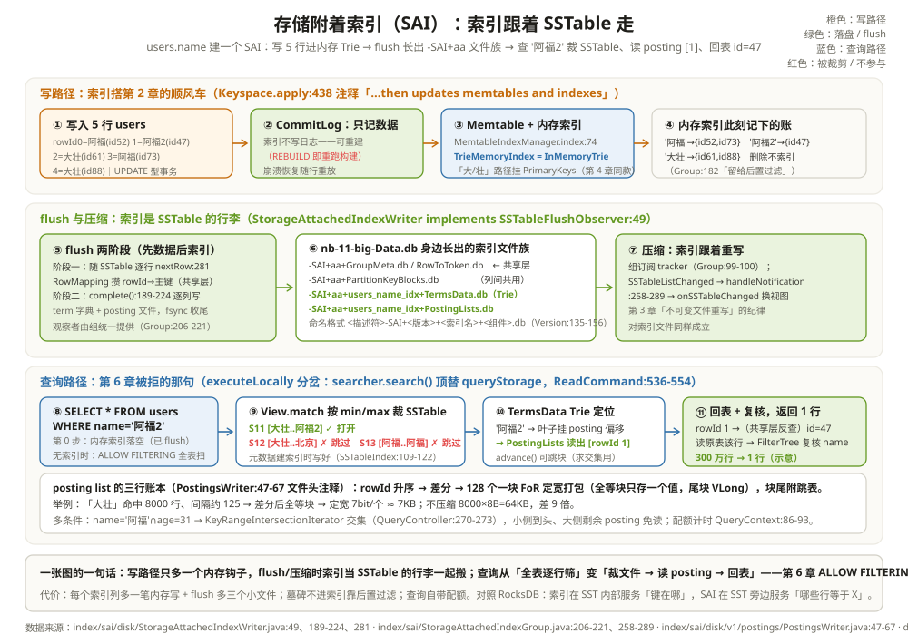

# 存储附着索引（SAI）：索引跟着 SSTable 走

第 6 章埋的雷到引爆的时候了。业务同学按名字反查用户：`SELECT * FROM users WHERE name = '阿福2'`，cqlsh 回了一句 `Cannot execute this query as it might involve data filtering`——name 既不是分区键也不是聚簇列，引擎拒绝替你全表扫描；强行加 `ALLOW FILTERING`，5 亿行的表直接跑不动。当时的药方是「改主键设计」，可主键动不了的场景遍地都是：users 表按 id 组织了三年，谁能为了一个反查需求重建全表？

本章的答案是 Cassandra 5.0 引入的 Storage-Attached Indexing（SAI）：给普通列建索引，让 `WHERE name = '阿福2'` 变成能「定位」的查询。它的关键设计藏在名字里——**索引附着在存储上**：不建另一张隐藏表，而是每个 SSTable 旁边挂一小份自己的索引文件，SSTable 生成时索引同步生成，SSTable 被压缩合并时索引跟着重写。看懂了第 3 章（SSTable 不可变）和第 4 章（内存 Trie），这一章就是给它们加的一层外挂。

看这一章要带着两个问题。第一，**索引写在哪、何时写**：答案会和第 2 章的写路径严丝合缝地咬在一起——Memtable 期间进内存索引，flush 时落盘，压缩时重写，全程没有一次「额外跑一遍数据」的索引维护任务。第二，**查询怎么用上它**：答案会接到第 10 章的读路径上——副本本地的 `executeLocally` 里有一个分岔口，有索引时走完全不同的数据来源。

全章跟一个索引走。先把它建出来，再看 node2 上这 5 行数据：

```text
贯穿全章的索引与数据（node2 视角，keyspace demo）：

CREATE INDEX users_name_idx ON demo.users (name) USING 'sai';

此刻 node2 上 users 的 5 行（rowId = 行在本 SSTable 里的序号）：
rowId 0 : id=52  name='阿福'
rowId 1 : id=47  name='阿福2'    ← 贯穿主角，ts=1005 胜出的版本（第 7 章）
rowId 2 : id=61  name='大壮'
rowId 3 : id=73  name='阿福'
rowId 4 : id=88  name='大壮'

name 索引真正记住的，只有右边的映射（term → posting list）：
'阿福'  → [0, 3]
'阿福2' → [1]        ← 第 6 章那句被拒的查询，答案就在这一个数字里
'大壮'  → [2, 4]
```

注意索引里没有 name 的原文 × 行数的乘积——「阿福」出现 2 次只在 Trie 里存一个词，posting list `[0, 3]` 才是它全部的行踪。这个「值 → 一串行号」的结构叫**倒排索引**，SAI 的全部故事都围绕它：写入时怎么攒、落盘时怎么压、查询时怎么用。

---

## 一、SAI 是什么：索引文件长在 SSTable 旁边

SAI 的入口类叫 `StorageAttachedIndex`（`index/sai/StorageAttachedIndex.java:122`），索引类型名就叫 `sai`（`:124`）。一句话定义：**每列一个索引，索引数据按 SSTable 切片**。它对老二级索引（2i）的颠覆用两个方法就能说清（`:484-489`）：`isSSTableAttached()` 返回 true，`getBackingTable()` 返回空——它**没有**后台表。旧 2i 的做法是在本地另建一张隐藏表来存索引数据，等于每次写都要多写一张表、查询还要扫本地表；SAI 则把索引直接摊在每个 SSTable 身上。

落到磁盘上，`ls` 一下数据目录最直观：

```text
举例：users 表 name 列建索引后，node2 数据目录多出的文件
nb-11-big-Data.db                                  ← 数据（第 3 章）
nb-11-big-SAI+aa+GroupMeta.db                      ← per-SSTable 共享索引头
nb-11-big-SAI+aa+RowToToken.db                     ← rowId → token 映射（共享）
nb-11-big-SAI+aa+PartitionKeyBlocks.db             ← rowId → 分区键块（共享）
nb-11-big-SAI+aa+users_name_idx+TermsData.db       ← name 列的 term 字典
nb-11-big-SAI+aa+users_name_idx+PostingLists.db    ← name 列的 posting 文件
nb-11-big-SAI+aa+users_name_idx+ColumnComplete.db  ← 「这列索引建完了」的标记
```

命名格式 `<SSTable 描述符>-SAI+<版本>(+<索引名>)+<组件名>.db` 定义在 `index/sai/disk/format/Version.java:135-156`。两屋分治（`index/sai/disk/v1/V1OnDiskFormat.java:67-101`）：**per-SSTable 共享层**（`RowToToken`、`PartitionKeyBlocks` 等，给所有索引列共用——rowId 对应哪个主键，问一次就够）+ **per-column 层**（文字列 `TermsData`+`PostingLists`，数值列换成 `BalancedTree`）。在 users 上再给 age 建个 SAI，共享层一个字节不加，只多三个 `age_idx` 开头的小文件。

能建索引的列型几乎全开（`SUPPORTED_TYPES`，`index/sai/StorageAttachedIndex.java:168-174`）：数值、时间、UUID、文本、blob、集合、以及下一章的主角向量——这也解释了为什么组件枚举里既有 Trie 用的 `TermsData` 又有数值用的 `BalancedTree` 还预留了 `CompressedVectors`。查询侧则一并列支持 `=`、范围、`IN`、`CONTAINS` 与 AND/OR 组合——第 6 章那张「什么条件能定位」的表，从这一章起多了一大行。

类比：2i 像「把全馆目录集中搬去另一栋楼」，楼和书架各记各的账，永远对不齐；SAI 像「每个书架侧面挂自己的目录卡」——书架（SSTable）不可变，卡片写完也不变，新书架进场自动带新卡片。

---

## 二、全景部件表：索引的家当分内存与盘上



SAI 的代码都在 `index/sai/` 一个包里，部件不多，一张表放得下。每个部件只记一句话职责，细节留给后面三节：

| 部件 | 住在哪 | 职责一句话 |
| --- | --- | --- |
| StorageAttachedIndex | `index/sai/StorageAttachedIndex.java:122` | 一个索引列的全部家当：校验、写钩子、查询入口 |
| StorageAttachedIndexGroup | `index/sai/StorageAttachedIndexGroup.java:77` | 表级小组：管 flush 观察者、听 SSTable 生命周期通知 |
| MemtableIndexManager | `index/sai/memory/MemtableIndexManager.java:44` | 每个活跃 memtable 对应一份内存索引，随 memtable 生灭 |
| TrieMemoryIndex | `index/sai/memory/TrieMemoryIndex.java:61` | 文字/数值列的内存索引：`InMemoryTrie<PrimaryKeys>` |
| ShardedMemtableIndex | `index/sai/memory/MemtableIndexManager.java:61-72` | 大核机器按 token 区间分片，写锁分家（分片数上限 256，`index/sai/StorageAttachedIndex.java:177`） |
| StorageAttachedIndexWriter | `index/sai/disk/StorageAttachedIndexWriter.java:49` | flush/压缩时的落盘工头，`implements SSTableFlushObserver` |
| RowMapping | `index/sai/disk/RowMapping.java:48` | 写盘期间攒 rowId→主键的映射，喂给共享层组件 |
| SSTableIndex | `index/sai/disk/SSTableIndex.java:59` | 查询侧：一本 SSTable 一份列索引，带 min/max term 元数据 |
| View / IndexViewManager | `index/sai/view/View.java:40` | 不可变视图：哪些 SSTableIndex 可查、按值域挑 |
| StorageAttachedIndexSearcher | `index/sai/plan/StorageAttachedIndexSearcher.java:83` | 查询执行：建迭代器树、回表、事后过滤 |
| QueryContext | `index/sai/QueryContext.java:40` | 一条查询的随身账本与秒表 |

读这张表的姿势：上半（到 StorageAttachedIndexWriter）服务**写与落盘**，下半服务**查询**；中间靠「SSTable 生命周期通知」这条隐线缝合——小组在 `tracker.subscribe`（`index/sai/StorageAttachedIndexGroup.java:99-100`）上挂号，SSTable 一有增删，视图自动换血。三条线（写、落盘、查询）在上面的图里各占一条泳道。

---

## 三、写路径：内存进 Trie，flush 时索引跟数据一起落盘

写入没有单独的「索引路径」，它搭的是第 2 章的顺风车。`db/Keyspace.java:438` 的注释写得很直白：apply 家族「先追加 CommitLog，再更新 memtables **and indexes**」。落到 SAI：`indexerFor`（`index/sai/StorageAttachedIndex.java:644-659`）只在 Memtable 型事务上返回一个 `UpdateIndexer`，注释特意说明「只关心 memtable 里的数据，其余交给 SSTableWriter 的观察者」。也就是说索引在写的头两站（CommitLog、Memtable）只挂了个内存钩子，盘上的事全部推迟到 flush。

三步走：

1. **写 Memtable 时进内存索引**：`UpdateIndexer.insertRow`（`:1075-1078`）调 `memtableIndexManager().index()`（`index/sai/memory/MemtableIndexManager.java:74`）。每个活跃 memtable 懒初始化一份 `MemtableIndex`（`:61-72`）：核多时分片（`ShardedMemtableIndex`，按本地 token 区间切，写锁互不挡），否则一份 `UnshardedMemtableIndex`——文字/数值列里面就是 `TrieMemoryIndex`（`index/sai/memory/TrieMemoryIndex.java:61`），内部是第 4 章 TrieMemtable 同款的 `InMemoryTrie<PrimaryKeys>`（`:67`）。写 rowId 4 的「大壮」，就是在 Trie 里沿「大/壮」的字节路径挂上一个 PrimaryKeys。删除不走索引：注释明说「SAI 不索引删除，留给查询后置过滤」（`index/sai/StorageAttachedIndexGroup.java:182`）。
2. **flush 时索引和数据一起写盘**：flush 观察者由组统一提供（`StorageAttachedIndexGroup.getFlushObserver`，`:206-221`），落到 `StorageAttachedIndexWriter`——它直接 `implements SSTableFlushObserver`（`index/sai/disk/StorageAttachedIndexWriter.java:49`）。两阶段：先随 SSTable 逐行记账（`nextRow` `:281`，把 rowId→主键喂给共享层的 `RowMapping`，`index/sai/disk/RowMapping.java:48`），全部行写完后 `complete()`（`:189-224`）把每个索引列攒的 term 与 posting 写成 `TermsData`/`PostingLists` 文件。
3. **压缩时索引跟着重写**：组订阅了 SSTable 生命周期（`tracker.subscribe`，`index/sai/StorageAttachedIndexGroup.java:99-100`）。flush/压缩/流式传输的新 SSTable 触发 `SSTableAddedNotification`/`SSTableListChangedNotification`（`handleNotification`，`:258-289`），`onSSTableChanged`（`:318-354`）负责把旧索引视图换成新 SSTable 的；memtable 的切换/废弃通知（`:277-288`）则同步清掉内存索引。第 3 章「压缩 = 重写不可变文件」的纪律，SAI 索引文件一样遵守——它就是 SSTable 的行李。

```text
举例：写 rowId 4（id=88, name='大壮'）之后，索引世界的三笔账
CommitLog   ：多的是数据行本身，索引没有日志（崩溃后随 memtable 重放重建）；
内存索引    ：Trie 路径 大→壮 挂上 PrimaryKeys{id=88}，估算内存加一笔
              （adjustMemtableSize，StorageAttachedIndex.java:1086-1091）；
盘上索引    ：0 笔——此刻 name 索引在磁盘上的任何文件都还不知道「大壮」来了。
等这本 memtable flush：nb-12-big-* 落盘，旁边同步长出 -SAI+aa+… 六七个文件。
```

这张账单里最反直觉的是第一行：索引不写 CommitLog。为什么敢？因为索引可以从数据重建——`REBUILD` 索引就是把存量 SSTable 重跑一遍索引构建（构建任务以 compaction 的面目出现在压缩线程池，`index/sai/README.md:43`）。日志是给「唯一真相」用的，派生数据不配占日志。

新建索引那一刻（`CREATE INDEX`）也走同一条重建逻辑，`startInitialBuild`（`index/sai/StorageAttachedIndex.java:951-991`）是范本：先打断进行中的压缩（`:962`，防止刚压完的 SSTable 漏建索引）、再强制 flush 一次（`:969`，把 memtable 里没建过索引的数据先落盘）、然后找出所有没有索引文件的存量 SSTable、按大小分组并行提交给压缩线程池（`:991`）。建完之前索引不可查；建完之后 `ColumnComplete` 标记文件各就各位——这就是数据目录里那颗「完工封条」。

---

## 四、倒排与 posting list：term → 一串 rowId，怎么压得小

倒排是相对「正排」说的：数据文件按行存（第 rowId 1 行的 name 是什么），索引按值存（叫「大壮」的行有哪几个）。连接两边的胶水是 **posting list**：一个 term 名下按升序排列的一串 rowId。接口很小（`index/sai/postings/PostingList.java:26`）：`nextPosting()`（`:51`）吐下一个行号、`advance(target)`（`:71`）直接跳到不小于 target 的行号——单调递增 + 可跳跃，这两个性质是多条件求交集时快的前提。

它凭什么小？压缩策略写在 `index/sai/disk/v1/postings/PostingsWriter.java:47-67` 的文件头注释里：**行号先做差分（delta）**，差分值切成 **128 个一块**，块内用 FoR（Frame of Reference）定宽位打包，全等块（差分全是同一个数）只存一个值，尾巴不满 128 的用 VLong 变长编码，块尾再附一张跳表（skip table）供 `advance` 直接跳块。注释里自带一个分块算例：259 个 posting = 前 256 个打成两个满块 + 剩 3 个一个 VLong 块。

```text
举例：百万行的表里「大壮」出现在 8000 行，posting list 有多小
原始 rowId   ：[2, 127, 252, 377, 502, …]（间隔约 125，共 8000 个）
差分之后     ：[2, 125, 125, 125, 125, …] ← 全等块登场
块内编码     ：125 < 2^7，定宽 7bit 一个 → 8000 × 7bit ≈ 7KB
若不压缩     ：8000 个 long = 64KB，差 9 倍；term 越热（行越多）省得越多
跳表的作用   ：查 name='大壮' AND age=31 时，age 侧只要 rowId 127，
               大壮侧 advance(127) 直接跳过第 0 块，不逐个吐行号
```

term 本身也有字典结构，按列型分三种形态（组件集见 `index/sai/disk/v1/V1OnDiskFormat.java:86-101`）：

| 列型 | term 字典结构 | 组件 | posting 去向 |
| --- | --- | --- | --- |
| 文字（text/blob） | 磁盘字节序 Trie | `TermsData` | `PostingLists` |
| 数值/时间/UUID | 块平衡树（bbtree） | `BalancedTree` | `PostingLists` |
| 向量（下一章） | 近邻图 + PQ 压缩向量 | `CompressedVectors`+`TermsData` | 向量 id → rowId |

文字列的 Trie 和第 4 章 BTI 的思路同宗；`index/sai/disk/format/IndexComponent.java:45` 的注释说明了数值树承载 term → segment row id 的映射。Trie（或平衡树）的叶子挂着「这个 term 的 posting 在 `PostingLists` 文件里的偏移」——查词与取行号，两跳完成。

---

## 五、查询路径：先裁 SSTable，再读 posting，最后回表

有索引时那句被拒了 5 章的查询，在引擎里换了走法。衔接点在副本本地：第 10 章读单送到副本后走 `ReadCommand.executeLocally`，这里有一处分岔（`db/ReadCommand.java:536-554`）——若 `indexQueryPlan` 非空，`searcher.search()` **顶替** `queryStorage()` 成为数据来源。SAI 的 searcher 是 `StorageAttachedIndexSearcher`（`index/sai/plan/StorageAttachedIndexSearcher.java:83`），普通查询走 `ResultRetriever`（`:193`）。

```text
举例：SELECT * FROM users WHERE name = '阿福2' 在 node2 的四步（带三本 SSTable）
第 0 步（兜底）：先问内存索引——本 memtable 没有，落空；
第 1 步（裁 SSTable）：每本 SSTable 的列索引元数据记着 min/max term
   （SSTableIndex.java:109-122）。
   SSTable-11  min='大壮'  max='阿福2'  → '阿福2' 落在区间，打开；
   SSTable-12  min='大壮'  max='北京'   → '阿福2' > max，整本跳过；
   SSTable-13  min='阿福'  max='阿福'   → '阿福2' > max，整本跳过。
   挑选逻辑在 view/View.java:68-74 的 rangeTermTree.search——不是碰运气，
   是拿建索引时写下的账先裁一轮；
第 2 步（读 posting）：SSTable-11 的 TermsData Trie 定位 '阿福2'
   → 叶子给出 posting 偏移 → PostingLists 读出 [rowId 1]，一条；
第 3 步（回表）：rowId 1 经共享层 PartitionKeyBlocks 反查得主键 id=47
   → 按主键去读原表这一行 → FilterTree 事后复核（name 确实等于 '阿福2'）→ 返回。
```

对照无索引的代价，把两条路的开销摆成表（示意量级，假设 users 有 300 万行、3 本 SSTable）：

| 开销项 | 无索引 + ALLOW FILTERING | 有 SAI |
| --- | --- | --- |
| 打开的 SSTable | 3 本全开 | 1 本（min/max 裁掉 2 本） |
| 读的行 | 300 万行逐行取 name 比对 | 1 行（posting 命中 rowId 1，回表） |
| 内存索引 | 无从问起 | 一次 Trie 查询（落空） |
| 事后再过滤 | 无（本来就逐行筛） | FilterTree 复核 1 行 |

索引把「读的行数」从全表压到 posting 命中的行数，把「打开的文件」从全部压到 min/max 裁完的几本——第 6 章 5 亿行的表从「跑不动」变回「毫秒级」，靠的就是这两刀。

多条件查询在同一套结构上做集合运算：`Operation.buildTree → analyzeTree → rangeIterator`（`index/sai/plan/Operation.java:321-323`）把 WHERE 树翻译成 AND/OR（`:54-55`）；严格过滤时每个表达式各出一个行号迭代器，丢进 `KeyRangeIntersectionIterator` 求交集（`index/sai/plan/QueryController.java:270-273`）。

```text
举例：WHERE name='阿福' AND age=31 的交集怎么走（示意）
name 侧：'阿福' → posting [0, 3]，先吐 0；
age 侧 ：31 → posting [0, 2, 3]，当前也是 0 → 两边相等，rowId 0 进结果；
name 侧吐 3 → age 侧 advance(3) 从 2 直接跳到 3（不吐 2）→ 相等，rowId 3 进结果；
name 侧到头 → 交集结束。age 侧若还有 8000 个 posting，余下全部免读。
```

一个细节：命中行里有未修复数据时 AND 会降级成 OR 宁多勿漏，事后由 `FilterTree`（`index/sai/plan/FilterTree.java:96-97`）逐行把关。整条查询还自带计时器：`QueryContext`（`index/sai/QueryContext.java:40`）随身数着 sstablesHit、segmentsHit（`:49-61`），到配额就 `checkpoint()` 抛 QueryCancelled（`:86-93`）——索引查询不许没完没了。

---

## 六、代价与边界：写多几笔小账，读得快不是免费的

索引不是白来的，账要摊开看：

| 账本 | 收/支 | 出处 |
| --- | --- | --- |
| 写放大 | 每个索引列多一笔内存写 + flush 时多写两三个小文件 | `MemtableIndexManager.index:74` 返回的字节数被记进 memtable（`:1086-1091`） |
| 空间 | term 只存一份，posting 压缩后约为原值的零头；多列共享 per-SSTable 层 | `StorageAttachedIndexGroup.totalDiskUsage:449-453` 可查总量 |
| 内存 | 每个活跃 memtable 一份内存索引；写路径上不算便宜但可控 | `MemtableIndexManager.estimatedMemIndexMemoryUsed:173` |
| 读 | 裁 SSTable + 读 posting + 回表，替代全表扫 | 第五节四步 |
| 边界一 | 墓碑不进索引，靠查询后置过滤兜底——索引命中 ≠ 行还活着 | `index/sai/StorageAttachedIndexGroup.java:182` |
| 边界二 | 索引查询有执行配额，超时自查抛异常 | `QueryContext.checkpoint:86-93` |
| 边界三 | 索引构建以 compaction 面目出现，走压缩线程池 | `index/sai/README.md:43` |

文本列还有一档「analyzed / not analyzed」的选择：默认整词匹配（NonTokenizing 分析器，`case_sensitive`/`normalize` 选项见 `index/sai/analyzer/NonTokenizingOptions.java:30-31`），`'阿福2'` 就得整个相等才命中；配置归一化后大小写与全半角不再敏感，分词 analyzed 文本则把一段话拆成多个 term 各挂 posting。

一致性方面没有新账，这点值得单独强调：索引是**本地结构**，每个副本各自维护各自那份，副本之间既不比索引也不传索引（流式传输时索引文件随 SSTable 整体搬运，`index/sai/README.md:33`）。跨副本一致性仍由第 7、10 章的 QUORUM 与读修复管——每个副本各自用本地索引找到行、各自回表读行，再由协调者对账。索引查询只是把「本地怎么找行」换了个算法，物流层一无所知。

```text
举例：users 建两个 SAI（name + age）后，一行 INSERT 的写账
数据行    ：CommitLog 1 笔 + Memtable 1 笔（第 2 章，不变）；
内存索引  ：name 的 Trie 挂 1 个 term、age 的平衡树挂 1 个节点，各 1 笔；
等 flush  ：数据 SSTable 1 套 + 共享层 4 个文件 + name 3 个 + age 3 个小文件。
多一个索引列 ≈ 写路径多一笔内存记账、盘上多三个小文件——线性、可算。
```

---

## 七、和 RocksDB 摆在一起看：谁负责「按值找行」

| 维度 | Cassandra SAI | RocksDB |
| --- | --- | --- |
| 索引回答的问题 | 哪些行的某列 = / 范围 / 包含 X | 这个键在不在这个 SST、在哪个块 |
| 索引放在哪 | SSTable **旁边**的外挂文件（-SAI+aa+…） | SST 文件**内部**（index block、filter block、footer） |
| 数据结构 | term 字典（Trie / 块平衡树）+ posting list | 有序键的块索引 + 布隆过滤器 |
| 多条件组合 | AND/OR 交集并集（plan 包的迭代器代数） | 无此概念（Get / 前缀迭代单键逻辑） |
| 内存层 | Memtable 期间就有 Trie 索引可查 | memtable 自身即有序跳表，无需二级 |
| 压缩时 | 索引文件随 SSTable 一起重写（Notification 机制） | 新 SST 内部重建索引与布隆块 |
| 按「值」找行 | 原生：这就是 SAI 的本职 | 不支持：需应用层自建「值 → 键」反查列族 |

两边最深的同构是那句「**索引跟着不可变文件走**」：RocksDB 压缩产出新 SST 时，块索引与布隆在写文件时内部重建，旧文件连同旧索引一起退役；SAI 的索引文件外挂在旁边，但生命周期完全绑定宿主 SSTable，压缩 = 搬家时把索引当行李一起重写。差别在服务对象：RocksDB 的索引结构全是为「键」服务的（这个键在哪），它的世界里没有「按值找行」这回事——用户要反查，惯用套路是再开一个列族存「值 → 键」，写两遍、自己维护一致性，这其实就是手工版的 SAI；而 Cassandra 把这层做进了存储引擎，写路径自动记账，查询计划自动裁剪。一个把「按值找行」外包给应用，一个把它收编为引擎能力。

---

## 这一章留下的线索

- **SAI = 每列一个索引 + 索引附着在 SSTable 上**：无后台表（`getBackingTable` 为空），per-SSTable 共享层 + per-column 小文件两层分治，文件名 `-SAI+aa+…`；
- **写路径搭第 2 章的顺风车**：Memtable 期间进 `InMemoryTrie`（TrieMemtable 同款），flush 观察者把 posting 写盘，压缩时索引随 SSTable 重写（`handleNotification`）；索引不写 CommitLog，可从数据重建；
- **posting list 是倒排的心脏**：升序 rowId + 差分 + 128 块 FoR 打包 + 跳表，`advance` 让多条件交集不必逐行吐；
- **查询四步**：内存索引兜底 → min/max 裁 SSTable（`View.match`）→ Trie 定位 term 读 posting → 回表 + FilterTree 复核；入口是 `ReadCommand.executeLocally` 里 `searcher.search()` 顶替 `queryStorage()`；
- **第 6 章的雷拆掉了**：`WHERE name='阿福2'` 从「拒绝或全表扫」变成「裁文件、读 posting、回表」；代价是写多几笔小账与查询配额自限时；
- **建索引即重建**：`CREATE INDEX` 打断压缩、强制 flush、按大小分组并行构建（`startInitialBuild:951-991`），构建任务走压缩线程池。

下一章把「按值找行」再往外推一格：当「值」是一个 512 维向量、相等变成「最相似」，posting list 就不够用了——[向量搜索与 ANN：JVector 的近邻搜索](../index/02-向量搜索与ANN.md)。

---

## 附：这一章的源码入口

> 除特别注明外，本节引用的源码文件与行号都来自 apache/cassandra 主分支（7.0-SNAPSHOT，2026-08）。

- `index/sai/StorageAttachedIndex.java:122、124`：SAI 索引类与 `NAME = "sai"`；`:484-489`：`isSSTableAttached()=true`、`getBackingTable()` 为空（对照旧 2i 的本地隐藏表）；`:177-181`：分片上限 256 与默认分片数；`:168-174`：SUPPORTED_TYPES 支持的列型清单
- `index/sai/StorageAttachedIndex.java:644-659`：indexerFor——只在 Memtable 型事务挂 UpdateIndexer；`:1063-1092`：UpdateIndexer（insertRow → 内存索引、内存记账 adjustMemtableSize）；`:951-991`：startInitialBuild（打断压缩 :962、强制 flush :969、并行构建 :991）
- `index/sai/StorageAttachedIndexGroup.java:77、99-100`：组类与 `tracker.subscribe`；`:206-221`：getFlushObserver → flush 观察者；`:258-289`：handleNotification（SSTableAdded/SSTableListChanged/memtable 三通知）；`:318-354`：onSSTableChanged 视图换血；`:182`：不索引删除的注释；`:449-453`：totalDiskUsage
- `index/sai/memory/MemtableIndexManager.java:44、61-72、74-113、173`：内存索引的懒初始化（分片/不分片）、写入入口、内存估算；`index/sai/memory/UnshardedMemtableIndex.java:47、56`：vector/非 vector 的内存索引分派；`index/sai/memory/TrieMemoryIndex.java:61、67`：`InMemoryTrie<PrimaryKeys>`（第 4 章同款）
- `index/sai/disk/StorageAttachedIndexWriter.java:49、66-72、189-224、281`：flush 观察者实现与 complete/nextRow；`index/sai/disk/RowMapping.java:48`：rowId→主键的内存映射
- `index/sai/disk/format/IndexComponent.java:34-113`：全部索引组件枚举（TermsData :51、PostingLists :61、RowToToken :73、GroupMeta :108）；`index/sai/disk/format/Version.java:41-42、135-156`：`SAI`/`+` 分隔符与文件名格式；`index/sai/disk/v1/V1OnDiskFormat.java:67-101`：per-SSTable 与 per-column（文字/数值/向量）组件集
- `index/sai/postings/PostingList.java:26、51、71`：posting 接口（nextPosting/advance）；`index/sai/disk/v1/postings/PostingsWriter.java:47-67`：差分 + 128 块 FoR + VLong 尾块 + skip table 的文件头注释
- `index/sai/disk/SSTableIndex.java:59、109-122、145`：列索引容器与 min/max term 元数据、search 入口；`index/sai/view/View.java:33-40、68-74`：按值域挑 SSTableIndex 的 View
- `index/sai/plan/StorageAttachedIndexSearcher.java:83、133-152、193`：searcher 与 ResultRetriever；`index/sai/plan/Operation.java:50-55、321-323`：AND/OR 与 buildTree→rangeIterator；`index/sai/plan/QueryController.java:245-273`：交集/并集构建；`index/sai/plan/FilterTree.java:43、96-97`：事后过滤与 AND 降级
- `index/sai/QueryContext.java:40、49-61、86-93`：查询读数（sstablesHit 等）与超时 checkpoint
- `db/ReadCommand.java:536-554`：executeLocally——`searcher.search()` 顶替 `queryStorage()` 的分岔；`db/Keyspace.java:438`：apply 注释「…then updates memtables and indexes」
- `index/sai/analyzer/NonTokenizingOptions.java:30-31`：case_sensitive/normalize 选项；`index/sai/README.md:22-45`：SAI 总览与「索引构建即 compaction」
- 官方文档（仓库内 adoc）：`doc/modules/cassandra/pages/developing/cql/indexing/sai/sai-read-write-paths.adoc`——flush 两阶段与「先写数据后写索引」的口径

---

## 思考题

1. `WHERE name = '阿福2' AND age = 31` 两个 SAI 索引求交集：name 侧 posting 命中 3 行、age 侧命中 80 万行。谁应该当「推进基准」？`advance()`（`index/sai/postings/PostingList.java:71`）在小侧 exhausted 时省掉了多少次比较？（提示：交集迭代器总是拿两侧当前行号互推，小侧一断，大侧剩余 posting 全部免读。）
2. 同一本 SSTable 上给 name 和 age 各建一个 SAI，再建第三个 map 类型的 SAI，per-SSTable 共享层（RowToToken、PartitionKeyBlocks 等）会增加几份？per-column 层呢？（提示：`index/sai/disk/v1/V1OnDiskFormat.java:67-101`——共享层与索引个数无关。）
3. 删除 id=47 这行（写墓碑，ts=4008）之后，name 索引里 '阿福2' → [1] 还在不在？随后的 `WHERE name='阿福2'` 会返回这行吗？靠什么机制不返回？（提示：索引不索引删除；回表后 FilterTree 复核时墓碑按时间戳遮蔽。）
4. RocksDB 用户想实现「按值找行」，自建一个 `value → key` 的反查列族。对比 SAI，他要自己负责哪些引擎在 SAI 里替他管了的事？（提示：flush/压缩时索引跟随重写、内存层可查、查询超时自限、多条件交集。）
