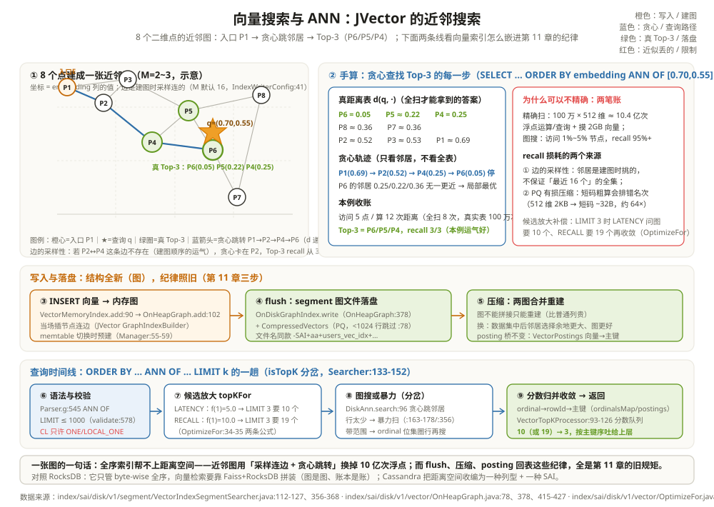

# 向量搜索与 ANN：JVector 的近邻搜索

一个推荐系统的现场。商品描述被嵌入模型转成一串 512 维浮点向量存进 Cassandra，用户来一次浏览，线上要答的问题是「和他当前看的这件最相似的 20 件是什么」。第一次评审，新工程师提的方案朴素得可爱：把 100 万个商品向量全读出来，逐个算距离，排序取前 20。老员工帮他算了笔账：100 万 × 512 维 = 一次查询 5 亿多次乘加，还要把约 2GB 的向量全摸一遍——每秒几十次这样的查询，任何集群都得跪。

换思路：不追求「数学上最近的 K 个」，只追求「大概率很近的 K 个」——用近似换速度，这就是 ANN（Approximate Nearest Neighbor，近似最近邻）。Cassandra 5.0 把它做成了原生的 `vector` 类型加一种 SAI 索引，底层图索引来自 JVector——一个由 Cassandra 核心开发者维护的外部库。本章要看清三件事：为什么精确最近邻贵到不可用、近邻图凭什么省、以及这套路子怎么嵌进第 11 章那套「索引跟着 SSTable 走」的纪律里。

读这一章带两个问题。第一，**「近似」到底丢什么**：答案藏在图的边里——边是建图时采样连的，不保证完备，贪心可能绕过真正的近邻；本章用 8 个点的二维地图把这笔账手算到明处。第二，**向量索引和普通 SAI 差在哪**：答案是「结构全新、纪律照旧」——内存层换成图、盘上层换成 segment 图文件，但 flush 观察、压缩重写、posting 回表这些第 11 章的规矩一步不变。

全章用一张可以手算的二维地图。给 users 表补一列向量（真实场景是 512/1536 维，这里压到 2 维便于跟着算）：

```text
贯穿全章的向量表（node2 视角，keyspace demo）：

ALTER TABLE users ADD embedding VECTOR<FLOAT, 2>;
CREATE INDEX users_vec_idx ON demo.users (embedding) USING 'sai'
  WITH OPTIONS = {'similarity_function': 'cosine'};

8 个点（= users 的 8 行；坐标即 embedding 列的值）：
P1(0.10,0.90)  P2(0.25,0.80)  P3(0.35,0.95)  P4(0.45,0.55)
P5(0.60,0.75)  P6(0.70,0.50)  P7(0.80,0.20)  P8(0.90,0.85)
P6 就是贯穿主角 id=47（阿福2）那一行——第 11 章按 name 精确找到它，
本章按「离 q 最近」也能找到它：两种问法，两套索引，同一行数据。

本章要答的查询（第五节手算）：
SELECT id, embedding FROM users
  ORDER BY embedding ANN OF [0.70, 0.55]   ← 查询向量 q
  LIMIT 3;
```

`vector<float, N>` 是 5.0 新列型：`db/marshal/VectorType.java:46` 定义 `VectorType`，维度必须为正（`:91`），同维度实例按 (类型, 维度) 缓存复用（`:104`）。它就是定长的 float 数组，比较、序列化都按整块处理——但注意「比较」这件事本身：向量之间没有全序，只有距离。

---

## 一、VECTOR 类型与 ANN 问题：为什么精确解贵到不可用

嵌入模型一句话：把一段文本/图片映射成一个向量，语义相近的东西在向量空间里距离相近。于是「找相似」变成「找最近」——听起来像索引问题，坏消息是它和 Cassandra、RocksDB 乃至一切 B+树/LSM 擅长的事**正交**。

先算清楚精确解的账，用贯穿案例放大到真实规模：

```text
举例：100 万向量 × 512 维，一次精确 Top-20 的成本
每向量距离：512 次乘法 + 512 次加法 ≈ 1024 次浮点运算（欧氏或余弦同量级）
全部扫完  ：100 万 × 1024 ≈ 10.4 亿次浮点运算 / 每次查询；
向量体积  ：100 万 × 512 × 4B = 2GB——每查询都要全部摸一遍（缓存装不下时就是盘 I/O）；
对照      ：token(id=47) 点查只算一次 MurmurHash（第 6 章），一次乘加都没有。
```

为什么第 6 章的令牌环、第 4 章的 Trie 都帮不上忙？因为它们全靠**全序**：键能排出「谁在谁前面」，二分/前缀裁剪才有意义。而向量空间里「近」不是序关系——q 的最近邻在 P6，q 的次近邻可能在任何方向；没有一种按键的排列能让「最近的 K 个」聚在一个连续区间里。精确最近邻在最坏情况下必须两两比距离，这是数学，不是工程优化空间。

把两种空间的性质摆开，差异一目了然：

| 性质 | 全序空间（键） | 距离空间（向量） |
| --- | --- | --- |
| 任意两元素 | 可比大小（a<b / a=b / a>b） | 只可比距离远近，无大小 |
| 「相邻」的含义 | 序上紧挨着（token(47) 与 token(48)） | 距离小（方向可以完全相反） |
| 裁剪手段 | 二分、前缀、范围、布隆 | 只能靠预建的近邻结构跳着找 |
| 精确 Top-K | 索引天然支持（区间即答案） | 两两比距离，无捷径 |
| 近似 Top-K | 用不上（已经精确） | 图索引：访问少数节点，高概率命中 |

ANN 的交换就在这里：放弃「保证是最近的 K 个」，接受「大概率是」。工程上的报偿是惊人的——好的图索引每次查询只访问 1%~5% 的节点，recall（真实最近 K 个里被找到的比例）能到 95%+。对推荐、语义查重、RAG 检索这类场景，「第 7 相似」错成「第 9 相似」几乎无感，快 50 倍却是真金白银。

```text
举例：两种空间各问一句「附近有什么」
全序空间：WHERE id = 47               → 一次 MurmurHash + 令牌环定位（第 6 章）；
距离空间：ANN OF [0.70, 0.55] LIMIT 3 → 没有任何键可算，只能问「谁离得近」。
users 表同时养着两种问法——id 走令牌环，embedding 走近邻图，井水不犯河水。
```

---

## 二、JVector：外部库 + Cassandra 集成层

JVector 是谁？`io.github.jbellis:jvector`——Cassandra 的外部依赖（`io.github.jbellis` 就是 Cassandra 的原核心开发者 Jonathan Ellis 的 GitHub 坐标），5.0 系列随 Cassandra 一起发行。源码不在 Cassandra 仓库里：依赖声明在构建文件（groupId `io.github.jbellis`），仓库内只有**集成层**——`index/sai/disk/v1/vector/` 一整个目录加上 `index/sai/memory/VectorMemoryIndex.java`。这一章的行号全部来自集成层；JVector 内部（图怎么建、怎么搜）按官方文档定性描述，不假装读了它的源码。

集成层的角色分工，一张表说清：

| 集成类 | 住在哪 | 职责一句话 |
| --- | --- | --- |
| VectorMemoryIndex | `index/sai/memory/VectorMemoryIndex.java:72` | memtable 期间的向量索引：包一个内存图 |
| OnHeapGraph | `index/sai/disk/v1/vector/OnHeapGraph.java:74` | 内存图本体：JVector 的 GraphIndexBuilder（`:88`）+ 向量→主键的登记簿 |
| VectorPostings | `index/sai/disk/v1/vector/VectorPostings.java:30` | 一个向量（图节点）名下挂的主键清单——名字呼应第 11 章的 posting list |
| DiskAnn | `index/sai/disk/v1/vector/DiskAnn.java:43` | 盘上图：JVector 的 OnDiskGraphIndex 加缓存壳（`:61`） |
| VectorIndexSegmentSearcher | `index/sai/disk/v1/segment/VectorIndexSegmentSearcher.java:72` | 每个 segment 的 ANN 查询执行器：调图、少行时改暴力扫 |
| VectorTopKProcessor | `index/sai/plan/VectorTopKProcessor.java:65` | 收尾：多副本/多 segment 的分数归并出最终 Top-K |
| IndexWriterConfig | `index/sai/disk/v1/IndexWriterConfig.java:37` | 三个旋钮：M、建图束宽、相似度函数 |

「外部库 + 集成层」这个结构值得记一笔：Cassandra 没有把向量代码 fork 进来，而是像对待 Netty、Guava 一样对待 JVector——边界清楚，升级独立；而**生命周期管理**（何时建、何时落盘、何时合并、查询怎么接）全部由集成层对齐 SAI 的既有纪律。这正是第 11 章的胜利的延续：向量索引不需要发明新的存储管理，租用现成的就行。

---

## 三、索引结构定性：近邻图 + PQ 压缩，边是采样出来的

JVector 的图索引属于 HNSW 一族（分层可导航小世界图）。不深入库内部，按结构和行为定性：

- **每个向量是图上一个节点，边连向它的若干个近邻**。建图时每个节点的邻居数有上限 M——Cassandra 默认 16（`index/sai/disk/v1/IndexWriterConfig.java:41` 的 `DEFAULT_MAXIMUM_NODE_CONNECTIONS = 16`），建图时的搜索束宽默认 100（`:45`）。**关键理解：边不是「最近的 16 个」的全集保证，而是建图过程采样出来的**——先插入的点只能在当时已存在的点里挑邻居，后插入的点可能反超它们。图的边天生「不完备」，这就是 ANN「近似」二字的源头。
- **分多个入口层**：上层稀疏（跳远点用）、下层稠密（精确逼近用），思想同跳表的分层——查询从顶层入口粗跳，逐层下降。集成层甚至写了期望访问节点数的估算公式（`VectorMemoryIndex.expectedNodesVisited`，被 `index/sai/disk/v1/segment/VectorIndexSegmentSearcher.java:370-374` 调用做暴力/图搜的分岔决策）。
- **PQ 压缩向量省内存**：图搜每一步都要算距离，用原始 512 维 float 太贵。JVector 把向量做乘积量化（Product Quantization）压成短码，先用短码粗算、再对候选用原始向量精算。集成侧的开关是 `index/sai/disk/v1/vector/OnHeapGraph.java:78` 的 `MIN_PQ_ROWS = 1024`——少于 1024 个向量不值得压缩；压缩与写入在 `:415-427`（`ProductQuantization.compute` + `CompressedVectors`），落盘文件就是第 11 章组件表里的 `CompressedVectors`（`index/sai/disk/v1/V1OnDiskFormat.java:97-101` 的 VECTOR_COMPONENTS）。
- **posting list 把向量映射回行**：图节点用的是自己的序号（ordinal），查到「ordinal 7 最近」还不能回答 SQL——`VectorPostings`（`:30`）把每个向量登记成 `向量 → 主键清单`（`:32` 的 postings 列表、`:47-50` 的 ordinal、`:94` 的 getRowIds），盘上对应 `OnDiskOrdinalsMap`（rowId ↔ ordinal 互查）。第 11 章的倒排词汇在这里换了语义：term 换成向量，posting 仍是「找到行」的桥。



与第 11 章逐项对齐着看，结构是同构的、术语换了行头：

| 第 11 章（name 列） | 本章（embedding 列） | 语义差别 |
| --- | --- | --- |
| term = '阿福2' | 向量 [0.70,0.50] | 值从可比的字符串变成不可比的坐标 |
| 内存 Trie | 内存近邻图 OnHeapGraph | 查找从「走前缀」变成「贪心跳邻居」 |
| TermsData Trie（盘） | 图文件 + OnDiskOrdinalsMap | 字典换图，posting 桥不变 |
| posting = [rowId] | VectorPostings → rowIds | 名字都懒得换 |
| min/max 裁 SSTable | 无可裁——全部 segment 都要问（`index/sai/view/View.java:70-71`） | 值无区间可言，只能撒网 |

```text
举例：贯穿案例 8 个点建成的近邻图（M=2~3，手工示意）
P1 ↔ P2,P3    P2 ↔ P1,P3,P4    P3 ↔ P1,P5    P4 ↔ P2,P5,P6
P5 ↔ P3,P4,P6,P8    P6 ↔ P4,P5,P7    P7 ↔ P6,P8    P8 ↔ P5,P7
入口 E = P1（顶层稀疏入口）。注意 P4 ↔ P6 这条边存在纯属建图顺序的运气——
若 P6 先插入、P4 后到，这条边可能不存在，贪心就可能绕远：这就是「近似」。
```

PQ 压缩再算一笔明白账：512 维 float32 一个向量 2KB，100 万个就是 2GB——图搜每跳都要算距离，全用原始向量，内存和 CPU 都吃不消。PQ 把 512 维切成若干子段、每段量化成一个字节短码（示意：32 段 × 1B = 32B，约 64 倍压缩），图上先拿短码粗算距离、对最终候选再取原始向量精算重排。短码有损，粗算会排错相邻名次——这是 recall 损耗的第二个来源（第一个是边的采样性）。少于 1024 个向量时 Cassandra 干脆不压（`MIN_PQ_ROWS`），量小不值当。

---

## 四、写入与落盘：memtable 图 → flush segment → 压缩合并

向量索引的写路径严格复用第 11 章的三步，只有一处向量特有的小分岔：

1. **写 Memtable 时进内存图**：`INSERT … embedding=[0.70,0.50]` 走 `UpdateIndexer.insertRow`（第 11 章同一入口），落到 `VectorMemoryIndex.add`（`index/sai/memory/VectorMemoryIndex.java:90-98`）——它把向量连同主键交给 `OnHeapGraph.add`（`:100-107`），JVector 的建图器当场把节点插进图。**与普通列的差别在初始化时机**：普通列的内存索引等到第一次写才懒初始化，向量列在 memtable 切换通知到达时就预建好（`MemtableIndexManager.maybeInitializeMemtableIndex:55-59`，由 `index/sai/StorageAttachedIndexGroup.java:281-284` 触发）——因为空图也要占结构，晚建不如早建。改写同一行的向量时走 `update`（`:110-139`）：先加新向量再删旧的，避免出现「行不在索引里」的窗口。
2. **flush 时落成 segment**：flush 观察者照旧（第 11 章 `StorageAttachedIndexWriter`），向量列把内存图整个写成磁盘上的图文件（`OnHeapGraph` 的写侧调 JVector 的 `OnDiskGraphIndex.write`，`:378`）加 PQ 压缩向量文件。每个 SSTable 一个 segment，文件名同款 `-SAI+aa+users_vec_idx+…`。行数少于 1024（`MIN_PQ_ROWS`）时跳过压缩，直接存原始向量。
3. **压缩时 segment 合并**：多本 SSTable 压缩成一本，各自的图 segment 合并重建成一张大图——照旧由 `handleNotification` 驱动（第 11 章）。图不能「拼接」，只能重建，这是向量索引压缩比普通列贵的原因；换来的是图的质量随数据集中而提高（边的选择余地更大）。

```text
举例：写 P6(0.70,0.50)（id=47 的向量，示意）之后的三笔账
CommitLog   ：只记数据行（向量是数据，索引仍是派生）；
内存图      ：OnHeapGraph.add 插节点 + 连边（≤M 条），VectorPostings 登记
             向量→{id=47}，估算内存 +512 维 float + 图节点开销；
盘上        ：0 笔——flush 时才落 segment。
```

一条时间线看 8 个点的索引一生：

| 时刻 | 事件 | 索引形态 |
| --- | --- | --- |
| INSERT P1 | memtable 收行 | 内存图 1 节点（邻居只能空着——图里没别人） |
| INSERT P2~P5 | 陆续插入 | 每个点当场找邻居连边；先来的点也可能被后来的反超 |
| flush | memtable 落盘 | segment 文件：图 + PQ 短码（8 < 1024，跳过压缩） |
| INSERT P6~P8 | 新 memtable | 第二张内存图从零建起，与盘上 segment 互不知晓 |
| 再 flush | 第二本 SSTable | 第二个 segment——查询时两张图都要问 |
| 压缩 | 两本合一 | 两图合并重建为一张（邻居重挑，质量更好） |

与 name 索引逐格对照，唯一多出来的功课是最后一行：Trie 的合并是归并排序，图的合并是重建——这也是向量索引的压缩成本曲线更陡的原因。

---

## 五、查询路径：ORDER BY ANN OF 的 Top-K 之旅

语法先立住：`ORDER BY embedding ANN OF [0.70, 0.55] LIMIT 3`。`ANN OF` 写在 ORDER BY 里是 5.0 的语法扩展（`src/antlr/Parser.g:545` 的 `orderByClause` 规则，`cident (K_ANN K_OF t=term)?`；操作符枚举 `cql3/Operator.java:624` 的 `ANN(15)`）。LIMIT 必须带且不得超 1000（`index/sai/StorageAttachedIndex.java:578-586` 的 validate，上限来自 `IndexWriterConfig.MAX_TOP_K:59`，默认 1000 配在 `config/CassandraRelevantProperties.java:556`）——ANN 没有「全量排序返回」这个语义，K 就是契约。

与 StorageProxy 的衔接只有一条路：ANN 查询被当作带索引的范围读（range read）派发——`View.match` 对 ANN 表达式返回全部 segment（`index/sai/view/View.java:68-71`，值无区间可裁），每个持数据的副本各自用本地索引算出带分数的 Top-K，协调者收到后交给 `VectorTopKProcessor` 归并。这解释了实验性限制里的第一条：CL 只许 ONE/LOCAL_ONE——多副本一致性对「分数归并」还没有定义清楚，干脆先关上门。

```text
举例：q=(0.70,0.55)，8 点图上贪心找 Top-3（全流程手算）
准备   ：真距离 d(q,·)——P6=0.05、P5=0.22、P4=0.25、P8=0.36、P7=0.36、
         P2=0.52、P3=0.53、P1=0.69（先记下，等下对照图找到几个）；
① 入口 ：从 E=P1 出发，d=0.69，候选池=[P1]；
② 贪心 ：看 P1 的邻居 P2(0.52)、P3(0.53)——都比 0.69 近，跳到最近的 P2，
         候选池=[P1,P2,P3]；
③ 再跳 ：P2 的邻居里 P4(0.25) 最近 → 跳到 P4，候选池=[P2,P3,P4]；
④ 再跳 ：P4 的邻居里 P6(0.05) 最近 → 跳到 P6，候选池=[P4,P5,P6]；
⑤ 停   ：P6 的邻居 P4(0.25)、P5(0.22)、P7(0.36) 没有一个比 0.05 近——
         局部最优，图搜索结束。访问 5 个点、算 12 次距离（全扫是 8 次 ×
         但真实场景是 100 万次）；
⑥ 收尾 ：候选池按距离收敛回 Top-3：P6(0.05)、P5(0.22)、P4(0.25)——
         本例恰好是真 Top-3；「近似」丢的是没被走到的点——若 P2↔P4 的边
         不存在（第三节说过，边是采样出来的），贪心会卡在 P2，把 P4、P6
         全漏掉，recall 随之掉。
```

代码里的对应件：`VectorIndexSegmentSearcher.orderBy`（`index/sai/disk/v1/segment/VectorIndexSegmentSearcher.java:112-127`）取 limit 后先乘一个放大系数问图要多一点候选（`:122` 的 `topKFor`——`index/sai/disk/v1/vector/OptimizeFor.java:34-35` 两条公式：LATENCY 档 `LIMIT 3` 问图要 10 个、RECALL 档要 19 个，最后再收敛回 3）；图搜本身是 `DiskAnn.search`（`index/sai/disk/v1/vector/DiskAnn.java:96`）。两个分支值得记：**行数太少时干脆暴力扫**（`:163-178` 与 `maxBruteForceRows:356-368`——预计比较次数 × 折算系数不划算就放弃图，直接逐向量算，反而更快），**带 WHERE 范围时先圈行再在圈内搜图**（`:180-206`，用 ordinal 位集当图搜的准入名单）。

把这条查询的完整时间线摆成表（谁在什么时候做什么）：

| 阶段 | 部件 | 行为 | 本章的数字 |
| --- | --- | --- | --- |
| 语法 | Parser.g:545 | `ORDER BY … ANN OF …` 进树 | Operator.ANN(15) |
| 校验 | StorageAttachedIndex:578-586 | LIMIT ≤ 1000，超了拒 | MAX_TOP_K 默认 1000 |
| 选视图 | View.java:68-71 | ANN 不裁 segment，全问 | 3 个 segment（示意） |
| 图搜 | VectorIndexSegmentSearcher:112 | topKFor 放大候选 | LATENCY 10 / RECALL 19 |
| 映射 | OnDiskOrdinalsMap + VectorPostings | ordinal → rowId → 主键 | 候选各回各行 |
| 归并 | VectorTopKProcessor:93-126 | 分数优先队列收敛 | 10 → 3 |

多 segment、多副本的分数怎么归一？`StorageAttachedIndexSearcher.search`（`index/sai/plan/StorageAttachedIndexSearcher.java:133-152`）看到 `command.isTopK()` 就换 `ScoreOrderedResultRetriever`，交给 `VectorTopKProcessor`（`:65`）：一个按分数升序的优先队列装候选（`:93-94`），超过 limit 就弹出分数最低的（`:124-126`），最后按主键序吐给上层。另一个诚实提示写在 `index/sai/StorageAttachedIndex.java:126-134`：向量索引仍是 experimental——CL 高于 ONE/LOCAL_ONE、分页、无 LIMIT、PER PARTITION LIMIT、GROUP BY 都不支持。云上广告牌再亮，源码注释才是真相。

---

## 六、和 RocksDB 摆在一起看：全序索引帮不上距离空间

| 维度 | Cassandra + JVector | RocksDB |
| --- | --- | --- |
| 查询语义 | 「与 X 最相似的 K 个」（距离空间 Top-K） | Get / 范围（全序空间点查与区间） |
| 原生向量支持 | `vector<float,N>` 列型 + SAI 图索引 | 无——键值都是字节串，无距离概念 |
| 索引结构 | 分层近邻图 + PQ 压缩（外部库 JVector） | 块索引 + 布隆（全序结构的看家本领） |
| 精确解的代价 | 100 万×512 维 ≈ 10 亿次浮点/查询 | 精确解本来就便宜（这正是全序的红利） |
| ANN 的实现层 | 引擎内置：列型、索引、查询语法一体 | 应用层拼装：Faiss/HNSW 库 + RocksDB 存向量与 id |
| 谁保证正确性 | recall 概率保证（图的质量决定） | 语义上 100%（全序查找无近似） |

根本差异一句话：**全序索引的前提是问题能映射成「序」**。RocksDB 的全部智慧——跳表、分层 LSM、块索引、布隆——都建立在「键可比大小」上；距离空间没有这个前提，q 的近邻散落在四面八方，任何按键的排列都聚不拢它们。所以 RocksDB 世界里的向量检索从来是拼装货：Faiss（或 hnswlib）建图搜图，RocksDB 存「向量 id → 行」做回表——图是图、账本是账，一致性、快照、压缩感知全要自己缝。Cassandra 走的是另一条路：把距离空间的索引收编为一种列型 + 一种 SAI，图文件跟着 SSTable 走、跟着压缩重建、跟着快照备份（第 11 章的纪律原封不动地罩住了向量）。两边的分工其实很清楚：RocksDB 继续做「字节串的全序专家」，距离空间的事要么上交应用层，要么交给把它当一等公民的引擎。

```text
举例：同一个「找相似」需求的两套账
拼装（Faiss + RocksDB）：应用写两份（图库一份、KV 一份）；快照/恢复自己管；
  压缩不知道图的存在；扩容搬数据时图要在新节点重建——全是应用层的活。
内置（Cassandra + JVector）：写一份，索引自动跟；快照带着 -SAI+aa+vec 文件走
  （第 11 章 README:33-34）；压缩自动重建图——代价是把「实验性」三个字
  写进了源码注释（CL>ONE 等限制，StorageAttachedIndex.java:126-134）。
```

---

## 这一章留下的线索

- **精确最近邻在距离空间没有免费午餐**：100 万×512 维一次查询 ≈ 10 亿次浮点 + 2GB 扫描；ANN 用 recall 换速度，访问 1%~5% 节点拿到 95%+ recall；
- **JVector 是外部库，仓库里只有集成层**：`index/sai/disk/v1/vector/` + `index/sai/memory/VectorMemoryIndex.java`；图（分层近邻 + PQ）按官方定性理解，生命周期全由 SAI 纪律接管；
- **边的采样性是「近似」的根源**：M=16、束宽 100（`index/sai/disk/v1/IndexWriterConfig.java:41、45`）；候选放大 LATENCY/RECALL 两档公式（`index/sai/disk/v1/vector/OptimizeFor.java:34-35`），最终由 `VectorTopKProcessor` 收敛回 LIMIT；
- **写读仍是第 11 章那套**：memtable 进内存图（向量列在 memtable 切换时预建）、flush 落 segment、压缩合并重建；查询 `ORDER BY … ANN OF … LIMIT k`（≤1000），少行时自动退化为暴力扫；
- **实验性边界要看源码注释**：CL>ONE、分页、无 LIMIT 等限制写在 `index/sai/StorageAttachedIndex.java:126-134`——不是营销话术，是工程承诺的边界。

下一章从索引转向运维的第一课：副本悄悄不一致了谁来抹平——[修复与反熵：Merkle 树、Hint 与读修复](../operations/01-修复与反熵.md)。

---

## 附：这一章的源码入口

> 除特别注明外，本节引用的源码文件与行号都来自 apache/cassandra 主分支（7.0-SNAPSHOT，2026-08）。

- `db/marshal/VectorType.java:46、91、104`：`vector<float,N>` 列型（VectorType）、维度必须为正、按 (类型,维度) 缓存实例
- `index/sai/disk/v1/IndexWriterConfig.java:37、41、45、48、54、59`：向量索引三旋钮（M=16、束宽 100、COSINE 默认相似度）、LATENCY 默认档、MAX_TOP_K
- `config/CassandraRelevantProperties.java:556`：`cassandra.sai.vector_search.max_top_k` 默认 1000
- `index/sai/memory/VectorMemoryIndex.java:72、74、85、90-107、110-139、298`：内存向量索引（OnHeapGraph 包装、add/update、writeDirect 落盘）；`index/sai/memory/MemtableIndexManager.java:55-59`：向量列在 memtable 切换时预初始化
- `index/sai/disk/v1/vector/OnHeapGraph.java:74、78、85、88、320、378、415-427`：内存图本体（GraphIndexBuilder、MIN_PQ_ROWS=1024、并发插入上限、search、OnDiskGraphIndex.write、PQ 压缩）
- `index/sai/disk/v1/vector/DiskAnn.java:43、61、96`：盘上图容器（CachingGraphIndex + OnDiskGraphIndex）与 search 入口
- `index/sai/disk/v1/segment/VectorIndexSegmentSearcher.java:72、80、93、112-127、122、163-178、180-206、356-368、370-374`：segment 级 ANN 执行器（orderBy、topKFor、暴力扫分岔、范围圈行、期望访问估算）
- `index/sai/disk/v1/vector/VectorPostings.java:30、32、47-50、94`：向量→主键的 posting 登记；`index/sai/disk/v1/vector/OnDiskOrdinalsMap.java`：rowId↔ordinal 互查
- `index/sai/disk/v1/vector/OptimizeFor.java:32、34-35、44`：LATENCY/RECALL 候选放大公式（f(1)=5.0 / 10.0）与 topKFor
- `index/sai/plan/VectorTopKProcessor.java:57-65、93-94、124-126`：分数优先队列收敛 Top-K；`index/sai/plan/StorageAttachedIndexSearcher.java:133-152`：isTopK 分岔（:149 takeTopKThenSortByPrimaryKey）
- `index/sai/StorageAttachedIndex.java:126-134、146、578-586`：实验性限制全文、ANN LIMIT 上限报错、ReadCommand 校验
- `src/antlr/Parser.g:545`：`ORDER BY col ANN OF term` 语法规则；`cql3/Operator.java:624`：ANN 操作符；`index/sai/plan/Expression.java:257`：IndexOperator.ANN；`index/sai/view/View.java:55-58、68-71`：向量不进范围树、ANN 全 segment 查
- `index/sai/disk/v1/V1OnDiskFormat.java:97-101`：VECTOR_COMPONENTS（META、COMPRESSED_VECTORS、TERMS_DATA、POSTING_LISTS）
- 依赖与文档：`io.github.jbellis:jvector` 为外部依赖（构建文件 groupId/io.github.jbellis，仓库内只有集成层）；`doc/modules/cassandra/examples/CQL/sai/select-vsearch-cycling.cql` 的 ANN 查询示例与「LIMIT ≤ 1000」注记

---

## 思考题

1. 同一个 8 点图，把查询挪到 q=(0.30,0.60)，贪心从 P1 会怎么走？如果删掉 P2↔P4 这条边，结果差在哪？（提示：先算 d(q,·)：P4=0.16、P2=0.21、P3=0.35、P5=0.34；边不存在时贪心卡在 P2，Top-3 的 recall 从 3/3 掉到 1/3。）
2. `LIMIT 3` 时 LATENCY 档问图要 10 个候选、RECALL 档要 19 个（`index/sai/disk/v1/vector/OptimizeFor.java:34-35`）。多要的候选最后去哪了？代价落在哪一步？（提示：`index/sai/plan/VectorTopKProcessor.java:124-126` 收敛回 3；多要的候选让图搜走得更深——访问节点更多、时延更长。）
3. 为什么向量列的内存索引在 memtable 切换时就预建（`index/sai/memory/MemtableIndexManager.java:55-59`），普通列却等第一次写？为什么向量索引的 update 要「先加新再删旧」（`index/sai/memory/VectorMemoryIndex.java:110-139`）？（提示：空图也有结构成本；行不在索引的窗口对 ANN 意味着什么。）
4. 用 Faiss + RocksDB 自建向量检索，要自己补上哪些 Cassandra 集成层免费送的功课？（提示：索引随 SSTable 落盘/压缩重建、快照与流式传输带着索引走、查询配额与实验性边界、segment 合并重建图。）
