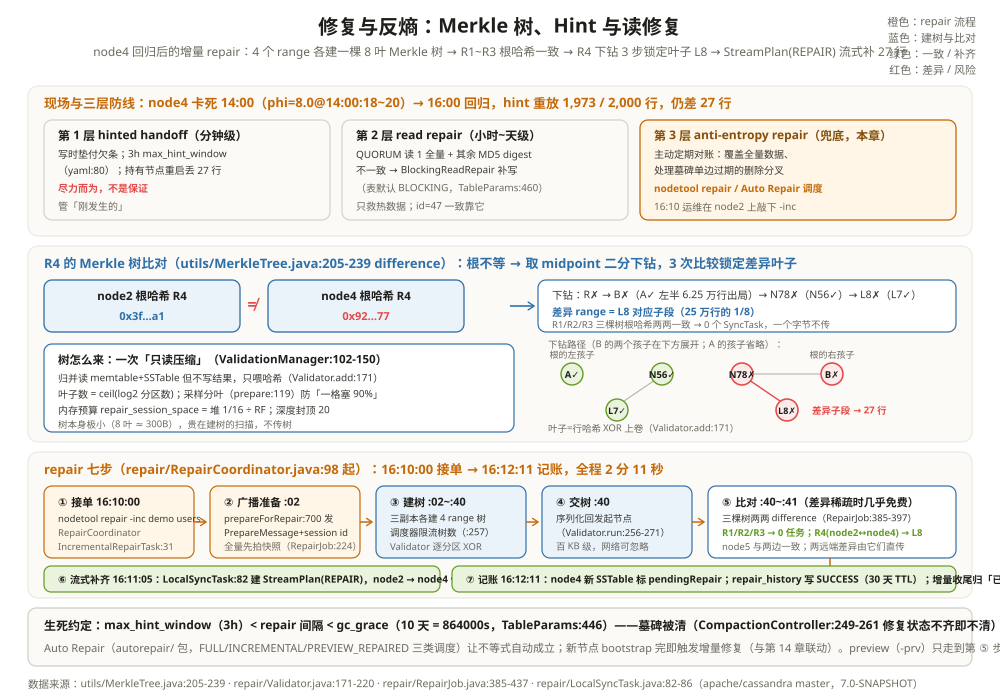

# 修复与反熵：Merkle 树、Hint 与读修复

先看一个让人后背发凉的现场。一位运维工程师周一巡检：上周五 14:00 node4 卡死，16:00 换盘重启回来了，hint 也重放完了，`nodetool` 里一切绿色。可他随手跑了个对账脚本——同一批 users 数据，在 node2、node4、node5 三个副本上 count 出来差了 27 行。没有报错、没有告警、没有任何一条写日志写着「失败」。他提了工单：数据悄悄丢了？

没丢，也没 bug。这正是最终一致系统的底色：**QUORUM 只保证「写进去的确认过了」，从不保证「每个副本每一刻都一模一样」**。副本分叉是常态——节点卡死、hint 丢失、删除的墓碑在某个副本上先过期，都会让三个副本悄悄长出差异。分叉也分冷热：那批 id=101..2100 是刚导入的冷数据，没人读过、read repair 从没轮到；而贯穿全轨道的老朋友 id=47（阿福2，ts=1005）在三个副本上一致——它是热数据，QUORUM 读的摘要比对已经顺手替它对过很多次账。真正的问题是：差异攒下来之后，**谁来对账、怎么找出「哪一段不一样」、找到了怎么补**。本章的主角 repair（修复）与反熵（anti-entropy），就是这套对账机制。

全章沿用第 5、7 章那个现场：

```text
背景：5 节点集群，keyspace demo，表 users，RF=3，CL=QUORUM（2/3）
node4：14:00:00 卡死（phi=8.0@14:00:18~20），16:00 修复重启，缺席 2 小时
缺席期间的写入：业务批量导入 2,000 行 users（id=101..2100，ts=14:00~16:00）
hint 重放：16:00~16:03 补回 1,973 行，仍有 27 行缺失
  （node1 上为 node4 攒的部分 hint 在一次重启后没能完全落盘——hint 从来就是尽力而为）
16:10 运维在 node2 上执行：nodetool repair -inc demo users
本章回答：这 27 行怎么被「算」出来、怎么被「流」过去。
```

---

## 一、为什么需要修复：副本分叉是常态，不是事故

第 7 章讲一致性时留过一个口子：node4 挂掉后，QUORUM 写靠 node2+node5 两个确认照样成功，缺的那份靠 hint 垫付。hint 是一张「我替你记着，你回来我还你」的欠条（`service/StorageProxy.java` 的 `shouldHint` 检查，含 3 小时 `max_hint_window` 窗口，`conf/cassandra.yaml:80`）。但欠条有三处靠不住：持有欠条的节点自己也可能挂（本次 27 行就是这么丢的）；欠条超过 3 小时窗口就作废；欠条重放成功与否没有回执。**hint 是优化，不是保证。**

第二类分叉更隐蔽：删除。第 3 章讲过，删除写墓碑、墓碑默认 10 天（gc_grace=864000，`schema/TableParams.java:446`）后被压缩清掉。如果 node4 缺席期间有人删了数据，墓碑作为一条特殊写入会由 hint 补给它——但如果 hint 没到、node4 上的旧数据还在，而别的副本 10 天后把墓碑清了，两边就永久分叉。这类分叉比「少 27 行」凶险：少行能靠 count 抽出来，「多出一行本该删掉的数据」只有被读到才露馅，而它被读到的那一刻就是一次线上事故。

```text
举例：三类分叉，各自的「肇事时间」
1) 死副本期间的写入：node4 14:00~16:00 缺的 2,000 行 —— hint 补 1,973，剩 27；
2) hint 丢失/过窗：node1 重启丢的 27 行欠条 —— 没人记得写过，只能对账找补；
3) 删除+墓碑过期：14:30 删掉的 3 行，node4 一直没收到墓碑 —— 10 天后别家清了墓碑，
   node4 上的旧数据就成了「僵尸」，读修复偶然路过才会压它一次。
```

所以需要第三种机制：**反熵（anti-entropy）**——不等读写路过，主动定期把副本两两对账、把差异抹平。名字借自热力学（熵=系统自发趋于混乱），人话就是「定期把账本摊开对一遍」。Cassandra 里它叫 repair，由 `nodetool repair` 或 Auto Repair 调度器触发。

---

## 二、三层防线：hint 垫付、读时对账、周期对账

把第 7 章的两个机制和本章的主角摆成一张表，三层各管一个时间尺度：

| 防线 | 触发时机 | 管的时间尺度 | 代价 | 源码入口 |
| --- | --- | --- | --- | --- |
| hinted handoff | 写时发现目标死 | 分钟级：垫付近期欠账 | 持有节点多一份暂存 | `service/StorageProxy.java:3000-3021`（3h 窗口检查） |
| read repair | QUORUM 读发现摘要不符 | 小时~天级：热数据先收敛 | 每次不一致读多一轮写 | `service/reads/repair/BlockingReadRepair.java:75-79`（表默认 BLOCKING，`schema/TableParams.java:460`） |
| anti-entropy repair | 人工/调度器周期触发 | 兜底：一切历史差异 | 全量扫描建树+流式 | `repair/RepairCoordinator.java:98`（本章主角） |

三层是接力关系：hint 管「刚发生的」，read repair 管「经常被读的」，repair 管「全部的」。read repair 的触发点在第 7 章的读路径里：QUORUM 读挑 1 个副本拿全量数据、其余副本只回 MD5 摘要（digest，`db/Digest.java:38-45`），摘要对不上就地触发 `BlockingReadRepair`——表默认就是 BLOCKING 档（`schema/TableParams.java:460`），类注释写得很直白：「Classic read repair. Doesn't allow the client read to return until updates have been written to nodes needing correction」（`service/reads/repair/BlockingReadRepair.java:75-79`）：这次读请求会等修复写完才返回。冷数据一辈子没人读，read repair 永远轮不到它——这就是为什么哪怕 hint 和读修复都开着，**repair 仍是必须定期跑的底线**：它是唯一覆盖全量数据、且能处理「墓碑只在部分副本存在」这种删除分叉的机制。

---

## 三、Merkle 树：把「哪一段不一样」找出来的代价降到 log N

对账的朴素做法是全量传输：node2 把 100 万行发给 node4 逐行比。反熵的聪明之处是把账本压成一棵哈希树再比。**Merkle 树**在 `utils/MerkleTree.java`（类声明 `:77`，注意它在 utils 包，不在 repair 包，7.0 也没有旧资料里的 MerkleTreePool 类；多 range 用 `utils/MerkleTrees.java:50` 打包）：

- **叶子 = 一段 token range 内所有行的哈希**。每个分区先算行哈希（`repair/Validator.java:210-220`，用 `Digest.forValidator`，注释写明「树内部用 XOR 合并，所以叶子要喂足够多的输出位」），逐个 XOR 进所属叶子（`Validator.add`，`:171-198`）。叶子怎么分不是拍脑袋：`Validator.prepare`（`:119-163`）先用分区键采样把叶子边界切在真实数据的热区上，避免「一个叶子塞 90% 的行」；
- **内节点 = 两个孩子哈希的 XOR**，按需惰性计算（类注释 `:58-76`）；整棵树表示「完美二叉树」的一个压缩形态，深度由分区数决定：`depth = ceil(log2(分区数))`，封顶受内存预算约束（`repair/ValidationManager.java:79-80`）；
- **比对 = 从根开始二分下钻**。根哈希相同 → 整个 range 一致，一个字节都不用传；根不同 → 取 midpoint 分左右两半递归比（`MerkleTree.difference`，`utils/MerkleTree.java:205-239`，下钻在 `differenceHelper`，`:250`）。

```text
贯穿案例的 Merkle 演示口径（后文全用这一套）：
demo.users 在本例压缩为 100 万行、摊给 4 个 range（R1~R4，每 range 25 万行）；
node2 与 node4 是 R4 的副本对（node5 也持有，但对得齐）；
每个 range 建一棵 8 叶子的树（教学规模；真实树的深度 = ceil(log2 分区数)，
叶子数 = 2^深度（向上取整到 2 的幂），受 repair_session_space 内存预算封顶）；
差异最终圈定在 R4 的叶子 L8 —— 27 行的出处。
```

类比：两个班对答案，不整卷互抄，而是各科各章各节先报一个「校验和」；哪一节的校验和不等，才翻到那一节逐题对。

```text
举例：一棵 8 叶子 Merkle 树（3 层），node2 vs node4
叶子: L1   L2   L3   L4   L5   L6   L7   L8   ← 每 31,250 行一格（示意 25 万行/range）
内层: N12  ─┐   N34  ─┤   N56  ─┐   N78  ─┤
根:   R = H(N12) XOR H(N34) XOR H(N56) XOR H(N78)
node2 的 R = 0x3f…a1，node4 的 R = 0x92…77 → 根不等，下钻：
  第 1 步：N12 相等 ✓（左半 6.25 万行出局）、N34 相等 ✓ → 锁定右半
  第 2 步：N56 相等 ✓、N78 不等 ✗ → 锁定 N78
  第 3 步：L7 相等 ✓、L8 不等 ✗ → 差异 range = L8
沿树 3 层下钻（最多比 7 个节点），从 25 万行里圈出差异所在的 1/8 段。
```

建树的成本是一次全量扫描：`ValidationManager.doValidation`（`:102-150`，注释「Performs a readonly "compaction" of all sstables … without writing the merge result」）——像压缩一样把 memtable+SSTable 归并读一遍，但不写结果，只喂哈希。树的内存有预算：`repair_session_space` 默认取堆的 1/16（`config/DatabaseDescriptor.java:765`），再除以 RF 分给每棵树（`repair/ValidationManager.java:61-64`），深度上限 20（`config/DatabaseDescriptor.java:754-761`）。这笔预算决定了 repair 的「贵」在哪：CPU（全量解压扫描）+ 网络（树本身要发给对账方，好在它很小——大小是叶子数 × 32 字节哈希；教学用的 8 叶树不到 1KB）+ 与正常读写抢磁盘；换来的差额几乎总是小得可以一次流完。

```text
举例：为什么「树比对」便宜、「建树」贵
25 万行/range、8 叶子：树本身 = 8×32B 哈希 + 结构 ≈ 300B，网络传输可忽略；
建树要把 25 万行全部读出来算哈希 —— 这才是 repair 的主要开销；
比对 3 步锁定差异叶子后，只需为 1/8 段（3.1 万行里实际差的 27 行）发起流式。
极端情况：若两副本随机打散各自丢 50% 的行，所有叶子都会不等 —— 退化为「全量重传」，
所以 repair 不是万能药，它赌的是「差异稀疏」这个现实前提。
```



---

## 四、repair 全流程：从一条 nodetool 命令到 27 行补齐

先认识命令行上的几个常用开关，再走流程：

| 开关 | 全称 | 一句话 |
| --- | --- | --- |
| `-inc` | incremental | 增量：只对账上次 repair 之后新产生的数据 |
| `-pr` | partitioner-range | 只修本节点当 primary 的 range（`tools/nodetool/Repair.java:84-85`） |
| `-prv` | preview | 预演：算出会流多少数据，不动手（`:93-94`） |
| `-par` | parallel | 建树全并行（默认 sequential，`repair/RepairParallelism.java:25-40`） |

`nodetool repair -inc demo users` 敲下去之后，七个步骤接力：

1. **① 接单**：RepairCoordinator 在发起节点（node2）组装任务——增量走 `IncrementalRepairTask`、全量走 `NormalRepairTask`（`repair/IncrementalRepairTask.java:31`、`repair/NormalRepairTask.java:24`）；
2. **② 广播准备**：`ActiveRepairService.prepareForRepair`（`service/ActiveRepairService.java:700`）向所有参与副本发 PrepareMessage，登记 parent repair session（id 是一个 TimeUUID）；全量 repair 先给每个节点拍快照（`repair/RepairJob.java:224` 注释「Create a snapshot at all nodes」），保证大家对着同一冻结视图建树；
3. **③ 建树**：每个副本对自己的 range 跑一次 validation（第三节的扫描），得到 MerkleTrees；
4. **④ 交树**：树序列化回发起节点（`Validator.run`，`repair/Validator.java:256-271`）；为控制内存，建树数量由调度器限流（`repair/RepairJob.java:257` 注释「limit the number of Merkle trees in memory at once」）；
5. **⑤ 比对**：`RepairJob.createStandardSyncTasks` 把每对副本的树两两 difference（`repair/RepairJob.java:385-397`，核心一行 `MerkleTrees.difference(r1.trees, r2.trees)`），得到差异 range 清单——多数为空；
6. **⑥ 流式补齐**：每个非空差异生成一个 SyncTask：发起方参与的走 `LocalSyncTask`——建一个 `StreamPlan(StreamOperation.REPAIR)`（`repair/LocalSyncTask.java:82-86`），把差异 range 的数据双向流动；两台远端之间差异则由它们直接互传。这一步用的 streaming 机制正是下一章 bootstrap 搬数据用的同一套（`streaming/StreamPlan.java:45`）；
7. **⑦ 记账**：结果写进 `system_distributed.repair_history`（表定义 `schema/SystemDistributedKeyspace.java:118-137`，默认 30 天 TTL），运维和调度器都看它。

```text
举例：16:10 那次增量 repair 的全过程（demo.users，node2 发起，邻居 node4/node5）
t=16:10:00  RepairCoordinator 启动，session id=9f3c…（TimeUUID），-inc 增量
t=16:10:02  三个节点各建 4 个 range 的树（教学口径：每 range 25 万行、8 叶子）
t=16:10:40  树齐。比对：
            R1/R2/R3 根哈希三副本一致 → 0 个 SyncTask
            R4：node2↔node5 一致；node2↔node4 根不等 → 下钻 3 步 → 叶子 L8 差异
t=16:10:41  LocalSyncTask(node2↔node4, range=L8 对应子段)：StreamPlan(REPAIR)
t=16:11:05  node2 向 node4 流式传输 27 行（散落在 id=101..2100 里缺失的那批，ts 原样带过去）
t=16:12:10  node4 落盘完成，新增 SSTable 标记本次 session 的 pendingRepair id
t=16:12:11  repair_history 写入 status=SUCCESS，增量收尾（新 SSTable 归入「已修复」组）
```

还有两个流程细节值得点破。**谁和谁比**：repair 不是拿「发起节点」当裁判，而是让共同持有某个 range 的所有副本两两成对建树比对（`repair/RepairJob.java:385` 注释「We need to difference all trees one against another」），RF=3 就是三棵树三个对（node2-node4、node2-node5、node4-node5）；本例里 node5 与两边都一致，所以真正产生 SyncTask 的只有 node2-node4 这一对。**死节点怎么处理**：prepare 阶段会预检邻居活性（`ActiveRepairService.prepareForRepair`，`:727-740`），邻居不活着就按配置要么失败要么跳过——缺席者留给下一次 repair，这正是「repair 间隔 < gc_grace」必须留余量的原因之一。

**增量 vs 全量**：全量每次扫全部数据；增量只扫「上次 repair 之后新产生的 SSTable」——靠的就是这套 session id 记账：repair 之后新刷出的 SSTable 打上 repairedAt/pendingRepair 标记（`repair/RepairJob.java:413` 把增量的 parentSessionId 传给 SyncTask，流完的 SSTable 归入「已修复」组），下次增量只碰未修复组——第 3 章说过的「压缩按修复状态分组」（`db/compaction/CompactionStrategyManager` 按 repaired/unrepaired 分桶委托）正是为这套标记服务的。**preview repair** 一句话：`-prv` 只做到第 ⑤ 步，报告「会流多少数据」但不真传（`tools/nodetool/Repair.java:93-94`）——大表全量 repair 前先 preview 一把，是判断「这次 repair 会不会把网卡打满」的例行动作。**并行度**：建树可串行（SEQUENTIAL，一次一个节点）、全并行（PARALLEL）或按 DC（DATACENTER_AWARE）（`repair/RepairParallelism.java:25-40`）——并行度越高建树越快，但同时在内存里的树越多、磁盘读越猛；而第 ⑥ 步的流式传输吞吐，正是下一章 streaming 的主场。

---

## 五、墓碑与 repair 的生死约定：gc_grace 是一场倒计时

repair 为什么「必须在 gc_grace 内跑完一遍」？把删除的分叉时间线摆开就清楚了：

```text
举例：僵尸复活的条件链（把第 3 章的账接着算）
14:30   DELETE id=101 —— 墓碑写入 node2/node5（node4 缺席，hint 欠着）
16:00   node4 回来，hint 部分丢失：数据行没补、墓碑也没补
10-25 14:00   墓碑满 10 天（gc_grace=864000s）——node2/node5 的压缩可以清墓了
        此时若一直没有 repair：node2/node5 墓碑被清、node4 上旧行健在
        → 节点 4 成为唯一「记得」这行数据的副本 → 读到就是僵尸复活
```

解法只有一条：**在任何副本清墓之前，让墓碑先到达所有副本**——这就是「gc_grace 内至少全量 repair 一遍」的含义。引擎内部有两道护栏配合：其一，压缩分组时 repaired 与 unrepaired 的 SSTable 不混压（`db/compaction/CompactionStrategyManager` 按修复状态分组），混组的压缩不清墓（`db/compaction/CompactionController.java:249-261` 的 `getPurgeEvaluator`：`NEVER_PURGE_TOMBSTONES` 显式关掉、或 `!compactingRepaired()` 修复状态不齐、或表级 `getNeverPurgeTombstones()`，任一命中即返回「永不清理」）；其二，validation 建树时默认按「不提纯墓碑」的口径算哈希（`Validator` 的 `dontPurgeTombstones`，`repair/Validator.java:86`），保证树里能看到该有的墓碑。

三个时间参数由此连成一道不等式，运维手册上那句常见的话就是这么来的：

```text
举例：gc_grace 倒计时的运维不等式
max_hint_window（3h）< repair 间隔 < gc_grace（10 天）
左半：hint 窗口必须短于 gc_grace —— 欠条还没作废、墓碑还没被清，欠账有着落；
右半：任意一个 range 两次全量 repair 的间隔必须小于 10 天 —— 墓碑在被清掉前
      一定被 repair 送达到包括「曾经缺席的 node4」在内的全部副本。
破坏右半的后果就是上面的僵尸链；Auto Repair（下一节）就是让这条不等式自动成立的机器。
```

`nodetool repair -pr`（primary range）是日常轮转的省流做法——每个节点只修自己当主人的 range，N 个节点各修各的，合起来覆盖全环（`tools/nodetool/Repair.java:84-85`）；它同时也是 Auto Repair 的基本工作单元。

---

## 六、Auto Repair：把闹钟交给调度器

「gc_grace 内跑完一遍」靠人肉 cron 既容易漏也不好均衡。7.0 master 带了 Auto Repair——一个全自动调度器（`repair/autorepair/AutoRepair.java:73-76`，文档 `doc/modules/cassandra/pages/managing/operating/auto_repair.adoc:6`），支持三类修复：FULL、INCREMENTAL、PREVIEW_REPAIRED（`repair/autorepair/AutoRepairConfig.java:73-81`）。它的做法：常驻线程池读 `auto_repair_history`，按「上次修复时间 + 每类最小间隔」排序挑下一个要修的节点，把 token range 按 `max_bytes_per_schedule` 切小、多节点并行推进；历史表同样在 system_distributed（`schema/SystemDistributedKeyspace.java:179-191`）。配置进 cassandra.yaml，一类一段：

```text
auto_repair:                        # 官方示例（managing/operating/auto_repair.adoc 的 Configuring 节）
  enabled: true                     # 总开关：默认 false（不开调度器线程）
  repair_type_overrides:
    full:
      enabled: true
      min_repair_interval: 5d       # 同一节点两轮全量的最小间隔（该参数默认 24h）
    incremental:
      enabled: true
      min_repair_interval: 1h
      token_range_splitter:
        parameters:
          bytes_per_assignment: 50GiB
          max_bytes_per_schedule: 100GiB   # 一个 schedule 最多搬多少字节
    preview_repaired:
      enabled: true
      min_repair_interval: 1d
```

它比人肉 cron 多做的三件事：**切小**（range 按字节上限切分，单次 repair 的爆炸半径可控）；**避让**（同 range 正在 repair 的节点互相阻塞，`allow_parallel_replica_repair_across_schedules` 控制）；**联动拓扑**——新节点 bootstrap 完成的那一刻，自动触发一次增量修复（`tcm/sequences/BootstrapAndJoin` 里调 `AutoRepairUtils.runRepairOnNewlyBootstrappedNodeIfEnabled()`）——刚搬来的数据立刻对账，不用等下一个周期。这是下一章的伏笔。

---

## 七、和 RocksDB 摆在一起看：一致性的最后防线

单机库没有「副本分叉」问题——RocksDB 只有一份账，它的对手是「文件损坏」。两边用的却是同一招：**不可变文件 + 哈希验证**。

| 维度 | Cassandra repair | RocksDB 校验 |
| --- | --- | --- |
| 防的是什么 | 多副本悄悄分叉（漏写、丢 hint、墓碑单边过期） | 单机文件位翻转（磁盘坏块、传输误码） |
| 验证单位 | token range 的 Merkle 子树（行哈希 XOR 上卷） | 块（每块尾 4 字节 CRC，`table/format.cc:748-751`） |
| 怎么定位差异 | 根哈希不等 → 二分下钻 log N 步 | 校验和不等 → 该块作废、触发读错误/恢复 |
| 差异怎么修 | StreamPlan 流式补数（有来有回） | 无「对账修复」——靠 MANIFEST+WAL 重放或人工修复工具 |
| 主动巡检 | nodetool repair / Auto Repair 周期跑 | `DB::VerifyChecksum()`（`include/rocksdb/db.h:2750-2760`）全库巡检 |
| 哈希写在数据里？ | 否——树是建树时现算的，不落盘 | 是——CRC 随块写死在文件里，读时必验 |

同构点值得记一笔：两边都把「验证」做成了廉价常设（XOR 上卷 / 逐块 CRC），把「修复」留给贵重路径（流式传输 / WAL 重放）。差异也值得记：Cassandra 的哈希是**计算出来的对账凭证**，比的是两个节点的两份数据；RocksDB 的 CRC 是**写进文件的封条**，比的是「磁盘上这份数据还是不是当初写的那份」。一个解决「多副本不一致」，一个解决「单副本不完整」——所以 Cassandra 的 SSTable 索引文件族里自己也带 CRC 组件（第 3 章的 `Digest.crc32`/`CRC.db`），那是它向 RocksDB 这一侧借的招。

顺着这条线还能看清一个更深的分工：RocksDB 的损坏是**位翻转**——数据本身错了，验出即废，修复只能靠更早的好版本（WAL/MANIFEST/备份）；Cassandra 的分叉是**版本滞后**——每个副本上的每一行都是「真的」，只是新旧不齐，修复是把新版本送到旧版本那儿去。所以前者的关键词是「校验与丢弃」，后者的关键词是「对账与合并」；而合并的裁判，就是第 7 章那套写入时间戳——repair 流过去的那 27 行带着 ts=14:00~16:00，天然压过 node4 上的任何旧版本。

---

## 这一章留下的线索

- **副本分叉是常态**：hint 是尽力而为（3h 窗口、持有节点自身风险），read repair 只救热数据，repair 是覆盖全量、能处理删除分叉的底线；
- **Merkle 树把对账降到 log N**：叶子=range 内行哈希 XOR，比对=根不等就二分下钻（`utils/MerkleTree.java:205-239`）；建树是一次不写结果的「只读压缩」（`repair/ValidationManager.java:102-150`）；
- **repair 七步**：接单 → prepare + 快照 → 建树 → 交树 → difference 出差异 range → StreamPlan(REPAIR) 流式补齐 → repair_history 记账（`repair/RepairJob.java`）；
- **gc_grace 是场倒计时**：每个 range 的两次全量 repair 间隔必须小于 10 天，否则墓碑单边过期、僵尸复活；压缩按修复状态分组不清混组的墓（`db/compaction/CompactionController.java:249-261`）；
- **Auto Repair 把周期修复自动化**：FULL/INCREMENTAL/PREVIEW_REPAIRED 三类调度，bootstrap 完成即触发增量修复（与第 14 章拓扑变更联动）。

下一章把镜头转向更猛的对账：节点整台进出——新节点入列怎么搬数据、老节点退场怎么交接、死节点怎么强摘，搬数据的 streaming 正是本章第 ⑥ 步用的那套——[拓扑变更与节点生命周期：入列与离场](../operations/02-拓扑变更与节点生命周期.md)。

---

## 附：这一章的源码入口

> 除特别注明外，本节引用的源码文件与行号都来自 apache/cassandra 主分支（7.0-SNAPSHOT，2026-08）。

- `utils/MerkleTree.java:58-76、77、205-239、250`：Merkle 树本体（类文档：XOR 内部合并/惰性哈希；`difference` 两树比对；`differenceHelper` midpoint 下钻）。注意：在 utils 包而非 repair 包；7.0 无 MerkleTreePool 类。多 range 容器 `utils/MerkleTrees.java:50、395`
- `repair/Validator.java:62、119-163、171-198、210-220、225、256-271`：建树三段生命周期（prepare 采样分叶 / add 逐分区 XOR / complete 交树），行哈希用 `Digest.forValidator`
- `repair/ValidationManager.java:44、54-88、61-64、79-80、102-150`：树深度=ceil(log2 分区数)、内存预算（`repair_session_space`=堆 1/16 再除以 RF，封顶深度 20）、只读压缩式扫描
- `config/DatabaseDescriptor.java:754-765`、`config/Config.java:279-281`：repair_session_space/repair_session_max_tree_depth 默认值
- `repair/RepairCoordinator.java:98、506`：发起端协调器；`repair/IncrementalRepairTask.java:31`、`repair/NormalRepairTask.java:24`：增量/全量任务
- `service/ActiveRepairService.java:700-767`：prepareForRepair（广播 PrepareMessage、全量先拍快照）
- `repair/RepairJob.java:88、224、257、322、385-397、413、437`：快照、树内存限流、树两两 difference（`:397`）、增量 pendingRepair 传递、sync task 统计
- `repair/RepairSession.java:91-95、112、123`：会话（类文档：树差异 → SyncTask 流式）；`repair/LocalSyncTask.java:52、82-86、112`：发起方参与的差异流式（`StreamPlan(StreamOperation.REPAIR)`）
- `streaming/StreamPlan.java:45、201`、`streaming/StreamResultFuture.java:54`：repair 与 bootstrap 共用的流式底座（第 14 章展开）
- `repair/RepairParallelism.java:25-40`：SEQUENTIAL/PARALLEL/DATACENTER_AWARE
- `tools/nodetool/Repair.java:84-85、93-94`：`-pr` 主 range、`-prv` 预览
- `schema/SystemDistributedKeyspace.java:99、118-137、335`：repair_history 表（30 天 TTL）；`schema/SystemDistributedKeyspace.java:179-191`：auto_repair_history
- `repair/autorepair/AutoRepair.java:73-76`、`repair/autorepair/AutoRepairConfig.java:73-81`：Auto Repair 调度器与三类修复；`doc/modules/cassandra/pages/managing/operating/auto_repair.adoc:6、19`
- 墓碑护栏：`db/compaction/CompactionController.java:249-261`（修复状态不一致即不清墓）、`repair/Validator.java:86`（dontPurgeTombstones）；gc_grace 默认 864000（`schema/TableParams.java:446`）
- 旧防线回看：hint `service/StorageProxy.java:3000-3021`（3h 窗口，`conf/cassandra.yaml:80`）、读修复 `service/reads/repair/BlockingReadRepair.java:75-79`（表默认 BLOCKING，`schema/TableParams.java:460`）
- RocksDB 对照：`include/rocksdb/db.h:2750-2760`（`DB::VerifyChecksum`）、`table/format.cc:748-751`（块尾 crc32c）

---

## 思考题

1. node4 缺席 8 小时（超过 3 小时 hint 窗口）再回来，和缺席 2 小时相比，修复路径有什么不同？（提示：窗口外的写不再攒 hint；此时三道防线里只剩 read repair 偶发兜底，差异要等下一次 repair 全量对账——「hint 窗口必须 < gc_grace − repair 周期」这个运维式怎么来的。）
2. 一棵 64 叶的 Merkle 树，两个副本恰好只有一个叶子段不同，difference 要比较几次哈希？如果两个副本各自有 8 个不同叶子且互不重叠呢？（提示：前者 log2 64=6 次；后者根不等后逐层下钻，最坏扫过的内节点数与差异叶子的分布有关。）
3. 为什么说「repaired 和 unrepaired 的 SSTable 混在一起压缩」有风险？`CompactionController.getPurgeEvaluator` 在什么条件下直接返回「永不清理」？（提示：`db/compaction/CompactionController.java:249-261` 的三个短路条件；混组清墓会让没对过账的墓碑提前消失。）
4. 同样是「哈希验证」，Cassandra 的 Merkle 树和 RocksDB 的块 CRC 在「哈希什么时候算、存不存盘、和谁比」上有何不同？（提示：一个是建树时现算、只存在于内存与网络、跨节点比；一个是写入时算好、固化在文件尾、读取时和磁盘上的自己比。）
