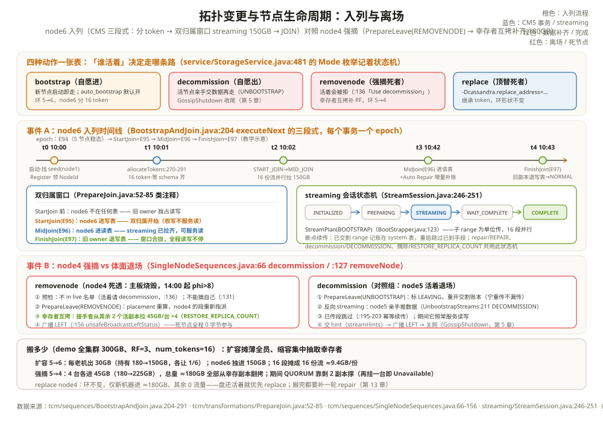

# 拓扑变更与节点生命周期：入列与离场

先看一个让人手心出汗的现场。双十一前一周，容量测算说 5 节点集群磁盘只剩 12%，运维决定扩容：新机器 node6 上线，`cassandra` 进程一启动，他盯着 `nodetool status` 看到它还是 `UN`（未入环），数据目录却已经开始哗哗进流量——**还没进环，凭什么在收数据？** 两个小时后 node6 变成 `UN→UJ` 又变回 `UN`，最后终于 `UN` 且持有 token。同一周，老 node4 主板烧毁、彻底死透，他跑 `nodetool decommission` 被拒绝——命令反过来提示他「节点活着才能退场」。换 `removenode` 才摘掉。

两个现场指向同一组问题：**节点进出环的完整流程是什么？数据搬多少、从哪搬到哪？搬的过程中线上读写停不停？谁来记账、防止两台节点同时改环打架？** 这就是拓扑变更（topology change）与节点生命周期要回答的事。第 13 章的 repair 负责抹平副本差异，本章负责更大的动作：整台节点的进出——两章合起来，才凑齐「数据在任何节点手里都一样」的最后两块拼图。

全章案例沿用 5 节点集群，并让它经历一进一出：

```text
集群现状：node1~node5，keyspace demo（RF=3，QUORUM），num_tokens=16（conf/cassandra.yaml:42）
数据总量：demo 全集群 300GB；每节点持有 3/5 × 300 = 180GB（RF=3 的账）
事件 A（扩容）：node6 入列
  t0 10:00 启动 → t1 10:01 分 token → t2~t3 10:02~10:42 streaming → t4 10:43 JOIN
事件 B（缩容）：node4 主板烧毁、死透（修不如换）→ removenode 强摘
本章回答：node6 怎么进来、node4 怎么出去、数据怎么搬、搬的时候读写停不停。
```

---

## 一、节点的四种动作：bootstrap、decommission、removenode、replace

节点的生命周期动作一共四种，命令与入口一张表看清：

| 动作 | 谁执行 | 一句话 | 命令与入口 |
| --- | --- | --- | --- |
| bootstrap（入列） | 新节点自己 | 智能分 token、拉数据、进环 | 自动启动；`tcm/sequences/BootstrapAndJoin.java:89` |
| decommission（体面退场） | 活节点自己 | 把数据亲手交出去再离开 | `nodetool decommission`（「Decommission the *node I am connecting to*」，`tools/nodetool/Decommission.java:25`）；`service/StorageService.java:3565` → `SingleNodeSequences.decommission` |
| removenode（强摘） | 集群任意存活节点 | 死节点没法交数据，由幸存者补齐 RF | `nodetool removenode <hostId>`；`service/StorageService.java:3716` → `SingleNodeSequences.removeNode` |
| replace（顶替） | 新节点顶替死节点 | 继承死节点的 token，只拉它的数据 | 启动参数 `-Dcassandra.replace_address=<死节点IP>`（`config/CassandraRelevantProperties.java:495`）；`tcm/sequences/BootstrapAndReplace.java:82` |

本章两个事件各走一条路：事件 A（node6 入列）是标准 bootstrap，第三节逐分钟放电影；事件 B（node4 强摘）是 removenode，第四节与 decommission 并排放对照。replace 在第四节末尾一句话带过——它是 removenode 的「环不变」变体。

两个易混点先钉死。**decommission 和 removenode 的本质区别不是命令，而是「谁活着」**：decommission 是活节点自愿退场——数据由它自己亲手流出去，交割完毕才走人；removenode 是集群强摘死节点——源码里写得直白：「Node is alive and owns this ID. Use decommission command to remove it from the ring」（活的节点请走退场流程，`tcm/sequences/SingleNodeSequences.java:136`），甚至「Cannot remove self」（`:131`）。死节点交不出数据，重分布的活儿由剩余副本自己拉齐（第五节算账）。**replace 和 removenode 的区别是「token 归谁」**：removenode 之后环上少一台、数据摊薄给剩下的人；replace 则让新机器继承死节点的全部 token，环的形状不变，只把死者的数据从幸存副本那里拷回来。

节点自己眼里的状态机由 `service/StorageService.java:481` 的 Mode 枚举记着：STARTING → JOINING → NORMAL → LEAVING → DECOMMISSIONED（还有失败态 JOINING_FAILED、DECOMMISSION_FAILED 和 DRAINING/DRAINED），`nodetool status` 与 JMX 一眼可查。这套状态还有配套的「后悔药」：退场执行到一半失败（比如 streaming 中断），可以 `nodetool abortdecommission` / `abortremovenode` 撤销（`tools/nodetool/Decommission.java:59`、`tools/nodetool/RemoveNode.java:48`），序列回到失败态等重试；bootstrap 卡住则有专门的 `nodetool bootstrap resume` 接管断点续传（`tools/nodetool/Bootstrap.java:23-26` 的定位就是「Monitor/manage node's bootstrap process」）。

```text
举例：四种动作在 5 节点集群上的「环形状」变化
bootstrap node6 ：环 5→6 台，node6 分到 16 个新 token，切开旧 range
decommission node5：环 5→4 台，node5 的 16 段数据亲手推给接手者，token 消失
removenode node4 ：环 5→4 台，node4 的 token 直接抹掉，幸存者互拷补齐 RF
replace node4   ：环还是 5 台，新机器继承 node4 的原 token，形状一个没动
同样的终点（node4 离开），后三条路的代价完全不同——第五节把账算给你看。
```

---

## 二、拓扑的账本：CMS 事务，不再是 gossip 一句话

第 5 章讲过 Gossip 的名片夹；第 6 章已经预告：7.0 上环的账本是 `tcm/ClusterMetadata.java`（epoch 单调递增）。拓扑变更在这套账本上是**事务**：一次变更 = 提交一个 Transformation，集群元数据从 epoch N 变到 N+1，全集群按日志顺序回放，谁也插不了队（`tcm/ClusterMetadataService.java:697` 的 `commit(Transformation)`；接口在 `tcm/Transformation.java:81`）。Placement（每个 range 的读写副本表）由 `tcm/ownership/PlacementProvider.java:31` 计算（实现 `tcm/ownership/UniformRangePlacement.java:83`）——旧资料里的 NetworkTopologyStrategy 仍管每 keyspace 的副本数，但「谁进谁出」的环账本已经完全是 CMS 的事。老机制一句话带过：4.x 以前靠 gossip 里互发 STATUS 应用状态、先到先得，节点多了经常打架——这正是 CMS 要解决的（7.0 旧 gossip STATUS 路径已退役为兼容层）。

「打架」具体打的是什么？老机制下，A 节点宣布「我加入 token 100」，这条消息 gossip 到全网需要几秒到几十秒；这期间 B 节点也宣布「我移到 token 100」，两条消息到达顺序在每个节点上可能不同——同一本环，各节点眼里长得不一样，写给 token 100 的数据一时按旧环、一时按新环路由，丢写就是这么来的。CMS 的解法是把「环的样子」变成一份**全局有序的日志**：每个事务（Transformation）带一个 epoch，CMS 成员组用共识协议把它写进日志，所有节点按同一条日志回放——不管消息乱序到达，最终的环完全一致。类比第 8 章的 WAL：写日志前先抢一个单调序号，回放按序号来，谁先谁后不再靠嘴说。

```text
举例：node6 入列在 CMS 账本上留下的三个事务（PrepareJoin 三段式）
PrepareJoin（tcm/transformations/PrepareJoin.java:52-85 类注释）把入列拆成三步：
StartJoin  = addToWrites ：node6 进「写副本表」——先开始收写（epoch E+1）
MidJoin    = moveReads   ：node6 进「读副本表」——开始对外服务读（E+2）
FinishJoin = removeFromWrites ：交出数据的旧副本退出写表（E+3）
三次 commit、三个 epoch，中途崩溃可从日志重放续跑（MultiStepOperation）。
本章案例里，node1~node5 各自 16 token、账本已走到 epoch 94——node6 的三连
提交把账本推进到 97，`nodetool ring` 看到的环就是第 97 版环（数值为教学示意）。
```

---

## 三、bootstrap 全流程：node6 的入列时间线

```text
t0 10:00  node6 启动：读 cassandra.yaml（num_tokens=16、seeds=node1:7000）
          向 seed 报到（Register 事务，CMS 登记 NodeId）——此刻是 REGISTERED，不持 token
t1 10:01  分 token：BootStrapper.allocateTokens（dht/BootStrapper.java:270-291）
          → TokenAllocation 按现有负载挑 16 个均衡位（不是随机撒）
          → 等待 schema 一致（拉齐 keyspace/表结构）
          → StartJoin 提交：node6 的 16 段 range 进写副本表（开始收写！）
t2 10:02  streaming：对每段 range，从「现任读副本」拉数据（老 placement 的 reads，
          BootstrapAndJoin 的 movementMap）；16 个 token = 16 份并行流
t3 10:42  流完：MidJoin 提交（node6 进读副本表）+ 触发 Auto Repair 增量补账
t4 10:43  FinishJoin 提交（旧副本退出写表）→ 状态 NORMAL，nodetool status 可见
```

运维在这 43 分钟里看到的 `nodetool status` 变化（U=Up、N=Normal、J=Joining）：

```text
t0 之前：node1~node5 均 UN，node6 不在列表（还没报到）
t1 之后：node6 UJ —— Up 但 Joining：进程活着、正在入列，数据目录开始进流量
t4 之后：node6 UN —— 入列完成，与老节点无异
开头那个「没进环却在收数据」的怪现象：UJ 阶段的 node6 已经在写副本表里，
coordinator 按账本办事——账本说它是副本，它就收写。窗口合拢前它不服务读，
所以对客户端完全无感。
```



把时间线里的关键机制逐个拆开：

**t0 的两件小事**。其一，node6 从 seeds（yaml:755-764）找到组织——seed 是「至少认识一个人」的入口，不参与选举、只管指路（第 5 章）；其二，auto_bootstrap 默认开启（`config/CassandraRelevantProperties.java:85`），所以普通加节点不需要敲任何命令，「启动即入列流程」。它先做 Register 事务领一个 NodeId——这是它在 CMS 里的身份证，此后所有事务都挂在这个 id 上；领完 id 它还不持任何 token，`nodetool status` 里就是那个不进环的观察者。

**token 不是随机分的**。第 6 章讲过 `allocate_tokens_for_local_replication_factor: 3`（yaml:59）：TokenAllocation 模拟「如果把 node6 放在这，各 range 的副本负载会怎样」，挑让负载最均衡的 16 个位——所以 vnode 既是写入均衡器，也是搬迁摊薄器。拿到 token 之前还有一道门：**schema 一致**——node6 要等全集群的 keyspace/表结构版本对齐才继续（启动参数里有专门的 bootstrap schema 等待与超时，`config/CassandraRelevantProperties.java:91-96`），否则可能出现「数据搬来了、表结构不认识」的尴尬。

**为什么还没进环就在收数据**：StartJoin 之后 node6 已在写副本表里，coordinator 的写请求自然会把 QUORUM 之外的第三份发给它（第 7 章「写发给全部副本」）。这正是「双归属窗口」：同一个 range，旧副本还在读表里、node6 已进写表——**旧 owner 与新 owner 短暂共存**，等 node6 数据拉齐（MidJoin 进读表、FinishJoin 旧副本退写表）窗口才合拢。窗口期间旧副本照常服务读，线上读写一秒不停。PrepareJoin 的事务里还带一把 range 锁（LockedRanges）：如果另一个变更正在动同一批 range，提交直接被拒——两台节点想同时改环的某一段？后到的那个会被挡在门外。

**streaming 期间新写入怎么办**：双归属窗口里 node6 一边收历史数据、一边收新写入，两股流在它本地汇合——不冲突，因为合并的裁判还是第 7 章的写入时间戳：流过来的旧版本、协调者转来的新版本，落 memtable/SSTable 时按 ts 归并，谁新谁赢。顺带一件容易被忽略的事：node6 在 MidJoin 提交前会把所有用户表的索引预构建任务跑完（`BootstrapAndJoin` 里对每个表 `executePreJoinTasksBlocking`）——第 11 章说过 SAI 索引跟着 SSTable 走，流过来的 SSTable 自带索引文件，但跨段合并出的新文件仍需在入列完成前把索引补齐，保证它进读表那一刻就能正常服务按值查询。

**streaming 是什么**：一套通用的节点间文件传输协议（`streaming/` 包）。发起方建一个 StreamPlan（`streaming/StreamPlan.java:45`，bootstrap 用 `StreamOperation.BOOTSTRAP`，`dht/BootStrapper.java:123`），对每个对端开一个 StreamSession，会话状态机：INITIALIZED → PREPARING（商量传哪些 SSTable/子 range）→ STREAMING（整文件或子 range 逐个传）→ WAIT_COMPLETE → COMPLETE（`streaming/StreamSession.java:246-251`，类图注释 `:230-233`）。结果由 `StreamResultFuture`（`:54`）汇成 StreamState 交还调用方。第 13 章 repair 的第 ⑥ 步用的就是这套，只是操作码换成 REPAIR。bootstrap 的传输以**子 range 为单位**（不是整本 SSTable 硬拷）：node6 只要 16 个 token 对应的段，SSTable 里不属于它的分区不会被传——这与 repair 的差异 range 流式、decommission 的整段交割是同一套机制的三种用法。

```text
举例：node6 的 40 分钟 streaming 账（demo 300GB，教学口径）
node6 要接手：全量 × RF 分摊 = 300 × 3/6 = 150GB（入列后每节点应持 1/2 全量）
16 个 token → 16 份流并行，每份 ≈ 9.4GB；从 3~4 个现任副本各拉各的段
吞吐 ≈ 62MB/s 持续 40 分钟（万兆网内轻松）——期间老节点照常读写
断点续传：已交割的 range 记在 system 表里（resetAvailableStreamedRanges），
  重启 bootstrap 跳过已到手的段接着搬（BootstrapAndJoin.bootstrap :378-381）
```

---

## 四、decommission 与 removenode：退场与强摘的两条时间线

```text
时间线 A：decommission（node5 主动退场，对照组）
t0'  nodetool decommission（在本机敲）→ SingleNodeSequences.decommission:66
t1'  PrepareLeave(UNBOOTSTRAP) 提交：node5 标记 LEAVING，placement 重算；
    重开交割账本（resetTransferredRanges——上次没传完的重来一遍，宁可重传不漏传）
t2'  反向 streaming：node5 把名下数据 StreamPlan(DECOMMISSION) 亲手推给接手者
    （UnbootstrapStreams.java:211，transferRanges；已传过的段跳过，:195-203）
t3'  广播 LEFT（unsafeBroadcastLeftStatus）→ shutdownNetworking → Gossiper 优雅离场
    （第 5 章 GossipShutdown；nodetool 上它从列表消失，环上少一台）

时间线 B：removenode（node4 死透，本章主线）
t0'' 运维在 node1 上：nodetool removenode <node4 的 hostId>
t1'' 预检：node4 必须不在 live 名单（活着请用 decommission，:136）
t2'' PrepareLeave(REMOVENODE) 提交：placement 重算，node4 的段重新指派
t3'' 幸存者补齐：接手指从「其余两个活副本」拉数据补回 RF=3
    （RemoveNodeStreams，Kind.REMOVENODE:92；流操作码 RESTORE_REPLICA_COUNT，
     streaming/StreamOperation.java:23 注释「Handles removeNode」）
t4'' 广播 LEFT，node4 从环上摘除。全程死节点一个字节都没参与。
```

两条线的镜像关系一目了然：**decommission 数据从退场者流出（它还得活着、还得有磁盘）；removenode 数据在幸存者之间补齐（死者的份额从别的副本翻拷）**。这也决定了运维选择：死节点如果盘还好，优先 replace（盘还在就把盘插新机器，token 不动、环不变）；盘也毁了才 removenode（数据重分布、全环搬家）。decommission 的收尾是第 5 章的 GossipShutdown：先把攒的 hint 交出去（`StorageService.streamHints`，挑「最近的非 LEAVING 邻居」接盘）、再广播 LEFT（`Gossiper.markAsShutdown` 路径，`gms/Gossiper.java:594-617`；专用 Verb GossipShutdown，`net/Verb.java:238`）、最后断网——体面退场的「体面」就在这三步的顺序里：先清债、再告别、再挂电话。

```text
举例：同是「node4 离开」，两条时间线的读写影响对比
decommission（node4 活着退场）：
  streaming 40 分钟里 node4 一边交数据一边继续服务读写（它还是读副本）；
  交割完成后 placement 切换，coordinator 的副本名单里不再有它——平滑退出。
removenode（node4 死透强摘）：
  node4 从 14:00 卡死起就不服务任何读写（QUORUM 靠 node2/node5 撑着，第 7 章）；
  removenode 只是把「它还会回来」的假设正式注销：placement 重算、幸存者补第三份。
  摘除前后线上读写无感——真正的痛发生在 node4 卡死那一刻，不在摘除这一刻。
```

---

## 五、数据移动量的算术：加一台、摘一台各搬多少

```text
举例：把第三节的账算完整（300GB 全量、RF=3）
扩容 5 → 6：
  每节点持有 3/5×300=180GB → 3/6×300=150GB
  每台老节点流出 180−150 = 30GB（自己手里数据的 1/6）
  node6 流入 150GB（= 5 台 × 30GB）；vnode 16 段 → 每段流 ≈ 9.4GB，摊给多个上家
缩容 5 → 4（removenode node4）：
  剩 4 台每台 3/4×300=225GB，每台需再接 225−180 = 45GB
  总流入 4×45=180GB ≈ node4 的全部持有量；全部来自其余两个活副本的翻拷
对照：replace node4 —— 环不变，只有新机器流入 180GB（接死者的整份），其余节点 0 流量
```

这张账回答了两个选型问题：为什么扩容一次别加太多台（每加一台，全员都要出 1/(N+1) 的流量，加 3 台等于全员一次大搬家）；为什么死节点优先 replace 而不是 removenode（replace 只有一方进流量，removenode 是四方进流量、还要占用幸存副本的读带宽）。vnode 的价值在两条线里都出现：16 段把一整块 30GB/45GB 的搬运摊成 16 份小流，并行、可断点续传，也避免「单一大 range 卡住整个入列」。把三条路放进一张表：

| 路径 | 环形状 | 总流量 | 谁出流量 | 谁进流量 | 线上读压力 |
| --- | --- | --- | --- | --- | --- |
| bootstrap node6（5→6） | 5→6 台 | 150GB | 5 台老机各 30GB | node6 独进 150GB | 老机被读 30GB/台 |
| removenode node4（5→4） | 5→4 台 | ≈180GB | 幸存副本被读 | 4 台各进 45GB | 幸存机被读 180GB |
| replace node4（5→5） | 不变 | ≈180GB | 幸存副本被读 | 新机器独进 180GB | 同上，但只此一次 |

顺着表还能看出一处容易忽略的对称性：**扩容时全员的磁盘读+网卡出是分摊的，缩容时幸存者的读是被集中抽取的**——removenode 之后每个 range 都要从「剩下两个副本」翻拷第三份，被摘者的负载没有消失，只是换了一批人来扛。这也是为什么大集群一次摘多台要排期错峰：一次摘两台，翻拷量不是 2 倍而是接近平方级的叠加。

```text
举例：把本章两件事排进同一周的运维排期（容量 300GB、万兆网、教学口径）
周一 10:00  node6 入列（事件 A）：全员各出 30GB，62MB/s × 40 分钟，选业务低峰
周三 14:00  node4 removenode（事件 B）：4 台各进 45GB，幸存副本多扛 180GB 读
排期红线：A、B 不重叠（LockedRanges 会拒第二个动同一批 range 的序列，
  但那是保护、不是排期）；B 之后立即跑一轮全量 repair——
  翻拷出来的第三份是「从活副本抄的当时快照」，抄完之后的写入差异仍要对账（第 13 章）
另一个方向的红线：node4 死而未摘期间，它的 range 只剩 2 副本撑 QUORUM=2——
  此时再挂任何一台，这些 range 直接 Unavailable。死节点不宜久留，就在这张账上。
```

---

## 六、和 RocksDB 摆在一起看：单机搬家与集群搬家

单机引擎没有「拓扑」——RocksDB 的世界里只有一个进程独占一个目录。最接近的概念是它对目录/卷的规划：

| 维度 | Cassandra 拓扑变更 | RocksDB 目录/卷管理 |
| --- | --- | --- |
| 搬的单位 | 跨节点搬分区（partition 按 token range） | 单机搬文件/分层放置（SST 落哪个目录） |
| 谁决定放哪 | 令牌环 + placement（CMS 事务） | `db_paths`/`cf_paths`：按层放置、按 target_size 分摊（`include/rocksdb/options.h:451-456`） |
| 搬的过程读写停不停？ | 不停：双归属窗口（先加写、后换读、再退写） | 不停：新 SST 写进新目录、旧 SST 照读，MANIFEST 原子切账 |
| 搬的执行者 | streaming（StreamSession 状态机） | 后台 flush/compaction 顺手把文件写去新路径 |
| 独占性 | 一个 token 一时刻只归一次变更（CMS 锁 range） | 一个目录只许一个实例（LOCK 文件，`file/filename.h:99-100`） |
| 失败恢复 | MultiStepOperation 从 CMS 日志重放续跑 | MANIFEST 回放 + 未完成 SST 丢弃 |

```text
举例：同一个「把 L5/L6 的冷数据挪去 HDD」的诉求，两边各怎么做
RocksDB：options.db_paths = [("/ssd", 200GB), ("/hdd", 10TB)]——配好之后
  compaction 往下写时按层落盘，冷 SST 自然沉到 HDD，全程单机搬文件、无网络；
Cassandra：没有「按层放盘」，等价做法是按数据冷热拆 keyspace/表放到
  不同 DC 或不同磁盘的节点上——那是跨节点搬分区，要走本章的 streaming。
一个在目录之间挪，一个在节点之间挪——「拓扑」二字，单机库根本用不上。
```

两边的共同命题是「搬的过程中读写不停」，解法神似但尺度不同：RocksDB 靠**不可变文件 + 账本原子切换**——文件写完才登记进 MANIFEST，登记之前它随时可以扔掉重来；Cassandra 靠**双归属窗口 + 事务化登记**——新副本先收写、数据拉齐、才接管读、旧副本才退出，每一步都是 CMS 里一个可重放的事务。差异也本质：RocksDB 的「搬家」是同一台机器换个目录/磁盘（数据一致性只涉及一台），Cassandra 是跨网络把数据的**第三份**搬给新主人（一致性要 RF 个副本一起对齐）。所以 Cassandra 的搬完还要 Auto Repair 补一刀（第 13 章：bootstrap 完即触发增量修复），RocksDB 的搬完只需要 MANIFEST 切一次账。

最后把「搬家」与「对账」连起来看，会发现这两章其实是一件事的两半：拓扑变更负责**成块地搬**（整台节点进出，双归属窗口保证搬的过程不停写），repair 负责**零碎地抹**（副本间细粒度差异，Merkle 树保证找差异不用全量对拷）。任何一次搬完都立刻触发一次抹（BootstrapAndJoin 的 Auto Repair 钩子；运维手册里 removenode 后补一轮全量 repair 的惯例）——搬是粗调、修是微调，两把刀一起，才敢说「数据在谁手里都一样」。

---

## 这一章留下的线索

- **四种动作一个表**：bootstrap（自愿进）、decommission（自愿出、数据亲手交）、removenode（集群强摘死节点、幸存者补齐）、replace（顶替死者 token）——「谁活着」决定走哪条路；
- **7.0 拓扑变更 = CMS 事务**：Transformation + epoch + 日志回放（`tcm/ClusterMetadataService.java:697`），入列是 PrepareJoin 三段式（addToWrites → moveReads → removeFromWrites），LockedRanges 挡住并发改环，老 gossip STATUS 已退役；
- **双归属窗口保证搬运不停写**：新节点先进写副本表（StartJoin）→ streaming 拉齐 → 进读表（MidJoin）→ 旧副本退写表（FinishJoin），线上读写全程无感；新写入与流式数据按写入时间戳归并；
- **streaming 是通用底座**：bootstrap/decommission/repair/removenode 共用 StreamPlan/StreamSession（INITIALIZED → PREPARING → STREAMING → WAIT_COMPLETE → COMPLETE），子 range 为单位、可断点续传；
- **搬多少有账可算**：5→6 每老节点出 1/6 持有量、node6 进 150GB；removenode 全员补 180GB；replace 只有新机器进流量——选型依据都在这组算术里；
- **搬与修是一对**：拓扑变更是粗调（成块地搬），repair 是微调（零碎地抹），搬完必补修（BootstrapAndJoin 的 Auto Repair 钩子）。

下一章是运维的最后一课，也是给这 15 章收口的手艺活：不搬数据、不动拓扑，把「过去某一刻」完整地留存下来——[快照与备份：硬链接的时光机](../operations/03-快照与备份.md)。

---

## 附：这一章的源码入口

> 除特别注明外，本节引用的源码文件与行号都来自 apache/cassandra 主分支（7.0-SNAPSHOT，2026-08）。

- `service/StorageService.java:481`：节点状态枚举 Mode（STARTING/JOINING/NORMAL/LEAVING/DECOMMISSIONED…）
- `service/StorageService.java:3565、3716-3721、1780、1595-1612`：decommission / removeNode 的 JMX 入口（转投 SingleNodeSequences）、isBootstrapMode、startBootstrap（组装 BootStrapper）
- `tcm/sequences/SingleNodeSequences.java:52-55、66、80、108、127、131、136、149、156、169`：单节点变更序列入口（类注释；decommission 提交 PrepareLeave(UNBOOTSTRAP) 并广播 LEFT、关网；removeNode 的三个预检与 PrepareLeave(REMOVENODE)；move）
- `tcm/sequences/BootstrapAndJoin.java:89、204-291、231-241、268、360、427`：入列三段式执行（START_JOIN/MID_JOIN streaming/FINISH_JOIN）、bootstrap 完成即触发 Auto Repair、movementMap 的拉数据来源 = 老 placement 的读副本
- `tcm/transformations/PrepareJoin.java:52-85、88、150、160-162`：入列计划三段式（类注释的 A/B/C→X 例子即「双归属窗口」）；`tcm/transformations/PrepareLeave.java`、`tcm/transformations/PrepareReplace.java:47`：离场与顶替事务
- `tcm/sequences/BootstrapAndReplace.java:82`：replace 序列；`config/CassandraRelevantProperties.java:85、383、494-496`：auto_bootstrap / join_ring / replace_address 启动参数
- `tcm/ClusterMetadataService.java:109、697、745`：CMS 提交事务（commit + 成功/失败处理器）；`tcm/Transformation.java:81`；`tcm/ownership/PlacementProvider.java:31`、`tcm/ownership/UniformRangePlacement.java:83、88`：placement 计算接口与实现
- `dht/BootStrapper.java:118-123、270-291`：bootstrap 的 StreamPlan(StreamOperation.BOOTSTRAP) 与 token 分配（→ TokenAllocation，第 6 章账本）
- `streaming/StreamSession.java:173、230-233、246-251`：会话状态机；`streaming/StreamPlan.java:45、201`、`streaming/StreamResultFuture.java:54`：流式底座；`streaming/StreamOperation.java:21-29`：BOOTSTRAP/DECOMMISSION/REPAIR/RESTORE_REPLICA_COUNT 等操作码
- `tcm/sequences/UnbootstrapStreams.java:58、65、195-203、211、227`：decommission 的交割（Kind.UNBOOTSTRAP、跳过已传段、StreamPlan(DECOMMISSION)+transferRanges）；`tcm/sequences/RemoveNodeStreams.java:92`：REMOVENODE 流
- `tools/nodetool/Decommission.java:25`、`tools/nodetool/RemoveNode.java:29-32`、`tools/nodetool/Bootstrap.java:23-26`：三条 nodetool 命令的官方描述
- `conf/cassandra.yaml:42、59、755-764`：num_tokens=16、allocate_tokens_for_local_replication_factor、seed_provider/seeds（第 6 章账本复核）
- RocksDB 对照：`include/rocksdb/options.h:319-330、451-456、763`（db_paths/cf_paths 按层分目录）、`file/filename.h:99-100`（LOCK 文件独占目录）

---

## 思考题

1. node6 在 t1~t4 之间的「双归属窗口」里，同一个 range 的写会发给谁？读会发给谁？如果 streaming 期间 node6 掉电重启，这个 range 的一致性由什么兜底？（提示：StartJoin 只进写表、MidJoin 才进读表；MultiStepOperation 从 CMS 日志重放续跑，搬完后 Auto Repair 增量补一刀——第 13 章的伏笔在这里兑现。）
2. 同样是摘掉 node4，removenode 和 replace 在「环的形状、数据流向、总流量」上各差多少？（提示：removenode 环少一台、四方各进 45GB；replace 环不变、新机器独进 180GB；再想想哪种对线上读带宽更友好。）
3. `SingleNodeSequences.removeNode` 有三个前置拒绝：不能摘自己、hostId 必须存在、节点必须不活着。为什么「节点必须死了才能 removenode」？（提示：活着说明它随时可能自己 decommission——两条路径同时动同一批 range，CMS 的 LockedRanges 会拒绝其中一个，但运维上先对齐口径更省事。）
4. RocksDB 的 db_paths 能把高层 SST 放 SSD、低层放 HDD，Cassandra 的哪个机制在做类似的「冷热分家」？两者为什么必然不同？（提示：单机按层放文件 vs 集群按节点放分区；一个由 compaction 顺手完成，一个要靠 streaming 跨网搬运 + 双归属窗口保证不停写。）
