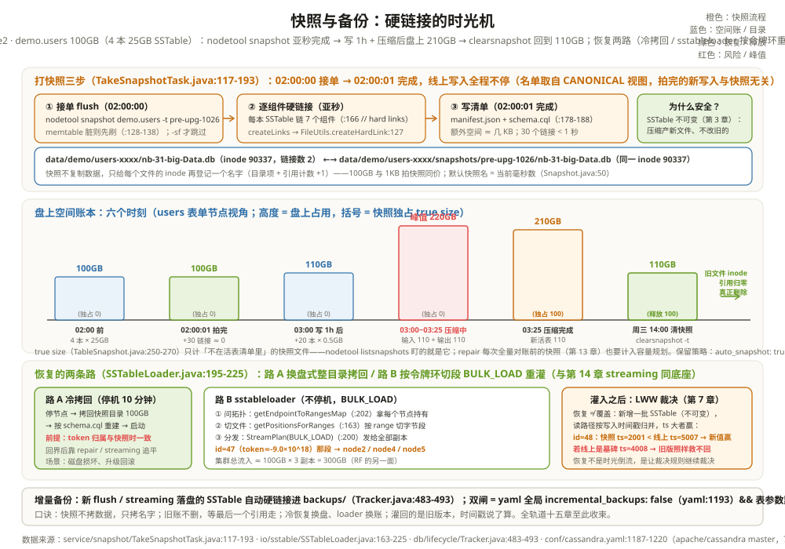

# 快照与备份：硬链接的时光机

先看一个让人犹豫的现场。周一凌晨两点，运维要给 5 节点集群做升级前备份。他上一份工作管的是 MySQL：备份 100GB 的表，mysqldump 要跑四十分钟，还有锁的风险。同事告诉他 Cassandra 这边敲一条 `nodetool snapshot` 就行。他敲下去，一秒钟后命令返回了。他不放心：100GB 用的什么黑魔法一秒拷完？更发毛的是第二天——`du` 一看，快照拍完、又跑了一小时写入和压缩之后，这张 100GB 的表现在在盘上占 210GB。他怀疑快照把空间吃爆了，提了工单。

两个「怪现象」其实是同一个设计：**快照不复制数据，只给每个 SSTable 文件加一个名字**。类 Unix 文件系统里，一个文件的本体（inode）和它的名字（目录项）是分开的；硬链接就是给同一个 inode 再登记一个名字——文件一个字节不动，两个名字指向同一份盘上数据。Cassandra 的 SSTable 写完就不可变（第 3 章的纪律），所以「某一刻盘上有哪些文件」就是「某一刻表长什么样」——把这份名单用硬链接钉住，就把那一刻钉住了。看懂这一层，一秒备份不再像黑魔法，210GB 也不再像事故：那是旧账本被快照拽住、新账本照常并账的正常形态。

全章跟着 node2 上的一张表走。它是贯穿案例的 `users` 表，几个月下来在 node2 长到了 100GB：

```text
贯穿全章的时间线（node2，demo.users，100GB = 4 本各 25GB 的 SSTable）：
周一 02:00:00  nodetool snapshot demo.users -t pre-upg-1026
周一 02:00:01  快照完成：30 个硬链接 + manifest.json + schema.cql，额外空间 ≈ 几 KB
周一 02:00~03:00  业务照常写入，新增 20 本 0.5GB 的小 SSTable（+10GB）
周一 03:00~03:25  nodetool compact：110GB 输入并账出 110GB 新文件
周一 03:25  盘上占用 210GB（旧 100GB 被快照硬链接持有，删不掉）
周三 14:00  nodetool clearsnapshot -t pre-upg-1026 → 110GB
```

当年第 2 章那本装着 `id=47`（阿福2，ts=1005）的小 SSTable，如今早已被几轮压缩并进 25GB 的大文件里；本章快照钉住的，就是这些大文件此刻的样子。

---

## 一、快照是什么：先 flush，再把每个 SSTable 硬链接进快照目录

7.0 的快照引擎住在 `service/snapshot/` 包里：`SnapshotManager`（`service/snapshot/SnapshotManager.java:61`）接 nodetool 的活，`TakeSnapshotTask`（`service/snapshot/TakeSnapshotTask.java:56`）干具体的活。一条 `nodetool snapshot`（命令定义在 `tools/nodetool/Snapshot.java:40`）下来，按顺序做三件事：

1. **先 flush**：任务默认不跳过 flush（`service/snapshot/TakeSnapshotTask.java:128-138`）——memtable 里有脏数据就先 `switchMemtableIfCurrent` 刷成 SSTable，让「盘上状态」尽量接近「此刻全量状态」；nodetool 加 `-sf`（skip-flush）才跳过，命令描述写得很直白：跳过的话「snapshot will not contain unflushed data」（`tools/nodetool/Snapshot.java:56`）；
2. **逐本硬链接**：遍历表当前的 SSTable（含二级索引），对每本在数据目录旁建目录 `<数据目录>/<keyspace>/<table>/snapshots/<快照名>/`（`db/Directories.java:640-648`，`SNAPSHOT_SUBDIR` 常量在 `:118`），把 SSTable 的全部组件文件硬链接进去——代码里的注释就一行：`// hard links`（`service/snapshot/TakeSnapshotTask.java:166`）；
3. **写清单**：快照目录里写两份小文件——`manifest.json`（哪些文件属于这个快照，`service/snapshot/TakeSnapshotTask.java:178-182`）和 `schema.cql`（建表语句快照，`:184-188`），恢复时先按它重建表结构。

```text
举例：02:00:00 敲下命令后，node2 的目录长这样
/var/lib/cassandra/data/demo/users-xxxx/
├── nb-33-big-Data.db          ← 4 本 25GB 的 SSTable 组件（本体）
│     …（Statistics.db、TOC.txt 等每本 7 个组件）
└── snapshots/
    └── pre-upg-1026/
        ├── nb-33-big-Data.db   ← 硬链接：同一 inode，另一个名字
        │     …（30 个链接 ≈ 4 本 × 7 组件 + 2 个清单文件）
        ├── manifest.json
        └── schema.cql

ls -i 验证：两个 Data.db 的 inode 号相同；盘上数据只有一份。
```

为什么这样几乎零成本？硬链接的代价只是「在目录表里添一行名字 + inode 引用计数加一」，跟文件多大无关——100GB 的表和 1KB 的表，拍快照的成本都是创建几十个目录项（真正落盘的实现走 `io/sstable/format/SSTableReader.java:1182-1211` 的 `createLinks`，逐组件调 `io/util/FileUtils.java:127-132` 的 `createHardLink`）。为什么这样安全？靠的正是第 3 章埋的伏笔：**SSTable 不可变**。压缩只产出新文件、从不改旧文件；旧文件从活表退役后，只要快照里还有一个名字指着它，文件系统就不会释放它的空间。快照钉住的不是「数据的一份数拷贝」，而是「那批不可变文件本身的存续」。

快照期间线上写入完全不受影响，这一点也值得算清楚：硬链接登记的名单取自「拍的那一刻的活表视图」（`View.select(SSTableSet.CANONICAL)`，`service/snapshot/TakeSnapshotTask.java:161`）。拍完之后的新写入进 memtable、flush 出新 SSTable——新文件不在名单里，自然与快照无关；名单里的旧文件因为不可变，内容也不会被任何并发写打搅。「锁表」这个概念在这套实现里根本不存在，备份窗口和生产高峰可以重叠。

还有两个细节值得一记：快照名不指定时，默认用当前时间的毫秒数当名字（`tools/nodetool/Snapshot.java:50`）；`SnapshotManager` 同时管理九种用途的快照（USER/TRUNCATE/DROP/REPAIR……，`service/snapshot/SnapshotType.java:21-37`）——repair 开工前拍的那张（第 13 章提过）也在这个账本里。另外，JOINING 状态的节点会被直接拒绝：「bootstrap 完成前不许拍快照」（`service/snapshot/TakeSnapshotTask.java:79-80`）——数据还在搬家的节点拍出的快照没有意义。

---

## 二、算账：快照之后写一小时、压一次，盘上空间怎么涨



「100GB 的表打快照要多久、占多少额外空间」现在能一口答出：亚秒（几十个硬链接），额外空间近零（两份 KB 级清单）。真正要看懂的是快照之后的一小时——空间为什么会涨到 210GB，又为什么涨得健康：

| 时刻 | 活表文件 | 快照独占持有 | 盘上合计 | 发生了什么 |
| --- | --- | --- | --- | --- |
| 周一 02:00 前 | 100GB（4 本） | — | 100GB | 稳态 |
| 02:00:01 快照完成 | 100GB | 0（硬链接共享同一份） | 100GB | 只加了名字 |
| 03:00 一小时新写 | 110GB（4 大 + 20 小） | 0 | 110GB | 新写 10GB 与快照无关 |
| 03:00~03:25 压缩中 | 110GB 输入仍可读 | 0 | **峰值 220GB** | 输出 110GB 边写边涨 |
| 03:25 压缩完成 | 110GB（4 本新的） | 100GB（4 本旧文件唯一持有者） | **210GB** | 旧文件进不了回收站 |
| 周三 14:00 清快照 | 110GB | 0 | 110GB | 引用归零，真正释放 |

```text
举例：210GB 是怎么拼出来的（nodetool compact demo.users，03:00~03:25）
输入：旧 4 本 100GB + 新 20 本 10GB（全部还在盘上，压缩期间照常可读）
输出：并账写出 4 本共 110GB 的新文件（25 分钟 ≈ 读+写 220GB IO）
压缩收尾：110GB 输入从活表除名 → 但其中旧 100GB 的 inode 还有
  snapshots/pre-upg-1026/ 里的硬链接指着 → 文件系统不释放；
新 10GB 的输入文件无快照链接 → 直接删除。
盘上 = 110GB（新活表） + 100GB（快照独占）= 210GB。
```

所以 `nodetool snapshot` 的输出里有个「true size」读数：`SnapshotManager.getTrueSnapshotsSize`（`service/snapshot/SnapshotManager.java:479`）只统计**快照独占**的文件——不在当前活表里、删掉快照才能真正释放的那部分（算法在 `service/snapshot/TableSnapshot.java:250-270`：逐个比对快照文件是否还出现在活表清单里）。本例 true size 从 0GB 涨到 100GB，一眼看出「删快照能拿回多少空间」。

快照的清理由 `nodetool clearsnapshot`（`tools/nodetool/ClearSnapshot.java:40`）显式触发，删除动作是整目录递归删（`service/snapshot/ClearSnapshotTask.java:178`）。运维上要记住三件事：一，快照不会自己消失（除了一种情况，见下），盘空间是备份策略的直接成本——`nodetool listsnapshots` 平时盯的就是那个 true size；别忘了 repair 每次全量对账前也会拍一张（第 13 章 `RepairJob`），repair 很勤的集群里这部分独占空间要算进容量规划；二，`auto_snapshot: true`（`conf/cassandra.yaml:1205`，代码默认 `config/Config.java:383`）让 truncate/drop 这类危险操作前自动拍一张保命快照，可以给这类自动快照配 TTL（`auto_snapshot_ttl: 30d` 的注释示例在 `conf/cassandra.yaml:1207-1213`，到期由 `clearExpiredSnapshots` 清理，`service/snapshot/SnapshotManager.java:400-404`）；三，创建和删除快照要动几万个目录项，大集群上官方建议用 `snapshot_links_per_second` 限速（`conf/cassandra.yaml:1215-1220`，0 表示不限）。

---

## 三、它是「崩溃一致性」，不是「时间点事务」；CommitLog 也不上镜

把快照想成「给整个数据库拍了张时间点一致的照片」是本章最容易埋雷的误解。如实拆开看：

- **单表内部**，一致性是完整的：先 flush、再对一批不可变文件做硬链接，任一文件的字节永不变化——快照里的这张表，就是它 02:00:00 那一刻在盘上的精确样子。
- **表与表之间**，没有跨表事务。`TakeSnapshotTask.call()` 是一个循环，逐表拍（`service/snapshot/TakeSnapshotTask.java:123-150`）：users 拍完才轮到 events，中间隔着几毫秒到几秒。多表快照是「几张时间差极小的连拍」，不是一张合影。跨表有外键式约束的应用（CQL 本身没有，但应用层可能有）恢复后要自己校验。

类比：这像给一家人拍合影，但相机只能一个人一个人拍——每个人拍的那一刻自己是清晰的，但拼接缝上可能有人刚换了姿势。对大多数备份场景（disaster recovery）这够了；要严格的跨表一致，得应用层停写配合。

```text
举例：nodetool snapshot demo（整个 keyspace 连拍）的接缝
02:00:00.000  接单，按表逐个拍
02:00:00.400  users   完成（4 本大文件 + flush，0.4 秒）
02:00:00.900  events  完成（0.5 秒后）
接缝上的事实：02:00:00.400~00.900 之间写入的行，
  若同时动了 users 和 events——users 里没有它、events 里有。
恢复后要拿这张「连拍照」对账，接缝就是校验点。
```

CommitLog 在备份故事里的位置也要如实交代：**快照只保 SSTable，CommitLog 从不进快照**。默认路径里快照前先 flush，把 memtable 的账并进 SSTable，所以「没落盘的数据」也被捎带进快照了；但 backup 这个产物本身不含 CommitLog，恢复时也不会回放 CommitLog（那是崩溃恢复的机制，第 2 章：进程挂了重启，用 CommitLog 把 memtable 补回来）。一句话钉死边界：**快照 = 某一刻的盘上状态；备份恢复 = 把盘上状态放回去，从那一刻继续，中间发生的读写一概不在账上**。这也是为什么 02:00 的快照救不回 02:30 误删的行——那要靠第五章之外的手段：把快照灌进一张影子表，人工捞出需要的行（第五节的 sstableloader 正是干这个的底座）。

---

## 四、增量备份：新 flush 的 SSTable 自动硬链接进 backups/

快照回答「某一刻的全量」，增量备份回答「这一刻之后又落了哪些新账」。机制简单到只有一段代码：`db/lifecycle/Tracker.java:483-493` 的 `maybeIncrementallyBackup`——每当有 SSTable 新进活表（flush 产出、streaming 收到的），就把它硬链接进 `<table>/backups/` 目录（`db/Directories.java:117、729-752`）。还是硬链接、还是零拷贝，只是从「按快照名分子目录」变成「全堆在一个 backups/ 目录里」。

开关有两个，7.0 的语义是「全局 && 单表」双双为真才生效（`db/ColumnFamilyStore.java:3227`）：

| 开关 | 位置 | 默认 | 语义 |
| --- | --- | --- | --- |
| `incremental_backups` | `conf/cassandra.yaml:1193`（代码 `config/Config.java:549`） | false | 节点级总闸 |
| 表参数 `incremental_backups` | `schema/TableParams.java:447` | true | 单表细粒度关掉（CASSANDRA-15402） |

yaml 的注释还交代了运维责任：backups/ 里的链接**不会自动清理**，「Removing these links is the operator's responsibility」（`conf/cassandra.yaml:1187-1192`）——增量文件要么被备份系统取走后删除，要么把盘吃满。

```text
举例：全量 + 增量的经典组合（备份窗口每晚一次）
周一 02:00  nodetool snapshot -t daily-1026 → 全量基线 100GB（硬链接，0 拷贝）
周一 02:00~周二 02:00  incremental_backups=true：
  每次 flush / streaming 落盘的新 SSTable 自动再链接进 backups/
周二 02:00  备份系统 rsync 快照目录 + backups/ 目录到远端：
  远端首次传 100GB，之后每天只传增量（rsync 按文件比对，未变的文件跳过）
  取走后清空 backups/、clearsnapshot 旧基线、拍新基线
远端持有的形态：一份全量 + 一串按日增量 = 可回拨到任意一天。
```

「把备份送出去」的下半句是目的地：快照目录和 backups/ 目录就是普通目录，rsync 到备份机、同步到对象存储（S3/OSS）都行，Cassandra 不管运输。要注意的一点：硬链接只在同一文件系统内有意义，**跨机器/跨介质传输时 rsync 会老老实实拷数据**——「零成本」只存在于本机的名字登记那一层。还有一层要如实说破：快照和增量链接都住在**同一块盘、同一台机器**上——机器着火，快照跟着一起没了。所以「快照 + backups/ + 外运」三件套才是完整答案：前两件让「留存」近零成本，第三件让「留存」活过单机灾难；只拍快照不外运，等于把备份和正本锁进同一个保险柜。

---

## 五、恢复的两条路：冷拷回，或 sstableloader 按令牌环重灌

真出事的那天来了——周二晚升级失败，决定回滚到 `pre-upg-1026`。两条路，代价完全不同。

**路 A：冷恢复（换盘式）。** 停节点，清掉（或挪走）数据目录，把快照目录里的文件拷回去，按 `schema.cql` 重建表结构（若 schema 也丢了），启动。它快而糙：100GB 在本地 NVMe 上拷回来约 10 分钟量级，但这 10 分钟节点是停机状态；而且拷回的是**当时那个节点的数据分布**——这暗含一个前提：节点的 token 归属最好和快照时刻一致（第 14 章：token 由 CMS 账本管理），若拓扑已变，拷回的数据会有「错位段」，要靠事后 repair/streaming 重新对齐。所以路 A 适合「整台机器的数据回到过去」（磁盘损坏、误操作整表、升级回滚）的场景，集群还活着的话，重启回界的节点会靠第 13/14 章的修复与流式机制把「快照之后」的差异逐步追平（或反过来，由更新的副本把它覆盖）。

**路 B：sstableloader（重灌式）。** 不停机。把快照目录交给 `sstableloader`（工具主体 `tools/sstableloader/src/org/apache/cassandra/tools/BulkLoader.java:53-65`，核心类 `io/sstable/SSTableLoader.java:67`），它做三件事：

```text
举例：sstableloader 按令牌环重灌 100GB 快照（不停机）
① 问拓扑：连上集群拿「每个节点拥有哪些 token range」
   （client.getEndpointToRangesMap，SSTableLoader.java:202）
② 切文件：对每本快照 SSTable，按各节点的 range 切出文件内的字节段
   （getPositionsForRanges，:163）——不重写数据，只算「哪段归谁」
③ 流式分发：每段发给持有它的全部副本（RF=3 → id=47 那段
   token≈-9.0×10^18 同时发给 node2/node4/node5，与第 6 章环账一致）
   —— StreamPlan(StreamOperation.BULK_LOAD)（:200、streaming/StreamOperation.java:28），
   与第 14 章 bootstrap/repair 共用同一套 streaming 底座。
集群总流入 ≈ 100GB × 3 副本 = 300GB（RF 的另一面）。
```

第三步的「灌进去之后会怎样」最值得细看：目标节点收到的不是覆盖，而是**一批新增的 SSTable**（不可变纪律的又一次兑现——恢复不改旧文件，只是多了一份旧账）。旧数据会不会被「冲掉」？不会，也不会反过来：读路径把新旧文件按写入时间戳归并（第 7 章的 last-write-wins，第 10 章读路径的 Memtable→SSTable 归并），时间戳大者赢。

```text
举例：灌回 id=48 这行，LWW 当场裁决
快照里的版本：id=48, ts=2001（周一 02:00 之前的老值）
线上的版本：  id=48, ts=5007（周二 09:00 的新写）
sstableloader 灌入后两版并存；读 id=48 → 归并 → ts=5007 赢，读到新值。
推论：恢复救不回「比快照新的写」——快照是旧账，时间戳说了算；
若线上那行是 ts=4008 的墓碑，灌回的 ts=2001 旧版照样被墓碑压住。
恢复不是时光倒流，是把旧版本加回来，让裁决规则继续裁决。
```

选型口诀：整台回滚、能停机 → 路 A 十分钟；挑几张表/几行数据、线上不能停 → 路 B 慢工细活（还要算好 300GB 流量对读带宽的挤压，第 14 章同款账）。日常最稳的用法是两者组合：全量快照送远端兜底，误删单表时用 sstableloader 把快照灌进**影子表**比对捞出。两条路摆成一张表：

| 维度 | 路 A 冷拷回 | 路 B sstableloader |
| --- | --- | --- |
| 停机 | 要（节点级停机窗口） | 不要（线上照常读写） |
| 恢复耗时 | 本地 NVMe 拷 100GB ≈ 10 分钟量级 | 100GB×3 副本 = 300GB 流量，按 stream_throughput 计 |
| 数据落点 | 整目录原位放回（单机视角） | 按令牌环切段、发给正确副本（集群视角） |
| 拓扑前提 | 节点 token 归属与快照时一致 | 无所谓——loader 按当前环重新计算归属 |
| 与线上数据的关系 | 整表替换，之后靠 repair 追平 | 新增 SSTable，LWW 时间戳归并共存 |
| 典型场景 | 磁盘损坏、升级回滚、整表误删 | 误删几行/几张表、跨集群迁数据、灌影子表 |

---

## 六、和 RocksDB 摆在一起看：不可变文件让备份变便宜

RocksDB 的备份是 BackupEngine（`include/rocksdb/utilities/backup_engine.h`），头文件注释把同一套思想说得明明白白：`share_table_files` 打开时，「备份目录在各次备份之间共享表文件和 blob 文件……从而实现增量备份——只拷贝新文件」（`:50-57`，默认 true `:208`）。落到实现，「共享」在同一个文件系统上就是硬链接（`utilities/copy_engine/copy_engine.cc:131-132、291-297` 走文件系统的 LinkFile）。两边对着一字排开：

| 维度 | Cassandra 快照/备份 | RocksDB BackupEngine |
| --- | --- | --- |
| 触发方式 | `nodetool snapshot`（外部命令，JMX 转SnapshotManager） | 进程内 API `CreateNewBackup`（`backup_engine.h:577-589`） |
| 快照的本质 | 现有 SSTable 的**硬链接** + manifest/schema（`service/snapshot/TakeSnapshotTask.java:166`） | 新 SST 文件拷贝或硬链接进共享目录，MANIFEST/WAL 另拷 |
| 增量粒度 | 文件级：新 SSTable（快照天然增量；backups/ 自动收新文件） | 文件级：share_table_files 只拷未见过的新 SST（`:50-57`） |
| 恢复方式 | 冷拷回快照目录 / sstableloader 按令牌环重灌（BULK_LOAD） | `RestoreDBFromLatestBackup`（`:516-524`）直接还原目录 |
| 清理 | `clearsnapshot` / `PurgeOldBackups` 无、TTL 自动清 | `PurgeOldBackups`（`:695`）、`GarbageCollect`（`:624`） |
| 一致性范围 | 单表完整；跨表有时间缝（崩溃一致性） | 单 DB 完整（WAL 截点对齐），天然单机一致 |
| 备份时停写吗 | 不停（先 flush 一刀，不可变文件随便链） | 不停（能截获一个一致点，latest sequence 之前） |

```text
举例：同样是「每晚一个恢复点」，两边的账
RocksDB：CreateNewBackup 每晚一次——第一晚全量拷 SST，
  之后每晚只拷新文件（旧文件在共享目录里被多次备份引用）；
  恢复 = RestoreDBFromLatestBackup 还原整个目录，单机秒级换回。
Cassandra：snapshot 每晚一次——0 拷贝、全硬链接；
  恢复要么整目录拷回（单机视角），要么 sstableloader
  按令牌环把 100GB 拆给 3 个副本重灌（集群视角）。
```

两边的差异都来自「单机 vs 集群」这个根：RocksDB 的备份目录就是这一个数据库的全部，恢复=目录换回，一致性天然成立；Cassandra 的快照只是**一个节点**盘上的一角，全量备份要对每个节点拍，恢复到集群要走令牌环重新分发——sstableloader 本质上是「把单机备份翻译回分布式语言」的翻译器。而共同的架构红利一字不差：**不可变文件让备份变便宜**。文件不可变，「某一刻的状态」就等于「某一刻的文件清单」；文件清单可以在 O(1) 时间内用硬链接钉住，增量就是「清单里新出现的文件」。 mutable 的 B+ 树永远做不到这一点——它没有一个时刻是「一批定死的文件」。这是 LSM 家族（第 3 章的纪律）在备份这件事上白捡的便宜。

---

## 全轨道收束：一条写入的完整旅程

十五章走完，把那条线从头串一遍：一条 `UPDATE users SET name='阿福2' WHERE id=47` 从原生协议的字节帧进来（第 9 章），被 CQL 解析成 Mutation（第 8 章），协调者按一致性级别 QUORUM 摊给三个副本（第 7 章），令牌环决定摊给谁（第 6 章），Gossip 让五个节点始终知道彼此死活（第 5 章）；在每个副本本地，它先写 CommitLog 保命、进 memtable 攒账（第 2 章），攒满 flush 成不可变的 SSTable（第 3 章），格式从 big 演进到 Trie/BTI（第 4 章）；读回来的时候，读写两条流水线在 Memtable 与 SSTable 之间归并（第 10 章），SAI 让按值查询不扫全表（第 11 章），向量索引让「找相近」也成了 first-class（第 12 章）；副本间悄悄走散的差异由 hint、read repair 和 Merkle 树修复抹平（第 13 章），集群伸缩时数据靠双归属窗口无声搬运（第 14 章），而这一切的「过去某一刻」，被几十个硬链接钉在 snapshots/ 目录里（本章）。写入路径 → 本地引擎 → 分布式共识 → 查询 → 索引 → 修复 → 拓扑 → 备份——每一步都是前一步的立足点。

下一步读什么：官方文档的 [Backup and restore](https://cassandra.apache.org/doc/latest/cassandra/operating/backups.html) 把本章的命令铺成 runbook；第 13 章的 repair 运维（间隔 < gc_grace 的不等式）值得回头再读一遍；然后装一个本地集群，用 `cassandra-stress`（`tools/bin/cassandra-stress`）写一千万行，亲手拍快照、删快照、sstableloader 重灌——十四章的机制都会在监控里活起来。

---

## 这一章留下的线索

- **快照 = 硬链接，不是拷贝**：`nodetool snapshot` 先 flush（`-sf` 跳过），再把每本 SSTable 的组件硬链接进 `<table>/snapshots/<名字>/`，附 manifest.json + schema.cql（`service/snapshot/TakeSnapshotTask.java:166、178-188`）——亚秒完成、额外空间近零；
- **不可变性是安全感的来源**：SSTable 永不改写，快照钉住的文件哪怕被压缩淘汰也删不掉，直到 `clearsnapshot` 摘掉最后一个名字——210GB 的盘面与 true size 读数都是这套引用计数的直接推论；
- **崩溃一致性 ≠ 时间点事务**：单表完整、跨表逐张连拍有时间缝；快照=盘上状态，CommitLog 不进快照、恢复不回放 CommitLog；
- **增量备份是 Tracker 的顺手之举**：新 SSTable 一进活表就硬链接进 backups/（`db/lifecycle/Tracker.java:483-493`），全局开关（yaml 默认 false）&& 表参数（默认 true）双闸控制；链接的清理是运维责任；
- **恢复两条路 + LWW 收尾**：冷拷回（停机 10 分钟换整盘回滚）vs sstableloader（不停机、按令牌环切段 BULK_LOAD 重灌、集群流入 3 倍）；灌回的旧版本与线上新版本按写入时间戳归并——恢复不是时光倒流；
- **和 RocksDB 同一个红利**：BackupEngine 的 share_table_files 同样用「文件级共享 + 只拷新文件」做增量——不可变文件让备份变便宜，是两个 LSM 引擎共享的架构底气。

---

十五章到这里合上。最后一句收束全轨道的话：**从一条写入的字节到一整块不可变的盘，Cassandra 的每个设计都在回答同一个问题——怎样在不停止写入的前提下，把「现在」安全地交给「过去」**。快照把过去钉住，修复把现在抹平，拓扑把未来搬好——三件事办妥，数据才敢说「在谁手里都一样」。想继续，从官方 runbook 和 cassandra-stress 开始，把这套盘上的账亲手拨一遍。

---

## 附：这一章的源码入口

> 除特别注明外，本节引用的源码文件与行号都来自 apache/cassandra 主分支（7.0-SNAPSHOT，2026-08）。

- `tools/nodetool/Snapshot.java:40、50、56`：nodetool snapshot 命令定义、默认快照名=epoch 毫秒、skip-flush 选项；`tools/nodetool/ClearSnapshot.java:40`：clearsnapshot
- `service/snapshot/SnapshotManager.java:61、421-424、449-452、479、400-404`：快照管理单例、takeSnapshot/clearSnapshot 入口、true size 汇总、TTL 过期清理
- `service/snapshot/TakeSnapshotTask.java:56、79-80、117-153、128-138、155-193`：快照任务——bootstrap 未完不许拍、先 flush、逐组件硬链接（:166 `// hard links`）、写 manifest/schema
- `db/Directories.java:106-118、640-648、729-752`：snapshots/ 与 backups/ 子目录规则（`getSnapshotDirectory`/`getBackupsDirectory`）
- `io/sstable/format/SSTableReader.java:1182-1211`：`createLinks` 逐组件建硬链接；`io/util/FileUtils.java:127-132`：`createHardLink` 落盘实现
- `service/snapshot/TableSnapshot.java:250-270`：true size——只计快照独占文件；`service/snapshot/ClearSnapshotTask.java:178`：递归删快照目录；`service/snapshot/SnapshotType.java:21-37`：九种快照用途
- `db/lifecycle/Tracker.java:483-493`：`maybeIncrementallyBackup`——新 SSTable 硬链接进 backups/；`db/ColumnFamilyStore.java:3227`：全局 && 表参数双闸；`schema/TableParams.java:447`：表参数默认 true
- `conf/cassandra.yaml:1187-1193、1201-1213、1215-1220`：incremental_backups（默认 false）、auto_snapshot: true 与 auto_snapshot_ttl 注释、snapshot_links_per_second；`config/Config.java:383、549`：两个代码默认值
- `io/sstable/SSTableLoader.java:67、99-173、195-225`：sstableloader 核心——按 range 切段（:163 `getPositionsForRanges`）、`StreamPlan(BULK_LOAD)`（:200）逐副本分发；`streaming/StreamOperation.java:28`：BULK_LOAD 操作码
- `tools/sstableloader/src/org/apache/cassandra/tools/BulkLoader.java:53-65`：sstableloader 命令入口（Java 包外，路径相对仓库根）
- RocksDB 对照（facebook/rocksdb 主分支）：`include/rocksdb/utilities/backup_engine.h:50-57、208、516-524、577-589、624、695`（share_table_files 增量语义与默认值、RestoreDBFromLatestBackup、CreateNewBackup、GarbageCollect、PurgeOldBackups）；`utilities/copy_engine/copy_engine.cc:131-132、291-297`（同文件系统走 LinkFile 硬链接）

---

## 思考题

1. 100GB 的表拍完快照后写入一小时（+10GB）再做一次全量压缩，盘上 210GB。此刻再拍第二个快照 post-compact，两个快照的 true size 各是多少？删掉旧快照 pre-upg-1026 能释放多少？（提示：压缩后活表 110GB 的新文件被 post-compact 链接共享——true size 为 0；旧快照独占 100GB；新快照独占 0GB，全删只回收 100GB。）
2. `incremental_backups: true` 打开半年从没清理过 backups/，会发生什么？和快照占空间的机制有什么本质区别？（提示：backups/ 里的硬链接钉住的是「每次 flush 的产物」——半年被压缩淘汰的 SSTable 全都因此删不掉；与快照同构，但没有 tag 分目录、没有 clearsnapshot 一键清。）
3. 为什么 sstableloader 恢复「救不回」快照之后被 `DELETE` 的行，却能安全地和线上数据并存？（提示：灌回的是旧时间戳版本，读路径按 ts 归并、墓碑赢——第 7 章 LWW；不覆盖任何旧文件是第 3 章不可变纪律的兑现。）
4. RocksDB 的 `RestoreDBFromLatestBackup` 能把整个库还原到备份点，Cassandra 为什么没有等价的「一键还原整个集群」？（提示：单机备份目录=整个数据库 vs 单节点快照=集群的三分之一视角；后者要按令牌环把数据重新分发到正确副本——所以答案是 sstableloader 这个「翻译器」，外加第 13/14 章的修复与流式追平差异。）
