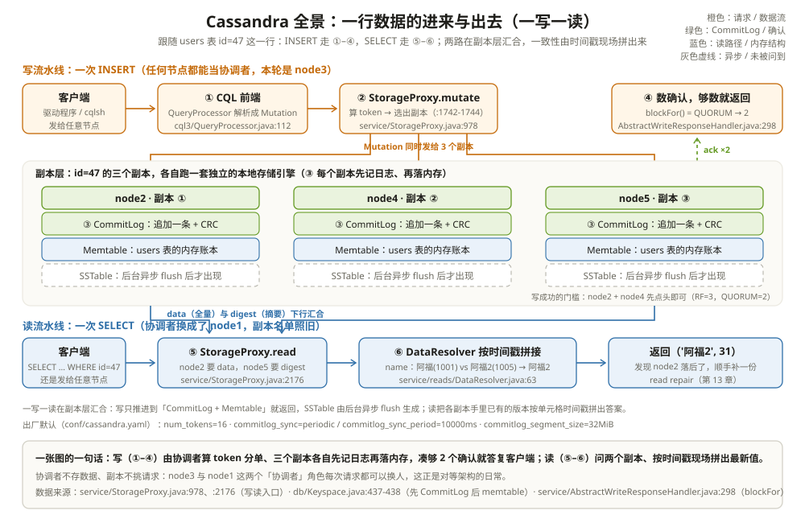

# 架构概述：一行数据的进来与出去

先看一个让新工程师发毛的现场。他从 MySQL 主从架构转过来管一套 Cassandra 集群，第一件事是找主库：翻了半天配置没找到哪个节点是 master，`nodetool status` 里五个节点全是绿油油的 UN，长得一模一样。他随手把 INSERT 发给了 node3——不是「主库」的 node3——居然也写成功了。他心里发虚：没有老板拍板，这些节点不打架吗？数据不会写散吗？

不打架，也不散。差别不在「配置没做好」，而在 Cassandra 的根本工作方式：**它是一群完全对等的节点，没有主从，任何节点都能接请求**。你连到的那个节点自动升任「协调者」（Coordinator）：按分区键算出这行数据归谁管，把请求转给管事的几个副本，等够数量的确认就回复你。没有选主、没有「写必须去主库」——因为根本没有主库。看懂这套「人人接单、按规则分单」的对等架构，上面三个疑虑会翻转成三个特性：任何节点挂了集群照常读写、容量不够就加节点摊着、写入吞吐随节点数往上走。

全章跟一个集群和一行数据走。它们长这样：

```text
贯穿全章的集群与一行数据（后续每章都复用）：
5 个节点：node1 ~ node5（演示用单数据中心）
keyspace demo：SimpleStrategy，replication_factor = 3
客户端一致性级别：CL = QUORUM（3 个副本里，读写都等到 2 个确认）

INSERT INTO users (id, name, age) VALUES (47, '阿福', 31);   ← 第一次写
UPDATE users SET name = '阿福2' WHERE id = 47;               ← 更新
SELECT name, age FROM users WHERE id = 47;                   ← 读

id=47 这一行按分区键哈希出的 token，落在 node2 / node4 / node5
这三个副本上。写要问它，读也要问它，全轨道的故事都围着它转。
```

QUORUM 这个数先记住结论：3 个副本、QUORUM = ⌊3/2⌋+1 = 2。写的时候 2 个副本点头就算成功，读的时候要凑 2 个副本的数据碰头才能走。为什么是 2、读写怎么配合，第 7 章展开。

---

## 一、先说定位：一群对等节点，没有老板

Cassandra 的身世写在官方文档里：它把 **Amazon Dynamo 的分布式存储与复制技术**和 **Google Bigtable 的数据模型**拼在了一起（`doc/modules/cassandra/pages/architecture/overview.adoc` 开篇的定性描述，官方文档不带行号）。Dynamo 那一半给它的是骨架——对等节点、按分区键摊数据、多副本可调一致性；Bigtable 那一半给它的是血肉——按列族组织的宽表、基于 LSM 的存储引擎。所以 Cassandra 既不是「分布式 MySQL」，也不是「更大号的 RocksDB」：数据模型像 Bigtable，部署形态像 Dynamo。

「对等」（peer-to-peer）是这套架构最反直觉、也最重要的一个词：每个节点跑的是同一份代码、存的是全环的一部分数据、扮演的角色完全相同（`doc/modules/cassandra/pages/architecture/dynamo.adoc` 对 multi-master 复制与 gossip 成员管理的定性描述）。类比一下：MySQL 主从像一家只有前台能收单的餐馆，前台挂了就得先选出新前台再开门；Cassandra 像食堂的打饭窗口——**每个窗口都能收单**，谁被顾客排到，谁就去后厨把这份菜从存它的窗口里凑齐。seeds 这个词容易让人误会它是「主」：它只是新节点入职时递名片用的联系人列表（`conf/cassandra.yaml:764`），除了「新人先找谁认识」之外没有任何特权。

| 维度 | MySQL 主从 / 分库分表 | Cassandra |
| --- | --- | --- |
| 节点角色 | 主库写、从库读，角色不同 | 全部对等，代码与职责相同 |
| 写入口 | 只能写主库 | 任何节点都能接写 |
| 挂一个节点 | 主挂了要选主，从挂了切流量 | 集群照常读写，只是少一个副本 |
| 扩容 | 分库分表要停机迁移规划 | 新节点入环自动分走一段 token |
| 数据分布 | 由中间件/应用层管 | 按分区键 token 由环自己管（第 6 章） |

对等架构还改变了运维的动作清单。MySQL 主从的例行维护是「先切主、再重启」——选主那几秒就是故障演练；Cassandra 的例行维护是「一台一台滚动重启」：任何时刻挂掉一个节点，剩下的副本照常凑够 QUORUM，客户端甚至不会察觉。没有 failover 脚本，因为不存在「谁接管谁」的问题——每个活着的节点天生就在接管。

```text
举例：同一个 INSERT 发两次，协调者可以不是同一个节点
第一次发给 node3 → node3 客串协调者（第三、四节就按这个走）
第二次发给 node1 → node1 客串协调者，副本名单照旧 {node2, node4, node5}
换的是「跑腿的」，不变的是「规则」：
token 决定这行数据归谁，一致性级别决定等几个确认。
跑腿的每来一个请求都重新选，规则刻在配置和环信息里。
```

---

## 二、全景部件表：集群入口三件套



把一个节点拆开看，入口处站着三件套。每件只记一句话职责，细节留给后面各章：

| 部件 | 住在哪 | 职责一句话 |
| --- | --- | --- |
| Cassandra daemon | `service/CassandraDaemon.java:137` | 进程本体：`main`（`:994`）里启动存储、拉起各服务，native transport 默认随进程启动（`:782`） |
| StorageService | `service/StorageService.java:291` | 节点在环上的身份证：`initServer`（`:731`）完成初始化入环 |
| CQL 前端（原生协议） | `transport/Server.java:72` | 监听 9042 的 Netty 服务端，收发原生协议 v5 帧 |
| CQL 引擎 | `cql3/QueryProcessor.java:112` | 把 CQL 解析成可执行语句；全局单例（`:119`），每个会话经它拿 QueryHandler（`service/ClientState.java:125`） |
| 协调者逻辑 | `service/StorageProxy.java:246` | 全静态方法的一台总机：算 token、选副本、等确认、拼读结果 |
| 存储引擎 | `db/ColumnFamilyStore.java:188` | 每张表一个实例（`createColumnFamilyStore`，`:785`），管这本表的全部家当：Memtable + SSTable 集合 |
| CommitLog | `db/commitlog/CommitLog.java:76` | 全节点共用的崩溃保险账，下一章主角 |
| Memtable | `db/memtable/Memtable.java:60` | 每张表一本的内存账本，写的第一落点 |
| SSTable | `io/sstable/` | 落盘后的不可变账本，第 3 章主角 |

对上号之后，再看 node2 的数据目录，每个目录都有了主：

```text
node2 的家（路径是 cassandra.yaml 里 data_file_directories /
commitlog_directory / hints_directory 的默认值）
/var/lib/cassandra/
├── commitlog/        ← CommitLog 段文件：全节点共用一本（不是每表一份）
├── data/
│   ├── demo/         ← keyspace demo
│   │   └── users-<hash>/   ← users 表的家当：一本本 SSTable
│   └── system-*/     ← 系统表（schema、本地信息等）
├── hints/            ← 给暂时联系不上的副本暂存的补发数据
└── saved_caches/     ← 键缓存、行缓存的落盘存档
```

注意两个「一本 / 一份」的分野：**CommitLog 全节点只有一本**，所有表混着记；**Memtable 和 SSTable 每张表各一份**，互不掺和。这个分野就是下一章的主题。三件套跑起来之后，一写一读两条流水线就转起来了：写走①②③④（下图），读走⑤⑥——下面两节放电影。

给三件套各配一个人话类比：daemon 是**配电间**，全楼的车闸电灯都从它过电，它不接待顾客但别人全靠它；CQL 前端是**前台接待**，说「协议方言」的客人（原生协议帧）由它引到翻译（QueryProcessor）那儿；存储引擎是**每个库区的库管员**——`ColumnFamilyStore` 一个实例盯一张表，Memtable 和 SSTable 都锁在它手里，谁也不能越过它动账本。

```text
举例：一条 CQL 请求穿过三件套的路径
驱动 → transport/Server：9042 端口收原生协议帧（Server.java:72）
     → QueryProcessor：解析 CQL、查 schema、生成执行计划（QueryProcessor.java:112）
     → StorageProxy：协调——算 token、选副本、数确认（StorageProxy.java:246）
     → ColumnFamilyStore：自己也是副本时，把改动交给本表的账本（:188）
     → transport/Server：结果编回帧，原路送回客户端
哪个节点接了请求，这条链就在哪个节点上跑一遍——所以每个节点都得三件套齐全。
```

---

## 三、写一行数据的一生：从 INSERT 到三个副本

客户端把 `INSERT INTO users (id, name, age) VALUES (47, '阿福', 31)` 发给了 node3（可以是任何节点，这次轮到 node3 当协调者）。这条语句的一生分四步，步步有名字：

1. **① 解析**：原生协议帧进来，`QueryProcessor` 把 CQL 解析、校验、计划，变成一个 `Mutation`——「某个分区上的一批单元格改动」这个纯数据结构；
2. **② 算 token、选副本**：协调者调 `StorageProxy.mutate`（`service/StorageProxy.java:978`），第一步就在日志里写明「Determining replicas for mutation」（`:981`）；`performWrite`（`:1732`）里取分区键的 token（`:1742`），按 keyspace 的复制策略算出这份 token 的副本集合并核对一致性级别够不够人（`ReplicaPlans.forWrite`，`:1744`）。id=47 的 token 指向 node2/node4/node5；
3. **③ 发给副本**：node3 把 Mutation 发给三个副本，自己也可能是其中之一；每个副本本地走 `Keyspace.apply`（`db/Keyspace.java:429`），它的内部注释一句话说清了顺序——**「先追加到全局 CommitLog，再更新 memtable 和索引」**（`db/Keyspace.java:437-438`），具体动作在写处理器里：先 `CommitLog.instance.add`（`db/CassandraKeyspaceWriteHandler.java:53`，落点在 `db/commitlog/CommitLog.java:301`），再写各表的 Memtable；
4. **④ 数确认**：协调者手里有个 `AbstractWriteResponseHandler`，等回执数量达到 `blockFor()`（`service/AbstractWriteResponseHandler.java:298`，QUORUM 时是 2）就 `get()` 返回（`:130`）。node3 等 node2、node4 先点头，不等 node5。

```text
举例：这条 INSERT 的写流程时间线（RF=3，CL=QUORUM）
t0  客户端 → node3：INSERT users(47,'阿福',31)
t1  node3 算 token，副本名单 = {node2, node4, node5}
t2  node3 把 Mutation 并行发给 node2 / node4 / node5
t3  node2、node4：追加各自本地 CommitLog → 写本地 Memtable → 回 ack
t4  node5 同样落了这份副本（只是没被等）
t5  node3 数到 2 个 ack ≥ QUORUM → 给客户端回「成功」
注意：此刻三份副本都只在「CommitLog + Memtable」里，SSTable 一个都没动。
落盘是后台异步 flush 干的活（第 2、3 章）。
```

这里有个新手最常踩的预期差：**「写成功」不等于「在磁盘上」**。QUORUM 确认的是「副本的内存和日志收到了」，不是「SSTable 写好了」。这正是 Cassandra 写入快的原因——返回前只做内存插入和一次日志追加，把整理磁盘的活全部甩给后台。代价是崩溃恢复要靠那本日志，这是下一章的全部内容。

把贯穿案例的第二次写也放进来，看看「更新」在这条流水线里是什么：

```text
举例：换成 UPDATE 再走一遍（贯穿案例的第二次写）
UPDATE users SET name='阿福2' WHERE id=47;
├── 协调者换成了 node4？无所谓，算 token、选副本的规则一样
├── 三个副本落的是一个「新的 cell 版本」（name='阿福2', ts=1005），
│   不是整行覆盖——旧 cell '阿福'（ts=1001）原样留在账本里
└── node5 恰好 GC 停顿 8 秒没回 ack → 不挡返回（QUORUM 已够数）
    node5 缓过来之后由 hint 机制补送这笔改动（第 13 章细讲）
```

「更新不覆盖、只追加新版本」这个行为和 RocksDB 的 Put 一个口味，但版本裁判不同：RocksDB 靠单调递增的 seq（库自己发号），Cassandra 靠每笔写自带的客户端时间戳——这也是第四节读拼接的裁决依据。

---

## 四、读一行数据：问几个副本，怎么拼

读走的是另一条流水线。客户端把 `SELECT name, age FROM users WHERE id=47` 发给 node1（这次换它当协调者）：

1. **⑤ 选副本、发查询**：`StorageProxy.read`（`service/StorageProxy.java:2176`）按同一个 token 算出副本名单；QUORUM 读会把查询发给若干副本——比如 node2 要全量数据（data）、node5 只要比对摘要（digest）；
2. **⑥ 汇聚拼接**：`DataResolver`（`service/reads/DataResolver.java:63`）把各副本返回的行**按单元格时间戳拼接**：同一个 cell 谁的时间戳新谁赢。node2 还没收到那次 UPDATE 时，它手里的 name 是「阿福」(ts=1001)，node5 已经是「阿福2」(ts=1005)——拼接结果取 ts=1005 的「阿福2」。

```text
举例：两个副本手里各有一半事实，拼出完整答案
node2 返回：name='阿福'  (写时间戳 1001),  age=31 (写时间戳 1001)
node5 返回：name='阿福2' (写时间戳 1005),  age=31 (写时间戳 1001)
拼接规则：每个 cell 单独比时间戳
→ name 取 1005 的 '阿福2'，age 取 31
→ 客户端拿到 ('阿福2', 31)
另外注意到 read repair 的机会：node2 落后了，协调者顺手把新值补给它。
```

这就是「最终一致」在源码里的样子：**没有谁负责把三份副本改成一样，一致性是每次读的时候现场拼出来的**。同一个分区的一行数据，列和列可能来自不同副本；时间戳就是唯一的裁判。第 7 章讲不同一致性级别下这套拼法怎么变化，第 13 章讲副本之间怎么悄悄抹平差异。

顺带说清楚 QUORUM 读的「问法」——它不是把三个副本都全量问一遍：

```text
举例：CL=QUORUM 的读到底问谁、问多少
副本名单 {node2, node4, node5}，QUORUM = 2：
├── 向 node2 要全量 data（真正的行数据，可能几百字节）
└── 向 node5 要 digest（各 cell 值的哈希摘要，几十字节）
两个回应能对上 → 直接返回 node2 的行；
对不上 → 说明有分歧，拉 node4 的数据三方对账，时间戳新的算数。
比全量问 3 份省一大截网络开销，又保住了「两个副本说一致」的信心。
```

digest 这个小设计值得记一笔：它把「验证一致」的成本从「再传一份全量数据」降到「传一个哈希」。后面第 13 章的 Merkle 树、反熵修复，都是同一个思路在更大尺度上的重演。

---

## 五、出厂默认值：cassandra.yaml 里的形状

这一章出现的配置集中摆一次，后面各章会反复回来对账：

| 配置 | 出厂默认 | 定义在哪 | 它决定了什么 |
| --- | --- | --- | --- |
| cluster_name | 'Test Cluster' | `conf/cassandra.yaml:26`（`config/Config.java:85` 同默认） | 集群名，防止机器串门到别的集群 |
| seeds | "127.0.0.1:7000" | `conf/cassandra.yaml:764` | 新节点入职联系人，不是主 |
| num_tokens | 16 | `conf/cassandra.yaml:42`（字段在 `config/Config.java:141`） | 每节点在环上拿几段 token（vnodes） |
| commitlog_sync | periodic | `conf/cassandra.yaml:665`（字段在 `config/Config.java:476`） | CommitLog 的 fsync 档位（第 2 章） |
| commitlog_sync_period | 10000ms | `conf/cassandra.yaml:667`（`config/Config.java:481`，旧名 `_in_ms` 已废弃） | periodic 档的 fsync 周期，即最坏丢数据窗口 |
| commitlog_segment_size | 32MiB | `conf/cassandra.yaml:691`（`config/Config.java:483`） | 单个 CommitLog 段文件多大就换下一个 |
| memtable_allocation_type | heap_buffers | `conf/cassandra.yaml:886`（`config/Config.java:625`） | Memtable 用堆内还是堆外内存 |
| endpoint_snitch | SimpleSnitch | `conf/cassandra.yaml:1629`（实现类 `locator/SimpleSnitch.java:31`） | 告诉集群网络拓扑；6.0 起有新的替代配置，这个口子仍兼容 |

这些数不是随手拍的：num_tokens=16 让每个节点在环上摊 16 小段而不是 1 大段，扩容时数据搬得更碎更均匀；commitlog_sync=periodic + 10 秒，是用「最坏丢 10 秒」换「写入永不等于 fsync」；32MiB 的段大小让日志文件既好回收又不至于太碎。改动任何一个之前，先想清楚它牵动哪条流水线——尤其是 commitlog_sync，它直接改写第 2 章的丢数据窗口。

再提醒一个新版本改动，免得照着旧文档改配置踩坑：`commitlog_sync_period` 在老版本里叫 `commitlog_sync_period_in_ms`，7.0 的 master 已改名为时长写法 `10000ms`（`config/Config.java:480-481` 明确标注旧名 deprecated）。同理 `endpoint_snitch` 从 6.0 起被一组新的拓扑配置（`initial_location_provider`、`node_proximity` 等）取代（`conf/cassandra.yaml:1544` 起的注释），旧口子仍然兼容——两处都改了名但没断后路，这是 Cassandra 演进的常见手法：先给新名字，旧名字过渡几个大版本。

---

## 六、和 RocksDB 摆在一起看：库与库的集群

| 维度 | RocksDB | Cassandra |
| --- | --- | --- |
| 部署形态 | 一个库：嵌在应用进程里，无端口无协议 | 一群库组成的服务：每节点内嵌一个存储引擎 + 分布式外衣 |
| 接口 | 进程内函数调用（Open/Put/Get） | 网络 CQL（原生协议 + QueryProcessor） |
| 数据分布 | 单机单库，一个目录一棵 LSM 树 | 按 token 环摊给副本，keyspace/RF 决定份数 |
| 副本与一致性 | 无副本概念，进程外的高可用靠上层 | RF 份副本 + CL 协商，读时按时间戳拼接 |
| 失败语义 | 进程崩 = 库不可用，靠 WAL 恢复单机数据 | 节点崩 = 少一个副本，其余副本继续服务 |
| LSM 角色 | LSM 是它自己的全部 | LSM 只在节点内部（引擎层），环在它之上 |

两者最本质的差别一句话说清：**RocksDB 是「库」，Cassandra 是「一群库组成的服务」**。Cassandra 每个节点里住的那个存储引擎（CommitLog + Memtable + SSTable + 压实），和 RocksDB 的三层流水线几乎是同一套 LSM 心法；外面那层「算 token、选副本、数确认、拼读结果」的分布式外衣，是 RocksDB 完全没有的维度。反过来，RocksDB 进程内的微操（列族、快照、迭代器、压实调优）在 Cassandra 里被换成了 keyspace、副本策略、一致性级别这些集群级的概念。所以读 Cassandra 源码的正确姿势是：把「引擎层」的问题对照 RocksDB 找答案，把「环层」的问题当成全新的一层来学——后面几章两条线交替走。

---

## 这一章留下的线索

- **对等架构，无 master**：Dynamo 的分布式骨架 + Bigtable 的数据模型；任何节点都能当协调者，seeds 只是入职联系人不是主；
- **集群入口三件套**：daemon 与 StorageService 负责入环，transport/Server + QueryProcessor 是 CQL 前端，ColumnFamilyStore 每表一份管住 Memtable + SSTable；
- **写的一生**：协调者算 token 选副本（StorageProxy.mutate）→ 每个副本先追加本地 CommitLog 再写 Memtable（Keyspace.apply）→ 确认数到 blockFor 就返回——**写成功 ≠ 在磁盘上**；
- **读的一生**：StorageProxy.read 汇聚多副本，DataResolver 按单元格时间戳拼接——一致性是读时现场拼出来的，不是提前写好的；
- **出厂默认值藏着形状**：num_tokens=16、commitlog_sync=periodic/10000ms、段 32MiB、heap_buffers——后面每章都会回到这几个数。

下一章把写流程第③步拆开看第一半：那本全节点共用的崩溃保险账怎么记、什么时候强制落盘、崩了之后靠它捞回多少——[提交日志与内存表：先记账，再落内存](../engine/01-提交日志与内存表.md)。

### 后续章节地图

| 篇 | 章节 | 它在故事线的哪一段 |
| --- | --- | --- |
| 02 | [提交日志与内存表](../engine/01-提交日志与内存表.md) | 存储引擎第一站：写请求怎么先保命再落内存 |
| 03 | [SSTable 与压缩](../engine/02-SSTable与压缩.md) | 磁盘上的不可变账本与后台并账 |
| 04 | [基于 Trie 的存储格式](../engine/03-基于Trie的存储格式.md) | 5.0 的新账本：内存 Trie 与盘上 BTI |
| 05 | [Gossip 与故障检测](../distributed/01-Gossip与故障检测.md) | 集群怎么互相认识、怎么发现谁挂了 |
| 06 | [分区器与令牌环](../distributed/02-分区器与令牌环.md) | 一行数据按什么规则摊给哪个节点 |
| 07 | [一致性与副本](../distributed/03-一致性与副本.md) | 三个副本写几个确认几个才算数 |
| 08 | [CQL3 解析与执行](../query/01-CQL3解析与执行.md) | 一句 CQL 变成 Mutation 的全过程 |
| 09 | [原生协议传输](../query/02-原生协议传输.md) | CQL 消息在线路上的字节形态 |
| 10 | [读写路径](../query/03-读写路径.md) | Coordinator 把两条流水线串起来 |
| 11 | [存储附着索引（SAI）](../index/01-存储附着索引SAI.md) | 不扫全表也能按值查行 |
| 12 | [向量搜索与 ANN](../index/02-向量搜索与ANN.md) | JVector 的近邻搜索怎么落进 SSTable |
| 13 | [修复与反熵](../operations/01-修复与反熵.md) | 副本悄悄不一致了谁来抹平 |
| 14 | [拓扑变更与节点生命周期](../operations/02-拓扑变更与节点生命周期.md) | 扩容、缩容、换机器时数据怎么搬 |
| 15 | [快照与备份](../operations/03-快照与备份.md) | 硬链接近零成本的时光机 |

---

## 附：这一章的源码入口

> 除特别注明外，本节引用的源码文件与行号都来自 apache/cassandra 主分支（7.0-SNAPSHOT，2026-08）。

- `service/CassandraDaemon.java:137、782、994`：daemon 本体、native transport 随进程启动、main 入口
- `service/StorageService.java:291、731`：StorageService 类与 `initServer` 节点初始化
- `transport/Server.java:72`：原生协议服务端（实现 `CassandraDaemon.Server`）
- `cql3/QueryProcessor.java:112、119` 与 `service/ClientState.java:125`：CQL 引擎单例与会话默认 QueryHandler
- `db/ColumnFamilyStore.java:188、785`：存储引擎每表一个实例与创建入口
- `service/StorageProxy.java:246、978、981、1732、1742-1744、2176`：协调者总机、写入口、选副本日志、token 计算与读入口
- `service/AbstractWriteResponseHandler.java:130、298`：等确认的 `get()` 与 `blockFor()`
- `service/reads/DataResolver.java:63`：多副本按时间戳拼接
- `db/Keyspace.java:429、437-438、447`：副本本地写入与「先 CommitLog 后 memtable」的顺序注释
- `db/CassandraKeyspaceWriteHandler.java:42、49-53、99` 与 `db/commitlog/CommitLog.java:301`：本地写处理器先追加 CommitLog
- `conf/cassandra.yaml:26、42、665、667、691、764、886、1629`：本章全部出厂默认值
- `config/Config.java:85、141、476-483、625`：同名配置字段的 Java 侧定义与默认值
- `locator/SimpleSnitch.java:31`：默认 snitch 实现

---

## 思考题

1. node3 收到一条写入后自己也是副本之一，它给本地副本落数据要经过 `Keyspace.apply` 吗？还是要「再发一次网络包给自己」？（提示：`service/StorageProxy.java:1746` 附近对本地副本的特殊处理。）
2. CL=QUORUM 时，三份副本里 node5 永远最慢，这条 INSERT 会因为 node5 挂掉而失败吗？换成 CL=ALL 呢？（提示：`blockFor()` 数的是「需要的确认数」，不是「副本总数」。）
3. 一行数据 UPDATE 之后立刻 SELECT，读到的 name 一定是新值吗？如果 CL 都降成 ONE，node2 还没收到 UPDATE 会发生什么？「按时间戳拼接」为什么救不了「根本没问到新副本」？
4. 把 `num_tokens` 从 16 调成 1（一个大 token），集群在「日常读写」和「扩容搬数据」两件事上各会发生什么变化？（提示：回忆图上那 16 小段在环上的样子。）
