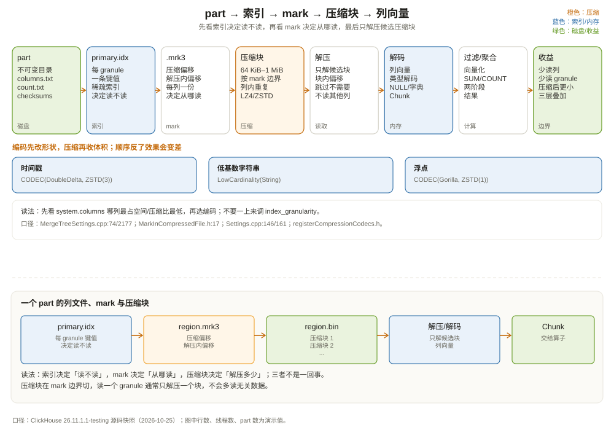

# 列式存储与压缩：只读四列，凭什么这么快

先算一笔账。

`shop.orders` 有 12 亿行、8 列（真实订单表通常更宽，这里保留 8 个关键字段）。假设每行平均 200 字节，整张表原始数据约 240 GB。一个查询只用 `region`、`status`、`amount`、`event_date` 四列：

```sql
SELECT region, COUNT(*) AS orders, SUM(amount) AS gmv
FROM shop.orders
WHERE event_date = '2026-10-01' AND status = 'paid'
GROUP BY region;
```

如果是行存（MySQL InnoDB），每一行 200 字节里只有四列是查询需要的，其余 4 列也要跟着页读进内存。按行存估算，要读的字节数约等于「命中行数 × 行宽」。

如果是列存（ClickHouse MergeTree），只读这四个列文件：

```text
region.bin       ≈ 12 亿 × 1 字节（LowCardinality 字典下标）
status.bin       ≈ 12 亿 × 1 字节
amount.bin       ≈ 12 亿 × 8 字节（Decimal 压缩后更小）
event_date.bin   ≈ 12 亿 × 2 字节（Date）
```

原始值总量约 14.4 GB，再经过压缩，实际磁盘可能只有 3~5 GB。只读这四列，I/O 量比行存少一个数量级。

这还没算「跳过」：按分区裁掉其他月份，按主键/granule 裁掉不命中的块，最终可能只读几百 MB。**列存的第一层收益是「少读列」，第二层是「少读行」，第三层才是「压缩后更小」。** 这一章把这三层拆开，从 part 目录里的 `.bin` 和 `.mrk3` 讲起。



---

## 一、part 目录：一列一对文件

第 5 章看过 part 的大致结构。这一章把每个文件的作用讲细：

```text
202610_1_1_0/
├── checksums.txt              ← 每个文件的校验和与大小
├── columns.txt                ← 列名、类型、默认值
├── count.txt                  ← 行数
├── primary.idx                ← 稀疏主键索引：每个 granule 一条键值
├── default_compression_codec.txt ← 这个 part 的默认压缩编码
├── region.bin                 ← region 列的数据（压缩块一个接一个）
├── region.mrk3                ← region 列的 mark：每个 granule 在 .bin 里的位置
├── status.bin / status.mrk3
├── amount.bin / amount.mrk3
├── event_date.bin / event_date.mrk3
└── ...
```

在 Wide 格式下，每列有独立的 `.bin` 和 `.mrk3`。这就是列裁剪的物理基础：查询只读需要的列，不读的 `.bin` 根本不会打开。

`checksums.txt` 记录每个文件的大小和校验和；`columns.txt` 记录列的定义；`count.txt` 记录行数。注意 `count.txt` 是**这个 part 的行数**，不是全表的；全表 `count()` 要把所有 active part 的 `count.txt` 加起来（或者用分区/表级统计）。

`primary.idx` 是稀疏主键索引，不是每行一条，而是**每个 granule 一条**。默认 `index_granularity = 8192` 行一个 granule（`MergeTreeSettings.cpp:74`），所以一个 8192 行的 granule 在 `primary.idx` 里只有一条键值。这个「稀疏」设计是 ClickHouse 索引内存小的关键：12 亿行只有约 14.6 万条索引，而不是 12 亿条。

---

## 二、mark：从「第几个 granule」到「文件里的第几个字节」

`.bin` 里的数据是压缩块一个接一个排的。读取器要读第 N 个 granule，怎么知道从哪个字节开始？

答案在 `.mrk3`。一个 mark 记录两个偏移（`src/Formats/MarkInCompressedFile.h:17`）：

```cpp
struct MarkInCompressedFile
{
    size_t offset_in_compressed_file;    // 压缩文件里的字节偏移
    size_t offset_in_decompressed_block; // 解压后块内的字节偏移
};
```

- `offset_in_compressed_file`：这个 granule 的数据从 `.bin` 的哪个压缩块开始；
- `offset_in_decompressed_block`：解压这个块后，从块内哪个位置开始读（因为一个压缩块可能包含多个 granule）。

自适应粒度（`.mrk3`）下，mark 大小是 3 个 `UInt64`（`MergeTreeIndexGranularityInfo.h:70-71`），第三个值是**这个 granule 的行数**——自适应粒度允许每个 granule 行数不同，读取器靠它知道要解码多少行；`MergeTreeIndexGranularity` 在内存里维护同一组数字。

读取一个 granule 的过程：

```text
1. 查 primary.idx，知道第 N 个 granule 的键值范围；
2. 查 .mrk3 第 N 条 mark，拿到压缩偏移 + 解压内偏移；
3. 从 .bin 的压缩偏移处读一个压缩块；
4. 解压这个块；
5. 从解压块内偏移处开始，解码出需要的值；
6. 如果 granule 跨了压缩块，继续读下一个块。
```

`MergeTreeReaderStream`（`src/Storages/MergeTree/MergeTreeReaderStream.h:20`）负责这套读取；`MergeTreeMarksLoader`（`src/Storages/MergeTree/MergeTreeMarksLoader.h:39`）负责加载和解析 marks。读取器不会「从文件头扫到目标位置」，而是直接 seek 到 mark 给的偏移，这是随机读能快的前提。

一个容易混的点：**mark 不是索引。** `primary.idx` 才是索引，它回答「哪个 granule 可能有我要的数据」；mark 只是「这个 granule 在文件里的位置」。索引决定「读不读」，mark 决定「从哪读」。

---

## 三、压缩块：不是按行压，是按块压

`.bin` 里的数据不是「一行一压」，也不是「整个文件一压」，而是按**压缩块**压。压缩块的大小由两个设置控制：

| 设置 | 默认值 | 作用 |
| --- | --- | --- |
| `min_compress_block_size` | 65536 字节 | 达到这个大小后，在下一个 mark 边界切块 |
| `max_compress_block_size` | 1048576 字节 | 压缩块的最大大小 |

（`src/Core/Settings.cpp:146`、`:161`。表级 `MergeTreeSettings` 里这两个值默认是 0，表示回退到全局设置。）

注意「在下一个 mark 边界切块」：压缩块不是任意字节切的，而是尽量对齐 granule/mark。这样读取一个 granule 时，通常只需要解压一个压缩块，不会因为块边界落在 granule 中间而多读。

压缩块的设计目标：

- 块太大：解压慢、随机读要解压很多无关数据、内存峰值高；
- 块太小：压缩率低（每次压缩都要写头、字典）、CPU 开销高；
- 64 KiB~1 MiB 是折中：既能利用列内重复，又不会让随机读解压太多。

一个 `.bin` 文件的布局：

```text
[压缩块 1][压缩块 2][压缩块 3]...
   ↑          ↑
 mark 0     mark k（可能指向块 2 的中间）
```

`max_compress_block_size` 是上限，实际块大小取决于数据写入时的 mark 边界。对高压缩率的列，一个块可能包含很多 granule；对低压缩率的列，块会更小。

---

## 四、编码与压缩：先改形状，再收体积

ClickHouse 的压缩分两层：

1. **编码（encoding）**：把值变成更适合压缩的形式，比如 Delta、DoubleDelta、Gorilla、T64、FPC、ALP；
2. **压缩（compression）**：用通用压缩算法（LZ4、ZSTD）把编码后的字节压得更小。

`CODEC(...)` 可以组合多层，按顺序执行：

```sql
CREATE TABLE shop.metrics
(
    ts        DateTime CODEC(DoubleDelta, ZSTD(3)),
    device_id UInt64   CODEC(T64, LZ4),
    temperature Float64 CODEC(Gorilla, ZSTD(1)),
    amount    Decimal(18, 2) CODEC(ZSTD(3)),
    raw       String   CODEC(ZSTD(10))
)
ENGINE = MergeTree
ORDER BY (device_id, ts);
```

常用编码/压缩：

| 编码/算法 | 适合的数据 | 原理一句话 |
| --- | --- | --- |
| `Delta` | 单调递增的整数/时间戳 | 存相邻差值，差值小 |
| `DoubleDelta` | 匀速递增的时间戳 | 存「差值的差值」，更小 |
| `Gorilla` | 浮点数（尤其缓慢变化） | XOR 相邻值，只存变化位 |
| `T64` | 范围有限的整数 | 去掉高位，按位打包 |
| `FPC` | 浮点数 | 预测 + XOR |
| `ALP` | Float32 / Float64 | 转整数 + 编码（仅浮点类型） |
| `LZ4` | 通用，速度快 | 字节级重复匹配 |
| `ZSTD` | 通用，压缩比高 | 更强的字典/熵编码 |
| `None` | 不可压缩/已压缩数据 | 不压 |
| `Encrypted` | 需要加密的列 | AES-GCM 等 |

（注册表在 `src/Compression/registerCompressionCodecs.h`。）

顺序很重要：**先用专用编码改形状，再用通用压缩收体积。** 比如 `CODEC(Delta, ZSTD(3))` 对时间戳：Delta 把「大整数序列」变成「小差值序列」，ZSTD 再压这些小差值。如果反过来 `CODEC(ZSTD(3), Delta)`，ZSTD 先把字节压乱，Delta 再对压缩后的字节做差，效果通常很差。

### 4.1 默认用什么

如果没有显式 `CODEC`，ClickHouse 的内置默认会按 part 大小选择：**100 MB 以下的 part 用 LZ4，100 MB 及以上用 ZSTD(3)**（`programs/server/config.xml:1764` 的注释）。表级 `default_compression_codec` 默认空（`MergeTreeSettings.cpp:2813`），列级 `CODEC` 优先级最高。

这意味着：

- 小 part 默认 LZ4，写入快、压缩比一般；
- 大 part 默认 ZSTD(3)，压缩比更好、CPU 稍高；
- 你可以按列覆盖，比如时间戳用 `DoubleDelta`，字符串用 `ZSTD`。

### 4.2 为什么列式压缩比行式高

同一列的值有三个特点，正好是压缩算法喜欢的：

1. **类型一致**：一列全是 `Decimal(18,2)`，不会混着字符串和日期；
2. **分布相近**：同一区域的订单金额在一个范围内，同一设备的温度变化缓慢；
3. **有序**：part 内按排序键排好，相同的 `region`、`status` 连续出现，游程/字典编码效率高。

行存里，一行几十列的类型和分布都不一样，压缩算法要在「混合字节」里找重复，效果自然差。这不是 ClickHouse 的压缩算法比 MySQL 强，而是**列式布局让压缩算法有更好的输入**。

一个演示算术（不是 benchmark）：

```text
行存：1 亿行 × 200 字节 = 20 GB
  压缩后约 6~8 GB（行级压缩，跨列重复少）

列存：1 亿行 × 4 列（region 1B + status 1B + amount 8B + date 2B）
  = 1.2 GB 原始值
  LowCardinality 字典 + Delta/ZSTD
  → 约 200~400 MB

同样查四列：
  行存要读 20 GB（压缩后 6~8 GB）
  列存要读 1.2 GB（压缩后 0.2~0.4 GB）
```

这就是「只读四列」的底气：不是 CPU 快，而是**要读的字节少了一个数量级**。

---

## 五、特殊列的存储：Nullable、LowCardinality、Array

列式存储不是「每列一个扁平数组」这么简单。复杂类型有自己的序列化方式。

### 5.1 Nullable：多一个 null map

`Nullable(T)` 在磁盘上存两部分：

- `T` 的值列（默认值填充 NULL 位置）；
- 一个 `UInt8` 的 null map，标记哪些行是 NULL。

`ColumnNullable` 的源码注释写得很清楚：它用一个 `ColumnUInt8` 的字节图，而不是 bitmap，因为列通常按压缩文件存储，用字节图实现更简单、压缩效果也够（`src/Columns/ColumnNullable.h:19-24`）。

代价：

- 每行多 1 字节 null map；
- 查询要同时读值列和 null map；
- `Nullable` 列不能直接做排序键的一部分（ClickHouse 会要求非 Nullable 或用默认值），因为 NULL 的排序语义复杂。

所以：**能不用 `Nullable` 就不用。** 用默认值（0、空字符串、`1970-01-01`）表达「缺失」，比 null map 更省空间、更快。确实需要区分「0」和「未知」时再用 `Nullable`。

### 5.2 LowCardinality：字典 + 下标

`LowCardinality(String)` 存两部分：

- 一个字典：所有不重复的字符串；
- 一个下标列：每行存字典下标（`UInt8`/`UInt16`/`UInt32`，取决于字典大小）。

`ColumnLowCardinality` 的注释说明：`reverse_index` 保存「值 → 下标」的映射，实际数据列存下标（`src/Columns/ColumnLowCardinality.h:19-27`）。

适合：`region`、`status`、`country`、`device_type` 这种基数几千以内的字符串。12 亿行、100 个不同值，字典只有 100 条，下标列每行 1 字节，压缩后非常小。

不适合：`user_id`、`order_id`、`trace_id` 这种高基数字符串。字典会变得巨大，下标列也不省空间，反而多了一层间接。

判断标准：**不同值的数量 / 总行数**。低于 1% 通常值得考虑，高于 10% 通常不值得。具体还要看字符串长度和查询模式。

### 5.3 Array：offset + 嵌套列

`Array(T)` 存两部分：

- 一个 offset 列：每行的数组在嵌套列里的结束位置；
- 一个嵌套列：所有数组元素按行展开。

```text
items: [['a','b'], ['c'], [], ['d','e','f']]
  offsets: [2, 3, 3, 6]
  nested:  ['a','b','c','d','e','f']
```

查询 `items[1]` 或 `arrayJoin(items)` 时，读取器根据 offset 定位。`Array` 适合「一行多个标签/多个商品」的场景，但要注意：数组元素多时，嵌套列会很长；跨行聚合要先 `arrayJoin` 展开，行数会放大。

### 5.4 稀疏序列化：大部分是默认值时

如果一列 95% 的值都是默认值（0 或空串），ClickHouse 可以用稀疏序列化，只存「非默认值 + 位置」。`ratio_of_defaults_for_sparse_serialization` 默认 `0.9375`（`MergeTreeSettings.cpp:97`），超过这个比例就触发。

这对「稀疏特征列」很有用，比如用户画像里大部分为 0 的标签。但不要依赖它做业务语义：稀疏序列化是存储层的优化，查询结果不变。

---

## 六、怎么观察一张表的存储

ClickHouse 提供了两个系统表：

```sql
-- 每个 part 的大小
SELECT
    partition,
    name,
    rows,
    bytes_on_disk,
    data_compressed_bytes,
    data_uncompressed_bytes,
    marks_bytes
FROM system.parts
WHERE database = 'shop' AND table = 'orders' AND active
ORDER BY bytes_on_disk DESC
LIMIT 10;

-- 每列的压缩情况
SELECT
    column,
    type,
    compression_codec,
    data_compressed_bytes,
    data_uncompressed_bytes,
    round(data_uncompressed_bytes / data_compressed_bytes, 2) AS ratio,
    marks_bytes
FROM system.columns
WHERE database = 'shop' AND table = 'orders'
ORDER BY data_compressed_bytes DESC;
```

（列含义见 `src/Storages/System/StorageSystemColumns.cpp:53-61`、`StorageSystemParts.cpp:92-96`。）

读法：

- `bytes_on_disk`：part 所有文件的总大小，包括 marks、索引、校验和；
- `data_compressed_bytes`：只算数据文件的压缩后大小，不含辅助文件；
- `data_uncompressed_bytes`：解压后的数据大小；
- `ratio`：压缩比，越高说明压得越狠；
- `marks_bytes`：mark 文件大小，granule 越细，marks 越大。

如果某个列 `ratio` 很低（比如 1.1），说明它几乎没压动。可能原因：

- 已经是压缩格式（图片、JSON 大文本、加密数据）；
- 高基数字符串，字典/Delta 帮不上忙；
- 用了 `CODEC(None)`；
- 数据随机，没有重复。

如果 `marks_bytes` 占比很高，说明 granule 太细（`index_granularity` 太小），索引开销压过了收益。

注意：`system.parts` 默认包含 inactive part（合并后等待删除的旧 part）。查询时加 `active`，否则会把旧 part 也算进去，看起来「磁盘没降」。

---

## 七、和 Parquet、InnoDB 比一比

### 7.1 和 Parquet 比

Parquet 也是列存，也有列块、页、统计、压缩。差别在「文件」和「表」：

| 维度 | Parquet 文件 | MergeTree 表 |
| --- | --- | --- |
| 组织单位 | 文件 → row group → column chunk → page | 表 → partition → part → granule → 压缩块 |
| 索引 | row group 统计、页索引、布隆（可选） | primary.idx 稀疏索引、skip index、projection |
| 更新 | 不支持，重写文件 | mutation 重写 part |
| 合并 | 外部工具 compact | 后台 merge |
| 复制 | 依赖文件系统/对象存储 | ReplicatedMergeTree |
| 读取 | 打开文件，读 footer | 打开 part，读 primary.idx/marks |
| 压缩 | 页级编码 + 压缩 | 列级编码 + 压缩块 |

两者都把「列」作为读取单位，都用统计做跳过。但 Parquet 是**静态文件格式**，MergeTree 是**动态表引擎**：后者有 part 生命周期、后台合并、复制、mutation。你可以把 MergeTree 理解成「一组会自己合并、复制、带索引的 Parquet 文件」，虽然内部格式并不相同。

### 7.2 和 InnoDB 比

| 维度 | InnoDB | MergeTree |
| --- | --- | --- |
| 存储单位 | 16 KB 页，行存 | 列文件 + 压缩块 |
| 一页里有什么 | 多行，所有列 | 一列的一段值 |
| 读一列 | 要把整页读进来 | 只读那一列的 `.bin` |
| 索引 | B+ 树，每行/每页 | 稀疏主键，每 8192 行 |
| 压缩 | 页压缩（可选） | 列级编码 + 块压缩 |
| 更新 | 原地改页 | 重写 part |
| 适合 | 点查、事务 | 大扫描、聚合 |

InnoDB 的页是为「按行读写」设计的：一页 16 KB 里塞多行，行内所有列在一起，改一行只碰一页。MergeTree 的列文件是为「按列扫描」设计的：一列的值连续，读一列不碰其他列。两种布局没有绝对优劣，取决于你更常做哪种操作。

---

## 八、调优：三个不要和三个可以

**不要：**

1. **不要 `SELECT *`。** 列存的最大优势是列裁剪，`SELECT *` 把优势扔掉了；
2. **不要给所有字符串都套 `LowCardinality`。** 高基数列的字典会爆炸；
3. **不要盲目用 `Nullable`。** null map 是每行 1 字节的额外开销，能用默认值就用默认值。

**可以：**

1. **可以给时间戳/单调 ID 加 `DoubleDelta`/`Delta`。** 这类列压缩比提升明显；
2. **可以给低基数字符串加 `LowCardinality`。** 字典编码通常比通用压缩更有效；
3. **可以按列覆盖 `CODEC`。** 不同列的数据分布不同，统一用 LZ4 不是最优。

一个渐进式调优顺序：

```text
1. 先看 system.columns：哪一列占空间最大、压缩比最低；
2. 再看查询：哪些列最常被读、哪些列从不被读；
3. 对占空间大的列试专用编码（Delta/Gorilla/ALP）；
4. 对低基数列试 LowCardinality；
5. 对从不被读的列考虑删除或移到独立表；
6. 最后才调 index_granularity / 压缩块大小。
```

不要一上来就调 `index_granularity`。它影响索引大小、mark 数量、读取粒度，牵一发动全身；先解决「读不读」和「压不压得动」的问题。

---

## 九、这一章留下的线索

把这一章压成几句话：

- 列式存储的物理单位是「每列一对 `.bin` + `.mrk3`」，列裁剪就是不打开不用的 `.bin`；
- `primary.idx` 是稀疏索引，每个 granule 一条；`.mrk3` 记录 granule 在 `.bin` 里的压缩偏移和解压内偏移；
- 压缩块按 mark 边界切，默认 64 KiB~1 MiB；压缩块太大/太小都有代价；
- 编码先改形状（Delta/Gorilla/T64/ALP），压缩再收体积（LZ4/ZSTD）；
- 默认按 part 大小选 LZ4/ZSTD(3)，列级 `CODEC` 优先级最高；
- `Nullable`、`LowCardinality`、`Array` 各有自己的序列化方式，选错会抵消列存优势；
- 看 `system.parts` / `system.columns` 判断压缩比和索引开销，别凭感觉调参。

下一章进入「内存里的列」：`ColumnVector`、`ColumnNullable`、`ColumnLowCardinality` 这些对象到底怎么表示一列？为什么 ClickHouse 的类型系统能让聚合函数直接在列上跑？

---

## 附：这一章的源码入口

> 源码来自本地 ClickHouse 26.11.1.1-testing 快照，验证时间 2026-10-25。

- `src/Formats/MarkInCompressedFile.h:17`：`MarkInCompressedFile`（压缩偏移 + 解压内偏移）
- `src/Storages/MergeTree/MergeTreeIndexGranularityInfo.h:70-71`：`getAdaptiveMrkSizeWide = 3 * UInt64`
- `src/Storages/MergeTree/MergeTreeIndexGranularityInfo.cpp:167`：mark 包含行数与偏移的注释
- `src/Storages/MergeTree/MergeTreeReaderStream.h:20`：`MergeTreeReaderStream`
- `src/Storages/MergeTree/MergeTreeMarksLoader.h:39`：`MergeTreeMarksLoader`
- `src/Storages/MergeTree/MergeTreeSettings.cpp:37`：`min_bytes_for_wide_part = 10 MiB`
- `src/Storages/MergeTree/MergeTreeSettings.cpp:74`：`index_granularity = 8192`
- `src/Storages/MergeTree/MergeTreeSettings.cpp:2177`：`index_granularity_bytes = 10 MiB`
- `src/Storages/MergeTree/MergeTreeSettings.cpp:97`：`ratio_of_defaults_for_sparse_serialization = 0.9375`
- `src/Storages/MergeTree/MergeTreeSettings.cpp:2813`：`default_compression_codec` 默认空
- `src/Core/Settings.cpp:146`：`min_compress_block_size = 65536`
- `src/Core/Settings.cpp:161`：`max_compress_block_size = 1048576`
- `src/Compression/registerCompressionCodecs.h`：编码/压缩注册表
- `src/Storages/System/StorageSystemColumns.cpp:53-61`：`system.columns` 的压缩字段
- `src/Storages/System/StorageSystemParts.cpp:92-96`：`system.parts` 的大小字段
- `src/Columns/ColumnNullable.h:19-24`：null map 的设计
- `src/Columns/ColumnLowCardinality.h:19-27`：字典 + 下标
- `programs/server/config.xml:1764`：默认压缩策略注释（LZ4 < 100 MB，ZSTD(3) ≥ 100 MB）

---

## 思考题

1. 一个 part 有 100 万行、`index_granularity=8192`，大概有多少个 granule、多少条 mark？如果 `index_granularity=1024`，marks 会变成多少？
2. 为什么压缩块要在 mark 边界切，而不是任意字节切？如果切在 granule 中间，读取一个 granule 会多做什么？
3. `CODEC(Delta, ZSTD(3))` 和 `CODEC(ZSTD(3), Delta)` 对时间戳列的效果为什么不同？
4. `LowCardinality(String)` 适合 `region`，为什么不适合 `order_id`？用 `system.columns` 怎么验证？
5. 一个查询只读 3 列，但 `system.parts` 显示 `bytes_on_disk` 很大。这能说明查询慢吗？还要看哪些指标？
