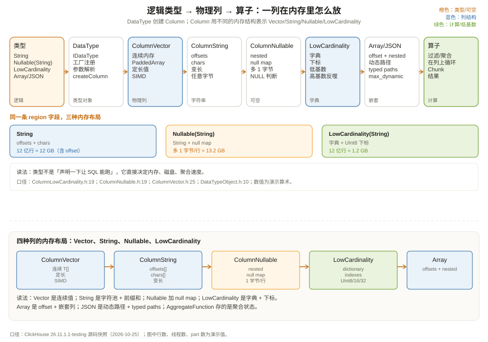

# 数据类型与列：内存里的列长什么样

先看一个把 DBA 看愣的对比。

同一份「区域」字段，三种写法：

```sql
-- ① 普通 String
region String

-- ② 可空 String
region Nullable(String)

-- ③ 低基数 String
region LowCardinality(String)
```

从 SQL 语义看，它们都能存 `'east'`、`'west'`。但从存储和内存看，三者完全不是一回事：

- `String`：每行一个变长字符串，字符连续存放，用 offset 定位；
- `Nullable(String)`：在 `String` 基础上多一个 null map，每行 1 字节；
- `LowCardinality(String)`：一个字典存所有不同值，每行存字典下标（通常 1~4 字节）。

12 亿行、100 个不同区域值，三者的差距：

```text
String:             12 亿 × (平均 6 字节 + 4 字节 offset) ≈ 12 GB
Nullable(String):   再多 12 亿 × 1 字节 null map ≈ 13.2 GB
LowCardinality:     100 条字典 + 12 亿 × 1 字节下标 ≈ 1.2 GB
```

这还没算压缩。`LowCardinality` 的下标列压缩后可能只有几百 MB。**类型不是「声明一下让 SQL 能跑」，它直接决定内存布局、磁盘格式、聚合速度。**

这一章从「一列在内存里到底是什么对象」讲起，把 ClickHouse 的类型系统和列实现对上号。



---

## 一、两层：DataType 是逻辑，Column 是物理

ClickHouse 把「类型」和「列」分成两个概念：

- **`IDataType`**：逻辑类型，回答「这个类型有什么值、占多少字节、怎么序列化、能做什么运算」；
- **`IColumn`**：物理列，回答「这一批值在内存里怎么放、怎么读、怎么过滤、怎么比较」。

`IDataType::createColumn()` 负责创建对应的列对象。比如：

```cpp
// 逻辑类型：UInt64
auto type = std::make_shared<DataTypeUInt64>();

// 物理列：ColumnVector<UInt64>
auto column = type->createColumn();   // 内部是 PaddedPODArray<UInt64>
```

`DataTypeFactory`（`src/DataTypes/DataTypeFactory.h:23`）是类型名的注册表：解析 `CREATE TABLE` 里的 `Nullable(String)`、`Decimal(18, 2)`、`Array(UInt64)`，创建对应的 `IDataType`。`Column` 的基类 `IColumn`（`src/Columns/IColumn.h:139`）定义了一列必须支持的操作：

| 方法 | 作用 |
| --- | --- |
| `size()` | 有多少行 |
| `getDataAt(n)` | 第 n 个值的字节视图（定长/字符串） |
| `insertFrom(src, n)` | 从另一列复制第 n 个值 |
| `compareAt(n, m, rhs, ...)` | 比较两列的第 n/m 个值 |
| `filter(mask)` | 按布尔掩码过滤 |
| `cut(start, length)` | 切一段 |
| `permute` / `replicate` | 重排/复制 |

聚合、排序、JOIN、过滤这些算子，都是通过这些方法操作列，而不是逐行调用「取字段」函数。这就是向量化执行的基础。

---

## 二、ColumnVector：定长值就是一块连续内存

`ColumnVector<T>` 是最简单的列：一列定长值，底层是一个 `PaddedPODArray<T>`（`src/Columns/ColumnVector.h:25`）：

```cpp
template <typename T>
class ColumnVector final : public COWHelper<...>
{
    using Container = PaddedPODArray<ValueType>;
    Container data;   // 连续内存，每个元素 T
public:
    ValueType & getData()[n];   // 直接访问
    size_t size() const { return data.size(); }
};
```

`PaddedPODArray` 在末尾留了 padding，方便 SIMD 一次读 16/32/64 字节而不越界。`UInt64`、`Int32`、`Float64`、`Decimal` 这些定长类型都用这种连续布局。

连续布局的好处：

- **缓存友好**：扫一列就是顺序扫内存，CPU 预取器喜欢；
- **SIMD 友好**：`amount > 1000` 可以对 4 个/8 个值一条指令比较；
- **压缩友好**：同样的字节模式连续出现，LZ4/ZSTD 容易压。

`ColumnDecimal<T>`（`src/Columns/ColumnDecimal.h`）也是定长，底层是 `PaddedPODArray<T>`，`T` 是 `Decimal32/64/128/256` 的底层整数。`Decimal(18,2)` 在内存里就是一个 64 位整数，小数点是元数据（scale），不是存储格式。

---

## 三、ColumnString：offset + 连续字符

字符串是变长的，不能像 `UInt64` 那样直接按下标乘字节宽度。`ColumnString` 用两个数组（`src/Columns/ColumnString.h:20`）：

```cpp
class ColumnString
{
    Offsets offsets;   // offsets[i] = 前 i+1 个字符串的总字节数
    Chars chars;       // 所有字符串的字节，连续存放
};
```

假设三行：

```text
row 0: "east"    → chars[0..3]   offsets[0] = 4
row 1: "west"    → chars[4..7]   offsets[1] = 8
row 2: "north"   → chars[8..12]  offsets[2] = 13
```

第 n 行的字符串是 `chars[offsets[n-1] .. offsets[n])`。`offsets` 是前缀和，所以取任意一行是 O(1)，顺序扫也很快。

两个重要的细节：

1. **ClickHouse 的 `String` 是任意字节，不校验 UTF-8。** 你可以存二进制、图片、JSON 文本，甚至非法 UTF-8；排序按字节比较。需要定长字符串用 `FixedString(N)`，不足补零。
2. **字符串不一定是「短」的。** 一列 `String` 里如果全是长文本，`chars` 会很大；压缩效果取决于内容重复度。大文本建议单独存表或用 `ZSTD` 高压缩级别。

`LowCardinality(String)` 是另一种字符串列，下面单独讲。

---

## 四、ColumnNullable：值列 + null map

`Nullable(T)` 的列是 `ColumnNullable`，它包了两列（`src/Columns/ColumnNullable.h:19`）：

```cpp
class ColumnNullable
{
    ColumnPtr nested_column;   // T 的值列
    ColumnPtr null_map;        // ColumnUInt8，1 表示 NULL
};
```

假设 `amount Nullable(Decimal(18,2))`：

```text
nested: [100.00, 0.00, 50.00, 0.00]   ← NULL 位置填默认值
nullmap:[0,      1,    0,     1   ]   ← 1 表示 NULL
```

读第 2 行时，先看 `nullmap[1]=1`，返回 NULL；读第 0 行时，看 `nullmap[0]=0`，返回 `nested[0]`。值列仍然连续，NULL 不影响其他行的布局。

代价：

- 每行多 1 字节 null map；
- 每个值多一次 null 判断；
- `Nullable` 不能直接做 `ORDER BY` 的前缀（需要非 Nullable 的排序键或特殊处理）；
- 聚合函数要处理 NULL 语义（`sum` 跳过 NULL，`count` 不数 NULL）。

所以 ClickHouse 的最佳实践是：**能用默认值就不用 Nullable**。`0`、`''`、`1970-01-01` 很多时候足以表达「没有」，而且省空间、省判断。

---

## 五、ColumnLowCardinality：字典 + 下标

`LowCardinality(T)` 的列是 `ColumnLowCardinality`，它有两部分（`src/Columns/ColumnLowCardinality.h:19`）：

```text
dictionary: ['east', 'west', 'north']      ← 去重后的值
indexes:    [0, 0, 1, 2, 1, 0, ...]        ← 每行的字典下标
```

`indexes` 的类型取决于字典大小：字典 ≤ 255 用 `UInt8`，≤ 65535 用 `UInt16`，否则 `UInt32`。每行只存一个小整数，比存完整字符串省得多。

适合：

- 基数低（不同值少）；
- 值重复率高；
- 经常作为过滤/分组键。

不适合：

- 高基数字符串（字典爆炸）；
- 值几乎不重复（下标不省空间，还多一层间接）；
- 需要按字符串原始顺序扫描（字典顺序和原始顺序不同）。

一个经验阈值：**不同值占比低于 1% 时优先考虑，高于 10% 时通常不值得。** 但这不是绝对规则，最终看 `system.columns` 的压缩比和查询模式。

`LowCardinality` 还支持 `Nullable` 嵌套，比如 `LowCardinality(Nullable(String))`；字典里会有一个「NULL」条目，下标指向它。复杂但可用，非必要不建议。

---

## 六、Array、Tuple、Map、JSON：嵌套类型怎么放

### 6.1 Array：offset + 嵌套列

`ColumnArray` 的注释写得很清楚：它是一列嵌套类型 + 一列 offset，offset 指向每行在嵌套列里的结束位置（`src/Columns/ColumnArray.h:17`）。

```text
items: [['a','b'], ['c'], [], ['d','e','f']]
  offsets: [2, 3, 3, 6]
  nested:  ['a','b','c','d','e','f']
```

`Array` 适合「一行多个标签/多个商品」；缺点是跨行聚合要先 `arrayJoin` 展开，行数会放大；数组元素很多时，嵌套列会很长。

### 6.2 Tuple：多列并排

`Tuple(String, UInt64)` 在内存里是两列并排：一列 String，一列 UInt64。`ColumnTuple` 持有一个 `Columns`，每个元素是一列。访问 `tuple.1` 就是取第一列。

### 6.3 Map：Array(Tuple(K, V))

`Map(K, V)` 在内存里通常表示为 `Array(Tuple(K, V))`：一列 offset，一列 key，一列 value。它适合小型的键值对集合，不适合当「宽表」用。

### 6.4 JSON：动态路径 + 类型化路径

ClickHouse 的 `JSON` 类型由 `DataTypeObject` 实现（`src/DataTypes/DataTypeObject.h:10`）。它有两种路径：

- **类型化路径（typed paths）**：建表时声明的 `JSON(a UInt64, b String)`，按列存，查询快；
- **动态路径（dynamic paths）**：运行时发现的路径，按子列存，最多 `max_dynamic_paths` 个（默认 1024，`DataTypeObject.h:21`）。

```sql
CREATE TABLE events
(
    id UInt64,
    payload JSON(max_dynamic_paths = 64)
)
ENGINE = MergeTree
ORDER BY id;

SELECT payload.user.name, payload.tags FROM events;
```

`JSON` 适合半结构化数据，但不是「无脑存 JSON」：动态路径太多会占用大量子列，查询也可能退化。能提前声明类型的字段，尽量放进 typed paths。

### 6.5 Sparse：大部分是默认值时

`ColumnSparse`（`src/Columns/ColumnSparse.h:12`）只存非默认值和它们的位置：

```text
values:  [默认值, 非默认值 1, 非默认值 2, ...]
offsets: [0, 17, 42, ...]
```

当一列 95% 以上是默认值时，ClickHouse 可能自动用稀疏序列化（`ratio_of_defaults_for_sparse_serialization=0.9375`）。这对稀疏特征列很省空间；但它是存储层优化，SQL 语义不变。

### 6.6 AggregateFunction：存的是「聚合状态」

`AggregateFunction(uniq, UInt64)` 不是存最终值，而是存聚合的中间状态。`ColumnAggregateFunction`（`src/Columns/ColumnAggregateFunction.h:43`）里存的是一组指向聚合状态的指针，状态本身放在 arena 里。

```sql
CREATE TABLE daily_uv
(
    event_date Date,
    region LowCardinality(String),
    users AggregateFunction(uniq, UInt64)
)
ENGINE = AggregatingMergeTree
ORDER BY (event_date, region);

-- 写入状态
INSERT INTO daily_uv
SELECT event_date, region, uniqState(user_id)
FROM shop.orders
GROUP BY event_date, region;

-- 查询时合并状态
SELECT event_date, region, uniqMerge(users) AS uv
FROM daily_uv
GROUP BY event_date, region;
```

这就是 `AggregatingMergeTree` 和物化视图预聚合的基础。`SimpleAggregateFunction` 则只存「可合并的简单值」（如 `sum` 的中间和），比完整状态更省。

---

## 七、类型系统：一张表认全常用类型

| 类别 | 类型 | 说明 | 常见坑 |
| --- | --- | --- | --- |
| 整数 | `UInt8/16/32/64/128/256`、`Int8...Int256` | 固定宽度，溢出报错或回绕（取决于函数） | `toUInt8(300)` 会截断/报错，用 `accurateCast` |
| 浮点 | `Float32/64`、`BFloat16` | IEEE 浮点 | 金额不要用 Float，用 Decimal |
| 定点 | `Decimal32/64/128/256` | 精确小数，`Decimal(P, S)` | P 是总位数，S 是小数位；运算可能升精度 |
| 布尔 | `Bool` | 底层 `UInt8` | 不要用字符串存 true/false |
| 字符串 | `String`、`FixedString(N)` | 任意字节；FixedString 定长补零 | UTF-8 不校验；FixedString 比较会带零 |
| 日期时间 | `Date`、`Date32`、`DateTime`、`DateTime64`、`Time`、`Time64` | 时间戳 + 时区 | `DateTime` 默认时区；`DateTime64` 精度到纳秒 |
| 枚举 | `Enum8`、`Enum16` | 字符串到整数的映射 | 改枚举值要 ALTER，旧值兼容性要注意 |
| UUID | `UUID` | 16 字节 | 随机 UUID 做主键会导致排序键很大 |
| 网络 | `IPv4`、`IPv6` | 专用类型 | 不要用 String 存 IP 再做范围查询 |
| 嵌套 | `Array`、`Tuple`、`Map`、`Nested` | 见上文 | `Array JOIN` 会放大行数 |
| 可空 | `Nullable(T)` | 值 + null map | 主键/排序键尽量不用 |
| 低基数 | `LowCardinality(T)` | 字典 + 下标 | 高基数会反噬 |
| 半结构化 | `JSON`、`Dynamic` | 动态路径/动态类型 | 路径太多会占内存 |
| 聚合 | `AggregateFunction`、`SimpleAggregateFunction` | 聚合状态 | 查询要用 `-Merge` 组合器 |

`system.data_type_families` 可以列出当前版本注册的所有类型（`src/Storages/System/StorageSystemDataTypeFamilies.cpp:17`）：

```sql
SELECT name, case_insensitive, alias_to
FROM system.data_type_families
ORDER BY name;
```

`DESCRIBE TABLE shop.orders` 看表的列类型；`toTypeName(expr)` 看表达式的推导类型：

```sql
SELECT toTypeName(amount), toTypeName(amount * 2), toTypeName(count())
FROM shop.orders
LIMIT 1;
```

---

## 八、类型转换：隐式、显式、溢出

ClickHouse 的类型转换有三层：

1. **隐式转换**：函数/运算符自动把参数转成共同类型，比如 `UInt32 + UInt64` 提升到 `UInt64`；`Decimal + Int` 提升到 `Decimal`；
2. **显式转换**：`CAST(x AS T)`、`toUInt64(x)`、`toDate(x)`；
3. **安全转换**：`accurateCast(x, 'T')`、`toUInt64OrNull(x)`，失败返回 NULL 或报错，而不是截断。

常见坑：

```sql
-- ① 整数除法
SELECT 5 / 2;          -- 2.5（ClickHouse 的 / 是浮点除法）
SELECT intDiv(5, 2);   -- 2
SELECT 5 % 2;          -- 1

-- ② Decimal 精度
SELECT toDecimal32(1, 2) / toDecimal32(3, 2);
-- 结果精度/小数位可能超出预期，必要时显式 CAST

-- ③ 字符串转日期
SELECT toDate('2026-10-01');       -- 可以
SELECT toDate('2026/10/01');       -- 可能报错，格式要匹配
SELECT parseDateTimeBestEffort('2026-10-01T10:00:00Z');  -- 宽松解析

-- ④ 溢出
SELECT toUInt8(300);               -- 报错或截断，取决于设置
SELECT accurateCast(300, 'UInt8'); -- 明确报错
```

金额、库存、计数这类不能出错的字段，用 `Decimal` + `accurateCast`；日志、埋点这类可以容忍截断的字段，用普通 `to...` 即可。

---

## 九、和 MySQL、Parquet 的类型对照

### 9.1 和 MySQL 比

| MySQL 类型 | ClickHouse 对应 | 差异 |
| --- | --- | --- |
| `TINYINT/SMALLINT/INT/BIGINT` | `Int8/16/32/64` | ClickHouse 有无符号版本，范围更大 |
| `DECIMAL(P,S)` | `Decimal(P,S)` | 语义接近；ClickHouse 最大 76 位 |
| `VARCHAR(N)` | `String` | ClickHouse 不限制长度、不校验字符集 |
| `CHAR(N)` | `FixedString(N)` | FixedString 补零，比较时零参与 |
| `DATETIME` | `DateTime` | ClickHouse 默认时区，精度秒 |
| `DATETIME(6)` | `DateTime64(6)` | 微秒/纳秒精度 |
| `JSON` | `JSON` / `String` | ClickHouse JSON 是列式动态路径，不是文本 |
| `ENUM` | `Enum8/16` | 类似，但改枚举要 ALTER |
| 无 | `Array/Tuple/Map` | ClickHouse 原生嵌套类型 |
| 无 | `LowCardinality` | ClickHouse 的字典编码类型 |

MySQL 的 `VARCHAR(N)` 有长度限制和字符集，ClickHouse 的 `String` 是任意字节；MySQL 的 `JSON` 存文本并做校验，ClickHouse 的 `JSON` 是列式存储 + 动态路径。迁移时不要机械映射，先看查询模式。

### 9.2 和 Parquet 比

Parquet 是「物理类型 + 逻辑注解」，ClickHouse 是「逻辑类型 + 列实现」。读 Parquet 时，ClickHouse 会把 Parquet 的物理/逻辑类型映射成自己的类型：

| Parquet 物理/逻辑 | ClickHouse 读取类型 |
| --- | --- |
| `INT32` + `INT(8,true)` | `Int8` |
| `INT64` + `TIMESTAMP(MILLIS)` | `DateTime64(3)` |
| `BYTE_ARRAY` + `STRING` | `String` |
| `FIXED_LEN_BYTE_ARRAY` + `DECIMAL` | `Decimal(P,S)` |
| `GROUP` + `LIST` | `Array(...)` |
| `GROUP` + `MAP` | `Map(...)` |
| `GROUP` + 嵌套 | `Tuple(...)` / `Nested` |

Parquet 的字典编码是物理编码，不是逻辑类型；ClickHouse 的 `LowCardinality` 是逻辑类型，读 Parquet 时不会自动变成 `LowCardinality`（除非你显式 CAST/建表时指定）。这也是为什么「Parquet 文件里有字典编码」不等于「ClickHouse 列是 LowCardinality」。

---

## 十、这一章留下的线索

把这一章压成几句话：

- `IDataType` 是逻辑类型，`IColumn` 是物理列；`createColumn()` 把两者对上；
- `ColumnVector<T>` 是连续内存，适合定长值；`ColumnString` 是 offset + 连续字符；
- `Nullable` 多一个 null map；`LowCardinality` 是字典 + 下标；`Array` 是 offset + 嵌套列；
- `JSON` 是动态路径 + 类型化路径，`AggregateFunction` 存的是聚合状态；
- 类型选择直接决定内存、磁盘、聚合速度，不是「声明一下」；
- 金额用 `Decimal`，低基数字符串用 `LowCardinality`，能不用 `Nullable` 就不用；
- 类型转换要区分隐式/显式/安全，金额和计数用 `accurateCast`。

下一章讲索引与投影：一列存好了，查询怎么知道「哪个 granule 可能有我要的数据」？主键稀疏索引、skip index、projection 各自解决什么问题？

---

## 附：这一章的源码入口

> 源码来自本地 ClickHouse 26.11.1.1-testing 快照，验证时间 2026-10-25。

- `src/Columns/IColumn.h:139`：`IColumn` 基类
- `src/Columns/ColumnVector.h:25`：`ColumnVector<T>`
- `src/Columns/ColumnString.h:20`：`ColumnString`（offsets + chars）
- `src/Columns/ColumnNullable.h:19`：`ColumnNullable`
- `src/Columns/ColumnLowCardinality.h:19`：`ColumnLowCardinality`
- `src/Columns/ColumnArray.h:17`：`ColumnArray`
- `src/Columns/ColumnSparse.h:12`：`ColumnSparse`
- `src/Columns/ColumnAggregateFunction.h:43`：`ColumnAggregateFunction`
- `src/Columns/ColumnDecimal.h`：`ColumnDecimal`
- `src/DataTypes/DataTypeFactory.h:23`：`DataTypeFactory`
- `src/DataTypes/DataTypeObject.h:10`：`DataTypeObject`（JSON）
- `src/DataTypes/DataTypeObject.h:21`：`DEFAULT_MAX_DYNAMIC_PATHS = 1024`
- `src/Storages/System/StorageSystemDataTypeFamilies.cpp:17`：`system.data_type_families`
- `src/Storages/MergeTree/MergeTreeSettings.cpp:97`：`ratio_of_defaults_for_sparse_serialization = 0.9375`

---

## 思考题

1. `String` 和 `LowCardinality(String)` 在内存里分别是什么结构？为什么 `LowCardinality` 不适合高基数列？
2. `Nullable(UInt64)` 比 `UInt64` 多存了什么？为什么排序键通常不建议用 `Nullable`？
3. `Array(String)` 的 offset 列和嵌套列分别存什么？`arrayJoin` 为什么会放大行数？
4. ClickHouse 的 `String` 不校验 UTF-8，这带来什么好处和什么坑？
5. `Decimal(18,2)` 和 `Float64` 存金额，哪个更合适？在聚合和比较时分别要注意什么？
