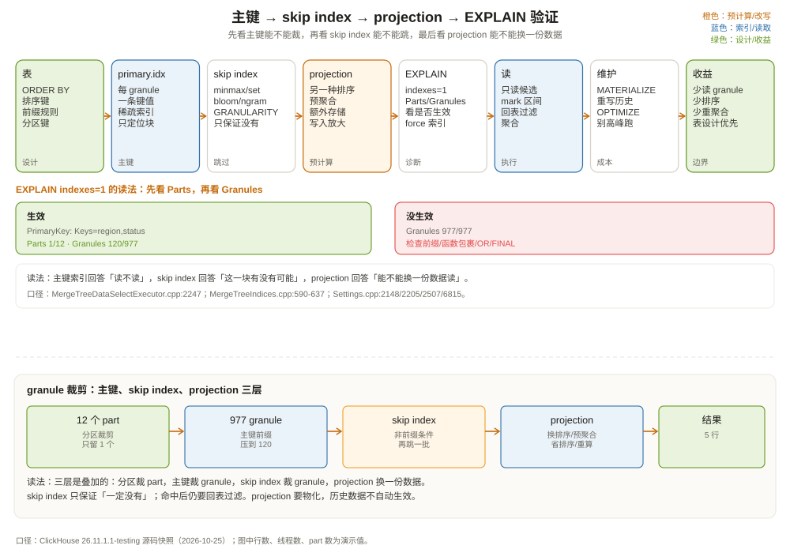

# MergeTree 索引与投影：先看小抄，再翻账本

先看三个查询，它们的数据量一样，速度却差几个数量级。

```sql
-- ① 按排序键前缀过滤：快
SELECT * FROM shop.orders
WHERE region = 'east' AND status = 'paid'
  AND event_time >= '2026-10-01 00:00:00'
LIMIT 100;

-- ② 按非前缀列做模糊匹配：慢
SELECT * FROM shop.orders
WHERE product_name LIKE '%phone%'
LIMIT 100;

-- ③ 反复做同一个重聚合：慢
SELECT region, uniq(user_id) AS uv, sum(amount) AS gmv
FROM shop.orders
WHERE event_date = '2026-10-01'
GROUP BY region;
```

第一条能利用表的 `ORDER BY (region, status, event_time)`，直接跳到 `east + paid` 那一段；第二条的条件不在排序键前缀里，也没有索引，只能扫全部 granule；第三条每次都要重新算 `uniq(user_id)`，即使结果每天只变一点点。

ClickHouse 给了三件工具分别对付这三种情况：

| 工具 | 解决什么 | 代价 |
| --- | --- | --- |
| 主键稀疏索引（primary key） | 按排序键前缀定位 granule | 排序键设计决定一切，事后改代价高 |
| 跳过索引（skip index） | 按非前缀列跳过 granule | 额外存储/写入开销，只保证「可能命中」 |
| 投影（projection） | 预计算另一种排序/聚合布局 | 额外存储，写入放大，需要物化 |

这一章把三件工具讲清楚：它们各自看什么、什么时候生效、怎么用 `EXPLAIN indexes=1` 验证。



---

## 一、主键稀疏索引：每 8192 行一条「路标」

MergeTree 的主键索引不是 B+ 树，也不是每行一条，而是**每个 granule 一条**。默认 `index_granularity = 8192`，所以 100 万行只有约 122 条索引。

```text
granule 0: [region=east, status=created, event_time=10:00]  ← primary.idx 第 0 条
granule 1: [region=east, status=paid,    event_time=10:05]  ← primary.idx 第 1 条
granule 2: [region=east, status=paid,    event_time=10:10]  ← primary.idx 第 2 条
...
```

注意：图里每个 granule 只写了一行排序键，真实 granule 有 8192 行，`status` 可能在中间变化；所以索引只能圈出「可能命中」的区间，不能保证整段都是 paid——这也是下面要讲「候选 granule 还要复核」的原因。

索引里存的是每个 granule 的**第一行**的排序键值（或前缀）。查询 `WHERE region='east' AND status='paid'` 时，分析器用这些路标做二分/范围查找，得到「哪些 granule 可能包含 east+paid」，然后把 mark 区间传给读取器。

`MergeTreeDataSelectExecutor::markRangesFromPKRange`（`src/Storages/MergeTree/MergeTreeDataSelectExecutor.cpp:2247`）就是做这件事的：把主键条件翻译成 mark 区间。它不是逐行判断，而是按 granule 判断：

```text
条件：region = 'east' AND status = 'paid'
  ↓
主键前缀 (region, status)
  ↓
在 primary.idx 里找 east+paid 的区间
  ↓
得到 mark 范围 [m1, m2)
  ↓
读取器只读这些 mark 对应的 granule
```

### 1.1 前缀规则：为什么顺序这么重要

主键索引只能有效利用**排序键的前缀**。表 `ORDER BY (region, status, event_time)`：

```sql
WHERE region = 'east' AND status = 'paid'          -- 能用 (region, status) 前缀
WHERE region = 'east'                              -- 能用 region 前缀
WHERE status = 'paid'                              -- 不能用（跳过了 region）
WHERE event_time > '2026-10-01'                    -- 不能用（跳过了 region, status）
WHERE region = 'east' AND event_time > '...'       -- 只能用 region，event_time 用不上
```

这就是为什么「把最常用的过滤列放在排序键前面」是表设计的第一原则。排序键不是「索引越多越好」，而是「前缀匹配越常用越好」。

### 1.2 `ORDER BY` 和 `PRIMARY KEY` 可以不同

ClickHouse 允许 `PRIMARY KEY` 是 `ORDER BY` 的前缀：

```sql
ENGINE = MergeTree
ORDER BY (region, status, event_time, order_id)
PRIMARY KEY (region, status)
```

这样数据按四列排序，但索引只存前两列。好处是索引更小、内存占用更低；代价是 `event_time` 上的条件不能直接用主键索引（但可以利用排序顺序做 read-in-order）。

如果没有显式 `PRIMARY KEY`，它默认等于 `ORDER BY`（`registerStorageMergeTree.cpp:1376`）。

### 1.3 看索引有没有生效

`EXPLAIN indexes = 1` 会打印索引分析结果：

```sql
EXPLAIN indexes = 1
SELECT * FROM shop.orders
WHERE region = 'east' AND status = 'paid'
LIMIT 100;
```

输出（简化）：

```text
ReadFromMergeTree (shop.orders)
Indexes:
  PrimaryKey
    Keys: region, status
    Parts: 1/12
    Granules: 120/977
```

读法：

- `Keys`：用到了哪些主键列；
- `Parts`：12 个 part 里只读了 1 个（分区/主键裁剪）；
- `Granules`：977 个 granule 里只读了 120 个。

如果 `Granules` 是 `977/977`，说明主键没帮上忙。常见原因：

- `WHERE` 里没有排序键前缀；
- 条件被函数包裹，比如 `toDate(event_time) = ...`，索引无法直接比较；
- 用了 `OR`、`NOT`、子查询，条件下推不到主键；
- 排序键顺序不对，最常用的列不在前面。

`use_primary_key` 默认 `true`（`src/Core/Settings.cpp:2148`），可以临时关掉做对比：

```sql
SELECT ... SETTINGS use_primary_key = 0;
```

---

## 二、跳过索引：给非前缀列也发一张「小抄」

主键索引只认排序键前缀。如果经常按 `status` 或 `product_name` 过滤，而这些列不在前缀里，就需要**跳过索引（skip index / data skipping index）**。

跳过索引是建在列表达式上的辅助结构，按 `GRANULARITY` 个 granule 一组存储。查询时，它告诉引擎「这个 granule 里**可能**有命中的值」或「**一定没有**」。注意是「一定没有」才跳过；它不能保证「一定有」，所以命中后还要回表过滤。

### 2.1 常用类型

| 类型 | 语法 | 适合 | 原理 |
| --- | --- | --- | --- |
| `minmax` | `INDEX i expr TYPE minmax GRANULARITY n` | 范围条件、有序数据 | 存每组 granule 的 min/max |
| `set` | `INDEX i expr TYPE set(max_rows) GRANULARITY n` | 低基数等值/IN | 存每组的不同值集合 |
| `bloom_filter` | `INDEX i expr TYPE bloom_filter(rate) GRANULARITY n` | 高基数等值/IN | 布隆过滤器 |
| `ngrambf_v1` | `INDEX i expr TYPE ngrambf_v1(n, size, hashes, seed) GRANULARITY n` | 子串搜索 `LIKE '%x%'` | n-gram 布隆 |
| `tokenbf_v1` | `INDEX i expr TYPE tokenbf_v1(size, hashes, seed) GRANULARITY n` | 整词搜索 | token 布隆 |
| `text` | `INDEX i expr TYPE text(tokenizer = ...) GRANULARITY n` | 全文检索 | 倒排索引 |
| `vector_similarity` | `INDEX i expr TYPE vector_similarity('hnsw', ...) GRANULARITY n` | 向量近邻 | HNSW |

（注册表在 `src/Storages/MergeTree/MergeTreeIndices.cpp:590-631`。）

`GRANULARITY n` 表示「每 n 个 granule 建一条索引」。`n=4` 时，4 个 granule 共用一条索引，索引更小但跳过粒度更粗；`n=1` 最细但索引最大。

### 2.2 例子：给 status 加 set 索引

```sql
ALTER TABLE shop.orders
ADD INDEX idx_status status TYPE set(100) GRANULARITY 4;

-- 已有数据需要物化索引
ALTER TABLE shop.orders MATERIALIZE INDEX idx_status;
```

查询：

```sql
SELECT * FROM shop.orders
WHERE status = 'paid'
LIMIT 100;
```

`EXPLAIN indexes = 1` 可能显示：

```text
Indexes:
  Skip
    Name: idx_status
    Description: set
    Granules: 30/977
  PrimaryKey
    Keys: ...
```

`Skip` 表示 skip index 生效，`Granules: 30/977` 表示只留下 30 个候选 granule。注意：这 30 个 granule 里仍然可能有 `status != 'paid'` 的行，因为 set 索引只保证「这个 granule 可能包含 paid」，不保证每行都是 paid。所以读取后还要用 `WHERE` 过滤。

### 2.3 例子：给 product_name 加 ngram 索引

```sql
ALTER TABLE shop.orders
ADD INDEX idx_product_ngram product_name
TYPE ngrambf_v1(3, 4096, 2, 0)
GRANULARITY 4;

ALTER TABLE shop.orders MATERIALIZE INDEX idx_product_ngram;
```

查询：

```sql
SELECT * FROM shop.orders
WHERE product_name LIKE '%phone%'
LIMIT 100;
```

`ngrambf_v1(3, ...)` 把字符串切成 3-gram（`pho`、`hon`、`one`...），用布隆过滤器判断「这个 granule 里有没有可能包含这些 3-gram」。如果某个 granule 连 `pho` 都没有，整块跳过。

注意：

- 布隆过滤器有假阳性，没有假阴性；它说「没有」一定没有，说「有」不一定有；
- `ngrambf_v1` 对短字符串不友好（n-gram 数量少，过滤效果差）；
- `tokenbf_v1` 适合整词，`ngrambf_v1` 适合子串；
- 全文检索用 `text` 索引，不要用 `LIKE '%...%'` 硬扫。

### 2.4 跳过索引的代价

- **存储**：每个索引都要占空间，`GRANULARITY` 越小、索引越大；
- **写入**：INSERT/合并时要更新索引，写入变慢；
- **查询规划**：索引太多，分析器要逐个评估，规划变慢；
- **假阳性**：命中后仍要回表过滤，不能保证精确。

经验：**只给真正高频、选择性高的条件建 skip index**。不要给每个列都建；不要给基数极高的列建 `set`；不要给短字符串建 `ngrambf`。

`use_skip_indexes` 默认 `true`（`src/Core/Settings.cpp:2205`）。可以用 `force_data_skipping_indices`（别名 `force_data_skipping_indexes`，`src/Core/Settings.cpp:2507`）强制要求某个索引必须被使用，否则报 `INDEX_NOT_USED`：

```sql
SELECT * FROM shop.orders
WHERE status = 'paid'
SETTINGS force_data_skipping_indices = 'idx_status';
```

这对验证「索引到底有没有生效」很有用。

---

## 三、投影：把「另一种查询」预先算好

主键索引和 skip index 都是「在现有数据上找捷径」。如果查询需要的是**另一种排序**或**预聚合结果**，捷径不够用，就需要投影（projection）。

投影是表的一部分，存储为隐藏的 part，按另一套 `ORDER BY` 或聚合结果组织。查询时，优化器可以判断「用投影比用主表更便宜」，然后改读投影。

### 3.1 普通投影：换一种排序

```sql
ALTER TABLE shop.orders
ADD PROJECTION p_by_amount
(
    SELECT order_id, region, status, amount, event_date
    ORDER BY (event_date, amount)
);

ALTER TABLE shop.orders MATERIALIZE PROJECTION p_by_amount;
```

之后查询：

```sql
SELECT order_id, amount
FROM shop.orders
WHERE event_date = '2026-10-01'
ORDER BY amount DESC
LIMIT 100;
```

如果投影的排序键 `(event_date, amount)` 正好匹配查询，优化器可能选择投影，按顺序读，省掉排序。

### 3.2 聚合投影：预计算聚合结果

```sql
ALTER TABLE shop.orders
ADD PROJECTION p_daily_region
(
    SELECT event_date, region,
           count() AS orders,
           sum(amount) AS gmv,
           uniq(user_id) AS uv
    GROUP BY event_date, region
);

ALTER TABLE shop.orders MATERIALIZE PROJECTION p_daily_region;
```

查询：

```sql
SELECT event_date, region, sum(gmv)
FROM shop.orders
WHERE event_date = '2026-10-01'
GROUP BY event_date, region;
```

优化器可以直接读投影里已经算好的 `gmv`，不用再扫明细。`uniq(user_id)` 这种重聚合收益最大。

### 3.3 投影怎么选

`optimize_use_projections` 默认 `true`（`src/Core/Settings.cpp:6815`）。优化器会：

1. 找出所有可能匹配查询的投影；
2. 估算每个投影要读的 marks/rows；
3. 和主表比较，选成本最低的；
4. 如果没有更便宜的，还是读主表。

`force_optimize_projection`（默认 `false`，`src/Core/Settings.cpp:6830`）强制使用投影，找不到就报 `PROJECTION_NOT_USED`；`prefer_optimize_projection`（默认 `false`，`:6840`）优先用投影但不报错。这两个适合验证「投影到底有没有被用」。

`system.projections` 可以看表上有哪些投影（`src/Storages/System/StorageSystemProjections.cpp:47-50`）：

```sql
SELECT database, table, name, type, sorting_key, query
FROM system.projections
WHERE table = 'orders';
```

投影的代价：

- **存储**：投影是另一份数据，可能和主表一样大；
- **写入放大**：INSERT 要同时写主表和投影；
- **物化成本**：`MATERIALIZE PROJECTION` 会重写历史数据；
- **维护**：投影不是自动同步的「物化视图」，它随 part 合并维护，但历史 part 需要物化。

投影适合「查询模式稳定、重复计算多、能接受存储/写入成本」的场景。不适合「查询千变万化」的场景——你不可能为每种查询都建一个投影。

---

## 四、三件工具怎么选

| 场景 | 首选 | 原因 |
| --- | --- | --- |
| 按排序键前缀过滤 | 主键索引 | 零额外存储，天然生效 |
| 按非前缀低基数列等值/IN | `set` / `bloom_filter` skip index | 轻量，跳过 granule |
| 子串/全文搜索 | `ngrambf` / `text` skip index | 主键帮不上忙 |
| 固定排序的 TopK | 普通投影 | 省掉排序 |
| 固定维度的重聚合 | 聚合投影 | 省掉重复计算 |
| 任意维度、任意过滤 | 没有银弹 | 需要重新设计排序键/分区键 |

一个常见的误区是「加索引就能快」。ClickHouse 的索引不是 MySQL 的二级索引：

- 主键索引是稀疏的，只按排序键前缀生效；
- skip index 只跳过 granule，不定位到行；
- projection 是另一份数据，不是免费的。

**表设计 > 索引 > 投影 > 调参。** 排序键选错，后面加多少 skip index 都救不回来。

---

## 五、和 B+ 树、Doris、Parquet 比一比

| 维度 | MySQL B+ 树 | ClickHouse 主键 | Doris/StarRocks | Parquet |
| --- | --- | --- | --- | --- |
| 索引粒度 | 每行/每页 | 每 granule（8192 行） | 前缀索引/zone map | row group 统计 |
| 是否精确 | 是（能定位行） | 否（只定位 granule） | 否（前缀/zonemap） | 否（统计） |
| 额外索引 | 二级索引 | skip index | 前缀/bitmap/bloom | 页索引/布隆 |
| 更新代价 | 改页 + 维护索引 | 重写 part | compaction | 重写文件 |
| 适合 | 点查、事务 | 大扫描、前缀过滤 | 实时分析 | 静态文件 |

MySQL 的 B+ 树能精确找到一行，因为它是「每行一条索引 + 页内有序」。ClickHouse 的主键是「每 8192 行一条路标」，它只能告诉你「这一块可能有」，不能告诉你「第几行」。这是为了索引小、写入快、扫描快做的取舍。

Doris/StarRocks 的前缀索引和 zone map 更像 ClickHouse 的「排序键 + minmax」，但它们在主键更新、MPP 调度上走得更远。Parquet 的 row group 统计是「文件级小抄」，ClickHouse 的 skip index 是「表级小抄」，思路相似，粒度不同。

---

## 六、常见坑

**坑一：函数包裹排序键。**

```sql
-- 索引可能失效
WHERE toDate(event_time) = '2026-10-01'
-- 更好
WHERE event_time >= '2026-10-01 00:00:00' AND event_time < '2026-10-02 00:00:00'
```

**坑二：`OR` 条件让主键失效。**

```sql
WHERE region = 'east' OR status = 'paid'
```

主键前缀无法同时满足两个分支，可能退化成全扫。可以拆成 `UNION ALL`，或给 `status` 建 skip index。

**坑三：skip index 建在高基数列上。**

```sql
-- user_id 基数太高，set(100) 根本装不下，bloom 假阳性也高
INDEX idx_user user_id TYPE set(100)
```

高基数列用 `bloom_filter` 或干脆不加；等值查询靠主键/分区更有效。

**坑四：投影建了但没物化。**

```sql
ALTER TABLE ... ADD PROJECTION ...;  -- 只对新 part 生效
-- 历史数据要
ALTER TABLE ... MATERIALIZE PROJECTION ...;
```

**坑五：`FINAL` 与 skip index。**

`FINAL` 查询要合并同一排序键的多个版本，skip index 的跳过逻辑更复杂；`use_skip_indexes_if_final` 默认 `true`（`src/Core/Settings.cpp:2213`），但 `FINAL` 本身会让很多优化失效，别指望它快。

---

## 七、这一章留下的线索

把这一章压成几句话：

- 主键是稀疏索引，每个 granule 一条，只对排序键前缀有效；
- `markRangesFromPKRange` 把主键条件翻译成 mark 区间，`EXPLAIN indexes=1` 看 `Granules`；
- skip index 按 `GRANULARITY` 组存辅助信息，只保证「一定没有」，不保证「一定有」；
- `minmax`/`set`/`bloom`/`ngrambf`/`tokenbf`/`text` 各有适用场景，别乱建；
- projection 是另一种排序/聚合布局，能省排序和重聚合，但占存储、放大写入；
- 表设计（排序键、分区键）比事后加索引重要得多。

下一章离开单机，进入分布式基础设施：ClickHouse Keeper 到底存了什么？它和 ZooKeeper 是什么关系？为什么说它是「集群的公共记事本」？

---

## 附：这一章的源码入口

> 源码来自本地 ClickHouse 26.11.1.1-testing 快照，验证时间 2026-10-25。

- `src/Storages/MergeTree/MergeTreeDataSelectExecutor.cpp:2247`：`markRangesFromPKRange`
- `src/Storages/MergeTree/MergeTreeIndices.cpp:590`：`minmax` 索引注册
- `src/Storages/MergeTree/MergeTreeIndices.cpp:596`：`set` 索引注册
- `src/Storages/MergeTree/MergeTreeIndices.cpp:602`：`ngrambf_v1` 注册
- `src/Storages/MergeTree/MergeTreeIndices.cpp:608`：`tokenbf_v1` 注册
- `src/Storages/MergeTree/MergeTreeIndices.cpp:620`：`bloom_filter` 注册
- `src/Storages/MergeTree/MergeTreeIndices.cpp:627`：`vector_similarity` 注册
- `src/Storages/MergeTree/MergeTreeIndices.cpp:637`：`text` 索引注册
- `src/Storages/ProjectionsDescription.h:33`：`ProjectionDescription`
- `src/Storages/ProjectionsDescription.h:35`：`Type`（Normal/Aggregate）
- `src/Processors/QueryPlan/Optimizations/optimizeUseNormalProjection.cpp:365`：`optimizeUseNormalProjections`
- `src/Processors/QueryPlan/Optimizations/optimizeUseAggregateProjection.cpp`：聚合投影优化
- `src/Storages/System/StorageSystemProjections.cpp:47-50`：`system.projections`
- `src/Storages/MergeTree/registerStorageMergeTree.cpp:1376`：`PRIMARY KEY` 缺省等于 `ORDER BY`
- `src/Core/Settings.cpp:2148`：`use_primary_key = true`
- `src/Core/Settings.cpp:2205`：`use_skip_indexes = true`
- `src/Core/Settings.cpp:2213`：`use_skip_indexes_if_final = true`
- `src/Core/Settings.cpp:2507`：`force_data_skipping_indexes`
- `src/Core/Settings.cpp:6815`：`optimize_use_projections = true`
- `src/Core/Settings.cpp:6830`：`force_optimize_projection = false`
- `src/Core/Settings.cpp:6840`：`prefer_optimize_projection = false`

---

## 思考题

1. 表 `ORDER BY (region, status, event_time)`，查询 `WHERE status='paid' AND event_time > ...` 能用主键索引吗？为什么？
2. 为什么 skip index 只能保证「一定没有」，不能保证「一定有」？这对查询结果有什么影响？
3. `GRANULARITY 1` 和 `GRANULARITY 8` 的 skip index，哪个更可能跳过更多 granule？哪个索引更大？
4. 投影和物化视图有什么区别？为什么 `MATERIALIZE PROJECTION` 很贵？
5. `EXPLAIN indexes=1` 显示 `Skip: Granules 30/977`，但查询还是慢。可能是什么原因？
