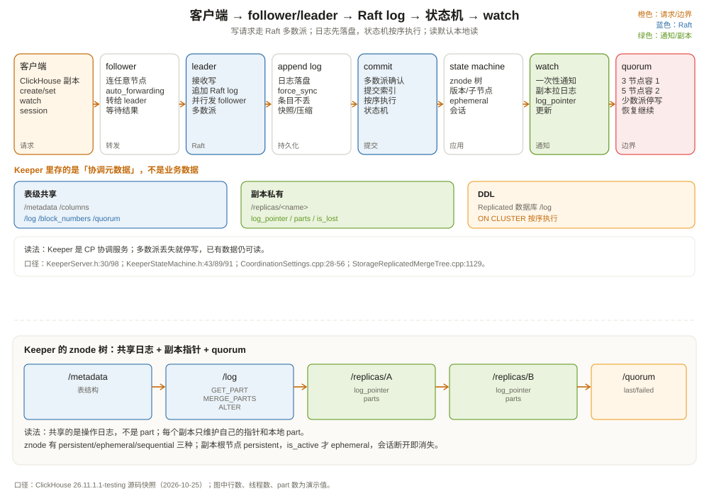

# ClickHouse Keeper：集群的公共记事本

先看一个故障现场。

三节点 ClickHouse 集群，每个节点跑一个 Keeper。某天机房网络抖动，三台 Keeper 里有两台失联，只剩一台还能通信。几分钟后，业务发现：

- 已经存在的表还能查；
- 新的 INSERT 全部卡住，最后报错；
- `ALTER TABLE` 不生效；
- `system.replicas` 里 `is_readonly=1`。

运维第一反应是「ClickHouse 挂了」，但 ClickHouse 进程还在，查询还能跑。真正挂的是 **Keeper 的多数派**：三个节点只剩一个，Raft 无法commit新日志，所有依赖 Keeper 的写操作都停了。

这个场景说明了一件事：**Keeper 不是 ClickHouse 的数据存储，但它是集群的「公共记事本」；记事本写不进去，集群就失去了协调能力。**

这一章讲清楚 Keeper 是什么、存什么、怎么写、怎么读，以及它和 ZooKeeper 的关系。



---

## 一、Keeper 是什么：一个用 Raft 实现的协调服务

ClickHouse Keeper 是一个**分布式协调服务**，兼容 ZooKeeper 协议。它的职责不是存业务数据，而是存「集群状态」：

- 表结构（`/clickhouse/tables/.../metadata`）；
- 复制日志（`/clickhouse/tables/.../log`）；
- 块号分配（`/block_numbers`）；
- 副本注册与状态（`/replicas/<name>`）；
- quorum 状态（`/quorum`）；
- 合并/变更的 leader 选举（`/leader_election`）；
- Replicated 数据库的 DDL 日志（`/clickhouse/databases/.../log`）。

这些数据有几个共同点：**小、关键、需要强一致、读多写少**。Keeper 就是为这种负载设计的。

它和 ZooKeeper 的关系：

| 维度 | ZooKeeper | ClickHouse Keeper |
| --- | --- | --- |
| 共识算法 | Zab | Raft（libnuraft） |
| 实现语言 | Java | C++ |
| 部署 | 独立 JVM 进程 | 可嵌入 ClickHouse，也可独立 `clickhouse-keeper` |
| 协议 | ZooKeeper 协议 | 兼容 ZooKeeper 协议 |
| 运维 | 需要 JVM 调优 | 与 ClickHouse 同栈，少一个 JVM |
| 数据模型 | znode 树 | znode 树（兼容） |

Keeper 不是「ClickHouse 版的 ZooKeeper」这么简单：它复用 ZooKeeper 的数据模型和客户端协议，但共识层换成了 Raft，实现更贴近 ClickHouse 的部署方式。很多团队从 ZooKeeper 迁到 Keeper，就是为了少维护一套 JVM。

---

## 二、数据模型：一棵 znode 树

Keeper 的数据模型是一棵树，每个节点叫 **znode**：

```text
/
├── clickhouse
│   ├── tables
│   │   └── 3f2a...（表 UUID）
│   │       ├── metadata
│   │       ├── log
│   │       ├── block_numbers
│   │       ├── leader_election
│   │       ├── replicas
│   │       │   ├── replica_a
│   │       │   │   ├── log_pointer
│   │       │   │   ├── parts
│   │       │   │   └── is_lost
│   │       │   └── replica_b
│   │       └── quorum
│   └── databases
│       └── shop
│           ├── log
│           └── replicas
```

每个 znode 有：

- **路径**：唯一标识，像文件系统；
- **值**：一小段字节（通常是 JSON/字符串/空）；
- **版本号**：每次修改递增，用于 CAS（compare-and-set）；
- **子节点列表**：树形结构；
- **stat**：创建/修改时间、版本、ephemeral owner 等。

znode 有两种生命周期，外加一个可选的顺序命名开关：

| 类型 | 生命周期 | 典型用途 |
| --- | --- | --- |
| persistent | 永久，直到显式删除 | 表元数据、复制日志 |
| ephemeral | 随会话消失 | 副本的 is_active、临时锁 |

`sequential` 不是第三种生命周期，而是一个命名选项：创建时名字自动追加递增序号，可以和 persistent 或 ephemeral 组合（例如「持久 + 顺序」做队列，「临时 + 顺序」做锁等待）。

`ReplicatedMergeTree` 的副本根节点 `/replicas/<name>` 是持久节点；`/replicas/<name>/is_active` 才是 ephemeral。副本启动时创建 `is_active`，会话断开后它消失，其他副本就知道该副本下线了；副本根节点和 `log_pointer` 仍然保留。

### 2.1 会话与 watch

Keeper 客户端与服务器之间有一个**会话（session）**。会话有超时时间（`session_timeout_ms`），客户端要定期发心跳；超时后，服务器认为客户端死了，删除它的 ephemeral 节点。

**watch** 是一次性订阅：客户端对某个 znode 注册 watch，节点变化时服务器通知客户端一次。`ReplicatedMergeTree` 用 watch 监听 `/log` 的新条目，而不是不停轮询。这减少了 Keeper 的读压力，也让副本能及时感知新日志。

注意 watch 是「一次性」的：触发后要重新注册。ZooKeeper/Keeper 都是这个语义，别写成「注册一次就永久监听」。

---

## 三、Raft：日志先复制，状态机再执行

Keeper 的共识层是 Raft。`KeeperServer` 里包了一个 `nuraft::raft_server`（`src/Coordination/KeeperServer.h:98`），`KeeperStateMachine`（`src/Coordination/KeeperStateMachine.h:43`）负责把已提交的日志应用到内存状态机。

一次写请求的路径：

```text
客户端（ClickHouse 副本）
  │  写请求（create/set/delete）
  ▼
Keeper 节点（可能是 follower）
  │  转发给 leader（auto_forwarding=true）
  ▼
Leader
  │  1. 追加到本地 Raft log
  │  2. 并行发给 followers
  │  3. 多数派确认后 commit
  ▼
KeeperStateMachine::commit
  │  按日志顺序应用到 znode 树
  ▼
返回客户端
```

关键点：

1. **日志先落盘，状态机后执行。** 日志是「操作指令」，状态机是「执行结果」；重启时先回放日志/快照，再恢复状态。
2. **多数派 commit。** 3 节点集群容忍 1 个节点挂；5 节点容忍 2 个。没有多数派，写请求永远 commit 不了。
3. **状态机是单线程按序执行的。** 所有节点按相同顺序执行相同日志，得到相同状态；这是 Raft 状态机复制的核心。
4. **follower 可以转发写请求。** `auto_forwarding` 默认 `true`（`src/Coordination/CoordinationSettings.cpp:33` 附近），客户端连 follower 也能写，follower 会转给 leader。

### 3.1 日志与快照

Keeper 不会无限保留日志。两个设置控制：

| 设置 | 默认值 | 作用 |
| --- | --- | --- |
| `reserved_log_items` | 100000 | 至少保留多少条日志（压缩时不移除） |
| `snapshot_distance` | 100000 | 多少条日志后写一个快照 |
| `snapshots_to_keep` | 3 | 保留几个快照 |
| `rotate_log_storage_interval` | 100000 | 单个日志文件最多多少条 |

（`src/Coordination/CoordinationSettings.cpp:36-44`。）

日志存在 `KeeperLogStore`（`src/Coordination/KeeperLogStore.h:14`）里，底层是 `Changelog`（`src/Coordination/Changelog.h:564`）；快照由 `KeeperSnapshotManager`（`src/Coordination/KeeperSnapshotManager.h:278`）管理。快照是「某一时刻的 znode 树」，日志是「快照之后的增量」。重启时先加载最新快照，再回放快照之后的日志。

`force_sync` 默认 `true`，每次日志变更都 fsync；这保证持久性，但会增加延迟。`compress_logs` 默认 `false`，`compress_snapshots_with_zstd_format` 默认 `true`，快照用 ZSTD 压缩。

### 3.2 读：默认本地读，强一致读可选

Keeper 的读默认不走 Raft：`quorum_reads` 默认 `false`（`src/Coordination/CoordinationSettings.cpp:56`）。这意味着读请求可以由本地状态机直接返回，延迟低，但可能读到稍微落后的状态。

如果需要「读也经过多数派确认」的强一致读，可以开：

```xml
<quorum_reads>true</quorum_reads>
```

代价是读延迟上升、吞吐下降。大多数 ClickHouse 场景不需要：副本协调依赖的是「日志顺序」和「watch 通知」，不是每次读都线性一致。

这个设计取舍和 ZooKeeper 类似：ZooKeeper 的读也是本地读，写走 Zab。需要强一致时，客户端用 `sync()` 或读 leader。

---

## 四、Keeper 在 ClickHouse 里具体存什么

回到 `ReplicatedMergeTree` 的例子。表级路径下每个节点的作用：

| 路径 | 内容 | 谁读写 |
| --- | --- | --- |
| `/metadata` | 表结构字符串 | 所有副本 |
| `/columns` | 列定义 | 所有副本 |
| `/log` | 复制日志（GET_PART/MERGE_PARTS/...） | 写入者追加，所有副本消费 |
| `/block_numbers` | 块号分配 | 插入时分配 |
| `/replicas/<name>` | 副本注册（persistent；`is_active` 是 ephemeral） | 副本自己 |
| `/replicas/<name>/log_pointer` | 本副本处理到哪条日志 | 副本自己 |
| `/replicas/<name>/parts` | 本副本本地有哪些 part | 副本自己 |
| `/quorum/last_part` | quorum 写入的最后 part | quorum 写入 |
| `/quorum/failed_parts` | quorum 失败的 part | quorum 写入 |
| `/leader_election` | 合并/变更任务的 leader 选举 | 副本竞争 |

（创建逻辑见 `src/Storages/StorageReplicatedMergeTree.cpp:1125-1175`。）

注意 `/leader_election`：`ReplicatedMergeTree` 的写入是「多主」的，但合并、mutation 这类后台任务需要一个副本当协调者，避免所有副本同时做同一件事。`leader_election` 就是选这个协调者的。它不是「写主」，不影响客户端写哪个副本。

`DatabaseReplicated` 也用 Keeper 存 DDL 日志：

```text
/clickhouse/databases/shop/
├── log/query-000001
├── log/query-000002
├── replicas/<name>/log_ptr
└── logs_to_keep
```

（`src/Databases/DatabaseReplicatedWorker.cpp:100`、`:429`。）`ON CLUSTER` 的 DDL 就是写进这条日志，各副本按顺序执行。`system.distributed_ddl_queue` 可以看 DDL 队列状态。

---

## 五、部署：嵌入式还是独立进程

Keeper 有两种部署方式：

**方式一：嵌入 ClickHouse 进程。** 在 `config.xml` 里配 `keeper_server`，ClickHouse 启动时同时启动 Keeper。适合小集群、测试环境，或者「每台机器既跑 ClickHouse 又跑 Keeper」的紧凑部署。

**方式二：独立 `clickhouse-keeper` 进程。** 用单独的二进制/容器跑 Keeper，和 ClickHouse 分离。适合生产：Keeper 的磁盘 I/O、内存、网络和 ClickHouse 隔离，升级/重启互不影响。

一个三节点 Keeper 配置的核心字段：

```xml
<keeper_server>
    <tcp_port>9181</tcp_port>
    <server_id>1</server_id>
    <log_storage_path>/var/lib/clickhouse/coordination/log</log_storage_path>
    <snapshot_storage_path>/var/lib/clickhouse/coordination/snapshots</snapshot_storage_path>

    <raft_configuration>
        <server>
            <id>1</id>
            <hostname>keeper-1</hostname>
            <port>9234</port>
        </server>
        <server>
            <id>2</id>
            <hostname>keeper-2</hostname>
            <port>9234</port>
        </server>
        <server>
            <id>3</id>
            <hostname>keeper-3</hostname>
            <port>9234</port>
        </server>
    </raft_configuration>
</keeper_server>
```

几个部署原则：

1. **节点数用奇数。** 3 或 5；偶数不能提高容错，只会增加投票开销；
2. **独立磁盘。** Keeper 的日志/快照写入频繁，和 ClickHouse 数据盘混用会互相影响；
3. **低延迟网络。** Raft 的 commit 需要多数派往返，跨机房/跨云的高延迟会直接放大写延迟；
4. **不要和 ClickHouse 副本数混为一谈。** 3 个 ClickHouse 副本不等于 3 个 Keeper；Keeper 可以独立扩到 5 个；
5. **监控多数派。** 少于多数派时，Keeper 不能写，ClickHouse 副本会只读。

---

## 六、故障：多数派、会话、磁盘

**故障一：Keeper 多数派丢失。**

3 节点挂 2 个，剩 1 个无法 commit。所有依赖 Keeper 的写操作（INSERT、ALTER、合并）停摆；已有数据仍可读。恢复多数派后，集群自动恢复。

这不是 bug，是 CP 系统的必然：没有多数派，就不能保证「写成功」的一致性。宁可停写，也不能让两个分区各自写、最后冲突。

**故障二：会话过期。**

ClickHouse 副本与 Keeper 的会话超时，副本的 `is_active` ephemeral 节点被删除；持久副本节点还在，但副本被标记为非活跃并进入只读。副本会尝试重连；重连成功后重新创建 `is_active`，继续拉日志。`system.replicas` 的 `is_session_expired`、`is_readonly` 会反映这个状态。

**故障三：Keeper 磁盘满。**

Raft 日志/快照写不进去，Keeper 无法 commit。监控 `log_storage_path` 和 `snapshot_storage_path` 的磁盘使用率；`snapshot_distance` 太大、`snapshots_to_keep` 太多都会占空间。

**故障四：znode 太多/值太大。**

Keeper 把整棵 znode 树放在内存里（默认 `use_lsmt_storage=false`）。如果业务把 Keeper 当数据库，存大 JSON、百万级 znode，内存会爆。Keeper 只适合存小元数据；大对象放对象存储/ClickHouse 表。

**故障五：watch 风暴。**

每个 watch 都是一次性订阅，触发后客户端要重新注册。如果大量客户端同时 watch 大量节点，Keeper 的通知和重注册会形成风暴。`ReplicatedMergeTree` 的 watch 数量是可控的；自定义应用要注意不要滥用 watch。

---

## 七、运维：看什么、怎么排查

**命令行四字命令：**

```bash
echo ruok | nc keeper-1 9181    # 返回 imok 表示进程活着
echo mntr | nc keeper-1 9181    # 监控指标
echo stat | nc keeper-1 9181    # 角色、连接、znode 统计
```

`mntr` 输出里的关键指标（`src/Coordination/FourLetterCommand.cpp:313-340`）：

| 指标 | 含义 |
| --- | --- |
| `zk_server_state` | leader / follower |
| `znode_count` | znode 总数 |
| `watch_count` | watch 总数 |
| `ephemerals_count` | 临时节点数 |
| `approximate_data_size` | 数据近似大小 |
| `avg_latency` / `max_latency` | 请求延迟 |
| `packets_received` / `packets_sent` | 网络包量 |

**SQL 查看：**

```sql
-- 列出某个路径下的 znode
SELECT name, value, czxid, mzxid, numChildren
FROM system.zookeeper
WHERE path = '/clickhouse/tables/3f2a.../replicas';

-- 查看副本状态
SELECT replica_name, is_readonly, is_session_expired,
       queue_size, log_pointer, log_max_index, absolute_delay
FROM system.replicas
WHERE table = 'orders';
```

`system.zookeeper` 可以直接读 Keeper 树，但不要用它做高频轮询；它是排查工具，不是业务接口。

**排查顺序：**

```text
1. echo ruok：进程活着吗？
2. echo mntr：有几个 leader/follower？znode/watch 是否异常增长？
3. system.replicas：is_readonly / is_session_expired / absolute_delay？
4. Keeper 日志：raft 选举、commit 失败、磁盘错误？
5. 网络：多数派之间是否互通？延迟是否突增？
```

---

## 八、和 ZooKeeper、etcd 比一比

| 维度 | ZooKeeper | ClickHouse Keeper | etcd |
| --- | --- | --- | --- |
| 共识 | Zab | Raft | Raft |
| 数据模型 | znode 树 | znode 树（兼容） | key-value + MVCC |
| 协议 | ZooKeeper | ZooKeeper 兼容 | gRPC/HTTP |
| 部署 | JVM | C++，可嵌入 | Go，独立 |
| watch | 一次性 | 一次性 | 长期 watch |
| 典型用途 | Hadoop/HBase/Kafka 协调 | ClickHouse 副本/DDL | Kubernetes 配置 |

Keeper 的优势是「和 ClickHouse 同栈」：不用维护 JVM，部署/监控/升级和 ClickHouse 一套体系；兼容 ZooKeeper 协议，现有客户端能直接用。劣势是生态不如 ZooKeeper/etcd 广，复杂协调场景的功能（如 etcd 的租约、事务）不如专用系统。

选型建议：

- 已经用 ClickHouse：优先 Keeper，少一套组件；
- 已经有成熟 ZooKeeper：可以继续用，ClickHouse 兼容；
- 需要 Kubernetes/云原生配置中心：etcd 更合适；
- 不要把 Keeper 当通用数据库/消息队列。

---

## 九、这一章留下的线索

把这一章压成几句话：

- Keeper 是协调服务，不是数据存储；存表结构、复制日志、副本状态、quorum、DDL；
- 数据模型是 znode 树，支持 persistent/ephemeral/sequential、session、watch；
- 共识层是 Raft：日志先复制，多数派 commit，状态机按序执行；
- 读默认本地读（`quorum_reads=false`），强一致读可选；
- `ReplicatedMergeTree` 用 `/log`、`/replicas`、`/quorum`、`/leader_election` 协调副本；
- 多数派丢失会停写，已有数据可读；会话过期会让副本只读；
- 部署用奇数节点、独立磁盘、低延迟网络，别把 Keeper 当数据库。

下一章把副本、分片、Keeper 放在一张图里：一个三片两副本的集群，坏一台、坏一个分片、坏 Keeper 多数派，分别会发生什么？怎么设计容错和一致性？

---

## 附：这一章的源码入口

> 源码来自本地 ClickHouse 26.11.1.1-testing 快照，验证时间 2026-10-25。

- `src/Coordination/KeeperServer.h:30`：`KeeperServer`
- `src/Coordination/KeeperServer.h:98`：`nuraft::raft_server` 包装
- `src/Coordination/KeeperStateMachine.h:43`：`KeeperStateMachine`
- `src/Coordination/KeeperStateMachine.h:89`：`pre_commit`
- `src/Coordination/KeeperStateMachine.h:91`：`commit`
- `src/Coordination/KeeperStorage.h:45`：`KeeperStorage`
- `src/Coordination/KeeperLogStore.h:14`：`KeeperLogStore`
- `src/Coordination/Changelog.h:564`：`Changelog`
- `src/Coordination/KeeperSnapshotManager.h:278`：`KeeperSnapshotManager`
- `src/Coordination/CoordinationSettings.cpp:28-44`：会话/快照/日志设置
- `src/Coordination/CoordinationSettings.cpp:56`：`quorum_reads = false`
- `src/Coordination/FourLetterCommand.cpp:313-340`：`mntr` 指标
- `src/Storages/StorageReplicatedMergeTree.cpp:1125-1175`：Keeper 路径创建
- `src/Databases/DatabaseReplicatedWorker.cpp:100`：Replicated 数据库 `/log`
- `src/Databases/DatabaseReplicatedWorker.cpp:429`：DDL 查询日志
- `src/Storages/System/StorageSystemZooKeeper.cpp`：`system.zookeeper`
- `src/Storages/System/StorageSystemReplicas.cpp:53-85`：`system.replicas`

---

## 思考题

1. Keeper 的 3 节点集群挂 1 个，还能写吗？挂 2 个呢？为什么？
2. 为什么 `ReplicatedMergeTree` 的副本根节点用 persistent，而 `is_active` 用 ephemeral？会话过期后会发生什么？
3. `quorum_reads=false` 时，读可能读到旧状态，为什么 ClickHouse 还能正常协调副本？
4. Keeper 的 Raft 日志和 ClickHouse 的 part 数据是什么关系？为什么 part 不存 Keeper？
5. 如果 Keeper 的 znode 数量每周增长 10 万，你会先查什么？可能是什么原因？
