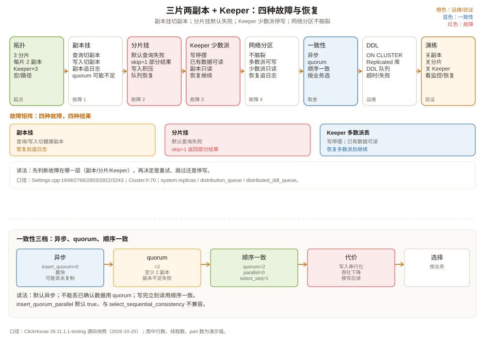

# 集群拓扑、复制与容错：坏一台之后发生什么

假设你有一个三片两副本的 ClickHouse 集群：

```text
shard 1: A1, A2
shard 2: B1, B2
shard 3: C1, C2
Keeper: K1, K2, K3
```

现在依次做四个实验：

1. 关掉副本 A2；
2. 关掉整个 shard 2（B1、B2 都停）；
3. 关掉 Keeper 的 K2、K3，只剩 K1；
4. 把 A1 和 A2 之间的网络断开，但两台机器都活着。

每个实验后，问三个问题：

- 查询还能跑吗？结果完整吗？
- 写入还能成功吗？会丢吗？
- 恢复后，数据能自动追上吗？

这一章不重复前面三章的细节，而是把「分片、副本、Keeper、一致性」放在一张故障矩阵里，讲清楚**坏一台之后到底发生什么**，以及集群该怎么设计。



---

## 一、先把词汇钉死

| 词 | 含义 | 谁负责 |
| --- | --- | --- |
| cluster | 一组 ClickHouse 节点，配置在 `remote_servers` | 配置文件 |
| shard | 数据的一个水平切分 | `Distributed` 表 + 分片键 |
| replica | 一个分片内的数据副本 | `ReplicatedMergeTree` |
| weight | 写入时该分片分到的比例 | 集群配置 |
| priority | 读取时副本的优先级 | 集群配置 |
| internal_replication | 写入只写一个副本，复制交给底层表 | 集群配置 |
| macro | 配置里的 `{shard}`、`{replica}` 等变量 | 服务器配置 |

`Cluster` 类在 `src/Interpreters/Cluster.h:70`，`system.clusters` 可以看当前拓扑（`src/Storages/System/StorageSystemClusters.cpp:26-48`）：

```sql
SELECT cluster, shard_num, shard_weight, replica_num,
       host_name, port, is_local, is_active
FROM system.clusters
WHERE cluster = 'shop_cluster'
ORDER BY shard_num, replica_num;
```

注意 `is_active` 只对 `Replicated` 数据库的集群有意义；普通 `remote_servers` 的 `is_active` 可能是 NULL。不要用它判断节点是否健康，健康要看连接和 `system.replicas`。

---

## 二、四层协作：一条查询/一次写入经过谁

**查询路径：**

```text
客户端
  │
  ▼
Distributed 表（发起节点）
  │  按分片改写查询
  ├──► shard 1：选一个健康副本（load_balancing）
  ├──► shard 2：选一个健康副本
  └──► shard 3：选一个健康副本
  │
  ▼
发起节点合并部分聚合结果
```

**写入路径（internal_replication=true）：**

```text
客户端
  │
  ▼
Distributed 表（发起节点）
  │  按分片键路由
  ├──► shard 1：选一个健康副本写入
  │       └── ReplicatedMergeTree 复制到同分片其他副本
  ├──► shard 2：同上
  └──► shard 3：同上
```

**副本同步路径：**

```text
副本 A 写入本地 part
  │  追加 Keeper /log
  ▼
Keeper（Raft 多数派 commit）
  │  watch 通知
  ▼
副本 B 拉日志 → 拉 part → 更新 log_pointer
```

**DDL 路径：**

```text
客户端执行 ON CLUSTER
  │
  ▼
写 Keeper /clickhouse/databases/<db>/log
  │
  ▼
各副本的 DDL worker 按序执行
  │
  ▼
system.distributed_ddl_queue 记录状态
```

这四层各管各的：

- `Distributed` 管「分片路由 + 结果合并」；
- `ReplicatedMergeTree` 管「同分片副本同步」；
- Keeper 管「日志顺序 + 元数据 + 选主」；
- `Replicated` 数据库管「DDL 复制」。

故障排查时，先判断问题在哪一层，不要把所有问题都归为「集群挂了」。

---

## 三、故障矩阵：四种故障，四种结果

### 3.1 关掉一个副本（A2）

**查询：** 还能跑。`Distributed` 会通过 `load_balancing` 选一个健康副本；如果 A2 被选到，连接失败后会重试 A1。`prefer_localhost_replica=true`（`src/Core/Settings.cpp:5090`）会优先本地副本，减少跨机读。

**写入：** 还能写。`internal_replication=true` 时只写 A1，A2 恢复后通过复制日志追上；`internal_replication=false` 时 `Distributed` 会尝试写两个副本，A2 失败可能导致写入报错或重试。

**恢复：** A2 重启后从 `log_pointer` 继续拉日志，补齐落后的 part。看 `system.replicas` 的 `absolute_delay`、`queue_size`、`log_pointer`。

**注意：** 如果开了 `insert_quorum=2`，而 A2 是 quorum 的一部分，写入可能失败（可用副本不足 2）。这时要么降低 quorum，要么先修副本。

### 3.2 关掉整个 shard 2（B1、B2）

**查询：** 默认失败。`skip_unavailable_shards=false`（`src/Core/Settings.cpp:1649`），一个分片不可用，整个查询报错。这是「正确优先」：少一个分片的数据，聚合结果就是错的。

如果业务能接受部分结果：

```sql
SET skip_unavailable_shards = 1;
```

查询会跳过 shard 2，返回 shard 1、3 的结果。但 `count()`、`sum()` 都会偏小，必须让业务知道。

**写入：** 写到 shard 2 的那部分数据会失败或进 `Distributed` 的本地队列（取决于异步/同步设置）。`system.distribution_queue` 可以看到积压：

```sql
SELECT database, table, data_files, data_compressed_bytes,
       error_count, is_blocked
FROM system.distribution_queue;
```

**恢复：** shard 2 恢复后，积压的队列会继续发送；`ReplicatedMergeTree` 的副本会从其他副本/日志追赶。如果队列里的文件损坏，`broken_data_files` 会增加，需要人工处理。

### 3.3 关掉 Keeper 的多数派（只剩 K1）

**查询：** 已存在的 part 还能读（取决于副本是否进入只读状态），但依赖 Keeper 的操作会停：

- INSERT：不能写 `/log`，副本进入只读；
- ALTER：不能写元数据；
- 合并：不能协调；
- DDL：不能写 DDL 日志。

**写入：** 基本停摆。不是 ClickHouse 不想写，而是没有多数派就无法保证复制日志的顺序和持久性。这是 CP 系统的取舍：宁可停写，也不能让两个分区各自写、最后冲突。

**恢复：** 恢复多数派后，Keeper 重新选主，副本重新建立会话，继续拉日志。期间进入只读的副本会自动恢复（可能需要 `SYSTEM RESTART REPLICA`）。

**注意：** Keeper 节点数和 ClickHouse 副本数是独立的。3 个 ClickHouse 副本不等于 3 个 Keeper；Keeper 可以独立扩到 5 个。Keeper 的磁盘、网络、CPU 要和 ClickHouse 隔离。

### 3.4 网络分区：A1 和 A2 断网，但都活着

**副本层：** A1、A2 各自还能服务本地查询；但它们的复制日志写不进 Keeper（如果 Keeper 在另一侧），或者写入后对方收不到。`ReplicatedMergeTree` 不会「两个都当主」——它没有主，写入是追加日志；网络恢复后，落后的副本从日志追赶。

**Keeper 层：** 如果分区导致 Keeper 失去多数派，少数派一侧的 ClickHouse 副本进入只读；多数派一侧继续工作。网络恢复后，少数派副本重新同步。

**会不会脑裂？** ClickHouse 的 `ReplicatedMergeTree` 没有「主副本」概念，所有副本都可以写；冲突不靠「选主」解决，而靠「Keeper 日志全序 + part 校验」。如果两个分区都往 Keeper 写，只有多数派能 commit；少数派的写入会失败。所以不会出现「两个分区各自写成功、最后数据冲突」的脑裂。

---

## 四、一致性三档：异步、quorum、顺序一致

| 档位 | 设置 | 保证 | 代价 | 适合 |
| --- | --- | --- | --- | --- |
| 异步（默认） | `insert_quorum=0` | 写入本地 + 日志，副本最终一致 | 副本可能落后；故障可能丢未复制数据 | 日志、埋点、可容忍少量丢失 |
| quorum | `insert_quorum=2` | 至少 N 个副本确认才返回 | 写入变慢；副本不足会失败 | 订单、账单等不能丢的数据 |
| 顺序一致 | `insert_quorum=2` + `insert_quorum_parallel=0` + `select_sequential_consistency=1` | 写后读，读到的副本包含所有已确认写 | 写入串行化，吞吐下降 | 写完立刻查的状态展示 |

关键细节（`src/Core/Settings.cpp:2766-2838`）：

- `insert_quorum` 默认 0，关闭；
- `insert_quorum_timeout` 默认 600000 ms；
- `insert_quorum_parallel` 默认 `true`，允许并行 quorum 写；
- `select_sequential_consistency` 默认 0；**当 `insert_quorum_parallel=true` 时它不生效**，因为并行写可能落在不同 quorum 集合上，无法保证单个副本包含所有历史写；
- 要顺序一致，必须把 `insert_quorum_parallel` 设为 0，写入串行化。

这不是「配置越多越强」，而是「一致性、吞吐、可用性」的三角取舍。大多数分析场景用默认异步；对账、订单状态用 quorum；只有强一致读才用顺序一致。

---

## 五、拓扑设计：分片数、副本数、Keeper 数

### 5.1 分片数

分片解决「单机容量/写入吞吐」问题，不是「查询加速」的万能药。

- 分片太多：`Distributed` 发起节点要连更多节点，合并结果更复杂，`max_distributed_connections` 默认 1024（`src/Core/Settings.cpp:454`）可能成为瓶颈；
- 分片太少：单机磁盘/写入到顶；
- 分片键选错：数据倾斜，某些分片特别大。

经验：先按「单机可管理的数据量」估分片数，再按「查询是否需要跨分片 JOIN」调分片键。不要为了「看起来分布式」而切很多小分片。

### 5.2 副本数

副本解决「可用性 + 读扩展」。

- 2 副本：容忍 1 个副本挂，成本最低；
- 3 副本：容忍 1 个副本挂，读能力更强，quorum 更灵活；
- 跨机房副本：容忍机房故障，但跨机房写入延迟高。

副本不是越多越好：每个副本都要存一份数据、参与复制、消耗 Keeper 元数据。3 副本已经能满足大多数场景。

### 5.3 Keeper 数

Keeper 用奇数节点：3 或 5。

- 3 节点：容忍 1 个挂；
- 5 节点：容忍 2 个挂，但写延迟更高（多数派更大）；
- 不要和 ClickHouse 副本数绑定；
- 独立磁盘、低延迟网络、独立监控。

`Keeper` 的 `snapshot_distance` 默认 100000（`CoordinationSettings.cpp:42`），`reserved_log_items` 默认 100000；日志/快照会占磁盘，别把 Keeper 磁盘塞满。

### 5.4 宏与路径

`default_replica_path` 默认 `/clickhouse/tables/{uuid}/{shard}`，`default_replica_name` 默认 `{replica}`（`src/Core/ServerSettings.cpp:1296-1305`）。每个节点的 `macros` 配置必须正确：

```xml
<macros>
    <shard>01</shard>
    <replica>ch-01</replica>
</macros>
```

常见错误：

- 不同分片用了相同的 `{shard}`，导致本应独立的分片被当成副本；
- 同一分片的两个副本用了相同的 `{replica}`，导致路径冲突；
- 手动删了 Keeper 里的 `/replicas/<name>`，副本重启后找不到状态。

`ON CLUSTER` 建表时，`{uuid}`/`{shard}`/`{replica}` 会按节点展开；建表前先确认每个节点的宏。

---

## 六、DDL 与运维：别手动逐台建表

**方式一：`ON CLUSTER`。**

```sql
CREATE TABLE shop.orders ON CLUSTER shop_cluster
(
    ...
)
ENGINE = ReplicatedMergeTree
PARTITION BY toYYYYMM(event_date)
ORDER BY (region, order_id);
```

`ON CLUSTER` 会写 Keeper 的 DDL 日志，各副本按序执行。`distributed_ddl_task_timeout` 默认 180 秒（`src/Core/Settings.cpp:3243`），超时会报错；`distributed_ddl_output_mode` 默认 `THROW`（`:7686`），有节点失败就抛异常。

**方式二：`Replicated` 数据库。**

```sql
CREATE DATABASE shop ON CLUSTER shop_cluster
ENGINE = Replicated('/clickhouse/databases/shop', '{shard}', '{replica}');
```

`Replicated` 数据库自动管理 DDL 日志和副本，建表不用逐台 `ON CLUSTER`。它适合「库级别统一管理」的场景。

**监控 DDL：**

```sql
SELECT entry, query, status, exception_code, exception_text, query_duration_ms
FROM system.distributed_ddl_queue
ORDER BY query_create_time DESC
LIMIT 20;
```

（列定义见 `src/Storages/System/StorageSystemDDLWorkerQueue.cpp:70-85`。）

---

## 七、监控清单：出问题先看哪张表

| 现象 | 先看 | 关键字段 |
| --- | --- | --- |
| 查询变慢/失败 | `system.clusters`、`system.replicas` | `is_readonly`、`absolute_delay` |
| 副本落后 | `system.replicas` | `log_pointer` vs `log_max_index`、`queue_size` |
| 写入积压 | `system.distribution_queue` | `data_files`、`error_count`、`is_blocked` |
| DDL 卡住 | `system.distributed_ddl_queue` | `status`、`exception_text` |
| mutation 卡住 | `system.mutations` | `is_done`、`parts_to_do`、`latest_fail_reason` |
| Keeper 异常 | `mntr`、`system.zookeeper` | `znode_count`、`watch_count`、`ephemerals_count` |
| 合并积压 | `system.merges`、`system.replicas` | `merges_in_queue`、`elapsed` |

一个排查顺序：

```text
1. 单副本问题还是全集群问题？看 system.clusters / system.replicas。
2. 读问题还是写问题？读看副本/连接，写看 Keeper/quorum/队列。
3. Keeper 是否有多数派？mntr 看 leader/follower。
4. 是否有节点磁盘满/只读？看日志和 system.parts。
5. 是否 DDL/mutation 卡住？看 system.distributed_ddl_queue / system.mutations。
```

不要一上来就重启所有节点。先定位层，再动手。

---

## 八、和 Doris/StarRocks、MySQL MGR、Kafka 比一比

| 维度 | ClickHouse | Doris/StarRocks | MySQL MGR | Kafka |
| --- | --- | --- | --- | --- |
| 元数据 | Keeper | FE + BDBJE | 各节点 | KRaft/ZooKeeper |
| 分片 | 用户定义 + Distributed | tablet/bucket 自动 | 无（分库分表外置） | partition |
| 副本 | ReplicatedMergeTree | tablet 副本 | group replication | ISR |
| 一致性 | 最终一致 + 可选 quorum | 多数派/quorum | 认证/多数派 | ISR + acks |
| 故障切换 | 副本自动追日志 | FE 选主 + tablet 调度 | 主库切换 | leader 选举 |
| 扩容 | 加分片/副本，需重分布 | 加 BE，tablet 迁移 | 加从库 | 加 broker/partition |

ClickHouse 的拓扑更像「积木」：`Distributed`、`ReplicatedMergeTree`、Keeper 各自独立，你可以按需组合；Doris/StarRocks 更像「一体化 MPP」，扩容/故障切换由 FE 统一调度。前者灵活，后者省心。

选型时问自己：

- 团队能不能接受自己设计分片键、维护 Keeper、处理副本追赶？能，ClickHouse 的灵活性和单机性能很值；
- 想要「加机器就自动均衡、故障自动切换」？Doris/StarRocks 更合适；
- 只是日志/指标分析，数据可重放？ClickHouse 的简单拓扑足够。

---

## 九、集群设计清单

建集群前，按这个清单过一遍：

1. **数据量/写入量**：需要几个分片？单机能扛多少？
2. **可用性**：需要几个副本？能不能接受一个副本挂？
3. **一致性**：异步够不够？要不要 quorum？要不要写后读？
4. **分片键**：最常用的查询条件是什么？JOIN 的两张表是否同键分片？
5. **Keeper**：3 还是 5？独立磁盘？跨机房延迟可接受吗？
6. **DDL**：用 `ON CLUSTER` 还是 `Replicated` 数据库？谁有权限？
7. **监控**：`system.replicas`、`system.distribution_queue`、`mntr` 有没有告警？
8. **备份**：`BACKUP`/`RESTORE` 还是对象存储快照？恢复演练过吗？
9. **扩容**：加分片怎么重分布？加副本怎么追数据？
10. **故障演练**：关一个副本、关一个分片、关 Keeper 多数派，分别会发生什么？团队知道怎么处理吗？

最后一条最重要：**容错不是配置出来的，是演练出来的。** 你可以在测试环境依次关掉副本、分片、Keeper，观察 `system.replicas`、`system.distribution_queue`、`system.distributed_ddl_queue` 的变化，确认监控和告警能覆盖。

---

## 十、这一章留下的线索

把这一章压成几句话：

- 集群四层：`Distributed` 管分片路由，`ReplicatedMergeTree` 管副本，Keeper 管日志/元数据，`Replicated` 数据库管 DDL；
- 副本挂：查询/写入自动切换，恢复后追日志；
- 分片挂：默认查询失败，`skip_unavailable_shards=1` 可返回部分结果；
- Keeper 多数派挂：写停摆，已有数据可读；
- 网络分区不会脑裂：Keeper 多数派决定谁能写，少数派只读；
- 一致性三档：异步/quorum/顺序一致，按业务选，不要默认最强；
- 拓扑设计：分片解决容量，副本解决可用性，Keeper 用奇数、独立部署；
- 容错靠演练，不靠配置。

到这里，ClickHouse 轨道的十三章走完了。从一条 SQL 的解析、计划、执行，到 MergeTree 的 part、列存、索引、复制、分布式、Keeper 和容错，你应该能在脑子里把「一条查询的进来与出去」和「一份数据的写入与复制」串成两条完整的链路。

---

## 附：这一章的源码入口

> 源码来自本地 ClickHouse 26.11.1.1-testing 快照，验证时间 2026-10-25。

- `src/Interpreters/Cluster.h:70`：`Cluster`
- `src/Interpreters/Cluster.h:422`：`Clusters`
- `src/Storages/System/StorageSystemClusters.cpp:26-48`：`system.clusters` 列
- `src/Storages/System/StorageSystemReplicas.cpp:53-85`：`system.replicas` 关键列
- `src/Storages/System/StorageSystemDistributionQueue.cpp:26-34`：`system.distribution_queue` 列
- `src/Storages/System/StorageSystemDDLWorkerQueue.cpp:70-85`：`system.distributed_ddl_queue` 列
- `src/Core/ServerSettings.cpp:1296`：`default_replica_path = /clickhouse/tables/{uuid}/{shard}`
- `src/Core/ServerSettings.cpp:1305`：`default_replica_name = {replica}`
- `src/Core/Settings.cpp:454`：`max_distributed_connections = 1024`
- `src/Core/Settings.cpp:1243`：`load_balancing = RANDOM`
- `src/Core/Settings.cpp:1649`：`skip_unavailable_shards = false`
- `src/Core/Settings.cpp:2766`：`insert_quorum = 0`
- `src/Core/Settings.cpp:2794`：`insert_quorum_timeout = 600000`
- `src/Core/Settings.cpp:2803`：`insert_quorum_parallel = true`
- `src/Core/Settings.cpp:2822`：`select_sequential_consistency = 0`
- `src/Core/Settings.cpp:2838`：`insert_quorum_parallel` 与顺序一致的冲突
- `src/Core/Settings.cpp:3243`：`distributed_ddl_task_timeout = 180`
- `src/Core/Settings.cpp:5090`：`prefer_localhost_replica = true`
- `src/Core/Settings.cpp:7686`：`distributed_ddl_output_mode = THROW`
- `src/Core/Settings.cpp:9759`：`max_parallel_replicas = 1000`
- `src/Storages/MergeTree/MergeTreeSettings.cpp:630`：`max_replicated_merges_in_queue = 1000`
- `src/Storages/MergeTree/MergeTreeSettings.cpp:634`：`max_replicated_mutations_in_queue = 8`
- `src/Coordination/CoordinationSettings.cpp:42`：`snapshot_distance = 100000`

---

## 思考题

1. 三片两副本，关掉一个副本后，`Distributed` 查询是怎么选到健康副本的？如果两个副本都挂了，查询会怎样？
2. 为什么 Keeper 失去多数派后，ClickHouse 选择停写而不是「先写本地，稍后同步」？
3. `insert_quorum=2` 和「三副本」是什么关系？三副本一定不会丢数据吗？
4. `skip_unavailable_shards=1` 会让查询返回部分结果，业务上怎么判断结果是否完整？
5. 如果要把集群从 3 分片扩到 6 分片，数据怎么重分布？`Distributed` 表需要改吗？底层表需要重建吗？
