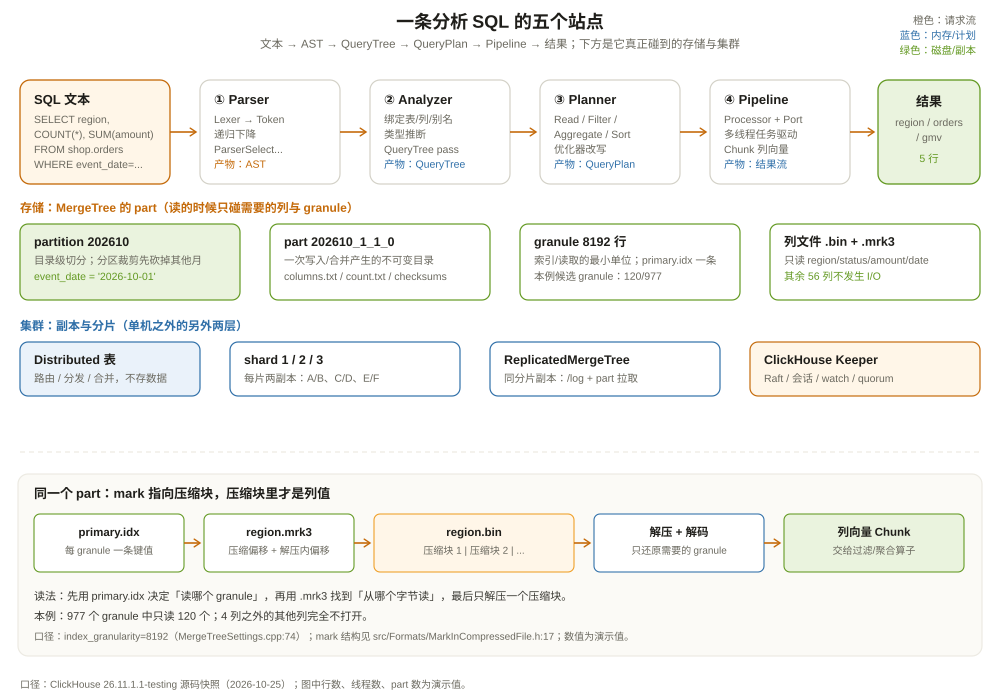

# 架构概述：一条分析 SQL 的进来与出去

先看一个很多人第一次用 ClickHouse 时都会遇到的场面。

运营同学要一份「昨天各区域已支付订单的 GMV 前五名」。这张订单表有 12 亿行、60 多个字段，数据存在 MySQL 里。你在 MySQL 上跑：

```sql
SELECT region, COUNT(*) AS orders, SUM(amount) AS gmv
FROM orders
WHERE event_date = '2026-10-01' AND status = 'paid'
GROUP BY region
ORDER BY gmv DESC
LIMIT 5;
```

执行计划选了 `event_date` 的二级索引，回表读了 800 万行，磁盘随机 I/O 打满，跑了 47 秒。把同样的数据导进 ClickHouse，同一条 SQL 不到 1 秒返回。你可能会以为 ClickHouse 用了什么神奇的压缩算法，或者把数据全放进了内存。

都不是。真正的差别只有一句话：**MySQL 是「按行把整条记录找出来」，ClickHouse 是「只把要算的那几列按顺序扫一遍」**。前者像在图书馆里按索书号一本本取书，后者像把全年账单按「区域」和「金额」两列重新装订成册，直接翻册子。两种做法没有绝对高下，但它们服务的 workload 完全不同。

这一章不急着钻进任何一个部件，先把一条 SQL 从进服务器到出结果的全过程走一遍。走完之后，你会在脑子里留下一张地图：后面十二章，每章只负责把地图上的一块放大。

贯穿全书的例子是一张电商订单表：

```sql
CREATE TABLE shop.orders
(
    order_id    UInt64,
    user_id     UInt64,
    region      LowCardinality(String),
    status      LowCardinality(String),
    amount      Decimal(18, 2),
    event_time  DateTime,
    event_date  Date,
    items       Array(String)
)
ENGINE = MergeTree
PARTITION BY toYYYYMM(event_date)
ORDER BY (region, status, event_time);
```

它有三个特点，后面会反复用到：

- **按天/按月分区**：查询只带某一天的条件时，能先砍掉绝大多数分区；
- **排序键是 `(region, status, event_time)`**：数据在 part 内按这三列排好，主键稀疏索引可以按区域和状态快速定位；
- **`region`、`status` 用 `LowCardinality`**：低基数字符串走字典编码，磁盘上只存字典下标。

查询固定为：

```sql
SELECT region, COUNT(*) AS orders, SUM(amount) AS gmv
FROM shop.orders
WHERE event_date = '2026-10-01'
  AND status = 'paid'
GROUP BY region
ORDER BY gmv DESC
LIMIT 5;
```

---

## 一、先定位：ClickHouse 到底是什么

ClickHouse 的 README 第一段写得很直白：**一个开源的、面向列的数据库管理系统，用来实时生成分析报表**（`README.md:14-15`）。这里每个词都不是装饰：

- **面向列**：磁盘上同一列的值连续存放，查询只读需要的列；
- **数据库管理系统**：它不是文件格式，也不是计算框架，有 SQL、有存储引擎、有复制、有权限、有后台任务；
- **实时**：数据写入后几秒内可查，不需要像传统数仓那样等一个批处理窗口。

它和 MySQL、PostgreSQL 最大的区别不在「谁更快」，而在**为哪种访问模式设计**。下面这张表先把定位钉死：

| 维度 | MySQL / PostgreSQL（OLTP） | ClickHouse（OLAP） |
| --- | --- | --- |
| 典型查询 | 按主键取一行、改一行、事务提交 | 扫一大片行，按几列聚合 |
| 磁盘组织 | 行存，B+ 树 / 堆表 + 索引 | 列存，part 内按排序键排好 |
| 更新方式 | 原地改页，MVCC 保留旧版本 | 追加新 part，后台合并；改删是重写 |
| 索引 | 每行/每页的精确索引 | 每 8192 行一条稀疏索引 + 跳过索引 |
| 事务 | 完整的 ACID、多行多表事务 | 单次 INSERT 的原子性，无跨行事务 |
| 并行 | 连接/查询级并行 | 查询内按 granule、列、pipeline 并行 |
| 最强场景 | 点查、事务、强一致 | 大宽表扫描、聚合、实时报表 |

ClickHouse 和 Doris、StarRocks 这类 MPP 分析库是同一赛道，但实现路线不同：Doris/StarRocks 更像「一套完整的 MPP 数据库」，有 FE 做元数据和查询规划、BE 做存储计算；ClickHouse 更像「一台单机分析引擎 + 一层可选的分布式外壳」，单机性能极强，分布式能力靠 `Distributed` 表、副本和 Keeper 拼起来。这个差别会贯穿「存储引擎系统」和「分布式基础设施」两部分。

它也不是 Parquet 的替代品。Parquet 是**文件格式**，只负责「数据怎么排、怎么压缩、怎么带统计信息」；ClickHouse 是**数据库**，在列存文件之上还有分区、排序键、稀疏索引、后台合并、复制、SQL 执行。ClickHouse 可以直接查 S3 上的 Parquet 文件，但那是「把文件当外部表」，不是「MergeTree 等于 Parquet」。这一点在第 8 章会展开。

---

## 二、一条 SQL 的五个站点

把服务器想象成一条流水线，SQL 文本从左边进去，结果块从右边出来，中间停五站：

```text
SQL 文本
  │
  ▼
① 解析（Parser）──────► AST（抽象语法树）
  │
  ▼
② 分析（Analyzer）────► QueryTree（绑定表、列、类型、别名）
  │
  ▼
③ 规划（Planner）─────► QueryPlan（Read → Filter → Aggregate → Sort → Limit）
  │
  ▼
④ 建流水线（Pipeline）─► Processor 图（Source → Transform → Sink）
  │
  ▼
⑤ 执行（Executor）────► Chunk 流（列向量块）→ 结果
```



每一站都有明确的入口文件，先把名字记住，后面章节逐个展开：

| 站点 | 干的事 | 源码入口 |
| --- | --- | --- |
| ① 解析 | 把文本切成 token，按语法拼成 AST | `src/Parsers/ParserSelectWithUnionQuery.cpp` |
| ② 分析 | 解析标识符、展开别名、推断类型、构造 QueryTree | `src/Analyzer/Resolve/QueryAnalyzer.h:118` |
| ③ 规划 | 把 QueryTree 变成可执行的 QueryPlan 步骤树 | `src/Planner/Planner.h:23`、`src/Processors/QueryPlan/QueryPlan.h:118` |
| ④ 建流水线 | 每个 Plan step 变成一个或多个 Processor，接成图 | `src/Processors/QueryPlan/ReadFromMergeTree.cpp:5332` |
| ⑤ 执行 | 多线程拉取 Chunk，直到所有 Port 关闭 | `src/Processors/Executors/Runtime/V1/PipelineExecutor.cpp:231` |

总入口是 `executeQueryImpl`（`src/Interpreters/executeQuery.cpp:2293`）。它负责会话、权限、配额、查询日志、解析、解释器分发这些「外壳工作」；真正的 SELECT 执行会落到 `InterpreterSelectQuery::execute`（`src/Interpreters/InterpreterSelectQuery.cpp:1254`）：

```cpp
BlockIO InterpreterSelectQuery::execute()
{
    BlockIO res;
    QueryPlan query_plan;

    buildQueryPlan(query_plan);                    // ③ 规划：步骤树

    auto builder = query_plan.buildQueryPipeline(  // ④ 步骤树 → 流水线
        QueryPlanOptimizationSettings(context),
        BuildQueryPipelineSettings(context));

    res.pipeline = QueryPipelineBuilder::getPipeline(std::move(*builder));
    setQuota(res.pipeline);
    return res;
}
```

注意这段代码的顺序：**先有完整的 QueryPlan，再把整棵 Plan 一次性翻译成流水线**。不是「读一行、算一行、写一行」的火山模型，而是先搭好一张由 Processor 和 Port 组成的有向图，再交给执行器多线程跑。这个设计决定了 ClickHouse 的并行方式和内存行为，第 4 章会专门讲。

---

## 三、解析：SQL 先变成一棵树

先别看存储，先看 SQL 文本进服务器后的第一站。

ClickHouse 的解析器是手写的递归下降解析器（recursive descent parser），不是 MySQL 那种 Bison/yacc 生成的语法表。`ParserSelectWithUnionQuery` 负责最外层的 `SELECT ... UNION ALL ...`，`ParserSelectQuery` 负责单个 SELECT 的各个子句。解析完成后得到一棵 AST：

```text
ASTSelectWithUnionQuery
└── ASTSelectQuery
    ├── select: ASTExpressionList
    │   ├── ASTIdentifier(region)
    │   ├── ASTFunction(count)
    │   └── ASTFunction(sum, ASTIdentifier(amount))
    ├── from: ASTTableIdentifier(shop.orders)
    ├── where: ASTFunction(and,
    │       ASTFunction(equals, event_date, '2026-10-01'),
    │       ASTFunction(equals, status, 'paid'))
    ├── group_by: ASTExpressionList(ASTIdentifier(region))
    ├── order_by: ASTExpressionList(ASTFunction(desc, gmv))
    └── limit: 5
```

你可以直接用 `EXPLAIN AST` 看这棵树：

```sql
EXPLAIN AST
SELECT region, COUNT(*) AS orders
FROM shop.orders
WHERE event_date = '2026-10-01' AND status = 'paid'
GROUP BY region;
```

AST 只回答「句子的结构是什么」，不回答「`region` 是哪张表的列」「`status` 是 String 还是 Enum」「`gmv` 这个别名能不能在 ORDER BY 里用」。这些问题归第二站。

解析阶段最重要的产出不是「树」，而是**错误边界**：语法错误在这里报，比如少写右括号、把 `GROUP BY` 拼成 `GROUPY BY`；但「列不存在」「类型不匹配」「聚合函数嵌套错误」这些语义错误，解析器根本不知道。很多初学者把报错都归为「SQL 写错了」，其实错误发生的站点不同，排查方向也完全不同。第 2 章会把 AST 的节点类型和 `EXPLAIN AST` 的读法讲透。

---

## 四、分析与规划：把树修成能执行的形状

第二站做三件事：**绑定、检查、改写**。

- **绑定**：把 `region` 绑定到 `shop.orders.region`，把 `orders` 这个别名绑定到 `COUNT(*)` 这个表达式；
- **检查**：表存不存在、列存不存在、聚合是否合法、类型能不能相加；
- **改写**：把 `WHERE` 里的条件下推到读取步骤，把没用的列裁掉，把常量表达式提前算掉，决定用哪个索引、要不要按排序键顺序读。

ClickHouse 26.x 的新分析器由 `QueryAnalyzer`（`src/Analyzer/Resolve/QueryAnalyzer.h:118`）执行，产出 `QueryTree`；随后一串 pass 对树做改写，`QueryTreePassManager`（`src/Analyzer/QueryTreePassManager.h:13`）负责调度。再往后，`Planner`（`src/Planner/Planner.h:23`）把 QueryTree 翻译成 `QueryPlan`。

`QueryPlan` 是一棵**步骤树**，每个节点是一个 `IQueryPlanStep`，描述「我要做什么」，比如：

```text
LimitStep(5)
└── SortingStep(gmv DESC)
    └── AggregatingStep(group_by = region)
        └── FilterStep(status = 'paid')
            └── ReadFromMergeTree(shop.orders, 只读 region/status/amount)
```

这棵树和 AST 长得很像，但性质不同：AST 是「用户写了什么」，QueryPlan 是「引擎决定怎么执行」。同一条 SQL 可以生成不同的 QueryPlan，取决于表结构、索引、设置和数据分布。比如 `WHERE event_date = ...` 可能被下推到 `ReadFromMergeTree` 里变成分区裁剪，也可能留成一个独立的 `FilterStep`，取决于优化器判断哪种更划算。

第三章会详细讲优化器做了哪些改写、哪些是「规则」、哪些是「代价」；第四章会讲这棵步骤树怎么变成 Processor 图。这里先记住一个判断：**你看到的执行慢，先看 QueryPlan 在哪一步读了太多数据，而不是先怀疑 CPU 不够。**

---

## 五、存储：MergeTree 的 part 是什么

现在把镜头切到磁盘。ClickHouse 最常用的表引擎是 MergeTree 家族，`MergeTreeData` 是整个家族的基类（`src/Storages/MergeTree/MergeTreeData.h:233`），单机版 `StorageMergeTree` 继承它（`src/Storages/StorageMergeTree.h:37`）。

一次 INSERT 不会「找到旧行、改掉」，而是：

1. 把这一批行按 `ORDER BY` 排序；
2. 写成磁盘上一个新的、不可变的 **part**（目录）；
3. 把 part 挂到表的 part 列表里，查询立刻能看到；
4. 后台线程按规则把多个小 part 合并成更大的 part。

`StorageMergeTree::write`（`src/Storages/StorageMergeTree.cpp:518`）返回一个 `MergeTreeSink`，真正写 part 的工作由 `MergeTreeDataWriter::writeTempPart`（`src/Storages/MergeTree/MergeTreeDataWriter.cpp:782`）完成。新 part 先写进临时目录，写完、校验、落盘后再原子改名，所以查询永远看不到「写了一半」的 part。

一个 part 目录里大致有这些文件：

```text
all_1_1_0/                  ← 分区 all，块号 1..1，合并层级 0
├── columns.txt             ← 这个 part 有哪些列、什么类型
├── count.txt               ← 有多少行
├── checksums.txt           ← 每个文件的校验和与大小
├── primary.idx             ← 稀疏主键索引：每 8192 行一个键值
├── region.bin              ← region 列的数据（压缩后）
├── region.mrk3             ← region 列的 mark：每个 granule 在 .bin 里的偏移
├── status.bin / status.mrk3
├── amount.bin / amount.mrk3
└── event_time.bin / event_time.mrk3
```

这里先认识三个尺寸：

| 名字 | 是什么 | 默认值/典型值 | 谁在乎 |
| --- | --- | --- | --- |
| partition | 目录级切分，按 `PARTITION BY` 表达式 | 示例按天/月 | 分区裁剪、TTL、跨分区合并 |
| part | 一次写入或一次合并产生的不可变目录 | 由插入块/合并策略决定 | 查询要打开的文件数、后台合并 |
| granule | part 内连续的一段行，索引和读取的最小单位 | `index_granularity = 8192` 行 | 稀疏索引、mark、跳过粒度 |

`index_granularity` 的默认值 8192 写在 `MergeTreeSettings.cpp:74`；还有一个按字节自适应的 `index_granularity_bytes`，默认 10 MiB（`MergeTreeSettings.cpp:2177`）。这两个参数决定了「每多少行有一条索引」，也决定了查询能在多细的粒度上说「这段肯定没有我要的数据」。

MergeTree 家族不止普通 MergeTree：`ReplacingMergeTree` 用来按版本去重，`SummingMergeTree` 在合并时预聚合，`AggregatingMergeTree` 存聚合状态，`CollapsingMergeTree` 用符号列折叠更新。它们的共同点是「不可变 part + 后台合并」，区别只在合并时怎么处理同一个排序键下的多行。第 5 章会把这张家族表摊开。

---

## 六、读取：一条查询只碰它该碰的东西

现在回到那条 SQL。假设表里有 12 亿行、60 列，`event_date = '2026-10-01'` 这一天的数据有 800 万行。

**第一步，分区裁剪。** 表按 `toYYYYMM(event_date)` 分区，10 月 1 日只落在 `202610` 这一个分区里，其他月份的分区连打开都不用打开。这一步在 `ReadFromMergeTree` 里由分区表达式和 minmax 索引完成。

**第二步，列裁剪。** 查询只用到 `region`、`status`、`amount` 三列（`event_date` 用于过滤），其余 57 列根本不读。列存在磁盘上是分开的文件，不读的列不会产生 I/O。这就是「列式」最直接的收益。

**第三步，granule 裁剪。** 在 `202610` 分区里，数据按 `(region, status, event_time)` 排序。`status = 'paid'` 这个条件可以用主键前缀 `region, status` 做稀疏索引定位；每个 granule 在 `primary.idx` 里有一个键值，索引分析会算出「哪些 mark 可能包含 paid」。`MergeTreeDataSelectExecutor::markRangesFromPKRange`（`src/Storages/MergeTree/MergeTreeDataSelectExecutor.cpp:2247`）就是做这件事的：它把主键条件翻译成 mark 区间，而不是逐行扫描。

**第四步，按 mark 读列。** 对每个候选 granule，读取器根据 `.mrk3` 里的偏移，到 `region.bin`、`status.bin`、`amount.bin` 里只读这一段压缩块，解压后得到三个列向量。

**第五步，向量化计算。** 过滤、聚合、排序都不是「一行一行」执行，而是以 `Chunk` 为单位批量处理。`Chunk` 是「一组列向量 + 行数」的容器（`src/Processors/Chunk.h:61`），默认一个 block 最多 65409 行（`src/Core/Defines.h:33`）。`COUNT`、`SUM` 在列向量上循环，编译器还能自动向量化，CPU 的流水线和缓存都用得上。

把这条路径压成一张表：

| 步骤 | 用了什么 | 省掉了什么 | 代价 |
| --- | --- | --- | --- |
| 分区裁剪 | 分区键、分区 minmax | 其他月份的所有 part | 分区键选错会切出大量小分区 |
| 列裁剪 | 每列独立的 `.bin` | 57 个不相关列的 I/O | 宽表写入时列文件更多 |
| granule 裁剪 | `primary.idx`、`markRangesFromPKRange` | 不命中的 mark | 排序键前缀没命中就退化成全扫 |
| 按 mark 读 | `.mrk3` 偏移 + 压缩块 | 整个 part 的顺序读 | mark 太多会增加索引内存 |
| 向量化 | `Chunk`、列向量 | 逐行函数调用开销 | 不适合大量小点查 |

这里有一组演示用的算术，帮你建立数量级感（不是 benchmark）：

```text
12 亿行，按天分布，一天约 800 万行；
index_granularity = 8192 行/granule
→ 一天约 977 个 granule；
status = 'paid' 过滤后剩 60%，但排序键里 region 在前，
  所以每个 region 的 paid 段是连续的；
假设主键前缀把候选 granule 压到 120 个；
每个候选 granule 只读 3 列 × 8192 行；
→ 实际读取约 120 × 3 × 8192 ≈ 295 万个值，
  而不是 800 万行 × 60 列 ≈ 4.8 亿个值。
```

这就是为什么同一条 SQL 在 MySQL 上要回表 800 万次，在 ClickHouse 上只需要顺序读几百个压缩块。**不是因为 ClickHouse 的 CPU 更快，而是因为它让「不读」变成了默认行为。**

---

## 七、执行：Processor 图与 Chunk 流

QueryPlan 只是「做什么」，真正跑起来的是 `QueryPipeline`：一张由 Processor 和 Port 组成的有向图。

- **Source**：产生 Chunk，比如 `ReadFromMergeTree` 生成的读取源；
- **Transform**：吃一个 Chunk，吐一个 Chunk，比如过滤、表达式计算、聚合；
- **Sink**：终点，比如把结果写给客户端、写入表、写入临时文件；
- **Port**：Processor 之间的连接点，分成输入口和输出口。

`ReadFromMergeTree::initializePipeline`（`src/Processors/QueryPlan/ReadFromMergeTree.cpp:5332`）会把「要读哪些 part、哪些 mark」变成多个读取流；`AggregatingStep` 会先做部分聚合，再在需要时做合并聚合；`ExpressionStep` 负责计算 `SUM(amount)` 和别名。最后，`QueryPipelineBuilder::getPipeline`（`src/QueryPipeline/QueryPipelineBuilder.cpp:1055`）把图交给 `PipelineExecutor`。

`PipelineExecutor::execute`（`src/Processors/Executors/Runtime/V1/PipelineExecutor.cpp:231`）启动多个线程，每个线程从图里找「有输入、能干活」的 Processor 执行。它不是一个线程处理一行，也不是一个线程处理一个算子，而是**任务驱动**：哪个 Port 有数据，哪个 Processor 就被调度。这样同一张图可以在不同数据分布下自动获得并行度。

这个模型有两个直接后果：

1. **并行是查询内建的。** 一条查询可以同时用多个线程读不同 granule、算不同 block、做不同聚合桶；不是靠客户端开多个连接。
2. **背压是天然的。** 下游 Port 满了，上游 Processor 就停下来等；不会像某些批处理框架那样把中间结果无限堆在内存里。

第四章会把 Plan step 和 Processor 的对应关系、`EXPLAIN PIPELINE` 的读法、`max_threads` 和 `max_block_size` 的调法讲清楚。

---

## 八、分布式：单机之外还有两层

到目前为止讲的都是单机。真实生产里，ClickHouse 通常有三种部署形态：

**形态一：单机 + 本地盘。** 一台机器、一个 `MergeTree` 表，简单、快，适合数据量在单机容量内、可用性要求不极端的场景。

**形态二：分片 + 副本。** 数据按分片键切开，每个分片有多个副本；查询通过 `Distributed` 表打到各分片，再在发起节点合并。副本之间用 `ReplicatedMergeTree` 同步，元数据和复制日志放在 ClickHouse Keeper 里。

**形态三：存算分离。** 计算节点不持久化数据，共享对象存储；这是 ClickHouse Cloud 和 SharedMergeTree 的方向。本书的源码快照以本地 MergeTree 为主线，存算分离只在概念上对照。

一张典型的集群图：

```text
                    ┌──────────────┐
                    │  initiator   │  ← 客户端连到的节点
                    │  Distributed │
                    └──────┬───────┘
             ┌─────────────┼─────────────┐
             ▼             ▼             ▼
        ┌─────────┐   ┌─────────┐   ┌─────────┐
        │ shard 1 │   │ shard 2 │   │ shard 3 │
        │ A / B   │   │ A / B   │   │ A / B   │
        └─────────┘   └─────────┘   └─────────┘
             ▲             ▲             ▲
             └──────── Keeper ───────────┘
                  复制日志 / 选主 / DDL 队列
```

这里先分清两个容易混的概念：

- **`ReplicatedMergeTree` 管「同一份数据有几个副本」**：副本之间通过 Keeper 里的复制日志对齐，写入一个副本，其他副本去拉；
- **`Distributed` 管「一张逻辑表怎么分到多个分片」**：它本身不存数据，只负责把查询改写、发到各分片、把结果合并回来。

第 6、7、12、13 章会分别讲复制、分布式表、Keeper 和集群容错。这里只需要记住：**ClickHouse 的分布式不是「一个大脑指挥所有节点」，而是「每个节点都能算，Keeper 负责记账，发起节点负责拼结果」**。

---

## 九、它快，但它不擅长什么

把 ClickHouse 讲成「万能快」是不负责任的。它的设计取舍非常明确：

**不擅长高频点更新。** `ALTER TABLE ... UPDATE` 是 mutation，要重写整个 part；一行一行改，代价极高。需要频繁按主键改一行的场景，应该用 MySQL/PostgreSQL，或者把变更写成追加事件，在 ClickHouse 里用 `ReplacingMergeTree` 收敛。

**不擅长多行事务。** 一次 INSERT 是原子的，但没有「跨多行、跨多表、可回滚」的事务。别把它当账务系统的主库。

**不擅长高基数、无预聚合的复杂 JOIN。** ClickHouse 的 JOIN 能力这些年进步很大，但它的看家本领仍然是「大宽表扫描 + 聚合」。星型模型的大事实表 JOIN 小维表可以，几十张表任意 Join 的复杂数仓查询，Doris/StarRocks/Trino 往往更合适。

**默认不保证强一致读。** 副本是异步复制的，刚写入的数据在其他副本上可能还看不到；需要读己之写时，要开 `insert_quorum` / `select_sequential_consistency`，或者直接读写入的那个副本。第 6、13 章会讲清楚一致性开关的代价。

**小批量高频写入会产生太多 part。** 每次 INSERT 生成一个 part，part 太多会触发「too many parts」保护（`parts_to_throw_insert` 默认 3000，`MergeTreeSettings.cpp:1207`）。正确做法是攒批、用 `async_insert`，或者用 Kafka 引擎做缓冲。

一张选型对照表：

| 需求 | 更适合 |
| --- | --- |
| 按主键点查、频繁更新、事务 | MySQL / PostgreSQL |
| 亿级行、按几列聚合、实时报表 | ClickHouse / Doris / StarRocks |
| 单机嵌入式分析、读 Parquet/CSV | DuckDB |
| 海量数据批处理、复杂 ETL | Spark / Flink |
| 数据湖文件格式、跨引擎共享 | Parquet / ORC + Iceberg/Delta |
| 全文检索、倒排索引 | Elasticsearch / OpenSearch |

ClickHouse 和 Doris/StarRocks 的区别，可以先用一句话记住：**Doris/StarRocks 更像「一体化 MPP 数据库」，ClickHouse 更像「极快的单机列存引擎 + 可拼装的分布式组件」**。选哪个，取决于你更看重「开箱即用的分布式管理」还是「单机极致性能与灵活的部署形态」。

---

## 十、把这一章压成一张地图

```text
                         ┌──────────────────────────────────────────┐
SQL 文本 ──► Parser ──►  │ AST ──► Analyzer ──► QueryTree ──► Planner │
                         └──────────────────────────────────────────┘
                                              │
                                              ▼
                                    QueryPlan（步骤树）
                                              │
                                              ▼
                         QueryPipeline（Processor + Port 图）
                                              │
                    ┌─────────────────────────┼─────────────────────────┐
                    ▼                         ▼                         ▼
              ReadFromMergeTree         AggregatingStep           Sorting/Limit
                    │                         │                         │
                    ▼                         ▼                         ▼
              part → granule → mark     Chunk 流（列向量）         结果块
                    │
                    ▼
        ┌───────────────────────────────────────────────┐
        │ 磁盘：分区目录 / part / 列文件 / 主键索引 / mark │
        │ 副本：ReplicatedMergeTree + Keeper 复制日志     │
        │ 分片：Distributed 表 + 两阶段聚合               │
        └───────────────────────────────────────────────┘
```

如果只能带走五句话：

1. **ClickHouse 的快，首先来自「不读」**：分区裁剪、列裁剪、granule 裁剪，一层层把不需要的数据排除掉。
2. **MergeTree 的核心是「不可变 part + 后台合并」**：写入只追加，更新和删除都变成新版本/墓碑，由合并收敛。
3. **查询执行是「先建图，再跑图」**：QueryPlan 描述做什么，QueryPipeline 用 Processor 和 Port 描述怎么并行做。
4. **单机之外，复制和分片是两套机制**：`ReplicatedMergeTree` 管副本，`Distributed` 管分片，Keeper 管记账。
5. **它不是关系型数据库的替代品**：点更新、事务、复杂 JOIN 不是它的主场，选型先看访问模式。

---

## 附：这一章的源码入口

> 除特别注明外，本章引用的源码均来自本地 ClickHouse 26.11.1.1-testing 快照，验证时间 2026-10-25。

- `README.md:14-15`：ClickHouse 的官方定位：面向列、实时分析
- `src/Interpreters/executeQuery.cpp:2293`：`executeQueryImpl`，查询总入口
- `src/Interpreters/InterpreterSelectQuery.cpp:1206`：`buildQueryPlan`，构造 QueryPlan
- `src/Interpreters/InterpreterSelectQuery.cpp:1254`：`execute`，Plan → Pipeline
- `src/QueryPipeline/QueryPipelineBuilder.cpp:1055`：`getPipeline`，把 Builder 变成可执行流水线
- `src/Processors/Executors/Runtime/V1/PipelineExecutor.cpp:231`：`PipelineExecutor::execute`
- `src/Processors/QueryPlan/QueryPlan.h:118`：`QueryPlan` 类
- `src/Processors/QueryPlan/ReadFromMergeTree.cpp:5332`：`initializePipeline`，读取步骤接入流水线
- `src/Storages/MergeTree/MergeTreeDataSelectExecutor.cpp:2247`：`markRangesFromPKRange`，主键条件 → mark 区间
- `src/Storages/StorageMergeTree.cpp:518`：`StorageMergeTree::write`，写入入口
- `src/Storages/MergeTree/MergeTreeDataWriter.cpp:782`：`writeTempPart`，写临时 part
- `src/Storages/MergeTree/MergeTreeData.h:233`：`MergeTreeData` 基类
- `src/Storages/MergeTree/MergeTreeSettings.cpp:74`：`index_granularity = 8192`
- `src/Storages/MergeTree/MergeTreeSettings.cpp:2177`：`index_granularity_bytes = 10 MiB`
- `src/Storages/MergeTree/MergeTreeSettings.cpp:1207`：`parts_to_throw_insert = 3000`
- `src/Processors/Chunk.h:61`：`Chunk`，列向量块
- `src/Core/Defines.h:33`：`DEFAULT_BLOCK_SIZE = 65409`

---

## 思考题

1. 一张 12 亿行的表，查询只带 `event_date = '2026-10-01'`，但表没有按日期分区。ClickHouse 还能快吗？它会省掉哪一步、省不掉哪一步？
2. 为什么 ClickHouse 的「更新」要重写 part，而 MySQL 可以原地改页？如果业务要求每秒更新 10 万行，你会怎么设计表？
3. 一条查询的 `ORDER BY` 列和表的 `ORDER BY` 列不一致时，主键稀疏索引还能帮你跳过 granule 吗？为什么？
4. 如果 `Distributed` 表把查询发到 3 个分片，每个分片又各自做 `GROUP BY region`，最终结果会不会重复？发起节点还需要做什么？
5. 把本章的订单表改成 `ReplacingMergeTree(version)`，同一 `order_id` 更新 3 次后，查询不加 `FINAL` 会看到几行？加了 `FINAL` 呢？
