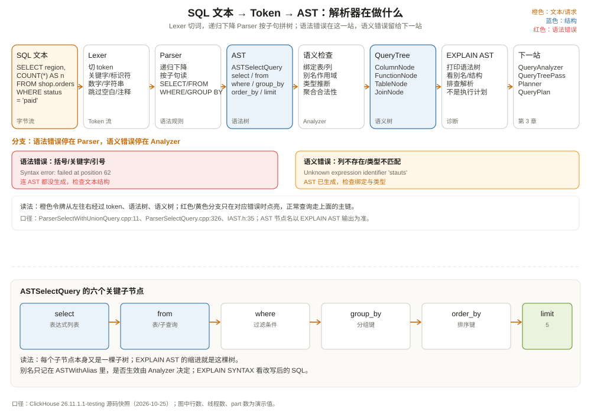

# SQL 解析器与 AST：先把句子拆成树

先做一个小实验。下面两条 SQL 都会报错，但报错的位置完全不同：

```sql
-- ① 少了一个右括号
SELECT region, COUNT(*) FROM shop.orders WHERE (status = 'paid';

-- ② 括号没问题，但列名拼错了
SELECT region, COUNT(*) FROM shop.orders WHERE stauts = 'paid';
```

第一条会得到类似 `Syntax error: failed at position 62` 的提示，服务器在**解析阶段**就拒绝了你：它连一棵完整的树都没拼出来。第二条能通过解析，因为 `stauts` 在语法上是一个合法的标识符；错误发生在**分析阶段**，提示会变成 `Unknown expression identifier 'stauts'`。

这个区别看起来只是报错文案不同，实际决定了你排查问题的方向：

- 解析错误：语法、关键字、括号、引号、语句边界；
- 分析错误：表/列不存在、类型不匹配、聚合不合法、别名冲突；
- 规划错误：没有可用的索引、join 算法不支持、分布式表配置缺失；
- 执行错误：内存超限、磁盘满、副本不可用、超时。

这一章只走到第一站：**SQL 文本怎么变成一棵 AST**。第二站的分析与规划留给下一章。



---

## 一、先把「解析」拆成两件事

编译原理里，解析通常分两步：

1. **词法分析（lexing）**：把字符流切成有类型的 token。比如 `SELECT region, COUNT(*)` 会切成 `SELECT`、`region`、`,`、`COUNT`、`(`、`*`、`)`；
2. **语法分析（parsing）**：按语法规则把 token 序列拼成树。比如「SELECT 后面跟表达式列表，表达式列表可以包含函数调用，函数调用的参数又是表达式」。

ClickHouse 的 `Lexer` 在 `src/Parsers/Lexer.h:119`，它每次调用 `nextToken()` 返回一个 `Token`（`src/Parsers/Lexer.h:102`）：

```cpp
struct Token
{
    TokenType type;      // 关键字、标识符、数字、字符串、运算符……
    const char * begin;  // 在原始 SQL 文本中的起点
    const char * end;    // 终点
};
```

`begin` / `end` 直接指向原始查询缓冲区，而不是拷贝一份字符串。这样做有两个好处：解析大查询时内存开销小；报错时能精确指到原始文本的偏移。`Token` 还区分了 `isSignificant()`：空白和注释会被跳过，不参与语法。

词法分析只认「长什么样」，不认「什么意思」。`region` 是一个 Identifier，`'paid'` 是一个 String，`= ` 是一个 Equals；至于 `region` 是不是表里的列，lexer 完全不知道。

---

## 二、解析器：一条手写的递归下降流水线

ClickHouse 的主解析器是手写的递归下降解析器（recursive descent parser）。它的入口不是一个巨大的 `switch`，而是一串「试错」：

```cpp
bool ParserQuery::parseImpl(Pos & pos, ASTPtr & node, Expected & expected)
{
    ParserQueryWithOutput query_with_output_p(end, allow_settings_after_format_in_insert);

    ParserInsertQuery insert_p(end, allow_settings_after_format_in_insert);
    ParserUseQuery use_p;
    ParserSetQuery set_p;
    ParserSystemQuery system_p;
    // ... 还有 CREATE、DROP、ALTER、GRANT 等几十种语句

    bool res = query_with_output_p.parse(pos, node, expected)
        || insert_p.parse(pos, node, expected)
        || use_p.parse(pos, node, expected)
        || set_p.parse(pos, node, expected)
        || system_p.parse(pos, node, expected)
        // ...
        ;
    return res;
}
```

（`src/Parsers/ParserQuery.cpp:104` 起。）

`ParserQueryWithOutput` 里再分 SELECT、SHOW、EXPLAIN 等。SELECT 这条线是：

```text
ParserQuery
└── ParserQueryWithOutput
    └── ParserSelectWithUnionQuery   ← 处理 SELECT ... UNION ALL SELECT ...
        └── ParserUnionList
            └── ParserSelectQuery    ← 处理单个 SELECT 的各个子句
                ├── ParserWithClause
                ├── ParserTablesInSelectQuery
                ├── ParserExpression
                ├── ParserGroupingSetsExpressionList
                └── ...
```

`ParserSelectWithUnionQuery::parseImpl`（`src/Parsers/ParserSelectWithUnionQuery.cpp:11`）先把整串 `SELECT ... UNION ...` 解析成一个 `ASTExpressionList`，再包成 `ASTSelectWithUnionQuery`。它特意没有把嵌套 UNION 拍平，因为 `UNION` 和 `UNION ALL` 的混合顺序会影响语义：

```sql
SELECT 1 UNION (SELECT 1 UNION ALL SELECT 1)
```

如果拍平成 `SELECT 1 UNION SELECT 1 UNION ALL SELECT 1`，去重和保留重复的行为就变了。这种「语法结构必须忠实于用户写法」的细节，是手写解析器比较容易控制的地方。

单个 SELECT 的解析在 `ParserSelectQuery::parseImpl`（`src/Parsers/ParserSelectQuery.cpp:326`）。它按 SQL 子句顺序一段段往下读：

```text
WITH ...            ← 可选，CTE / 标量表达式
SELECT ...          ← 投影列表，支持别名、DISTINCT、TOP
FROM ...            ← 表、子查询、表函数、JOIN
PREWHERE ...        ← ClickHouse 特有，先于 WHERE 的过滤
WHERE ...           ← 过滤
GROUP BY ...        ← 聚合键，支持 ROLLUP / CUBE / GROUPING SETS
HAVING ...          ← 聚合后过滤
WINDOW ...          ← 窗口定义
QUALIFY ...         ← 窗口函数结果过滤
ORDER BY ...        ← 排序
LIMIT ...           ← 行数、LIMIT BY、OFFSET
SETTINGS ...        ← 查询级设置
```

注意 `PREWHERE` 是 ClickHouse 自己的语法，不是 SQL 标准。它的语义是「先只读过滤需要的列，把不命中的行尽早扔掉，再读其他列」，第 9、11 章会从存储层解释它为什么能省 I/O。

表达式本身则交给 `ParserExpression`（`src/Parsers/ExpressionListParsers.cpp:3393`）。表达式解析通常用**优先级爬升**（precedence climbing）：先读一个 primary（字面量、标识符、括号、函数调用），再看后面的运算符优先级，决定什么时候收束。`1 + 2 * 3` 会解析成 `+(1, *(2, 3))`，而不是 `*( +(1, 2), 3)`。

---

## 三、AST：一棵「什么都能挂」的树

解析的产物是 AST（Abstract Syntax Tree，抽象语法树）。ClickHouse 的 AST 基类是 `IAST`（`src/Parsers/IAST.h:35`），核心只有两样东西：

```cpp
class IAST : public TypePromotion<IAST>
{
public:
    ASTs children;   // 子节点，类型是 vector<ASTPtr>
    // ...
    virtual ASTPtr clone() const = 0;
    virtual String getID() const;   // 用于比较两棵树是否相同
};
```

`ASTPtr` 是 `boost::intrusive_ptr<IAST>`，一种引用计数智能指针。父子节点之间靠 `children` 连接，父节点同时用具体类型的裸指针指向关键子节点，避免每次访问都做类型转换。

不同的语法结构对应不同的 AST 子类：

| AST 类 | 代表什么 | 关键字段/子节点 |
| --- | --- | --- |
| `ASTSelectQuery` | 一个 SELECT 语句 | `select`、`from`、`where`、`groupBy`、`orderBy`、`limit` 等 |
| `ASTSelectWithUnionQuery` | 多个 SELECT 的 UNION | `list_of_selects`、`list_of_modes` |
| `ASTIdentifier` | 标识符 | 名字、可选限定符（库/表） |
| `ASTFunction` | 函数调用或运算符 | 函数名、参数列表 |
| `ASTLiteral` | 字面量 | 字符串、数字、NULL |
| `ASTExpressionList` | 逗号分隔的表达式列表 | `children` |
| `ASTTableIdentifier` | 表名 | 库名、表名 |
| `ASTSubquery` | 子查询 | 内部 SELECT |
| `ASTJoin` | JOIN | 左右表、ON 条件、JOIN 类型 |

`ASTSelectQuery` 用一个 `Expression` 枚举给每个子句编号（`src/Parsers/ASTSelectQuery.h:17`）：

```cpp
enum class Expression : uint8_t
{
    WITH, SELECT, TABLES, ALIASES, CTE_ALIASES,
    PREWHERE, WHERE, GROUP_BY, HAVING, WINDOW, QUALIFY,
    ORDER_BY, LIMIT_BY_OFFSET, LIMIT_BY_LENGTH, LIMIT_BY,
    LIMIT_OFFSET, LIMIT_LENGTH, LIMIT_AFTER, LIMIT_UNTIL,
    SETTINGS, INTERPOLATE
};
```

`select()`、`where()`、`groupBy()` 这些方法只是按枚举取子节点。这样设计的好处是：新增一个子句只要加一个枚举值和一个字段，不用改所有访问者。

---

## 四、把一条 SQL 亲手拆成树

拿贯穿全书的查询：

```sql
SELECT region, COUNT(*) AS orders, SUM(amount) AS gmv
FROM shop.orders
WHERE event_date = '2026-10-01'
  AND status = 'paid'
GROUP BY region
ORDER BY gmv DESC
LIMIT 5;
```

它的 AST 大致是：

```text
ASTSelectQuery
├── select
│   └── ASTExpressionList
│       ├── ASTIdentifier(region)
│       ├── ASTFunction(count, alias=orders)
│       │   └── ASTLiteral(*)
│       └── ASTFunction(sum, alias=gmv)
│           └── ASTIdentifier(amount)
├── from
│   └── ASTTablesInSelectQuery
│       └── ASTTableIdentifier(shop.orders)
├── where
│   └── ASTFunction(and)
│       ├── ASTFunction(equals)
│       │   ├── ASTIdentifier(event_date)
│       │   └── ASTLiteral('2026-10-01')
│       └── ASTFunction(equals)
│           ├── ASTIdentifier(status)
│           └── ASTLiteral('paid')
├── group_by
│   └── ASTExpressionList
│       └── ASTIdentifier(region)
├── order_by
│   └── ASTExpressionList
│       └── ASTFunction(desc)
│           └── ASTIdentifier(gmv)
└── limit
    └── ASTLiteral(5)
```

你可以用 `EXPLAIN AST` 让服务器把这棵树打印出来：

```sql
EXPLAIN AST
SELECT region, COUNT(*) AS orders, SUM(amount) AS gmv
FROM shop.orders
WHERE event_date = '2026-10-01'
  AND status = 'paid'
GROUP BY region
ORDER BY gmv DESC
LIMIT 5;
```

输出是缩进形式的，节点名就是 AST 类名去掉 `AST` 前缀。刚看会觉得很啰嗦，但它是排查「引擎到底把你写的 SQL 理解成了什么」最直接的工具。

比如你以为自己写的是：

```sql
SELECT region, COUNT(*) AS orders
FROM shop.orders
WHERE status = 'paid'
ORDER BY orders DESC;
```

AST 会告诉你 `ORDER BY` 里的 `orders` 是 `ASTIdentifier`，而不是 `ASTFunction(count)`。它到底是「列 `orders`」还是「别名 `orders`」，解析阶段不下结论，留给分析阶段按作用域规则决定。这就是为什么同一棵树可以对应多种语义解释。

---

## 五、别名：解析阶段只记名字，不裁决

SQL 别名是初学者最容易混的地方。看下面三条：

```sql
-- ① ORDER BY 用别名：大多数数据库都允许
SELECT region, COUNT(*) AS orders
FROM shop.orders
GROUP BY region
ORDER BY orders DESC;

-- ② WHERE 用别名：标准 SQL 不允许，ClickHouse 允许（有前提）
SELECT region, amount * 2 AS double_amount
FROM shop.orders
WHERE double_amount > 100;

-- ③ 别名和列名同名：到底用哪个？
SELECT amount AS region, region
FROM shop.orders
WHERE region = 'east';
```

解析器对这三条一视同仁：它只负责把 `orders`、`double_amount`、`region` 记成 `ASTIdentifier`，把 `AS` 后面的名字记到 `ASTWithAlias::alias`（`src/Parsers/ASTWithAlias.h:13`）。**别名的作用域和优先级是分析阶段的事**。

ClickHouse 的别名规则和标准 SQL 有差异：

- `SELECT` 列表里的别名可以在 `GROUP BY`、`ORDER BY`、`HAVING` 里使用；
- 在 `WHERE` 里也能用别名，但这是一个扩展，不是标准；
- 如果别名和真实列名冲突，默认优先真实列（`prefer_column_name_to_alias = 0`），可以用设置改成别名优先；
- 别名表达式会被尽量内联，复杂的别名可能被重复计算，必要时用 `WITH` 子句或子查询固定下来。

这解释了一个常见困惑：为什么有时候 `WHERE` 里用别名能跑，有时候报「列不存在」？因为别名是否可见取决于它被定义在哪个作用域，以及优化器有没有把它内联掉。第 3 章会从 `QueryAnalyzer` 的标识符解析角度讲清楚。

---

## 六、查询参数：别把用户输入拼进 SQL

解析阶段还有一个和安全直接相关的机制：**查询参数**。

```sql
SELECT region, COUNT(*)
FROM shop.orders
WHERE event_date = {day:Date}
  AND status = {status:String}
GROUP BY region;
```

`{day:Date}` 和 `{status:String}` 是参数占位符，真正的值通过驱动或 HTTP 的 `param_day`、`param_status` 传入。服务器在解析时把它们记成 `ASTQueryParameter`，随后由 `ReplaceQueryParameterVisitor` 替换成 `ASTLiteral`（`src/Interpreters/executeQuery.cpp:2714` 附近）。

这比字符串拼接安全得多：

```python
# 危险：用户输入直接进 SQL
sql = f"SELECT * FROM orders WHERE status = '{user_input}'"

# 安全：参数占位，值不参与语法解析
sql = "SELECT * FROM shop.orders WHERE status = {status:String}"
client.query(sql, parameters={"status": user_input})
```

参数的值只会被当成字面量，不会被当成 SQL 语法。即使 `user_input` 里包含 `' OR 1=1 --`，它也只是一个字符串值，不会改变 AST 的结构。

这和 MySQL 的 prepared statement 是同一个思路，但 ClickHouse 的参数替换发生在服务端解析之后、分析之前，占位符本身是 SQL 语法的一部分。注意：**不要把参数用在标识符位置**（表名、列名），那需要另一套机制（如 `identifier` 函数或动态 SQL），否则参数替换后仍然不是合法标识符。

---

## 七、解析器的边界：三个限制和两个坑

ClickHouse 给解析器设了硬限制，防止恶意或失控的查询把服务器拖死：

| 设置 | 默认值 | 作用 |
| --- | --- | --- |
| `max_query_size` | 262144 字节（256 KiB） | 单条 SQL 文本的最大长度 |
| `max_parser_depth` | 1000 | 递归下降的最大嵌套深度 |
| `max_parser_backtracks` | 1000000 | 回溯解析的最大次数 |
| `max_ast_depth` | 1000 | AST 的最大深度 |
| `max_ast_elements` | 50000 | AST 的最大节点数 |

（`src/Core/Settings.cpp:459`、`6198`、`6206`、`4209`、`4218`；常量定义在 `src/Core/Defines.h:92-100`。）

这些限制不是「性能调优参数」，而是**安全边界**。一个 10 万层嵌套的括号、一个超长的 `IN` 列表、一个自动生成出来的巨型 SQL，都可能让解析器耗尽栈或内存。遇到 `Max query size exceeded`、`Too deep recursion` 这类错误，先看查询是不是自动拼接出来的，而不是急著调大限制。

两个常见的坑：

**坑一：把注释当成语句结束。** ClickHouse 支持 `--` 行注释和 `/* */` 块注释，但注释里出现的分号不会被当成语句分隔符。用 HTTP 接口一次发多条语句时，分号的位置和注释的边界要特别小心。

**坑二：`FORMAT` 子句的位置。** `SELECT ... FORMAT JSON` 里的 `FORMAT` 不是 SELECT 语法的一部分，而是查询输出格式的声明。它由 `ParserQueryWithOutput` 处理，位置通常在语句末尾；在 `INSERT ... SELECT ... FORMAT` 里又另有规则。解析器对 `FORMAT` 的处理和普通子句不同，写错位置会得到「Syntax error」而不是「未知格式」。

---

## 八、和 MySQL 的解析器比一比

MySQL 8 的 SQL 解析器主要是 Bison/yacc 生成的 LALR(1) 语法分析器，语法写在 `sql_yacc.yy` 里，语义动作在解析过程中执行。ClickHouse 走的是手写递归下降路线。两条路线的取舍：

| 维度 | MySQL（Bison/LALR） | ClickHouse（递归下降） |
| --- | --- | --- |
| 语法定义 | 形式化文法，集中在一个 `.yy` 文件 | 手写代码，分散在 `Parser*.cpp` |
| 错误恢复 | 依赖 Bison 的错误恢复机制 | 可以针对每个子句定制错误提示 |
| 扩展语法 | 改文法要重新生成解析器 | 加一个 Parser 类即可 |
| 语法证明 | 工具可以检查冲突 | 靠测试和代码审查 |
| 解析性能 | 表驱动，稳定 | 手写，通常更快、更可控 |
| 特殊语法 | 受 LALR 限制，可能需要改写文法 | 可以随意 lookahead、回溯 |

ClickHouse 的语法扩展非常快：窗口函数、`QUALIFY`、`LIMIT BY`、`PREWHERE`、`SETTINGS`、管道操作符 `|>`，都是手写解析器容易加的东西。代价是语法规则没有一份可机读的完整文法，学习时只能顺着 `Parser*.cpp` 读。

对使用者来说，最实际的差别是**错误提示的友好度**。手写解析器可以在某个子句解析失败时给出「这里期望 GROUP BY，但看到了 ORDER BY」这种上下文；Bison 的报错往往只有「syntax error near ...」。ClickHouse 的报错虽然也不算完美，但通常能把你带到出错的那一段。

---

## 九、AST 之后还有两棵树，别混

很多资料把 AST、QueryTree、QueryPlan 都叫「语法树」或「执行树」，这是理解查询优化的第一个障碍。它们解决的是不同问题：

| 树 | 谁产生 | 回答什么问题 | 例子 |
| --- | --- | --- | --- |
| AST | Parser | 用户写了什么 | `SUM(amount) AS gmv` |
| QueryTree | Analyzer | 每个名字指的是什么、类型是什么 | `sum(shop.orders.amount)`，类型 `Decimal(18,2)` |
| QueryPlan | Planner | 引擎决定怎么执行 | `AggregatingStep(group_by=region)` 下接 `ReadFromMergeTree` |

AST 里可以有不存在的列、不匹配的类型、未解析的别名；QueryTree 里这些都必须被解决。AST 是「文本的结构」，QueryTree 是「语义的结构」，QueryPlan 是「执行的步骤」。第 3 章会把 QueryTree 和 QueryPlan 的生成过程展开。

一个实用技巧：排查「SQL 被理解成了什么」用 `EXPLAIN AST`；排查「优化器做了什么」用 `EXPLAIN PLAN`；排查「实际怎么并行」用 `EXPLAIN PIPELINE`。三个命令对应三棵树，不要用错工具。

---

## 十、这一章留下的线索

把这一章压成几句话：

- 解析分两步：`Lexer` 切 token，递归下降 Parser 拼 AST；
- ClickHouse 的 Parser 是一串「试错」：`ParserQuery` 按语句类型分派，`ParserSelectWithUnionQuery` 管 UNION，`ParserSelectQuery` 管子句；
- AST 是「用户写了什么」的忠实记录，别名、类型、表绑定都还没裁决；
- `ASTSelectQuery` 用枚举管理子句，`IAST::children` 维护父子关系；
- 查询参数把值变成字面量，避免 SQL 注入；
- 解析器有硬限制：256 KiB、1000 层深度、5 万节点；
- AST、QueryTree、QueryPlan 是三棵不同的树，分别对应「写了什么」「指的是什么」「怎么执行」。

下一章进入分析阶段：ClickHouse 怎么把 AST 里的 `region` 绑定到 `shop.orders.region`，怎么决定 `gmv` 是聚合别名还是列名，怎么把一棵「语法正确但语义模糊」的树修成可执行的 QueryTree。

---

## 附：这一章的源码入口

> 源码来自本地 ClickHouse 26.11.1.1-testing 快照，验证时间 2026-10-25。

- `src/Parsers/Lexer.h:102`：`Token` 结构，指向原始查询缓冲区
- `src/Parsers/Lexer.h:119`：`Lexer` 类
- `src/Parsers/ParserQuery.cpp:104`：`ParserQuery::parseImpl`，语句类型分派
- `src/Parsers/ParserSelectWithUnionQuery.cpp:11`：`ParserSelectWithUnionQuery::parseImpl`
- `src/Parsers/ParserSelectQuery.cpp:326`：`ParserSelectQuery::parseImpl`，子句顺序
- `src/Parsers/ExpressionListParsers.cpp:3393`：`ParserExpression::parseImpl`
- `src/Parsers/IAST.h:35`：`IAST` 基类，`children` 在 `:38`
- `src/Parsers/ASTSelectQuery.h:17`：`ASTSelectQuery` 与 `Expression` 枚举
- `src/Parsers/ASTWithAlias.h:13`：`ASTWithAlias`，别名存放处
- `src/Parsers/parseQuery.cpp:699`：`parseQuery` 入口
- `src/Core/Settings.cpp:459`：`max_query_size = 262144`
- `src/Core/Settings.cpp:6198`：`max_parser_depth = 1000`
- `src/Core/Settings.cpp:6206`：`max_parser_backtracks = 1000000`
- `src/Core/Settings.cpp:4209`：`max_ast_depth = 1000`
- `src/Core/Settings.cpp:4218`：`max_ast_elements = 50000`
- `src/Interpreters/executeQuery.cpp:2714`：查询参数替换

---

## 思考题

1. `SELECT * FROM t WHERE x = 1; -- 注释` 和 `SELECT * FROM t WHERE x = 1 /* 注释 */;` 在解析上有什么区别？注释里的分号会不会提前结束语句？
2. 为什么 ClickHouse 的 `ParserSelectWithUnionQuery` 不把嵌套 UNION 拍平？举一个拍平后语义会变的例子。
3. `EXPLAIN AST` 里 `ORDER BY gmv` 的 `gmv` 是 `ASTIdentifier`。它在什么情况下会被解析成列，什么情况下会被解析成别名？
4. 查询参数 `{status:String}` 和字符串拼接 `'...'` 在 AST 层面有什么本质区别？为什么参数不能直接用在表名位置？
5. 如果一条 SQL 有 60000 个 AST 节点，但语法完全合法，ClickHouse 会在哪一步拒绝它？这个限制应该调大吗？
