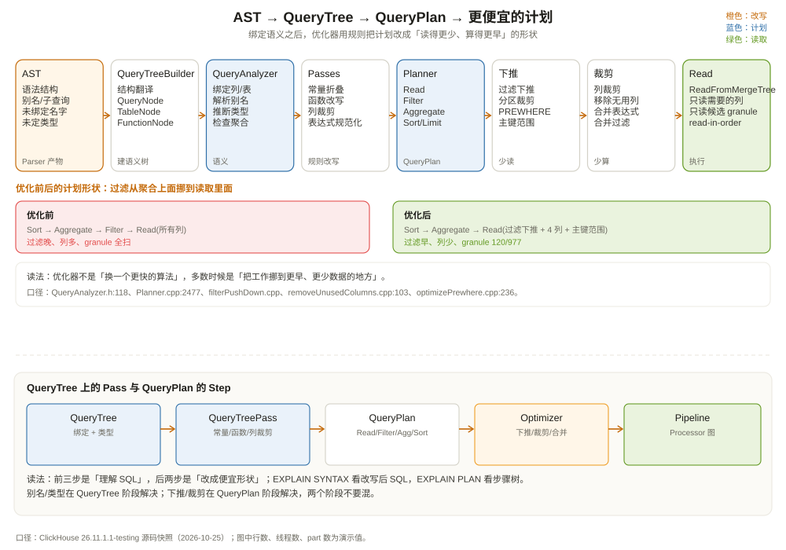

# 查询分析器与优化器：把树修成能执行的形状

上一章留下了一棵 AST。它忠实记录了用户写了什么，但还不能执行：`region` 是谁的列、`orders` 是别名还是列、`COUNT(*)` 的结果类型是什么、`event_date` 能不能用来裁分区，这些都没有答案。

这一章看 ClickHouse 怎么把 AST 修成两棵新树：

```text
AST（写了什么）
  │  QueryTreeBuilder：把语法结构翻译成 QueryTree
  ▼
QueryTree（名字和类型都绑定好了）
  │  一串 Pass：解析标识符、展开别名、类型推断、改写函数
  ▼
QueryTree（语义明确）
  │  Planner：翻译成执行步骤
  ▼
QueryPlan（先读什么、再算什么、最后排什么）
  │  优化器：下推、裁剪、合并、换顺序
  ▼
QueryPlan（能执行的最优形状）
```

先看一个能说明问题的例子。同一条查询，加一个 `PREWHERE`，执行时间可能差一个数量级：

```sql
-- A：普通 WHERE
SELECT region, COUNT(*)
FROM shop.orders
WHERE event_date = '2026-10-01'
  AND status = 'paid'
  AND amount > 1000
GROUP BY region;

-- B：把高选择性的条件下到 PREWHERE
SELECT region, COUNT(*)
FROM shop.orders
PREWHERE amount > 1000
WHERE event_date = '2026-10-01'
  AND status = 'paid'
GROUP BY region;
```

两条 SQL 的语义完全一样，但 B 可能只读 `amount` 一列就把 99% 的行排掉，再读 `region`、`status`；A 则可能先把三列都读出来再过滤。差别不在 SQL 写法本身，而在**优化器有没有把过滤拆成「先读哪一列、后读哪一列」**。



---

## 一、分析阶段：把「名字」变成「实体」

分析阶段的核心任务是**名字解析（name resolution）**。ClickHouse 26.x 的流程是：

1. `QueryTreeBuilder` 把 AST 翻译成 `QueryTree`。这是一棵语义树的骨架，节点是 `QueryNode`、`TableNode`、`ColumnNode`、`FunctionNode`、`JoinNode` 等；
2. `QueryAnalyzer`（`src/Analyzer/Resolve/QueryAnalyzer.h:118`）做标识符解析：把 `region` 绑定到 `shop.orders.region`，把 `orders` 绑定到聚合表达式，把子查询的列绑定到外层作用域；
3. `QueryTreePassManager`（`src/Analyzer/QueryTreePassManager.h:13`）跑一串 pass，做类型推断、别名展开、函数改写、冗余消除；
4. `Planner`（`src/Planner/Planner.h:23`）把 QueryTree 翻译成 QueryPlan。

`QueryTreeBuilder::buildQueryTreeNode`（`src/Analyzer/QueryTreeBuilder.cpp:185`）是入口。它不做语义判断，只负责把 AST 的结构映射成 QueryTree 的节点。比如：

```text
ASTSelectQuery
  ├── select: ASTExpressionList
  │     ├── ASTIdentifier(region)
  │     └── ASTFunction(sum, ASTIdentifier(amount)) [alias=gmv]
  ├── from: ASTTableIdentifier(shop.orders)
  └── where: ASTFunction(and, ...)
```

会先变成：

```text
QueryNode
  ├── projection: [ColumnNode(region), FunctionNode(sum, ColumnNode(amount))]
  ├── from: TableNode(shop.orders)
  └── filter: FunctionNode(and, ...)
```

此时 `region` 还是一个「未解析的标识符」。`QueryAnalyzer` 会拿当前作用域里的表、列、别名去匹配它，匹配成功后把节点替换成带表 ID、列 ID、数据类型的 `ColumnNode`。匹配失败就报 `Unknown expression identifier`。

### 1.1 别名到底怎么解析

回到上一章的别名问题：

```sql
SELECT amount AS region, region
FROM shop.orders
WHERE region = 'east';
```

分析器会按作用域规则处理：

- 默认 `prefer_column_name_to_alias = false` 时，同名标识符优先当**别名**用：`WHERE region` 会绑到 `amount AS region`，条件实际在过滤 `amount`；
- `SELECT` 里的 `region` 也可能被这个别名替换——一条 SQL 里两个 `region` 的含义就此分叉；
- 设置 `prefer_column_name_to_alias = 1` 才会按真实列 `shop.orders.region` 解析，语义回到多数数据库的直觉。

ClickHouse 的默认值是 `prefer_column_name_to_alias = false`（`src/Core/Settings.cpp:3571`），也就是**别名优先**。这和很多人的直觉相反：别名不只是输出层的名字，还会悄悄改变输入层的语义。遇到「条件没生效」时，先用 `EXPLAIN SYNTAX` 看同名标识符到底绑到了谁。

### 1.2 类型推断：`Decimal` 加 `UInt64` 变成什么

分析阶段还要给每个表达式定类型。`SUM(amount)` 的 `amount` 是 `Decimal(18, 2)`，结果类型是 `Decimal(38, 2)` 还是 `Decimal(18, 2)`？`COUNT(*)` 是 `UInt64`；`COUNT(*) + 1` 会不会溢出？这些规则由数据类型的 `getLeastSupertype`、`getReturnType` 等函数决定。

类型推断的产物会写进 QueryTree 的每个节点。规划阶段据此选择聚合算法、序列化格式、比较函数。类型不对时，分析器会在执行前就报错，而不是等到运行时才发现「字符串不能和数字相加」。

一个常见的坑：

```sql
SELECT region, SUM(amount) AS gmv
FROM shop.orders
WHERE event_date = '2026-10-01'
GROUP BY region
HAVING gmv > 100000;
```

`gmv` 是 `SUM(amount)` 的别名，`HAVING` 里可以用；但如果你写 `HAVING sum(amount) > 100000`，分析器也能识别。两种写法都会在聚合之后过滤。真正不能做的是在 `WHERE` 里引用聚合结果，因为 `WHERE` 发生在聚合之前，分析器会报「聚合函数不允许出现在 WHERE 中」。

---

## 二、QueryTree 上的 Pass：一类一类地修

`QueryTreePassManager` 注册的 pass 很多，下面只列和日常查询最相关的几类（`src/Analyzer/QueryTreePassManager.cpp:271` 起）：

| Pass 类型 | 典型 pass | 做什么 |
| --- | --- | --- |
| 解析 | `QueryAnalysisPass` | 绑定表、列、别名、类型 |
| 分组解析 | `GroupingFunctionsResolvePass` | 处理 `GROUPING()` 等分组函数 |
| 自动 FINAL | `AutoFinalOnQueryPass` | 在需要时自动加 `FINAL` |
| 列裁剪 | `RemoveUnusedProjectionColumnsPass`、`PruneArrayJoinColumnsPass` | 去掉没有被引用的投影列 |
| 表达式改写 | `ConvertLogicalExpressionToCNFPass`、`RegexpFunctionRewritePass` | 把逻辑表达式转成合取范式，改写正则函数 |
| 聚合改写 | `RewriteSumFunctionWithSumAndCountPass`、`CountDistinctPass`、`UniqToCountPass` | 把某些聚合改写成更快的等价形式 |
| 常量/条件 | `IfConstantConditionPass`、`MultiIfToIfPass` | 常量折叠、条件简化 |
| 排序/限制 | `OptimizeRedundantFunctionsInOrderByPass`、`OrderByTupleEliminationPass` | 去掉排序键里的冗余函数、消除无用排序 |
| 函数融合 | `FuseFunctionsPass` | 把能融合的函数合成一个表达式 |

这些 pass 大多是**规则驱动**的：只要模式匹配，就改写，不关心数据量。比如 `count(DISTINCT x)` 在单列、非 Nullable 的情况下可能被改写成 `uniqExact(x)`；`sumIf(x, cond)` 可能被改写成 `countIf(cond)`（当 `x` 是常量 1 时）。规则改写的好处是稳定、可预测；坏处是有时候会改出「看起来更复杂」的表达式，需要看 `EXPLAIN SYNTAX` 才能发现。

`EXPLAIN SYNTAX` 展示的是**改写后的 SQL**，不是执行计划：

```sql
EXPLAIN SYNTAX
SELECT region, COUNT(*) AS orders
FROM shop.orders
WHERE event_date = '2026-10-01' AND status = 'paid'
GROUP BY region;
```

输出可能把 `COUNT(*)` 改写成 `count()`，把别名展开，把某些函数换成内部等价形式。它是理解「分析器眼中的 SQL 长什么样」的最快方式。

---

## 三、规划阶段：QueryPlan 是一棵步骤树

`Planner::buildQueryPlanIfNeeded`（`src/Planner/Planner.cpp:2477`）负责把 QueryTree 翻译成 QueryPlan。SELECT 的主路径是 `buildPlanForQueryNode`（`src/Planner/Planner.cpp:2886`）。

QueryPlan 的节点是 `IQueryPlanStep`，每个 step 只描述「我要对输入做什么」，不直接执行。常见的 step：

| Step | 作用 | 关键输入 |
| --- | --- | --- |
| `ReadFromMergeTree` | 从 MergeTree 表读数据 | 表、分区、主键条件、需要的列 |
| `FilterStep` | 按条件过滤 | 过滤表达式、输入流 |
| `ExpressionStep` | 计算表达式、生成新列 | ActionsDAG |
| `AggregatingStep` | 分组聚合（部分聚合） | 分组键、聚合函数 |
| `MergingAggregatedStep` | 合并部分聚合结果 | 聚合状态 |
| `SortingStep` | 排序 | 排序键、方向 |
| `LimitStep` | 截断行数 | 行数、offset |
| `JoinStep` | 连接 | 左右输入、连接条件 |
| `UnionStep` | 合并多个输入 | 多个子计划 |

我们那条查询的初始计划，大致是：

```text
LimitStep(5)
└── SortingStep(gmv DESC)
    └── ExpressionStep(计算 gmv 别名)
        └── AggregatingStep(group_by = region)
            └── FilterStep(status = 'paid' AND event_date = '2026-10-01')
                └── ReadFromMergeTree(shop.orders)
```

注意 `ExpressionStep` 和 `AggregatingStep` 的顺序：`SUM(amount) AS gmv` 的别名是在聚合之后才有的，`ORDER BY gmv` 必须排在聚合之后。如果 `ORDER BY` 用的是 `region`（分组键），优化器可能把排序下推到聚合之前，甚至利用存储的排序顺序省掉排序。这就是「计划形状」对性能的影响。

---

## 四、优化器：把计划改成更便宜的形状

QueryPlan 建好后，`QueryPlan::buildQueryPipeline` 之前会跑一轮优化。优化器的入口在 `QueryPlanOptimizationSettings`（`src/Processors/QueryPlan/Optimizations/QueryPlanOptimizationSettings.h`），开关是一组布尔值：

```cpp
struct QueryPlanOptimizationSettings
{
    bool optimize_plan;                 // 总开关
    bool filter_push_down;              // 过滤下推
    bool remove_unused_columns;         // 列裁剪
    bool read_in_order;                 // 按存储顺序读
    bool merge_expressions;             // 合并表达式
    bool merge_filters;                 // 合并过滤
    bool lift_up_array_join;
    bool convert_outer_join_to_inner_join;
    bool try_use_top_k_optimization;
    // ...
};
```

这些开关来自会话设置，默认大多开启。比如 `query_plan_filter_push_down` 默认 `true`（`src/Core/Settings.cpp:7961`），`optimize_read_in_order` 默认 `true`（`src/Core/Settings.cpp:5127`），`optimize_move_to_prewhere` 默认 `true`（`src/Core/Settings.cpp:1143`）。

下面挑四个最影响日常查询的优化讲。

### 4.1 过滤下推：把 WHERE 送到读取步骤里

原始计划里，`FilterStep` 在 `ReadFromMergeTree` 上面：

```text
FilterStep(status = 'paid')
└── ReadFromMergeTree(所有列)
```

优化器会把过滤条件下推到读取步骤，让 `ReadFromMergeTree` 只读需要的列，并在读取时就应用分区裁剪、主键裁剪、跳过索引。下推后的计划更像：

```text
ReadFromMergeTree(
  table = shop.orders,
  partition_prune = event_date = '2026-10-01',
  primary_key = none（WHERE 里没有 region，status 不是前缀）,
  columns = [region, status, amount]
)
```

如果查询补上 `region = 'east'`，这里才会出现 `primary_key = (region, status)` 和 `Granules: 120/977` 这样的裁剪结果；没有前缀时，主键只能退化成全分区扫描。

`filterPushDown.cpp` 处理的是通用 step 之间的过滤下推；MergeTree 自己的分区/主键/跳过索引分析在 `ReadFromMergeTree` 和 `MergeTreeDataSelectExecutor` 里。两类「下推」经常同时发生，但层次不同：

- **计划级下推**：把 `FilterStep` 从聚合上面挪到读取上面；
- **存储级下推**：把条件下沉成分区裁剪、主键范围、跳过索引，甚至 PREWHERE。

### 4.2 列裁剪：不读的列真的不读

`remove_unused_columns` 会在计划里从下往上收集「哪些列还有人用」，把没人用的列从 `ReadFromMergeTree` 的读取列表里删掉。`removeUnusedColumns.cpp` 的实现会遍历计划树，调用每个 step 的 `removeUnusedColumns`，能裁就裁。

这一步对宽表特别关键。假设一张 60 列的宽表，查询只用 4 列；如果列裁剪没生效，读取步骤会读 60 列的 `.bin` 文件，I/O 放大十几倍。列裁剪生效后，计划里的 `ReadFromMergeTree` 只列出 4 列。

你可以在 `EXPLAIN PLAN` 里看到 `ReadFromMergeTree` 的 `Header` 或 `Description`，确认它到底读了哪些列。如果列数不对，先检查是不是有 `SELECT *`、`MATERIALIZED` 列、`FINAL`、或者某个表达式引用了额外的列。

### 4.3 PREWHERE：先读一小列，把行排掉

ClickHouse 的 `PREWHERE` 是一个存储层优化：先读 `PREWHERE` 用到的列，过滤掉不命中的行，再读其他列。它和 `WHERE` 的语义一样，但执行顺序不同。

优化器可以把 `WHERE` 里的条件下沉成 `PREWHERE`，判断依据是「这个条件的选择性高不高、它引用的列是不是宽列」。`optimizePrewhere.cpp` 负责这件事。一个典型的改写：

```sql
-- 你写的
SELECT region, COUNT(*)
FROM shop.orders
WHERE event_date = '2026-10-01' AND amount > 1000
GROUP BY region;

-- 优化器可能改写成
SELECT region, COUNT(*)
FROM shop.orders
PREWHERE amount > 1000
WHERE event_date = '2026-10-01'
GROUP BY region;
```

这样读取器先只读 `amount` 列，把大部分行过滤掉，再读 `region`。如果 `amount` 的选择性很高，I/O 会显著下降；如果 `amount > 1000` 命中 90% 的行，PREWHERE 反而多了一次读列的开销。

`PREWHERE` 只对 MergeTree 家族有效，而且不是所有条件都能下推。包含子查询、非确定性函数、某些复杂表达式的条件，优化器会保守地留在 `WHERE`。你可以用 `EXPLAIN PLAN` 看 `Prewhere` 信息，或者显式写 `PREWHERE` 来对比。

### 4.4 按存储顺序读：省掉排序

如果查询的 `ORDER BY` 和表的 `ORDER BY` 前缀一致，ClickHouse 可以直接按 part 的存储顺序读，省掉 `SortingStep`。这就是 `optimize_read_in_order`：

```sql
-- 表 ORDER BY (region, status, event_time)
SELECT region, status, event_time, amount
FROM shop.orders
WHERE region = 'east' AND status = 'paid'
ORDER BY event_time
LIMIT 100;
```

因为 `region` 和 `status` 都是排序键前缀，`event_time` 在这一组前缀内才有序，读取器可以按顺序扫，读到 100 行就停，不需要把整个 `region` 的数据读出来再排序。**只固定 `region` 不够**：`status` 夹在中间，同一个 region 内 `event_time` 只在每个 status 内部有序；要不就同时固定 `status`，要不就把排序键改成 `(region, event_time)`。

反过来，如果 `ORDER BY amount`，存储顺序帮不上忙，必须读全部候选行再排序：

```sql
SELECT region, amount
FROM shop.orders
WHERE region = 'east'
ORDER BY amount DESC
LIMIT 100;
```

这条查询的 `LIMIT 100` 不能让你少读数据，因为「最大的 100 个 amount」可能在任何位置。优化器可以用 TopK 算法（堆）减少内存，但不能减少扫描量。

`optimize_aggregation_in_order` 是另一个相关开关，默认关闭（`src/Core/Settings.cpp:5159`）。开启后，如果 `GROUP BY` 的键和存储顺序一致，聚合可以流式进行，不需要把整个哈希表建完。它适合「分组键基数低、数据已经按分组键排好」的场景；如果分组键基数高，流式聚合反而可能产生大量小分组。

---

## 五、用 EXPLAIN 看见优化器的决定

ClickHouse 提供三种 EXPLAIN，分别对应三棵树：

| 命令 | 看什么 | 典型用途 |
| --- | --- | --- |
| `EXPLAIN AST` | 语法树 | 确认 SQL 被解析成什么结构 |
| `EXPLAIN SYNTAX` | 改写后的 SQL | 看分析器的别名展开、函数改写 |
| `EXPLAIN PLAN` | 执行计划步骤树 | 看读了哪些列、用了哪个索引、有没有下推 |
| `EXPLAIN PIPELINE` | Processor 图 | 看并行度、流数量、算子连接 |
| `EXPLAIN ANALYZE` | 实际执行后的计划 | 看每个步骤的真实耗时/行数 |

一个典型的 `EXPLAIN PLAN` 输出（简化）：

```text
Expression ((Projection + Before ORDER BY))
  Aggregating
    Expression (Before GROUP BY)
      Filter (WHERE)
        ReadFromMergeTree (shop.orders)
        Indexes:
          PrimaryKey
            Keys: none
            Parts: 1/12
            Granules: 977/977
```

读法：

- `ReadFromMergeTree` 是最底层的读取步骤；
- `Indexes` 下面列出了用到的索引：`PrimaryKey` 表示主键索引；
- `Parts: 1/12` 表示 12 个 part 里只读了 1 个（分区裁剪生效）；
- `Granules: 977/977` 表示主键没能裁掉 granule：`WHERE` 里没有 `region`，`status` 不是排序键前缀。若补上 `region = 'east'`，这里才会变成 `Keys: region, status` 和 `Granules: 120/977`。

如果 `Parts` 和 `Granules` 都是全量，说明分区/主键没帮上忙。先检查：

1. `WHERE` 里有没有分区键条件？条件是不是用了函数包裹（`toDate(event_time) = ...` 可能阻止分区裁剪）？
2. `ORDER BY` 的前缀有没有出现在 `WHERE` 里？没有前缀，主键索引只能用上第一列或完全用不上；
3. 是不是用了 `FINAL`、`SAMPLE`、`JOIN`，导致读取步骤不能简单裁剪？
4. 是不是 `PREWHERE` 没生效，或者条件里有子查询？

`EXPLAIN PIPELINE` 则展示计划怎么变成 Processor 图。它回答的是「这条查询会用几个线程、几个流、在哪里做聚合」。第 4 章会专门讲。

---

## 六、和 MySQL 优化器比：规则驱动 vs 代价驱动

MySQL 的优化器是典型的**代价驱动（cost-based）**：它用统计信息估算每种执行路径的行数、I/O、CPU，选代价最低的。表有直方图、索引基数、InnoDB 的页统计；join 顺序、索引选择、是否用临时表，都靠代价模型。

ClickHouse 的优化器更偏向**规则驱动（rule-based）**：

- 过滤下推、列裁剪、PREWHERE、read-in-order、表达式合并，都是「模式匹配 + 开关」；
- 主键/分区裁剪基于键范围和 part 的 minmax，不需要直方图；
- join 顺序优化这些年引入了基于统计的枚举（`query_plan_optimize_join_order_limit` 默认 10），但整体仍不如 MySQL 那种成熟的 CBO；
- ClickHouse 没有 MySQL 那种「二级索引选择」问题，因为它的主键是排序键，索引和存储顺序绑定。

两种路线的取舍：

| 维度 | MySQL CBO | ClickHouse 规则优化 |
| --- | --- | --- |
| 依赖统计 | 强，统计不准计划就差 | 弱，主要看键范围和开关 |
| 可预测性 | 计划随统计漂移 | 计划稳定，容易解释 |
| 复杂 JOIN | 代价模型选顺序 | 有限枚举 + 启发式 |
| 大宽表扫描 | 不是强项 | 主键/分区/列裁剪天然适配 |
| 调优方式 | 加索引、更新统计、hint | 调排序键、分区键、设置、重写 SQL |

这也解释了为什么 ClickHouse 的调优重点不在「加索引」，而在**表设计**：排序键、分区键、列类型、编码、投影。索引不是事后加的，而是建表时就定好的。第 9、11 章会讲这套设计方法。

---

## 七、几个容易误判的优化场景

**场景一：`LIMIT` 不一定能减少扫描。**

```sql
SELECT * FROM shop.orders LIMIT 10;
```

如果没有 `ORDER BY`，读取器读到 10 行就可以停，确实很快。但如果：

```sql
SELECT * FROM shop.orders ORDER BY amount DESC LIMIT 10;
```

就必须读所有候选行（或者至少读所有 `amount`），因为最大的 10 个可能在任意 part 里。`LIMIT` 只减少输出，不减少输入。

**场景二：`FINAL` 会让很多优化失效。**

`SELECT ... FROM t FINAL` 要求合并时去重，读取步骤不能简单地按主键顺序返回，必须把同一个排序键的所有版本放在一起处理。`optimize_read_in_order` 在 `FINAL` 下通常不生效，`PREWHERE` 也可能受限。能不用 `FINAL` 就不用，改用 `ReplacingMergeTree` 的版本条件或子查询去重。

**场景三：分区键用了函数，分区裁剪可能失效。**

```sql
-- 分区键是 toYYYYMM(event_date)
WHERE toYYYYMM(event_date) = 202610   -- 能裁
WHERE toDate(event_time) = '2026-10-01' -- 不一定能裁，取决于表达式匹配
```

分区裁剪不是「看 WHERE 里有没有日期」，而是「看分区表达式和 WHERE 条件能不能在同一个表达式上求值」。把分区键表达式原样用在 WHERE 里，成功率最高。

**场景四：别名冲突会让优化器读错列。**

```sql
SELECT amount AS region, region
FROM shop.orders
WHERE region = 'east';
```

默认别名优先，所以 `WHERE region` 会绑到 `amount AS region`；如果你以为它用的是真实列，计划就会和预期完全不同。设 `prefer_column_name_to_alias = 1` 才按真实列过滤——遇到「条件没生效」时，先用 `EXPLAIN SYNTAX` 看别名到底绑到了谁。

---

## 八、这一章留下的线索

把这一章压成几句话：

- 分析阶段做三件事：绑定名字、推断类型、跑改写 pass；
- QueryTree 是「语义树」，每个标识符都已经绑定到表/列/别名；
- QueryPlan 是「步骤树」，每个 step 描述一种操作，不直接执行；
- 优化器以规则驱动为主：过滤下推、列裁剪、PREWHERE、read-in-order、表达式合并；
- `EXPLAIN SYNTAX` 看改写后的 SQL，`EXPLAIN PLAN` 看步骤树，`EXPLAIN PIPELINE` 看并行图；
- ClickHouse 的调优重点在表设计（排序键、分区键、类型），而不是事后加索引。

下一章进入执行阶段：QueryPlan 这棵步骤树，怎么变成一张由 Processor 和 Port 组成的流水线，`Chunk` 怎么在流里走，`PipelineExecutor` 怎么用多线程把它跑起来。

---

## 附：这一章的源码入口

> 源码来自本地 ClickHouse 26.11.1.1-testing 快照，验证时间 2026-10-25。

- `src/Analyzer/QueryTreeBuilder.cpp:185`：`buildQueryTreeNode`，AST → QueryTree
- `src/Analyzer/Resolve/QueryAnalyzer.h:118`：`QueryAnalyzer`
- `src/Analyzer/QueryTreePassManager.h:13`：`QueryTreePassManager`
- `src/Analyzer/QueryTreePassManager.cpp:271`：注册的分析 pass 列表
- `src/Planner/Planner.h:23`：`Planner`
- `src/Planner/Planner.cpp:2477`：`buildQueryPlanIfNeeded`
- `src/Planner/Planner.cpp:2886`：`buildPlanForQueryNode`
- `src/Processors/QueryPlan/QueryPlan.h:118`：`QueryPlan`
- `src/Processors/QueryPlan/Optimizations/QueryPlanOptimizationSettings.h`：优化开关
- `src/Processors/QueryPlan/Optimizations/filterPushDown.cpp`：过滤下推
- `src/Processors/QueryPlan/Optimizations/removeUnusedColumns.cpp:103`：列裁剪
- `src/Processors/QueryPlan/Optimizations/optimizePrewhere.cpp:236`：PREWHERE 优化
- `src/Processors/QueryPlan/Optimizations/optimizeReadInOrder.cpp:1915`：按存储顺序读
- `src/Core/Settings.cpp:3571`：`prefer_column_name_to_alias = false`
- `src/Core/Settings.cpp:5127`：`optimize_read_in_order = true`
- `src/Core/Settings.cpp:5159`：`optimize_aggregation_in_order = false`
- `src/Core/Settings.cpp:7961`：`query_plan_filter_push_down = true`
- `src/Core/Settings.cpp:1143`：`optimize_move_to_prewhere = true`

---

## 思考题

1. `SELECT * FROM t ORDER BY x LIMIT 10` 和 `SELECT * FROM t LIMIT 10` 在读取步骤上有什么本质区别？为什么前者通常更慢？
2. 表 `ORDER BY (region, status, event_time)`，查询 `WHERE status = 'paid' ORDER BY event_time` 能利用 read-in-order 吗？为什么？
3. 分区键是 `toYYYYMM(event_date)`，查询写 `WHERE toYYYYMM(event_date) = 202610` 和 `WHERE event_date >= '2026-10-01' AND event_date < '2026-11-01'`，哪个更容易触发分区裁剪？
4. 为什么 `FINAL` 会让 `optimize_read_in_order` 失效？如果你必须去重，有什么替代方案？
5. `EXPLAIN PLAN` 显示 `Granules: 977/977`，但查询只返回 5 行。你会按什么顺序排查？
