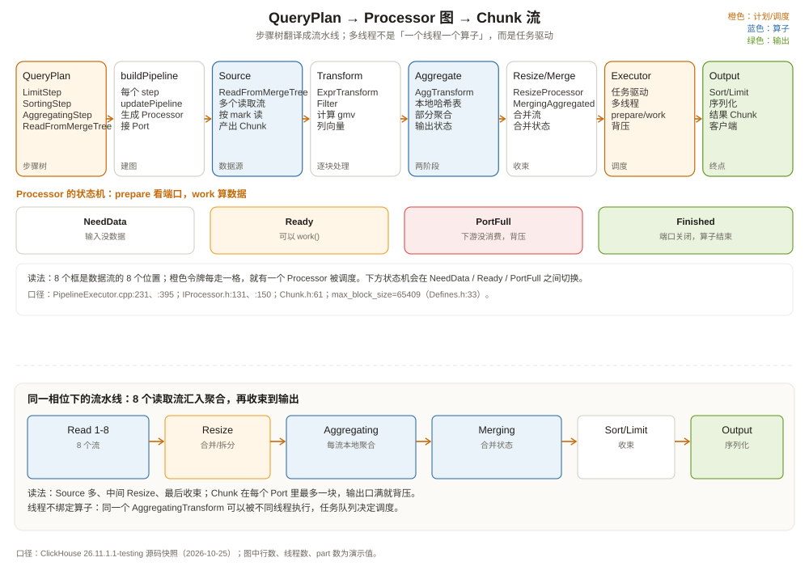

# 查询计划与处理器执行：从步骤树到流水线

先看一段 `EXPLAIN PIPELINE` 的输出。还是那条订单查询：

```sql
EXPLAIN PIPELINE graph = 1, compact = 0
SELECT region, COUNT(*) AS orders, SUM(amount) AS gmv
FROM shop.orders
WHERE event_date = '2026-10-01' AND status = 'paid'
GROUP BY region
ORDER BY gmv DESC
LIMIT 5;
```

输出大致长这样（不同版本、不同数据分布会有差异）：

```text
(ExpressionTransform)
  (AggregatingTransform)
    (ExpressionTransform)
      (MergeTreeSelectPool)
        (ReadFromMergeTree)
```

如果开了 `graph = 1`，你会看到更完整的图：多个 `ReadFromMergeTree` 源、`ResizeProcessor`、`MergingAggregatedTransform`、`LimitTransform`，以及它们之间的箭头。第一次看很容易懵：为什么一条 SQL 会变成十几个 Processor？为什么有的 Processor 有多个输入口，有的有多个输出口？

这一章回答三个问题：

1. QueryPlan 的「步骤树」怎么翻译成 Processor 的「流水线图」；
2. `Chunk` 怎么在 Port 之间流动，执行器怎么调度；
3. 并行度、内存、`LIMIT` 这些行为，在流水线里到底由谁决定。



---

## 一、两种图：步骤树与流水线图

先分清两个概念。

**QueryPlan 是步骤树。** 每个节点是一个 `IQueryPlanStep`，描述「我要做什么」：读表、过滤、聚合、排序、限制。它是一棵树，因为大多数操作只有一个输入；`JoinStep`、`UnionStep` 这类步骤有多个输入，树会分叉。

**QueryPipeline 是流水线图。** 每个节点是一个 `IProcessor`，描述「我怎么处理数据」：读、过滤、聚合、排序、写。Processor 之间用 `Port` 连接，数据以 `Chunk` 为单位流动。

从步骤树到流水线图的翻译发生在 `QueryPlan::buildQueryPipeline`（`src/Processors/QueryPlan/QueryPlan.cpp:240`）：

```cpp
QueryPipelineBuilderPtr QueryPlan::buildQueryPipeline(
    const QueryPlanOptimizationSettings & optimization_settings,
    const BuildQueryPipelineSettings & build_settings)
{
    // 1. 先跑优化器，把计划改成更便宜的形状
    // 2. 从根节点向下，每个 step 调用 updatePipeline()
    // 3. 把各个 step 的 Pipe 接起来
    // 4. 返回 QueryPipelineBuilder
}
```

每个 step 都有自己的 `updatePipeline`。比如：

- `ReadFromMergeTree::initializePipeline`（`src/Processors/QueryPlan/ReadFromMergeTree.cpp:5332`）创建一个或多个读取源；
- `ExpressionStep::updatePipeline`（`src/Processors/QueryPlan/ExpressionStep.cpp:89`）在输入流上挂一个 `ExpressionTransform`；
- `AggregatingStep::updatePipeline`（`src/Processors/QueryPlan/AggregatingStep.cpp:904` 附近）挂 `AggregatingTransform`，必要时再挂 `MergingAggregatedTransform`；
- `LimitStep::updatePipeline`（`src/Processors/QueryPlan/LimitStep.cpp:95`）挂 `LimitTransform`。

最后 `QueryPipelineBuilder::getPipeline`（`src/QueryPipeline/QueryPipelineBuilder.cpp:1055`）把 Builder 变成可执行的 `QueryPipeline`。`QueryPipeline` 有三种形态（`src/QueryPipeline/QueryPipeline.h:52`）：

| 形态 | 入口 | 典型场景 |
| --- | --- | --- |
| pulling | `PullingPipelineExecutor` | SELECT：从输出口拉 Chunk |
| pushing | `PushingPipelineExecutor` | INSERT：把 Chunk 推进入口 |
| completed | `CompletedPipelineExecutor` | 没有外部输入输出，跑完即止 |

我们这条 SELECT 是 pulling：客户端或输出格式从流水线末端拉数据，执行器反向驱动前面的 Processor。

---

## 二、Processor：只认 Port，不认 SQL

`IProcessor` 的接口非常小（`src/Processors/IProcessor.h:131`）：

```cpp
class IProcessor
{
protected:
    InputPorts inputs;
    OutputPorts outputs;

public:
    virtual String getName() const = 0;

    enum class Status : uint8_t
    {
        NeedData,       // 需要更多输入
        PortFull,       // 输出口满了，等下游消费
        Finished,       // 全部完成
        Ready,          // 可以立刻 work()
        Async,          // 异步任务，稍后 schedule()
        UpdatePipeline  // 需要增删 Processor
    };

    virtual Status prepare();
    virtual void work();
    virtual int schedule();
};
```

这个设计的精髓是：**Processor 不关心数据从哪来、到哪去，只关心自己的输入口有没有数据、输出口能不能写**。

- `prepare()` 做「便宜」的准备工作：检查端口状态、计算需要的输入、返回 `NeedData` / `PortFull` / `Ready` / `Finished`；
- `work()` 做实际的 CPU 计算：消费输入 Chunk，产生输出 Chunk；
- `schedule()` 用于异步 I/O（比如读 S3、等网络），返回一个可 poll 的文件描述符。

`Port` 是 Processor 之间的连接点（`src/Processors/Port.h:27`）。输入口提供 `pull()`、`hasData()`；输出口提供 `push()`、`canPush()`。一个输出口同一时刻只能有一个 Chunk，下游不取走，上游就不能继续推。这就是**背压（backpressure）**：

```text
上游 Processor 想 push
  │
  ▼
输出口已经有数据？
  ├── 是：返回 PortFull，上游暂停
  └── 否：push 成功，上游继续
```

背压让 ClickHouse 不需要在算子之间放大缓冲。下游慢，上游就慢；内存不会因为「生产太快、消费太慢」无限增长。聚合、排序这类需要物化的算子，会在自己的内存里攒数据，但那是算子内部的账，不是管道里的无限队列。

---

## 三、Chunk：流动的列向量块

数据在 Port 里以 `Chunk` 为单位流动。`Chunk` 的定义很短（`src/Processors/Chunk.h:61`）：

```cpp
class Chunk
{
    Columns columns;   // 一组列向量
    UInt64 num_rows;   // 这些列向量的行数
    ChunkInfoCollection chunk_infos;  // 可选的附加信息
};
```

它不是「一行」，也不是「一张表」，而是**一批同构的列**。一个 Chunk 里，`region` 列有 8192 个值，`amount` 列也有 8192 个值，`status` 列也有 8192 个值；所有列的行数必须一致。

为什么用 Chunk 而不是一行一行处理？

- **缓存友好**：同一列的值连续存放，CPU 缓存命中率高；
- **SIMD 友好**：对一列做 `amount > 1000`，编译器可以把循环向量化；
- **函数调用摊销**：一次函数调用处理几千行，而不是每行调一次；
- **压缩友好**：一批同类型的值更容易压缩。

Chunk 的大小由 `max_block_size` 控制，默认 65409 行（`src/Core/Defines.h:33`）。这个数字不是随便定的：65409 = 65536 - 64 - 63，给 SIMD padding 留了空间。块太小，函数调用和调度开销占比高；块太大，单块内存峰值高，缓存容易失效。

`Chunk` 里还可以挂 `ChunkInfo`，比如聚合的桶号、spill 的标记、排序的边界。`ChunkInfoCollection` 让算子之间传递「这块数据是什么」的元信息，而不只是裸列。

---

## 四、把订单查询翻译成流水线

现在把那条查询的计划翻译成 Processor 图。简化后的流水线：

```text
ReadFromMergeTree (stream 1) ─┐
ReadFromMergeTree (stream 2) ─┼─► ResizeProcessor ─► ExpressionTransform ─► AggregatingTransform ─┐
ReadFromMergeTree (stream 3) ─┤      （合并/拆分流）      （过滤 + 表达式）      （部分聚合）          │
ReadFromMergeTree (stream 4) ─┘                                                                    │
                                                                                                   ▼
                                                                                         MergingAggregatedTransform
                                                                                                   │
                                                                                                   ▼
                                                                                         ExpressionTransform (gmv)
                                                                                                   │
                                                                                                   ▼
                                                                                         SortingTransform
                                                                                                   │
                                                                                                   ▼
                                                                                            LimitTransform
                                                                                                   │
                                                                                                   ▼
                                                                                              OutputFormat
```

每个 Processor 的职责：

| Processor | 输入 | 输出 | 说明 |
| --- | --- | --- | --- |
| `ReadFromMergeTree` | 无 | Chunk | 按 part/mark 读列，生成 Chunk |
| `ResizeProcessor` | N 个 | M 个 | 把多个读取流合并/拆分到目标并行度 |
| `ExpressionTransform` | 1 个 | 1 个 | 计算 `status = 'paid'`、`event_date = ...` 等表达式 |
| `AggregatingTransform` | 1 个 | 1 个 | 每个流本地建哈希表，做部分聚合 |
| `MergingAggregatedTransform` | N 个 | 1 个 | 把多个部分聚合结果合并成最终结果 |
| `ExpressionTransform` | 1 个 | 1 个 | 计算 `gmv` 别名，准备输出 |
| `SortingTransform` | 1 个 | 1 个 | 按 `gmv DESC` 排序（可能先部分排序再合并） |
| `LimitTransform` | 1 个 | 1 个 | 取前 5 行，通知上游可以停 |
| `OutputFormat` | 1 个 | 无 | 序列化成客户端要的格式 |

几个容易忽略的点：

**第一，聚合是两阶段的。** 每个读取流先做本地部分聚合，再由 `MergingAggregatedTransform` 合并。这样每个线程的哈希表只装自己那部分数据，最后合并的只是「分组键 + 聚合状态」，数据量小得多。

**第二，`LIMIT` 会反向传播。** `LimitTransform` 取够 5 行后，会把「不需要更多数据」的信号传给上游；上游的 `SortingTransform`、`AggregatingTransform` 可以提前结束。但如果排序需要全部数据，`LIMIT` 只能减少输出，不能减少排序的输入。

**第三，并行度不是越多越好。** 读取流太多，每个流的数据量变小，聚合的局部性变差，`MergingAggregatedTransform` 要合并的片段变多。`max_threads` 默认等于硬件线程数，`max_streams_to_max_threads_ratio` 默认 1（`src/Core/Settings.cpp:2539`），意味着流数大致等于线程数。

---

## 五、执行器：任务驱动，不是线程绑定算子

`PipelineExecutor` 是流水线的调度器。它的执行模型可以概括为：

```text
每个线程循环：
  1. 从任务队列拿一个「可执行」的 Processor
  2. 调 prepare()，看它要什么
  3. 如果 Ready，调 work()
  4. work() 之后，把它的上游/下游重新入队
  5. 直到所有 Processor 都 Finished
```

核心代码在 `PipelineExecutor::execute`（`src/Processors/Executors/Runtime/V1/PipelineExecutor.cpp:231`）和 `executeStepImpl`（`:395`）。`executeStepImpl` 里有一个 `while (!tasks.isFinished())` 循环，每次从 `ExecutorTasks` 取任务，执行后通过 `graph->updateNode` 更新图，把新的可执行节点推回队列。

这个模型有三个特点：

**一、线程不绑定算子。** 同一个 `AggregatingTransform` 可能被线程 1 执行一次、线程 2 执行一次；线程只在「当前这个任务」上工作，不长期持有某个算子。这样负载更均衡，不会出现「一个线程忙死、其他线程闲着」。

**二、`prepare()` 串行，`work()` 并行。** `prepare()` 不能并行执行（即使是对不同但相连的 Processor），因为它要看端口状态；`work()` 可以并行，因为它在 prepare 之后只处理已经准备好的数据。这个约束避免了端口状态的竞态。

**三、动态图。** 有些 Processor 会在运行时增删节点，比如 `ResizeProcessor` 根据数据量调整流数，`UnionStep` 动态合并子管道。`Status::UpdatePipeline` 就是为这种场景准备的。

对比 Spark 的 DAG 调度：Spark 把作业切成 stage，stage 之间要等 shuffle 完成（barrier），然后一批 task 并发跑。ClickHouse 的流水线更像「数据流图」：没有全局 barrier，Chunk 一个接一个流过算子，只有排序、聚合这类需要物化的算子会在内部攒数据。这让 ClickHouse 在低延迟查询上更有优势，也让「一个慢算子拖住整条链」的问题更明显。

---

## 六、并行度：三个旋钮和一个反直觉

影响流水线并行度的主要设置：

| 设置 | 默认值 | 作用 |
| --- | --- | --- |
| `max_threads` | 0（自动 = 硬件线程数） | 查询内最大工作线程数 |
| `max_block_size` | 65409 | 单个 Chunk 的最大行数 |
| `max_streams_to_max_threads_ratio` | 1 | 读取流数与线程数的比例 |
| `max_download_threads` | 4 | 远程读取（S3/HDFS）的下载线程数 |

（`src/Core/Settings.cpp:385`、`170`、`2539`、`435`。）

一个反直觉的现象：**把 `max_threads` 调大，不一定更快。** 原因有三：

1. **读取流多了，每个流的数据量变小。** 聚合的哈希表在多个线程里各建一份，最后合并的开销变大；
2. **内存放大。** 每个线程的聚合哈希表、排序缓冲都要占内存，线程数翻倍，峰值内存可能翻倍；
3. **小查询的调度开销。** 一个只扫 10 万行的查询，开 32 个线程，线程启动和任务调度的开销可能超过计算本身。

ClickHouse 的自动 `max_threads` 已经考虑了硬件线程数和空闲内存（`max_threads_min_free_memory_per_thread` 默认 1 GiB，`src/Core/Settings.cpp:403`）。大多数场景不需要手动调；真正需要调的是「单查询内存超限」或「小查询并发高」的场景，通常是**调小**而不是调大。

另一个容易误判的点：`max_threads` 限制的是「查询内工作线程」，不包括远程读取的下载线程、后台合并线程、Keeper 通信线程。所以「服务器有 64 核，`max_threads=64`，为什么 CPU 只用了 30%？」的答案可能是：瓶颈在磁盘、网络、或者某个单线程的算子（比如最终合并聚合）。

---

## 七、EXPLAIN PIPELINE 怎么读

`EXPLAIN PIPELINE` 有两种输出模式：

- `compact = 1`（默认）：每个 Processor 一行，用缩进表示连接关系；
- `graph = 1`：输出完整的图，包括端口名、流数量、连接箭头。

一个 `graph = 1` 的简化输出：

```text
ReadFromMergeTree
  Port 0 (Chunk) → ResizeProcessor (input 0)
ReadFromMergeTree
  Port 0 (Chunk) → ResizeProcessor (input 1)
ResizeProcessor
  Port 0 (Chunk) → ExpressionTransform
ExpressionTransform
  Port 0 (Chunk) → AggregatingTransform
AggregatingTransform
  Port 0 (Chunk) → MergingAggregatedTransform (input 0)
MergingAggregatedTransform
  Port 0 (Chunk) → ExpressionTransform
...
```

读法：

1. **从下往上读**：先看数据源（`ReadFromMergeTree`），再看中间的 Transform，最后看输出；
2. **看流数量**：同名的 `ReadFromMergeTree` 出现几次，就是几个读取流；
3. **看 Resize**：`ResizeProcessor` 出现的位置，说明并行度在这里发生变化；
4. **看聚合**：`AggregatingTransform` 是部分聚合，`MergingAggregatedTransform` 是最终合并；
5. **看 Limit**：`LimitTransform` 越靠近源，能越早停止读取；如果它在排序后面，通常停不了太早。

如果你看到 `AggregatingTransform` 只有一个，而 `ReadFromMergeTree` 有 8 个，说明聚合没有并行化，所有流都汇到一个聚合算子。可能的原因：`GROUP BY` 的键基数太低、聚合函数不支持并行、或者 `max_threads` 被调成了 1。

---

## 八、INSERT 的流水线是反过来的

SELECT 是 pulling（从输出拉），INSERT 是 pushing（往输入推）。`INSERT INTO ... SELECT ...` 的流水线大致是：

```text
ReadFromMergeTree → ExpressionTransform → ... → MergeTreeSink
```

`MergeTreeSink` 是终点，它把 Chunk 排序、写列文件、生成 part。`PushingPipelineExecutor` 负责把数据推进去，`CompletedPipelineExecutor` 用于没有外部输入的内部查询。

写入侧有一个 SELECT 没有的问题：**part 的生成是批量的**。一个 INSERT 语句可能产生一个或多个 part；每个 part 对应一次 `writeTempPart`。如果 INSERT 的批次太小，会生成大量小 part，触发后台合并和「too many parts」保护。第 5 章会详细讲 part 的生命周期。

---

## 九、流水线的边界：什么时候它会停下来等

流水线不是永远流式的。以下算子会在内部物化数据，形成事实上的「屏障」：

| 算子 | 为什么要物化 | 后果 |
| --- | --- | --- |
| `SortingTransform` | 必须看到所有行才能确定顺序 | 内存/磁盘临时文件，`LIMIT` 不能提前太多 |
| `AggregatingTransform` | 需要哈希表按分组键累积 | 内存与分组基数成正比 |
| `MergingAggregatedTransform` | 合并多个部分聚合结果 | 需要等所有输入流结束 |
| `JoinTransform` | 需要构建哈希表或排序 | 内存与右表大小相关 |
| `FINAL` 合并 | 需要把同一键的所有版本放在一起 | 读取不能简单按顺序流式 |

这也是为什么「一条查询用了多少内存」不能只看表大小，而要看流水线里同时存在多少个物化算子。一个 `ORDER BY` + `GROUP BY` + `JOIN` 的查询，可能同时持有排序缓冲、聚合哈希表、join 哈希表，内存峰值是三者之和。

ClickHouse 提供了 `max_memory_usage`、`max_bytes_before_external_group_by`、`max_bytes_before_external_sort` 等设置，让算子在水位超过阈值时把数据 spill 到磁盘。spill 不是免费的：它会增加磁盘 I/O，降低查询速度，但能避免 OOM。第 9、10 章会从存储和内存角度继续讲。

---

## 十、这一章留下的线索

把这一章压成几句话：

- QueryPlan 是「做什么」的步骤树，QueryPipeline 是「怎么流」的 Processor 图；
- 每个 Plan step 通过 `updatePipeline` 挂上对应的 Processor；
- Processor 只认 Port：`prepare()` 看状态，`work()` 算数据，`push/pull` 传 Chunk；
- 背压是天然的：输出口满，上游就停；
- `Chunk` 是列向量块，默认最多 65409 行，向量化执行的基本单位；
- `PipelineExecutor` 是任务驱动，线程不绑定算子；
- 排序、聚合、join 会在内部物化，形成事实上的屏障；
- `EXPLAIN PIPELINE` 是看并行度和算子连接的最好工具。

下一章离开查询层，进入存储引擎：MergeTree 的 part 是怎么写的、怎么合并的，为什么「更新」在 ClickHouse 里等于「写一个新版本」。

---

## 附：这一章的源码入口

> 源码来自本地 ClickHouse 26.11.1.1-testing 快照，验证时间 2026-10-25。

- `src/Processors/QueryPlan/QueryPlan.h:118`：`QueryPlan` 类
- `src/Processors/QueryPlan/QueryPlan.cpp:240`：`buildQueryPipeline`，Plan → Pipeline
- `src/QueryPipeline/QueryPipelineBuilder.cpp:1055`：`getPipeline`
- `src/QueryPipeline/QueryPipeline.h:52`：`QueryPipeline` 三种形态
- `src/Processors/IProcessor.h:131`：`IProcessor` 类
- `src/Processors/IProcessor.h:150`：`Status` 枚举（NeedData/PortFull/Finished/Ready/Async/UpdatePipeline）
- `src/Processors/IProcessor.h:195`：`prepare()`
- `src/Processors/IProcessor.h:207`：`work()`
- `src/Processors/Port.h:27`：`Port`
- `src/Processors/Port.h:246`：`hasData()`
- `src/Processors/Port.h:478`：`canPush()`
- `src/Processors/Chunk.h:61`：`Chunk`
- `src/Core/Defines.h:33`：`DEFAULT_BLOCK_SIZE = 65409`
- `src/Processors/Executors/Runtime/V1/PipelineExecutor.cpp:231`：`execute`
- `src/Processors/Executors/Runtime/V1/PipelineExecutor.cpp:395`：`executeStepImpl`
- `src/Processors/QueryPlan/ReadFromMergeTree.cpp:5332`：`initializePipeline`
- `src/Processors/QueryPlan/ReadFromMergeTree.cpp:744`：`readFromPool`
- `src/Processors/QueryPlan/ReadFromMergeTree.cpp:1012`：`readInOrder`
- `src/Processors/QueryPlan/ExpressionStep.cpp:89`：`ExpressionTransform`
- `src/Processors/QueryPlan/AggregatingStep.cpp:904`：`AggregatingTransform`
- `src/Processors/QueryPlan/LimitStep.cpp:95`：`LimitTransform`
- `src/Core/Settings.cpp:385`：`max_threads = 0`（自动）
- `src/Core/Settings.cpp:2539`：`max_streams_to_max_threads_ratio = 1`
- `src/Core/Settings.cpp:435`：`max_download_threads = 4`

---

## 思考题

1. 为什么 `prepare()` 不能并行，而 `work()` 可以并行？如果两个相连的 Processor 同时执行 `prepare()`，会发生什么？
2. 一条查询有 8 个 `ReadFromMergeTree` 源，但只有一个 `AggregatingTransform`。这可能是什么原因？如何让聚合并行起来？
3. `LIMIT 5` 在 `ORDER BY` 之前和之后，流水线行为有什么不同？为什么排序后面的 `LIMIT` 通常不能提前停止读取？
4. 背压能防止内存无限增长，但为什么聚合和排序仍然可能 OOM？这两类算子的内存由什么决定？
5. `EXPLAIN PIPELINE graph=1` 里出现 `ResizeProcessor`，它通常在做什么？如果去掉它，流水线会变成什么样？
