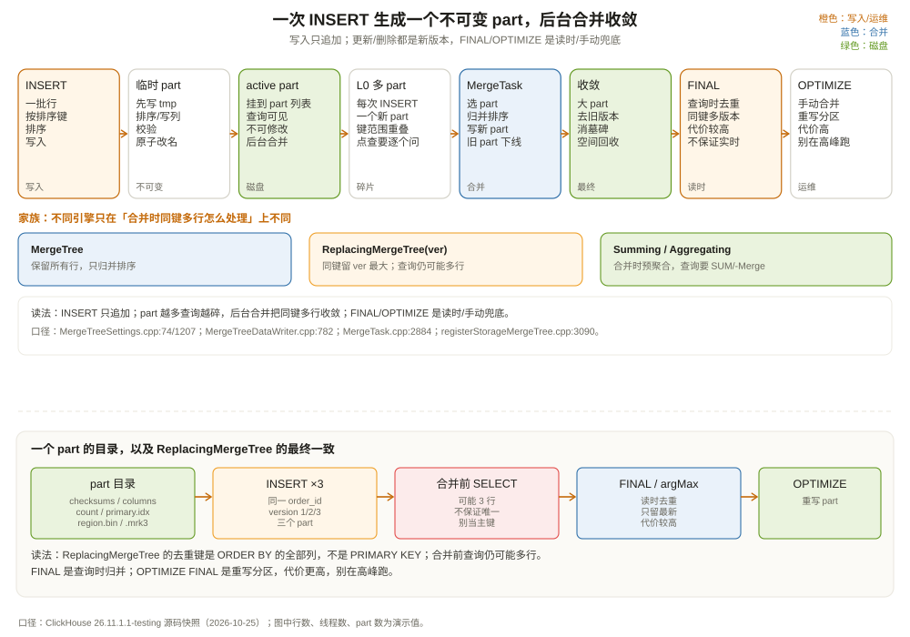

# MergeTree 引擎家族：不可变 part 与后台合并

先看一个从 MySQL 迁移过来的团队经常踩的坑。

他们在 MySQL 里有一张订单表，`order_id` 是主键，更新订单状态就是 `UPDATE orders SET status='paid' WHERE order_id=42`。迁到 ClickHouse 后，他们照猫画虎建了表：

```sql
CREATE TABLE shop.orders
(
    order_id UInt64,
    status   String,
    amount   Decimal(18, 2),
    version  UInt64
)
ENGINE = MergeTree
ORDER BY order_id;
```

然后写了三条 INSERT：

```sql
INSERT INTO shop.orders VALUES (42, 'created', 100.00, 1);
INSERT INTO shop.orders VALUES (42, 'paid',    100.00, 2);
INSERT INTO shop.orders VALUES (42, 'shipped', 100.00, 3);
```

查询：

```sql
SELECT * FROM shop.orders WHERE order_id = 42;
```

结果返回三行。团队的第一反应是「ClickHouse 的主键不唯一，是不是 bug？」

不是 bug。**ClickHouse 的 `ORDER BY` 不是 MySQL 的主键约束，它只决定数据在 part 内怎么排序，不负责去重。** 每次 INSERT 都会生成一个新的 part，三行 `order_id=42` 分别躺在三个 part 里；查询不会自动帮你挑最新的一条。

要「按 order_id 只保留最新版本」，需要换引擎：

```sql
CREATE TABLE shop.orders
(
    order_id UInt64,
    status   LowCardinality(String),
    amount   Decimal(18, 2),
    version  UInt64
)
ENGINE = ReplacingMergeTree(version)
ORDER BY order_id;
```

即便如此，`SELECT * FROM shop.orders WHERE order_id = 42` 仍然可能返回多行，因为合并还没发生。要立刻看到去重结果，得加 `FINAL`：

```sql
SELECT * FROM shop.orders FINAL WHERE order_id = 42;
```

这一章就讲清楚：part 是什么、合并什么时候发生、为什么 `ReplacingMergeTree` 不保证实时唯一，以及 MergeTree 家族每个成员到底在合并时做了什么。



---

## 一、part、partition、granule：三个容易混的层级

先分清三个概念。它们都出现在 `system.parts` 里，但含义完全不同：

| 概念 | 是什么 | 例子 | 谁决定 |
| --- | --- | --- | --- |
| partition | 表数据的一级目录切分 | `202610`、`all` | `PARTITION BY` 表达式 |
| part | 一次写入或一次合并产生的不可变目录 | `202610_1_1_0`、`202610_2_4_1` | 插入批次、合并策略 |
| granule | part 内连续的一段行，索引/读取的最小单位 | 第 0 个 granule、第 1 个 granule | `index_granularity`、`index_granularity_bytes` |

`system.parts` 的 `name` 字段给出了 part 的命名规则（`src/Storages/System/StorageSystemParts.cpp:75`）：

```text
<partition_id>_<min_block_number>_<max_block_number>_<level>_<data_version>
```

例如：

```text
202610_1_1_0        ← 10 月分区，第 1 个块，level 0（插入产生，未合并）
202610_2_4_1        ← 10 月分区，块 2..4，level 1（由 3 个 part 合并而来）
```

`level` 是合并深度：0 表示新插入的 part，1 表示合并过一次，2 表示合并过两次，以此类推。`min_block_number` / `max_block_number` 是块号范围，合并后的 part 会覆盖被合并的块号。块号不是行号，而是「第几次写入」的编号；它用来判断 part 之间是否重叠、谁包含谁。

一个 part 的物理结构：

```text
202610_2_4_1/
├── checksums.txt       ← 所有文件的校验和与大小
├── columns.txt         ← 列名与类型
├── count.txt           ← 行数
├── primary.idx         ← 稀疏主键索引（每 8192 行一条）
├── region.bin          ← region 列的数据（压缩后）
├── region.mrk3         ← region 列的 mark（每个 granule 的偏移）
├── status.bin / status.mrk3
├── amount.bin / amount.mrk3
└── ...
```

part 有两种物理格式（`src/Storages/MergeTree/MergeTreeDataPartType.h`）：

| 格式 | 数据文件 | 适用 | 默认阈值 |
| --- | --- | --- | --- |
| `Wide` | 每列一个 `.bin` + `.mrk` | 大 part，列裁剪友好 | `min_bytes_for_wide_part = 10 MiB` |
| `Compact` | 所有列一个 `data.bin` + `data.mrk` | 小 part，减少文件数 | 低于阈值时使用 |

`min_bytes_for_wide_part` 默认 10 MiB（`MergeTreeSettings.cpp:37`、`:80`），`min_rows_for_wide_part` 默认 0。也就是说，一个 part 小于 10 MiB 时，ClickHouse 倾向于用 Compact 格式，把所有列塞进一个文件，减少小文件数量；part 变大后再用 Wide 格式，让每列可以独立读。

这个细节解释了一个常见现象：**刚插入的小 part 查询可能不快。** Compact 格式读一列也要打开整个 `data.bin`，列裁剪的优势要到 Wide 格式才明显。等后台合并把小 part 合成大 part，读取效率才会提升。

---

## 二、写入：一次 INSERT 生成一个不可变 part

一次 INSERT 的路径可以概括为：

```text
INSERT 语句
  │
  ▼
MergeTreeSink::consume(Chunk)      ← 接收数据，按排序键排序
  │
  ▼
MergeTreeDataWriter::writeTempPart ← 写临时 part 目录
  │
  ▼
写 .bin / .mrk / primary.idx / checksums.txt
  │
  ▼
校验、fsync、原子改名 → 挂到 active part 列表
```

`MergeTreeSink::consume`（`src/Storages/MergeTree/MergeTreeSink.cpp:137`）接收上游传来的 Chunk，攒到 `min_insert_block_size_rows`（默认约 104 万行，`src/Core/Settings.cpp:227`）或 `min_insert_block_size_bytes`（默认约 256 MiB）后，交给 `MergeTreeDataWriter::writeTempPart`（`src/Storages/MergeTree/MergeTreeDataWriter.cpp:782`）写盘。

写 part 的过程有几个关键点：

**一、先排序。** 一个 part 内的数据按 `ORDER BY` 排序。排序在内存里做，如果数据量太大，会 spill 到磁盘。排序键决定了主键索引的顺序，也决定了后面查询能不能用索引跳过 granule。

**二、写临时目录。** part 不是直接写进最终目录，而是先写到 `tmp_*`，写完、校验、fsync 后再原子改名。这样查询永远看不到「写了一半」的 part，崩溃恢复也简单：临时目录会被清理。

**三、不可变。** part 一旦写完，就不再修改。后续的 INSERT 生成新 part；UPDATE/DELETE 生成新的 part（mutation）；合并生成新的 part（merge）。旧 part 在不再被任何查询引用后，才会被标记为 inactive 并删除。

这个「不可变」设计是 MergeTree 所有特性的基础：

- 读取不需要加锁，因为文件不会变；
- 副本同步只需要传输不可变 part，不需要处理并发写；
- 合并可以后台慢慢做，不影响正在进行的查询；
- 缓存键可以长期有效，因为 part 内容不会变。

代价是：**更新和删除不是原地操作**，而是重写整个 part。一行更新可能触发一个几十 GB part 的重写，这就是为什么 ClickHouse 不适合高频点更新。

---

## 三、合并：谁在什么时候把 part 合起来

part 会越来越多，查询要打开的文件也越来越多。后台合并线程负责把多个小 part 合成一个大 part：

```text
202610_1_1_0  ┐
202610_2_2_0  ├─► MergeTask ─► 202610_1_3_1
202610_3_3_0  ┘
```

合并的入口是 `StorageMergeTree::selectPartsToMerge`（`src/Storages/StorageMergeTree.cpp:1990`），它调用 `MergeTreeDataMergerMutator::selectPartsToMerge`（`src/Storages/MergeTree/MergeTreeDataMergerMutator.cpp:328`）选出「哪些 part 值得合并」。选择规则大致是：

- 优先合并大小相近的 part，避免「小 part 反复被大 part 拖着合并」；
- 同一分区内选，默认不跨分区合并；
- 考虑 `max_bytes_to_merge_at_max_space_in_pool`（默认 150 GiB，`MergeTreeSettings.cpp:555`），太大的 part 不合并；
- 考虑后台池的空闲线程数，避免合并把磁盘/CPU 打满。

选中后，`MergeTask::execute`（`src/Storages/MergeTree/MergeTask.cpp:2884`）执行合并。合并有两种算法（`src/Storages/MergeTree/MergeTask.cpp:3763`）：

| 算法 | 怎么合 | 适用 |
| --- | --- | --- |
| Horizontal | 按行归并，所有列一起读、一起写 | 大多数场景；行数多、列少 |
| Vertical | 按列分别读、分别写，最后拼行 | 列很多、行很宽；减少单次内存 |

合并的输出是一个新 part，输入 part 被标记为 inactive，等所有引用它们的查询结束后删除。合并本身也是「读旧 part → 排序归并 → 写新 part」，所以会消耗磁盘带宽和 CPU；它不是免费的。

`OPTIMIZE TABLE ... FINAL` 可以手动触发一次「合并到只剩一个 part」的操作，但它会重写整个表/分区，代价很高，不要在生产高峰随便跑。

---

## 四、MergeTree 家族：合并时做什么，决定引擎语义

普通 `MergeTree` 合并时只做一件事：按排序键归并，保留所有行。家族里的其他引擎在合并时多了一步「同键多行怎么处理」：

| 引擎 | 合并时做什么 | 典型用途 | 关键限制 |
| --- | --- | --- | --- |
| `MergeTree` | 保留所有行，只归并排序 | 原始事件、日志、明细 | 不去重 |
| `ReplacingMergeTree(ver)` | 同一排序键只留 `ver` 最大的行 | 按主键保留最新版本 | 合并前仍可能多行；`FINAL` 才保证查询去重 |
| `ReplacingMergeTree(ver, is_deleted)` | 同上，`is_deleted=1` 的行在合并时可被清理 | 支持「删除」语义 | 需要 `cleanup` 设置；不是实时删除 |
| `CollapsingMergeTree(sign)` | `sign=1` 与 `sign=-1` 抵消 | 用「写一条取消记录」表达更新/删除 | 写入顺序敏感；乱序会折叠错误 |
| `VersionedCollapsingMergeTree(sign, ver)` | 按版本配对折叠 | 乱序写入也能正确折叠 | 需要正确维护 `ver` |
| `SummingMergeTree` | 同一排序键的数值列求和 | 预聚合指标 | 只对数值列求和；非数值列取任意一行 |
| `AggregatingMergeTree` | 同一排序键的聚合状态合并 | 存 `AggregateFunction` 状态 | 查询要用 `-Merge` 组合器 |
| `CoalescingMergeTree` | 同一排序键的非空值合并 | 稀疏更新、补全字段 | 主要面向 Nullable 列 |
| `GraphiteMergeTree` | 按时间粒度降采样 | Graphite 指标 | 专用场景 |

这张表里最重要的是 `ReplacingMergeTree`，也是误会最多的一个。

### 4.1 ReplacingMergeTree 不保证「查询时唯一」

官方文档写得很清楚：`ReplacingMergeTree` 适合在后台清理重复数据以节省空间，但**不保证查询时没有重复**（`registerStorageMergeTree.cpp:3090`）。另一处也强调：它只提供最终正确性（eventual correctness），不能依赖它实时去重（`registerStorageMergeTree.cpp:3256`）。

原因很简单：合并是异步的、按 part 选择的。你插入了 `version=1` 和 `version=2` 两行，它们可能分别在两个 part 里；后台还没合并，查询就会看到两行。即使合并了，如果新 part 还没替换旧 part，查询也可能看到旧版本。

要查询时去重，有三个办法：

```sql
-- ① FINAL：查询时强制合并去重（代价高）
SELECT * FROM shop.orders FINAL WHERE order_id = 42;

-- ② 子查询 + argMax：只取最新版本
SELECT order_id, argMax(status, version) AS status
FROM shop.orders
WHERE order_id = 42
GROUP BY order_id;

-- ③ 用视图封装，读时统一去重
CREATE VIEW shop.orders_latest AS
SELECT order_id, argMax(status, version) AS status
FROM shop.orders
GROUP BY order_id;
```

`FINAL` 的实现不是「把整个表合并一遍」，而是读取时对同一排序键的多个版本做归并。它比普通查询慢，但比 `OPTIMIZE FINAL` 轻。`FINAL` 的成本取决于重复度、part 数量和排序键的分布；在高频查询里滥用 `FINAL` 是常见的性能坑。

另一个细节：`ReplacingMergeTree` 的去重键是 **`ORDER BY` 的全部列**，不是 `PRIMARY KEY`。如果你的 `ORDER BY` 是 `(region, order_id)`，那么 `region` 不同、`order_id` 相同的两行不会被去重。想让 `order_id` 唯一，`ORDER BY` 必须包含且只包含你想要的唯一键（或至少让唯一键成为完整排序键）。

### 4.2 用 Collapsing 表达「撤销」

`CollapsingMergeTree(sign)` 的思路是：每次更新先写一条 `sign=-1` 的旧行撤销旧状态，再写一条 `sign=1` 的新行；合并时正负抵消。

```sql
CREATE TABLE orders_collapsing
(
    order_id UInt64,
    status   String,
    amount   Decimal(18, 2),
    sign     Int8
)
ENGINE = CollapsingMergeTree(sign)
ORDER BY order_id;
```

写入「把 42 从 created 改成 paid」：

```sql
INSERT INTO orders_collapsing VALUES
(42, 'created', 100.00, -1),   -- 撤销旧行
(42, 'paid',    100.00,  1);   -- 写入新行
```

它要求写入顺序正确：先写 `-1` 再写 `1`，否则合并时可能配错。为了处理乱序，`VersionedCollapsingMergeTree(sign, version)` 增加了版本列，按版本配对。

这类引擎适合「事件流里天然带正负号」的场景（比如点击流、计数器），不适合把 MySQL 的 UPDATE 机械翻译过来。第 13 章讲数据一致性时还会提到它们。

### 4.3 Summing 和 Aggregating：预聚合

`SummingMergeTree` 在合并时把同一排序键的数值列相加：

```sql
CREATE TABLE daily_gmv
(
    event_date Date,
    region     LowCardinality(String),
    orders     UInt64,
    gmv        Decimal(18, 2)
)
ENGINE = SummingMergeTree((orders, gmv))
ORDER BY (event_date, region);
```

插入两条 `(2026-10-01, east, 10, 100)` 和 `(2026-10-01, east, 5, 50)`，合并后变成 `(2026-10-01, east, 15, 150)`。但合并前查询仍可能看到两行，所以查询要写 `SUM(orders)`、`SUM(gmv)`，不能假设只有一行。

`AggregatingMergeTree` 更进一步：它存的是聚合状态（`AggregateFunction`），不是最终值。查询要用 `-Merge` 组合器把状态合并：

```sql
CREATE TABLE daily_uniq
(
    event_date Date,
    region     LowCardinality(String),
    users      AggregateFunction(uniq, UInt64)
)
ENGINE = AggregatingMergeTree
ORDER BY (event_date, region);

SELECT event_date, region, uniqMerge(users) AS uv
FROM daily_uniq
GROUP BY event_date, region;
```

这类引擎适合物化视图的预聚合层，不适合直接当明细表用。

---

## 五、更新与删除：mutation 是重写，不是原地改

ClickHouse 支持 `ALTER TABLE ... UPDATE` 和 `ALTER TABLE ... DELETE`，但它们的实现是 **mutation**：给每个受影响的 part 打上 mutation 版本，后台重写这些 part，生成新 part，旧 part 标记为 inactive。

```sql
ALTER TABLE shop.orders UPDATE status = 'shipped' WHERE order_id = 42;
```

这条语句不会立刻返回「改好了」，而是创建一个 mutation 任务，后台异步执行。你可以查 `system.mutations` 看进度：

```sql
SELECT command, is_done, parts_to_do, latest_fail_reason
FROM system.mutations
WHERE table = 'orders';
```

mutation 的代价和「受影响的 part 总大小」成正比。如果 `WHERE` 命中了很多 part，重写量可能非常大。高频、小批量的更新应该避免用 mutation。

ClickHouse 还有轻量级删除 `DELETE FROM ... WHERE ...`（lightweight delete），它不会立刻重写 part，而是写一个 `_row_exists` 标记，查询时过滤；后台再慢慢清理。它比 mutation 轻，但也不是「原地删除」，而且需要表支持。

TTL 也是类似的机制：`TTL event_date + INTERVAL 30 DAY DELETE` 会在合并时删除过期数据，或者把数据移动到冷存储。TTL 不是定时任务，它依赖合并触发；如果 part 一直不合并，TTL 也不会立刻生效。

---

## 六、too many parts：写入侧最常见的故障

MergeTree 的合并是后台的，写入是前台。如果写入速度超过合并速度，part 会越积越多，最终触发保护：

| 设置 | 默认值 | 行为 |
| --- | --- | --- |
| `parts_to_delay_insert` | 1000 | 单分区 active part 超过 1000，INSERT 被人工延迟 |
| `parts_to_throw_insert` | 3000 | 超过 3000，INSERT 直接报错 |
| `max_parts_in_total` | 100000 | 全表 part 总数超过 10 万，INSERT 报错 |
| `max_partitions_per_insert_block` | 100 | 单次 INSERT 涉及超过 100 个分区，报错 |

（`MergeTreeSettings.cpp:1185`、`:1207`、`:1315`；`src/Core/Settings.cpp:5421`。）

这些数字不是「性能建议」，而是**保护阈值**。触发 `Too many parts` 时，正确的处理不是把 `parts_to_throw_insert` 调大，而是减少 part 的产生速度：

1. **攒批写入。** 每次 INSERT 写足够多的行（几十万到几百万），不要一行一条；
2. **开启 async_insert。** 让服务器把小批写入攒成一批再落 part。注意：26.11 快照里 `async_insert` 默认已经是 `true`（`src/Core/Settings.cpp:8547`，26.2 起改的默认值），旧版本默认是 `false`，以实际版本为准；
3. **用 Kafka 引擎做缓冲。** 高频流式写入先落到 Kafka，再由 ClickHouse 批量消费；
4. **检查分区键。** 按小时/按用户 ID 分区会产生大量小分区，每个分区都有自己的 part；
5. **避免 `INSERT ... SELECT` 产生大量小 part。** 可以用 `max_insert_threads` 控制并行写，但并行度太高也会产生更多 part。

一个常见的反例：

```sql
-- 每 100ms 写一条，每条一个 part
INSERT INTO shop.orders VALUES (42, 'paid', 100.00, now());
```

一天 86 万条写入，就是 86 万个 part（如果分区键还按小时切，part 更多）。后台合并根本追不上。正确做法是客户端攒 1 秒/1 万条再写，或者用 async_insert。

---

## 七、和 InnoDB、Doris/StarRocks 比一比

**和 InnoDB 比：**

| 维度 | InnoDB | MergeTree |
| --- | --- | --- |
| 数据组织 | B+ 树，按主键聚簇 | part 内按排序键排，part 间按块号/分区组织 |
| 更新 | 原地改叶子页，undo log 保旧版本 | 写新 part；mutation 重写 part |
| 删除 | 标记删除，purge 线程清理 | 墓碑/`_row_exists`；合并时清理 |
| 主键 | 唯一约束，冲突报错 | 不唯一，只影响排序/索引 |
| 事务 | 完整 ACID | 单 INSERT 原子，无跨行事务 |
| 合并 | 页分裂/合并 | 后台 part merge |
| 适合 | 点查、事务、频繁更新 | 大扫描、聚合、批量写入 |

一句话：**InnoDB 像一本可以随时改写的账本，MergeTree 像一摞只追加、定期装订的账本。** 前者适合「改一行」，后者适合「记一本」。

**和 Doris/StarRocks 比：**

Doris 和 StarRocks 也有「不可变 segment + 后台 compaction」的思路，但它们在「主键更新」上走得更远：

- Doris 的 Unique Key 表支持 Merge-on-Write，查询时能保证主键唯一；
- StarRocks 的主键表也支持实时更新和删除；
- ClickHouse 的 `ReplacingMergeTree` 是最终一致，查询要 `FINAL` 或 `argMax` 才能保证唯一。

这不是说 ClickHouse 做不到，而是设计取舍不同：ClickHouse 把「写入吞吐 + 扫描性能」放在第一位，把「实时唯一」交给查询层或外部组件。需要强唯一、频繁更新的场景，Doris/StarRocks 或 MySQL 更合适。

---

## 八、表设计：排序键、分区键、part 大小

MergeTree 的表设计，90% 的性能差异来自三个选择：

**一、排序键（`ORDER BY`）。** 它是主键索引的基础，也是数据在 part 内的物理顺序。原则：

- 把最常用的过滤列放在前面；
- 低基数列（如 `region`、`status`）在前，高基数列（如 `user_id`、`order_id`）在后，可以让前缀索引更有效；
- 如果查询经常按时间范围过滤，把时间列放在排序键里；但不要盲目把时间放第一位，除非它确实是最高频的前缀条件；
- 排序键不是越多越好，列太多会让索引变大、写入排序变慢。

**二、分区键（`PARTITION BY`）。** 分区是目录级切分，分区太多会产生大量小 part。原则：

- 按天/月分区，不要按小时/分钟；
- 分区键的基数控制在几百到几千，不要按用户 ID/订单 ID 分区；
- 分区键表达式要和查询条件匹配，`toYYYYMM(event_date)` 配 `event_date` 范围条件最容易裁剪；
- 分区不是索引，别指望它替代排序键。

**三、part 大小。** part 太大，合并/重写成本高；太小，元数据和小文件开销大。经验值：

- 单 part 几百 MB 到几 GB 比较健康；
- 避免频繁写入小 part；
- 用 `OPTIMIZE` 谨慎合并历史分区，不要在高峰跑全表 `OPTIMIZE FINAL`。

一个推荐的设计：

```sql
CREATE TABLE shop.orders
(
    order_id    UInt64,
    user_id     UInt64,
    region      LowCardinality(String),
    status      LowCardinality(String),
    amount      Decimal(18, 2),
    event_time  DateTime,
    event_date  Date
)
ENGINE = MergeTree
PARTITION BY toYYYYMM(event_date)
ORDER BY (region, status, event_time, order_id)
TTL event_date + INTERVAL 365 DAY DELETE;
```

排序键的前两列是低基数的 `region`、`status`，适合做前缀过滤；`event_time` 支持时间范围。`order_id` 放在最后并不能保证同一个订单的行相邻——只有前三列都相同时它们才相邻；要让同一订单的行聚在一起，得把 `order_id` 提前，代价是牺牲 `region/status` 的前缀过滤能力。分区按月，part 不会太碎；TTL 自动清理一年前的数据。

---

## 九、这一章留下的线索

把这一章压成几句话：

- MergeTree 的数据单位是 part：一次写入/合并产生一个不可变目录；
- partition 是目录级切分，granule 是索引/读取的最小单位，三者不是一回事；
- 写入只追加，更新/删除是 mutation（重写 part），合并是后台归并；
- MergeTree 家族的区别在「合并时同键多行怎么处理」；
- `ReplacingMergeTree` 只保证最终去重，查询要 `FINAL` 或 `argMax`；
- `too many parts` 的解不是调大阈值，而是攒批/async insert/检查分区键；
- 表设计的三个关键：排序键、分区键、part 大小。

下一章进入复制：一个 part 写完，怎么让其他副本也有一份？`ReplicatedMergeTree` 和 Keeper 的复制日志怎么配合？为什么它不算「每写一次就投一次票」的共识？

---

## 附：这一章的源码入口

> 源码来自本地 ClickHouse 26.11.1.1-testing 快照，验证时间 2026-10-25。

- `src/Storages/MergeTree/MergeTreeData.h:233`：`MergeTreeData` 基类
- `src/Storages/StorageMergeTree.h:37`：`StorageMergeTree`
- `src/Storages/MergeTree/IMergeTreeDataPart.h:134`：`IMergeTreeDataPart`
- `src/Storages/MergeTree/MergeTreeDataPartType.h`：`Wide` / `Compact` 两种 part 格式
- `src/Storages/MergeTree/MergeTreeSettings.cpp:37`：`min_bytes_for_wide_part = 10 MiB`
- `src/Storages/MergeTree/MergeTreeSettings.cpp:74`：`index_granularity = 8192`
- `src/Storages/MergeTree/MergeTreeSettings.cpp:2177`：`index_granularity_bytes = 10 MiB`
- `src/Storages/MergeTree/MergeTreeSettings.cpp:1185`：`parts_to_delay_insert = 1000`
- `src/Storages/MergeTree/MergeTreeSettings.cpp:1207`：`parts_to_throw_insert = 3000`
- `src/Storages/MergeTree/MergeTreeSettings.cpp:1315`：`max_parts_in_total = 100000`
- `src/Storages/MergeTree/MergeTreeSink.cpp:137`：`MergeTreeSink::consume`
- `src/Storages/MergeTree/MergeTreeDataWriter.cpp:782`：`writeTempPart`
- `src/Storages/StorageMergeTree.cpp:1990`：`selectPartsToMerge`
- `src/Storages/MergeTree/MergeTreeDataMergerMutator.cpp:328`：`selectPartsToMerge`
- `src/Storages/MergeTree/MergeTask.cpp:2884`：`MergeTask::execute`
- `src/Storages/MergeTree/MergeTask.cpp:3763`：`chooseMergeAlgorithm`（Horizontal/Vertical）
- `src/Storages/MergeTree/registerStorageMergeTree.cpp:3090`：`ReplacingMergeTree` 不保证无重复
- `src/Storages/MergeTree/registerStorageMergeTree.cpp:3256`：`ReplacingMergeTree` 只是最终正确
- `src/Storages/System/StorageSystemParts.cpp:75`：part 命名规则
- `src/Core/Settings.cpp:227`：`min_insert_block_size_rows`
- `src/Core/Settings.cpp:5421`：`max_partitions_per_insert_block = 100`
- `src/Core/Settings.cpp:8547`：`async_insert = true`（26.2 起默认开启）

---

## 思考题

1. 为什么 `ReplacingMergeTree` 的去重键是 `ORDER BY` 的全部列，而不是 `PRIMARY KEY`？如果 `ORDER BY` 是 `(region, order_id)`，`order_id` 还能唯一吗？
2. 一次 INSERT 生成了一个 20 GB 的 part，查询只读其中 1 列。Wide 和 Compact 两种格式对这个查询分别意味着什么？
3. `too many parts` 时把 `parts_to_throw_insert` 从 3000 调到 30000，会发生什么？为什么这不是根治办法？
4. `ALTER TABLE ... UPDATE` 和 `DELETE FROM ... WHERE` 在底层有什么不同？为什么前者更重？
5. 如果业务要求「同一订单永远只看到最新状态」，你会选 `ReplacingMergeTree + FINAL`、`argMax` 视图，还是 Doris/StarRocks？各自的代价是什么？
