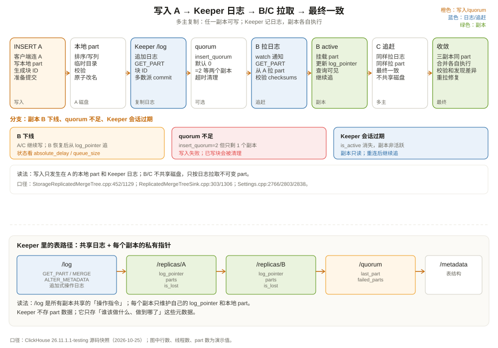

# ReplicatedMergeTree 与共识机制：副本之间怎么对齐

先看一个线上场景。

三副本的 ClickHouse 集群，订单表用 `ReplicatedMergeTree`。某天下午，副本 B 的磁盘满了，进程进入只读状态。运维把 B 摘掉，业务继续往副本 A 和 C 写。两个小时后 B 换盘重启，重新加入集群。问题来了：

1. B 落后了两个小时的数据，它怎么追上？
2. 追的过程中，A 和 C 还在写入，B 会不会漏掉？
3. 如果 A 和 C 对同一批数据的合并结果不一致，B 该信谁？
4. 客户端从 B 读，会不会读到旧数据？

这些问题都指向同一个核心：**副本之间不共享磁盘，只共享一份「应该做什么」的日志**。理解这份日志，就理解了 `ReplicatedMergeTree` 的复制模型。



---

## 一、先定位：它是「多主复制」，不是「主从复制」

很多人把 `ReplicatedMergeTree` 想成 MySQL 的主从：一个主库写，binlog 传给从库，从库回放。ClickHouse 不是这个模型。

`ReplicatedMergeTree` 是**多主（multi-primary）**：每个副本都可以接受 INSERT，都可以执行合并，都可以服务查询。没有「主副本」和「从副本」的固定角色。副本之间通过 ClickHouse Keeper 里的一份共享日志协调，而不是通过一个主节点转发。

`StorageReplicatedMergeTree` 的类定义在 `src/Storages/StorageReplicatedMergeTree.h:98`，它继承 `MergeTreeData`，和单机版 `StorageMergeTree` 是兄弟关系。构造时，它把 Keeper 路径分成两部分（`src/Storages/StorageReplicatedMergeTree.cpp:452`）：

```cpp
zookeeper_path  = zookeeper_info.path;                       // 表级共享路径
replica_path    = zookeeper_path / "replicas" / replica_name; // 本副本私有路径
```

表级路径（`zookeeper_path`）是所有副本共享的：元数据、复制日志、块号、quorum 状态都在这里。副本私有路径（`replica_path`）是每个副本自己的：它复制到哪一条日志、本地有哪些 part、队列状态。

一个典型的表级路径结构（`src/Storages/StorageReplicatedMergeTree.cpp:1125-1175`）：

```text
/clickhouse/tables/{uuid}/{shard}/
├── metadata              ← 表结构（所有副本必须一致）
├── columns               ← 列定义
├── log                   ← 复制日志：所有副本都要执行的条目
├── blocks                ← 块去重记录
├── block_numbers         ← 块号分配
├── leader_election       ← 合并/变更任务的协调
├── replicas/
│   ├── replica_a/
│   │   ├── log_pointer   ← 本副本已经复制到日志的哪个位置
│   │   ├── queue         ← 本副本待执行的任务队列
│   │   ├── parts         ← 本副本本地有哪些 part
│   │   └── is_lost       ← 本副本是否丢失
│   └── replica_b/...
└── quorum/
    ├── last_part
    └── failed_parts
```

注意：**part 的实际数据不在 Keeper 里**。Keeper 只存「哪个副本有哪个 part、日志到哪了、谁该做什么」这些元数据；数据本身在每个副本的本地磁盘上。这是 ClickHouse 复制和「共享存储」最大的区别。

---

## 二、一次 INSERT 的复制路径

假设客户端连到副本 A，执行：

```sql
INSERT INTO shop.orders
VALUES (42, 'paid', 100.00, '2026-10-01 10:00:00');
```

`ReplicatedMergeTreeSink::consume`（`src/Storages/MergeTree/ReplicatedMergeTreeSink.cpp:303`）会做这些事：

1. **写本地临时 part**：和单机 MergeTree 一样，先把这一批数据排序、写成临时 part；
2. **生成块 ID**：对这批数据算一个哈希，作为去重标识；
3. **提交到 Keeper**：在 `zookeeper_path/log` 下追加一条 `GET_PART` 日志，记录「哪个副本写了哪个 part、块 ID 是什么」；
4. **等待 quorum（可选）**：如果开了 `insert_quorum`，等足够多的副本确认收到；
5. **返回客户端**：写入成功。

其他副本（B、C）在做什么？

- 每个副本有一个 `ReplicatedMergeTreeQueue`，它通过 `pullLogsToQueue`（`src/Storages/MergeTree/ReplicatedMergeTreeQueue.h:402`）定期从 Keeper 拉取新日志；
- 拉到 `GET_PART` 条目后，如果本地没有这个 part，就去源副本拉取 part 文件；
- 拉取完成后，把 part 挂到本地 active part 列表；
- 更新自己的 `log_pointer`，表示「这条日志我处理完了」。

所以复制是**日志驱动 + 拉取数据**：

```text
副本 A：写本地 part → 写 Keeper /log → 返回
副本 B：轮询 /log → 看到 GET_PART → 从 A 拉 part → 挂载 → 更新 log_pointer
副本 C：同上
```

这也解释了副本 B 落后两小时后怎么追上：它重启后从自己的 `log_pointer` 继续拉日志，把落后的 `GET_PART`、`MERGE_PARTS`、`MUTATE_PART` 一条条补上。`system.replicas` 里的 `log_pointer` 和 `log_max_index` 就是看这个进度的：

```sql
SELECT
    replica_name,
    is_readonly,
    queue_size,
    inserts_in_queue,
    merges_in_queue,
    log_pointer,
    log_max_index,
    absolute_delay
FROM system.replicas
WHERE table = 'orders';
```

如果 `log_pointer` 远小于 `log_max_index`，说明这个副本落后了；如果 `absolute_delay` 持续增长，说明它追不上。`is_readonly=1` 通常意味着 Keeper 会话断了或副本被摘除。

---

## 三、复制日志里到底有哪些条目

`ReplicatedMergeTreeLogEntry.h:30` 定义了日志条目类型：

| 类型 | 含义 | 谁产生 |
| --- | --- | --- |
| `GET_PART` | 从其他副本拉取一个 part | INSERT、副本修复 |
| `MERGE_PARTS` | 合并若干 part | 后台合并 |
| `DROP_RANGE` | 删除某个范围内的 part | DROP PARTITION、TTL |
| `REPLACE_RANGE` | 用新 part 替换一个范围 | REPLACE PARTITION |
| `MUTATE_PART` | 对 part 执行 mutation | ALTER UPDATE/DELETE |
| `ALTER_METADATA` | 应用表结构变更 | ALTER TABLE |

这些条目不是「数据变更」，而是「操作指令」。副本拿到 `MERGE_PARTS` 后，会自己在本地执行同样的合并；拿到 `MUTATE_PART` 后，会自己在本地重写 part。**数据不通过日志传输，日志只告诉副本「该做什么」**。这就是为什么复制日志可以很小，而 part 的实际传输走副本之间的网络。

日志是追加的，每个条目有一个递增的索引。副本的 `log_pointer` 指向「下一条要处理的条目」。这个模型和 Kafka 的 consumer offset 很像：日志是共享的，每个消费者自己维护进度。

但有一个关键区别：**Kafka 的日志是数据本身，ClickHouse 的日志是操作指令**。同样的 `MERGE_PARTS` 在不同副本上执行，输入 part 相同、合并算法相同，输出 part 应该相同；如果有差异，副本会通过 part 校验和发现，并重新拉取。

---

## 四、共识在哪里：Keeper 负责「日志的顺序」，不负责「每次写入投票」

这是最容易误解的地方。`ReplicatedMergeTree` 的「共识」不是「每次 INSERT 让所有副本投票」，而是：

1. **Keeper 集群用 Raft 保证日志的顺序和持久性**：所有副本看到的 `/log` 顺序一致；
2. **每个副本按日志顺序执行操作**：先 `GET_PART`，再 `MERGE_PARTS`，等等；
3. **写入默认是异步的**：副本 A 写完本地 part、写日志、返回客户端，不等 B/C 落盘；
4. **需要强一点的一致性时，开 `insert_quorum`**：等 N 个副本确认，才返回成功。

所以「共识」发生在两个层次：

| 层次 | 谁负责 | 保证什么 |
| --- | --- | --- |
| 元数据/日志顺序 | ClickHouse Keeper（Raft） | 所有副本看到相同的日志顺序 |
| 数据副本 | `ReplicatedMergeTree` 的拉取/执行 | 每个副本最终拥有相同的 part 集合 |
| 写入可见性 | `insert_quorum` + `select_sequential_consistency` | 可选的「写后读」保证 |

Keeper 本身是一个 Raft 集群，通常 3 或 5 个节点。它保证「日志条目不丢、顺序一致」，但它不存储 part 数据。Keeper 挂了，副本不能写日志、不能合并、不能 ALTER，但已经存在的 part 仍然可以读（取决于副本的只读状态）。第 12 章会专门讲 Keeper 的 Raft 实现。

### 4.1 insert_quorum 的语义

`insert_quorum` 默认是 0（关闭），`insert_quorum_timeout` 默认 600000 ms（10 分钟），`insert_quorum_parallel` 默认 true（`src/Core/Settings.cpp:2766`、`:2794`、`:2803`）。

开启 quorum：

```sql
SET insert_quorum = 2;
INSERT INTO shop.orders VALUES (42, 'paid', 100.00, now());
```

语义是：

- INSERT 只有在至少 2 个副本成功写入后才返回成功；
- 如果超时还没达到 quorum，写入失败，ClickHouse 会尝试删除已经写入的副本上的这个块（`src/Core/Settings.cpp:2779`）；
- 客户端需要重试，重试的块 ID 相同，可以去重。

`insert_quorum_parallel=true` 意味着多个 quorum INSERT 可以并行；代价是**不能开启 `select_sequential_consistency`**。官方文档写得很清楚：当 `insert_quorum_parallel` 开启时（默认），`select_sequential_consistency` 不生效，因为并行写入可能落在不同的 quorum 副本集合上，无法保证单个副本包含所有历史写入（`src/Core/Settings.cpp:2838`）。

如果业务需要「写后读」的强一致：

```sql
SET insert_quorum = 2;
SET insert_quorum_parallel = 0;
SET select_sequential_consistency = 1;
```

代价是写入串行化、吞吐下降。大多数分析场景不需要这个级别的强一致；需要时，也可以让客户端直接读写入的那个副本，或者用 `insert_quorum` + 业务层等待。

### 4.2 去重：块 ID 是幂等的关键

`insert_deduplicate` 默认 true（`src/Core/Settings.cpp:2746`），`replicated_deduplication_window` 默认 10000（`src/Storages/MergeTree/MergeTreeSettings.cpp:1559`）。含义是：

- 每个 INSERT 块根据内容算一个哈希；
- 如果同一个块 ID 在窗口内重复出现，副本会跳过写入；
- 这让「客户端超时重试」变成幂等操作，不会重复写入。

去重不是万能的：

- 只对「完全相同的块」有效；如果你重试时数据顺序变了、批次大小变了，块 ID 就不同；
- 去重窗口有限，太久之前的块不再记得；
- 它不能替代业务层的唯一键约束。

这也是为什么第 5 章说 `ReplacingMergeTree` 去重和这里的 `insert_deduplicate` 不是一回事：前者按排序键保留最新版本，后者按块内容避免重复写入。

---

## 五、副本落后、失联、恢复：三种典型故障

**故障一：副本进程重启，落后一段时间。**

副本重启后，从 `log_pointer` 继续拉日志。落后的 `GET_PART` 会从其他副本拉取；落后的 `MERGE_PARTS` 会在本地重放。追赶期间，副本可能处于只读或部分可用状态；`system.replicas` 的 `absolute_delay` 会上升。

如果落后太多，日志已经被清理（日志保留由各副本的 `log_pointer` 推着走，清理线程只删所有副本都已消费的条目；`replicated_deduplication_window` 管的是另一件事——块去重哈希的保留窗口，别把它当成复制日志长度），副本可能无法从日志追上，需要执行 `SYSTEM RESTART REPLICA` 或重新同步。严重情况下，副本会被标记为 `is_lost`，需要重建。

**故障二：Keeper 会话断开。**

副本与 Keeper 的会话是临时的；副本启动时在 `/replicas/<name>/is_active` 创建 ephemeral 节点，会话过期后这个节点消失，副本被标记为非活跃并进入只读。持久节点 `/replicas/<name>` 本身还在；重连后重新创建 `is_active`，继续拉日志。

**故障三：副本之间数据不一致。**

理论上，同样的日志 + 同样的输入 part + 同样的合并算法，输出应该一致。但以下情况可能造成差异：

- 副本在合并过程中崩溃，产生了不完整的 part；
- 磁盘损坏；
- 人为把不同数据目录挂到同一个副本路径。

ClickHouse 有 `ReplicatedMergeTreePartCheckThread`（`src/Storages/MergeTree/ReplicatedMergeTreePartCheckThread.h:48`）定期检查 part 的校验和；发现不一致时，会从其他副本重新拉取。`system.replicas` 的 `queue_size`、`log_pointer`、`absolute_delay` 是排查的第一手指标。

一个常见的误判：**看到某个副本 `queue_size` 很大，就以为复制坏了。** 其实合并任务也会进队列（`merges_in_queue`），大合并期间队列长是正常的；要看 `inserts_in_queue` 和 `absolute_delay`，以及队列最老任务的时间（`queue_oldest_time`）。`system.replicas` 的列注释已经把每个指标的含义写清楚了（`src/Storages/System/StorageSystemReplicas.cpp:53-85`）。

---

## 六、和 Kafka、MySQL、Doris 的复制模型对比

| 维度 | Kafka ISR | MySQL 主从 / MGR | Doris/StarRocks | ClickHouse ReplicatedMergeTree |
| --- | --- | --- | --- | --- |
| 写入入口 | 分区 leader | 主库 / 任一节点（MGR） | FE 选 tablet 主副本 | 任一副本 |
| 复制单位 | 消息日志 | binlog / redo | segment/tablet | part + 操作日志 |
| 一致性 | ISR + acks | 半同步/组复制 | quorum/多数派 | 默认异步；可选 quorum |
| 冲突处理 | 无（单 leader） | 认证/冲突检测 | 主副本串行 | 日志顺序 + part 校验 |
| 读一致性 | 按 offset | 按 GTID/事务 | 按版本 | 默认最终一致；可选顺序一致 |
| 故障恢复 | leader 选举 | 主库切换 | 副本重建 | 从日志追赶 / 重新拉 part |

ClickHouse 的模型更接近「共享操作日志 + 本地状态机」：

- 日志由 Keeper 提供全序；
- 每个副本是状态机，按顺序执行操作；
- 数据不共享，副本各自持有 part；
- 默认异步，quorum 是可选的加速/加强。

这也是为什么它能做到「任一副本可写」：写入不依赖主副本，只依赖 Keeper 的日志追加。代价是「写后读」不默认保证，需要业务自己选择一致性级别。

---

## 七、表怎么建：路径、副本名、数据库

一个典型的三副本表：

```sql
CREATE TABLE shop.orders ON CLUSTER shop_cluster
(
    order_id    UInt64,
    region      LowCardinality(String),
    status      LowCardinality(String),
    amount      Decimal(18, 2),
    event_date  Date,
    version     UInt64
)
ENGINE = ReplicatedMergeTree(
    '/clickhouse/tables/{uuid}/{shard}',  -- 表级共享路径
    '{replica}'                          -- 副本名
)
PARTITION BY toYYYYMM(event_date)
ORDER BY (region, order_id);
```

`{uuid}`、`{shard}`、`{replica}` 是宏，来自服务器配置。路径的关键是**所有副本必须用同一个表级路径**，副本名必须唯一。如果两个副本用了不同的 `zookeeper_path`，它们会各自复制自己的数据，看起来「都正常」，实际上互不相干。

常见错误：

- 把 `{replica}` 写成了固定字符串，导致所有副本共用一个 `replica_path`，日志指针互相覆盖；
- 在不同分片用了相同的 `zookeeper_path`，导致本应独立的分片被当成副本；
- 手动删除了 Keeper 里的 `/replicas/<name>` 节点，副本重启后找不到自己的状态。

`Replicated` 数据库可以自动管理这些路径：

```sql
CREATE DATABASE shop ON CLUSTER shop_cluster
ENGINE = Replicated('/clickhouse/databases/shop', '{shard}', '{replica}');
```

它把 DDL 也复制到所有副本，避免手动 `ON CLUSTER` 的不一致。第 13 章会讲 `Replicated` 数据库和 DDL 队列。

---

## 八、一致性怎么选：三档配置

把一致性需求分成三档，按业务选：

**第一档：默认异步（性能优先）。**

```sql
-- 不设置 insert_quorum
INSERT INTO shop.orders VALUES (...);
```

写入最快，副本最终一致。适合日志、埋点、可容忍少量丢失的分析数据。客户端重试可能重复写，但 `insert_deduplicate` 会帮忙去重。

**第二档：quorum 写入（不丢已确认数据）。**

```sql
SET insert_quorum = 2;
INSERT INTO shop.orders VALUES (...);
```

至少 2 个副本确认才返回。适合订单、账单这类「不能丢」的数据。注意：quorum 只保证「至少 N 个副本有」，不保证「所有副本都有」；读其他副本仍可能看不到。

**第三档：顺序一致（写后读）。**

```sql
SET insert_quorum = 2;
SET insert_quorum_parallel = 0;
SET select_sequential_consistency = 1;
```

写入串行化，读取只返回包含所有已确认写入的副本。适合「写完立刻查」的场景，比如订单状态更新后马上展示。代价是吞吐下降，且 `select_sequential_consistency` 依赖 Keeper 的元数据。

大多数分析场景用第一档；对账、订单状态用第二档；只有强一致读需求才用第三档。不要把第三档当默认，它会把 ClickHouse 当 MySQL 用，性能和可用性都会受影响。

---

## 九、这一章留下的线索

把这一章压成几句话：

- `ReplicatedMergeTree` 是多主复制：任一副本可写，没有固定主副本；
- 副本共享 Keeper 里的操作日志，不共享 part 数据；
- 写入本地 part → 追加 `/log` → 其他副本拉日志、拉 part、更新 `log_pointer`；
- Keeper 用 Raft 保证日志顺序，但每次 INSERT 不投票；强一致靠 `insert_quorum`；
- `insert_quorum_parallel=true`（默认）与 `select_sequential_consistency` 不兼容；
- `insert_deduplicate` 按块 ID 去重，解决重试重复写，不等于业务唯一键；
- 副本落后看 `log_pointer` / `log_max_index` / `absolute_delay`，不要只看 `queue_size`。

下一章看 `Distributed` 表：如果一张逻辑表被切成 3 个分片，一条查询怎么发下去、怎么把结果拼回来？`Distributed` 和 `ReplicatedMergeTree` 到底谁管什么？

---

## 附：这一章的源码入口

> 源码来自本地 ClickHouse 26.11.1.1-testing 快照，验证时间 2026-10-25。

- `src/Storages/StorageReplicatedMergeTree.h:98`：`StorageReplicatedMergeTree`
- `src/Storages/StorageReplicatedMergeTree.cpp:452`：`replica_path = zookeeper_path/replicas/replica_name`
- `src/Storages/StorageReplicatedMergeTree.cpp:1129`：创建 `/log`
- `src/Storages/StorageReplicatedMergeTree.cpp:1137`：创建 `/block_numbers`
- `src/Storages/StorageReplicatedMergeTree.cpp:1141`：创建 `/leader_election`
- `src/Storages/StorageReplicatedMergeTree.cpp:1156`：创建 `/quorum`
- `src/Storages/StorageReplicatedMergeTree.cpp:1171`：副本私有 `log_pointer`
- `src/Storages/MergeTree/ReplicatedMergeTreeSink.h:54`：`ReplicatedMergeTreeSink`
- `src/Storages/MergeTree/ReplicatedMergeTreeSink.cpp:303`：`consume`
- `src/Storages/MergeTree/ReplicatedMergeTreeSink.cpp:1306`：`waitForQuorum`
- `src/Storages/MergeTree/ReplicatedMergeTreeQueue.h:39`：`ReplicatedMergeTreeQueue`
- `src/Storages/MergeTree/ReplicatedMergeTreeQueue.h:402`：`pullLogsToQueue`
- `src/Storages/MergeTree/ReplicatedMergeTreeLogEntry.h:30`：日志条目类型
- `src/Storages/MergeTree/ReplicatedMergeTreePartCheckThread.h:48`：part 校验线程
- `src/Storages/MergeTree/ReplicatedMergeTreeRestartingThread.h:23`：重启恢复线程
- `src/Storages/System/StorageSystemReplicas.cpp:53-85`：`system.replicas` 关键列
- `src/Core/Settings.cpp:2746`：`insert_deduplicate = true`
- `src/Core/Settings.cpp:2766`：`insert_quorum = 0`
- `src/Core/Settings.cpp:2794`：`insert_quorum_timeout = 600000`
- `src/Core/Settings.cpp:2803`：`insert_quorum_parallel = true`
- `src/Core/Settings.cpp:2822`：`select_sequential_consistency = 0`
- `src/Core/Settings.cpp:2838`：`insert_quorum_parallel` 开启时顺序一致不生效
- `src/Storages/MergeTree/MergeTreeSettings.cpp:1559`：`replicated_deduplication_window = 10000`

---

## 思考题

1. 副本 B 落后两小时，它怎么知道该从哪条日志开始补？如果日志已经被清理，会发生什么？
2. 为什么 `insert_quorum=2` 不能保证「从任意副本读到刚写的数据」？要保证这一点需要什么设置？
3. `insert_deduplicate` 能替代订单表的唯一键吗？举一个它无法去重的重试场景。
4. 三个副本里有一个 `queue_size` 一直很大，但 `inserts_in_queue=0`、`absolute_delay` 很小。这可能是什么原因？
5. 如果 Keeper 集群失去多数派，`ReplicatedMergeTree` 还能读吗？还能写吗？为什么？
