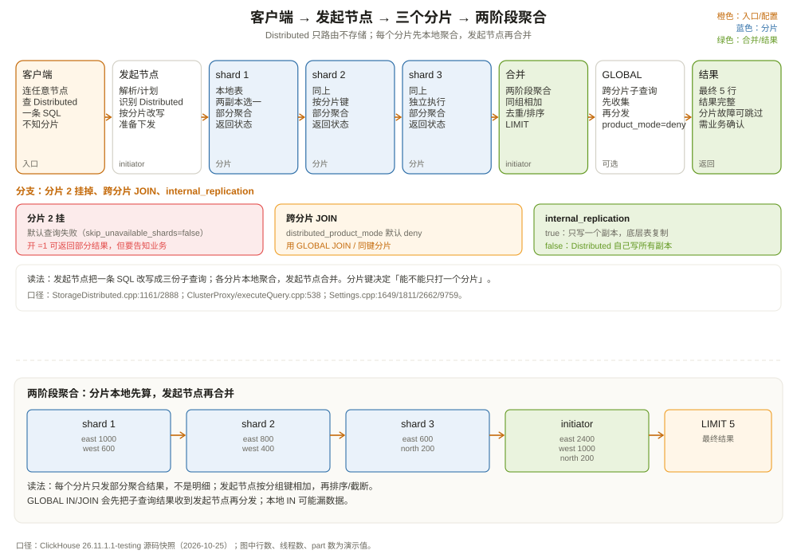

# 分布式表引擎：一条查询如何打到整个集群

先看一个常见的集群查询。

三台机器，每台一个分片，每个分片两个副本。数据表叫 `shop.orders_local`，是 `ReplicatedMergeTree`。上层再建一张 `Distributed` 表：

```sql
CREATE TABLE shop.orders ON CLUSTER shop_cluster AS shop.orders_local
ENGINE = Distributed(
    'shop_cluster',      -- 集群名
    'shop',              -- 远端库
    'orders_local',      -- 远端表
    cityHash64(user_id)  -- 分片键
);
```

客户端只连集群里的任意一台机器，查 `shop.orders`：

```sql
SELECT region, COUNT(*) AS orders, SUM(amount) AS gmv
FROM shop.orders
WHERE event_date = '2026-10-01' AND status = 'paid'
GROUP BY region
ORDER BY gmv DESC
LIMIT 5;
```

这条 SQL 会神奇地变成「每个分片查一部分，最后在发起节点合并」。问题来了：

1. `Distributed` 表自己存数据吗？
2. 每个分片收到的是什么 SQL？是原 SQL 还是改写过的？
3. `GROUP BY` 在每个分片做一次，发起节点再做一次，会不会重复计数？
4. 一个分片挂了，查询是报错还是返回部分结果？
5. `internal_replication=true` 到底改变了什么？

这一章把 `Distributed` 表拆开。核心结论先放在前面：**`Distributed` 不是存储引擎，是路由层；它不存数据，只负责把查询改写、分发、合并。**



---

## 一、Distributed 是什么：一张「没有本地数据」的表

`StorageDistributed` 的类注释写得很清楚：它使用指定数据库和表在各个服务器上的数据；可以传一个地址，也可以传多个（`src/Storages/StorageDistributed.h:45-50`）。

它和 `MergeTree` 的本质区别：

| 维度 | MergeTree | Distributed |
| --- | --- | --- |
| 数据存在哪 | 本地磁盘的 part | 不存数据，指向远端表 |
| 本地读写 | 直接读 part、写 part | 改写查询、发到远端、合并结果 |
| 分片 | 无（单机） | 有，按分片键路由 |
| 副本 | 由 ReplicatedMergeTree 管 | 由集群配置 + 底层表管 |
| 建表 | 需要列定义、排序键 | 只定义列结构 + 集群/库/表/分片键 |

`StorageDistributed::read`（`src/Storages/StorageDistributed.cpp:1161`）并不读本地列，它做的是：

1. 解析远端库表、集群、分片键；
2. 对每个分片克隆一份查询树，按分片条件改写；
3. 通过 `ClusterProxy::executeQuery`（`src/Interpreters/ClusterProxy/executeQuery.cpp:538`）把子查询发到各分片；
4. 在发起节点把各分片的结果合并成一个 QueryPlan。

`StorageDistributed::write`（`src/Storages/StorageDistributed.cpp:1250`）则返回一个 `DistributedSink`，由它按分片键把行分到不同分片。注意 `DistributedSink::consume`（`src/Storages/Distributed/DistributedSink.cpp:221`）是「分发」而不是「存储」：它把 Chunk 拆成每个分片一份，发到远端。

所以 `Distributed` 表本身没有 part，`system.parts` 里也看不到它的数据。你在它上面查 `count()`，实际上是在查底层各分片的表。

---

## 二、集群配置：分片、副本、权重

`Distributed` 依赖服务器配置里的 `remote_servers`。一个三片两副本的配置大致是：

```xml
<remote_servers>
  <shop_cluster>
    <shard>
      <weight>1</weight>
      <internal_replication>true</internal_replication>
      <replica>
        <host>ch-01</host><port>9000</port>
      </replica>
      <replica>
        <host>ch-02</host><port>9000</port>
      </replica>
    </shard>
    <shard>
      <weight>1</weight>
      <internal_replication>true</internal_replication>
      <replica><host>ch-03</host><port>9000</port></replica>
      <replica><host>ch-04</host><port>9000</port></replica>
    </shard>
    <shard>
      <weight>1</weight>
      <internal_replication>true</internal_replication>
      <replica><host>ch-05</host><port>9000</port></replica>
      <replica><host>ch-06</host><port>9000</port></replica>
    </shard>
  </shop_cluster>
</remote_servers>
```

关键字段：

| 字段 | 作用 | 默认 |
| --- | --- | --- |
| `shard` | 一个分片，数据的一部分 | 必填 |
| `replica` | 分片内的副本 | 至少一个 |
| `weight` | 写入时该分片分到的比例 | 1 |
| `internal_replication` | 写入是否只写一个健康副本，由底层表复制 | false |
| `priority` | 读取时副本的优先级 | 1 |

`Cluster.cpp:529` 里 `internal_replication` 的默认值是 `false`。这个默认值很关键，下面单独讲。

`system.clusters` 可以看到当前配置：

```sql
SELECT cluster, shard_num, replica_num, host_name, port, is_local, weight
FROM system.clusters
WHERE cluster = 'shop_cluster'
ORDER BY shard_num, replica_num;
```

### 2.1 internal_replication 到底改变什么

假设一个分片有两个副本 A、B，底层表是 `ReplicatedMergeTree`。

**`internal_replication=false`（默认）**：`Distributed` 表写入时，把同一批数据分别写给 A 和 B。它自己负责「复制」，但副本之间的一致性不由它检查。官方文档明确说这更差：副本可能逐渐不一致（`StorageDistributed.cpp:2890`）。

**`internal_replication=true`**：`Distributed` 表只选一个健康副本写，比如 A；A 的 `ReplicatedMergeTree` 负责把数据复制到 B。这样只写一份，复制由底层表保证，一致性更好。

结论：**底层表是 `Replicated*MergeTree` 时，一定把 `internal_replication` 设为 `true`。** 否则你会同时用两套复制机制，既浪费带宽，又可能写出不一致的副本。

---

## 三、读路径：把一条 SQL 改写成 N 条子 SQL

回到查询。发起节点收到 SQL 后，`StorageDistributed::read` 会为每个分片克隆一份查询树，并按分片键改写 `WHERE`。

如果查询里带了分片键条件：

```sql
SELECT * FROM shop.orders WHERE user_id = 42;
```

并且分片键是 `cityHash64(user_id)`，优化器（在 `optimize_skip_unused_shards=1` 时）可以算出 `user_id=42` 只落在某一个分片，于是只发一个子查询。这个优化默认是关闭的（`src/Core/Settings.cpp:1811`），因为不是所有查询都能安全推导；需要显式开启。

如果没有分片键条件，查询会发到所有分片：

```text
发起节点
  ├─► shard 1: SELECT region, COUNT(*), SUM(amount) FROM shop.orders_local WHERE ... GROUP BY region
  ├─► shard 2: 同上
  └─► shard 3: 同上
```

每个分片在自己的本地表上执行，返回**部分聚合结果**。发起节点再把三份结果合并：

```text
shard 1: east, 1000, 50000
shard 2: east, 800,  40000
shard 3: west, 600,  30000
        ↓ 发起节点合并
east, 1800, 90000
west, 600,  30000
```

这就是**两阶段聚合**：

1. 第一阶段：各分片本地聚合，减少网络传输；
2. 第二阶段：发起节点合并部分聚合结果，得到最终结果。

`distributed_aggregation_memory_efficient` 默认 `true`（`src/Core/Settings.cpp:1517`），它让发起节点用更省内存的方式合并，而不是把所有分片结果全塞进一个哈希表。

### 3.1 为什么不会重复计数

因为 `GROUP BY region` 的分组键是 `region`，每个分片只负责自己那部分行，发起节点把同组的计数相加。每个行只属于一个分片（假设分片键路由正确），所以不会重复。

但有两种情况会重复：

- **写入时同一行被写到多个分片**（比如 `internal_replication=false` 且客户端重试）；
- **查询用了 `GLOBAL IN`/`GLOBAL JOIN` 但语义没写对**，子查询被重复展开。

第一种是写入侧的问题，第二种是查询语义的问题。

### 3.2 什么时候需要 `GLOBAL IN` / `GLOBAL JOIN`

普通 `IN` 的子查询是「本地执行」的：

```sql
SELECT *
FROM shop.orders
WHERE user_id IN (SELECT user_id FROM shop.vip_users);
```

如果 `orders` 和 `vip_users` 都按 `user_id` 分片，且分片键一致，那么每个分片上的 `vip_users` 正好包含本分片的用户，本地 `IN` 就够了。

如果两张表的分片方式不一致，本地 `IN` 会漏数据：分片 1 的 `orders` 去查分片 1 的 `vip_users`，但某个 VIP 用户的数据可能在分片 2。这时要用 `GLOBAL IN`：

```sql
SELECT *
FROM shop.orders
WHERE user_id GLOBAL IN (SELECT user_id FROM shop.vip_users);
```

`GLOBAL IN` 会先把子查询结果收集到发起节点，再分发给所有分片。代价是网络传输和内存，但语义正确。

`distributed_product_mode` 控制分布式 JOIN 的行为，默认是 `DENY`（`src/Core/Settings.cpp:2662`）：如果 JOIN 的两张表分布在不同分片，默认直接拒绝，避免悄悄算错。可选值：

| 值 | 行为 |
| --- | --- |
| `deny`（默认） | 不允许分布式 JOIN，报错 |
| `local` | 在本地分片执行，可能漏数据 |
| `global` | 把右表收集到发起节点，再分发 |
| `allow` | 允许，按查询写法执行 |

默认 `DENY` 是保守但正确的选择：宁可报错，也不要返回错误结果。需要跨分片 JOIN 时，显式设置 `GLOBAL` 或调整模式。

---

## 四、写路径：按分片键把行分出去

`INSERT INTO shop.orders VALUES (...)` 走 `DistributedSink`。它的逻辑是：

1. 计算每行的分片键（如 `cityHash64(user_id)`）；
2. 按分片权重取模，决定这一行去哪个分片；
3. 把行拆成每个分片一批，发到远端；
4. 如果开了异步写，先落本地队列，后台再发。

分片权重的计算方式：所有权重求和，每行取 `hash % total_weight`，落在哪个分片的区间就去哪个分片。比如两个分片权重 9 和 10，余数 `[0,9)` 去第一个，`[9,19)` 去第二个（`StorageDistributed.cpp:2896` 附近）。

`distributed_foreground_insert` 默认 `false`（`src/Core/Settings.cpp:1067`，别名 `insert_distributed_sync`），意味着写入默认是异步的：数据先写到本地磁盘的分布式队列目录，后台线程再发。好处是写入快、远端抖动不影响客户端；坏处是「写入成功」不等于「远端已落盘」，`system.distribution_queue` 里可能还有积压。

一个常见问题：

```sql
INSERT INTO shop.orders SELECT * FROM shop.orders_local;
```

如果源表和目标表在同一个集群，`Distributed` 可能把数据又发回本地分片，造成重复。正确做法是用 `INSERT INTO shop.orders_local` 直接写本地表，或者用 `parallel_distributed_insert_select` 让每个分片本地写。

---

## 五、分片键：决定「数据去哪」和「查询打哪」

分片键是 `Distributed` 表最重要的设计选择。它决定两件事：

1. **写入时一行去哪个分片**；
2. **查询时能不能只打一个分片**（`optimize_skip_unused_shards`）。

常见的分片键：

| 分片键 | 适合 | 不适合 |
| --- | --- | --- |
| `cityHash64(user_id)` | 按用户查、用户数据本地化 | 按时间范围查要扫所有分片 |
| `cityHash64(order_id)` | 订单均匀分布 | 同一用户的订单散落各分片，`GLOBAL JOIN` 多 |
| `toYYYYMM(event_date)` | 按时间分区查询 | 数据倾斜（某月数据特别多） |
| `rand()` | 均匀写入 | 查询无法裁剪，永远扫全部分片 |

原则：

- **让最常用的查询条件命中分片键**。如果查询总是带 `user_id`，就按 `user_id` 分片；
- **让 JOIN 的两张表按同一个键分片**。这样可以用本地 JOIN，避免 `GLOBAL JOIN`；
- **避免热点**。按 `region` 分片可能某个区域数据特别多；用哈希打散；
- **不要频繁改分片键**。改分片键意味着重分布数据，代价极高。

`optimize_skip_unused_shards` 默认关闭，因为它的推导有前提：分片键表达式必须能由 `WHERE` 条件唯一确定。开启后，可以用 `EXPLAIN` 看它是否真的跳过了分片：

```sql
SET optimize_skip_unused_shards = 1;
EXPLAIN SELECT * FROM shop.orders WHERE user_id = 42;
```

如果计划里只有一个分片的读取，说明裁剪生效；如果还是三个分片，说明条件不满足推导规则（比如分片键是复合表达式、或者条件是 `OR`）。

---

## 六、并行副本：一个分片内的多个副本也能一起读

默认情况下，`Distributed` 查询每个分片只选一个副本读（按 `load_balancing` 和 `prefer_localhost_replica`）。如果分片内有多个副本，读能力其实没用满。

`max_parallel_replicas` 默认 1000（`src/Core/Settings.cpp:9759`），它允许一个查询在一个分片的多个副本上并行读取。实现上，发起节点把读取任务分给多个副本，每个副本读一部分 granule，最后合并。

这适合「单分片数据量很大、副本数多、查询扫描量大」的场景；不适合小查询，因为协调开销可能超过收益。`prefer_localhost_replica` 默认 `true`（`src/Core/Settings.cpp:5090`），优先读本地副本，减少网络传输。

---

## 七、故障：一个分片挂了，查询怎么办

默认 `skip_unavailable_shards=false`（`src/Core/Settings.cpp:1649`），所以一个分片不可用时，整个查询会失败。这是「正确优先」的默认值：少一个分片的数据，聚合结果就是错的。

如果业务能接受部分结果，可以开：

```sql
SET skip_unavailable_shards = 1;
```

这时查询会跳过不可用的分片，返回其余分片的结果。但要注意：

- 结果可能不完整，`count()` 会偏小；
- `max_skip_unavailable_shards_num` / `max_skip_unavailable_shards_ratio` 可以限制最多跳多少个/多少比例；
- 全部跳完会报 `No available shards to query`。

副本级别的故障则由 `ReplicatedMergeTree` 处理：一个副本挂了，分片内其他副本还能服务，`Distributed` 会选健康副本。只要分片内至少有一个副本可用，查询就能继续。

三种故障的层次：

| 故障 | 谁处理 | 默认行为 |
| --- | --- | --- |
| 单个副本挂 | `ReplicatedMergeTree` + 连接池 | 自动切到同分片其他副本 |
| 整个分片挂 | `Distributed` + `skip_unavailable_shards` | 默认报错；开启后跳过 |
| Keeper 挂 | `ReplicatedMergeTree` | 副本只读，已有数据可读 |

---

## 八、和 Doris/StarRocks、Trino 比一比

| 维度 | ClickHouse Distributed | Doris/StarRocks MPP | Trino |
| --- | --- | --- | --- |
| 架构 | 无共享，发起节点做合并 | FE 规划 + BE 执行，MPP | Coordinator + Worker |
| 元数据 | 集群配置 + 本地表 | FE 元数据 | Metastore |
| 分片 | `Distributed` 表 + 分片键 | tablet/分桶 | connector split |
| 聚合 | 两阶段，发起节点合并 | 多阶段 MPP，节点间 shuffle | 多阶段，worker 间 exchange |
| 故障 | 分片级跳过可选 | 副本/tablet 调度 | worker 失败重试 |
| 一致性 | 依赖底层复制 | 副本 quorum | 依赖 connector |

ClickHouse 的 `Distributed` 更像「scatter-gather」：发起节点把查询撒下去，各分片算完，发起节点收上来合并。它没有 Doris/StarRocks 那种全局的 MPP shuffle 调度，所以：

- 两阶段聚合很简单、很快；
- 复杂的多表 JOIN、跨分片 shuffle 不如 MPP 数据库；
- 发起节点是瓶颈：所有分片的结果都要经过它合并。

这也是为什么 ClickHouse 的典型用法是「大宽表 + 少量维表 JOIN」，而不是「几十张表任意 JOIN」。分片键设计得好，大部分查询可以在分片内完成，发起节点只做轻量合并。

---

## 九、设计清单

建 `Distributed` 表前，按这个清单过一遍：

1. **底层表是什么？** 如果是 `ReplicatedMergeTree`，集群配置里 `internal_replication=true`；
2. **分片键选什么？** 让最常用的过滤/JOIN 条件命中分片键；避免数据倾斜；
3. **查询会不会跨分片 JOIN？** 会的话，两张表按同一个键分片，或者显式用 `GLOBAL JOIN`；
4. **写入是同步还是异步？** 默认异步，确认 `system.distribution_queue` 没有积压；
5. **一个分片挂了能不能接受部分结果？** 不能就保持 `skip_unavailable_shards=false`；
6. **要不要开 `optimize_skip_unused_shards`？** 分片键条件明确时可以开，先用 `EXPLAIN` 确认；
7. **要不要开 `max_parallel_replicas`？** 大扫描 + 多副本时考虑，小查询别开；
8. **DDL 怎么同步？** 用 `ON CLUSTER` 或 `Replicated` 数据库，别手动逐台建表。

---

## 十、这一章留下的线索

把这一章压成几句话：

- `Distributed` 不存数据，是路由层：改写查询、分发、合并；
- 集群配置决定分片、副本、权重、`internal_replication`；
- 读路径是两阶段聚合：分片本地聚合，发起节点合并；
- `GLOBAL IN` / `GLOBAL JOIN` 解决跨分片子查询，`distributed_product_mode` 默认 `DENY`；
- 写路径按分片键分发，默认异步，`system.distribution_queue` 看积压；
- 分片挂了默认报错，`skip_unavailable_shards=1` 可返回部分结果；
- 分片键设计决定写入分布和查询裁剪，是最重要的表设计决策。

下一章离开 ClickHouse 自己的存储，看看它怎么查外部系统：S3 上的 Parquet、MySQL、PostgreSQL、Kafka、Iceberg。`ENGINE = S3(...)` 和 `s3(...)` 表函数有什么区别？谓词下推在外部存储上还能用吗？

---

## 附：这一章的源码入口

> 源码来自本地 ClickHouse 26.11.1.1-testing 快照，验证时间 2026-10-25。

- `src/Storages/StorageDistributed.h:50`：`StorageDistributed`
- `src/Storages/StorageDistributed.cpp:1161`：`read`
- `src/Storages/StorageDistributed.cpp:1250`：`write`
- `src/Storages/StorageDistributed.cpp:2888`：`internal_replication=true` 的语义
- `src/Storages/StorageDistributed.cpp:2890`：`internal_replication=false` 的风险
- `src/Storages/Distributed/DistributedSink.h:39`：`DistributedSink`
- `src/Storages/Distributed/DistributedSink.cpp:221`：`consume`
- `src/Interpreters/ClusterProxy/executeQuery.cpp:538`：`executeQuery`，分片查询分发
- `src/Interpreters/ClusterProxy/executeQuery.cpp:1106`：`executeQueryWithParallelReplicas`
- `src/Interpreters/Cluster.cpp:529`：`internal_replication` 默认 false
- `src/Interpreters/Cluster.h:261`：`hasInternalReplication`
- `src/Core/Settings.cpp:1067`：`distributed_foreground_insert = false`
- `src/Core/Settings.cpp:1517`：`distributed_aggregation_memory_efficient = true`
- `src/Core/Settings.cpp:1649`：`skip_unavailable_shards = false`
- `src/Core/Settings.cpp:1811`：`optimize_skip_unused_shards = false`
- `src/Core/Settings.cpp:2662`：`distributed_product_mode = deny`
- `src/Core/Settings.cpp:5090`：`prefer_localhost_replica = true`
- `src/Core/Settings.cpp:9759`：`max_parallel_replicas = 1000`

---

## 思考题

1. `Distributed` 表上执行 `SELECT count() FROM shop.orders`，发起节点实际做了什么？如果某个分片挂了，默认会怎样？
2. 为什么 `internal_replication=false` 时 `Distributed` 会自己写所有副本？它和 `ReplicatedMergeTree` 的复制有什么区别？
3. 两张表都按 `user_id` 分片，`JOIN` 还需要 `GLOBAL JOIN` 吗？如果分片键不同呢？
4. `optimize_skip_unused_shards` 为什么默认关闭？开启后什么条件下能真正跳过分片？
5. 一个分片的数据量特别大，其他分片很小。你会用 `weight` 调整写入，还是重新设计分片键？各有什么代价？
