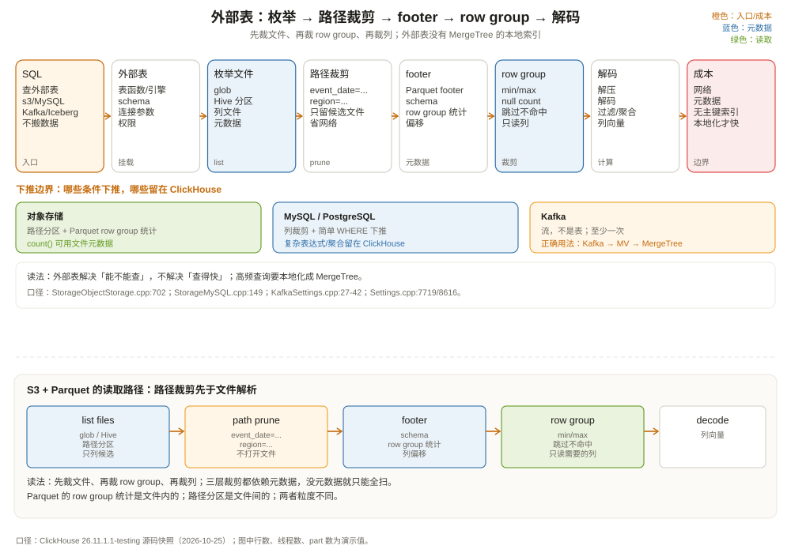

# 外部存储集成：不搬数据也能查

先看一个很诱人的需求：数据湖里有一批 Parquet 文件，总共 2 TB，放在 S3 上。业务想在 ClickHouse 里直接查，不想再跑一遍 ETL。于是你写了：

```sql
SELECT region, COUNT(*) AS orders, SUM(amount) AS gmv
FROM s3(
    'https://my-bucket.s3.us-east-1.amazonaws.com/orders/2026/10/*.parquet',
    'Parquet',
    'order_id UInt64, region String, amount Decimal(18, 2), event_date Date'
)
WHERE event_date = '2026-10-01'
GROUP BY region;
```

查询真的跑起来了，没导入一行数据。但第二次、第三次查，速度还是很慢；并发一高，S3 请求费和出口流量也上来了。你开始怀疑：**「不搬数据」到底是省事，还是把成本转移到了别处？**

这一章讲 ClickHouse 的四类外部存储集成：

1. **文件/对象存储**：S3、GCS、Azure Blob、HDFS、本地文件、HTTP URL；
2. **关系型数据库**：MySQL、PostgreSQL；
3. **流式系统**：Kafka；
4. **湖仓格式**：Iceberg、Delta Lake、Hudi。

核心结论：**外部存储集成解决的是「能不能查」，不是「查得快不快」。** 它可以让你少一次 ETL，但网络、元数据、格式解析、无索引这些成本不会消失。用对了是数据湖的快捷入口，用错了是慢查询和账单的源头。



---

## 一、三种「外部表」：表函数、表引擎、数据库引擎

ClickHouse 接外部数据有三种形态，名字很像，能力不同。

### 1.1 表函数：查询里的临时表

表函数（table function）直接出现在 `FROM` 里：

```sql
SELECT *
FROM s3('https://bucket/path/*.parquet', 'Parquet', 'id UInt64, name String')
LIMIT 10;

SELECT *
FROM file('data/orders.csv', 'CSV', 'id UInt64, amount Decimal(18,2)');

SELECT *
FROM mysql('mysql-host:3306', 'shop', 'orders', 'user', 'password')
LIMIT 10;
```

特点：

- 不需要建表，适合临时排查、一次性导入；
- 每次查询都要解析 URL、建立连接、推断/校验 schema；
- 不能直接参与 `ON CLUSTER` 的持久化 DDL；
- 适合「偶尔查一次」和「把外部数据导入本地表」。

### 1.2 表引擎：持久化的外部表对象

表引擎（table engine）把外部数据源注册成一张表：

```sql
CREATE TABLE shop.orders_s3
(
    order_id UInt64,
    region   String,
    amount   Decimal(18, 2),
    event_date Date
)
ENGINE = S3(
    'https://bucket/path/*.parquet',
    'Parquet'
);
```

之后就可以像普通表一样查：

```sql
SELECT region, SUM(amount) FROM shop.orders_s3 GROUP BY region;
```

特点：

- schema 显式定义，查询时不用每次写 structure；
- 可以建视图、加权限、参与 JOIN；
- 数据仍然在外部，每次查询都要读远端；表引擎不是「导入」，是「挂载」；
- 写入能力取决于引擎/版本：`file`、`s3` 等表函数支持 `INSERT`，部分对象存储表引擎在较新版本也支持写入；上线前用 `DESC` 和版本文档确认。

### 1.3 数据库引擎：把整个 catalog 挂进来

数据湖场景下，表可能成百上千。逐个建表不现实。ClickHouse 提供 `DataLake` 数据库引擎，把 Iceberg/Delta/Hudi 的 catalog 挂成一个数据库：

```sql
CREATE DATABASE lake
ENGINE = DataLake
SETTINGS
    catalog_type = 'rest',
    warehouse = 's3://my-bucket/warehouse',
    ...;
```

之后 `lake.orders`、`lake.users` 直接可查，schema 从 catalog 读取，支持 schema 演进。`DatabaseDataLake` 的类定义在 `src/Databases/DataLake/DatabaseDataLake.h:18`，它背后是 Iceberg/Delta/Hudi 的元数据读取。

三种形态的取舍：

| 形态 | 适用 | 生命周期 | 每次查询开销 |
| --- | --- | --- | --- |
| 表函数 | 临时查、导入 | 不持久 | URL 解析 + 连接 + schema |
| 表引擎 | 固定数据源、需要权限/视图 | 持久 | 连接 + 远端读 |
| 数据库引擎 | 数据湖 catalog、大量表 | 持久 | catalog 元数据 + 远端读 |

---

## 二、对象存储：S3 上的 Parquet 是怎么读的

对象存储是 ClickHouse 最常见的外部数据源。`StorageObjectStorage` 是统一入口（`src/Storages/ObjectStorage/StorageObjectStorage.h:45`），S3、GCS、Azure、HDFS、本地文件都走这套框架。

一次 `SELECT` 的读取路径大致是：

```text
StorageObjectStorage::read
  │
  ▼
枚举文件（glob / Hive 分区）
  │
  ▼
按 _path / _file / 分区值裁剪文件
  │
  ▼
打开 Parquet 文件，读 footer / row group 统计
  │
  ▼
只读需要的列，按 row group 跳过
  │
  ▼
解码、过滤、聚合
```

### 2.1 文件枚举与分区裁剪

对象存储的「分区」通常体现在路径里，比如 Hive 风格：

```text
s3://bucket/orders/event_date=2026-10-01/region=east/part-0001.parquet
s3://bucket/orders/event_date=2026-10-01/region=west/part-0002.parquet
```

ClickHouse 支持 Hive 分区解析（`partition_strategy = 'hive'`），把路径里的 `event_date=...`、`region=...` 变成虚拟列。查询 `WHERE event_date = '2026-10-01'` 时，可以先按路径裁剪文件，不用打开所有文件（`src/Storages/ObjectStorage/StorageObjectStorageSource.cpp:554` 附近的 `createPathAndFileFilterDAG`）。

这层裁剪很关键：对象存储列出 100 万个文件可能比读数据还慢。能按路径裁掉 99% 的文件，比读 footer 再裁要快得多。

### 2.2 Parquet 统计裁剪

打开一个 Parquet 文件后，ClickHouse 可以读 footer 里的 row group 统计（min/max、null count），跳过不命中的 row group。这和第 1 章讲的 Parquet 格式是一套东西：

- 文件级：路径/分区裁剪；
- row group 级：min/max 统计；
- 列级：只读需要的列；
- 页级：Parquet 的页索引/布隆过滤器（取决于格式和设置）。

ClickHouse 的 Parquet reader 会把 `WHERE` 条件下推成「row group 过滤」，但**不是所有条件都能下推**。复杂表达式、跨列函数、非确定性函数通常只能在解码后过滤。

### 2.3 `count()` 的捷径

如果查询是 `SELECT count() FROM s3(...)`，ClickHouse 不一定要读数据。`optimize_count_from_files` 默认 `true`（`src/Core/Settings.cpp:5885`），`use_cache_for_count_from_files` 默认 `true`（`:5902`），它会尽量用文件元数据/缓存来算行数，避免全文件扫描。

但注意：**Parquet 的 row group 元数据里有行数，CSV 没有**。CSV 的 `count()` 仍然要扫整个文件；Parquet/ORC 才能享受这个优化。这也是为什么数据湖喜欢用列式格式。

### 2.4 外部存储没有 MergeTree 的那些东西

把对象存储和 MergeTree 摆在一起：

| 能力 | MergeTree | 对象存储外部表 |
| --- | --- | --- |
| 分区裁剪 | 分区目录 + minmax | 路径/Hive 分区 |
| 主键稀疏索引 | 有 | 没有（Parquet 有 row group 统计） |
| mark 级跳过 | 有 | 没有（Parquet 页索引可选） |
| 数据本地性 | 本地盘 | 网络 |
| 复制 | ReplicatedMergeTree | 依赖对象存储自身冗余 |
| 后台合并 | 有 | 没有（文件是别人写的） |
| 写入 | INSERT 生成 part | 取决于引擎；通常不适合高频小写 |

这解释了为什么「直接查 S3」通常比「导入 MergeTree 再查」慢一个数量级：不是 ClickHouse 的 SQL 引擎慢，而是它要跨网络、解析文件、没有本地索引。

### 2.5 缓存：把热数据拉到本地

ClickHouse 支持文件系统缓存（`enable_filesystem_cache` 默认 `true`，`src/Core/Settings.cpp:8616`）。对象存储读过的文件块可以缓存在本地磁盘，下一次查询命中缓存就不用再走网络。

缓存适合「同一批文件被反复查」的场景；不适合「每次查不同文件」的场景。缓存命中率取决于查询模式、缓存容量、淘汰策略。别把缓存当索引：它只能减少重复读，不能让你跳过没读过的文件。

---

## 三、MySQL / PostgreSQL：把关系型库当外部表

ClickHouse 可以直连 MySQL/PostgreSQL：

```sql
-- 表函数
SELECT *
FROM mysql('mysql-host:3306', 'shop', 'orders', 'reader', '***')
WHERE status = 'paid'
LIMIT 100;

-- 表引擎
CREATE TABLE shop.mysql_orders
ENGINE = MySQL('mysql-host:3306', 'shop', 'orders', 'reader', '***');

-- PostgreSQL
SELECT *
FROM postgresql('pg-host:5432', 'shop', 'orders', 'reader', '***')
WHERE status = 'paid';
```

### 3.1 下推了什么，没下推什么

MySQL 表函数的文档写得很明确：简单的 `WHERE` 条件（`=`、`!=`、`>`、`>=`、`<`、`<=`）会在 MySQL 服务器上执行；其余条件在 ClickHouse 里执行。`LIMIT` 只有在安全且 `external_storage_push_down_limit=true`（默认 `true`，`src/Core/Settings.cpp:7719`）时才下推。

也就是说：

```sql
-- 下推：列裁剪 + status 过滤 + LIMIT
SELECT order_id, amount
FROM mysql(...)
WHERE status = 'paid'
LIMIT 10;

-- 部分下推：status 下推，amount * 2 只能在 ClickHouse 算
SELECT order_id, amount * 2 AS double_amount
FROM mysql(...)
WHERE status = 'paid'
  AND amount * 2 > 100;
```

PostgreSQL 表函数类似：`ReadFromPostgreSQL` 会把列和条件下推，复杂表达式留在 ClickHouse。`StorageMySQL::readImpl`（`src/Storages/StorageMySQL.cpp:149`）和 `StoragePostgreSQL::readImpl`（`src/Storages/StoragePostgreSQL.cpp:257`）分别负责构造远端 SQL。

这意味着：**外部表的 JOIN、聚合、复杂表达式仍然在 ClickHouse 里做**。ClickHouse 会把 MySQL 当「一个能过滤、能投影的远端表」，而不是「把整个查询交给 MySQL」。所以：

- 小结果集的过滤查询很快；
- `JOIN` 大表时，可能把大量数据拉到 ClickHouse，网络成为瓶颈；
- 聚合/排序通常不会下推到 MySQL/PG。

`external_table_strict_query` 默认 `false`（`src/Core/Settings.cpp:5228`）。它控制「外部表查询里出现不能下推的表达式时，是否直接报错」。默认允许，ClickHouse 会把不能下推的部分拉回来算；如果你希望「要么全下推、要么报错」，可以打开它。

### 3.2 写入：可以，但别当主库用

MySQL/PostgreSQL 表引擎支持 `INSERT`，ClickHouse 会把数据写回远端。但：

- 没有跨库事务；
- 写入性能受远端数据库限制；
- 不适合高频小批量写；
- 不能保证「ClickHouse 写入成功 = 远端事务提交」的强一致语义（取决于引擎实现）。

正确用法是「把 ClickHouse 的聚合结果写回 MySQL 供业务查询」，或者「一次性补数据」。不要把 MySQL 表引擎当成 ClickHouse 的主存储。

---

## 四、Kafka：不是表，是流

Kafka 引擎和前面几种外部表有一个本质区别：**Kafka 没有「表数据」，只有「流」**。每次 `SELECT` 都是从 consumer 的当前位置读消息，读完就没了（取决于 offset 提交）。

```sql
CREATE TABLE shop.kafka_orders
(
    order_id UInt64,
    region   String,
    amount   Decimal(18, 2),
    event_time DateTime
)
ENGINE = Kafka
SETTINGS
    kafka_broker_list = 'kafka-1:9092,kafka-2:9092',
    kafka_topic_list = 'orders',
    kafka_group_name = 'clickhouse-orders',
    kafka_format = 'JSONEachRow',
    kafka_num_consumers = 4;
```

`StorageKafka` 的类定义在 `src/Storages/Kafka/StorageKafka.h:39`，`read`（`src/Storages/Kafka/StorageKafka.cpp:239`）返回一个流式读取源。关键设置：

| 设置 | 默认 | 作用 |
| --- | --- | --- |
| `kafka_num_consumers` | 1 | 每个表的消费者数 |
| `kafka_max_block_size` | 0（自动） | 每次 poll 攒多少行 |
| `kafka_thread_per_consumer` | false | 每个消费者独立线程 |
| `kafka_format` | 空 | 消息格式（JSONEachRow、Avro、Protobuf 等） |

（`src/Storages/Kafka/KafkaSettings.cpp:27-42`。）

### 4.1 正确用法：Kafka → Materialized View → MergeTree

不要在生产里直接 `SELECT * FROM kafka_orders` 做分析——它会把消息消费掉，而且没有索引/分区。正确姿势是用物化视图把流落到 MergeTree：

```sql
CREATE MATERIALIZED VIEW shop.orders_mv TO shop.orders_local AS
SELECT order_id, region, amount, event_time
FROM shop.kafka_orders;
```

这样 Kafka 引擎负责消费，物化视图负责写入，`orders_local` 负责存储和查询。Kafka 表本身只作为「入口」，不承担分析查询。

### 4.2 语义：至少一次，不是精确一次

Kafka 引擎的消费语义是**至少一次（at-least-once）**：消息可能重复，尤其是在消费者重启、offset 提交失败、网络抖动时。ClickHouse 的 `ReplicatedMergeTree` 有块级去重，但块 ID 取决于写入批次，重试时批次可能不同，不能保证完全去重。

如果需要精确一次，通常要在业务层做幂等（唯一键 + `ReplacingMergeTree` + 版本），或者用支持事务的流处理框架。别假设 Kafka 引擎会自动帮你做到 exactly-once。

### 4.3 offset 存在哪

Kafka 引擎的 offset 由 ClickHouse 管理（不是完全交给 Kafka 的 consumer group 自动提交），具体存储位置与配置有关。运维时要关注：

- `system.kafka_consumers`：消费者状态、分配的分区、lag；
- `system.mutations` / 日志：消费失败的原因；
- Kafka 侧的 consumer group lag。

如果 ClickHouse 的消费者长时间 lag，先看是消费慢（`kafka_num_consumers` 太小、单条消息太大）还是写入慢（下游 MergeTree 的 part 太多）。

---

## 五、Iceberg / Delta / Hudi：湖仓格式

数据湖的「表」不只是文件，还有元数据（schema、分区、快照）。ClickHouse 支持三类湖仓格式：

| 格式 | 表函数 | 数据库引擎 | 特点 |
| --- | --- | --- | --- |
| Iceberg | `icebergS3`、`icebergAzure`、`icebergHDFS`、`icebergLocal` | `DataLake` | 开放表格式，快照/分区演进 |
| Delta Lake | `deltaLake`、`deltaLakeS3`、`deltaLakeAzure`、`deltaLakeLocal` | `DataLake` | `_delta_log` 事务日志 |
| Hudi | `hudi`、`hudiS3` 等 | `DataLake` | 增量写、mor/col 表 |

（注册入口：`src/TableFunctions/TableFunctionObjectStorage.cpp:1470`、`:2417`、`:2555`。）

用法示例：

```sql
-- Iceberg 表函数
SELECT region, SUM(amount)
FROM icebergS3('s3://warehouse/orders', 'Parquet')
WHERE event_date = '2026-10-01'
GROUP BY region;

-- Delta Lake 表函数
SELECT COUNT(*) FROM deltaLake('s3://warehouse/orders_delta');
```

湖仓格式的价值在于**元数据**：

- schema 演进：加列、改类型，不用重写所有文件；
- 分区演进：从按天分区改成按小时，旧文件仍然可读；
- 快照/时间旅行：查询某个历史版本；
- 清单裁剪：先读 metadata，再决定读哪些文件，避免列出整个桶。

ClickHouse 的湖仓读取会尽量利用这些元数据做裁剪，但它仍然是「读外部文件」，没有 MergeTree 的本地索引和 part 管理。适合「数据湖已经存在，想用 ClickHouse 做加速查询」；不适合「把 ClickHouse 当湖仓的写入引擎」（写入能力有限，且不是 Iceberg/Delta 的原生写入路径）。

---

## 六、性能与成本：外部表的四笔账

把外部表当成「免费的数据源」是最大的误会。它有四笔账：

**第一笔：网络。** 每次查询都要从 S3/MySQL/Kafka 拉数据。跨区域、跨云、公网的出口流量可能比计算还贵。能本地化就本地化。

**第二笔：元数据。** 对象存储列出文件、读 Parquet footer、解析 Iceberg manifest，都要时间。文件越多，元数据开销越大。小文件是数据湖的天敌。

**第三笔：格式解析。** Parquet/ORC 要解码，CSV/JSON 要解析。列式格式比行式格式快，但仍然比 MergeTree 的本地列文件多一层解压/解码。

**第四笔：没有索引。** 除了路径分区和 Parquet row group 统计，外部表没有主键稀疏索引、没有 skip index、没有 projection。查询只能靠「少读列 + 少读文件 + row group 裁剪」。

一个实用的判断：

```text
如果同一批外部数据每天要被查很多次，
  且查询模式稳定、数据量大于单机内存，
  → 建 MergeTree 本地表，定期导入/物化；
如果只是偶尔查一次、或者数据湖是唯一事实源，
  → 用外部表/湖仓表，接受网络和解析成本。
```

---

## 七、和 Trino、Spark、DuckDB 比一比

| 维度 | ClickHouse 外部表 | Trino | Spark | DuckDB |
| --- | --- | --- | --- | --- |
| 定位 | 分析引擎 + 外部连接器 | 联邦查询引擎 | 批处理引擎 | 嵌入式分析 |
| 外部源 | S3/MySQL/PG/Kafka/Iceberg... | 大量 connector | 大量 connector | Parquet/CSV/JSON/DB |
| 执行 | 向量化流水线 | 向量化 MPP | JVM DAG | 向量化单机 |
| 延迟 | 低（本地表）/中（外部） | 中 | 高 | 低（单机） |
| 适合 | 实时分析 + 数据湖加速 | 跨源联邦查询 | 大规模 ETL | 单机分析/Notebook |

ClickHouse 的外部表能力不是为了取代 Trino 的「联邦查询」，而是为了：

- 让数据湖里的数据「不用搬就能查」；
- 让 MySQL/PG 的维表「不用同步就能 JOIN」；
- 让 Kafka 的流「不用额外组件就能落表」。

如果你的核心需求是「跨 10 个数据源做复杂 JOIN」，Trino 更合适；如果是「把数据湖的 Parquet 加速到亚秒级」，ClickHouse 的本地表 + 定期导入更合适。

---

## 八、设计清单

用外部存储前，问自己六个问题：

1. **数据量多大？** 几十 GB 可以每次读；几 TB 要考虑本地化/缓存；
2. **查询频率多高？** 偶尔查用表函数；高频查建 MergeTree；
3. **能不能裁剪？** 路径分区、Parquet row group、MySQL 索引，能裁多少；
4. **网络成本多少？** 跨区域/公网出口流量是否可接受；
5. **需不需要写入？** 外部表大多读多写少；写入用本地表；
6. **元数据是否稳定？** 湖仓 schema 演进、文件小文件多，会影响规划。

一个推荐的架构：

```text
数据湖（S3 + Parquet/Iceberg）
  │  低频/探索查询
  ├──────────────► ClickHouse 外部表 / DataLake
  │
  │  高频/稳定查询
  └──────────────► 定期导入 MergeTree（或物化视图）
                      │
                      └──► 本地索引 + 压缩 + 副本
```

---

## 九、这一章留下的线索

把这一章压成几句话：

- 外部存储有三种形态：表函数（临时）、表引擎（持久挂载）、数据库引擎（catalog）；
- 对象存储读取靠「路径分区 + Parquet row group + 列裁剪」，没有 MergeTree 的主键索引；
- MySQL/PostgreSQL 会下推列裁剪和简单 WHERE，复杂表达式/聚合仍在 ClickHouse；
- Kafka 是流不是表，正确用法是「Kafka → 物化视图 → MergeTree」，语义至少一次；
- Iceberg/Delta/Hudi 靠元数据做 schema/分区演进，但仍受网络和文件布局限制；
- 外部表解决「能不能查」，不解决「查得快」；高频查询要本地化。

下一章进入核心数据层：MergeTree 的列文件、mark、压缩块到底怎么组织？为什么同一份数据，列式压缩能比行式小一个数量级？

---

## 附：这一章的源码入口

> 源码来自本地 ClickHouse 26.11.1.1-testing 快照，验证时间 2026-10-25。

- `src/Storages/ObjectStorage/StorageObjectStorage.h:45`：`StorageObjectStorage`
- `src/Storages/ObjectStorage/StorageObjectStorage.cpp:702`：`read`
- `src/Storages/ObjectStorage/StorageObjectStorageSource.h:38`：`StorageObjectStorageSource`
- `src/Storages/ObjectStorage/StorageObjectStorageSource.cpp:554`：路径/文件过滤 DAG
- `src/TableFunctions/TableFunctionObjectStorage.cpp:304`：对象存储表函数注册
- `src/TableFunctions/TableFunctionObjectStorage.cpp:1470`：`iceberg` 表函数
- `src/TableFunctions/TableFunctionObjectStorage.cpp:2417`：`deltaLake` 表函数
- `src/TableFunctions/TableFunctionObjectStorage.cpp:2555`：`hudi` 表函数
- `src/TableFunctions/TableFunctionFile.cpp:201`：`file` 表函数
- `src/TableFunctions/TableFunctionURL.cpp:510`：`url` 表函数
- `src/TableFunctions/TableFunctionMySQL.cpp:176`：`mysql` 表函数
- `src/TableFunctions/TableFunctionPostgreSQL.cpp:144`：`postgresql` 表函数
- `src/Storages/StorageMySQL.cpp:149`：`StorageMySQL::readImpl`
- `src/Storages/StorageMySQL.cpp:174`：`transformQueryForExternalDatabase`
- `src/Storages/StoragePostgreSQL.cpp:257`：`StoragePostgreSQL::readImpl`
- `src/Storages/StoragePostgreSQL.cpp:228`：`transformQueryForExternalDatabase`
- `src/Storages/Kafka/StorageKafka.h:39`：`StorageKafka`
- `src/Storages/Kafka/StorageKafka.cpp:239`：`read`
- `src/Storages/Kafka/KafkaSettings.cpp:27-42`：Kafka 引擎设置
- `src/Databases/DataLake/DatabaseDataLake.h:18`：`DatabaseDataLake`
- `src/Core/Settings.cpp:5228`：`external_table_strict_query = false`
- `src/Core/Settings.cpp:7719`：`external_storage_push_down_limit = true`
- `src/Core/Settings.cpp:5885`：`optimize_count_from_files = true`
- `src/Core/Settings.cpp:5902`：`use_cache_for_count_from_files = true`
- `src/Core/Settings.cpp:8616`：`enable_filesystem_cache = true`

---

## 思考题

1. `s3(...)` 表函数和 `ENGINE = S3(...)` 表引擎都能查 S3，什么时候用哪个？表引擎会把数据复制到本地吗？
2. 为什么 `SELECT count() FROM s3(...)` 有时很快、有时很慢？取决于什么格式和设置？
3. MySQL 外部表的 `WHERE amount * 2 > 100` 能下推到 MySQL 吗？如果不能，数据会在哪里过滤？
4. Kafka 引擎的「至少一次」会导致重复数据，ClickHouse 的块级去重能完全解决吗？为什么？
5. 数据湖里同一批 Parquet 文件每天被查 100 次，你会继续用外部表，还是导入 MergeTree？导入的代价是什么？
