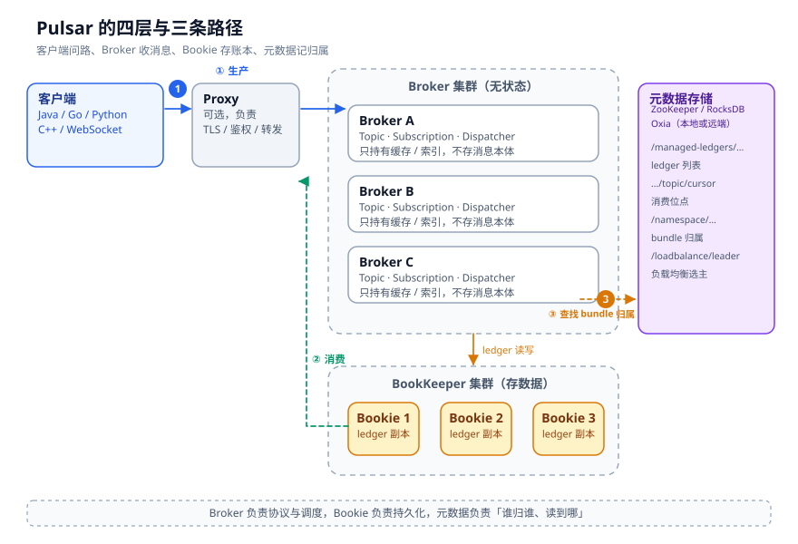
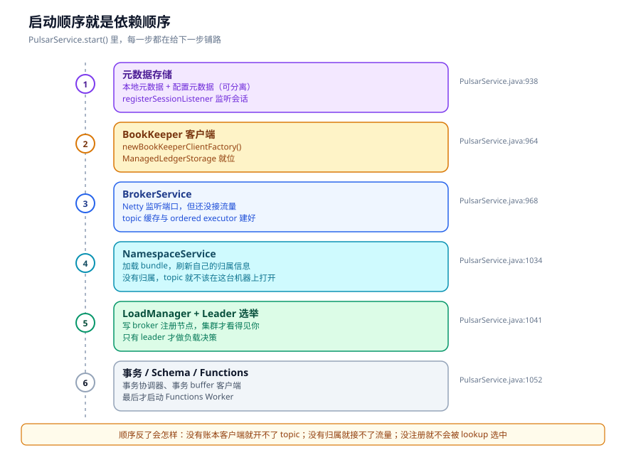

# 整体架构：一条消息最后落在谁手里

凌晨两点，某个订单 topic 的消费延迟从 200 毫秒涨到 40 秒。监控上 Broker 的 CPU 只有 15%，Bookie 的磁盘也不忙，网络没有丢包。你打开 Pulsar 的架构图，四层画得清清楚楚，可这张图不告诉你该去查哪。

架构图只能回答「系统由什么组成」，回答不了「一条消息经过谁、在哪一步可能停住」。这两个问题差得很远。前者可以背下来，后者得顺着调用链走一遍。

这一章不急着讲参数，先把一条消息的落脚点找出来。后面四章的所有细节，都挂在这条链上。

---

## 一、四层拆分，拆开的到底是什么

Pulsar 的官方架构图上有四层：Pulsar 实例、集群、Broker、Bookie。再加一个经常被画在角落里的元数据存储。这个分法没错，但它把最重要的一件事说轻了。



把每一层拆开看，职责是这样的：

| 组件 | 有没有状态 | 主要职责 | 挂了会怎样 |
| --- | --- | --- | --- |
| Proxy | 基本无状态 | TLS 终止、鉴权、转发、限流 | 客户端换地址重连，未确认的消息靠重试补发 |
| Broker | 有缓存、有归属、有未完成的写 | 协议解析、主题加载、订阅分发、归属管理 | 它拥有的 bundle 被重新分配，主题从 Bookie 重新加载 |
| Bookie | 有数据 | 追加 ledger、复制、恢复 | 副本数够就继续写；不够就降级或阻塞 |
| 元数据存储 | 有目录和锁 | ledger 列表、游标位点、bundle 归属、策略 | 新主题加载不了，归属无法变更；已有读写通常还能撑一段 |
| 客户端 | 有本地队列 | 攒批、压缩、重试、维护连接 | 应用自己感知 |

这里最容易被误读的是 Broker 的「无状态」。

Broker 确实不把消息写在自己的本地磁盘上，但它绝不是一个可以随时 kill -9 的纯计算节点。它内存里有一份 topic 缓存，有一份 bundle 归属的锁，还有一批已经发给 Bookie、但还没收到确认的写请求。重启一个 Broker，客户端要重连，它拥有的 bundle 要被别的 Broker 接管，每个 topic 都要重新打开 managed ledger、恢复游标。这些动作加起来，可能是几十秒，也可能在异常情况下卡住。

所以更准确的说法是，Broker 把「数据」交了出去，把「索引和调度」留在了自己身上。这个交换带来了两个直接后果。

好处是扩缩容变简单了。存储不够就加 Bookie，流量涨了就加 Broker，两边不用一起动。坏处是链路上多了一跳，多了一套要运维的系统，还多了一个必须保持一致性的地方：Bookie 上的数据和元数据里的账本列表。后面讲故障恢复，大部分麻烦都出在这个一致性上。

---

## 二、启动顺序把依赖关系写在了脸上

看一个分布式系统，我习惯先看它的启动方法。启动顺序里藏着作者对依赖关系的理解，比任何架构文档都诚实。

`PulsarService.start()` 很长，但骨架很清楚。下面这段删掉了参数校验和异常分支，只留下顺序：

```java
// pulsar-broker/src/main/java/org/apache/pulsar/broker/PulsarService.java
localMetadataStore = createLocalMetadataStore(...);          // :938
coordinationService = new CoordinationServiceImpl(localMetadataStore);
configurationMetadataStore = ...;                            // :944
pulsarResources = newPulsarResources();
orderedExecutor = newOrderedExecutor();

this.bkClientFactory = newBookKeeperClientFactory();         // :964
managedLedgerStorage = newManagedLedgerStorage();
this.brokerService = newBrokerService(this);                 // :968
this.loadManager.set(LoadManager.create(this));              // :972
this.startNamespaceService();                                // :975

brokerService.start();                                       // :999
this.nsService.initialize();                                 // :1034
startLeaderElectionService();                                // :1041
startLoadManagementService();                                // :1048

// 事务协调器、Schema、Functions Worker …
state = State.Started;                                       // :1157
```



这个顺序不是随便排的。

先有元数据存储，因为后面所有东西都要在里面登记。再有 BookKeeper 客户端和 managed ledger 存储，因为没有账本客户端，连一个 topic 都打不开。然后才创建 `BrokerService`，把 Netty 的端口绑上。注意，端口绑上不等于能接客，此时服务状态还不是 `Started`，早到的请求会收到 `ServiceNotReady`。

接着是 `NamespaceService.initialize()` 和负载均衡。这两步解决的是「这块地归谁」。一个 Broker 如果不知道自己拥有哪些 bundle，就不该打开对应的 topic；一个 Broker 如果没在集群里注册，lookup 永远选不到它。

最后才是事务协调器、Schema Registry、Functions Worker 这些外围能力。它们不是消息主路径的必经之地，晚一点启动，不影响生产消费。

一句话总结这段顺序：**先有目录，再有账本；先有归属，再接流量；先被看见，再谈均衡。**

---

## 三、三条路径，三种失败方式

Pulsar 的日常请求可以归成三条路径。把这三条记住，排障时至少知道该看哪一段。

### 3.1 生产：从 sendAsync 到 sendReceipt

客户端调 `sendAsync`，消息先进入 `ProducerImpl` 的待确认队列，然后通过 Netty 发给 Broker。Broker 侧的入口是 `ServerCnx.handleProducer()`，真正写消息的调用链是：

```text
ServerCnx.handleSend()
  → Producer.publishMessage()                 // 校验、去重、限速
    → PersistentTopic.publishMessage()        // fencing、最大消息、延迟投递
      → ManagedLedger.asyncAddEntry()         // 进入账本写队列
        → OpAddEntry.initiate()
          → BookKeeper LedgerHandle.asyncAddEntry()
            → 写 writeQuorum 个 Bookie，收齐 ackQuorum 个就算成功
              → PersistentTopic.addComplete()
                → 回 sendReceipt
```

这条链上，客户端只关心最后那个 `sendReceipt`。中间的每一次排队、每一次复制，都会变成延迟。链路确实长，但它换来了两个能力：批量写 Bookie，以及 Broker 挂掉之后从别处恢复。

### 3.2 消费：Broker 推，客户端给信用

消费的入口是 `ServerCnx.handleSubscribe()`。Broker 会为这个订阅创建或复用一个 `PersistentSubscription`，再按订阅类型选一个 dispatcher。dispatcher 从 `ManagedCursor` 读 entry，发给消费者。

这里有个容易搞反的点：Pulsar 的逻辑是 Broker 推消息，但流量控制靠客户端发许可。客户端每消费一批，就发一个 `CommandFlow` 把额度还回去。Broker 侧有一个 `totalAvailablePermits`，没有许可就停止读取。

所以「消费慢」在 Pulsar 里通常表现为「Broker 不读了」，而不是「Broker 拼命推、客户端内存爆掉」。这个设计后面第三章会展开。

### 3.3 查找：先问归属，再连 Broker

客户端不知道 topic 在哪个 Broker 上，它只知道一个服务地址。于是它先发 `CommandLookupTopic`，随便找一台 Broker 问。

Broker 的处理在 `TopicLookupBase.lookupTopicAsync()`（`pulsar-broker/.../lookup/TopicLookupBase.java:204`），核心是 `NamespaceService.getBrokerServiceUrlAsync()`（`:222`）：

1. 把 topic 名算出 bundle；
2. 查 bundle 的归属；
3. 有归属就返回 `Connect` 或 `Redirect`；
4. 没归属就选一个 Broker 去抢锁。

返回 `Redirect` 的意思是「你问对人了，但这事儿不归我管，去这个地址」。客户端会带着 `authoritative=true` 再问一次。这个重定向可能发生一到两次，之后才拿到真正的连接地址。

三条路径的失败方式完全不同：

| 路径 | 卡住时的典型表现 | 先看哪里 |
| --- | --- | --- |
| 生产 | sendTimeout、pendingMessages 满、Broker 限流 | 客户端队列、Broker publish 限速、Bookie 写延迟 |
| 消费 | backlog 上涨、permits 不涨、receive 队列空 | dispatcher 许可、cursor 读取、订阅类型 |
| 查找 | 连接超时、反复 Redirect、ServiceNotReady | bundle 归属、负载均衡 leader、元数据存储 |

### 3.4 和 Kafka 摆在一起看

讲 Pulsar 很难绕开 Kafka。两者最核心的差别不在 API，而在「谁对数据负责」。

| 维度 | Kafka | Pulsar |
| --- | --- | --- |
| 数据存放 | Broker 本地磁盘上的 partition log | Bookie 上的 ledger，Broker 不存 |
| 复制 | Broker 之间复制，ISR 机制 | BookKeeper 的 ensemble / quorum |
| 扩存储 | 加 Broker，再搬 partition | 加 Bookie，Broker 不用动 |
| 消费模型 | 客户端 pull | Broker push + 客户端信用 |
| 顺序 | 分区内有序 | 分区内有序，另有 Key_Shared |

这个对比没有胜负。Kafka 的链路更短，单机吞吐高，运维面小；Pulsar 把存储拆出去，扩缩容更灵活，代价是多一套 BookKeeper 和更长的写路径。选型时真正要问的是：你的瓶颈在吞吐，还是在存储与计算的独立伸缩。


---

## 四、三本账：理解后面所有章节的钥匙

Pulsar 把「消息」这件事拆成了三本账。这个说法不是官方术语，但很好用。

**第一本是数据账。** 消息真正躺在 Bookie 的 ledger 里。ledger 只能追加，不能修改，删除以整本为单位。一个 topic 的数据，是一串 ledger。

**第二本是索引账。** 元数据存储里记着这个 topic 有哪些 ledger、每本有多少条、多大、时间戳、有没有卸载到对象存储。路径是 `/managed-ledgers/<tenant>/<namespace>/<topic>`。Broker 打开一个 topic 时，先读这本账，才知道去哪里找数据。

**第三本是进度账。** 每个订阅有一个游标，记着「读到哪了」。游标的 `markDeletePosition` 也在元数据存储里，路径是同一个前缀加游标名。但未确认消息的位图可能很大，会单独写进一本 cursor ledger，放在 Bookie 上。

三本账的更新频率完全不同。数据账每条消息都写，索引账换 ledger 才写，进度账按 ack 批量写。理解这个差异，就能理解很多「看起来不一致」的现象。

比如，为什么 Broker 刚写完一条消息，消费者立刻就能读到？因为读路径会先看内存里的 `lastConfirmedEntry` 和 entry cache，不一定去 Bookie。又比如，为什么 Broker 崩溃后，最后几条已经 ack 的消息可能重投？因为进度账是异步落盘的，崩溃时最后一段 ack 可能还没写进元数据。

---

## 五、三个常见误解

**误解一：Broker 无状态，所以可以随便重启。**

Broker 不存消息本体，但它持有主题缓存、归属锁和未完成的写。重启的代价远不止换一台机器。它要重新加载一批 topic，重新抢一批 bundle，重新恢复一批游标。生产环境里滚动重启要限速，原因就在这里。

**误解二：BookKeeper 只是 Pulsar 的磁盘。**

BookKeeper 有自己的 ensemble、write quorum、ack quorum 和恢复流程。Pulsar 只是它的一个用户。Bookie 的复制延迟、磁盘抖动、GC，都会直接反映到 produce 延迟上。把 BookKeeper 当成「黑盒存储」，排障时就会漏掉一半线索。

**误解三：元数据存储只是配置中心。**

它更像一个分布式目录服务。topic 能不能打开、bundle 归谁、ledger 列表是否完整，都靠它。元数据存储的延迟升高，最先出问题的不是配置下发，而是新 topic 加载和 ledger 切换。很多「偶发加载超时」，根因在这里。

---

## 六、这一章留下的线索

把这一章压缩成几句话：

- Broker 负责协议、路由、缓存和调度，消息本体在 Bookie；
- 启动顺序是依赖顺序，元数据 → 账本 → 归属 → 流量；
- 三条路径各有各的失败方式，排障先分清是哪一条；
- 数据账、索引账、进度账更新频率不同，不一致是常态，不是 bug。

下一章顺着「三本账」往下走，看看 Broker 内部怎么组织一个 topic，ManagedLedger 怎么把消息写成 ledger，元数据里到底存了什么，以及 Broker 挂掉之后，这一切是怎么被恢复的。

---

## 附：这一章的源码入口

- `pulsar-broker/src/main/java/org/apache/pulsar/broker/PulsarService.java`：`start()`（`:862`）、元数据存储（`:938`）、BookKeeper 客户端（`:964`）、`BrokerService`（`:968`）、`startNamespaceService()`（`:975`）、`brokerService.start()`（`:999`）、`nsService.initialize()`（`:1034`）、leader 选举（`:1041`）、负载均衡（`:1048`）、状态切到 `Started`（`:1157`）
- `pulsar-broker/.../service/BrokerService.java`：`start()`（`:644`）、topic executor（`:390`）、`getOrCreateTopic()`（`:1252`）、`getTopic()`（`:1264`）、归属校验（`:2195`）
- `pulsar-broker/.../lookup/TopicLookupBase.java`：`lookupTopicAsync()`（`:204`）
- `pulsar-broker/.../namespace/NamespaceService.java`：`getBrokerServiceUrlAsync()`（`:222`）、`findBrokerServiceUrl()`（`:493`）
- `pulsar-broker/.../namespace/OwnershipCache.java`：`tryAcquiringOwnership()`（`:291`）
- `managed-ledger/.../impl/ManagedLedgerImpl.java`：`asyncAddEntry()`（`:918`）、`internalAsyncAddEntry()`（`:978`）、`ledgerClosed()`（`:2252`）

---

## 思考题

1. 你的集群里，Broker 重启一次，客户端平均要重连多久？这个时间里，哪些 topic 完全不可用，哪些只是延迟升高？
2. 如果一个 topic 的 backlog 在涨，但 Bookie 写入延迟正常、Broker CPU 也不高，你会先查消费端的哪三个指标？
3. 元数据存储的延迟从 5ms 涨到 50ms，哪些操作会先受影响？为什么不是所有读写都等比例变慢？
