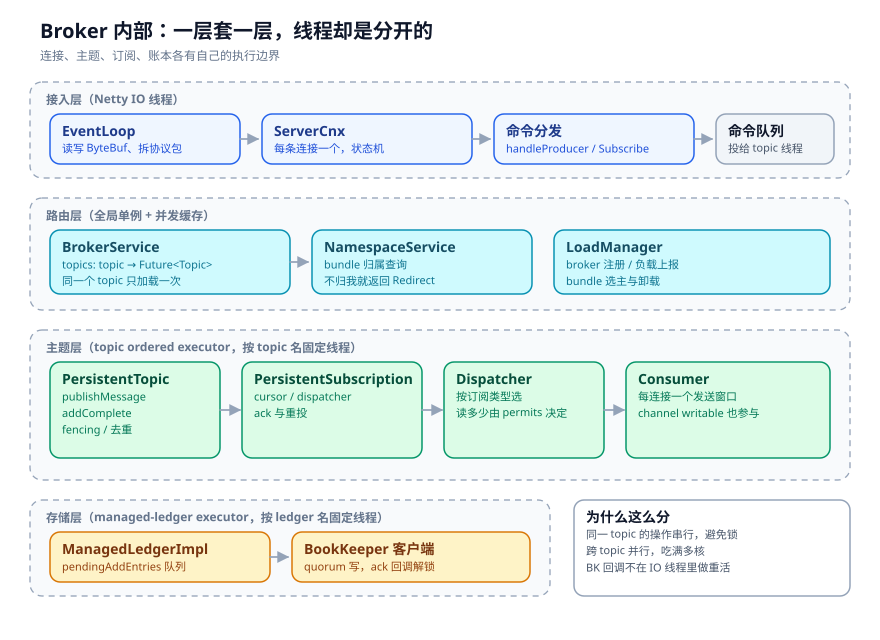
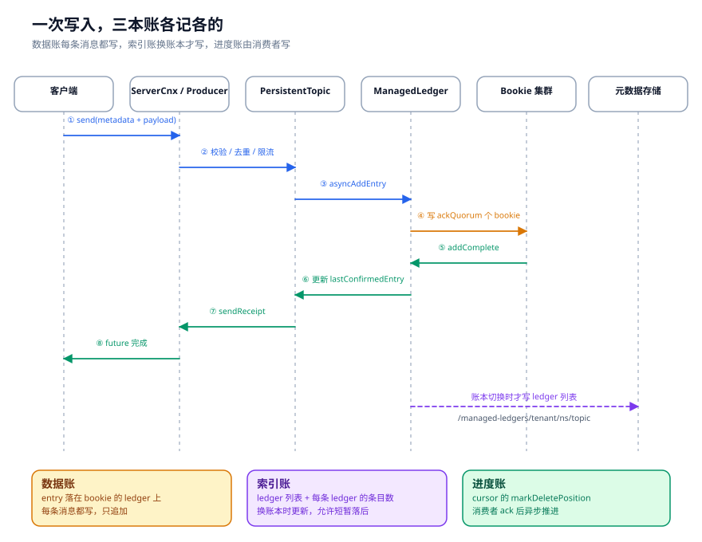

# Broker 与账本：数据、索引、进度这三本账

有个问题我拿来问过不少人：一条消息发到 Pulsar，Broker 到底往磁盘上写了什么？

常见回答是「写进 BookKeeper」。再追问一句，BookKeeper 里的东西是谁让它写的、写完以后 Broker 怎么记得它在哪、消费者读到哪又记在什么地方，能答完整的人就不多了。

这三个问题对应三本账：数据账在 Bookie，索引账在元数据存储，进度账在游标。这一章把三本账拆开看，顺便解释一个经常让人困惑的现象：为什么 Broker 重启之后，有的消息会重投，有的不会。

---

## 一、Broker 的内部形状

先看对象关系。Pulsar 的 Broker 不是一个巨大的 `Broker` 类，而是一层层套起来的：



- `ServerCnx`：每条客户端连接一个，负责协议状态机。
- `BrokerService`：全局单例，持有 topic 缓存、限流器、订阅统计。
- `PersistentTopic`：每个 topic 一个，负责消息写入、fencing、去重、订阅管理。
- `PersistentSubscription`：每个订阅一个，持有 cursor 和 dispatcher。
- `ManagedLedgerImpl`：每个 topic 一个逻辑日志，负责把消息写成一串 BookKeeper ledger。
- `ManagedCursorImpl`：每个订阅一个游标，负责记录消费进度。

这套对象不是在启动时全量创建的，而是按需加载。`BrokerService` 里有一个 `topics` 缓存，类型是 `ConcurrentOpenHashMap<String, CompletableFuture<Optional<Topic>>>`。注意 value 是个 Future，不是 Topic。这个设计是为了解决并发加载：同一个 topic 同时来十个请求，只有一个请求真正去加载，其余九个等同一个 Future。

`getTopic()` 的注释把规则写得很清楚，我翻译一下：

1. 缓存里已有 Future，直接返回，不管它是成功、失败还是超时；
2. 元数据里已经有这个 topic，就创建，不看 `createIfMissing`；
3. 元数据里没有，且 `createIfMissing=false`，返回空，不放进缓存；
4. 否则用 `computeIfAbsent` 创建，失败时把 Future 从缓存里移除。

第四条最关键。加载失败的 Future 如果留在缓存里，这个 topic 就永远打不开了。所以异常分支必须清理缓存，这是很多「重启后才能恢复」的 bug 的来源。

加载一个持久化 topic 的步骤大致是：

```text
getTopic(topicName, createIfMissing)
  → 检查 topic 是否允许自动创建
  → checkTopicNsOwnership()            // 这个 bundle 归不归我
  → getManagedLedgerConfig()           // 保留策略、卸载策略、ensemble 参数
  → 创建 ManagedLedger
  → new PersistentTopic(...)
  → 恢复订阅（cursor）
  → 放进 topics 缓存
```

归属检查发生在创建 topic 之前。这不是防御性编程，是硬约束：如果一个 Broker 不拥有这个 bundle，它写进去的数据没人会接管，元数据里的归属也会乱。宁可返回 `ServiceUnitNotReadyException`，让客户端重试到正确的 Broker。

---

## 二、ManagedLedger：把一个 topic 变成一串 ledger

BookKeeper 的 ledger 有两个限制：只能追加，且不能无限大。所以 Pulsar 在 ledger 之上加了一层 `ManagedLedger`，把一个 topic 切成很多本 ledger，按顺序排好。

`ManagedLedgerImpl` 里几个关键字段：

```java
// managed-ledger/src/main/java/org/apache/bookkeeper/mledger/impl/ManagedLedgerImpl.java
protected final NavigableMap<Long, LedgerInfo> ledgers = new ConcurrentSkipListMap<>();
private volatile LedgerHandle currentLedger;
protected final ConcurrentLinkedQueue<OpAddEntry> pendingAddEntries = new ConcurrentLinkedQueue<>();
private volatile Position lastConfirmedEntry;
```

`ledgers` 是索引，`currentLedger` 是当前正在写的那本，`pendingAddEntries` 是还没完成的写请求，`lastConfirmedEntry` 是已经确认的最后一条。

写入的入口是 `asyncAddEntry()`（`:918`）。它做了一个看起来不起眼、但对吞吐很关键的动作：把写请求交给一个批处理 executor，而不是直接在调用线程里写。

```java
// ManagedLedgerImpl.java:918
public void asyncAddEntry(ByteBuf buffer, int numberOfMessages,
                          AddEntryCallback callback, Object ctx) {
    buffer.retain();
    addEntryBatchingExecutor.execute(
        new AddEntryHandover(buffer, numberOfMessages, callback, ctx));
}
```

`AddEntryHandover` 实现了 `WeightedRunnable`，权重是 buffer 的字节数。这个 executor 会把多个写请求合成一批再执行，减少线程切换和锁竞争。批的大小有上限，默认 1024 条或 5MB，超过就分开。

真正写 ledger 的是 `internalAsyncAddEntry()`（`:978`）。它先看状态机：

- `CreatingLedger` / `ClosingLedger`：当前没有可写的 ledger，请求先排队；
- `ClosedLedger`：触发创建新 ledger；
- `LedgerOpened`：直接写当前 ledger。

写之前会检查 `currentLedgerIsFull()`（`:4851`），条件是三个里任意一个：

| 条件 | 默认值 | 说明 |
| --- | --- | --- |
| 条目数 | 50,000 | `maxEntriesPerLedger` |
| 大小 | 100 MB | `maxSizePerLedgerMb` |
| 存活时间 | 4 小时 | `maximumRolloverTimeMs` |

前两个是容量，第三个是时间。时间条件很重要：一个低流量的 topic，可能几天都写不满 100MB，如果不按时间滚动，ledger 会一直开着，恢复时扫描的 entry 数量不可控。

如果当前 ledger 满了，这一条写请求会被标记 `closeWhenDone=true`，写完就关闭 ledger，然后走 `ledgerClosed()`：

```java
// ManagedLedgerImpl.java:2252
synchronized void ledgerClosed(final LedgerHandle lh, Long lastAddConfirmed) {
    ...
    updateClosedLedgerInfo(lh, lastAddConfirmed, true);
    trimConsumedLedgersInBackground();
    maybeOffloadInBackground(AUTOMATIC_OFFLOAD_TRIGGER);
    createLedgerAfterClosed();
}
```

注意这里的顺序：先更新已关闭 ledger 的信息（条目数、大小、时间戳），再清理已消费的 ledger，再看要不要卸载，最后才创建新 ledger。

创建新 ledger 时，会把它写进元数据：

```java
// ManagedLedgerImpl.java:735
LedgerInfo info = new LedgerInfo().setLedgerId(lh.getId()).setTimestamp(0);
ledgers.put(lh.getId(), info);
store.asyncUpdateLedgerIds(name, getManagedLedgerInfo(), ledgersStat, storeLedgersCb);
```

这就是索引账的更新点。它不在每条消息上发生，只在 ledger 创建、关闭、删除时发生。所以元数据里的 ledger 列表，可能比 Bookie 上的真实数据「少一条正在写的 ledger」，这很正常。恢复时会以 Bookie 上的 ledger 为准，把最后一条补回来。

---

## 三、一次写入的完整时序

把上面的步骤串起来，就是图 4。



几个容易被忽略的细节：

**第一，ack 的时机。** 客户端收到 `sendReceipt`，意味着这条消息已经写到了 `ackQuorum` 个 Bookie 上，不是 `writeQuorum` 个，更不是全部。集群默认是 ensemble=2、writeQuorum=2、ackQuorum=2（`conf/broker.conf:1417-1423`；standalone 是 1/1/1）。ensemble 是这本 ledger 分配到的 Bookie 集合，writeQuorum 是每条 entry 实际写几份，ackQuorum 是收齐几个确认就算成功。默认每条消息两份副本，两个都必须确认；没有第三个副本，也没有 standby。只有把 E 调到 3、W 仍为 2 时，才会出现一个在 ensemble 里但不在本次 writeQuorum 的第三个 Bookie——它不持有这条 entry 的副本，不是候补。如果两份副本所在的 Bookie 同时挂掉，这条消息就丢了。

**第二，entry cache。** 写完成之后，消息会放进 `entryCache`，供追尾读使用。消费者如果读的是最新消息，通常不经过 Bookie，直接从 Broker 内存里拿。这就是为什么「刚发的消息立刻能消费到」，也是为什么 Broker 的内存配置会影响消费延迟。

**第三，回调线程。** `OpAddEntry.addComplete()` 不会在 Netty IO 线程里做重活，它把后续处理丢回 managed-ledger 的 executor。`run()` 里更新 `lastConfirmedEntry`、插入 entry cache、触发 cursor 通知。这条线程边界如果搞错，很容易出现「IO 线程被业务逻辑堵住」的问题。

---

## 四、BookKeeper 的 quorum 到底在保证什么

Pulsar 把 ledger 的复制交给了 BookKeeper。BookKeeper 的三个参数经常被混着用：

| 参数 | 集群默认 | 含义 | 调大的代价 |
| --- | --- | --- | --- |
| ensembleSize (E) | 2 | 一本 ledger 分配到几个 Bookie 上 | 更多 Bookie、更高恢复成本 |
| writeQuorumSize (W) | 2 | 每条 entry 实际写几份 | 更高写放大、更高延迟 |
| ackQuorumSize (A) | 2 | 收到几个 ack 才算成功 | 更高延迟、更低可用性 |

约束是 `ackQuorum <= writeQuorum <= ensemble`。默认 W=A=2，所以两个副本都必须确认，不存在「只等一个、另一个异步补」的窗口。为什么在非默认配置里 ack 可以小于 write？因为 BookKeeper 认为，只要这 `ackQuorum` 个副本还在，这条 entry 就能恢复；剩下的副本可以异步补齐。这是在延迟和耐久性之间做的折中。比如 E=3、W=3、A=2 时，第三条写入可以晚到；但 E=3、W=2、A=2 时第三个 Bookie 根本不在本次写集合里，它不是「异步补的第三份」。

但如果 `ackQuorum < writeQuorum`，恢复时就需要判断哪些副本是最新的。BookKeeper 用 entry 的元数据和 ledger 的 lastAddConfirmed 来做这件事。Pulsar 侧不感知这个过程，只看到「打开 ledger 时可能触发恢复，恢复期间写会变慢」。

这里有个实践中的坑：**ensemble 跨机架/跨可用区，不等于免费的高可用。** 跨区写会增加延迟，而 Pulsar 的 produce 延迟直接受 ackQuorum 影响。把 ensemble 全放到三个可用区，ackQuorum=2，意味着至少一次跨区 RTT。对延迟敏感的 topic，这个成本要算清楚。

---

## 五、元数据：账本的目录，不是配置中心

Pulsar 的元数据存储有一套统一的 `MetadataStore` 接口，底层可以是 ZooKeeper、RocksDB（单机/本地）、Oxia，或者内存实现。接口本身不复杂：get / put / delete / exists，加上版本号做 CAS，加上通知机制。

### 5.1 两套 store，不是一套

`PulsarResources` 在启动时建两个视图：config store 放 tenant / cluster / namespace / resourcegroup（`PulsarResources.java:77-82`），local store 放 dynamic-config / local-policies / load-report / bookie / topic / loadbalance（`:90-98`）。生产环境里 config URL 为空会回退到 local（`ServiceConfiguration.java:4757-4767`）。

这两个视图不是同一套能力：local store 是 `MetadataStoreExtended`，带 session 监听和锁；config store 只是普通 `MetadataStore`。代码里没有 `ConfigurationMetadataStore` 这个类，别把“配置存储”当成一个独立的实现类（`PulsarService.java:444-465`、`:1396-1413`）。

### 5.2 账本与游标的路径

对 managed ledger 来说，最重要的两个路径是：

```text
/managed-ledgers/<tenant>/<namespace>/<topic>
    ManagedLedgerInfo
      ├─ ledgerInfo[0] { ledgerId, entries, size, timestamp, offloadContext }
      ├─ ledgerInfo[1] { ... }
      └─ properties

/managed-ledgers/<tenant>/<namespace>/<topic>/<cursor>
    ManagedCursorInfo
      ├─ markDeleteLedgerId / markDeleteEntryId
      ├─ cursorsLedgerId
      ├─ individualDeletedMessages[]
      └─ lastActive
```

`ManagedLedgerInfo` 里有一个字段需要单独看，就是每个 ledger 的 `offloadContext`。它记录这本 ledger 有没有被卸载到对象存储、卸载是否完成、Bookie 上的副本有没有删。第五章会展开。

`ManagedCursorInfo` 里最关键的是 `cursorsLedgerId`。游标的未确认位图（individual deleted messages）可能很大，放在元数据节点里会撑爆 ZK 的节点大小限制。所以 Pulsar 会把位图快照写进一本单独的 cursor ledger，放在 BookKeeper 上，元数据里只留一个 ledger id。

这解释了为什么「游标」这件事需要两套存储：**位置是小的、频繁更新的，放元数据；位图是大的、可以批量写的，放 BookKeeper。** 两者通过 `cursorsLedgerId` 关联。

写入用的是 CAS：

```java
// managed-ledger/.../MetaStoreImpl.java:233
String path = PREFIX + ledgerName + "/" + cursorName;
byte[] content = compressCursorInfo(info);
store.put(path, content, Optional.of(expectedVersion));
```

`expectedVersion` 不匹配就抛 `BadVersionException`。`ManagedCursorImpl` 收到这个异常后，会先确认自己还拥有这个 managed ledger，再重新读一次版本号重试。这个细节很重要：如果 ownership 已经丢了，重试只会覆盖新 owner 的写入，所以必须先检查归属。

### 5.3 一个接口，三种底座

`MetadataStore` 的核心方法有 `get`、`getChildren`、`exists`、`put`、`delete`、`registerListener`、`getMetadataCache`、`scanChildren`、`subscribeSequence`。**接口里没有 `set` / `compareAndSwap` / `acquireLock`**：CAS 就是 `put(path, value, expectedVersion)`，`expectedVersion=-1` 表示“只在不存在时创建”（`MetadataStore.java:159-168`）；`set` 在 `BaseResources` / `MetadataCacheImpl` 里做封装；锁在 `LockManager` / `ResourceLock` 里，是对一个临时节点的 CAS，不是公平队列。

三种底座的差别在“怎么通知、怎么比较版本”：

| 实现 | 通知 / 版本 | 适用 |
| --- | --- | --- |
| ZooKeeper | 持久递归 watch、znode version CAS、ephemeral 节点（`ZKMetadataStore.java:114`、`:543-584`） | 多节点共享、需要锁和会话 |
| RocksDB | 本地 TransactionDB + 版本比较，没有跨节点 watch（`RocksdbMetadataStore.java:79`、`:600-611`） | 单机 / 本地元数据 |
| Oxia | 原生通知、序列键、二级索引（`OxiaMetadataStore.java:128`、`:434`） | 远端元数据服务 |

通知会进入 `AbstractMetadataStore` 的单线程 `eventExecutor`，再串行通知 listener，并失效 children / exists / MetadataCache（`AbstractMetadataStore.java:134`、`:426-438`）。所以 listener 里不能做重活，否则会堵住同一批通知。

### 5.4 慢/挂时，什么先疼

元数据是控制面，不是数据面。它慢下来时，先疼的是“新 topic 加载、ledger 切换、bundle 归属变更、配置写入”，已有 topic 的追尾读写通常还能靠缓存撑一段。

几个具体数字：同步元数据读最多阻塞 30 秒（`PulsarResources.java:32`、`BaseResources.java:86`）；CAS 冲突重试从 5ms 退避到 3s，30 秒硬停（`MetadataCacheImpl.java:394-399`）；children / exists 缓存默认 5 分钟刷新、10 分钟过期，断连期间可能读到旧值（`AbstractMetadataStore.java:86`、`:185-190`、`:206-213`）。session 丢失会让 bundle 锁消失，新 owner 可以接管；如果配置成 `shutdown`，Broker 会直接退出（`OwnershipCache.java:292-295`、`ServiceConfiguration.java:1983`）。

---

## 六、游标：进度账为什么总是慢半拍

消费者 ack 之后，Broker 要做两件事：更新内存里的 `markDeletePosition`，以及把新位置持久化。第二件事是异步的，而且会批量合并。

`PersistentSubscription.acknowledgeMessageAsync()`（`:471`）按 ack 类型分两条路：

```java
if (ackType == AckType.Cumulative) {
    // 累积 ack 只允许一个 position
    cursor.asyncMarkDelete(position, properties, callback, callback);
} else {
    // 单条 ack 走位图
    cursor.asyncDelete(positions, callback, callback);
}
```

累积 ack 的语义是「这个位置之前的都确认了」，所以只能传一个 position。单条 ack 会维护一个 `individualDeletedMessages` 位图，允许中间有空洞。

`ManagedCursorImpl.asyncMarkDelete()`（`:2294`）会把待持久化的 mark-delete 操作放进 `pendingMarkDeleteOps`，合并后再写。合并的好处是减少元数据写入次数，坏处是崩溃时最后一段 ack 会丢。

这就是「至少一次」的来源：**ack 是异步持久化的，Broker 在 ack 落盘前崩溃，消费者重启后会从上一个持久化位点重新读。** 消息不会丢，但会重复。要解决重复，只能在消费端做幂等，或者用事务。

---

## 七、Broker 挂了之后，恢复做了什么

假设 Broker A 拥有 bundle `tenant/ns/0x00000000_0x40000000`，它突然挂了。恢复过程大致是：

1. Broker A 和元数据存储的会话断开，`/namespace/tenant/ns/0x...` 这个临时节点消失；
2. 负载均衡器发现这个 bundle 没有 owner，选一个 Broker B；
3. Broker B 抢到锁，成为新 owner；
4. 客户端 lookup 到 Broker B，重新建立生产/消费连接；
5. Broker B 打开 managed ledger，读 `/managed-ledgers/...` 拿到 ledger 列表；
6. 打开最后一本 ledger，触发 BookKeeper 的 recovery，确定 lastAddConfirmed；
7. 从元数据加载所有 cursor，恢复每个订阅的位点；
8. 开始接受读写。

这中间最危险的是第 5 到第 7 步。如果 Broker A 其实没死，只是网络分区，它可能还在写。BookKeeper 的 fencing 机制会兜底：新 owner 打开 ledger 时会 fencing 旧 writer，旧 writer 的后续写会收到 `LedgerFencedException`。`ManagedLedgerImpl` 里有一段专门处理这种情况：`addEntryFailedDueToConcurrentlyModified()` 会重新检查 ownership，确认自己是不是真的被接管了。

还有一个容易忽略的恢复成本：**cursor 恢复是逐个订阅做的。** 一个 topic 如果有 200 个订阅，恢复就要打开 200 个 cursor，每个 cursor 可能要读 cursor ledger。这就是为什么「订阅太多」会让 topic 加载变慢，也是为什么生产环境要限制订阅数量。

---

## 八、数据什么时候才真的消失

前面都在讲数据怎么进来，这一节讲它怎么走。ledger 是只追加的：能加、能整本地删，不能改单条、也不能删单条。所以「删除」在 Pulsar 里被拆成了三步，三步不同步：

1. **ack 记进度**：消费者 ack 推进 `markDeletePosition`，意思是「这个位置之前的可以删了」；
2. **保留策略定边界**：`retentionSizeInMB` / `retentionTimeInMinutes` 落到 `ManagedLedgerConfig`（`BrokerService.java:2619`）；没到阈值，ack 过的数据照样留着；
3. **后台任务真删**：`ManagedLedgerImpl.trimConsumedLedgersInBackground()`（`:3167`）把满足条件的 ledger 真正删掉。

这就是为什么「消费完了磁盘没降」是正常的——三步里只走了第一步。

**TTL 也是推进位点，不是删数据。** `PersistentTopic.checkMessageExpiry()`（`:2454`）把活交给 `PersistentMessageExpiryMonitor.expireMessages()`（`:106`），里面先跑 `checkExpiryByLedgerClosureTime()`（`:123`）按 ledger 关闭时间整本过期，再按 `publish_time` 逐条找位点，最后同样落回 `cursor.asyncMarkDelete()`。所以 TTL 配得太激进，会把还没消费的消息也「吞掉」。

**压缩改的是读视图，不是数据。** `AbstractTwoPhaseCompactor` 分两遍：phaseOne（`:110`）扫一遍原 topic，建出「key → 最新 MessageId」的映射；phaseTwo（`:183`）把这些最新值写进一本新的 compacted ledger。读路径用 `CompactedTopicImpl.getCompactionHorizon()`（`:358`）切分：horizon 之前读 compacted ledger（每个 key 只留最新值），之后读原 ledger。原数据一本没删，所以压缩完磁盘不降，反而多占一点。

**卸载只是多一条读路径。** 旧 ledger 卸载到对象存储后 `offloadContext.complete=true`，读路径改走对象存储；本地副本要等 `deletionLag` 到期才释放。所以开了分层存储也别指望磁盘立刻降。

**副本修复不归 Pulsar 管。** Bookie 挂了之后，是 BookKeeper 的 Auditor 标记 under-replicated、ReplicationWorker 负责补副本；Pulsar 只保管 ledger 列表和 ensemble 信息。补副本期间写 quorum 会变小，延迟和失败率都会上升。

顺带说一句：BookKeeper 是独立仓库，本章引用不到它的源码。Bookie 内部那两层落盘可以记个结论——**journal 顺序写 + fsync 就能回 ack，entry log 与索引异步刷、由后台 GC 回收**。这解释了为什么 Bookie 写延迟低，也解释了为什么磁盘水位要靠 GC 而不是靠删除消息。

---

## 九、踩坑清单

1. **以为 ack 完磁盘就会降。** 保留策略没到、裁剪任务没跑，数据就在那。
2. **把 Broker 当无状态服务随便重启。** 重启会触发 topic 重新加载和 bundle 重新分配，滚动重启要限速。
3. **ensemble 跨三区，ackQuorum 还是 2。** 延迟会上去，但很多人只在压测时才发现。
4. **元数据存储和 Bookie 放同一批机器。** 元数据延迟升高会拖慢 ledger 切换，进而拖慢所有写入。
5. **订阅数量不设上限。** 每个订阅一个 cursor，恢复时逐个打开，topic 加载时间会线性上涨。
6. **以为 ack 之后就一定不重投。** ack 是异步持久化的，崩溃窗口内会重投。
7. **把 `maxEntriesPerLedger` 调得很大。** 单本 ledger 越大，恢复越慢，坏一本的影响面越大。
8. **忽略 entry cache 的内存占用。** 追尾读很快，但代价是 Broker 堆内存。
9. **TTL 配得比消费能力还激进。** 过期是推进 markDelete，会把还没消费的消息一起判死。

---

## 附：这一章的源码入口

- `pulsar-broker/.../service/BrokerService.java`：`getTopic()`（`:1264`）、`checkOwnershipAndCreatePersistentTopic()`（`:2195`）、`createPersistentTopic0()`（`:2224`）
- `pulsar-broker/.../service/persistent/PersistentTopic.java`：`publishMessage()`（`:674`）、`asyncAddEntry()`（`:733`）、`addComplete()`（`:792`）
- `managed-ledger/.../impl/ManagedLedgerImpl.java`：`asyncAddEntry()`（`:918`）、`internalAsyncAddEntry()`（`:978`）、`ledgerClosed()`（`:2252`）、`currentLedgerIsFull()`（`:4851`）、`asyncCreateLedger()`（`:5121`）
- `managed-ledger/.../impl/OpAddEntry.java`：`initiate()`（`:129`）、`addComplete()`（`:207`）、`run()`（`:254`）
- `conf/broker.conf`：`managedLedgerDefaultEnsembleSize` / `WriteQuorum` / `AckQuorum`（`:1417-1423`）
- `pulsar-broker-common/.../ServiceConfiguration.java`：三个 quorum 字段的默认值（`:2568-2581`）
- `managed-ledger/.../impl/ManagedLedgerConfig.java`：账本滚动阈值与交接批次默认值（`:53` 起）
- `managed-ledger/.../impl/MetaStoreImpl.java`：`BASE_NODE`（`:68`）、`asyncUpdateCursorInfo()`（`:233`）
- `pulsar-metadata/.../api/MetadataStore.java`：CAS `put(expectedVersion)`（`:159-168`）
- `pulsar-metadata/.../impl/AbstractMetadataStore.java`：通知串行化（`:134`、`:426-438`）、children/exists 缓存（`:86`、`:185-190`、`:206-213`）
- `pulsar-metadata/.../impl/ZKMetadataStore.java`：递归 watch（`:114`）、版本 CAS（`:543-584`）
- `pulsar-metadata/.../impl/RocksdbMetadataStore.java`：本地 TransactionDB / 版本比较（`:79`、`:600-611`）
- `pulsar-metadata/.../impl/oxia/OxiaMetadataStore.java`：原生通知 / 序列键（`:128`、`:434`）
- `pulsar-broker-common/.../resources/PulsarResources.java`：config store（`:77-82`）与 local store（`:90-98`）
- `pulsar-broker/.../namespace/OwnershipCache.java`：bundle 锁与 session 故障（`:115`、`:292-295`）
- `pulsar-broker/.../PulsarService.java`：local/config store 创建（`:444-465`、`:1396-1413`）
- `pulsar-broker-common/.../ServiceConfiguration.java`：config URL 回退（`:4757-4767`）、session 策略（`:1983`）
- `managed-ledger/.../impl/ManagedCursorImpl.java`：`asyncMarkDelete()`（`:2294`）、`persistPositionMetaStore()`（`:3109`）、`doCreateNewMetadataLedger()`（`:3449`）
- `pulsar-broker/.../service/persistent/PersistentSubscription.java`：`acknowledgeMessageAsync()`（`:471`）
- `managed-ledger/.../impl/ManagedLedgerImpl.java`：`trimConsumedLedgersInBackground()`（`:3167`）—— 真正删 ledger 的后台任务
- `pulsar-broker/.../service/persistent/PersistentTopic.java`：`checkMessageExpiry()`（`:2454`）
- `pulsar-broker/.../service/persistent/PersistentMessageExpiryMonitor.java`：`expireMessages()`（`:106`）、`checkExpiryByLedgerClosureTime()`（`:123`）
- `pulsar-broker/.../compaction/AbstractTwoPhaseCompactor.java`：`phaseOne()`（`:110`）、`phaseTwo()`（`:183`）
- `pulsar-broker/.../compaction/CompactedTopicImpl.java`：`newCompactedLedger()`（`:71`）、`getCompactionHorizon()`（`:358`）

---

## 思考题

1. 一个 topic 的写入延迟突然从 5ms 涨到 200ms，但 Bookie 的写延迟正常。你会先看 ledger 切换频率，还是先看 entry cache 命中率？为什么？
2. 如果把 `ackQuorum` 从 2 调到 3，吞吐和延迟会怎么变？什么场景下这个交换是值得的？
3. 一个 topic 有 500 个订阅，Broker 重启后加载了 3 分钟。除了减少订阅，还有什么办法能缩短恢复时间？
4. 消费者全部 ack 完了，但 `storageSize` 一周没降。请按「位点 → 保留策略 → 裁剪任务 → 卸载状态」的顺序，说一说每一步该看什么指标。
