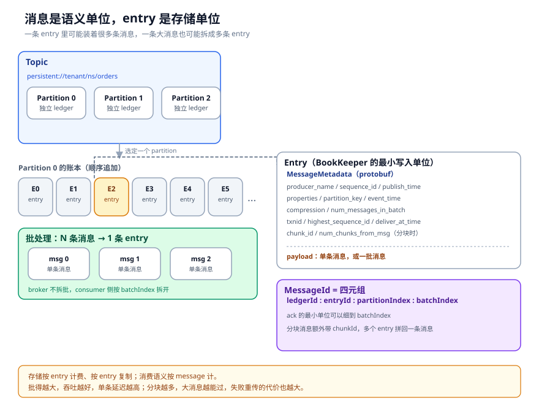
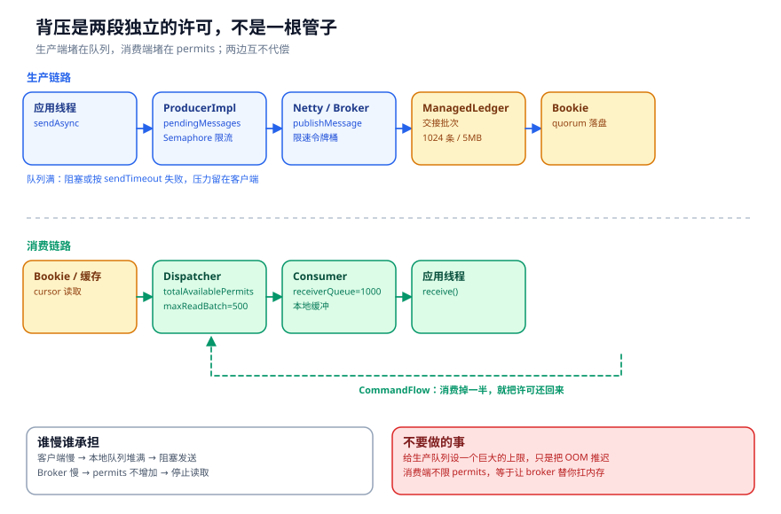
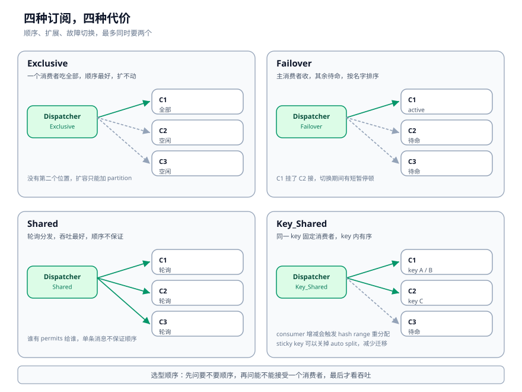

# 消息模型：生产、消费与四种订阅的取舍

「一条消息」在 Pulsar 里是个含糊的说法。

你写代码时看到的是一个对象，带 key、带 value、带 properties。Broker 存的时候看到的是一条 entry，可能装着 100 条消息。消费者 ack 的时候，粒度又可以细到 batch 里的第 3 条。等消息大到超过上限，它还会被拆成多个 chunk，每个 chunk 都是一条 entry。

这几个「条」不是同一件事。分不清它们，就会在延迟、顺序、重复消费上反复踩坑。这一章从编号讲起，一路讲到订阅类型和 ack 语义。

---

## 一、先搞清楚编号

一个 topic 的名字长这样：

```text
persistent://tenant/namespace/orders
```

`persistent` 是域，表示持久化；`tenant/namespace` 是管理边界；`orders` 是主题名。分区 topic 会在后面加 `-partition-N`：

```text
persistent://tenant/namespace/orders-partition-0
```

分区不是 Pulsar 的物理概念，而是逻辑分片。每个分区是一个独立的 topic，有自己的 managed ledger；同一个订阅在每个分区上各有一套 cursor。分区数决定生产/消费的最大并行度，也决定 Key_Shared 的分配粒度。

消息的编号是四元组：



```text
MessageId = (ledgerId, entryId, partitionIndex, batchIndex)
```

- `ledgerId`：这条消息在哪个 ledger；
- `entryId`：在这本 ledger 里的第几条；
- `partitionIndex`：哪个分区；
- `batchIndex`：如果这条 entry 是一个 batch，它是 batch 里的第几条。

大部分 API 只暴露前三个，`batchIndex` 在批量消费和精确 ack 时才会出现。`MessageIdImpl` 的 `toString()` 就是 `ledgerId:entryId:partitionIndex`，`BatchMessageIdImpl` 会多一个 batchIndex。

这里有个容易混淆的地方：**entry 是存储单位，message 是语义单位。** 一条 entry 可以装多条 message（批处理），一条 message 也可以拆成多条 entry（分块）。Broker 写 Bookie 时按 entry 写，消费者处理时按 message 处理。

---

## 二、生产：客户端先替 Broker 挡一层

客户端调 `sendAsync()`，不是直接把消息扔到网络上。它先要拿到一个「发送许可」。

`ProducerImpl.canEnqueueRequest()`（`pulsar-client/.../ProducerImpl.java:1260`）做了两件事：

```java
if (conf.isBlockIfQueueFull()) {
    semaphore.get().acquire();                       // 队列满就阻塞
    client.getMemoryLimitController().reserveMemory(payloadSize);
} else {
    if (!semaphore.map(Semaphore::tryAcquire).orElse(true)) {
        callback.sendComplete(new PulsarClientException.ProducerQueueIsFullError(
                "Producer send queue is full", sequenceId), null);
        return false;                                // 队列满就失败
    }
    if (!client.getMemoryLimitController().tryReserveMemory(payloadSize)) {
        semaphore.ifPresent(Semaphore::release);
        callback.sendComplete(new PulsarClientException.MemoryBufferIsFullError(
                "Client memory buffer is full", sequenceId), null);
        return false;
    }
}
```

两个闸门：待确认消息条数（`maxPendingMessages`）和客户端内存上限。前者防「发出去的消息堆成山」，后者防「消息太大把堆撑爆」。`blockIfQueueFull` 决定队列满时是阻塞还是立刻失败。

拿到许可后，消息可能先进入批处理容器。攒够一批、或者等够时间，再压缩、发出去。批处理是吞吐的主要来源，代价是单条消息的延迟。

Broker 侧的入口是 `ServerCnx.handleSend()`（`:2869`），然后进 `Producer.publishMessage()`，再到 `PersistentTopic.publishMessage()`（`:674`）。这个方法做四件事：

```java
// PersistentTopic.java:674（省略了异常分支里的计数回收）
public void publishMessage(ByteBuf headersAndPayload, PublishContext publishContext) {
    pendingWriteOps.incrementAndGet();
    if (isFenced) { ... }                            // 主题被接管了，拒绝
    if (isExceedMaximumMessageSize(...)) { ... }     // 超过最大消息大小
    if (isExceedMaximumDeliveryDelay(...)) { ... }   // 延迟投递时间太远

    MessageDupStatus status = messageDeduplication.isDuplicate(publishContext, headersAndPayload);
    switch (status) {
        case NotDup:
            asyncAddEntry(headersAndPayload, publishContext);
            break;
        case Dup:
            publishContext.completed(null, -1, -1);  // 直接回 ack
            decrementPendingWriteOpsAndCheck();
            break;
        default:
            publishContext.completed(new MessageDupUnknownException(...), -1, -1);
            decrementPendingWriteOpsAndCheck();
    }
}
```

顺序很重要。fencing 检查在最前面，因为主题被接管后，任何写入都不该落盘。最大消息大小和延迟投递是硬约束，提前拒绝比写到一半失败便宜。去重排在最后，因为它要读消息元数据、查 producer 的 sequenceId，成本比前几个检查高。

去重的粒度是 `producerName + sequenceId`。同一个生产者名字、同一个序号，只保留第一条。它不是全局去重，也不是跨生产者的幂等。生产者重启后如果名字变了，去重就失效了。所以「开去重等于 exactly-once」是个误解，它只能解决生产者重试导致的重复。

---

## 三、消费：Broker 推，客户端给信用

### 3.1 推模型 + 信用

Pulsar 的消费模型经常被描述成「推」。Broker 主动把消息发给消费者，消费者不用轮询。但推的模式最怕一件事：消费者处理不过来，Broker 还在推，最后把客户端内存打爆。

Pulsar 的解法是信用（credit）。消费者订阅时带一个 `receiverQueueSize`，默认 1000。Broker 最多给它发这么多条，发完就停。消费者每消费掉一半，就发一个 `CommandFlow` 把额度还回去。

客户端侧的阈值在 `ConsumerImpl.increaseAvailablePermits()`：

```java
// ConsumerImpl.java:2107
protected void increaseAvailablePermits(ClientCnx currentCnx, int delta) {
    int available = AVAILABLE_PERMITS_UPDATER.addAndGet(this, delta);
    while (available >= getCurrentReceiverQueueSize() / 2 && !paused) {
        if (AVAILABLE_PERMITS_UPDATER.compareAndSet(this, available, 0)) {
            sendFlowPermitsToBroker(currentCnx, available);
            break;
        }
    }
}
```

消费掉一半才补，而不是消费一条补一条。这是为了减少 `CommandFlow` 的网络往返。代价是 Broker 侧的许可会有短暂的低估，但不会超过窗口。

Broker 侧收到 `handleFlow()`（`ServerCnx.java:3023`），把许可加到 `Consumer` 和 dispatcher 的 `totalAvailablePermits`。dispatcher 每次读之前算一下能读多少：

```java
// PersistentDispatcherMultipleConsumers.java:592
protected Pair<Integer, Long> calculateToRead(int currentTotalAvailablePermits) {
    int maxReadBatchSize = Math.min(readBatchSize, serviceConfig.getDispatcherMaxReadBatchSize());
    int messagesToRead = Math.min(currentTotalAvailablePermits, maxReadBatchSize);
    long bytesToRead = serviceConfig.getDispatcherMaxReadSizeBytes();

    Consumer c = getRandomConsumer();
    if (c != null && c.isPreciseDispatcherFlowControl()) {
        int avgMessagesPerEntry = Math.max(1, c.getAvgMessagesPerEntry());
        messagesToRead = Math.min(
                (int) Math.ceil(currentTotalAvailablePermits * 1.0 / avgMessagesPerEntry),
                maxReadBatchSize);
    }
    ...
}
```

三个数决定一次读多少：许可数、`dispatcherMaxReadBatchSize`（默认 500）、`dispatcherMaxReadSizeBytes`（默认 5MB）。如果开了精确流控，还会按「每条 entry 平均装多少消息」折算，避免一批读太多、许可瞬间用完。

读的时候，如果 cursor 追上了最新消息，`asyncReadEntriesOrWait()` 会挂起，等新 entry 写入时再唤醒。这就是「推」的感觉来源：消费者不用轮询，Broker 有新消息会主动送。



### 3.2 异步到底发生在哪

`sendAsync()` 返回一个 `CompletableFuture`。消息并没有立刻上网，它先进 pending 队列，等 Netty 把 `CommandSend` 写出去，再等 Broker 的 `sendReceipt` 回来，future 才完成。

这条链上有三个异步点：

- 客户端攒批：消息在批处理容器里等，攒够或超时才发；
- 网络往返：`CommandSend` 发出去，`sendReceipt` 回来，中间是 IO 线程和回调；
- Broker 落盘：`asyncAddEntry` 之后，写 Bookie 是异步的，ack 回来才触发 `addComplete`。

消费端的 `receive()` 看起来是同步的，实际上是从本地队列取。队列由 Netty 回调填充，`receive()` 只是在队列空的时候阻塞。所以「同步 API」背后仍然是一套异步的填充机制。

Broker 内部也一样。`publishMessage` 返回 `void`，但真正的完成是通过 `PublishContext.completed()` 回调出去的。整条链用 `CompletableFuture` 串起来，回调跑在 topic ordered executor 或 managed-ledger executor 上，不在 Netty IO 线程里。

异步带来的麻烦是错误处理分散。一次发送可能失败在攒批、网络、Broker 校验、Bookie 写入中的任何一步，每一处的异常类型和重试策略都不一样。客户端把这些收敛成 `SendCallback`，但业务侧仍然要处理超时、重试、幂等这三件事。

---

## 四、四种订阅，四种代价

在选订阅之前，先确认分区数。分区是并行的上限，消费者数量超过分区数，多出来的消费者分不到分区，只能空转。分区数也不是越多越好，每个分区都是一套 ledger + cursor + 元数据，分区太多会让 topic 加载和恢复变慢。

Key_Shared 的「key 内有序」只在单个分区内成立。如果同一个订单的消息被写到不同分区，即使订阅类型是 Key_Shared，也保证不了顺序。所以分区键和消息 key 要一起设计：通常用订单号做 partition key，保证同一订单落到同一分区。

订阅类型是 Pulsar 里最需要「按场景选」的一个配置。四种类型没有绝对的好坏，只有代价放在哪。



| 类型 | dispatcher | 顺序 | 扩展性 | 故障切换 | 典型场景 |
| --- | --- | --- | --- | --- | --- |
| Exclusive | `PersistentDispatcherSingleActiveConsumer` | 最强 | 最差，只能一个消费者 | 消费者挂了才能换 | 单分区严格有序、低频控制消息 |
| Failover | `PersistentDispatcherSingleActiveConsumer` | 强 | 中等，多个待命 | 按 consumer name 排序接班 | 主备、分区级有序 |
| Shared | `PersistentDispatcherMultipleConsumers` | 不保证 | 最好 | 自动分摊 | 日志、通知、无顺序要求的任务 |
| Key_Shared | `PersistentStickyKeyDispatcherMultipleConsumers` | key 内有序 | 好 | hash range 重分配 | 订单、账务、按用户维度有序 |

选择逻辑在 `PersistentSubscription.reuseOrCreateDispatcher()`（`:304`）里，就是一段 switch：

```java
// PersistentSubscription.java:304（省略了 dispatcher 复用判断，Key_Shared 只画经典 sticky 分支）
switch (consumer.subType()) {
    case Exclusive:
        dispatcher = new PersistentDispatcherSingleActiveConsumer(
                cursor, SubType.Exclusive, 0, topic, this);
        break;
    case Shared:
        dispatcher = new PersistentDispatcherMultipleConsumers(topic, cursor, this);
        break;
    case Failover:
        dispatcher = new PersistentDispatcherSingleActiveConsumer(
                cursor, SubType.Failover, partitionIndex, topic, this);
        break;
    case Key_Shared:
        dispatcher = new PersistentStickyKeyDispatcherMultipleConsumers(
                topic, cursor, this, config, ksm);
        break;
}
```

几个实践中的细节：

**Exclusive 的「扩不动」是真的扩不动。** 第二个消费者连上来会被拒绝，不是排队。要扩容只能加分区，然后让消费者订阅不同的分区。所以「先用 Exclusive，以后再扩」这种想法，通常会在流量上来时付出迁移成本。

**Failover 的排序依据是 priority level 和 consumer name，不是连接顺序。** 先比优先级，再比名字，排在前面的当 active。对于分区 topic，active 是按分区算的：一个消费者可能在第 0 分区是 active，在第 1 分区是 standby。这一点经常被忽略，导致「明明有两个消费者，为什么只有一个在收」的疑问。

**Shared 的「不保证顺序」不是「完全乱序」。** 单条 entry 内还是有顺序的，同一个消费者收到的消息也是按读取顺序的。但跨消费者、跨重投之后，全局顺序就不成立了。要顺序就别用 Shared。

**Key_Shared 的关键是 hash range。** 消息按 `key`（或 `orderingKey`）哈希，落到某个消费者的 range 里。消费者增减会触发 range 重分配，重分配期间可能有一小段消息重投。`sticky key` 可以关掉自动 split，让 range 更稳定，代价是负载可能不均。

---

## 五、ack 与重投：至少一次是怎么来的

Pulsar 支持两种 ack：

- **Cumulative**：确认这个位置之前的全部消息。只能传一个 position，中间不能有空洞。
- **Individual**：确认指定的若干条，允许中间有空洞。位图存在 `individualDeletedMessages` 里。

`PersistentSubscription.acknowledgeMessageAsync()`（`:471`）按类型分流。累积 ack 走 `cursor.asyncMarkDelete()`，单条 ack 走 `cursor.asyncDelete()`。

ack 之后并不代表消息立刻从 Bookie 删除。删除是异步的，而且受保留策略约束。`markDeletePosition` 只表示「这个位置之前的消息可以删了」，真正删除要等 `trimConsumedLedgers`。

重投有三个来源：

1. **ack 丢失**：Broker 在持久化 ack 之前崩溃，重启后从旧位点读；
2. **ack 超时**：消费者迟迟不 ack，Broker 认为它挂了，重新投递；
3. **负向 ack**：消费者主动 `negativeAcknowledge()`，要求重投。

第一种是「至少一次」的根源，第二种是「消费卡住」的常见原因，第三种是业务自己控制的。三种都会导致重复，区别是重复的窗口大小。

要真正做到「处理一次」，只能在消费端做幂等：用消息里的业务 key 去重，或者把「处理 + 写结果 + ack」放进一个事务。Pulsar 的事务能解决 Broker 侧的原子性，但跨外部系统（比如写 MySQL）仍然要靠业务自己保证。

---

## 六、持久化格式：entry 里到底装了什么

一条 entry 是 `MessageMetadata` 加 payload。`MessageMetadata` 是 protobuf，字段很多，常用的就这些：

```protobuf
message MessageMetadata {
    required string producer_name   = 1;
    required uint64 sequence_id     = 2;
    required uint64 publish_time    = 3;
    repeated KeyValue properties    = 4;
    optional string partition_key   = 6;
    optional CompressionType compression = 8 [default = NONE];
    optional int32 num_messages_in_batch = 11 [default = 1];
    optional uint64 event_time      = 12 [default = 0];
    optional bytes ordering_key     = 18;
    optional int64 deliver_at_time  = 19;
    optional int32 marker_type      = 20;
    optional uint64 txnid_least_bits = 22;
    optional uint64 txnid_most_bits  = 23;
    optional uint64 highest_sequence_id = 24 [default = 0];
    optional int32 num_chunks_from_msg = 27;
    optional int32 total_chunk_msg_size = 28;
    optional int32 chunk_id = 29;
}
```

几个字段值得单独说：

- `compression`：压缩在客户端做，Broker 不解压。支持 NONE / LZ4 / ZLIB / ZSTD / SNAPPY。压缩的是 payload，不是 metadata。
- `num_messages_in_batch`：大于 1 表示这是批量消息。Broker 不拆批，整批当一个 entry 存。消费者读出来再按 `batchIndex` 拆。
- `deliver_at_time`：延迟投递。Broker 会把消息先存下来，到时间才投递。延迟消息不会进 batch，单独发。
- `txnid_*`：事务消息的标记，第五章展开。
- `chunk_id` / `num_chunks_from_msg`：大消息分块。一条消息被切成多个 entry，每个 entry 带 chunk 信息，消费者按 `chunk_id` 拼回去。

分块有个代价：**只要有一个 chunk 丢了，整条消息就不可读。** 而且 chunk 是分开写的，可能落在不同的 ledger 上，恢复时要把它们都找齐。所以能调大 `maxMessageSize` 就调大，别轻易开 chunking。

批处理也有代价。一批消息共享一个 `publish_time` 和一个 `sequence_id` 区间，单条消息的延迟取决于批什么时候关闭。批越大，吞吐越高，尾延迟越差。Pulsar 客户端有 `batchingMaxPublishDelay` 和 `batchingMaxMessages` 两个参数，调的就是这个平衡。

---

## 七、踩坑清单

1. **以为开了去重就是 exactly-once。** 去重只管 producer 重试，不管消费端重复处理。
2. **用 Shared 订阅却要求全局有序。** 顺序在跨消费者那一刻就没了。
3. **Exclusive 订阅配很多分区。** 一个消费者只能消费一个分区，多出来的分区没人读。
4. **Failover 不给消费者起名字。** 名字是自动生成的，排序不确定，主备可能和你想的不一样。
5. **ackTimeout 设得太短。** 业务处理稍慢就重投，重复率飙升。
6. **批量很大，又要求低延迟。** 这两个目标天然冲突，只能选一个。
7. **大消息开 chunking，却不监控 chunk 丢失。** 丢一个 chunk，整条消息读不出来。
8. **receiverQueueSize 设得很大。** 客户端内存上涨，Broker 的许可窗口也变大，故障时重投的量更大。

---

## 附：这一章的源码入口

- `pulsar-client/.../impl/ProducerImpl.java`：`sendAsync()`（`:576`）、`canEnqueueRequest()`（`:1260`）
- `pulsar-client/.../impl/ConsumerImpl.java`：`increaseAvailablePermits()`（`:2107`）
- `pulsar-broker/.../service/ServerCnx.java`：`handleSend()`（`:2869`）、`handleFlow()`（`:3023`）
- `pulsar-broker/.../service/persistent/PersistentTopic.java`：`publishMessage()`（`:674`）
- `pulsar-broker/.../service/persistent/PersistentDispatcherMultipleConsumers.java`：`calculateToRead()`（`:592`）、`sendMessagesToConsumers()`（`:838`）
- `pulsar-broker/.../service/persistent/PersistentSubscription.java`：`reuseOrCreateDispatcher()`（`:304`）、`acknowledgeMessageAsync()`（`:471`）
- `pulsar-common/src/main/proto/PulsarApi.proto`：`MessageMetadata`（`:107`）、`SubType`（`:372`）、`AckType`（`:587`）
- `pulsar-client/.../impl/MessageIdImpl.java`、`BatchMessageIdImpl.java`

---

## 思考题

1. 一个订单 topic 要求「同一订单有序，不同订单可以并行」，你会选哪种订阅？分区键怎么设？
2. 消费者处理一条消息平均要 300ms，ackTimeout 设成 1s，会发生什么？如果设成 30s 呢？
3. 一批 100 条消息写成一个 entry，其中第 50 条处理失败。重投的粒度是整批还是单条？为什么？
