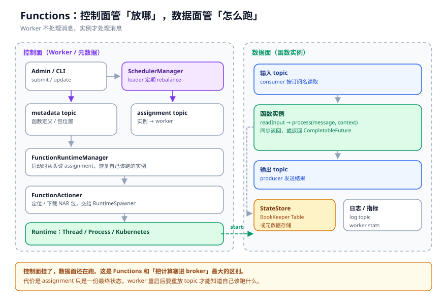
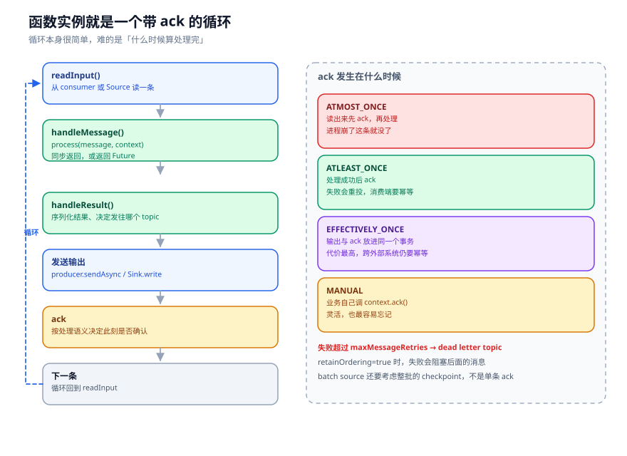

# Functions 与 IO：把计算搬进消息系统

有个很常见的需求：订单 topic 里混着测试单，要先过滤掉，再按用户维度算一个累计金额，最后写到另一个 topic。

正常做法是写一个服务，订阅、处理、再发出去。服务不大，但该有的都得有：部署、扩缩容、监控、重启、发版。为了几十行业务逻辑，养一套服务，很多人是不情愿的。

Pulsar Functions 就是冲着这个场景来的。你把一个 jar 交给它，告诉它从哪读、往哪写，剩下的调度、扩容、重启它来管。

但「把计算搬进消息系统」这句话有个前提：你得知道控制面在哪、数据面在哪、状态存哪、失败了怎么办。这一章把这四件事拆开。

---

## 一、三个角色：Worker、Runtime、Instance

Pulsar Functions 的部署形态有两种：独立 Worker 集群，或者把 Worker 嵌在 Broker 里。不管哪种，角色都分三层：



- **Worker**：控制面。接收 admin 请求，管理函数元数据，做调度决策。
- **Runtime**：运行环境。可以是同进程的线程、子进程，或者 Kubernetes Pod。
- **Instance**：一个函数实例。真正读消息、调 `process()`、写结果的地方。

控制面和数据面是分开的。Worker 挂了，已经在跑的实例不会立刻停；实例挂了，Worker 会尝试重启它。这个分离很重要，它意味着 Functions 不是「Broker 的一个插件」，而是一套独立调度系统，只是恰好把元数据存在 Pulsar topic 里。

元数据存在哪？两个内部 topic：

```yaml
# conf/functions_worker.yml
pulsarFunctionsNamespace: public/functions
functionMetadataTopicName: metadata
functionAssignmentTopicName: assignments
```

拼起来就是 `persistent://public/functions/metadata` 和 `persistent://public/functions/assignments`。函数定义、包位置、实例数这些信息写进 metadata topic；「哪个实例跑在哪个 worker 上」写进 assignment topic。

assignment topic 是一条追加日志，每条消息记录一次分配或解绑。Worker 重启时，`FunctionRuntimeManager.initialize()`（`pulsar-functions/worker/.../FunctionRuntimeManager.java:246`）会用 Reader 从 earliest 读一遍这个 topic，重放出 `workerId → assignments` 的映射，然后只启动属于自己的那些实例。

为什么用 topic 而不是数据库？因为 Pulsar 自己就是干这个的，topic 能持久化、能重放、能跨集群复制，还不用额外运维一个存储。代价是 assignment 的更新是「写一条新消息」，不是「改一行记录」，所以 topic 会越来越长，需要 compaction 或者定期清理。

---

## 二、调度：谁决定实例跑在哪

调度由 leader worker 做。`SchedulerManager` 定期 rebalance，把函数的所有实例摊到可用的 worker 上。分配结果写进 assignment topic，各 worker 读到之后各自启动。

流程大概是这样：

```text
Admin 提交函数
  → Worker 校验、存 metadata topic
  → SchedulerManager（leader）计算分配
      → 每个函数拆成 parallelism 个实例
      → 按实例数摊开
      → 写 assignment topic
  → 各 worker 的 FunctionRuntimeManager 读到分配
      → 属于自己：FunctionActioner.startFunction()
      → 不属于自己：忽略
```

`FunctionActioner.startFunction()`（`:109`）负责把包准备好：

```java
RuntimeSpawner runtimeSpawner = getRuntimeSpawner(
        functionRuntimeInfo.getFunctionInstance(), packageFile, transformFunctionPackageFile);
functionRuntimeInfo.setRuntimeSpawner(runtimeSpawner);
runtimeSpawner.start();
```

包从哪来？三种：本地文件、HTTP URL、内置函数。生产环境一般是先把 NAR 上传到 Pulsar 的 package management，Worker 再按 URL 下载到本地目录。下载失败、包损坏、类找不到，都会在这一步暴露。

`RuntimeSpawner.start()`（`pulsar-functions/runtime/.../RuntimeSpawner.java:76`）启动 runtime，然后起一个定时检查：

```java
runtime.start();
if (!runtimeFactory.externallyManaged() && instanceLivenessCheckFreqMs > 0) {
    scheduleAtFixedRate(() -> {
        if (runtime != null && !runtime.isAlive()) {
            runtime.stop();
            runtime.start();
            numRestarts++;
        }
    }, ...);
}
```

这就是「实例挂了自动拉起」的实现。注意它是按 runtime 粒度重启，不是按消息粒度。如果函数代码里有死循环，重启只能暂时缓解，问题还在。

### 2.1 一次 rebalance 做了什么

`SchedulerManager.rebalance()`（`SchedulerManager.java:247`）本身只是个壳，真正的算法在 `IScheduler.rebalance()`。默认实现是 `RoundRobinScheduler`，逻辑比想象中朴素：

1. 把活跃 worker 各建一个链表，装入它们当前的实例；
2. 找出实例最多的 worker 和实例最少的 worker；
3. 如果两者差距小于等于 1，停止；
4. 否则从最多的那个挪一个实例到最少的那个，重复。

挪完之后，每个新分配写一条 assignment 消息，同时更新 leader 本地的 assignment 缓存。没有两阶段提交，也没有回滚。某条 assignment 应用失败，下一次 rebalance 会重新算一遍，最终收敛。

这个算法只保证「实例数尽量平均」，不保证「负载平均」。一个函数很轻、另一个很重，按实例数摊平之后，重的那个 worker 还是会更忙。要按资源调度，得换自定义的 `IScheduler`。

---

## 三、Runtime 的三种形态

| 形态 | 隔离性 | 启动速度 | 资源开销 | 适用场景 |
| --- | --- | --- | --- | --- |
| Thread | 最差，同 JVM | 最快 | 最小 | 开发、轻量函数、内置函数 |
| Process | 中等，独立进程 | 中等 | 中等 | 生产常用，Java/Python 都支持 |
| Kubernetes | 最好，独立 Pod | 最慢 | 最大 | 多租户、资源隔离要求高 |

Thread 模式下，函数和 Worker 共享 JVM。一个函数 OOM，整个 Worker 一起挂。Process 模式隔离了内存和 CPU，但仍有进程管理的开销。Kubernetes 模式把函数放到单独的 Pod，隔离最彻底，代价是调度链路更长，冷启动更慢。

选哪种不是技术偏好，是运维约束。小团队用 Process 就够了；多租户平台、函数之间互不信任，才值得上 Kubernetes。

## 四、一个实例内部：循环、状态、输出

实例的核心是 `JavaInstanceRunnable.run()`（`pulsar-functions/instance/.../JavaInstanceRunnable.java:375`）。删掉异常处理，骨架非常短：

```java
public void run() {
    setup();
    while (true) {
        currentRecord = readInput();

        boolean atMostOnceAutoAck = instanceConfig.getFunctionDetails().getProcessingGuarantees()
                == ProcessingGuarantees.ATMOST_ONCE
                && instanceConfig.getFunctionDetails().isAutoAck();
        if (atMostOnceAutoAck) {
            currentRecord.ack();
        }

        result = javaInstance.handleMessage(
                currentRecord, currentRecord.getValue(), asyncResultConsumer, asyncErrorHandler);

        if (result != null) {
            handleResult(currentRecord, result);
        }
    }
}
```

`setup()` 做的事不少：加载 NAR、创建类加载器、反序列化用户函数、建 consumer、建 producer、初始化 state store、装日志 appender。任何一步失败，实例都起不来。

`readInput()` 从 consumer 或 Source 读一条。`handleMessage()` 调用户的 `process()`：

```java
// JavaInstance.java:116
Object rawOutput = function != null
        ? function.process(input, context)
        : javaUtilFunction.apply(input);
```

如果返回值是 `CompletableFuture`，`JavaInstance` 会把它放进 `pendingAsyncRequests` 或并发 limiter，等回调再走 `handleResult()`。这就是「异步函数」的支持方式。同步函数直接返回结果，走同一条 `handleResult()`。

`handleResult()` 负责三件事：序列化结果、决定发到哪个 topic、发送。如果函数配置了 `--output`，结果写到输出 topic；如果配置了 `--topic` 或自定义 router，可能写到别的 topic。

---

## 五、处理语义：ack 到底什么时候发

这是 Functions 里最容易被忽略、也最容易出事的地方。



| 语义 | ack 时机 | 失败会怎样 | 代价 |
| --- | --- | --- | --- |
| ATMOST_ONCE | 读出来先 ack，再处理 | 消息丢了，不重投 | 最快，可能丢 |
| ATLEAST_ONCE | 处理成功后 ack | 重投，可能重复 | 默认，需要幂等 |
| EFFECTIVELY_ONCE | 输出与 ack 放进同一个事务 | 不重不丢（在 Pulsar 内） | 最慢，跨外部系统仍要幂等 |
| MANUAL | 业务自己调 `context.ack()` | 忘了就永远不 ack | 最灵活，也最危险 |

默认是 `ATLEAST_ONCE`。它的语义是「至少处理一次」，不是「只处理一次」。如果函数写完数据库、还没 ack 就崩了，重启后这条消息会再处理一遍。所以函数里只要有外部副作用，就必须做幂等。

失败重试由 `maxMessageRetries` 控制。超过次数后，消息进 dead letter topic（DLT）。DLT 是个普通 topic，需要你自己去消费、排查、重放。没有 DLT，失败消息会一直卡在订阅里，把后面的消息堵住。

`retainOrdering=true` 时，失败的消息会阻塞同 key 的后续消息，直到它成功或进 DLT。这是用吞吐换顺序，想清楚再开。

---

## 六、状态：函数也可以有记忆

无状态函数处理一条消息、发一条结果，很简单。但「按用户累计金额」这种需求，需要记住上一次的值。

Pulsar Functions 提供 `Context.getStateStore()`，底层有两种实现：

- `BKStateStoreImpl`：用 BookKeeper 的 Table 服务，key-value 存储，支持计数器；
- `PulsarMetadataStateStoreImpl`：用 Pulsar 的元数据存储，适合小状态。

接口很简单：

```java
StateStore store = context.getStateStore("counts");
Long prev = store.get("user-42");
store.put("user-42", prev == null ? 1L : prev + 1);
```

状态是按函数实例隔离的。函数扩到 4 个实例，每个实例有自己的 state store，不是共享的。这意味着「按用户累计」需要保证同一个用户总是落到同一个实例，否则计数会分散。Functions 没有自动的 key-group 机制，这件事得在函数内部用 hash 或者外部存储解决。

另一个坑是 rebalance。实例从 worker A 迁到 worker B，state store 不会自动跟过去。如果状态很重要，要么用外部存储（Redis、数据库），要么接受迁移后的短暂不一致。

---

## 七、IO 连接器：Source 和 Sink 的极简契约

Functions 解决「消息进来、计算、消息出去」。如果数据源不是 Pulsar，或者目的地不是 Pulsar，就需要连接器。

连接器的核心接口只有两个：

```java
// pulsar-io/core/.../Source.java:28
public interface Source<T> extends AutoCloseable {
    void open(Map<String, Object> config, SourceContext context) throws Exception;
    Record<T> read() throws Exception;
}

// pulsar-io/core/.../Sink.java:31
public interface Sink<T> extends AutoCloseable {
    void open(Map<String, Object> config, SinkContext context) throws Exception;
    void write(Record<T> record) throws Exception;
}
```

`Source.read()` 是拉模型，读不到就阻塞。`Sink.write()` 是推模型，来一条写一条。连接器自己决定怎么实现：JDBC 用查询、Kafka 用 poll、文件用逐行读。

还有一种反过来的 `PushSource`：外部系统主动把数据推给连接器，连接器再调用 `consume(record)`。Kafka 的 consumer 更适合拉模型，所以大多数 Kafka Source 实现的是 `Source`；webhook、MQTT 这类推送型数据源，用 `PushSource` 更自然。

连接器打包成 NAR（NiFi Archive），里面包含依赖 jar 和 `META-INF/services` 声明。Worker 用 `NarClassLoader` 加载，每个连接器一个类加载器，避免依赖冲突。配置项用 `@FieldDoc` 注解描述，admin 接口能自动生成配置 schema。

这个版本的仓库里只保留了 `pulsar-io/core` 和 `data-generator` 等少数示例，Kafka、JDBC、Elasticsearch 这些连接器需要单独获取。这个拆分对使用方其实是好事：核心仓库保持稳定，连接器独立发版，不用为了一个 JDBC 驱动升级整个 Pulsar。

### 7.1 连接器是怎么打包的

NAR 不是普通 jar。它把连接器代码和依赖一起打包，解压后能看到 `META-INF/bundled-dependencies/` 目录，里面是连接器自己的依赖。Worker 用 `NarClassLoader` 加载，每个 NAR 一个类加载器。这样两个连接器依赖不同版本的 Jackson，也不会互相覆盖。

包的管理走 Pulsar 自己的 package management：上传后存进 BookKeeper 和元数据，Worker 按 URL 下载到本地目录。URL 协议受 `PackageUrlValidator` 限制，避免有人用 `file://` 读服务器上的任意文件。这个检查看起来小，但在多租户环境里是必须的。

---

## 八、什么时候不该用 Functions

Functions 很适合「轻量、无状态、事件驱动」的场景。下面这些情况，老老实实写服务更好：

- **重 CPU / GPU**：视频转码、模型推理，Functions 的调度粒度太粗，资源也不匹配。
- **长事务、复杂依赖**：函数包越大，冷启动越慢，依赖冲突越难查。
- **需要精细扩缩容**：Functions 的并行度是静态配置的，不能按 QPS 自动伸缩。
- **跨外部系统的 exactly-once**：Pulsar 事务管不到 MySQL，最终还是要业务幂等。
- **需要长时间运行的后台任务**：Functions 是为消息处理设计的，不是为常驻任务设计的。

一句话：**Functions 适合「一条消息进来、几毫秒到几秒处理完、结果发出去」的活。** 超出这个形状，框架会跟你打架。

---

## 九、踩坑清单

1. **用 ATLEAST_ONCE 却不做幂等。** 重复是常态，不是异常。
2. **不配 dead letter topic。** 一条毒消息能把整个订阅堵死。
3. **函数里做阻塞 IO，还开很多并发。** 实例线程被占满，吞吐反而下降。
4. **状态存在本地内存。** 实例一重启就丢，rebalance 后还会分片。
5. **NAR 包带了大依赖。** 冷启动变慢，类冲突变多。
6. **以为 Worker 挂了函数就停了。** 数据面还在跑，但没人调度新实例。
7. **parallelism 设得比分区数大。** 多出来的实例分不到分区，白占资源。

---

## 附：这一章的源码入口

- `pulsar-functions/worker/.../PulsarWorkerService.java`：`start()`（`:427`）
- `pulsar-functions/worker/.../SchedulerManager.java`：`rebalance()`（`:247`）
- `pulsar-functions/worker/.../FunctionRuntimeManager.java`：`initialize()`（`:246`）
- `pulsar-functions/worker/.../FunctionActioner.java`：`startFunction()`（`:109`）
- `pulsar-functions/runtime/.../RuntimeSpawner.java`：`start()`（`:76`）
- `pulsar-functions/instance/.../JavaInstanceRunnable.java`：`setup()`（`:260`）、`run()`（`:375`）、`setupInput()`（`:888`）、`setupOutput()`（`:1150`）
- `pulsar-functions/instance/.../JavaInstance.java`：`handleMessage()`（`:116`）
- `pulsar-functions/instance/.../state/BKStateStoreImpl.java`（`:39`）
- `pulsar-functions/api-java/.../Function.java`（`:34`）
- `pulsar-io/core/.../Source.java`（`:28`）、`Sink.java`（`:31`）、`PushSource.java`
- `pulsar-functions/runtime/.../worker/WorkerConfig.java`：metadata / assignment topic 拼接（`:911`、`:919`）

---

## 思考题

1. 一个函数要按用户维度累计金额，parallelism=8，怎么保证同一个用户落到同一个实例？
2. ATLEAST_ONCE + 写 MySQL，重复消息会造成什么后果？你会用哪种幂等方案？
3. 为什么 Functions 的 assignment 用 topic 存，而不是用元数据存储的单个节点？各有什么代价？
