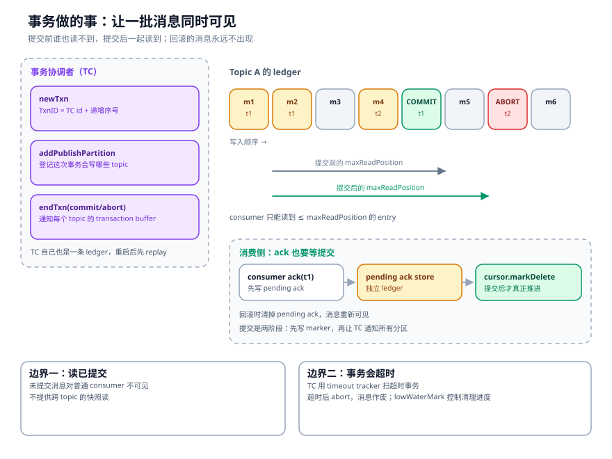
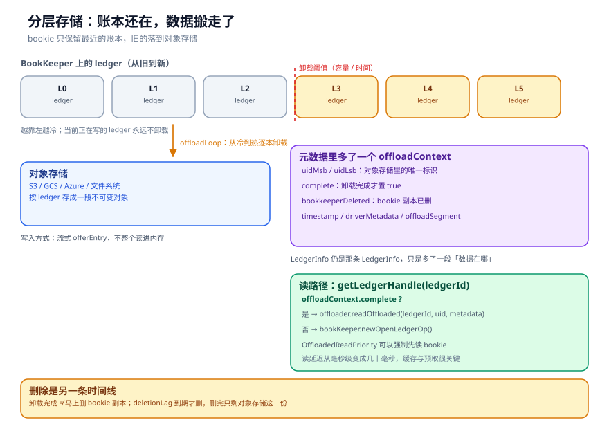
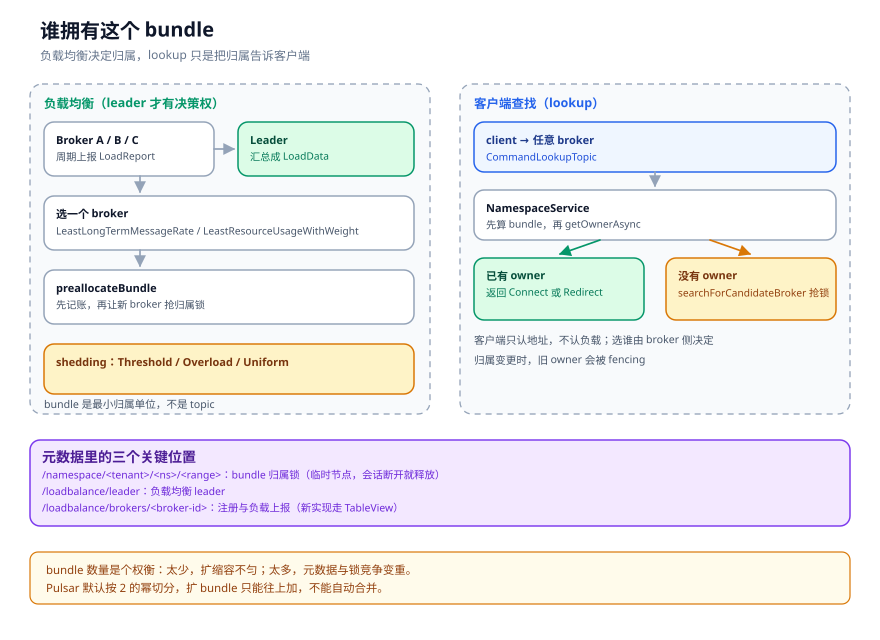
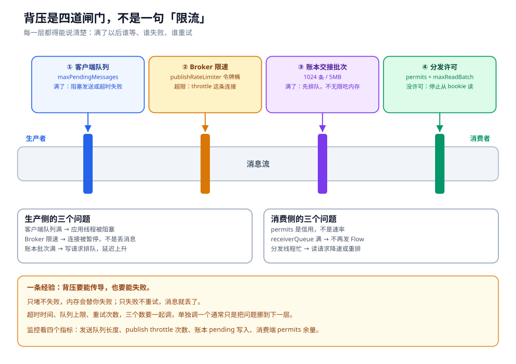

# 事务、卸载与负载均衡：把意外收进工程边界

前四章讲的都是正常路径：消息发出去、存下来、被消费、函数处理完。

生产环境里让人半夜起床的，通常不是正常路径，而是四种边界：写了一半失败、数据太老占着磁盘、机器负载不均、流量突然超过处理能力。这四个问题分别对应事务、分层存储、负载均衡和背压。

它们看起来不相干，其实都在回答同一个问题：**当系统不能按预期继续时，怎么把不确定性收进一个可控的范围。**

---

## 一、事务：让一批消息同时可见

先想一个场景。一个转账操作要写两条消息：A 账户扣 100，B 账户加 100。如果只写成功一条，下游就会算错账。你需要的是一组消息，要么都可见，要么都不可见。

Pulsar 的事务解决的就是这个。它不提供数据库那种隔离级别，只保证一件事：**同一事务内的消息，在提交前对消费者不可见，提交后一起可见。**

### 1.1 三个角色

- **TC（Transaction Coordinator）**：事务协调者。分配 TxnID，记录事务状态，决定提交还是回滚。
- **TB（Transaction Buffer）**：每个 topic 一个。暂存这个 topic 上的事务消息，写 commit/abort marker。
- **Pending Ack Store**：每个 topic-subscription 一个。消费侧在事务里的 ack，先写这里，提交后才真正推进游标。

TC 的状态也存在一本 managed ledger 里，名字是 `persistent://pulsar/system/__transaction_log_<tcId>`。它不是普通的消息 topic，没有生产者消费者，只追加事务日志。TC 重启后先 replay 这段日志，恢复未完成的事务。

```java
// pulsar-transaction/coordinator/.../MLTransactionMetadataStore.java:246
// 省略了 maxActiveTransactions 判断和线程切换
CompletableFuture<TxnID> completableFuture = new CompletableFuture<>();
long mostSigBits = tcID.getId();
long leastSigBits = sequenceIdGenerator.generateSequenceId();
TxnID txnID = new TxnID(mostSigBits, leastSigBits);
long now = System.currentTimeMillis();

TransactionMetadataEntry entry = new TransactionMetadataEntry()
        .setTxnidMostBits(mostSigBits)
        .setTxnidLeastBits(leastSigBits)
        .setStartTime(now)
        .setTimeoutMs(timeOut)
        .setMetadataOp(TransactionMetadataOp.NEW);

transactionLog.append(entry).whenComplete((position, throwable) -> {
    TxnMeta txn = new TxnMetaImpl(txnID, now, timeOut, owner);
    txnMetaMap.put(leastSigBits, MutablePair.of(txn, List.of(position)));
    timeoutTracker.addTransaction(leastSigBits, timeOut);
    completableFuture.complete(txnID);
});
```

TxnID 的高位是 TC 的 id，低位是递增序号。这个设计让 TxnID 自带「归哪个 TC 管」的信息，客户端拿到之后就知道该找谁提交。

### 1.2 写入时，消息其实已经落盘了

这点很反直觉。事务消息在提交前，**已经写进了 topic 的 ledger**，和普通消息一样占用存储、参与复制。区别在于，消费者看不到它。

怎么做到的？靠 `maxReadPosition`。



`TopicTransactionBuffer` 维护一个 `maxReadPosition`，初始值是当前 ledger 的 lastConfirmedEntry。事务消息写入时，这个位置不动。dispatcher 读取时会把 `maxReadPosition` 作为上界：

```java
// PersistentDispatcherMultipleConsumers.java:463
cursor.asyncReadEntriesOrWait(
        messagesToRead, bytesToRead, this,
        topic.getMaxReadPosition(), createReadEntriesSkipConditionForNormalRead());
```

所以未提交的事务消息就在 ledger 里躺着，但读取游标到不了那里。提交时，TB 往 ledger 追加一条 commit marker，然后把 `maxReadPosition` 推过 marker，消息才进入可读范围。

### 1.3 提交与回滚

提交的代码很短：

```java
// TopicTransactionBuffer.java:492（省略了等待 buffer 恢复的 thenRun）
CompletableFuture<Void> completableFuture = new CompletableFuture<>();
ByteBuf commitMarker = Markers.newTxnCommitMarker(
        -1L, txnID.getMostSigBits(), txnID.getLeastSigBits());

topic.getManagedLedger().asyncAddEntry(commitMarker, new AddEntryCallback() {
    public void addComplete(Position position, ByteBuf entryData, Object ctx) {
        synchronized (TopicTransactionBuffer.this) {
            removeTxnAndUpdateMaxReadPosition(txnID);
            handleLowWaterMark(txnID, lowWaterMark);
            takeSnapshotByChangeTimes();
        }
        updateLastDispatchablePosition(null);
        completableFuture.complete(null);
    }
    ...
}, null);
```

commit marker 是一条特殊的 entry，它不包含用户数据，只带 txnid。它的作用是给这个 topic 一个「提交点」：marker 之前的这个事务的消息，从此可见。

回滚类似，只是写的是 abort marker，并且把 txnid 记进 `AbortedTxnProcessor`。消费者读到 abort marker 之前的消息时，会查这个索引，跳过属于该事务的 entry。

为什么要把 marker 写进 topic 的 ledger，而不是只存在 TC 里？因为可见性判断必须跟数据在一起。如果只存 TC，TC 挂了或者网络分区，这个 topic 就不知道哪些消息该可见。marker 写进 ledger 之后，判断是幂等的：重放 ledger 就能重建可见性。

### 1.4 消费侧的 ack 也要等提交

生产侧的事务解决「多条消息一起可见」。消费侧还有另一个问题：消费者处理完消息，在事务里 ack，但这个事务还没提交，ack 该不该生效？

Pulsar 的做法是先把 ack 写进 pending ack store，提交时才真正 `markDelete`。

```text
consumer.ack(txnId, msgId)
  → PendingAckHandle.individualAcknowledgeMessage()
    → MLPendingAckStore.appendIndividualAck(txnId, positions)
      → 写入 <topic>-<subscription>__transaction_pending_ack 这本 ledger

transaction.commit()
  → PendingAckHandle.commitTxn(txnId)
    → appendCommitMark(txnId)
      → 把 pending 的 ack 应用到 cursor，推进 markDeletePosition
```

回滚时清掉 pending ack，消息重新可见。这套机制保证 ack 与事务提交原子生效，不会出现「消息处理了但 ack 没生效」或者反过来。处理逻辑本身是否幂等，仍然由业务负责。

### 1.5 事务的边界

Pulsar 事务有几个明确的边界，用之前要知道：

- **读已提交，不是可串行化。** 消费者只能看到已提交的消息，但看不到事务之间的顺序保证。
- **事务有超时。** TC 用 `TransactionTimeoutTracker` 扫超时事务，超时后 abort。超时时间太短，业务还没处理完就回滚；太长，未提交消息会一直占着 `maxReadPosition`，阻塞后面的消息。
- **不跨集群。** 事务是集群内的，geo-replication 复制的是已经提交的消息。
- **有 lowWaterMark。** 每个 TC 会把自己已经处理到的位置告诉 topic buffer，buffer 用它来裁剪 abort 索引和快照。水位线滞后太久，清理就会变慢。

### 1.6 TC 不是一台机器，是分区系统 topic

事务默认是关闭的：`transactionCoordinatorEnabled=false`（`conf/broker.conf:2305`）。开启后 `PulsarService` 才创建 `TransactionMetadataStoreService`；TC 本身是懒加载的——客户端第一次 `TcClientConnect(tcId)`，服务先确认 `transaction_coordinator_assign` 的分区归属，再 open + replay 这个 TC 的日志（`TransactionMetadataStoreService.java:109-146`）。并发连接同一个 tcId 会被一个 semaphore 合并，pending 连接 30 秒超时。

TC 的 assign topic 是 `persistent://pulsar/system/transaction_coordinator_assign-partition-N`（`SystemTopicNames.java:67-68`），事务日志是 `__transaction_log_<tcId>`（`MLTransactionLogImpl.java:64`、`:106`）。HEAD 里没有 `TransactionCoordinator` 这个类，真正干活的是 `TransactionMetadataStoreService` 和每个 tcId 的 `MLTransactionMetadataStore`。

状态机是 `None → Initializing → Ready → Closing → Close`（`TransactionMetadataStoreState.java:31-37`）；事务状态是 `OPEN / COMMITTING / COMMITTED / ABORTING / ABORTED`。`newTransaction()` 写一条 NEW 日志并生成 `TxnID(most=tcId, least=seq)`（`MLTransactionMetadataStore.java:246-299`）；commit / abort 没有独立方法，统一走 `updateTxnStatus` 写 UPDATE 并校验 expectedStatus（`:392-462`）。恢复时 OPEN 重新进 timeout tracker，COMMITTING / ABORTING 重新驱动到终态（`TransactionRecoverTrackerImpl.java:123-130`）。客户端事务超时默认 60 秒（`TransactionBuilderImpl.java:38`），broker 的 tracker 100ms tick，到期 abort；`maxActiveTransactionsPerCoordinator=0` 表示不限量（`broker.conf:2329`）。

### 1.7 PendingAck 的恢复顺序

消费侧的事务 ack 先写进 `<topic>-<sub>-__transaction_pending_ack` 这本 ledger（`MLPendingAckStoreProvider.java:114-116`）。提交时 `PendingAckHandleImpl.commitTxn()` 把 pending ack 应用到真实 cursor（`:786-791`）；回滚则 redeliver（`:603-617`）。恢复期间订阅不会提前就绪（`:195-220`、`PersistentSubscription.java:261`）——如果 pending ack 还没 replay 完，commit 会排队或抛 `ServiceUnitNotReadyException`。这也解释了为什么事务 topic 的加载比普通 topic 慢：它多了一次 pending ack 的恢复。

---

## 二、分层存储：把冷数据挪走

消息系统有个绕不开的矛盾：保留时间越长，占的磁盘越多。但大部分历史消息，其实一年都不会被读一次。

分层存储的思路很直接：热的留在 Bookie，冷的搬到对象存储。Bookie 的磁盘只需要装最近几天，保留策略可以设几个月甚至几年。

### 2.1 什么时候触发卸载

`ManagedLedgerImpl.maybeOffload()`（`:3251`）按两个阈值判断：容量和时间。

```java
for (Map.Entry<Long, LedgerInfo> e : ledgers.descendingMap().entrySet()) {
    LedgerInfo info = e.getValue();
    if (info.getTimestamp() == 0L) {
        continue;                                  // 当前正在写的 ledger，跳过
    }
    sizeSummed += info.getSize();
    boolean alreadyOffloaded = info.hasOffloadContext() && info.getOffloadContext().isComplete();
    if (alreadyOffloaded) {
        alreadyOffloadedSize += info.getSize();
    } else if ((offloadThresholdInBytes >= 0 && sizeSummed > offloadThresholdInBytes)
            || (offloadTimeThresholdMillis >= 0 && now - info.getTimestamp() >= offloadTimeThresholdMillis)) {
        toOffload.addFirst(info);                  // 超过阈值的旧 ledger，加入待卸载
    }
}
```

从新到旧扫描，累计大小超过阈值、或者 ledger 的年龄超过阈值，就加入待卸载列表。当前正在写的 ledger（timestamp=0）永远跳过，因为它还在追加。

### 2.2 卸载写什么



卸载不是把整个 ledger 读进内存再上传。`LedgerOffloader.OffloadHandle` 提供了流式接口：`offerEntry(entry)` 一条一条写，写满一段就 `close()`，再开下一段。这样内存占用是可控的。

写完之后，元数据里的 `LedgerInfo` 会多一个 `offloadContext`：

```text
offloadContext {
  uidMsb / uidLsb        // 对象存储里的唯一标识
  complete               // 卸载完成才置 true
  bookkeeperDeleted      // Bookie 副本已删
  timestamp
  driverMetadata
  offloadSegment[]
}
```

`complete=true` 是读路径的分水岭。没有它，Broker 仍然从 Bookie 读；有了它，Broker 可以去对象存储读。

### 2.3 读路径怎么选

`ManagedLedgerImpl.getLedgerHandle()`（`:2556`）打开一本 ledger 时，先看 `offloadContext`：

```java
if (info != null && info.hasOffloadContext() && info.getOffloadContext().isComplete()) {
    UUID uid = new UUID(info.getOffloadContext().getUidMsb(), info.getOffloadContext().getUidLsb());
    openFuture = config.getLedgerOffloader().readOffloaded(ledgerId, uid, driverMetadata);
} else {
    openFuture = bookKeeper.newOpenLedgerOp()
            .withRecovery(!isReadOnly())
            .withLedgerId(ledgerId)
            ...
}
```

如果配置了 `OffloadedReadPriority.BOOKKEEPER_FIRST`，即使已经卸载，也会先尝试从 Bookie 读。这个选项适合「刚卸载不久、Bookie 副本还没删」的窗口，能避免一次对象存储的冷读。

### 2.4 删除与代价

卸载完成不等于马上删 Bookie 副本。`isOffloadedNeedsDelete()` 会看 `deletionLag`，到期才删。删完之后 `bookkeeperDeleted=true`，只剩对象存储这一份。

这套机制有三个代价，选型时要算：

- **读延迟**：对象存储的首字节延迟通常是几十毫秒，比 Bookie 高一个数量级。追历史数据、重放、新消费者从头读，都会变慢。
- **流量费**：对象存储的读流量是要钱的，尤其是跨区读。
- **卸载带宽**：卸载任务和正常写入共享网络，跑得太猛会影响在线延迟。

所以分层存储适合「历史数据多、读得少」的场景。如果业务每天都在重算全量历史，卸载反而会让查询变慢，不如直接加 Bookie 磁盘。

---

## 三、负载均衡：bundle 归谁

Pulsar 的负载均衡单位是 bundle，不是 topic。

一个 namespace 被切成若干个 hash range，每个 range 就是一个 bundle。topic 按名字哈希落到某个 bundle，bundle 再归属到某个 Broker。一个 Broker 可以拥有多个 bundle，一个 bundle 里的所有 topic 都归它管。

为什么用 bundle 而不是 topic？因为 topic 太多了。一个集群几十万个 topic，如果每个 topic 单独做归属，元数据量和锁竞争都受不了。bundle 把粒度放大，通常一个 namespace 几十到几百个 bundle，管理成本可控。

### 3.1 经典实现：LoadReport + Leader

默认的 `ModularLoadManagerImpl` 是这套逻辑：

1. 每个 Broker 周期上报 `LoadReport`：CPU、内存、direct memory、带宽、topic 数、bundle 数。
2. Leader 汇总成 `LoadData`，按 broker 和 bundle 两个维度拆开。
3. 新 bundle 需要归属时，`selectBrokerForAssignment()`（`:969`）选一个负载最低的 Broker。
4. 选中的 Broker 去抢 `/namespace/<tenant>/<ns>/<range>` 这个锁，抢到才算真正拥有。
5. Leader 周期性做 shedding，把高负载 Broker 上的 bundle 迁走。

```java
// ModularLoadManagerImpl.java:969
public Optional<String> selectBrokerForAssignment(final ServiceUnitId serviceUnit) {
    synchronized (brokerCandidateCache) {
        final String bundle = serviceUnit.toString();
        if (preallocatedBundleToBroker.containsKey(bundle)) {
            return Optional.of(preallocatedBundleToBroker.get(bundle));
        }
        Optional<String> broker = selectBroker(serviceUnit);
        broker.ifPresent(b -> preallocateBundle(bundle, b));
        return broker;
    }
}
```

`preallocateBundle` 是个容易被忽略的细节。处理 lookup 的 Broker 选完目标之后，先在本地记一笔「这个 bundle 预分配给谁」，再把客户端 redirect 过去。目标 Broker 收到请求后才去抢锁。这样在抢锁完成之前，重复的 lookup 不会又选一个不同的 Broker。

shedding 策略有几种：`ThresholdShedder` 按阈值搬、`OverloadShedder` 按过载搬、`UniformLoadShedder` 按流量均匀搬。选哪种取决于集群的负载形状。CPU 密集和流量密集的集群，最优策略不一样。

### 3.2 新实现：BrokerRegistry + ServiceUnitStateChannel

`ExtensibleLoadManagerImpl` 换了一套思路：

- `BrokerRegistry` 用 metadata cache / TableView 维护 broker 列表和 lookup data，不再靠 ZK 临时节点逐个读。
- `ServiceUnitStateChannel` 用一条系统 topic 维护 bundle 的状态机：`Owned`、`Assigning`、`Releasing`、`Splitting` 等。归属变更变成事件，不再是锁竞争。
- `selectAsync()`（`:615`）先查 channel 里的 owner，没有再做选择。

这套实现的好处是可扩展：bundle 数量很大时，状态 channel 的分区能力比单个 ZK 节点好。代价是组件更多，排障链路更长。

| 维度 | ModularLoadManager | ExtensibleLoadManager |
| --- | --- | --- |
| 归属存储 | ZK 临时节点 / 元数据锁 | 系统 topic + TableView |
| 选主 | `/loadbalance/leader` | 同样的 leader 机制 |
| 扩展性 | 受元数据节点数限制 | 按 topic 分区扩展 |
| 运维复杂度 | 低 | 高 |

### 3.3 Broker 查找：把归属告诉客户端

负载均衡决定「谁拥有」，lookup 负责「告诉客户端去找谁」。



客户端连到任意一个 Broker，发 `CommandLookupTopic`。Broker 的处理在 `NamespaceService.getBrokerServiceUrlAsync()`（`:222`）：

```text
getBrokerServiceUrlAsync(topic, options)
  → getBundleAsync(topic)                    // 算 hash，找 bundle
    → getOwnershipCache().getOwnerAsync()    // 查归属
      ├─ 有 owner → createLookupResult() → Connect / Redirect
      └─ 无 owner → searchForCandidateBroker() → 抢锁
```

如果 owner 就是当前 Broker，返回 `Connect`，客户端直接在这个连接上建 producer/consumer。如果 owner 是别的 Broker，返回 `Redirect`，客户端带着 `authoritative=true` 再问一次。

这里有个细节：`Redirect` 不是错误，是正常流程。客户端第一次连的 Broker 不一定是 owner，所以新 topic 的 lookup 经常会有一次 redirect。这也是为什么「lookup 延迟」不能只看单次请求，要看「redirect 次数 × 单次 RTT」。

归属变更时，旧 owner 可能还在处理请求。Pulsar 用两层防护：元数据锁的版本号，以及 BookKeeper 的 ledger fencing。新 owner 打开 ledger 时会 fence 旧的 writer，旧 writer 的写入会失败，然后触发 `addEntryFailedDueToConcurrentlyModified()` 的归属检查。这套机制不保证「零重复」，但能保证「不会有两个 owner 同时写」。

---

## 四、并发与背压

### 4.1 四个线程池，各管一段

Pulsar Broker 的并发模型可以粗分成四层：

| 线程池 | 管什么 | 关键约束 |
| --- | --- | --- |
| Netty IO | 读写 socket、拆协议包 | 不能做阻塞操作 |
| topic ordered executor | 同一 topic 的写入、分发、ack | 按 topic 名固定线程 |
| managed-ledger executor | 账本写入、ledger 切换、游标持久化 | 按 ledger 名固定线程 |
| BookKeeper IO | 和 Bookie 的网络往返 | 独立的 Netty event loop |

`BrokerService` 创建 topic executor 时，线程数默认是 CPU 核数：

```java
// BrokerService.java:390
this.topicOrderedExecutor = OrderedExecutor.newBuilder()
        .numThreads(pulsar.getConfiguration().getTopicOrderedExecutorThreadNum())
        .name("broker-topic-workers").build();
```

`PersistentTopic` 构造时用 `chooseThread(topic)` 把自己绑到其中一个线程。这样同一个 topic 的所有操作都在同一个线程里串行执行，不需要为 topic 内部状态加锁。

ManagedLedger 更彻底，它直接用 BookKeeper 的主 worker pool，按 ledger 名选线程：

```java
// ManagedLedgerImpl.java:427
this.executor = (ThreadBoundExecutor) bookKeeper.getMainWorkerPool().chooseThread(name);
```

这行代码解释了一个常见现象：**同一个 Bookie 客户端上的不同 ledger，可能互相影响。** 如果某个 ledger 的回调里做了重活，它会堵住绑在同一线程上的其他 ledger。所以回调里不能做阻塞 IO，也不能做大的序列化。

### 4.2 四道闸门



背压不是一句「限流」，而是四道独立的闸门：

1. **客户端队列**：`maxPendingMessages` + 内存上限。满了阻塞或失败，压力留在应用线程。
2. **Broker 发布限速**：`publishRateLimiter` 用令牌桶，超限就 throttle 这条连接。它不丢消息，只是让发送方慢下来。
3. **账本交接批次**：`addEntryHandoverMaxBatchItems=1024`、`addEntryHandoverMaxBatchBytesSize=5MB`。超过就分批，避免一次吃太多 direct memory。
4. **分发许可**：dispatcher 的 `totalAvailablePermits` + `maxReadBatch`，没有许可就停止从 Bookie 读。

这四道闸门是串联的，但**不共享一个队列**。生产端堵了，不会直接让消费端停；消费端慢了，也不会让生产端立刻失败。它们各自有超时和重试，压力逐层传导。

### 4.3 超时是背压的一部分

只堵不失败，内存会替你失败。所以每一层都要有超时：

- 客户端 `sendTimeout`：消息在 pending 队列里等太久，失败；
- Broker `topicLoadTimeoutSeconds`：topic 加载超时，返回错误而不是无限等；
- 元数据 `metadataOperationsTimeoutSeconds`：ledger 创建/更新超时；
- 消费 `ackTimeout`：太久不 ack，重投；
- 事务超时：太久不提交，abort。

这些超时时间要一起调。只调一个，通常只是把问题挪到下一层。比如 sendTimeout 调大，客户端队列会堆得更久，最后 OOM；调小，Broker 稍微抖一下就开始大量失败。

### 4.4 Broker 侧还有两道隐形闸门

前文的四道闸门是教学模型。到了 Broker 内部，还有两道更容易忽略的闸门：

1. **连接级在途发布**：`ServerCnx` 对每条连接限制 pending publish，默认 1000，降到 500 才恢复（`ServerCnx.java:392-393`）。超限会暂停这条连接的读取。
2. **IO 线程级字节**：每个 Netty IO 线程还有 pending 字节上限，默认是 `maxMessagePublishBufferSizeMB / numIOThreads`，而 `maxMessagePublishBufferSizeMB` 默认取 `max(64MB, 直接内存/2)`（`ServerCnx.java:397-399`、`ServiceConfiguration.java:1936`）。超过一半恢复，超限就 `setAutoRead(false)`（`ServerCnxThrottleTracker.java:304-311`）——注意这会停掉**同一个 IO 线程上的所有连接**，不只是慢的那个 topic。

另外，`publishRateLimiter` 的默认值是 0（关闭；`ServiceConfiguration.java:1255`、`:1262`、`:1293`、`:1300`）；backlog quota 默认 `-1`（关闭），策略默认 `producer_request_hold`（`conf/broker.conf:219`、`:228`），每 60 秒检查一次；未 ack 消息超过 50000/200000 也会阻塞消费（`ServiceConfiguration.java:1148`、`:1156`）。所以“背压没生效”先别怀疑代码，先确认这些开关是不是根本没开。

---

## 五、把五章串起来：一条消息的一生

现在把前面所有东西接起来，走一遍完整旅程。

1. 客户端 `sendAsync`，拿到信号量许可，消息进 pending 队列。
2. 连接建立前，客户端先 lookup，Broker 算出 bundle，查归属，返回 Connect 或 Redirect。
3. 消息到达 `ServerCnx`，转给 `Producer.publishMessage`，做校验、去重、限速。
4. `PersistentTopic.publishMessage` 检查 fencing、大小、延迟投递，然后 `asyncAddEntry`。
5. `ManagedLedger` 把写请求交接给批处理 executor，`OpAddEntry` 写到当前 ledger。
6. BookKeeper 把 entry 写到 writeQuorum 个 Bookie，收齐 ackQuorum 个 ack。
7. 回调更新 `lastConfirmedEntry` 和 entry cache，返回 `sendReceipt`。
8. 当前 ledger 满了，关闭它，把 ledger 列表写进元数据，创建新 ledger。
9. 消费者订阅，Broker 创建 cursor 和 dispatcher，按订阅类型选分发策略。
10. dispatcher 按 permits 读取 entry，发给消费者；消费者处理完发 `CommandFlow` 还许可。
11. ack 异步写进元数据（累积）或 cursor ledger（位图），崩溃窗口内可能重投。
12. 如果开了事务，消息先写进 ledger 但 `maxReadPosition` 不前进；提交时写 marker，才可见。
13. 如果开了分层存储，旧 ledger 被卸载到对象存储，元数据里多一个 `offloadContext`。
14. 如果 Broker 挂了，bundle 锁过期，新 Broker 接管，从元数据读 ledger 列表，恢复最后一本 ledger 和所有 cursor。
15. 如果流量超过处理能力，四道闸门依次生效：客户端队列、Broker 限速、账本批次、分发许可。

这十五步里，任何一步失败都有对应的恢复机制。但没有一个机制能保证「绝对不丢、绝对不重」。Pulsar 给你的是「可配置的权衡」：ackQuorum 决定耐久性，订阅类型决定顺序，事务决定原子性，分层存储决定成本。

---

## 六、踩坑清单

1. **事务超时设得太短。** 业务还没处理完就 abort，日志里全是回滚。
2. **事务里做长耗时操作。** 未提交消息会卡住 `maxReadPosition`，后面的消息也读不到。
3. **卸载阈值设得太低。** 刚写完就卸载，读的时候全是对象存储冷读。
4. **Bookie 副本删得太早。** deletionLag 太短，对象存储出问题就没有退路。
5. **bundle 数量拍脑袋。** 太少扩缩容不匀，太多元数据压力大。
6. **只调 sendTimeout，不调队列上限。** 问题只是从「失败」变成「OOM」。
7. **在 BookKeeper 回调里做重活。** 会堵住绑在同一线程上的其他 ledger。
8. **忽略 lookup redirect。** 客户端连接慢，可能不是网络问题，是 redirect 次数太多。

---

## 思考题

1. 一个事务写了 topic A 和 topic B 各一条消息，提交时 topic A 的 marker 写成功、topic B 的写失败。Pulsar 会怎么处理？客户端看到什么？
2. 分层存储开了之后，一个新消费者从 earliest 读，读延迟会怎么变化？哪些缓存能缓解？
3. 如果把 `topicOrderedExecutorThreadNum` 从 CPU 核数调到 2，会发生什么？哪些指标会先恶化？

---

## 附：这一章的源码入口

**事务**

- `pulsar-broker/.../TransactionMetadataStoreService.java`：TC 连接/打开/重放（`:109-146`）、结束与重试（`:316-368`）
- `pulsar-transaction/.../TransactionMetadataStoreState.java`：状态机（`:31-37`）
- `pulsar-transaction/coordinator/.../MLTransactionMetadataStore.java`：`newTransaction()`（`:246-299`）、`updateTxnStatus()`（`:392-462`）
- `pulsar-transaction/.../TransactionRecoverTrackerImpl.java`：恢复重驱动（`:123-130`）
- `pulsar-transaction/.../MLTransactionLogImpl.java`：事务日志（`:64`、`:106`）
- `pulsar-broker/.../transaction/buffer/impl/TopicTransactionBuffer.java`：`commitTxn()`（`:492`）、`abortTxn()`（`:538`）、`maxReadPosition`（`:77`、`:470-478`、`:656-664`）
- `pulsar-broker/.../service/persistent/PersistentTopic.java`：`getMaxReadPosition()`（`:5433`）
- `pulsar-broker/.../transaction/pendingack/impl/MLPendingAckStoreProvider.java`：pending ack store 路径（`:114-116`）
- `pulsar-broker/.../transaction/pendingack/impl/PendingAckHandleImpl.java`：恢复（`:195-220`）、回滚（`:603-617`）、`commitTxn()`（`:540`、`:786-791`）
- `pulsar-broker/.../service/persistent/PersistentSubscription.java`：订阅就绪（`:261`）
- `pulsar-common/.../naming/SystemTopicNames.java`：`transaction_coordinator_assign`（`:67-68`）、`PENDING_ACK_STORE_SUFFIX`（`:50`）
- `pulsar-client/.../TransactionBuilderImpl.java`：客户端事务超时（`:38`）
- `conf/broker.conf`：`transactionCoordinatorEnabled`（`:2305`）、快照阈值（`:2311`、`:2316`、`:2319`）、`maxActiveTransactionsPerCoordinator`（`:2329`）

**分层存储**

- `managed-ledger/.../LedgerOffloader.java`（`:37`）
- `managed-ledger/.../impl/ManagedLedgerImpl.java`：`maybeOffload()`（`:3251`）、`getLedgerHandle()`（`:2556`）、`isOffloadedNeedsDelete()`（`:3353`）
- `managed-ledger/src/main/proto/MLDataFormats.proto`：`OffloadContext`（`:34`）、`LedgerInfo`（`:55`）

**负载均衡与查找**

- `pulsar-broker/.../loadbalance/LoadManager.java`：`create()`（`:152`）
- `pulsar-broker/.../loadbalance/impl/ModularLoadManagerImpl.java`：`selectBrokerForAssignment()`（`:969`）
- `pulsar-broker/.../loadbalance/extensions/ExtensibleLoadManagerImpl.java`：`selectAsync()`（`:615`）
- `pulsar-broker/.../loadbalance/LeaderElectionService.java`（`:33`）
- `pulsar-broker/.../namespace/NamespaceService.java`：`getBrokerServiceUrlAsync()`（`:222`）、`findBrokerServiceUrl()`（`:493`）

**并发与背压**

- `pulsar-broker/.../service/BrokerService.java`：topic executor（`:390`）、`getTopicOrderedExecutor()`（`:4272`）
- `managed-ledger/.../impl/ManagedLedgerImpl.java`：按 ledger 名选线程（`:427`）
- `managed-ledger/.../impl/ManagedLedgerConfig.java`：`addEntryHandoverMaxBatchItems`（`:66`）
- `pulsar-broker/.../service/ServerCnx.java`：连接 pending publish（`:392-393`）、IO 线程 pending 字节（`:397-399`）
- `pulsar-broker/.../service/ServerCnxThrottleTracker.java`：`setAutoRead(false)`（`:304-311`）
- `pulsar-broker-common/.../ServiceConfiguration.java`：`dispatcherMaxReadBatchSize`（`:1635`）、`maxMessagePublishBufferSizeMB`（`:1936`）、publish rate 默认值（`:1255`、`:1262`、`:1293`、`:1300`）、unacked 上限（`:1148`、`:1156`）、`maxConcurrentLookupRequest`（`:1754`）、`topicOrderedExecutorThreadNum`（`:1813`）
- `pulsar-broker/.../service/BacklogQuotaManager.java`：超限断 producer（`:131-136`）
- `pulsar-broker/.../service/persistent/PersistentTopic.java`：backlog 超限拒绝 producer（`:4133-4144`）
- `conf/broker.conf`：backlog quota 默认（`:219`、`:228`）

---

## 总结

Pulsar 的复杂度，大部分不在「消息怎么发」，而在「状态放在哪、谁负责恢复」。

- Broker 管协议、路由、缓存和调度，不存消息本体；
- ManagedLedger 把 topic 变成一串 ledger，数据账在 Bookie，索引账在元数据，进度账在游标；
- 订阅类型决定顺序和扩展性的取舍，ack 语义决定重复的窗口；
- Functions 把计算搬到消息旁边，控制面和数据面分离；
- 事务、分层存储、负载均衡、背压，都是在给「意外」划边界。

读源码真正的收获，是知道每个设计背后的约束。下次遇到「消费延迟涨了」「topic 加载慢了」「Broker 重启后重投了」，你能顺着链路找到那个具体的点，而不是对着架构图猜。
