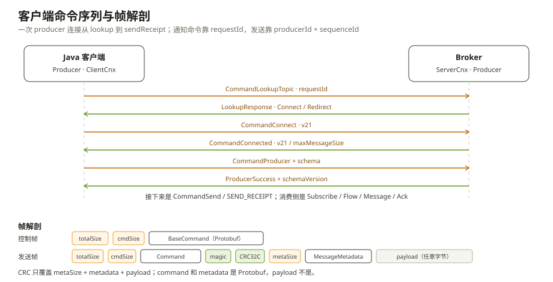
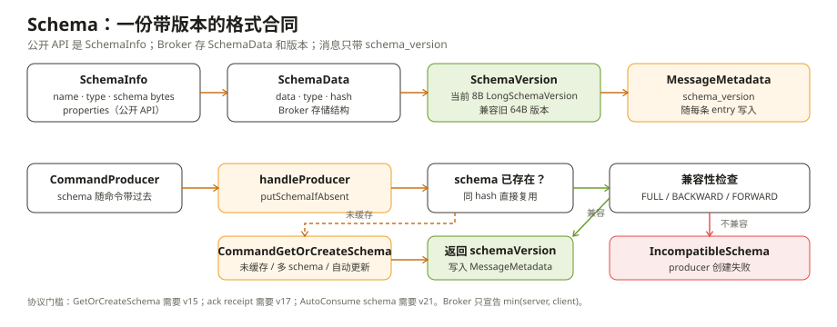

# 客户端与协议：sendAsync 之后，消息被翻译成了什么

一个 Java 应用调用 `producer.sendAsync(message)`，看起来只是把一个对象交给了 Pulsar。但如果你在 Broker 侧抓包，看到的不是这个对象，而是一串带长度前缀的字节：一条 `CommandSend`、一段 `MessageMetadata`、一段 payload；如果开了批处理，payload 里还装着不止一条消息。

客户端代码、线上协议、Schema 是三层不同的东西。很多“消息发不出去”“消费端解析不了”“升级客户端后行为变了”的问题，根因都在这三层的交界处。

这一章沿着一次发送和一次消费，把这三层拆开。

---

## 一、连接：先找对 Broker，再复用连接

客户端不是每发一条消息就建一次 TCP 连接。`PulsarClientImpl` 持有一个 `ConnectionPool`（`pulsar-client/.../impl/ConnectionPool.java:68`），每个 Broker 地址对应一条（或若干条）`ClientCnx`。`connectionsPerBroker` 默认是 1（`ClientConfigurationData.java:169`），连接超时默认 10 秒，普通操作超时默认 30 秒（`:322`、`:138`）。

所以一个 topic 的连接建立过程，至少有两段：

```text
PulsarClientImpl.createProducerAsync()
  → BinaryProtoLookupService.getBroker()
    → 向任意 Broker 发 CommandLookupTopic
      → Connect（当前 Broker 就是 owner）
        或 Redirect（owner 在别的 Broker）
  → ConnectionPool.getConnection(owner)
    → new ClientCnx → CommandConnect → CommandConnected
```

lookup 的请求在 `BinaryProtoLookupService.java:185` 附近构造，方法名是 `Commands.newLookup(...)`。这一段和第一章的 lookup/redirect 是同一件事，区别只是这里发生在客户端内部。

`ClientCnx` 是每条连接的状态机（`ClientCnx.java:125`）。连接建立时，客户端先发 `CommandConnect`，里面带协议版本、客户端版本、认证信息和可选的代理目标；Broker 回 `CommandConnected`，带上 Broker 协议版本、最大消息大小和 feature flags（`ClientCnx.java:590`）。这一步不通过，后面的 producer/consumer 命令都发不出去。

连接建立后，多个 producer、consumer、lookup 请求会复用同一条 `ClientCnx`。它们靠不同的 id 区分：

- producer 用 `producerId`；
- consumer 用 `consumerId`；
- 请求/响应型命令用 `requestId`。

`ClientCnx.sendRequestWithId()`（`:1467`）会把 `requestId` 和 `CompletableFuture` 放进 `pendingRequests`；收到响应时再按 id 取回 future。`CommandSend` 是个例外：它不带 `requestId`，而是用 `producerId + sequenceId` 关联 `CommandSendReceipt`。这也是为什么发送是异步的，但不需要为每条消息维护一个请求表。

连接复用的代价是：**一条连接出问题，挂在它上面的所有 producer/consumer 一起受影响。** `ClientCnx.channelInactive()` 会把所有 pending 请求以 `ConnectException` 完成异常，并通知所有 producer/consumer 重连。排查“某个客户端突然全部超时”时，先看连接，不要先怀疑单条消息。

---

## 二、生产：sendAsync 之前还有三道手续

### 2.1 建 producer 时，Schema 先谈好

`PulsarClientImpl.createProducerAsync()`（`PulsarClientImpl.java:726`）最终发的是 `CommandProducer`，但 `CommandProducer` 里已经带了 schema 信息：`ProducerImpl` 把 `schemaInfo` 放进 `Commands.newProducer(...)` 的 schema 字段（`ProducerImpl.java:2164-2195`）。Broker 在 `ServerCnx.handleProducer()`（`:2479`）里注册或校验 schema，回 `CommandProducerSuccess`；响应里带 schemaVersion（`ProducerImpl.java:2201`），客户端把它缓存起来。

只有一种情况会单独发 `CommandGetOrCreateSchema`：后续要发送的消息带了一个缓存里没有的 schema（比如多 schema 或自动更新场景）。这时 `ProducerImpl.tryRegisterSchema()`（`:994`）调用 `getOrCreateSchemaAsync()`（`:1034`），向 Broker 发 `CommandGetOrCreateSchema`；Broker 在 `ServerCnx.handleGetOrCreateSchema()`（`:3703`）里注册，返回版本后再继续发送。

这一步的直觉误区是“Schema 是客户端自己的事”。实际上，**Schema 是一份跨客户端、跨语言的格式合同**：Broker 要存它、校验它，消费者要按版本取它。后面第五节会展开。

### 2.2 sendAsync：先拿许可，再进队列

`ProducerImpl.sendAsync()`（`ProducerImpl.java:576`）做的是“入队”，不是“上网”。它先给消息分配 `sequenceId`，然后调用 `canEnqueueRequest()`（`:1260`）做两件事：

- 如果配置了 `maxPendingMessages`（默认是 0，表示不按条数设信号量），就先拿一个信号量许可；
- 向客户端的内存控制器申请 payload 大小的额度。

默认 `maxPendingMessages=0`（`ProducerConfigurationData.java:55`），所以默认不会创建信号量；真正的第一道限制是客户端内存上限，默认 64MB（`ClientConfigurationData.java:457`；内存限制关闭时才会回填 1000/50000 的默认值）。只有显式把 `maxPendingMessages` 设成正数，才会出现“队列满，阻塞或立刻失败”的行为（`ProducerImpl.java:225`）。这一点和很多“默认 1000 条 pending”的印象不同，配置前要看自己客户端的实际版本。

拿到许可后，消息进入 `pendingMessages` 队列，等待被写成 `CommandSend`。`sendTimeout` 默认 30 秒（`ProducerConfigurationData.java:76`）：如果 30 秒内没有收到对应的 `sendReceipt`，这条消息会以超时失败。超时不是 Broker 一定没写，而是客户端没有在窗口内看到确认；重试和幂等要由业务或去重机制处理。

### 2.3 批处理：一条 CommandSend 可能装很多条消息

默认 `batchingEnabled=true`（`ProducerConfigurationData.java:204`）。消息先进入 `BatchMessageContainer`，满足下面任一条件就发送：

- 攒到 `batchingMaxMessages`，默认 1000 条（`:197`），或者触到默认 128KB 的字节上限；
- 等够 `batchingMaxPublishDelayMicros`，默认 1 毫秒（`:190`）；
- 当前批放不下下一条消息，或者遇到事务/延迟投递等不能合批的消息。

批处理把多条消息压成一个 entry，`CommandSend` 里用 `num_messages` 记录这一批有几条，`sequence_id` 和 `highest_sequence_id` 圈定这一批的序号范围。Broker 只看到一条 entry，Bookie 也只写这一条 entry；消费者读出来后再按 `batchIndex` 拆开。

这就是一个常见的误判：

> “我发了 100 条消息，为什么 Broker 的写入指标只涨了 1？”

不是丢消息，而是这 100 条被客户端合批了。反过来，如果 100 条消息中有一条 schema 不同、或者中间夹了一条延迟消息，批可能被提前切开，写入指标又会变多。批处理不是“客户端攒着玩”，它直接改变 Broker 和 Bookie 看到的写入粒度。

批处理的代价是延迟。`batchingMaxPublishDelayMicros=1ms` 是默认值，但客户端的实际等待还包括攒批线程、压缩和网络往返。对单条延迟敏感的消息，应该关闭批处理或把延迟调小；对吞吐敏感、能接受毫秒级尾延迟的消息，保留默认值通常更划算。

---

## 三、消费：命令方向和发送相反

消费者订阅时，客户端发的是 `CommandSubscribe`，里面有 topic、subscription、`subType`、`consumerId`、`requestId`、可选的 `schema`、起始位置和是否复制订阅状态（`PulsarApi.proto:371`）。Broker 在 `ServerCnx.handleSubscribe()`（`ServerCnx.java:2045`）里创建或复用 subscription，选 dispatcher，然后回 `CommandSuccess`。

订阅成功后，消息由 Broker 主动发过来。`receiverQueueSize` 默认 1000，Broker 最多先发这么多条；客户端消费掉一半，就发 `CommandFlow` 把许可还回去（`ConsumerImpl.increaseAvailablePermits()`，`ConsumerImpl.java:2107`）。这条信用链在第三章已经拆过，这里只强调方向：

```text
客户端 → Broker：CommandSubscribe
Broker → 客户端：CommandMessage（可以连续很多条）
客户端 → Broker：CommandFlow（还许可）
客户端 → Broker：CommandAck（确认消费）
```

`CommandMessage` 里带 `consumer_id`、`message_id`、`redelivery_count` 和 `ack_set`；消息本体仍然是“命令 + metadata + payload”的帧。消费端的 ack 可以用 `Individual` 或 `Cumulative`（`PulsarApi.proto:586`），对应的位图和 markDelete 逻辑在第二章、第三章。客户端默认把 ack 攒 100ms 或 1000 条再发（`ConsumerConfigurationData.java:147`、`:153`），`ackTimeout` 默认是 0（不开启超时重投）；这两个默认值决定了“ack 什么时候真的到 Broker”。

注意：`CommandSubscribe` 里的 schema 和 producer 侧的 schema 是同一份合同。消费者如果显式带了 Schema，会按自己的类型反序列化；如果用的是 `AutoConsumeSchema`，则会根据消息里的 schema 版本去 Broker 取对应 schema。消费者不是“拿到字节自己猜类型”，猜类型只在 `Schema.BYTES`/`Schema.NONE` 这种明确不做 schema 校验的场景里发生。

---

## 四、协议：Protobuf 包住的是命令，不是 payload



Pulsar 的线上协议由 `PulsarApi.proto` 定义，核心是 `BaseCommand`（`:1263`）：一条命令有一个 `Type` 和对应的字段。常见命令如下：

| 方向 | 命令 | 作用 |
| --- | --- | --- |
| 客户端 → Broker | `CommandConnect`（`:289`） | 握手，带协议版本和认证 |
| Broker → 客户端 | `CommandConnected`（`:330`） | 返回 Broker 版本、最大消息大小 |
| 客户端 → Broker | `CommandLookupTopic` | 查 topic 的 owner |
| 客户端 → Broker | `CommandProducer`（`:504`） | 建 producer，带 schema |
| 客户端 → Broker | `CommandSend`（`:546`） | 发送一条 entry |
| Broker → 客户端 | `CommandSendReceipt`（`:564`） | 写入完成回执 |
| 客户端 → Broker | `CommandSubscribe`（`:371`） | 建 consumer，带 schema |
| 客户端 → Broker | `CommandFlow`（`:632`） | 归还消费许可 |
| Broker → 客户端 | `CommandMessage`（`:578`） | 推送消息 |
| 客户端 → Broker | `CommandAck`（`:586`） | 确认消费 |
| 客户端 → Broker | `CommandGetOrCreateSchema`（`:1118`） | 注册/取 schema |

控制命令的帧格式很简单（`Commands.serializeWithSize()`，`Commands.java:2043`）：

```text
[TOTAL_SIZE][CMD_SIZE][CMD]
```

发送消息时，帧里多了元数据和 payload（`Commands.serializeCommandSendWithSize()`，`:2062`）：

```text
[TOTAL_SIZE][CMD_SIZE][CMD][MAGIC][CHECKSUM][METADATA_SIZE][METADATA][PAYLOAD]
```

其中：

- `CMD` 是 `CommandSend`，只包含 `producerId`、`sequenceId`、`numMessages`、`highestSequenceId` 等控制字段；
- `METADATA` 是 `MessageMetadata`（`PulsarApi.proto:107`），也是 Protobuf，里面装 producer 名、发布时间、压缩类型、批内条数、schema 版本、事务 id 等；
- `PAYLOAD` 是业务数据的字节，**不要求是 Protobuf**。它可以是 Avro、JSON、字符串、图片，甚至就是一段不透明字节；schema 决定怎么解释它；
- `MAGIC + CHECKSUM` 是可选的 Crc32c 校验，用来发现传输损坏；是否启用取决于 checksum 类型。

所以“Pulsar 用 Protobuf 传消息”这句话只对了一半：**命令和消息元数据是 Protobuf，业务 payload 是另一层。** 把 payload 当成 Protobuf 去解，或者以为换了 schema 就会改变线上命令，都会踩坑。

`ClientCnx` 负责把字节解成命令，再按 id 分发给对应的 producer/consumer。`ServerCnx` 做相反的事：`handleSend()`（`ServerCnx.java:2869`）、`handleAck()`（`:2967`）、`handleFlow()`（`:3023`）。发送命令不带 `requestId`，但创建 producer/consumer、lookup、schema 这些控制命令都带；两类命令的关联方式不同，排障时不能混为一谈。

协议版本会改变可用能力，且是**向后兼容地逐版增加**：当前 HEAD 的协议版本是 v21；`GetOrCreateSchema` 需要 v15（`Commands.java:2604`），ack receipt 需要 v17，AutoConsume schema 需要 v21（`Commands.java:2612`）。Broker 在握手时只宣告 `min(server, client)`（`Commands.java:343`），所以老客户端不会“看到新字段”，新客户端也不能假设所有 Broker 都支持新命令。升级客户端后行为变化，先看 `CommandConnected` 里的版本和 feature flags。

---

## 五、Schema：一份带版本的格式合同

### 5.1 三个对象：SchemaInfo、SchemaData、SchemaVersion

Pulsar 的 schema 模型有三个容易混的对象：

- `SchemaInfo`（`pulsar-client-api/.../common/schema/SchemaInfo.java`）：对外的 schema 描述，包含 name、type、schema bytes、properties；客户端用 `Schema.getSchemaInfo()` 拿到它；
- `SchemaData`（`pulsar-common/.../protocol/schema/SchemaData.java`）：Broker 存储用的数据，包含 schema 的字节、类型和 hash；
- `SchemaVersion`（`pulsar-common/.../protocol/schema/SchemaVersion.java`）：版本号，最终会以字节形式写进 `MessageMetadata.schema_version`。

`SchemaType` 定义在 `pulsar-client-api/.../common/schema/SchemaType.java`，常见类型有 `NONE`、`BYTES`、`STRING`、`JSON`、`AVRO`、`PROTOBUF`、`KEY_VALUE`、`PROTOBUF_NATIVE`。`BYTES`/`NONE` 表示不做 schema 校验，这也是为什么“没有 schema 也能发消息”。

### 5.2 注册与获取：Broker 是仲裁者

Producer 带 schema 创建时，schema 随 `CommandProducer` 到 Broker；`ServerCnx.handleProducer()` 把它交给 topic。后续发送遇到未缓存的 schema 时，才走 `CommandGetOrCreateSchema` / `ServerCnx.handleGetOrCreateSchema()`。真正的注册链是 `AbstractTopic.addSchema()`（`pulsar-broker/.../service/AbstractTopic.java:866`）→ `SchemaRegistryServiceImpl.putSchemaIfAbsent()`（`pulsar-broker/.../schema/SchemaRegistryServiceImpl.java:182`）→ `BookkeeperSchemaStorage.put()`（`:113`）。如果 topic 已有 schema，`putSchemaIfAbsent()` 会检查兼容性（`isCompatible()`，`:297`），再返回已有版本或新版本。版本号当前是 8 字节的 `LongSchemaVersion`，同时兼容旧的 64 字节版本（`LongSchemaVersion.java:41`、`BookkeeperSchemaStorage.java:268`）。

默认的 schema 存储实现是 `BookkeeperSchemaStorageFactory`（`conf/broker.conf:2226`），对应的 `BookkeeperSchemaStorage`（`pulsar-broker/.../schema/BookkeeperSchemaStorage.java:66`）把 schema 数据写进 BookKeeper，并在元数据里保存定位信息。也就是说，schema 不是只存在客户端内存里，它和 topic 一样有持久化、有版本、有恢复路径。

Broker 侧的几个默认值值得记住（`conf/broker.conf`）：

| 配置 | 默认 | 含义 |
| --- | --- | --- |
| `isSchemaValidationEnforced` | false（`:2230`） | 不强制所有 producer 都带 schema；`BYTES/NONE` 仍可写入 |
| `isAllowAutoUpdateSchemaEnabled` | true（`:423`） | 允许 schema 自动注册/更新 |
| `schemaCompatibilityStrategy` | `FULL`（`:2234`） | 默认要求新 schema 与旧 schema 双向兼容 |
| `schemaRegistryStorageClassName` | `BookkeeperSchemaStorageFactory`（`:2226`） | schema 数据落在 BookKeeper |

`SchemaCompatibilityStrategy` 的取值见 `pulsar-client-admin-api/.../policies/data/SchemaCompatibilityStrategy.java`：`BACKWARD`、`FORWARD`、`FULL`、`BACKWARD_TRANSITIVE`、`FORWARD_TRANSITIVE`、`FULL_TRANSITIVE`、`ALWAYS_COMPATIBLE`、`ALWAYS_INCOMPATIBLE`。默认 `FULL` 只比较相邻版本；要保证“历史所有版本都能读/写”，用 `*_TRANSITIVE`。



### 5.3 一次 schema 升级会发生什么

假设一个订单消息从 `{orderId, amount}` 升级到 `{orderId, amount, currency}`：

1. 新 producer 带新 schema 创建；
2. Broker 调 `putSchemaIfAbsent()`，按 `FULL` 检查新旧 schema 是否兼容；
3. 兼容则返回新 `SchemaVersion`，新 producer 把它缓存下来，写消息时放进 `MessageMetadata.schema_version`；
4. 旧 producer 继续用旧版本写，消息带旧版本号；
5. 新 consumer 可以按 schema 版本反序列化；旧 consumer 如果显式用旧 schema，读到新字段时可能忽略它，或者在严格模式下失败；
6. 如果兼容性检查不通过，新 producer 创建失败（`IncompatibleSchemaException`），不会让一条“格式不明的消息”混进 topic。

这里的天真做法是“改完 POJO 直接重启 producer”。Pulsar 不会因为你的 Java 类改了就自动保证消费者能读；它检查的是 schema 的兼容性策略。加字段、删字段、改类型，在 Avro/JSON/Protobuf 下的兼容性语义不同，必须按策略验证。`FULL` 默认能挡住大多数破坏性变更，但它不是“所有语言、所有版本都自动兼容”的魔法。

生产端的 schema 版本写入点在 `ProducerImpl.populateMessageSchema()`（`ProducerImpl.java:936`）：如果 schema 已经注册过，版本从 `schemaCache` 取；新 schema 走 `getOrCreateSchemaAsync()`，成功后把版本缓存起来，再设置到 `MessageMetadata`。消费端订阅前会先取最新 schema（`PulsarClientImpl.java:2040`、`MultiVersionSchemaInfoProvider.java:83`），再把 consumer 的 schema 带进 `CommandSubscribe`；`AutoConsumeSchema` 还会按消息里的 schema 版本取对应版本解码（`AutoConsumeSchema.java:346`）。

---

## 六、失败会落在哪一层

| 现象 | 更可能的原因 | 先看哪里 |
| --- | --- | --- |
| `sendAsync` future 超时 | 30 秒内没收到 `CommandSendReceipt`；连接抖动、Broker 写入慢、批一直没关闭 | `sendTimeout`、pending 队列、Broker/Bookie 写延迟 |
| producer 创建失败 | schema 不兼容、topic 不存在、权限不足、producer 名称冲突 | `CommandProducerSuccess` 的错误码、schema registry 日志 |
| consumer 收到字节但解析失败 | 消费端 schema 与消息 schema 版本不匹配；`BYTES/NONE` 被当成了具体类型 | `MessageMetadata.schema_version`、consumer 的 schema |
| 升级客户端后行为变化 | 协议版本/feature flags 不同；批处理或 flow 默认值变化 | `CommandConnected` 的协议版本、客户端配置 |
| 连接断开后全部 producer 卡住 | `ClientCnx.channelInactive()` 让所有挂载对象重连；重连期间 lookup/redirect 变慢 | 连接池、Broker 地址、lookup 延迟 |
| 批处理导致“Broker 只写了一条” | 多条消息被合成了一个 entry | `num_messages`、`highest_sequence_id`、批处理配置 |

---

## 附：这一章的源码入口

- `pulsar-client/.../impl/PulsarClientImpl.java`：`createProducerAsync()`（`:726`、`:994`）、lookup 与连接（`:1762`）、`getCnxPool()`（`:1862`）
- `pulsar-client/.../impl/ConnectionPool.java`：连接池（`:68`）
- `pulsar-client/.../impl/ClientCnx.java`：协议状态机（`:125`）、`protocolVersion`（`:238`）、`handleConnected()`（`:590`）、`handleSendReceipt()`（`:844`）、`sendRequestWithId()`（`:1467`）、`sendGetOrCreateSchema()`（`:1534`）
- `pulsar-client/.../impl/BinaryProtoLookupService.java`：lookup 请求（`:185`）
- `pulsar-client/.../impl/ProducerImpl.java`：`sendAsync()`（`:576`）、`canEnqueueRequest()`（`:1260`）、schema 随 `CommandProducer`（`:2164-2195`）、schemaVersion 缓存（`:2201`）、`getOrCreateSchemaAsync()`（`:1034`）、`populateMessageSchema()`（`:936`）、信号量初始化（`:225`）
- `pulsar-client/.../impl/ConsumerImpl.java`：`connectionOpened()`（`:893`）、`increaseAvailablePermits()`（`:2107`）
- `pulsar-client/.../impl/conf/ProducerConfigurationData.java`：`sendTimeout`（`:76`）、批处理默认值（`:190`、`:197`、`:204`）、`maxPendingMessages`（`:55`）
- `pulsar-client/.../impl/conf/ConsumerConfigurationData.java`：`receiverQueueSize`（`:134`）、ack 分组（`:147`、`:153`）、`ackTimeout`（`:193`）
- `pulsar-client/.../impl/conf/ClientConfigurationData.java`：`connectionsPerBroker`（`:169`）、连接/操作超时（`:322`、`:138`）、客户端内存上限（`:457`）
- `pulsar-client/.../impl/PulsarClientImpl.java`：订阅前取 schema（`:2040`）
- `pulsar-client/.../impl/schema/generic/MultiVersionSchemaInfoProvider.java`（`:83`）、`pulsar-client/.../impl/schema/AutoConsumeSchema.java`（`:346`）
- `pulsar-broker/.../service/ServerCnx.java`：`handleSubscribe()`（`:2045`）、`handleProducer()`（`:2479`）、`handleSend()`（`:2869`）、`handleAck()`（`:2967`）、`handleFlow()`（`:3023`）、`handleGetSchema()`（`:3639`）、`handleGetOrCreateSchema()`（`:3703`）
- `pulsar-broker/.../service/AbstractTopic.java`：`addSchema()`（`:866`）
- `pulsar-common/src/main/proto/PulsarApi.proto`：`MessageMetadata`（`:107`）、`CommandSubscribe`（`:371`）、`CommandProducer`（`:504`、schema 字段 `:518`）、`CommandSend`（`:546`）、`CommandSendReceipt`（`:564`）、`CommandMessage`（`:578`）、`CommandAck`（`:586`）、`CommandFlow`（`:632`）、`CommandProducerSuccess.schema_version`（`:708`）、`CommandGetSchema`（`:1102`）、`CommandGetOrCreateSchema`（`:1118`）、`BaseCommand`（`:1263`）
- `pulsar-common/.../protocol/Commands.java`：协议版本协商（`:343`）、控制帧（`:2043`）、发送帧（`:2062`）、`GetOrCreateSchema` 版本门槛（`:2604`）、`AutoConsume` 门槛（`:2612`）、消息帧（`:2436`）
- `pulsar-broker/.../service/schema/SchemaRegistryServiceImpl.java`：`putSchemaIfAbsent()`（`:182`）、`isCompatible()`（`:297`）
- `pulsar-broker/.../service/schema/BookkeeperSchemaStorage.java`：schema 存储（`:66`）、`put()`（`:113`）、版本兼容（`:268`）
- `pulsar-common/.../common/schema/LongSchemaVersion.java`（`:41`）
- `pulsar-client-api/.../common/schema/SchemaInfo.java`、`SchemaType.java`；`pulsar-common/.../protocol/schema/SchemaData.java`、`SchemaVersion.java`；`pulsar-client-admin-api/.../policies/data/SchemaCompatibilityStrategy.java`
- `conf/broker.conf`：schema 默认值（`:423`、`:2226`、`:2230`、`:2234`）

---

## 思考题

1. 一个 producer 发 100 条消息，Broker 侧只看到 1 条 entry。哪些配置会导致这个结果？如果消费者只处理了其中 50 条就崩溃，重投的粒度是什么？
2. `CommandSend` 没有 `requestId`，客户端怎么知道哪条 `sendReceipt` 对应哪条消息？如果一批消息中间有一条失败，future 的完成顺序是什么？
3. 把 `schemaCompatibilityStrategy` 从 `FULL` 改成 `ALWAYS_COMPATIBLE`，能解决哪些发布问题，又会把什么问题推迟到消费端？
4. 为什么说“payload 不是 Protobuf”不等于“协议和 schema 无关”？如果 payload 是 Avro，schema 版本在哪个字段里？
