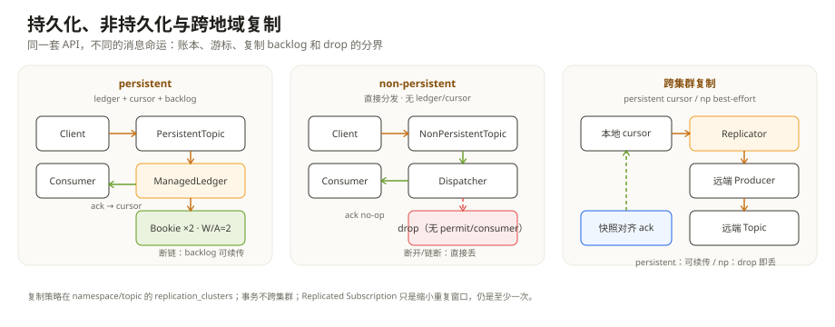

# 主题与复制：非持久化不落账本，跨地域复制已提交的消息

前几章讲的 topic 都是 `persistent://` 开头。Pulsar 还有另一种 topic：`non-persistent://`。两者用的是同一套客户端 API、同一套协议、同一套订阅类型，但消息的“命运”完全不同：一个落进 Bookie 的 ledger，另一个只在 Broker 内存里活一瞬间。

跨地域复制又是另一条边界。它不改变单条消息在本地怎么存，而是回答“已经写进本地 topic 的消息，怎么再去另一个集群一份”。这里面最容易混的是：复制的是**消息**，不是**事务**；持久化 topic 可以补 backlog，非持久化 topic 只能尽力而为。

这一章把这两条边界拆开。

---

## 一、非持久化主题：没有账本，也没有重放

`NonPersistentTopic`（`pulsar-broker/.../service/nonpersistent/NonPersistentTopic.java:105`）没有 `ManagedLedger`，没有 `ManagedCursor`，也没有“当前 ledger”这些字段。它只有订阅、replicator 和计数器（`:110-118`）。这句话不是实现细节，而是语义本身：**没有账本，就没有“存下来以后重放”的能力。**

一次发布在 `publishMessage()`（`:200`）里发生得很快：

```text
客户端 publish
  → NonPersistentTopic.publishMessage()
    → callback.completed(null, 0, 0)       // 先回执：Broker 已接收
    → 对每个订阅：
        dispatcher 存在 → retainedDuplicate 成 Entry(0:0)，推给消费者
        dispatcher 不存在 → release（没有消费者，消息直接丢）
    → 对每个 replicator：
        sendMessage(entry)                 // 非持久化复制是即发即走
```

这里没有 `asyncAddEntry`，没有 Bookie 的 quorum，也没有 `markDeletePosition`。`callback.completed(null, 0, 0)` 的参数就是 0 ledger、0 entry：**这条消息没有持久化的 MessageId**。所以 producer 收到“发送成功”，只代表 Broker 接住了并尝试分发，不代表它能在消费者重启后还找回来。

订阅侧也一样。`NonPersistentSubscription` 会按订阅类型创建 `NonPersistentDispatcherSingleActiveConsumer` 或 `NonPersistentDispatcherMultipleConsumers`（`NonPersistentSubscription.java:120-153`），但没有 cursor。它的 `acknowledgeMessageAsync()` 是空实现（`:210-214`），`negativeAcknowledge` 也不会触发重投（`NonPersistentDispatcher.java:37-45`）。消费者 ack 只是告诉 Broker“我处理了”，没有位点可写、没有重投可做。

几个直接后果：

- **没有消费者时，消息直接丢。** `publishMessage()` 遍历订阅；没有 dispatcher，entry 被 `release()`，不会排队等消费者上线。
- **消费者慢了，消息也会丢。** `NonPersistentDispatcherMultipleConsumers.sendMessages()` 只在 `totalAvailablePermits > 0` 时选消费者；没有许可就把 entry release，并记一次 drop（`NonPersistentDispatcherMultipleConsumers.java:201-219`）。SingleActive 分支同理（`NonPersistentDispatcherSingleActiveConsumer.java:58-74`）。
- **最后一个消费者断开，订阅会被删。** `NonPersistentSubscription.removeConsumer()` 在消费者列表为空时触发 unsubscribe（`:190-193`）；下次消费者再订阅，是新的订阅，不会从旧位点续读。
- **TTL 和 backlog quota 不适用。** `checkMessageExpiry()`（`NonPersistentTopic.java:741-743`）和 `checkBacklogQuotaExceeded()`（`:1254-1257`）都是 no-op；backlog 恒为 0。没有持久化数据，就没有“过期”和“积压”的对象。
- **仍有限流和在途上限。** 发布限流还走 `Producer` 的 `publishRateLimiter`；连接级还有非持久化在途消息的上限（`ServerCnx.java:2909-2922`），超过会回 `-1:-1` 并记录丢弃。它不是“完全不限”，只是“限了也不落盘”。

这组行为的正确用法是：**能接受丢的消息**。实时指标、在线状态广播、行情快照、通知推送的“当前值”，适合非持久化；订单、账单、审计日志，不适合。

一个常见的天真用法是：

> “先发 non-persistent，消费者挂了再从 earliest 重放。”

没有 earliest。非持久化 topic 没有 ledger/cursor，消费者断开后订阅被删，重连是新订阅，Broker 没有历史可给。要重放，只能用 `persistent://`。

---

## 二、持久化与非持久化：一张表看清

| 维度 | persistent | non-persistent |
| --- | --- | --- |
| 消息存放 | Bookie 的 ledger | Broker 内存/直接分发 |
| MessageId | ledgerId + entryId（可持久） | 0:0（无持久位置） |
| ack | 推进 cursor / 位图 | no-op |
| 重投 | 可以（ack 超时、负向 ack、重连） | 不可以 |
| 消费者断开 | cursor 保留，回来可续读 | 订阅删除，消息丢失 |
| backlog | 有，可监控 | 恒 0 |
| TTL / backlog quota | 生效 | 不生效 |
| 跨地域复制 | 有 cursor/backlog，断链可续传 | 即发即走，断链即丢 |
| 适用 | 交易、事件、需要重放的场景 | 实时状态、可丢的推送 |

这张表里最容易被忽略的是最后一行：**“非持久化”不只影响本地存储，也影响复制语义。** 下一节会看到，`NonPersistentReplicator` 没有 cursor，只有远程 producer；producer 不可写时，消息直接 drop。



---

## 三、跨地域复制：本地 ledger + 远程 producer

跨地域复制不是把 Bookie 的 ledger 复制到另一个集群，而是**本地 Broker 起一个 replicator，从本地 topic 读，再写到远端 topic**。复制单位是 topic（以及它的分区），不是整个集群的磁盘。

### 3.1 配置从哪里来

复制关系挂在 namespace/topic policy 上，核心字段是 `replication_clusters`（`pulsar-client-admin-api/.../policies/data/Policies.java:40`）。它必须是 `allowed_clusters` 的子集（`Policies.java:265-275`、`:292-302`）。策略本身由 `PulsarResources` 管理的配置元数据存储（config store）保存（`PulsarResources.java:77-82`；`NamespaceResources.java:61-65`）；动态配置和负载上报则走 local store（`:90-98`）。集群的 service URL 从 `ClusterResources.java:46-48`、`:70-72` 读。

persistent topic 加载时，`PersistentTopic.initializeCheckReplication()`（`:2127-2144`）会检查复制关系；`checkReplication()`（`:2161-2213`）为每个远端集群启动/停止 replicator。Broker 还有周期性的复制检查（`BrokerService.java:885-891`，600 秒级），所以改完 policy 不会“立刻全网生效”，要等下一轮检查。

一个容易踩的边界：**本地集群不一定自动在 `replication_clusters` 里。** 对 persistent topic，如果本地集群既不在复制列表、也不在 allowed 列表，topic 可能被拒绝创建（`PersistentTopic.java:2398-2417`）。配置复制时，先把本地集群和远端集群都写清楚。

### 3.2 persistent：cursor + 远程 producer

persistent topic 为每个远端集群建一个 replicator，并打开一个本地 cursor，名字是 `pulsar.repl.<remote>`（`PersistentTopic.java:2616-2627`），初始位置是 latest。然后创建 `GeoPersistentReplicator`（`:2651-2694`），它做三件事：

```text
本地 cursor 读 entry
  → 过滤：事务标记 / 已复制消息 / replicateTo 不含远端 / 已过期
  → setReplicatedFrom(localCluster)
  → 远程 producer.sendAsync()
     成功 → cursor.asyncDelete(position)   // 这条可以推进了
     失败 → rewind cursor，重读
```

远程 producer 的配置是：

- 不做批处理，单分区，`Schema.AUTO_PRODUCE_BYTES()`（`AbstractReplicator.java:153-159`）；
- `maxPendingMessages` 取 `replicationProducerQueueSize`，默认 1000（`conf/broker.conf:2069`）；
- `replicationConnectionsPerBroker` 默认 16（`:2066`），每个远端集群一套 replication client。

复制是**异步**的。本地 producer 收到 `sendReceipt` 只代表本地 ledger 写成功，不代表远端已经收到。复制成功后才推进 cursor；失败就 rewind，所以语义是**至少一次**：断链恢复后可能重复，单 cursor + 单 producer 保证分区内顺序，但不是 exactly-once。远端 producer 的 backlog/延迟可以用 `replicationDelay` 和 cursor backlog 观察。

持久化复制的关键优势是：**断链时本地 backlog 会增长，链恢复后从 cursor 续传。** 只要本地保留策略还没删掉这些 ledger，复制的“欠账”能补回来。

### 3.3 non-persistent：没有 cursor，只有即发即走

`NonPersistentTopic` 也有 replicator（`NonPersistentReplicator.java`），但机制完全不同：它没有 cursor，`publishMessage()` 直接把 entry 交给每个 replicator 的 `sendMessage()`（`NonPersistentTopic.java:224-232`）。

`NonPersistentReplicator` 的 producer：

- `maxPendingMessages(1000)`，`blockIfQueueFull(false)`（`NonPersistentReplicator.java:62-64`）；
- 远程 producer 不可写、或者队列满、或者发送异常，消息直接 drop，并计入 `msgDrop`（`:143-147`、`:188-198`）；
- backlog 恒为 0（`:266-270`），没有“断链后补”的路径。

所以非持久化的跨地域复制是 **best-effort**：链在，消息可能到；链断，消息就没了。它适合“远端晚到一条也没关系”的场景，不适合把复制当容灾。

### 3.4 Replicated Subscription：让多个集群的 ack 对齐

普通订阅只在本地集群推进 cursor。开了 geo 复制后，同一个逻辑订阅在多个集群各有一份 cursor；如果各集群独立 ack，消费者在 A 集群处理过的消息，在 B 集群可能还会再投一次。

Replicated Subscription 解决的是这个重复窗口。它的机制可以粗暴地理解成“定期拍快照”：

1. Controller 每秒发起一次快照（`ServiceConfiguration.java:1909` 的 snapshot frequency；`ReplicatedSubscriptionsController.java:272-325`）；
2. 只有所有 replicator 都连通时才发（`Controller.java:300-312`）；
3. 每个集群回自己的 last position，汇总成 snapshot marker（`ReplicatedSubscriptionsSnapshotBuilder.java:90-131`）；
4. 订阅缓存快照；当本集群的 mark-delete 越过快照位点时，向其他集群发 UPDATE；
5. 收到 UPDATE 的集群只对自己的 position 做 cumulative ack（`Controller.java:200-223`），不会跳过本地尚未到达的消息；
6. 超过两个集群时做两轮快照；默认超时 30 秒，缓存 30 个快照（`ServiceConfiguration.java:1914`、`:1919`）。

它仍然是**至少一次**：快照之间、UPDATE 丢失或延迟时，重复窗口仍然存在；它只是把窗口从一个“无限长”缩小到“快照周期”。另外，非持久化订阅不支持 replicated subscription（`NonPersistentSubscription.java:106-108`），因为根本没有 cursor 可以对齐。

---

## 四、断链与边界：先看 backlog，还是先看 drop

| 现象 | persistent | non-persistent |
| --- | --- | --- |
| 远端集群不可用 | 本地 backlog 增长，cursor 停住；恢复后从 cursor 续传 | 消息直接 drop，backlog 恒 0 |
| 远程 producer 队列满 | 复制读取暂停，backlog 增长 | `blockIfQueueFull=false`，drop |
| 远端 topic 不存在 | 按 auto-create 配置创建；失败则报错 | 依赖远端自动创建；失败即 drop |
| 订阅跨集群重复 | 用 replicated subscription 缩小窗口 | 不支持 replicated subscription |
| 事务消息 | replicator 过滤事务标记；事务本身不跨集群 | 同样不跨集群 |
| 新订阅从哪里开始 | 默认 latest；replicated subscription 按快照追平 | 订阅删除后重新开始，无位点 |

这张表解释了为什么“复制延迟”和“消息丢失”要分开看：persistent 的复制延迟是 backlog，通常可以追；non-persistent 的复制延迟就是 drop，追不回来。排查时不要拿 persistent 的 `backlog` 经验去看 non-persistent。

还有两个容易混淆的机制：

- **Cluster Migration** 不是 geo-replication。它是在集群级别把客户端重定向到迁移后的集群，靠 cluster policy 的 migrated URL（`AbstractTopic.java:1516-1528`）；geo 复制是 topic 级别的消息转发。
- **Replicated Subscription** 不是“复制订阅配置”。它复制的是多个集群的 ack 进度快照，让同一逻辑订阅尽量对齐；订阅本身的消费逻辑仍然在各集群独立执行。

---

## 五、什么时候用哪一种

- **需要重放、需要断链续传、需要审计**：`persistent://`，并给复制留足本地保留时间；否则 cursor 追不上、ledger 已被裁掉，复制也会断。
- **只需要当前值、丢了可以重算**：`non-persistent://`；不要给它配“重放”或“容灾”的期待。
- **多集群都要能消费同一份消息**：persistent + geo replication；如果要减少跨集群重复，开 replicated subscription，但接受“至少一次”。
- **跨集群事务**：当前不支持；事务是集群内的，复制的是已经提交的消息。跨集群的一致性要在业务层解决。

---

## 附：这一章的源码入口

**非持久化**

- `pulsar-broker/.../service/nonpersistent/NonPersistentTopic.java`：字段（`:110-118`）、`publishMessage()`（`:200-233`）、`checkMessageExpiry()`（`:741-743`）、`checkBacklogQuotaExceeded()`（`:1254-1257`）、删除订阅（`:1270-1288`）
- `pulsar-broker/.../service/nonpersistent/NonPersistentSubscription.java`：dispatcher 选择（`:120-153`）、最后消费者移除（`:190-193`）、ack no-op（`:210-214`）
- `pulsar-broker/.../service/nonpersistent/NonPersistentDispatcherMultipleConsumers.java`：permit 与 drop（`:201-219`）
- `pulsar-broker/.../service/nonpersistent/NonPersistentDispatcherSingleActiveConsumer.java`：单活跃分发（`:58-74`）
- `pulsar-broker/.../service/nonpersistent/NonPersistentReplicator.java`：producer 配置（`:62-64`）、drop（`:143-147`、`:188-198`）、backlog（`:266-270`）
- `pulsar-broker/.../service/ServerCnx.java`：非持久化在途上限（`:2909-2922`）

**复制**

- `pulsar-client-admin-api/.../policies/data/Policies.java`：`replication_clusters`（`:40`）、allowed clusters（`:265-275`、`:292-302`）
- `pulsar-broker-common/.../resources/PulsarResources.java`、`NamespaceResources.java`、`ClusterResources.java`：策略与集群 URL 的读取（`:77-82`、`:61-65`、`:46-48`、`:70-72`）
- `pulsar-broker/.../service/persistent/PersistentTopic.java`：初始化复制（`:2127-2144`）、`checkReplication()`（`:2161-2213`）、创建 replicator cursor（`:2616-2627`）、GeoReplicator（`:2651-2694`）
- `pulsar-broker/.../service/AbstractReplicator.java`：远程 producer 配置（`:153-159`）、重连 backoff（`:223-233`）
- `pulsar-broker/.../service/persistent/PersistentReplicator.java`：cursor 读取（`:315`、`:515`）、成功删 cursor / 失败 rewind（`:639-703`）
- `pulsar-broker/.../service/persistent/GeoPersistentReplicator.java`：读取过滤与发送（`:152-292`）
- `pulsar-broker/.../service/persistent/ReplicatedSubscriptionsController.java`：快照与 UPDATE（`:139-155`、`:200-223`、`:272-325`）
- `pulsar-broker/.../service/persistent/ReplicatedSubscriptionsSnapshotBuilder.java`：快照汇总（`:90-131`）
- `pulsar-broker-common/.../ServiceConfiguration.java`：快照频率/超时/缓存（`:1909`、`:1914`、`:1919`）、复制连接/队列（`:3740`、`:3753`）
- `conf/broker.conf`：`replicatedSubscriptionsSnapshotTimeoutSeconds`（`:801`）、`replicationConnectionsPerBroker`（`:2066`）、`replicationProducerQueueSize`（`:2069`）

---

## 思考题

1. 一个业务把订单消息发到 `non-persistent://`，消费者重启后从 earliest 订阅，能读到重启前的消息吗？为什么？
2. persistent 的远端集群断了 30 分钟，本地 backlog 会发生什么？如果本地保留策略只保留 10 分钟，30 分钟后会发生什么？
3. 为什么 non-persistent 的复制 producer 要 `blockIfQueueFull(false)`？如果改成阻塞，会发生什么？
4. Replicated Subscription 的快照能消除跨集群重复吗？它缩小的是哪个窗口？
5. Cluster Migration 和 geo-replication 都在“换集群”，它们的区别是什么？
