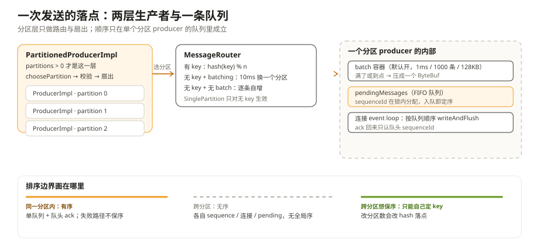
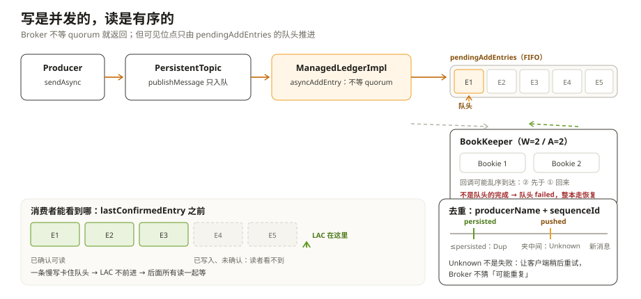
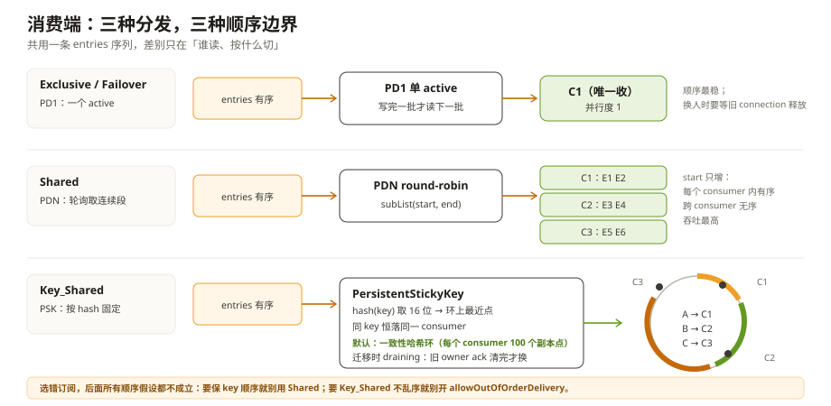

# 异步、并发与顺序：Pulsar 源码里的六个取舍

「Pulsar 保证同一个 producer 的消息有序。」

这句话你大概在哪篇文档里见过。它是真的，但它省掉了三个前提：同一个 topic、同一个分区、同一个连接。换掉其中任何一个，顺序就未必还在——而 Pulsar 的源码里，几乎每个关键设计都在回答同一个问题：**为了这件事，我该在哪里放弃那件事。**

这一章不按模块讲，按「一次 sendAsync 往下走」遇到的取舍讲。六个取舍，每个都带代码位置，最后给一张对照表和一份顺序相关的踩坑清单。

---

## 一、两个 Producer：你以为的一个，其实是两层

先看一个容易踩的直觉：`client.newProducer()` 拿到的对象，就是一个生产者。

不是。`PulsarClientImpl.createProducerAsync()` 里有一处很直白的二选一（`PulsarClientImpl.java:1007-1013`）：

```java
ProducerBase<T> producer;
if (partitions > 0) {
    producer = newPartitionedProducerImpl(topic, conf, schema, interceptors, producerCreatedFuture, partitions);
} else {
    producer = newProducerImpl(topic, -1, conf, schema, interceptors, producerCreatedFuture, Optional.empty());
}
```

分区 topic 拿到的是 `PartitionedProducerImpl`，普通 topic 拿到的是 `ProducerImpl`。两者不是父子类，而是兄弟：都 `extends ProducerBase`，`ProducerBase implements Producer`。分区层里真正干活的是**每个分区一个 `ProducerImpl`**：

```java
private final Map<Integer, ProducerImpl<T>> producers = new ConcurrentHashMap<>();
```

（`PartitionedProducerImpl.java:63`）

所以「一个 producer」在客户端其实是**一层路由 + N 个独立状态机**。

`sendAsync` 进来之后，分区层只做三件事（`PartitionedProducerImpl.java:251-253`）：

```java
int partition = routerPolicy.choosePartition(message, topicMetadata);
checkArgument(partition >= 0 && partition < topicMetadata.numPartitions(),
        "Illegal partition index chosen by the message routing policy: " + partition);
```

选分区、校验、把消息交给那个分区的 `ProducerImpl`。然后它就不管了。

这里有两个常见误解值得当场掐掉：

- **它不会按分区拆 batch。** 一条消息永远整体落在一个分区；批是在各自的子 producer 里、按已选好的分区攒出来的。所以「发 1000 条，Broker 只看到 1 条 entry」和「发 1000 条，被拆到 4 个分区」不会同时发生。
- **它没有全局 sequenceId。** 每个 `ProducerImpl` 各有一个 `msgIdGenerator`（`ProducerImpl.java:807` 的 `updateMessageMetadataSequenceId` 里 `msgIdGenerator++`），各自从 0 开始。`PartitionedProducerImpl.getLastSequenceId()` 返回的是各分区最大值的 max，可它的注释写的是「a single id generator across all partitions」——注释和实现对不上，信实现：

```java
// Return the highest sequence id across all partitions. This will be correct,
// since there is a single id generator across all partitions for the same producer
return producers.values().stream().map(Producer::getLastSequenceId)
        .mapToLong(Long::longValue).max().orElse(-1);
```

三个代价随两层结构一起进来：跨分区没有顺序；分区 producer 的创建是「结果原子、过程不原子」（全成就成功，中途失败就关掉已经建好的）；`lazyStartPartitionedProducers` 打开且是 Shared 模式时，只先建一个分区，第一次发到别的分区会在发送路径里同步去建（失败只报 `NotConnectedException`）。



**取舍一：用「每分区一套独立状态机」换故障隔离和并行度，代价是全局顺序与全局序号。**

---

## 二、异步的假象：`sendAsync` 里有三处会停

`sendAsync` 返回 `CompletableFuture`，很容易被理解成「调用不会停」。但源码里它至少有三处会停，只是停的地方不同。

整条链是（行号以本仓 5.1.0-SNAPSHOT 为准）：

```text
ProducerBase.sendAsync            → internalSendAsync
ProducerImpl.internalSendAsync    → beforeSend（拦截器）
ProducerImpl.sendAsync            → 分配 sequenceId、进 batch 或建 OpSendMsg
ProducerImpl.canEnqueueRequest    → 许可 / 内存
ProducerImpl.processOpSendMsg     → pendingMessages 入队
WriteInEventLoopCallback.run      → 投到连接 event loop，writeAndFlush
```

三处停下：

**1. 许可。** `maxPendingMessages` 大于 0 时，`ProducerImpl` 持有 `Semaphore(maxPendingMessages, true)`，每条消息拿一个许可。没许可时走哪条路取决于 `blockIfQueueFull`（`ProducerImpl.java:1270-1281`）：

```java
if (conf.isBlockIfQueueFull()) {
    if (semaphore.isPresent()) {
        semaphore.get().acquire();          // 真的阻塞
    }
    client.getMemoryLimitController().reserveMemory(payloadSize);
} else {
    if (!semaphore.map(Semaphore::tryAcquire).orElse(true)) {
        callback.sendComplete(new PulsarClientException.ProducerQueueIsFullError(...), null);
        return false;                        // 不抛，是失败的 future
    }
}
```

注意默认值（`ProducerConfigurationData.java:101`）：

```java
public static final int DEFAULT_MAX_PENDING_MESSAGES = 0;
```

`maxPendingMessages=0` 意味着**不建 semaphore**。这是 5.x 的一个反直觉默认：消息条数不再有上限，改由客户端内存上限兜底（`ClientConfigurationData.java:457` 的 `memoryLimitBytes = 64 * 1024 * 1024`）。所以你想用「pending 上限」做背压，必须显式设；只调大客户端内存并不会让 pending 有条数上限。

**2. 内存。** 没有 semaphore 时，`canEnqueueRequest` 仍然要 `tryReserveMemory(payloadSize)`，失败给 `MemoryBufferIsFullError`。这条和上一条是两套闸门：条数闸门关了，字节闸门还在。

**3. 锁。** 分配 sequenceId 与入队在同一把 producer 监视器里（`ProducerImpl.java:720` 附近），`pendingMessages` 本身是个非线程安全的 `ArrayDeque`，遍历期间的新 op 会先暂存到 `postponedOpSendMgs`。

**取舍二：用「异步 + 两个上限」换吞吐与内存安全，代价是 `sendAsync` 可能阻塞、也可能立刻给你一个失败的 future——你必须处理失败分支。**

---

## 三、顺序只由一条队列决定

最值得看的是 ack 怎么回来。客户端没有用 requestId 去配对（这点和多数 RPC 不同），而是**只认队列头**（`ProducerImpl.java:1503` 起）：

```java
synchronized (this) {
    op = pendingMessages.peek();
    ...
    if (sequenceId > op.sequenceId) {
        // Force connection closing so that messages can be re-transmitted in a new connection
        cnx.channel().close();
        return;
    } else if (sequenceId < op.sequenceId) {
        // Ignoring the ack since it's referring to a message that has already timed out.
        return;
    } else {
        // 队头匹配：出队、还许可、完成 future
    }
}
```

三种情况：

- **等于队头**：正常，出队、还一个许可、`sendComplete`。
- **大于队头**：说明队列里丢了一条却先回来了后面的 ack，客户端不相信这个连接了，直接关连接，重连后把 pending 全量重发。
- **小于队头**：这是一条已经超时、已经失败的 ack，当迟到处理，忽略。

于是「成功 ack 的 future 按发送顺序完成」不是靠额外排序，而是**队列本身**：seq 在锁内分配、入队顺序即发送顺序、ack 只从队头消。一条队列同时干了排序、限流、重传清单三件事。

但别把它理解成「所有 future 都按顺序完成」。失败路径不保序：

- 入队失败（队列满、内存满）当场完成那条 future；
- 一个 batch 只收一个 ack，整批 future 一起完成；
- `sendTimeout`（默认 30s，从**入队时间**算）检查的是队头，一旦队头超时，`failPendingMessages` 会把**整个 pending 队列**一起失败掉。一条慢消息会放大成一批失败。

顺带一个实现细节：`flushAsync()` 只等 `lastSendFuture`。因为队列保证了顺序，等到最后一个就等于等到全部。

**取舍三：用「单队列 + 队头 ack」换顺序与实现简单，代价是失败粒度粗、错误会放大。**

---

## 四、路由：用时间换批量

`MessageRoutingMode` 在这个版本里只有三个值（`MessageRoutingMode.java:39/49/55`）：`SinglePartition`、`RoundRobinPartition`、`CustomPartition`。老版本那个 `RoundRobin` 已经不在枚举里，也没有对应的 router 类——如果你看到文章写「四种路由」，那讲的是旧版。

`ProducerConfigurationData` 里 `messageRoutingMode` 字段本身默认是 `null`，由 builder 补成 `RoundRobinPartition`。选择器在 `PartitionedProducerImpl.getMessageRouter()`：

- `CustomPartition`：用你传进来的 `MessageRouter`；
- `SinglePartition`：**随机**挑一个分区号，构造 `SinglePartitionMessageRouterImpl`；
- `RoundRobinPartition`（默认）：构造 `RoundRobinPartitionMessageRouterImpl`。

两个 router 的核心行为都很短，但都很反直觉。

`SinglePartitionMessageRouterImpl` 只在**没有 key** 时才固定（`SinglePartitionMessageRouterImpl.java:40-44`）：

```java
if (msg.hasKey()) {
    return signSafeMod(hash.makeHash(msg.getKey()), metadata.numPartitions());
}
return partitionIndex;
```

也就是说：`SinglePartition` 并不保证「所有消息都去同一个分区」，它保证的是「**没有 key 的**消息都去同一个分区」。带 key 的消息照样按 key 散开——这恰好是保 key 顺序需要的行为。而且那个「固定的分区」是构造时 `ThreadLocalRandom` 随机选的，不是 0 号分区。

`RoundRobinPartitionMessageRouterImpl` 更值得看（`RoundRobinPartitionMessageRouterImpl.java:76-85`）：

```java
if (msg.hasKey()) {
    return signSafeMod(hash.makeHash(msg.getKey()), metadata.numPartitions());
}
if (isBatchingEnabled) { // if batching is enabled, choose partition on `partitionSwitchMs` boundary.
    long currentMs = clock.millis();
    return signSafeMod(currentMs / partitionSwitchMs + startPtnIdx, metadata.numPartitions());
} else {
    return signSafeMod(PARTITION_INDEX_UPDATER.getAndIncrement(this), metadata.numPartitions());
}
```

默认开了 batching 时，它**不是逐条轮转**，而是每 `partitionSwitchMs` 换一个分区。这个值不是常量：`batchingPartitionSwitchFrequencyIntervalMicros()` 返回 `batchingPartitionSwitchFrequencyByPublishDelay`（默认 10）乘以 `batchingMaxPublishDelayMicros`（默认 1ms），默认合起来 10ms。改了 batch 延迟，切换窗口跟着变。10ms 内没有 key 的消息全落同一个分区——这样才能被打进同一个 batch，只发一条 `CommandSend`。关掉 batching 才会走 atomic 自增的逐条轮转。

一句话概括这层设计：**分区选择不是负载均衡器，是 batch 打包器。** 你看到的「不均匀」是它故意的。

**取舍四：用 10ms 窗口内的分区倾斜换批处理吞吐，代价是短时热点和「轮询其实不轮询」的错觉。**

---

## 五、Broker：写是并发的，读是有序的

到了 Broker 侧，`handleSend` 校验完只做一件事：把写请求交给账本，**不等 BookKeeper 的 quorum**。

链路是 `ServerCnx.handleSend` → `Producer.publishMessage` → `PersistentTopic.publishMessage` → `ManagedLedgerImpl.asyncAddEntry` → `OpAddEntry` → `ledger.asyncAddEntry`。每条 entry 一个 `OpAddEntry`，入队就被 `initiate()`，所以同一时刻可以有很多条 add 在飞。

那顺序怎么保住？靠一个 FIFO 队列和「只认队头」（`OpAddEntry.java:258-269`）：

```java
// Remove this entry from the head of the pending queue
OpAddEntry firstInQueue = ml.pendingAddEntries.poll();
if (firstInQueue == null) {
    return;
}
if (this != firstInQueue) {
    firstInQueue.failed(new ManagedLedgerException("Unexpected add entry op when complete the add entry op."));
    return;
}
```

BookKeeper 侧的完成回调可能是乱序的（不同 Bookie 的 ack 到达时间本来就不同）。但**不是队头的完成不会被采纳**：它会直接让队头失败，整本 ledger 走恢复，绝不会越过一个空洞去推进 LAC。队头完成之后才更新可见位点：

```java
ml.lastConfirmedEntry = lastEntry;   // OpAddEntry.java:292
```

消费者能读到哪，由 `lastConfirmedEntry` 决定：当前 ledger 只给读到最后确认的那条。这条规则解释了两个现象：

- **一条慢写会拖住后面所有读**，不是只慢那一条。因为 LAC 卡在队头。
- **写入的并发度 ≠ 可读的条数**。在飞的 add 可以很多，可见范围只有一个点。



### 去重：两个水位和一次「故意的不确定」

Broker 的去重键是 **producerName + sequenceId**，维护两份水位（`MessageDeduplication`）：`highestSequencedPushed`（收到就更新）和 `highestSequencedPersisted`（账本确认后才更新）。判断逻辑（`MessageDeduplication.java:493-514`）：

```java
if (lastSequenceIdPushed != null && sequenceId <= lastSequenceIdPushed) {
    Long lastSequenceIdPersisted = highestSequencedPersisted.get(producerName);
    if (lastSequenceIdPersisted != null && sequenceId <= lastSequenceIdPersisted) {
        return MessageDupStatus.Dup;
    } else {
        return MessageDupStatus.Unknown;
    }
}
```

三种结果：

- 大于 pushed：新消息，放行；
- 小于等于 persisted：一定重复，`Dup`；
- **夹在中间**：已经发出去但还没落盘，无法判断。返回 `Unknown`，让客户端稍后重试，而不是让 Broker 猜。

这个 `Unknown` 是设计亮点。它承认「在分布式里有一段时间是真的不知道」，然后把决定权交给重试，而不是选一个看起来安全的默认值。快照也不是每条都写：每 `brokerDeduplicationEntriesInterval`（默认 1000）条才把 persisted 水位写进 `pulsar.dedup` 游标的属性里。

### Fencing：两道门，别混

- **连接级 epoch**：`ConnectionHandler` 每次切换连接就把 epoch 加一，随 `CommandProducer` 发给 Broker，Broker 用它判断「是不是同一个连接上顶替旧 producer」（`Producer.isSuccessorTo`）。
- **topicEpoch**：Broker 侧持久化在 topic 属性里，配合 `ProducerAccessMode.ExclusiveWithFencing` 使用。新 producer 的 `topicEpoch` 落后就直接 `ProducerFencedException`。

一个是会话级、一个是主题级。想靠 fencing 挡住「旧实例还在发」的场景，看的是 topicEpoch；只想处理断线重连的顶替，看的是 epoch。

**取舍五：用「队头推进 LAC」换读侧绝对有序，代价是慢写会拖住整条读路径；用 `Unknown` 换正确性，代价是客户端多一次重试。**

---

## 六、消费端：三个档位把顺序换成吞吐

生产端守住了顺序，消费端要不要继续守，是另一个选择。Broker 按订阅类型直接分成三种 dispatcher：

**Exclusive / Failover → `PersistentDispatcherSingleActiveConsumer`。** 一个 `activeConsumer` 字段，同一时刻只有它收；而且上一批**写完**才读下一批。顺序最稳，并行度是 1。

**Shared → `PersistentDispatcherMultipleConsumers`。** round-robin 取下一个 consumer，然后从待发列表里切一段**连续**的子列表给它（`PersistentDispatcherMultipleConsumers.java:912-919`）：

```java
int end = Math.min(start + maxEntriesInThisBatch, entries.size());
List<Entry> entriesForThisConsumer = entries.subList(start, end);
```

`start` 只增不减，所以**同一个 consumer 内部**顺序是保的；跨 consumer 没有顺序。这就是 Shared「吞吐最高、顺序不保」在代码里的样子——不是没排序，是排序的边界只到单个 consumer。

**Key_Shared → `PersistentStickyKeyDispatcherMultipleConsumers`。** 靠 hash 把 key 固定到 consumer。这个版本的默认值得单独说：`subscriptionKeySharedUseConsistentHashing = true`（`ServiceConfiguration.java:961`），所以 `AUTO_SPLIT` 默认走**一致性哈希环**（`ConsistentHashingStickyKeyConsumerSelector`，每个 consumer 在环上放 100 个副本点），不是老的 hash range 均分。key 先用 Murmur3 取 16 位哈希，再在环上找第一个不小于它的点——consumer 增减时只影响相邻的一段，而不是把所有 key 重新取模。

consumer 加入或离开会立刻改变路由。为了不在这时候破序，`allowOutOfOrderDelivery=false`（默认）时会启用 draining：旧 owner 的 pending ack 没清完之前，新 owner 拿不到这个 key。



还有两处容易被当成「限速」的东西：`dispatchRateLimiter` 是在**读预算**层按 broker → topic → subscription 三级削减的，不是逐条发送限速；`permits`（`CommandFlow`）是信用，不是每条的同步点。

**取舍六：用三种 dispatcher 换「顺序 / 吞吐 / 并行度」的不同组合，代价是这些语义差异全落在订阅类型上——选错订阅，后面所有假设都不成立。**

---

## 七、六个取舍，一张表

| 为了让…… | 放弃了…… | 代价落在谁身上 | 代码位置 |
| --- | --- | --- | --- |
| 每分区独立状态机（隔离、并行） | 全局顺序、全局 sequenceId | 跨分区保序的应用 | `PartitionedProducerImpl.java:63` |
| 异步调用不占线程等网络 | `sendAsync` 可能阻塞或立刻失败 | 没处理失败分支的调用方 | `ProducerImpl.java:1270-1281` |
| 单队列 + 队头 ack（顺序确定） | 失败粒度粗（超时清整队） | 一条慢消息后面的全部消息 | `ProducerImpl.java:1503` |
| 10ms 窗口路由（batch 打满） | 短时分区倾斜 | 无 key 且依赖均匀分布的应用 | `RoundRobinPartitionMessageRouterImpl.java:76-85` |
| 队头推进 LAC（读侧绝对有序） | 慢写拖住读路径 | 追尾读延迟 | `OpAddEntry.java:258-292` |
| 三种 dispatcher（按需换吞吐） | 一种订阅只能选一种保证 | 选错订阅类型的应用 | dispatcher 三实现 |

这张表可以反着用：**线上出了顺序问题，先问「这条消息的排序边界画在哪」**——是 producer、分区、单 consumer，还是 key。

---

## 八、顺序相关的踩坑清单

| 现象 | 更可能的原因 | 先看哪里 |
| --- | --- | --- |
| 同一个 producer 的消息乱序 | 消息被路由到多个分区；或用了 Shared 订阅 | `MessageRoutingMode`、分区数、订阅类型 |
| 带 key 的消息还是乱序 | 分区数变了（扩容/重建）导致 hash 落点变化；或订阅是 Shared | topic 分区数历史、`KeySharedPolicy` |
| 「轮询」负载不均 | 开了 batching，无 key 时按 10ms 窗口落分区 | `batchingPartitionSwitchFrequencyByPublishDelay` × `batchingMaxPublishDelayMicros` |
| 少数热点分区 | 用了 `SinglePartition` 且消息无 key | 分区级写入指标 |
| 一条慢消息导致一大批失败 | 队头超时触发整队 `failPendingMessages` | `sendTimeout`、Broker/Bookie 写延迟 |
| 重发后出现重复 | 去重看 producerName + sequenceId；换了 producer 名或 epoch 变化 | `pulsar.dedup` 游标、producer 创建参数 |
| 消费端偶发乱序 | 订阅是 Shared；或 Key_Shared 开了 `allowOutOfOrderDelivery` | 订阅类型、`KeySharedPolicy` |
| 重连后消息重复但没丢 | 客户端把 pending 全量重发，Broker 去重窗口在兜底 | pending 队列、去重水位 |

---

## 附：这一章的源码入口

- `pulsar-client/.../impl/PulsarClientImpl.java`：`createProducerAsync()` 两层分支（`:1007-1013`）
- `pulsar-client/.../impl/PartitionedProducerImpl.java`：子 producer 表（`:63`）、路由选择（`:132-150`）、发送与懒启动（`:245-262`）、`getLastSequenceId` 归约（`:164-168`）
- `pulsar-client/.../impl/ProducerImpl.java`：`internalSendAsync`（`:412-429`）、`sendAsync` 与 seq 分配（`:576`、`:807`）、`canEnqueueRequest`（`:1270-1281`）、`ackReceived` 队头匹配（`:1503`）、`processOpSendMsg`（`:2782`）、`failPendingMessages`（`:2580`）、`resendMessages`（`:2418`）
- `pulsar-client/.../impl/BatchMessageContainerImpl.java`：批量序列化与单条 `CommandSend`（`:187-206`、`:422-435`）
- `pulsar-client/.../impl/conf/ProducerConfigurationData.java`：`sendTimeoutMs`（`:76`）、`DEFAULT_MAX_PENDING_MESSAGES=0`（`:55`）、`batchingMaxPublishDelayMicros=1ms`（`:190`）、`batchingEnabled=true`（`:204`）
- `pulsar-client/.../impl/conf/ClientConfigurationData.java`：`memoryLimitBytes=64MB`（`:457`）
- `pulsar-client-api/.../api/MessageRoutingMode.java`：三个模式（`:39/49/55`）
- `pulsar-client/.../impl/RoundRobinPartitionMessageRouterImpl.java`：key 哈希与分区切换窗口（`:76-85`）
- `pulsar-client/.../impl/SinglePartitionMessageRouterImpl.java`：只有无 key 才固定（`:40-44`）
- `managed-ledger/.../impl/OpAddEntry.java`：队头判定（`:258-269`）、LAC 更新（`:292`）
- `managed-ledger/.../impl/ManagedLedgerImpl.java`：`pendingAddEntries` 与 `lastConfirmedEntry`（`:366`、`:277`）
- `pulsar-broker/.../persistent/MessageDeduplication.java`：两水位与 `Unknown`（`:493-514`）、快照（`:636`）
- `pulsar-broker/.../service/Producer.java`：`isSuccessorTo` 的 epoch 比较（`:201-206`）
- `pulsar-broker/.../service/persistent/PersistentDispatcherMultipleConsumers.java`：连续子列表（`:912-919`）
- `pulsar-broker/.../service/persistent/PersistentDispatcherSingleActiveConsumer.java`：单 active 与写完再读（`:250-265`）
- `pulsar-broker/.../service/persistent/PersistentStickyKeyDispatcherMultipleConsumers.java`：selector 选择与 draining（`:87-124`）
- `pulsar-broker-common/.../ServiceConfiguration.java`：Key_Shared 一致性哈希默认开（`:961`）、去重快照间隔 1000 条（`:1003`）

---

## 思考题

1. 一个生产 `orders` 的应用同时带了 key 和 `RoundRobinPartition`，扩容分区数之后 key 的顺序出了问题。这是 bug 还是配置问题？如果要求「扩容后同 key 顺序不变」，有哪些做法，各自代价是什么？
2. `sendTimeout=30s` 到了，为什么客户端会把整个 pending 队列都失败掉，而不是只失败超时那条？如果只失败一条，ack 的队头匹配会变成什么样？
3. Broker 去重返回 `Unknown` 时，客户端重试是唯一正确的处理吗？如果客户端不重试，会造成什么后果？
4. 用 `Shared` 订阅接一个要求「同一订单的事件有序」的 topic，加再多消费者也解决不了问题。最小的改动是什么？为什么 `Key_Shared` 能解决，而它又为什么可能破序？
