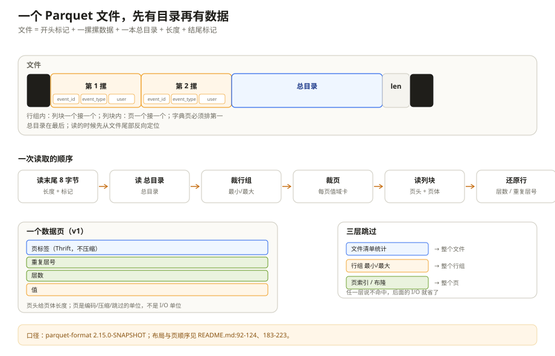
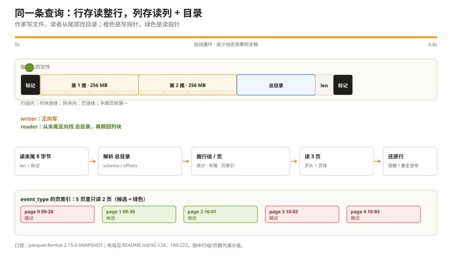

# 文件布局与结构：一个查询只读三页，凭什么

线上有一张 `events` 表，按天切成 Parquet 文件，一个文件大约 1 GB。某个凌晨，一条补偿查询只捞 100 行：

```sql
SELECT event_id, event_ts
FROM events
WHERE event_type = 'signup' AND event_ts >= '2026-10-01'
LIMIT 100;
```

执行计划上写着「扫描 1 GB」，实际磁盘只读了 3 个页，几十毫秒就回来了。有人觉得这是引擎在吹牛；也有人把文件下载下来，用 `parquet-tools` 一看，确实只有 3 页被碰过。

差别不在 SQL，而在文件自己的排版。Parquet 不是「把 CSV 压一压」，它把一张表先横着切成行组，再竖着切成列块，最后把列块切成页，并且在文件尾部留下一张足够细的目录。读的时候先看目录，再决定碰哪几页。这一章先把这张「排版图」讲清楚，后面七章才有落点。

把 Parquet 想成一本**按列装订的书**：每一页只放同一列的内容，书末有一本总目录。查两列，就只翻两列的书页；目录告诉你哪一摞、哪一叠、哪一页。

---

## 一、先把文件摊开：四层结构

一个 Parquet 文件的骨架长这样：

```text
4 字节            "PAR1"
                  <Row Group 1>
                    <Column 1 Chunk>
                    <Column 2 Chunk>
                    ...
                    <Column N Chunk>
                  <Row Group 2>
                    ...
                  <Row Group M>
                  FileMetaData（footer）
4 字节            footer 的字节长度（little-endian）
4 字节            "PAR1"
```

这是 `README.md:92-124` 给出的官方布局。把它翻译成人话，是四层：

| 层 | 是什么 | 谁按它切 |
| --- | --- | --- |
| File | 一个完整的 Parquet 文件 | 查询引擎按文件裁剪 |
| Row Group | 一批行，通常几十万到几百万行 | 并行任务、内存预算、统计裁剪 |
| Column Chunk | 某个列在一个行组里的全部数据 | 列投影、压缩、编码 |
| Page | 列块里的最小读写单位 | 页级编码、压缩、索引跳过 |

注意这里的顺序：**行组之间是横向切的，列块之间是纵向切的**。同一个行组里，列 1 的整块数据写在一起，然后才是列 2 的整块。这样读一列时，磁盘上是连续的一段；行存读一列则要把每一行都走一遍。

文件开头的 `PAR1` 是魔数，结尾也是。开头那个用来让读取方一眼确认「这是 Parquet」；结尾那个用来从文件尾部反向定位 footer。两个魔数之间才是数据。

---

## 二、footer 为什么在最后

第一次看到这个布局的人多半会问：目录为什么不放前面？

因为 Parquet 是**单遍写**的。writer 一边收数据一边往文件里追加列块，在最后一个列块写完之前，它根本不知道每个列块的偏移、每页压缩后多大、统计值是什么。等所有数据落完，再把这些信息一次性写成 `FileMetaData`，放在文件尾部，最后补上「footer 有多长」和结尾魔数。

读取方于是从后往前找：先读最后 8 个字节，前 4 个字节是目录长度 L，后 4 个字节是魔数；再跳到「文件长度 - 8 - L」的位置，读 L 个字节，解析成总目录；最后从总目录里拿到表结构、行组列表和每列的位置。这个「先读尾、再回头读数据」的动作，是所有 Parquet 读取器的第一步。`README.md:125-130` 说得很直白：文件元数据和页头元数据都用 Thrift 的 `TCompactProtocol` 序列化；读取器先读文件元数据，找到自己关心的列块，再顺序读这些列块。

把 footer 放尾部有一个直接代价：**如果写 footer 的时候进程崩了，前面写进去的所有数据都读不出来**。`README.md:230-244` 把这件事列为错误恢复的头号问题，并给了一个尚未标准化的扩展思路：每 N 个行组写一次累积元数据。这是后话，第八章会展开。

还有一个细节：加密文件的结尾魔数可能不是 `PAR1`，而是 `PARE`。看到 `PARE` 就说明 footer 被加密了，读取器要先读 `FileCryptoMetaData` 才能解 footer。这个分支在第六章讲。

---

## 三、三种「跳过」，粒度完全不同

Parquet 之所以能做到「只读三页」，是因为它在三个粒度上都留下了可判断的信息。很多人把这三个混成一个，排障时就会找错地方。

**第一层：文件级。** 清单服务（Hive Metastore、Iceberg、Delta Log）里通常存了每个文件的统计信息。查询条件如果和文件级 min/max 完全不沾边，整个文件都不用打开。

**第二层：行组级。** footer 的每个 `RowGroup` 里，`ColumnChunk.meta_data.statistics` 存了该列在这个行组里的 min/max、null 数等。谓词落在范围外，这个行组直接跳过。行组还是并行读取的基本单位：一个 1 GB 文件切成 4 个 256 MB 的行组，四个任务可以各读一个。

**第三层：页级。** 一个列块内部还有多个页。页级统计和页索引（`ColumnIndex` / `OffsetIndex`）能告诉你「这个页的 min/max 也不沾边」，于是连这一页都不读。`PageIndex.md:28-50` 专门解释了为什么要把页索引单独放在 footer 附近：老格式里页统计藏在每个页头里，读取器必须把整列的所有页头都读一遍才能判断，I/O 早就发生了；新格式把每页的边界值集中放在 footer 附近，先读索引，再决定读哪页。

三层的关系可以画成一道漏斗：

| 层 | 看什么 | 能跳过什么 |
| --- | --- | --- |
| 文件清单 | 文件的 min/max、分区值 | 整个文件 |
| 行组统计 | 这一摞的 min/max、空值数 | 整个行组 |
| 页索引 / 布隆 | 这一页的 min/max / 值在不在 | 整个页 |
| 解压 + 解码 | 真正读值 | 不能再跳了 |

「只读三页」不是引擎会猜，而是这三层里至少有一层给出了确定答案。反过来，如果表没有排序、统计被截断、或者谓词写成 `LIKE '%signup%'`，漏斗就会漏到底，扫描量立刻回到 1 GB。第五章会把每一层的条件和坑拆开。

### 3.4 和普通行数据库摆在一起看：同一条查询，读的字节不一样

假设 `events` 一行 480 字节，100 万行；查询只取 `event_id`、`event_ts`，按 `event_type` 过滤。

普通行数据库（MySQL InnoDB、PostgreSQL）把一行放在一起，页里是 `id | type | ts | user | payload` 交错排列。MySQL 的主键是聚簇索引，行就在主键 B+ 树叶子页里；`event_type` 上的二级索引只存「索引列 + 主键」，查到主键后还要回表取 `event_ts`，除非你建了覆盖索引。PostgreSQL 是堆表 + 索引，索引扫到 TID 后同样要回表。**行数据库的强项是「按索引找到少量行」，不是「扫宽表里的少数几列」。**

Parquet 没有 B+ 树，也没有二级索引。它读 `event_id`、`event_ts`、`event_type` 三列，约 28 字节/行，也就是 28 MB；如果 `event_type` 的行组统计还能再排掉 90%，落到 3 MB 左右。**同一条 SQL，行数据库读的是「索引页 + 回表行」，Parquet 读的是「列 + 统计 + 页索引」。**

| 维度 | MySQL / PostgreSQL（普通行数据库） | Parquet（文件格式 + 查询引擎） |
| --- | --- | --- |
| 定位 | OLTP：事务、点查、小批量读写 | 分析：大扫描、聚合、宽表投影 |
| 存储单位 | 页（InnoDB 16 KB / PG 8 KB）+ 行记录 | 行组 / 列块 / 页 |
| 主键点查 | 聚簇索引/堆表 + B+ 树，通常很快 | 没有主键索引；靠 footer + 页索引，可能读整页 |
| 范围扫描 | 二级索引 + 回表，或全表扫 | 列裁剪 + 统计/页索引，无回表 |
| 单行更新/删除 | 原地改页 + WAL/undo/MVCC | 重写行组/文件，或 merge-on-read |
| 事务 | ACID、隔离级别、锁/MVCC | 文件本身没有事务；靠 Iceberg/Delta 提供快照 |
| 索引 | B+ 树、二级索引、覆盖索引 | 统计、页索引、布隆过滤器（不是点查索引） |
| 压缩 | 页级/行格式压缩 | 逐列编码 + 通用 codec |
| 并发写 | 多写者、锁/MVCC | 单写者生成新文件，清单原子切换 |
| 扩展 | 主从、分库分表、共享存储 | 对象存储 + 分布式计算引擎 |
| 最适合 | 点查、事务、小批量写入 | 大范围扫描、聚合、数据湖分析 |

这里没有「谁全面更强」。行数据库赢在点查、事务、原地更新和二级索引；Parquet 赢在宽表扫描、列裁剪、高压缩和低成本对象存储。**Parquet 不是「另一种数据库」，它是一个给查询引擎读的文件格式**：索引只有粗粒度的统计/页索引/布隆，事务要交给上层表格式。

CSV 和 Avro 是行格式，不是数据库：CSV 是文本行存，Avro 是带 schema 的二进制行存，适合流式落地；Parquet 是列存，适合分析。它们解决的是不同读写模式，不是新旧替代关系。





*动图：橙色是写指针，绿色是读指针；系统开启“减少动态效果”时定格。*

### 3.5 Avro、ORC、Parquet：三种排法，三种读法

先把三种格式摆在一起。它们都不是数据库，都是“给引擎读的文件”，但排法不同：

- **Avro：一行一行放。** 一条记录的所有字段捆在一起，适合把完整事件写下来、传出去。
- **Parquet：一列一列放。** 同一列的值排在一起，适合分析时只读几列。
- **ORC：也是一列一列放。** 但它把行切成 stripe（可以理解成 Parquet 的行组），并在 stripe 里带索引；它更像 Hive 数仓里的“带索引卡的活页本”。

还是用本章的 `events` 表，只留三行：

| event_id | event_type | event_ts | user_id | payload |
| --- | --- | --- | --- | --- |
| e1 | signup | 10-01 | u01 | `{...}` |
| e2 | login | 10-01 | u02 | `{...}` |
| e3 | signup | 10-02 | u03 | `{...}` |

查询只取 `event_id`、`event_ts`，按 `event_type` 过滤。

Avro 在磁盘上更像这样（简化示意）：

```text
[e1, signup, 10-01, u01, {...}]
[e2, login,  10-01, u02, {...}]
[e3, signup, 10-02, u03, {...}]
```

一条记录一个包裹。读取时，Avro 可以用自己的 reader schema 只反序列化需要的字段，但记录还是要一条一条往前走；如果文件按块压缩，可能还得先解压整块。它没有“这一块的 `event_type` 最小值是 login，所以整块跳过”这种列统计。所以 Avro 适合“完整地写一条、传一条”，不适合“在上亿行里只扫三列”。

Parquet 在磁盘上按列排（简化示意）：

```text
event_id:   [e1, e2, e3]
event_type: [signup, login, signup]
event_ts:   [10-01, 10-01, 10-02]
user_id:    [u01, u02, u03]
payload:    [{...}, {...}, {...}]
```

查询只碰三列，`payload` 完全不读；行组统计还能用 `event_type` 的 min/max 把整段没有 `signup` 的行组跳过去，页索引再往下跳页。这就是前面说的“先少读列，再少读行组/页”。

ORC 也按列排，但它把行切成 stripe，每个 stripe 里带索引：某一列的最小值、最大值、空值数，必要的时候还有布隆过滤器。查询同样只读三列，但 ORC 可以在 stripe 级、以及更细的 row index 步长上判断“这段有没有 signup”。在 Hive 里，ORC 还常和 ACID 事务表一起用；注意 ACID 是 Hive 的表级能力，不是 ORC 文件本身自带事务。Parquet 没有这层能力，数据湖里通常靠 Iceberg/Delta/Hudi 补。

把三者的差别压成一张表：

| 维度 | Avro | Parquet | ORC |
| --- | --- | --- | --- |
| 存放方向 | 一行一行 | 一列一列 | 一列一列 |
| schema 放哪 | 文件头，JSON | 文件尾 footer，Thrift | 文件尾 + stripe footer，Protobuf |
| 跳读靠什么 | 基本没有列统计/索引 | 行组统计、页索引、布隆（后两者可选） | stripe 索引、row index、布隆 |
| 压缩方式 | 按块压缩 | 按列/页编码后再压缩 | 按 stripe/列编码后再压缩 |
| schema 演进 | 最强，reader/writer schema + 默认值 | 加列容易；改名列依赖 field id | field id + 类型放宽 |
| 事务/更新 | 无，只能追加新记录 | 无，靠 Iceberg/Delta/Hudi 补 | Hive ACID 常配 ORC |
| 典型场景 | Kafka、流式、原始落地层 | 数据湖分析、跨引擎互读 | Hive 数仓、ACID 表 |

然后分两句话说清两个常见选择：

**Avro 和 Parquet 不是新旧替代。** Avro 负责“把一条事件完整地写下来、传出去”，Parquet 负责“让分析只读该读的列”。常见管道是 Kafka 里用 Avro 传事件，原始层用 Avro 落地，再 compaction 成 Parquet 给 Spark/Trino 查。

**ORC 和 Parquet 也不是谁全面更强。** 两者都是列存，差别在生态、索引结构和事务：Hive 数仓、ACID 表通常选 ORC；跨引擎数据湖、Spark/Trino/Athena 通常选 Parquet。性能没有绝对赢家，同一份数据、同一个引擎版本下测才算数。

最后提醒一句：格式只决定“数据怎么排”，不决定一切。小文件太多、数据没排序、分区不合理，都会让 Parquet/ORC 的跳读能力大打折扣。选型先看访问模式，再看生态，最后才是 benchmark。

> 这一节是横向对照，ORC/Avro 的细节以各自规范为准，不在本章 parquet-format 源码引用的范围内。

---

## 四、一次读取到底走了哪些步骤

把上面的结构串成一条链，读取一个列的过程可以分成六步，不需要看代码也能复述：

1. **读文件末尾**：先读最后 8 个字节，知道目录有多长、从哪开始。
2. **读目录**：把 footer 读出来，拿到表结构、行组列表和每列的说明卡。
3. **只留要用的列**：查询要 `event_id`、`event_ts`，就只保留这三列（加上过滤用的 `event_type`），宽列不碰。
4. **先裁行组**：看每一摞的 min/max、空值数，和谓词完全不沾边的整摞跳过。
5. **再裁页**：对留下来的行组，看页索引/布隆过滤器，只读可能命中的页。
6. **解压、解码、拼行**：读页头知道页体多大，解压后按编码还原值，再按「第几层、从哪层重复」把值放回行里。

这条链里有三个容易忽略的点。

**第一，页头不压缩。** 页头自己也是目录结构，里面写着页体压缩前/后多大。读取器必须先读页头，才知道页体该解压到多大。所以页头永远以明文（或加密后的密文）存在，不能跟着页体一起压。

**第二，列块里的页是背靠背的。** 列块由一页页紧挨着写成，页与页之间没有填充；读取器可以跳过不关心的页，但必须知道每页的边界。页边界由页头里的「页体压缩大小」给出，或者由页索引直接给出偏移和长度。

**第三，字典页必须排第一。** 如果一个列块用了字典编码，字典页放在列块最前面，而且一个列块最多只有一个字典页。数据页里存的是字典下标，不是原值。读取器如果不先读字典页，后面的下标就是一串没有意义的整数。

---

## 五、页里面有什么：v1 与 v2 的差别

一个数据页不是「一排值」那么简单。它按顺序放三样东西（`README.md:183-206`）：

1. **重复层级**：这个值属于哪一行、哪一层重复；没有嵌套的列可以省略，因为永远是 0。
2. **空值层级**：这个值在哪一层是空；可空列靠它表示 NULL，没有嵌套且不可空的列可以省略。
3. **真正的值**：按页头里写明的编码方式排好。

v1 页和 v2 页的区别，主要在这三段怎么组织：

| 项目 | 数据页 v1 | 数据页 v2 |
| --- | --- | --- |
| 页头 | 老式页头 | 新式页头 |
| 层级怎么放 | 跟着整页一起压 | 层级不压缩，单独给出字节长度 |
| 页体布局 | levels + values 一起压 | levels 明文 + values 压缩 |
| 行边界 | 页可以在一行中间切开 | 页必须从行边界开始 |
| 空值计数 | 需要解码 levels 才知道 | 页头直接给 `num_nulls` |
| 页索引 | 支持，但页边界不保证 | 天然适合页索引 |

v2 的动机很实际：分析查询经常只需要 levels 来判断某行是否命中，不需要解压整页的值。把 levels 单独放在未压缩区，读取器可以先扫 levels，再决定要不要解压 values。代价是页头更大、写入路径更复杂。

还有一个容易混的点：`num_values` 包含 NULL，`num_rows` 只在 v2 里有，表示这个页覆盖多少行。`DataPageHeaderV2` 的注释明确写了「每一页必须从行边界开始，行不能跨页」。这也是页索引能按行号定位的前提。

---

## 六、列块、行组、文件：三个「大小」不是一回事

调 Parquet 参数时，最常见的误会是把这三个尺寸当成同一个东西。

**行组大小**决定「一次并行任务要吃多少数据」，也决定读取器为了还原一个行组要在内存里放多少东西。`README.md:250-263` 建议 512 MB 到 1 GB，并且要让一个行组完整落在一个 HDFS block 里。行组太小，footer 里的元数据和每个行组的固定开销会变多，页索引也跟着碎；行组太大，写入端要缓存更多数据，读取端一个任务的内存峰值也更高。

**列块大小**不是一个独立参数，它由「这个行组里这一列有多少数据」决定。一个行组里，`user` 这种宽结构体的列块可能几百 MB，`event_type` 这种短字符串可能只有几 MB。它们共享同一个行组边界，但不共享大小。

**页大小**才是编码、压缩和跳过的单位。`README.md:258-263` 建议 8 KB 左右。页太小，页头开销和解析开销占比升高；页太大，单行查找和页级跳过都变粗。注意这句话：**顺序扫描时并不是一页一页读**，页不是 I/O 块；I/O 块通常是列块或更大的连续区间。页是「解压和编码的单位」，不是「磁盘寻址的单位」。

把这三个尺寸摆在一起：

| 尺寸 | 典型值 | 谁在乎 | 调大了会怎样 | 调小了会怎样 |
| --- | --- | --- | --- | --- |
| Row Group | 512 MB–1 GB | 并行度、内存峰值、统计裁剪 | 写缓存大、单任务内存高 | 元数据多、并行碎片多 |
| Column Chunk | 由行组和列宽决定 | 列投影、压缩 | 单列读取时间长 | 固定开销占比高 |
| Page | ~8 KB | 编码、压缩、页索引 | 跳过粒度粗、单页解压慢 | 页头多、索引大 |

---

## 七、布局带来的四个能力，和它的账单

Parquet 的布局不是免费的。它换来了四件事，也收四笔账。

**能力一：列投影。** 只读 `event_id` 和 `event_ts` 时，`payload` 列块根本不用碰。这是列存最直接的收益。账单是：更新一行要重写整个行组，所以 Parquet 适合批量写、不适合频繁改。

**能力二：高压缩比。** 同一列的值类型一致、分布接近，字典、RLE、Delta 才有用武之地。账单是：压缩和解压要 CPU；编码选错（比如高基数列硬上字典）会让文件更大、写入更慢。

**能力三：谓词下推。** 行组统计、页索引、布隆过滤器让读取器在 I/O 之前就能排除大量数据。账单是：统计本身要占空间，字符串统计还要截断；没有排序的列，min/max 可能覆盖整个值域，等于没写。

**能力四：并行读取。** 行组之间天然独立，一个文件可以切给多个任务。账单是：小文件太多时，每个文件都要读一次 footer，元数据开销会压过数据本身；这也是数据湖里「小文件合并」的由来。

还有一个经常被忽略的能力：**元数据和数据可以分开**。`ColumnChunk.file_path` 允许列数据放在另一个文件里，footer 只负责引用。`README.md:245-249` 说这是格式有意为之，`_metadata` 汇总文件就是靠它把多个文件的 footer 拼在一起，做清单级的统计裁剪。不过 thrift 注释也提醒：这个字段在标准 Parquet 文件里的外部列数据读取并没有参考实现，别把它当成通用的「水平拆分」方案。

---

## 八、五个常见误解

**误解一：Parquet 是「压缩过的 CSV」。**

不是。CSV 是行存，Parquet 是列存 + 编码 + 页索引 + 统计。把它当 CSV 读，等于把列存的所有优势都扔掉，还会因为逐行解码付出额外代价。

**误解二：一个行组就是一张表的一个分区。**

行组是文件内部的横向切分，不是目录分区。一个分区可以有很多文件，一个文件可以有很多行组。分区是清单层的概念，行组是文件层的概念，别混。

**误解三：一页就是一行。**

一页通常覆盖很多行，8 KB 的页可能装几百到几万行，取决于列的宽度和编码。页是压缩/编码单位，不是行单位。

**误解四：footer 可以在文件任意位置。**

footer 的位置由「结尾 8 字节」唯一确定：前 4 字节是长度，后 4 字节是魔数。你可以把 footer 读进内存，但不能假设它在开头，也不能假设它紧跟最后一个列块——列块和 footer 之间可能还有页索引、布隆过滤器、加密元数据。

**误解五：列块在文件里一定连续。**

在同一个行组内，一个列块是连续的；但跨行组不连续。`ColumnChunk` 的 `data_page_offset` 只指向本行组内这个列块的第一页。别拿一个偏移去扫整个文件。

---

## 九、踩坑清单

| 现象 | 更可能的原因 | 先看哪里 |
| --- | --- | --- |
| 查询扫描量远大于命中行数 | 谓词列没有统计、没排序，或统计被截断 | `ColumnMetaData.statistics`、`ColumnOrder` |
| 只读一列却很慢 | 行组太大、页太大，或列块跨了多个 HDFS block | 行组大小、页大小、文件 block 布局 |
| 小文件查询元数据开销高 | 每个文件都要读 footer；清单里文件太多 | 文件数、`_metadata` 汇总、清单统计 |
| 读取时报「页头损坏」 | 页头 Thrift 解析失败，或偏移算错 | `PageHeader`、`compressed_page_size`、`data_page_offset` |
| 字典编码的列读出来是乱码 | 没先读字典页，或把字典下标当原值 | `dictionary_page_offset`、`RLE_DICTIONARY` |
| 文件末尾读不到 footer | 写入未完成、footer 长度被截断，或加密文件用了 `PARE` | 文件大小、末尾 8 字节、`FileCryptoMetaData` |
| 行组统计看起来「全是 null」 | `null_count` 缺失不等于 0；老文件的 `min/max` 语义不同 | `Statistics.null_count`、`min_value/max_value` |

---

## 十、这一章留下的线索

把这一章压成几句话：

- Parquet 文件 = 魔数 + 行组（列块（页））+ footer + 长度 + 魔数；
- footer 在尾部，是为了单遍写；读取从最后 8 字节开始；
- 跳过发生在文件、行组、页三个粒度，粒度越细，需要的信息越多；
- 页是编码/压缩/跳过的单位，不是 I/O 单位；
- 行组大小、页大小、列块大小是三笔不同的账；
- Avro 是行存，Parquet/ORC 是列存；ORC 和 Parquet 的差别在生态、索引和事务，不在“是否列存”。

下一章把 footer 拆开，看看 `FileMetaData` 这棵 Thrift 树到底存了什么，为什么它能让不同语言的读取器在十几年后还能读懂同一个文件。

---

## 附：这一章的源码入口

> 除特别注明外，本节引用的 `README.md`、`*.md` 与 `src/main/thrift/parquet.thrift` 都来自 apache/parquet-format（2.15.0-SNAPSHOT）。

- `README.md:92-124`：文件布局、魔数、footer 位置、单遍写
- `README.md:125-130`：文件元数据与页头元数据，Thrift `TCompactProtocol`
- `README.md:183-206`：数据页的三段结构、v1 页的 levels 与 values
- `README.md:207-223`：列块、页、字典页的位置约束
- `README.md:224-229`：页级 CRC32 校验
- `README.md:230-244`：footer/列元数据/页头/页体四层损坏边界
- `README.md:245-249`：元数据与列数据分离
- `README.md:250-263`：行组 512 MB–1 GB、页 8 KB 的建议
- `src/main/thrift/parquet.thrift:830-868`：`PageHeader`、`DataPageHeader`、`DataPageHeaderV2`、`DictionaryPageHeader`
- `src/main/thrift/parquet.thrift:908-973`：`ColumnMetaData` 的偏移、大小、统计、页索引与布隆过滤器字段
- `src/main/thrift/parquet.thrift:991-1047`：`ColumnChunk` 的 `file_path`、`meta_data`、索引偏移
- `src/main/thrift/parquet.thrift:1049-1077`：`RowGroup` 的行数、压缩/未压缩大小、排序信息
- `src/main/thrift/parquet.thrift:1407-1472`：`FileMetaData` 的 schema、row_groups、column_orders、加密字段

---

## 思考题

1. 一个 1 GB 的文件切成 4 个 256 MB 的行组，和一个 1 GB 的单行组，在「只读 100 行」的查询上分别会发生什么？如果查询是「全表扫描」，答案会变吗？
2. 为什么页头不能和页体一起压缩？如果强行一起压，读取器会失去什么能力？
3. 一个列块用了字典编码，但字典页损坏了。读取器还能读出后面的数据页吗？如果可以，读出来的是什么？
4. 行组越大，统计裁剪的粒度越粗，但并行度和内存又受什么限制？你会用什么指标决定行组大小？
