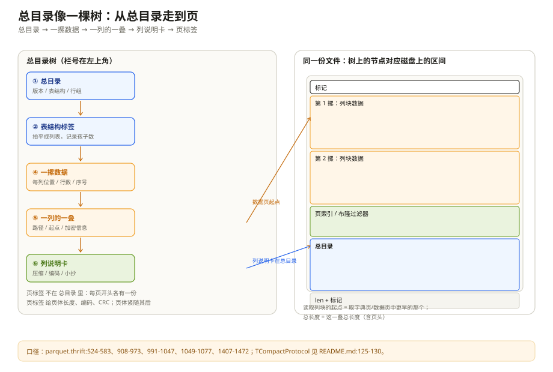
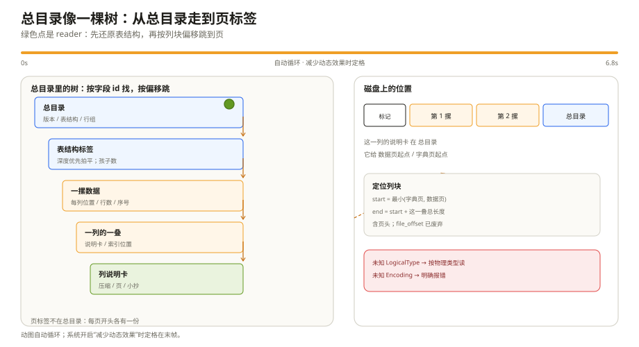

# Thrift 元数据定义：目录里到底写了什么

上一章说读取器先读文件尾部，拿到 footer。可 footer 里到底有什么，为什么它能让一个 2013 年写的文件在 2026 年的引擎里还能读？

先别想「Thrift」这个词。把它想成一张**带栏号的目录表**：每一栏都有固定编号，表里写着「表结构长什么样、数据分成几摞、每摞里每一列从第几页开始、每页多大」。读取器按栏号找自己认识的栏，不认识的直接跳过。正因为栏号稳定，十几年前写的目录，今天的引擎还能对得上。

这一章就顺着这张目录表往下走。先看它为什么这么设计，再看总目录、表结构、每一摞数据和每页标签分别装了什么。具体的结构体放在文末的源码入口，正文只讲人话。

---

## 一、先把它想成一张带栏号的表

如果没有这套栏号，Parquet 的目录大概会变成一段手工拼的二进制：第 1 个字节是版本，第 2 到 5 个字节是行组数，第 6 个字节开始是表结构……每加一个字段，所有语言的读取器都要改一遍，旧文件还要写兼容分支。十几年下来，这段代码会变成没人敢动的沼泽。

Thrift 解决的就是这件事。它给每个字段一个固定编号，比如版本是 1 号栏、表结构是 2 号栏；每栏还有类型，比如整数、字符串、列表。序列化时，栏号和类型一起写进去。读取器按编号找自己认识的栏，不认识的跳过。新增字段只要用新编号，老读取器不会报错，新读取器也能读老文件。

这就像一张快递面单：面单上印好了「收件人、电话、地址、备注」的栏位。新版本的面单多加一栏「取件码」，老系统不认识，跳过就行，不影响它读收件人。

Parquet 用的 Thrift 编码叫 `TCompactProtocol`。名字很吓人，做的事很朴素：把整数压短、把栏号写成差值，让目录小一点。footer 可能有几十 MB，这点压缩不是装饰。

和普通行数据库比，差别在「目录跟着谁走」：MySQL/PostgreSQL 的目录通常是表级、库级的一份；Parquet 每个文件都自带一份完整目录。所以文件越多、行组和页切得越碎，目录本身就越胖。这也是第八章「行组别切太碎」的一个原因。

---

## 二、总目录：几个抽屉，外加两把备用钥匙

总目录的正式名字叫 `FileMetaData`（`parquet.thrift:1407-1472`）。名字很长，作用就一个：告诉读取器「这个文件里有什么、去哪找」。

它主要装这些抽屉：

| 抽屉 | 人话 | 里面装什么 | 读不到会怎样 |
| --- | --- | --- | --- |
| 版本 | 目录格式的版本号 | 通常写 1；reader 把 1 和 2 都当合法 | 一般不影响读，别拿它当特性开关 |
| 表结构 | 这个文件有哪些列、什么类型 | 一棵被拍平的树 | 不知道列和类型，文件基本读不了 |
| 行数 | 整个文件一共多少行 | 一个总数 | 可以用行组行数相加补，但很多引擎会直接不信任 |
| 行组列表 | 数据分成几摞，每摞里每列在哪 | 每个行组的列块目录 | 不知道数据在哪，读不了 |
| 排序规则 | 每列的 min/max 按什么顺序比 | 每个叶子列一条规则 | min/max 的含义不确定，不能拿它做裁剪 |
| 附加信息 | 谁写的、业务方塞的键值对 | 写文件的库、schema 版本等 | 不影响读，但排障时很有用 |
| 加密信息 | 这个文件有没有上锁 | 算法和钥匙的线索 | 加密文件读不了；普通文件用不到 |

前五样是主路径，后两样是备用钥匙。这里重点说三个容易踩的：

**版本号不是功能开关。** 规范写得很直白：社区对「版本 2 到底是什么」没有共识。writer 为了兼容，通常总是写 1；reader 看到 1 或 2 都接受。想知道文件用没用某个特性，别看版本号，看对应的目录栏在不在。

**排序规则决定 min/max 能不能用。** 一列的「最小值/最大值」听起来很直观，但字符串按什么比、无符号整数按什么比、小数按什么比，不同规则结果不一样。目录里的 `column_orders` 就是告诉读取器「这一列按哪套规则比」。没有它，min/max 的含义是未定义的——不是「默认按有符号比」，是「别用」。这条规则在第五章会反复出现。

**附加信息是排障入口。** `created_by` 通常写着写文件的库和版本，比如 `parquet-mr version 1.15.0`。遇到兼容性问题，先看这栏，比猜实现靠谱。业务方塞的键值对也在这里，比如 schema 版本、数据源、Arrow schema 的序列化结果。

---

## 三、表结构：一棵树被拍成一列标签

表结构的正式名字叫 `SchemaElement`（`parquet.thrift:524-583`）。它像一张标签，每张标签回答三件事：

1. 这一层叫什么名字；
2. 它是「一组字段」还是「一个具体的值」；
3. 它能不能为空、能不能重复。

如果这一层是「一组字段」，标签上会写「我有几个孩子」；如果这一层是「一个具体的值」，标签上会写它的存储类型。读取器拿到一串标签，按「孩子数」递归往下走，就能把树还原出来。

用一张订单举例：

```text
订单
├─ 订单号        必填，整数
├─ 事件类型      可空，字符串
└─ 商品          一组字段
   ├─ SKU        可空，整数
   └─ 标签       可重复，字符串
```

这张树在文件里不是画出来的，而是一串按顺序排好的标签。读取器从根开始，看到「订单有 3 个孩子」，就知道接下来 3 张标签是它的孩子；看到「商品有 2 个孩子」，就继续往下。这个「拍平」不是偷懒，是因为 Thrift 没有递归结构，只能用「列表 + 孩子数」来表达树。

每个列块还会带一条路径，比如 `user.name`、`tags.list.element`。路径的作用是「对名字」：读取器在树里找到对应的叶子，再去列块里找同名的路径。路径里会包含 LIST/MAP 的包装层，所以跨语言实现最容易在这里出分歧。

标签上还有一个 `field_id`，可以理解成「这一列在业务系统里的身份证号」。Parquet 自己不用它匹配列，匹配靠路径；但如果上层要做 schema 演进，身份证号比名字稳，改个名字不会丢列。

---

## 四、行组与列块：一摞纸和每列的一叠

先把数据想成一摞纸。一摞纸就是一个行组（`RowGroup`，`parquet.thrift:1049-1077`），它回答三件事：

- 这一摞有多少行；
- 这一摞里每一列的数据在哪；
- 这一摞解压后大概多大、压缩后实际多大。

行组是「横着切」的：先按行数把数据分成几摞。每一摞里面再「竖着切」：订单号一叠、事件类型一叠、商品一叠……每一叠就是一个列块（`ColumnChunk`，`parquet.thrift:991-1047`）。

这样切的好处很直接：你只想看「事件类型」这一列，就只翻这一叠，不用把整摞纸都翻一遍。

列块里还有一张说明卡，正式名字叫 `ColumnMetaData`（`parquet.thrift:908-973`）。说明卡上写着：

| 说明卡上的话 | 人话 |
| --- | --- |
| 这一叠是什么类型 | 整数、字符串、小数…… |
| 用了哪些编码 | 字典、RLE、Delta…… |
| 从第几页开始 | 数据页的「页码」 |
| 字典页在哪 | 如果用了字典，字典在最前面 |
| 一共多少值 | 包含空值 |
| 压缩前/后多大 | 解压和 I/O 的估算 |
| 这一叠的 min/max、空值数 | 裁剪用的小抄 |
| 布隆过滤器在哪 | 等值查询的「排除卡」 |

这里最容易被代码带偏的是「偏移」两个字。`data_page_offset` 不是「这一列在文件里的绝对地址」，它只是「这一叠第一页从文件的第几个字节开始」；`total_compressed_size` 是「这一叠一共占多少字节，含每页的页头」。读取器把这两个数一加，就知道这一叠读到哪为止。

还有一个历史坑：`ColumnChunk` 里有个 `file_offset`，名字看起来像「这一列的位置」，但规范已经把它标成废弃。历史上有的实现让它指向说明卡，有的让它指向第一页，很多文件里干脆是错的。**别用它定位列块**，用说明卡里的 `dictionary_page_offset` 和 `data_page_offset`。

---

## 五、页头：每一页自己的小标签

一叠纸不是一整块，而是很多页。每页开头有一张小标签，正式名字叫 `PageHeader`（`parquet.thrift:830-868`）。小标签回答：

- 这是一页数据、一页字典，还是别的页；
- 这一页解压后多大、压缩后多大；
- 这一页用什么编码；
- 有没有 CRC 校验；
- 这一页具体是 v1 还是 v2 格式。

这张小标签本身不压缩。原因很简单：读取器必须先读它，才知道后面那一段页体该解压到多大。如果标签也压了，就变成「先有鸡还是先有蛋」。

小标签里的两个大小都不包含标签自己。读取器往前推进时，要算「标签的字节数 + 页体的压缩大小」，不能把标签算进页体里。这个细节写错，后面的页会全部错位。

v1 和 v2 的区别，也可以用人话讲：

- **v1**：把「重复层级、空值层级、值」三段一起压。想判断某一行在不在，得先把整页解压。
- **v2**：把两个层级放在未压缩区，先扫层级，再决定要不要解压值。页头直接告诉你这一页有多少空值。

v2 更适合「先过滤、再取值」的分析查询，代价是页头更大、写入更复杂。读文件的人不需要背结构体，只要知道「v2 把索引信息放在了更容易拿的地方」。





*动图：绿色点从总目录走到列说明卡，再按偏移跳到页；系统开启“减少动态效果”时定格。*

---

## 六、一次「按目录找数据」的全过程

把上面的东西串起来，读取器找一列的过程其实是六步，不需要看代码也能复述：

1. **读文件末尾 8 个字节**：前 4 个字节是目录长度，后 4 个字节是魔数。知道目录从哪开始。
2. **读总目录**：拿到表结构、行组列表、排序规则。知道「有哪些列、数据分几摞」。
3. **还原表结构**：把一串标签按「孩子数」拼回树，记下每个叶子的路径。
4. **翻行组目录**：对每一摞，找到这一列的说明卡。说明卡告诉你「这一叠从第几页开始、到哪结束」。
5. **翻页**：从第一页开始读小标签，按「标签 + 页体」往前推进；遇到字典页先读字典，遇到数据页就解码。
6. **拼回行**：用每页里的「走到第几层、从哪层重复」把值放回对应的行和嵌套位置。

这六步里，任何一步拿不到必需信息，后面的「页码」都无从谈起。所以读取器对目录的完整性非常敏感：目录缺一栏，可能不是「少读一点」，而是「整段数据找不到」。

---

## 七、兼容性：为什么老文件还能读

Thrift 给了两层兼容：栏号不撞、未知栏跳过。Parquet 在这上面又加了几条自己的规则：

- **不认识的逻辑类型，降级读。** 比如新版本加了 `VARIANT`，老读取器不认识这个注解，就把它当普通字节串读。它看不到结构，但不会把整个文件判死。
- **不认识的编码，明确报错。** 编码不是「跳过就行」的，跳过会解出垃圾。读取器应该老老实实说「这个编码我不支持」。
- **新旧注解都要写。** 新文件用新的逻辑类型表示，同时把老的等价注解也写上，照顾老读取器。
- **每个结构留一个「后门」栏。** 所有目录结构都保留 32767 号栏，类型是二进制，内容随意。读取器不认识就跳过。这是给厂商做实验用的，不是业务字段。

这几条规则合起来，才让「2013 年的文件，2026 年的引擎还能读」成为常态。不是 Thrift 一个库的功劳，是格式和生态一起守出来的。

---

## 八、目录不是越小越好

很多人以为目录就几 KB，不用管。实际不是。

目录里每个行组、每个列块都有一张说明卡；每个列块还可能带 min/max、空值数、页索引、布隆过滤器。一个 1 GB 文件如果切成 1000 个行组，每个行组 20 列，目录里就有 2 万张说明卡。每张再带一段统计，目录很容易到几十 MB。

这带来两个直接后果：

- **打开文件的固定成本变高。** 每次查询都要读目录、反序列化整棵树。小文件多的时候，这个成本会超过读数据。
- **目录也会被加密。** 加密模式会给每个模块加 nonce/tag，目录的加密开销会随模块数量上升。

所以「行组别切太碎」不只是读端内存问题，也是目录体积问题。第八章会把这条和页大小、字典、布隆过滤器放在一张配置表里。

---

## 九、踩坑清单

| 现象 | 更可能的原因 | 先看哪里 |
| --- | --- | --- |
| 读取器找不到列 | 路径和表结构对不上，或 LIST/MAP 的包装层名字不一致 | 表结构树、列块路径 |
| 列顺序错乱 | 行组里的列块顺序和叶子顺序不一致 | 行组的列块列表 |
| 用了 `file_offset` 定位列块，读到垃圾 | 该字段已废弃且历史语义不一致 | 改用字典页/数据页偏移 |
| 说明卡为空 | 列元数据被单独加密，或 writer 没按事实标准写 | 加密列元数据字段 |
| min/max 裁剪结果不对 | 没写排序规则，或用了废弃的 min/max | 总目录的排序规则 |
| 新类型在老引擎里读成二进制 | 未知逻辑类型被降级 | 这是设计行为，不是 bug |
| 目录解析失败 | 栏号撞了、文件截断，或把加密魔数当普通魔数 | 魔数、目录长度 |
| 页头解析后位置越界 | 把页体大小当成了含页头的总长度 | 页头里的两个大小 |

---

## 十、这一章留下的线索

- 目录是一张带栏号的表：总目录 → 表结构 / 行组 → 列块 → 列说明卡 / 页标签；
- 表结构是一棵被拍平的树，靠「孩子数」还原，靠路径对列；
- 行组是「一摞纸」，列块是「每列的一叠」，说明卡告诉你页码和大小；
- 定位列块不要用废弃的 `file_offset`，用字典页/数据页偏移；
- min/max 的含义由排序规则决定，没有它就不要裁剪；
- 兼容靠栏号不复用、未知类型降级、未知编码报错和 32767 后门。

下一章进入数据模型：为什么 Parquet 只有 8 种物理类型，却能表达字符串、小数、时间戳、地理围栏和嵌套列表；以及「第几层、从哪层重复」到底怎么把一棵树压成三列。

---

## 附：这一章的源码入口

> 除特别注明外，本节引用的 `README.md`、`*.md` 与 `src/main/thrift/parquet.thrift` 都来自 apache/parquet-format（2.15.0-SNAPSHOT）。

- `README.md:125-130`：文件元数据、页头元数据、`TCompactProtocol`
- `README.md:131-165`：物理类型与逻辑注解的分工
- `src/main/thrift/parquet.thrift:32-47`：`Type` 枚举
- `src/main/thrift/parquet.thrift:183-200`：字段可空/可重复的枚举
- `src/main/thrift/parquet.thrift:489-516`：逻辑类型 union
- `src/main/thrift/parquet.thrift:524-583`：表结构节点
- `src/main/thrift/parquet.thrift:699-785`：数据页 v1/v2、字典页头
- `src/main/thrift/parquet.thrift:819-868`：布隆过滤器头、页头
- `src/main/thrift/parquet.thrift:908-973`：列说明卡
- `src/main/thrift/parquet.thrift:991-1047`：列块
- `src/main/thrift/parquet.thrift:1049-1077`：行组
- `src/main/thrift/parquet.thrift:1102-1233`：排序规则
- `src/main/thrift/parquet.thrift:1407-1472`：总目录
- `BinaryProtocolExtensions.md:20-60`：32767 扩展栏的写法

---

## 思考题

1. 如果 writer 只写了列块的位置，没写列说明卡，读取器还能打开文件吗？标准允许吗？主流实现会怎么做？
2. 为什么没有排序规则时，min/max 不能用来裁剪？如果只写废弃的 min/max，它们的含义又是什么？
3. 表结构被拍平后，读取器怎么知道某个标签属于哪个父节点？如果「孩子数」写错了，会发生什么？
4. 页头里的两个大小都不包含页头自身。这个设计对顺序扫描和随机跳页分别意味着什么？
