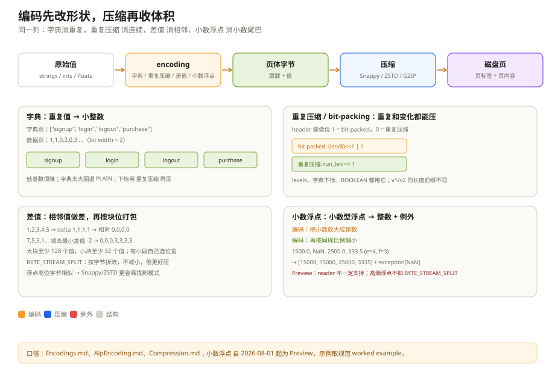

# 编码与压缩：同类值排在一起，才压得动

同一份数据，两个团队各写了一份 Parquet：一份 1.2 GB，一份 180 MB。schema 一样，行数一样，压缩 codec 都是 Snappy。差距不在「有没有压缩」，而在「压缩之前把数据摆成了什么形状」。

Parquet 的压缩是两层：**编码（encoding）** 把值变成更适合压缩的字节，**压缩（compression）** 再用通用算法（Snappy/ZSTD/GZIP）压一遍。很多人只调第二层，忽略了第一层；实际上，编码选错，后面用再好的 codec 也救不回来。

这一章把常用的编码拆开：字典、RLE/bit-packing、Delta、Byte Stream Split、ALP。每一种都回答同一个问题：**这列数据长什么样，为什么这种摆法更省。**

---

## 一、先分清编码和压缩

一个页写到磁盘上的顺序是四步：原始值先按编码排成字节流，再按压缩算法压一遍，需要的话再加密，最后写进页体。页头单独写在页体前面，而且不压缩。

编码和压缩是两个独立的开关（`parquet.thrift:585-680`）。编码决定「值怎么排」，压缩决定「排好的字节怎么压」。同一个编码可以配不同 codec，同一个 codec 也可以压不同编码的输出。

为什么要分两层？因为通用压缩算法不认识的模式，编码可以提前消掉。比如一列全是 `"CN"`，Snappy 能压，但它仍然要先看到几百个重复的 `"CN"`；如果先用字典编码把它变成一串 `0`，再用 RLE 把 `0` 压成「重复 N 次」，Snappy 面对的就是几十个字节。编码做的是「把领域知识告诉压缩器」。换个日常说法：编码像收拾行李，先把同类东西叠在一起；压缩像用真空袋抽气。叠得整齐，抽气才有效。

`README.md:183-206` 说数据页里三样东西按顺序放：repetition levels、definition levels、encoded values。levels 本身也有编码（通常是 RLE），values 用页头里的 `encoding`。这三段一起被压缩（v1），或者 levels 不压、values 压（v2）。

### 1.1 行数据库/行存压的是混合类型，列存压的是同类型

同一批 100 万行事件，普通行数据库的一页里，大概是「991203、signup、时间戳、一段用户 JSON、一段 payload JSON」这样一个接一个地排。页里整数、短字符串、长 JSON、嵌套结构交错在一起。通用 codec 能看到一些重复，但没法针对某一列做专门处理：`event_type` 的四种值被 `id`、`payload` 冲散，RLE 找不到长 run；`event_ts` 的有序性也被其他列打断，Delta 没有用武之地。

列存把同类型的值排在一起，编码器可以逐列选策略：

| 列 | 普通行数据库/行存里的处境 | 列存里的选择 |
| --- | --- | --- |
| `event_type`（4 种值） | 和唯一 id、长 JSON 混在一起 | 字典 + RLE，下标只要 2 bit |
| `event_id`（高基数） | 和短字符串混在一起 | PLAIN + ZSTD，硬压 |
| `event_ts`（近似有序） | 被其他列打断 | DELTA_BINARY_PACKED |
| `payload`（高熵 JSON） | 和数字混在一起 | 字典（如果低基数）或 PLAIN + ZSTD |

这不是说行数据库/行存压不小。Avro + ZSTD 也能把行存压得很好，只是它只有「整块一起压」这一个旋钮；列存多了「逐列编码」这一层，能把不同分布分开处理。

---

## 二、原样摆（PLAIN）：所有实现的保底

`PLAIN = 0` 是最简单的编码，也是所有实现必须支持的保底（`Encodings.md:50-75`）：

| 类型 | 布局 |
| --- | --- |
| BOOLEAN | 位打包，LSB first |
| INT32 | 4 字节小端 |
| INT64 | 8 字节小端 |
| INT96 | 12 字节小端（已废弃） |
| FLOAT | 4 字节 IEEE 小端 |
| DOUBLE | 8 字节 IEEE 小端 |
| BYTE_ARRAY | 4 字节长度 + 字节内容 |
| FIXED_LEN_BYTE_ARRAY | 定长字节 |

它不做任何「聪明」的事：值一个接一个放。优点是实现简单、随机访问容易；缺点是对于重复值、有序值、低基数值，几乎没有压缩空间，只能靠后面的 Snappy/ZSTD 硬压。

注意 BYTE_ARRAY 的 4 字节长度前缀。它让每个值可以独立定位，但也让字符串列多出 4 字节/值的开销。后面讲的 Delta Length / Delta Byte Array 就是在消这个开销。

---

## 三、字典：把重复值换成编号

字典编码（`PLAIN_DICTIONARY = 2`，新文件用 `RLE_DICTIONARY = 8`）的思路很直接（`Encodings.md:76-91`）：

1. 扫描一个列块，收集不重复的值，建成字典；
2. 字典页用 PLAIN 编码写在列块最前面，一个列块最多一个字典页；
3. 数据页里不存原值，存字典下标；下标用 RLE/bit-packing 编码。

数据页里只存两样东西：一个「下标最多用几位」的位宽，和一串用 RLE/bit-packing 压过的下标。

字典页本身也有页头，记录字典里有多少个值、用什么编码（通常是 PLAIN）、是否有序。

举个具体的例子。`event_type` 一列有 100 万个值，只有 `signup`、`login`、`logout`、`purchase` 四种。字典页存这四个词；数据页存 `1, 1, 0, 2, 0, 3...`，每个下标只要 2 bit。原值平均 7 个字节，现在每个值 2 bit；再叠 RLE，连续重复的 `1` 会变成「重复几次 + 值」。这就是为什么低基数列的字典编码通常能压到原来的几十分之一。

但字典不是万能的：

- **字典本身要驻留内存。** 高基数列（比如 `event_id`、UUID）的字典可能和原数据一样大，读的时候还要额外建哈希表。
- **字典太大时 writer 会回退到 PLAIN。** 规范说「如果字典变得太大（大小或 distinct 值数量），编码会回退到 plain」。回退可能发生在列块中间，所以一个列块里可能同时有字典页和 PLAIN 数据页；`ColumnMetaData.encodings` 会列出所有用到的编码。
- **下标位宽由字典大小决定。** 字典有 5 个值只要 3 bit，有 300 个值要 9 bit。字典越大，下标的收益越小。

`PLAIN_DICTIONARY` 是旧枚举，新文件的数据页应该写 `RLE_DICTIONARY`，字典页写 `PLAIN`。读取器两者都要认，但 writer 别再用旧枚举。

---

## 四、重复与打包（RLE）：重复和变化都能压

`RLE = 3` 是 Parquet 里最常用的编码之一，用于 definition/repetition levels、字典下标、BOOLEAN 值（`Encodings.md:92-172`）。它不是纯 RLE，而是「RLE 和 bit-packing 的混合」：连续的重复值用 RLE，变化的值用 bit-packing。

它不是纯 RLE，而是「重复段用 RLE，变化段用 bit-packing」。每段开头有一个头字节，最低位告诉你这段是哪一种：

| 头的最低位 | 这一段是什么 | 头里还存什么 |
| --- | --- | --- |
| 1 | 一组打包好的值 | 有多少个「8 值组」 |
| 0 | 一段重复值 | 重复多少次，后面跟着那个值 |

打包时按 8 个值一组，长度必须是 8 的倍数；不够就补到 8 的倍数。打包顺序是从低位往高位排，也就是常说的 LSB first。规范的理由很实际：小端机器一次读 4 字节或 8 字节，按这个顺序可以直接移位解包，不用处理字节序。

举个例子，位宽 3，值 `0..7`。原始是 `000 001 010 011 100 101 110 111`，按 3 bit 一组从低位往高位摆，就得到三个字节 `10001000 11000110 11111010`。读的时候按 3 bit 一组取，就能还原。

RLE 的 `length` 前缀不是总有的。规范给了一张表：

| 页类型 | 数据 | 是否前置 4 字节长度 |
| --- | --- | --- |
| Data Page v1 | definition levels | 是 |
| Data Page v1 | repetition levels | 是 |
| Data Page v1 | 字典下标 | 否 |
| Data Page v1 | BOOLEAN 值 | 是 |
| Data Page v2 | definition levels | 否 |
| Data Page v2 | repetition levels | 否 |
| Data Page v2 | 字典下标 | 否 |
| Data Page v2 | BOOLEAN 值 | 是 |

这张表是解析器最容易写错的地方之一。v1 的 levels 带长度，v2 的 levels 不带长度（因为页头给了 `definition_levels_byte_length` / `repetition_levels_byte_length`）；字典下标永远不带长度（位宽和值的数量由页头/字典决定）。读错一个前缀，后面全乱。

---

## 五、差值（Delta）：有序整数和字符串的利器

**差值整数（DELTA_BINARY_PACKED）** 用于 INT32/INT64（`Encodings.md:201-321`）。它不是简单存「当前值 - 前一个值」，而是分块、找每块的最小差值、再按小段位打包。

先存四个数：每块多少个值、每块分多少小段、一共多少个值、第一个值是什么。每个块再存：这一块的最小差值、每个小段的位宽、以及「原值减去最小差值」之后打包好的相对差值。

- 块的大小是 128 的倍数；
- 每个小段的值数量是 32 的倍数；
- 每个小段有自己的位宽，不会被别处的巨大差值拖累。

为什么要有小段？因为一列数据在不同区间的变化幅度可能差很多。比如时间戳列，白天每秒几千条，夜里几秒一条；用整块一个位宽，会被最大的差值拖累。小段让每个 32 值左右的小段自己选位宽，压缩率更高。

规范给了两个例子，用人话摆出来：

| 原始值 | 相邻差值 | 这一块的最小差值 | 相对差值 |
| --- | --- | --- | --- |
| 1, 2, 3, 4, 5 | 1, 1, 1, 1 | 1 | 0, 0, 0, 0 |
| 7, 5, 3, 1, 2, 3, 4, 5 | -2, -2, -2, 1, 1, 1, 1 | -2 | 0, 0, 0, 3, 3, 3, 3 |

第一组所有相对差值都是 0，位宽 0，几乎不占数据；第二组只要 2 bit 就能装下。注意真实块大小是 128 的倍数，例子里的 8 只是为了好算。还有一个容易忽略的规则：差值的加减可能溢出，规范要求按补码回绕，不能因为溢出报错。

**长度分离（DELTA_LENGTH_BYTE_ARRAY）** 用于 BYTE_ARRAY（`Encodings.md:322-344`）：先把所有字符串的长度排成一段，再用同样的差分/位打包压；后面把所有字符串内容首尾相接拼成一段。它省掉了 PLAIN 里每个值 4 字节的长度前缀。比如 `"Hello", "World", "Foobar", "ABCDEF"`，长度是 `5, 5, 6, 6`，内容拼成 `HelloWorldFoobarABCDEF`。

**前缀压缩（DELTA_BYTE_ARRAY）** 用于 BYTE_ARRAY / FIXED_LEN_BYTE_ARRAY（`Encodings.md:345-366`）：它利用「相邻字符串共享前缀」的特点，只存「前缀有多长 + 剩下的后缀」。

| 原始字符串 | 和上一个共享的前缀 | 只存后缀 |
| --- | --- | --- |
| axis | 0 | axis |
| axle | 2（ax） | le |
| babble | 0 | babble |
| babyhood | 3（bab） | yhood |

后缀拼起来是 `axislebabbleyhood`。对于 URL、日志路径、枚举字符串这类前缀重复的列，效果很好；对于随机 UUID，前缀几乎不重复，收益就很小。

---

## 六、按字节拆流（BYTE_STREAM_SPLIT）：不压大小，压「可压性」

**按字节拆流（BYTE_STREAM_SPLIT）** 用于 FLOAT/DOUBLE/INT32/INT64/FIXED_LEN_BYTE_ARRAY（`Encodings.md:367-396`）。它不减少字节数，只是把每个值的第 0 个字节放到第 0 条流、第 1 个字节放到第 1 条流，依此类推，最后把 K 条流拼起来。

| 原来的三个值 | 拆成四条流之后 |
| --- | --- |
| `AA BB CC DD`、`00 11 22 33`、`A3 B4 C5 D6` | 第 0 条：`AA 00 A3`；第 1 条：`BB 11 B4`；第 2 条：`CC 22 C5`；第 3 条：`DD 33 D6` |

为什么有用？浮点数的指数位集中在高位字节，尾数位集中在低位字节。按字节拆开后，同一列的高位字节往往高度重复（比如全是 `0x3F`、`0x40`），低位字节更像噪声。通用的 Snappy/ZSTD 面对「一堆相似的高位字节」能压得更好；如果原始浮点数交错排列，压缩器很难利用这个规律。

它没有元数据，编码后的长度就是 `K * N`，流的结束就是页体的结束。读取器按页头里的类型宽度 K 反推每条流的长度。注意它**本身不减少大小**，收益来自后面的 codec；如果 codec 是 UNCOMPRESSED，用了它反而没有意义（大小一样）。

---

## 七、小数浮点（ALP）：把「像小数的浮点数」变成整数

**ALP = 10** 是 2024 年 SIGMOD 论文提出的自适应无损浮点编码，Parquet 规范在 2026 年 8 月把它标为 **Preview**（`Encodings.md:397-422`、`AlpEncoding.md:26-83`）。它解决一个很常见的场景：浮点数列看起来是小数，但其实是「金额、传感器读数、温度」这类有限精度的值。

做法可以写成一句话：编码时把值乘以 `10^e`、再乘以 `10^-f`，四舍五入成整数；解码时反过来，乘以 `10^f`、再乘以 `10^-e`。`e` 和 `f` 是两个可调的指数，满足 `0 ≤ f ≤ e`。编码器为每一页/每个向量选一对 `(e, f)`，把浮点数放大成整数，再用帧参考（FOR）和位打包压。不能无损转换的值（NaN、Inf、-0.0、超出整数范围、round-trip 失败）作为 **exception** 单独存。

一个页的布局是「页头 + 偏移表 + 一批小向量」。页头说明这批数据怎么编；偏移表告诉你每个小向量从哪开始；每个小向量自带「用了哪组 e/f、最小值是多少、每个数占几位、有几个例外」，后面才是打包后的值和例外。

规范里的例子：`double values[4] = {1500.0, NaN, 2500.0, 333.5}`，选 `(e=4, f=3)`，等价于乘 10：

| 值 | 乘 10 | 编码 |
| --- | --- | --- |
| 1500.0 | 15000 | 15000 |
| NaN | — | exception |
| 2500.0 | 25000 | 25000 |
| 333.5 | 3335 | 3335 |

exception 用第一个非 exception 的编码值做占位（15000），然后算 min=3335、delta=[11665,11665,21665,0]、bit width=15。整个 vector 31 字节，而 PLAIN 是 32 字节——这个例子太小，看不出优势；当一页有 1024 个值时，13 字节的 vector 头被摊薄，典型压缩比是 2–8 倍。

ALP 的三个注意点：

- **它是 Preview。** 规范稳定，但生态实现不一定完整；writer 应该提供 opt-in 开关，reader 不支持时要有回退/报错策略。
- **解码必须按规范的两步乘法。** `decoded = encoded * 10^f * 10^(-e)`，不能用 `pow()` 现算常量，也不能合并成一次乘法；否则不同实现可能差 1 个 ULP。编码端的 `fast_round` 是「建议」不是「强制」，只要 round-trip 不通过就存 exception。
- **它适合小数型浮点，不适合随机浮点。** 如果一列是科学计算的高熵浮点，decimal scaling 会产生大量 exception，反而不如 BYTE_STREAM_SPLIT + ZSTD。

---

## 八、压缩算法（codec）：编码之后的第二层

`Compression.md` 列出的 codec 有：

| Codec | 枚举 | 特点 | 适用 |
| --- | --- | --- | --- |
| UNCOMPRESSED | 0 | 不压 | 已经编码得很紧、CPU 敏感 |
| SNAPPY | 1 | 快，压缩比中等 | 默认选择，读多写多都合适 |
| GZIP | 2 | 压缩比高，CPU 高 | 冷数据、归档 |
| LZO | 3 | 快，生态支持一般 | 少见 |
| BROTLI | 4 | 压缩比高，速度慢 | 静态数据、Web 传输 |
| LZ4 | 5 | 已废弃，带私有 framing | 不要用 |
| ZSTD | 6 | 压缩比/速度平衡好 | 现代数据湖常用 |
| LZ4_RAW | 7 | LZ4 block format，无 framing | 替代废弃的 LZ4 |

除了废弃的 `LZ4`，所有 codec 都是把页的原始字节**原样**喂给压缩库，不加额外的 framing 或 padding；压缩前/后的大小写在 `PageHeader` 里（`Compression.md:24-38`）。这意味着：

- **页头不压缩。** 读取器要先读页头，才知道 `compressed_page_size` 和 `uncompressed_page_size`。
- **GZIP 可能包含多个 member。** 规范要求 reader 支持多 member，但建议 writer 默认不要产生，因为历史实现支持不一致。
- **LZ4 和 LZ4_RAW 不是一回事。** 老的 `LZ4` 带 Hadoop 的私有 framing，跨实现容易出问题；新文件用 `LZ4_RAW`。

压缩算法的选择不是「越强越好」。一个典型的权衡：

| 算法 | 特点 | 适合 |
| --- | --- | --- |
| Snappy | 解压快，压缩比一般 | 热数据、交互查询 |
| ZSTD | 压缩比高，解压也不慢 | 数据湖默认，尤其列存 |
| GZIP | 压缩比高，解压慢 | 冷数据、归档 |
| Brotli | 压缩比高，编码慢 | 静态发布、一次性写多次读 |

还有一层常被忽略：**编码和 codec 的组合效应**。字典 + RLE 后的下标流，Snappy 几乎压不动（已经很小）；PLAIN 浮点 + BYTE_STREAM_SPLIT + ZSTD，往往比 PLAIN + ZSTD 好很多；ALP + ZSTD 对小数型浮点可能比 BYTE_STREAM_SPLIT 更好。选型要看列的实际分布，不要背默认值。

*动图：橙色点从原始值走到磁盘页，重复压缩把 8 个连续的 1 收成一段；系统开启“减少动态效果”时定格。*

---

## 九、按列型选编码：一张实用表

| 列的特征 | 首选 | 备选 | 别用 |
| --- | --- | --- | --- |
| 低基数枚举/字符串 | 字典 + RLE | DELTA_BYTE_ARRAY | PLAIN |
| 高基数随机字符串（UUID） | PLAIN + ZSTD | DELTA_BYTE_ARRAY（前缀少时无效） | 字典（字典太大） |
| 有序整数/时间戳 | DELTA_BINARY_PACKED | 字典（基数低时） | PLAIN |
| 无序整数 | 字典/位打包 | DELTA（相邻差小） | — |
| 浮点（小数型） | ALP（如果 reader 支持） | BYTE_STREAM_SPLIT + ZSTD | PLAIN |
| 浮点（高熵） | BYTE_STREAM_SPLIT + ZSTD | PLAIN + ZSTD | ALP（exception 多） |
| 布尔 | RLE / 位打包 | PLAIN 位打包 | — |
| 嵌套 levels | RLE | — | BIT_PACKED（已废弃） |
| 短字符串、前缀重复 | DELTA_BYTE_ARRAY | 字典 | PLAIN |

这张表只是起点。真正的选择要看两件事：列的基数/分布，以及读取端的 codec 支持。比如 ALP 是 Preview，很多老 reader 不认；写了 ALP，文件在这些 reader 里可能直接打不开。跨团队共享的数据湖，编码兼容性比压缩比更重要。

---

## 十、踩坑清单

| 现象 | 更可能的原因 | 先看哪里 |
| --- | --- | --- |
| 字典编码的列读成乱码 | 没先读字典页，或把下标当原值 | `dictionary_page_offset`、`RLE_DICTIONARY` |
| 高基数列文件反而更大 | 字典太大、下标位宽高、字典页开销 | `distinct_count`、字典页大小 |
| levels 解析错位 | v1/v2 的 RLE 长度前缀规则不同 | `DataPageHeaderV2.definition_levels_byte_length` |
| 浮点列压缩比很差 | 用了 PLAIN，没试 BYTE_STREAM_SPLIT/ALP | `encoding`、列分布 |
| ALP 文件在某些 reader 打不开 | ALP 还是 Preview，reader 不支持 | `encodings`、reader 版本 |
| 压缩后页大小和预期不符 | `compressed_page_size` 不含页头；编码后还有 levels | `PageHeader`、页体布局 |
| GZIP 页读取失败 | 页里有多个 GZIP member，reader 不支持 | GZIP member、reader 实现 |
| 老 LZ4 文件跨实现读不了 | 用了废弃的 `LZ4` framing | 改用 `LZ4_RAW` |

---

## 十一、这一章留下的线索

- 编码是「把值摆成更适合压缩的形状」，codec 是「再压一遍」；页头永远不压；
- 字典适合低基数，RLE 适合重复和 levels，Delta 适合有序整数/前缀重复字符串；
- BYTE_STREAM_SPLIT 本身不减大小，靠后续 codec 收益；
- ALP 把小数型浮点转成整数 + exception，Preview 阶段要谨慎；
- 选编码要看列分布和 reader 兼容性，不要只看压缩比。

下一章进入「读得更少」：统计、页索引和布隆过滤器如何在 I/O 之前就把数据排除掉，以及它们各自的失效条件。

---

## 附：这一章的源码入口

> 除特别注明外，本节引用的 `README.md`、`*.md` 与 `src/main/thrift/parquet.thrift` 都来自 apache/parquet-format（2.15.0-SNAPSHOT）。

- `Encodings.md:28-48`：支持的编码与废弃编码
- `Encodings.md:50-75`：PLAIN
- `Encodings.md:76-91`：字典编码
- `Encodings.md:92-172`：RLE/bit-packing 语法、长度前缀表
- `Encodings.md:173-200`：废弃的 BIT_PACKED
- `Encodings.md:201-321`：DELTA_BINARY_PACKED
- `Encodings.md:322-344`：DELTA_LENGTH_BYTE_ARRAY
- `Encodings.md:345-366`：DELTA_BYTE_ARRAY
- `Encodings.md:367-396`：BYTE_STREAM_SPLIT
- `Encodings.md:397-422`：ALP 概览
- `AlpEncoding.md:26-83`：ALP 流水线
- `AlpEncoding.md:84-241`：页布局、vector、AlpInfo、ForInfo、exceptions
- `AlpEncoding.md:242-368`：编码公式、fast_round、参数选择、exception 检测
- `AlpEncoding.md:411-460`：完整例子
- `Compression.md:24-101`：codec 列表与 framing 规则
- `src/main/thrift/parquet.thrift:585-668`：`Encoding` 枚举
- `src/main/thrift/parquet.thrift:670-680`：`CompressionCodec` 枚举

---

## 思考题

1. 一列 100 万个值、只有 4 种字符串，用字典编码后每个值 2 bit；如果这 4 种值在文件里完全随机排列，RLE 还能帮上忙吗？最终大小主要由什么决定？
2. DELTA_BINARY_PACKED 为什么要分 block 和 miniblock？如果整个列只用一个 min delta 和一个位宽，什么数据会变得很差？
3. BYTE_STREAM_SPLIT 本身不减少字节数，为什么能提升压缩比？什么类型的浮点数据最受益？
4. ALP 的 exception 列表最长可能有多大？如果一列全是 NaN，ALP 还有意义吗？
5. 一个跨团队共享的数据湖，writer 想用 ALP 把浮点列压到 1/3。你会先确认哪三件事？
