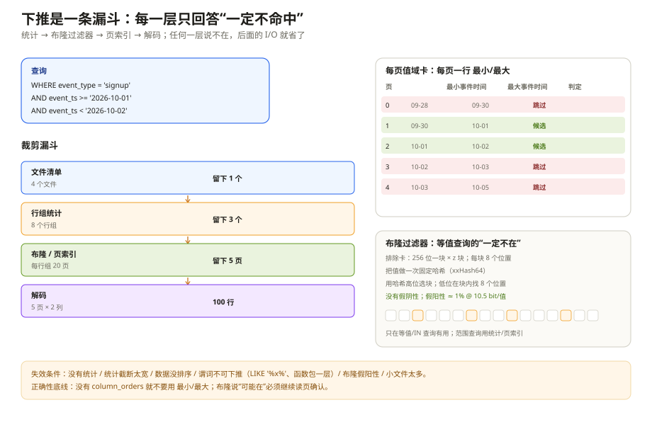
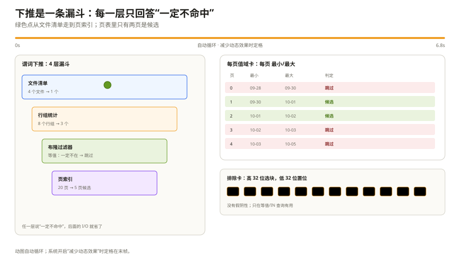

# 优化特性：先看小抄，再决定翻哪页

一条查询慢，最常见的两种原因：一是真的读了很多数据，二是明明不用读，却还是读了。Parquet 的优化特性全在解决第二种。

上一章讲的是「读到的字节怎么变小」，这一章讲的是「根本不去读」。两者不是一回事：编码/压缩省的是 I/O 之后的 CPU 和带宽；统计、页索引、布隆过滤器省的是 I/O 本身。

先把结论摆在前面：这三种东西都是在「读之前」做判断，但判断的粒度、能回答的问题、失效条件完全不同。

把统计想成每摞书里夹的小纸条，页索引想成每页的便签，布隆过滤器想成门口保安：保安只说「肯定没来」或「可能来了」，从不说「一定在」。把它们混成一个「Parquet 会下推」，排障时就会找错地方。

---

## 一、统计：最便宜的一层裁剪

统计信息存在三个地方：

| 位置 | 结构 | 粒度 | 谁用 |
| --- | --- | --- | --- |
| `ColumnMetaData.statistics` | `Statistics` | 列块（行组内一列） | 行组级裁剪 |
| `DataPageHeader.statistics` | `Statistics` | 页 | 老式页级裁剪 |
| `ColumnIndex` | 每页一组 min/max | 页 | 页索引裁剪 |

每列的小卡片上写着这些东西：

| 卡片上的项目 | 人话 | 要注意什么 |
| --- | --- | --- |
| 最小值 / 最大值 | 这一列的值大概落在什么范围 | 可能是截断后的保守值，不一定精确 |
| 空值数 | 这一列有多少 NULL | 没写不等于 0 |
| 不同值数量 | 大概有多少种值 | 不保证精确，别拿它做正确性判断 |
| 有没有 NaN | 浮点列里有多少非数字 | 没写不代表没有 |
| 精确标记 | 最小值/最大值是不是实际值 | 不精确时只能用来排除，不能用来确认 |

几个必须记住的细节：

**老的 min/max 已废弃。** 它们只按有符号比较，不适用于无符号整数、字符串、小数这些类型。新文件应该写「新的最小值/最大值」，并带上这一列的排序规则。老文件如果只有旧字段，只有在排序规则确实是有符号比较时才能用。

**字符串的 min/max 是裸字节。** 不是「4 字节长度 + 内容」，读取器要按这一列的类型把它解码回字符串/小数/时间。这个细节在跨语言实现里经常出错。

**min/max 可以是「保守值」。** 规范允许 writer 截断长字符串：真实最小值是 `"Blart Versenwald III"`，可以写 `"B"`、最大值写 `"C"`。这样卡片更小，但裁剪更粗。卡片上的「精确标记」告诉你「这个值是不是实际值」；不精确时，只能用它做「一定不命中」的判断，不能做「一定命中」的判断。

**空值数缺失不等于 0。** 规范明确要求读取器区分「没有这一栏」和「这一栏是 0」；缺失时不能假设没有 NULL。不同值数量也是估算，别拿它做正确性判断。

**NaN 数缺失时，要假设可能有 NaN。** 对浮点列，NaN 不参与 min/max 比较；如果一页全是 NaN，min/max 可能为空。老文件没有这一栏，读取器不能因此认为没有 NaN。

统计能回答的问题很有限：**「这个行组/页的值域和谓词有没有交集？」** 它不能回答「这个值一定在」，只能回答「一定不在」或「可能在」。所有裁剪逻辑都必须建立在「可能」上。

### 排序顺序决定统计能不能用

`FileMetaData.column_orders` 给每个叶子列一个排序规则（`parquet.thrift:1102-1233`）：

- `TYPE_ORDER`：按逻辑类型/物理类型的默认顺序；
- `IEEE754_TOTAL_ORDER`：浮点的 IEEE 754 全序，明确处理 NaN 和 -0/+0；
- `INT96_TIMESTAMP_ORDER`：INT96 时间戳的时序。

没有 `column_orders`，`min_value` / `max_value` 的含义是未定义的。这不是「默认按有符号比较」——规范明确说未定义，reader 不应该拿它做裁剪。

常见的排序规则：

| 类型 | 顺序 | 坑 |
| --- | --- | --- |
| STRING / ENUM / JSON / BSON | 无符号逐字节 | 不是 locale 字典序 |
| UINT8/16/32/64 | 无符号 | 别用有符号比较 |
| INT8/16/32/64 | 有符号 | |
| DECIMAL | 按数值有符号 | 定长字节要先处理符号位 |
| DATE / TIME / TIMESTAMP | 有符号 | |
| FLOAT / DOUBLE / FLOAT16 | 按数值，NaN 特殊 | 推荐 IEEE754_TOTAL_ORDER |
| LIST / MAP / VARIANT / GEOMETRY / GEOGRAPHY / FILE | 未定义 | 不要用 min/max 裁剪 |

如果 reader 不支持某个 `ColumnOrder` 分支，规范要求忽略该列的 min/max，而不是猜一个顺序。这个「宁可不用，不要用错」的原则，是统计裁剪的正确性底线。

### 1.1 普通行数据库的页里，所有列一起被读

普通行数据库的一个页（InnoDB 16 KB / PostgreSQL 8 KB，或行存文件的 segment）里，`id | type | ts | user | payload` 是混着放的。谓词只过滤 `event_type`，但块里所有列都在同一段连续字节里；读取器把块读进来，`payload` 也就跟着进来了。行数据库也能在块级放 zone map（min/max）来跳块，但粒度通常只到「块」，跳不掉块里的列。

列存的裁剪粒度是分开的：

| 粒度 | 普通行数据库 | Parquet |
| --- | --- | --- |
| 文件 | 清单统计可跳文件 | 清单统计可跳文件 |
| 块/行组 | 块级 zone map，跳整块 | 行组统计，跳整组 |
| 列 | 块内所有列一起读 | 只读投影列 + 谓词列 |
| 页 | 通常没有页级统计 | ColumnIndex / OffsetIndex 跳页 |

所以「谓词下推」在普通行数据库里通常是「少读几个块」，在 Parquet 里是「少读几个块 + 少读几列 + 少读几页」。这不是同一件事，优化上限差一个量级。

代价也在这里：行数据库的页是「写一条记录就更新页」的自然结果；Parquet 为了按列聚合并留下统计/索引，写路径要按列缓冲、攒行组、写 footer。**读得少，是写的时候多做了组织换来的。**

---

## 二、页索引：把「行组级」缩到「页级」

行组统计只能告诉你「这个行组可能命中」。如果行组有 256 MB，你还是得读不少页。页索引（Page Index）把粒度降到页。

它由两张卡片组成（`PageIndex.md:57-120`）：

**第一张：每页的值域卡。** 它给每一页记四件事：

- 这一页是不是全是空值；
- 这一页的最小值、最大值；
- 这些最小/最大值有没有按顺序排；
- 这一页有多少空值、多少 NaN。

**第二张：每页的页码卡。** 它给每一页记三件事：

- 这一页从文件第几个字节开始；
- 这一页占多少字节（含页头）；
- 这一页的第一行是整个行组的第几行。

读取器有了第一张卡，就知道「哪些页可能命中」；有了第二张卡，就能按页的起点直接跳过去，不用从头扫所有页头。这也是页索引相对「页头里的小统计」最大的优势：老式页统计必须先读所有页头，I/O 已经发生了；页索引放在目录附近，先读索引，再决定读哪页。

页码卡里的「占多少字节」包含页头，不是只算页体。读取器直接按「起点 + 大小」跳到下一页，所以这个数必须包含页头，否则每跳一次都差一点。

页索引的位置不在列块里，而在目录附近。每个列块的说明卡上记着两张卡各自的起点和长度：一张是值域卡，一张是页码卡。读取器先按起点找到卡，再按长度读进来，不用猜。

两张卡的关系：

- 有值域卡，就必须有页码卡；
- 页码卡可以单独存在（比如只按行号跳，不做值裁剪）；
- 有页码卡时，页必须从行边界开始，否则「第几行」和页对不上。

### 页索引怎么用

假设查询是「事件时间落在 10 月 1 日这一天」，这一列有 20 页：

1. 先看值域卡，拿到每页的最小值、最大值；
2. 如果卡上写着「按顺序排」，可以用二分缩小候选页范围；没写就逐页比较；
3. 候选页如果整页都比查询下界小，或者比上界大，直接跳过；
4. 页码卡给出每页的起点和第一行，读取器直接跳过去，不用从头扫；
5. 其他被投影的列，按同一个「第一行」对齐，跳过相同的行范围，避免拼错行。

第 5 步是页索引最容易被忽略的地方。你只裁了 `event_ts` 列，但查询还要输出 `event_id`；如果 `event_id` 不跟着跳过相同的行，最后拼出来的行就错位了。所以页索引不是「单列优化」，它需要同一行组内所有被投影列一起配合。

第 5 步是页索引最容易被忽略的地方。你只裁剪了 `event_ts` 列，但查询还要输出 `event_id`；如果 `event_id` 列不跟着跳过相同的行，最后拼出来的行就错位了。所以页索引不是「单列优化」，它需要同一行组内所有被投影列的 `OffsetIndex` 协同。

`boundary_order` 还有一个坑：它只说明 `min_values` / `max_values` 两个列表各自有序，**不保证页与页的值域不重叠**。规范明确说 reader 不能假设 `max_values[i] <= min_values[i+1]`。所以二分只能缩小候选范围，不能假设「找到一个页就结束」；重叠边界上的页仍要检查。

`null_pages[i] = true` 表示这一页全是 null，`min_values[i]` / `max_values[i]` 必须是空字节数组。`null_counts` 缺失时不能假设 0。`nan_counts` 同理。

---

## 三、布隆过滤器：高基数列的「一定不在」

统计和页索引对「范围查询」很有效，但对「等值查询」有一个尴尬：如果一列基数很高、min/max 很宽，几乎每个行组都「可能命中」。比如 `WHERE event_id = 991203`，`event_id` 的 min/max 覆盖整个范围，统计帮不上忙；字典又因为太大被 writer 放弃了。

布隆过滤器（Bloom Filter）就是为这个场景准备的（`BloomFilter.md:22-45`）。它用一小段位图回答：「这个值**一定不在**」或「**可能在**」。它没有假阴性（说不在就一定不在），但有假阳性（说可能在，实际不一定在）。

Parquet 用的是 **Split Block Bloom Filter（SBBF）**，不是教科书里的单个位数组。结构是：

- 每个 block 256 bit，分成 8 个 32-bit word；
- 一个 SBBF 由 `z` 个 block 组成；
- 插入/查询时，用 64 位哈希的高 32 位选 block：`i = ((h >> 32) * z) >> 32`；
- 用低 32 位在 block 内设置/检查 8 个 bit：每个 word 用不同的 salt 乘一次，取高 5 位作为 bit 位置。

salt 是 8 个固定的奇数常量，规范里已经列好了；每个 word 配一个，保证同一个值在不同 word 里落到不同的 bit。具体数值不需要背，实现按规范抄即可。

哈希是 **xxHash64，seed=0**，规范版本 0.1.1。哈希的输入是「列值按 PLAIN 编码后的字节」：字符串是 4 字节长度前缀 + UTF-8 字节，整数是小端字节。读取器必须用同样的编码和同样的哈希，否则永远查不到。

为什么用 SBBF 而不是普通 Bloom？因为 CPU cache。普通 Bloom 一次查询可能命中多个随机 bit，跨多个 cache line；SBBF 把 8 个 bit 限制在同一个 256-bit block（通常是一个 cache line 附近），查询只需要访问一个 block。代价是假阳性率略高，但换来了更好的局部性。

假阳性率和空间的关系（`BloomFilter.md:232-265`）：

| 每个值的位数 | 假阳性率 |
| --- | --- |
| 6.0 | 10% |
| 10.5 | 1% |
| 16.9 | 0.1% |
| 26.4 | 0.01% |
| 41 | 0.001% |

比如 1024 个 block、插入 26,214 个值，总空间 262,144 bit，约 10 bit/值，假阳性率约 1.26%。如果插入值翻倍到 52,428，比例降到 5 bit/值，假阳性率升到 18%。

布隆过滤器能回答什么：

- **等值**：`WHERE event_id = 991203`、`WHERE event_type IN ('signup','login')`；
- **不能回答范围**：`WHERE event_ts > ...`，布隆过滤器不知道值的顺序；
- **不能回答 NULL**：NULL 不插入布隆过滤器，`IS NULL` 要看 `null_count`；
- **不能回答「一定在」**：返回 true 只代表「可能在」，还要读页确认。

存储格式很简单：一小段说明 + 一块位图。说明里写着「位图多大、用什么算法、用什么哈希、有没有压缩」；目前算法只有一种分块布隆，哈希只有一种，压缩只有「不压」。说明后面紧跟位图。位图大小必须是 32 字节的倍数，因为一个 block 就是 256 bit。

列说明卡里会给出布隆过滤器的起点和总长度，方便一次读完。老文件没有总长度，读取器要先读说明，再按「位图多大」读位图。布隆过滤器可以放在所有行组之后、页索引之前，也可以放在行组之间；位置由 writer 决定，读取器只看起点。加密列的布隆过滤器要用列密钥加密，否则会泄露「某个值是否存在」。

---

## 四、把三层串起来：一次谓词下推的完整路径

假设查询：

```sql
SELECT event_id, event_ts
FROM events
WHERE event_type = 'signup'
  AND event_ts >= '2026-10-01'
  AND event_ts < '2026-10-02'
LIMIT 100;
```

读取器的裁剪顺序：

1. **先看文件**：文件清单里的统计/分区值，跳过完全不相关的文件。
2. **再看每一摞**：`event_type` 的 min/max 不含 `signup`，或者 `event_ts` 的范围和这一天不相交，整摞跳过。
3. **再看排除卡**：`event_type` 的布隆过滤器说 `signup` 一定不在，整个列块跳过。
4. **再看页**：值域卡判断哪些页可能命中，页码卡给出页的位置和第一行。
5. **最后解码**：只解压命中的页，只解码被投影的列。
6. **行对齐**：其他列的页码卡按同一个「第一行」跳过相同行范围，保证拼出来的行不错位。

这条链里，任何一层返回「一定不命中」，后面的层都不用走。反过来，任何一层返回「可能命中」，都要继续往下确认。布隆过滤器的假阳性、统计的截断、页索引的重叠边界，都是「可能」的来源。





*动图：绿色点从文件清单走到页索引，右侧页表只留下候选页；系统开启“减少动态效果”时定格。*

---

## 五、什么时候这些优化会失效

这一节比前面都重要。线上「Parquet 没生效」的抱怨，八成是下面某一条。

**1. 没有统计。** 老文件、某些 writer、或者列类型不支持统计（LIST/MAP/GEOMETRY 等），`min_value` / `max_value` 为空。没有统计，行组级裁剪直接退化成全扫。

**2. 统计被截断得太宽。** 字符串统计只保留前几个字节，`min="B"`、`max="C"`，谓词 `= "signup"` 落在 `B..C` 里，只能读。截断是为了控制 footer 大小，不是 bug；但你要知道它会让裁剪变粗。

**3. 数据没有排序。** 页索引的 `boundary_order` 仍然是 `UNORDERED`，只能逐页比较，不能二分；如果每页的 min/max 都覆盖整个范围，页索引等于没有。

**4. 谓词不是 sargable。** `LIKE '%signup%'`、`lower(event_type) = 'signup'`、`CAST(event_ts AS STRING) > ...` 这类表达式，引擎无法把它映射成列上的范围比较，统计和页索引都用不上。先把谓词改写成列的直接比较，再谈下推。

**5. 类型/排序不匹配。** 无符号整数按有符号比较、字符串按 locale 比较、DECIMAL 符号处理错、NaN 参与比较——这些都会让「一定不命中」的判断变成错误。统计裁剪的正确性依赖排序规则，不是靠猜。

**6. 布隆过滤器假阳性。** 1% 的假阳性听起来很小，但如果每个行组都命中，累积起来就很可观。布隆过滤器只适合「高基数 + 等值」；范围查询和低基数列，统计/字典更合适。

**7. NULL 语义。** `WHERE col = 'x'` 不匹配 NULL；`WHERE col IS NULL` 不能用布隆过滤器；`NOT IN` 遇到 NULL 的三值逻辑，可能让引擎放弃下推。这些是 SQL 语义，不是 Parquet 的锅，但会直接影响裁剪。

**8. 小文件太多。** 每个文件都要读 footer、解析元数据、建 schema 树；文件数一多，固定成本超过数据本身。合并小文件、用 `_metadata` 汇总、或者上 Iceberg/Delta 的清单，往往比调 Parquet 参数更有效。

**9. 页太小/太多。** 页索引本身也占空间；页太小，页头、索引、布隆过滤器的固定开销占比上升。8 KB 是一个常见起点，不是绝对标准。

---

## 六、成本：优化不是免费的

| 特性 | 写端成本 | 读端成本 | 空间成本 | 什么时候值得 |
| --- | --- | --- | --- | --- |
| 行组统计 | 计算 min/max | 解析统计 | 很小 | 几乎总是 |
| 页索引 | 记录每页边界 | 读索引 | 与页数成正比 | 选择性查询多 |
| 布隆过滤器 | 建位图 + 哈希 | 查位图 | 6–41 bit/值 | 高基数等值查询 |
| 字典 | 建字典 + 下标 | 建哈希/查字典 | 字典页 | 低基数 |
| 小页 | 更多页头 | 更多解析 | 页头/索引 | 单行查找、细粒度跳过 |
| 小行组 | 更多元数据 | 更多 footer 解析 | 元数据 | 高并发、细粒度裁剪 |

一个常见的反模式是「所有列都加布隆过滤器」。布隆过滤器只对等值查询有用；如果查询主要是范围扫描，它只是白白增加写入和存储成本。另一个反模式是「行组切得很小以提升裁剪」：行组小到几 MB，footer 里的 `ColumnChunk` 数量爆炸，打开文件的成本反而更高。

---

## 七、踩坑清单

| 现象 | 更可能的原因 | 先看哪里 |
| --- | --- | --- |
| 统计裁剪没生效 | 没有 `column_orders`，或统计为空 | `FileMetaData.column_orders`、`Statistics` |
| 字符串裁剪漏数据 | 用 locale 比较，writer 用字节序 | `ColumnOrder`、STRING 规则 |
| 无符号整数裁剪漏数据 | 有符号/无符号比较混用 | `INTEGER(bitWidth, false)` |
| 布隆过滤器从不命中 | 哈希输入编码不一致，或没读到 bitset | `BloomFilterHash`、PLAIN 编码 |
| 布隆过滤器误判率高 | 位/值比例太低，或行组太大 | `numBytes`、行组 distinct 数 |
| 页索引跳过了错误的页 | `boundary_order` 假设了页间不重叠 | `ColumnIndex` 注释 |
| 行拼错位 | 只裁了一列，其他列没按 `first_row_index` 对齐 | 各列 `OffsetIndex` |
| 页索引存在但没用 | 谓词不是 sargable，或页全是 NULL | 执行计划、`null_pages` |
| 小文件查询慢 | footer 解析成本 > 数据读取 | 文件数、`_metadata`、清单 |

---

## 八、这一章留下的线索

- 统计回答「值域有没有交集」，只能用来排除，不能用来确认；
- 排序顺序由 `ColumnOrder` 决定，没有它就不要用 min/max；
- 页索引把粒度降到页，`ColumnIndex` 判断候选页，`OffsetIndex` 给偏移和行号；
- 布隆过滤器只适合高基数等值查询，没有假阴性但有假阳性；
- 下推是一条链，任何一层「可能」都要继续确认；谓词不可下推时，整条链都失效。

下一章换一个方向：文件已经能被高效读取了，怎么保证「不该看的人看不到」——Parquet 的模块加密，以及它留给厂商的 32767 扩展位。

---

## 附：这一章的源码入口

> 除特别注明外，本节引用的 `README.md`、`*.md` 与 `src/main/thrift/parquet.thrift` 都来自 apache/parquet-format（2.15.0-SNAPSHOT）。

- `README.md:131-165`：排序顺序与统计的关系
- `PageIndex.md:28-120`：页索引的问题、目标、`ColumnIndex` / `OffsetIndex` 布局
- `BloomFilter.md:22-45`：高基数列的谓词下推问题
- `BloomFilter.md:46-231`：SBBF 的 block、salt、mask、插入/查询
- `BloomFilter.md:232-265`：假阳性率与空间
- `BloomFilter.md:266-343`：文件格式、`BloomFilterHeader`
- `BloomFilter.md:344-359`：布隆过滤器的加密
- `src/main/thrift/parquet.thrift:267-320`：`Statistics`
- `src/main/thrift/parquet.thrift:819-828`：`BloomFilterHeader`
- `src/main/thrift/parquet.thrift:1102-1233`：`ColumnOrder`
- `src/main/thrift/parquet.thrift:1235-1373`：`PageLocation`、`OffsetIndex`、`ColumnIndex`
- `src/main/thrift/parquet.thrift:1031-1041`：`ColumnChunk` 的页索引偏移

---

## 思考题

1. 一个字符串列的统计是 `min="B"`、`max="C"`，查询 `= "signup"` 能否跳过？如果 `is_min_value_exact=false`，答案会变吗？
2. `ColumnIndex.boundary_order = ASCENDING` 是否意味着页与页的值域不重叠？为什么二分只能缩小候选范围？
3. 布隆过滤器说「可能在」，但读页后发现没有。这是 bug 吗？如果这种情况大量发生，你会先调什么？
4. 只对 `event_ts` 列做了页索引裁剪，为什么还要读其他列的 `OffsetIndex`？不读会发生什么？
5. 一个查询的谓词是 `lower(event_type) = 'signup'`，统计和页索引为什么都用不上？改写谓词有哪些办法？
