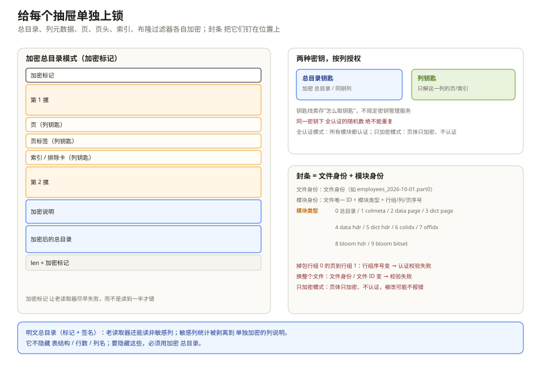
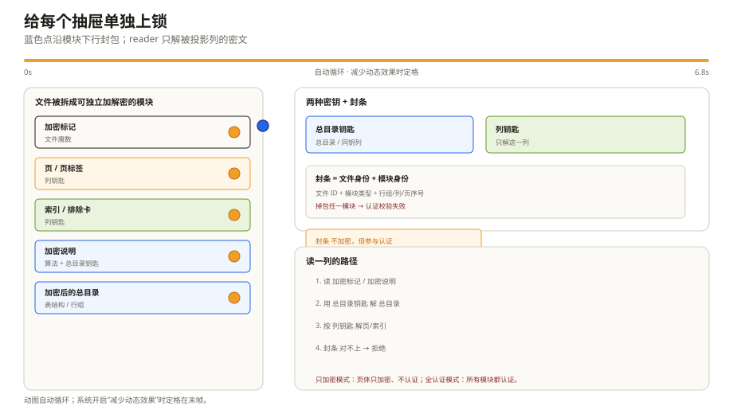

# 安全性与可扩展性：给每个抽屉单独上锁

一家公司要把用户行为数据放进数据湖。合规要求：`user.email`、`user.phone` 必须加密，`event_type`、`event_ts` 这些非敏感列还要让老引擎能读；密钥由 KMS 管，不同部门拿不同的列密钥；文件被替换、被截断、被从别的分区挪过来，读取器要能发现。

平铺加密（整个文件一把锁）做不到「按列授权 + 列投影 + 谓词下推」；存储层加密做不到「客户端持钥、服务端不见明文」；自己写一套加密封装，又会把 Parquet 的页索引、布隆过滤器、列裁剪全部废掉。

Parquet 的答案是 **模块化加密（Modular Encryption）**：把文件拆成一个个可独立加解密的模块，每列可以用不同的密钥，footer 可以加密也可以只签名。这一章讲它怎么拆、怎么保证「密文不能被掉包」，以及格式留给厂商的扩展位。

---

## 一、模块：加密的最小单位

`Encryption.md:54-87` 把 Parquet 文件拆成这些模块：

| 模块 | 内容 | 用什么密钥 |
| --- | --- | --- |
| Footer | `FileMetaData` 及其嵌套结构 | footer key |
| ColumnMetaData | 列的元数据（当列密钥和 footer 密钥不同） | column key |
| Data Page / Dictionary Page | 页体 | column key |
| Data Page Header / Dictionary Page Header | 页头 | column key |
| ColumnIndex / OffsetIndex | 页索引 | column key |
| BloomFilter Header / Bitset | 布隆过滤器 | column key |

加密的粒度是「模块」，不是「整个文件」，也不是「单个值」。这像一排快递柜：总目录是一把总钥匙，每一列是一格柜子，封条上写着「这是哪个文件、第几格」。把 3 号柜的包裹塞进 5 号柜，封条对不上，柜门就打不开。

这样做的好处很直接：

- **列投影仍然有效。** 读取器只需要解密被投影的列，不用碰其他列的密文。

行数据库/行存的加密通常落在文件、表空间或块设备上，整块加解密；Parquet 把模块拆开，才能只解投影列，不破坏列裁剪和页索引。代价是模块数量多，footer、页索引、布隆过滤器这些元数据也要跟着保护。和普通行数据库的整体对照见第 1 章 3.4。
- **谓词下推仍然有效。** 页索引、布隆过滤器可以随列一起加密；有密钥的读取器解密后照样能用。
- **不同列可以用不同密钥。** 财务列、PII 列、普通列各用各的 key，授权粒度到列。
- **压缩/编码不受影响。** 加密发生在压缩之后，解密发生在解压之前；所有 codec 和 encoding 都能用。

代价是模块数量多，每个模块都要带 nonce/tag，元数据也会变大。`Encryption.md:532-543` 估算，按 1 MB 页、每个模块 32 字节开销算，大约是每 30,000 字节原始数据多 1 字节，量级可以忽略。

---

## 二、两种算法：全 GCM 与 GCM+CTR

Parquet 支持两种加密算法（`Encryption.md:153-176`）：

**AES_GCM_V1**：所有模块都用 AES-GCM。输入是密钥、12 字节 nonce、明文、AAD；输出是等长密文 + 16 字节认证 tag。GCM 同时保证机密性和完整性，任何字节被改、AAD 不匹配，解密都会失败。

**AES_GCM_CTR_V1**：元数据（footer、列元数据、页头、索引、布隆过滤器）仍然用 GCM；**页体用 AES-CTR**。CTR 只加密、不认证，速度快，但页体被篡改可能发现不了。规范的原话是「tampering with the page data might go unnoticed」。适合「元数据必须可信、页体只求机密性」的场景，不适合「页体也不能被改」的合规要求。

两种算法都支持 AES-128/192/256。GCM 的 nonce 是 12 字节；CTR 的 IV 是 16 字节，由 12 字节 nonce + 4 字节计数器组成，计数器的前 31 位为 0、最后一位为 1。

这里有一条密码学上的硬规则：**同一个密钥下，GCM nonce 绝不能重复**。重复 nonce 会直接破坏 GCM 的安全性，不只是「可能泄露一点」。规范给了 invocation limit 的建议（`Encryption.md:130-152`），实现要按密钥轮换或 nonce 计数来保证。自己拼加密层时，这条比「选 AES-256 还是 AES-128」重要得多。

---

## 三、密钥与 key_metadata：格式不管 KMS

Parquet 不规定你用哪个 KMS，也不规定密钥怎么生成、怎么轮换。它只给一个字段：`key_metadata`，一个任意字节数组（`Encryption.md:177-206`）。

writer 可以往里放：

- **Data key 的字符串 ID**：读取器拿 ID 去 KMS 取 key；
- **加密后的 Data key + Master key 的 ID**：Data key 随机生成，用 Master key 包一层；Master key 轮换要改文件 footer；
- **Data key 在文件里的短 ID（counter）**：加密后的 key 材料放在文件外，读取器用 counter + 文件路径去取；Master key 轮换不用改文件；
- **空**：密钥完全由调用方管理，读取时显式传给 reader。

这个设计把「密钥管理」留给组织，把「密钥引用」留在格式里。好处是灵活，坏处是**格式无法保证你选对了方案**。比如把明文 Data key 塞进 `key_metadata`，格式不会阻止你；把 Master key 和 Data key 放在同一个文件里，格式也不会阻止你。安全边界在实现和运维，不在 Thrift 字段。

轮换的代价也不一样：

- Data key 轮换：新文件用新 key，旧文件用旧 key，互不影响；
- Master key 轮换（key 材料在文件内）：要重写 footer，可能要重写整个文件；
- Master key 轮换（key 材料在文件外）：只换 KMS 里的映射，文件不动。

选哪种，取决于你能不能接受「轮换时重写数据」。

---

## 四、AAD：防止密文被掉包

GCM 本身能防止「密文内部被改」，但防不住「把一段密文整体换成另一段用同一密钥加密的密文」。比如把行组 0 的 `email` 页换成行组 1 的 `email` 页，两段密文都合法，GCM 校验都能过，读出来的却是错位的数据。

Parquet 用 **AAD（附加认证数据）** 解决这个问题（`Encryption.md:207-289`）。AAD 不加密，但参与 GCM 的认证；AAD 不匹配，tag 校验就失败。

AAD 由两部分拼成：**文件身份** + **模块身份**。

**AAD prefix** 是用户提供的文件身份，比如 `employees_23May2018.part0`。它可以存在文件里（`aad_prefix` 字段），也可以不存、由 reader 显式提供（`supply_aad_prefix=true`）。它的作用是防止「整个文件被旧版本/别的分区替换」。

**AAD suffix** 由 Parquet 内部生成，包含：

1. 文件的唯一 ID（随机字节，每个文件一个）；
2. 模块类型（1 字节）；
3. 行组序号（2 字节，footer 除外）；
4. 列序号（2 字节，footer 除外）；
5. 页序号（2 字节，只用于数据页和页头）。

模块类型的取值（`Encryption.md:249-289`）：

| 值 | 模块 |
| --- | --- |
| 0 | Footer |
| 1 | ColumnMetaData |
| 2 | Data Page |
| 3 | Dictionary Page |
| 4 | Data Page Header |
| 5 | Dictionary Page Header |
| 6 | ColumnIndex |
| 7 | OffsetIndex |
| 8 | BloomFilter Header |
| 9 | BloomFilter Bitset |

这张表解释了 AAD 的防掉包能力：行组 0 的页和行组 1 的页，suffix 里的行组序号不同；同一行组的不同列，列序号不同；同一列的不同页，页序号不同。把任意两个模块互换，AAD 就对不上，GCM 校验失败。

注意 footer 没有行组/列/页序号，因为它不属于任何行组；它的身份由文件唯一 ID + 模块类型 0 保证。文件唯一 ID 在 `AesGcmV1.aad_file_unique` 里，和 AAD prefix 一起决定「这是哪个文件」。

---

## 五、两种 footer 模式：加密还是只签名

### 5.1 加密 footer（PARE）

在加密 footer 模式下，footer 本身也被加密。文件长这样：开头是 `PARE` 魔数，中间是各个行组，接着是一段「加密说明」，然后是加密后的总目录，最后是长度和结尾的 `PARE`。

这段「加密说明」里有加密算法和目录钥匙的线索。读者看到开头/结尾的 `PARE`，就知道要先读它，拿钥匙，解密目录，再继续。

`PARE` 这个魔数是故意换的：老读取器只认 `PAR1`，看到 `PARE` 会立刻报「不是 Parquet」，而不是读到一半才崩。这是一个很实用的兼容性设计——**让不支持加密的读取器尽早失败，而不是给出错误结果**。

加密 footer 模式下，schema、行数、列名、统计、key metadata 都被保护。如果列密钥和 footer 密钥不同，`ColumnMetaData` 会单独加密，放在 `ColumnChunk.encrypted_column_metadata` 里；`ColumnChunk.crypto_metadata` 说明这一列是用 footer key 还是 column key。

### 5.2 明文 footer（PAR1 + 签名）

明文 footer 模式是为了过渡期：老读取器还要能读非敏感列，所以 footer 不加密，只签名。

文件布局：开头是 `PAR1`，中间是各个行组，接着是明文的目录，目录后面跟 28 字节签名（12 字节 nonce + 16 字节 tag），最后是「目录 + 签名」的长度和结尾的 `PAR1`。

目录里的两个字段告诉新读取器「这个文件用了哪种算法、签名钥匙的线索在哪」。签名不是把目录再存一份密文，而是用 GCM 对目录算一个 tag；读取器验证 tag，确认目录没被改。

明文 footer 模式下：

- 老读取器能读非敏感列，遇到敏感列的加密页头会报 Thrift 解析错误（这是预期行为）；
- 敏感列的统计会从明文 `meta_data` 里剥掉，放到 `encrypted_column_metadata` 里；老读取器能看到列的存在和偏移，但看不到统计；
- schema、行数、列名、非敏感列统计仍然是明文。**这不是「全密」，只是「敏感列密 + footer 完整性」**。

选择哪种模式，取决于你的威胁模型：

| 需求 | 加密 footer（PARE） | 明文 footer（PAR1+签名） |
| --- | --- | --- |
| 隐藏 schema/行数/列名 | 是 | 否 |
| 隐藏敏感列统计 | 是 | 敏感列统计被剥离，其他可见 |
| 老读取器读非敏感列 | 否（老读取器不认 PARE） | 是 |
| footer 防篡改 | 是（GCM） | 是（签名） |
| 迁移成本 | 高 | 低 |

*动图：蓝色点沿抽屉下行上锁，reader 只解被投影的抽屉；系统开启“减少动态效果”时定格。*

---

## 六、一次加密读取怎么走完

以加密 footer 模式、读取一列 `user.email` 为例，读取器走六步：

1. 读开头 4 字节，看到 `PARE`；
2. 读结尾 8 字节，拿到长度和结尾的 `PARE`；
3. 跳到目录起点，先读「加密说明」，拿到算法和目录钥匙的线索；
4. 用目录钥匙解密总目录，拿到表结构、行组和每列的位置；
5. 找到 `user.email` 这一列的说明卡，拿列钥匙和这一列的身份信息；
6. 解密页头、页体、页索引/布隆过滤器，再解码。只要有一把钥匙不对，或者身份信息对不上，GCM 就报错，不会返回「看起来能读」的明文。

这条链里有三个「失败点」：

- **密钥不对**：GCM tag 校验失败，读不出明文；
- **AAD 不对**：即使密钥对，tag 也失败；这通常意味着模块被换过位置，或者文件身份不对；
- **算法不支持**：读到不认识的 `EncryptionAlgorithm` 分支，应该明确报错，不能猜。

CTR 模式下，页体的解密不验证 tag，所以「页体被改」可能不会报错；只有页头、索引、footer 这些 GCM 模块能保证完整性。这是选型时要写进威胁模型的差异。

---

## 七、加密不保护什么

这一节很重要，很多「我们加密了」的安全评审就栽在这里。

**1. 访问模式。** 加密保护内容，不保护「你读了哪些页、哪些列、什么时间读」。如果攻击者能看到 I/O 模式，可能推断出查询热点、行组分布，甚至某些值的存在。Parquet 没有 ORAM 之类的访问模式隐藏。

**2. 明文 footer 的元数据。** schema、行数、列名、非敏感列统计、列块偏移都是明文。即使敏感列的内容加密了，攻击者仍能知道「这个文件有 `user.email` 列、有 100 万行、邮箱列在哪个偏移」。如果这些信息本身敏感，必须用加密 footer。

**3. 未加密的列。** 部分加密只保护被加密的列；非敏感列的内容、统计、布隆过滤器都可能泄露关联信息。比如 `event_type` 明文 + `email` 密文，攻击者仍能按事件类型分组做频率分析。

**4. 统计和布隆过滤器的泄露。** 敏感列的统计如果留在明文 footer 里，会泄露 min/max、null 数、distinct 数；布隆过滤器会泄露「某个值是否存在」。所以规范要求敏感列的布隆过滤器和列元数据一起加密。

**5. 密钥管理。** 格式只存 `key_metadata`，不保证 KMS 的权限、审计、轮换策略。密钥泄露、权限过宽、nonce 复用，格式都救不了。

**6. 压缩侧信道。** 加密发生在压缩之后，所以压缩率本身可能泄露一些信息（比如重复模式）。这不是 Parquet 特有的问题，但做高敏感数据时要意识到。

**7. 老读取器的降级。** 明文 footer 模式下，老读取器能读非敏感列；如果攻击者能诱导系统用老读取器，可能绕过列级授权。所以「过渡期」不能变成「永久兼容」。

---

## 八、可扩展性：三个正式入口和一个后门

Parquet 的扩展机制有四个层次（`README.md:264-274`）：

**1. File Version。** `FileMetaData.version` 是正式版本号，但社区对 v2 没有共识，writer 应该写 1，reader 接受 1/2。不要拿它当特性开关。

**2. Encodings。** `Encoding` 是枚举，新编码可以加新值。reader 遇到不认识的编码，应该报「不支持」，而不是硬解。ALP 就是这样一个新值（`ALP=10`）。

**3. Page Types。** `PageType` 也是枚举，新页类型可以加；老 reader 遇到不认识的页类型，可以安全跳过（因为页头给了 `compressed_page_size`）。这是格式里少有的「向前兼容」设计。

**4. Binary Protocol Extensions（32767）。** 每个 Thrift struct 都保留 field-id `32767`，类型固定为 `binary`。内容可以是任意格式（不一定是 Thrift），reader 不认识就跳过。这是给厂商做实验的后门。

32767 的写法很朴素：在结构末尾追加一段二进制，前面是固定栏头，接着是「这段有多长」，然后是扩展内容，最后是结束标记。老读取器读到 32767 号栏，按长度跳过整段，不会把扩展内容当成正常字段。

因为只有一个扩展位，厂商必须自己在扩展字节里放足够的唯一标识（比如 UUID），否则多个扩展会互相踩。规范故意制造这种「稀缺性」，鼓励厂商把扩展标准化，而不是各自私藏。文档里给了一个「用 FlatBuffers 替代 FileMetaData」的迁移示例，展示了「私有扩展 → 社区标准 → 双写 → 新魔数」的路径。

可扩展性不是「随便加字段」。核心约束是：

- 老 reader 必须能跳过不认识的东西；
- 新 reader 必须能读老文件；
- 任何「改变语义」的扩展都要有迁移计划，不能悄悄改字段含义；
- 扩展不能破坏加密、页索引、布隆过滤器这些横切能力。

---

## 九、踩坑清单

| 现象 | 更可能的原因 | 先看哪里 |
| --- | --- | --- |
| 加密文件在老引擎里打不开 | 用了 PARE 加密 footer，老引擎只认 PAR1 | 魔数、footer 模式 |
| 密钥对但解密失败 | AAD 不匹配：文件被换、模块被换、prefix 没提供 | `aad_prefix`、`supply_aad_prefix`、模块序号 |
| 页体被改却没报错 | 用了 AES_GCM_CTR_V1，页体只加密不认证 | 算法选择、威胁模型 |
| 敏感列统计泄露 | 明文 footer 模式，统计没剥离 | `encrypted_column_metadata`、plaintext footer |
| 布隆过滤器泄露值存在性 | 敏感列的布隆过滤器没加密 | `BloomFilter` 加密、列密钥 |
| 非敏感列也读不了 | 列密钥和 footer 密钥配置错，或 `crypto_metadata` 指向错 | `ColumnCryptoMetaData`、`key_metadata` |
| 轮换 Master key 后旧文件读不了 | key 材料在文件内，旧 Master key 没了 | `key_metadata` 方案、KMS 历史版本 |
| 新编码被老 reader 静默误解 | reader 没检查 `encodings` 就硬解 | `ColumnMetaData.encodings` |
| 32767 扩展冲突 | 多个厂商用同一个扩展位，没有唯一标识 | 扩展字节里的 UUID/版本 |

---

## 十、这一章留下的线索

- Parquet 加密是模块级的：footer、列元数据、页、页头、索引、布隆过滤器各自加密；
- AES_GCM_V1 全 GCM；AES_GCM_CTR_V1 页体用 CTR，快但页体不防篡改；
- AAD = 文件身份 prefix + 内部模块身份 suffix，防止密文掉包；
- 加密 footer 用 PARE，保护 schema/行数/列名；明文 footer 用 PAR1 + 签名，兼容老读取器；
- 格式只管 `key_metadata`，KMS、轮换、权限在格式之外；
- 扩展有版本、编码、页类型、32767 四个入口，32767 是给厂商实验的后门。

下一章进入半结构化数据：JSON 这种「schema 随时变」的东西，怎么在列式文件里既保持灵活，又能被列裁剪和谓词下推照顾到。

---

## 附：这一章的源码入口

> 除特别注明外，本节引用的 `README.md`、`*.md` 与 `src/main/thrift/parquet.thrift` 都来自 apache/parquet-format（2.15.0-SNAPSHOT）。

- `Encryption.md:27-87`：问题、目标、模块划分
- `Encryption.md:88-152`：AES 模式、nonce/IV、invocation limit
- `Encryption.md:153-176`：AES_GCM_V1 与 AES_GCM_CTR_V1
- `Encryption.md:177-206`：key_metadata 的三种方案
- `Encryption.md:207-289`：AAD prefix/suffix、模块类型表
- `Encryption.md:290-394`：加密模块序列化、crypto 结构
- `Encryption.md:395-465`：敏感元数据保护、加密 footer
- `Encryption.md:466-531`：明文 footer、签名、PARE/PAR1
- `Encryption.md:532-543`：加密开销
- `README.md:264-274`：扩展入口
- `BinaryProtocolExtensions.md:20-60`：32767 扩展的 wire layout
- `src/main/thrift/parquet.thrift:975-989`：`ColumnCryptoMetaData`
- `src/main/thrift/parquet.thrift:1375-1405`：`AesGcmV1`、`AesGcmCtrV1`、`EncryptionAlgorithm`
- `src/main/thrift/parquet.thrift:1407-1485`：`FileMetaData` 加密字段、`FileCryptoMetaData`

---

## 思考题

1. 为什么 AAD 里要放行组序号、列序号、页序号？只放文件 ID 和模块类型够不够？
2. AES_GCM_CTR_V1 的页体不认证。什么样的合规场景可以接受，什么样的不能？
3. 明文 footer 模式下，敏感列的统计被放到哪里？老读取器能看到什么、不能看到什么？
4. 一个厂商想用 32767 扩展加「自定义排序规则」。它需要保证哪些兼容性？如果两个厂商都这么做，会发生什么？
5. 加密能防止「文件被替换成旧版本」吗？需要什么条件？
