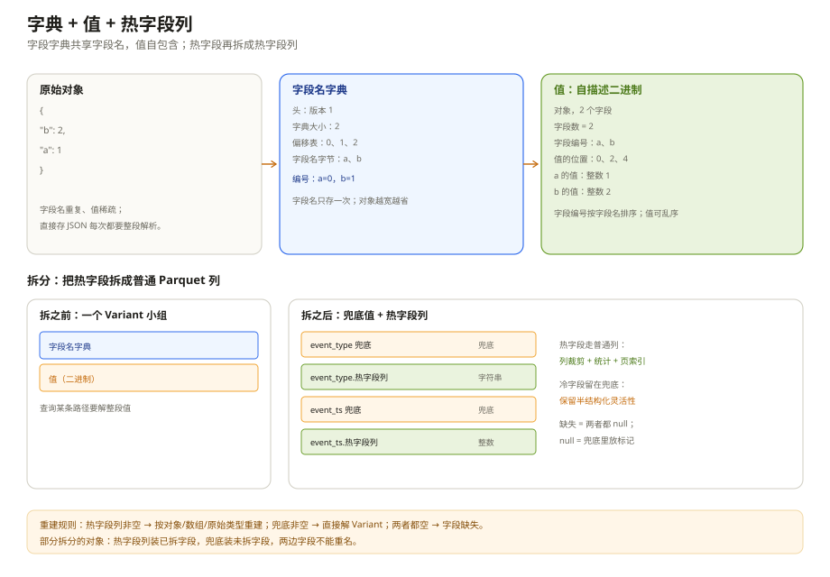
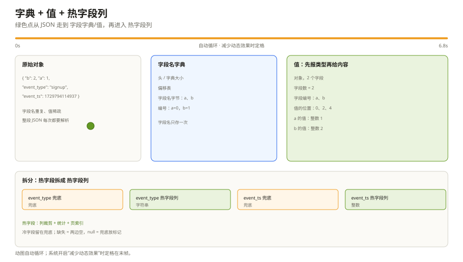

# 半结构化数据：给 JSON 配一本字典和几张常用列

数据湖里最麻烦的往往不是「大表」，而是「一张表里塞了十种事件」。`signup` 有 `utm`，`purchase` 有 `amount` 和 `currency`，`error` 有 `stack` 和 `code`；明年又加两种事件，字段继续长。

你可以把它存成 JSON 字符串。查询 `payload.utm = 'wx'` 时，引擎要把每一行的 JSON 都解析一遍；列裁剪、统计、页索引全都用不上。存得下，但读得贵。

Variant 就是为这种数据准备的。它把半结构化的值装进一个「自描述的小盒子」：盒子里有一本字段名字典，和一个带类型标签的值。常用的字段还可以单独抽出来，变成普通的 Parquet 列。这一章就讲两件事：**怎么装**，以及**怎么拆**。

---

## 一、先看问题：为什么 JSON 字符串不够

假设有一张事件表，`payload` 列存的是 JSON：

```json
{ "event_type": "signup", "event_ts": 1729794114937, "utm": "wx" }
```

你想查「`utm` 是 wx 的事件」，引擎只有两种办法：

1. 把 `payload` 整段读出来，逐行解析 JSON，找到 `utm` 再判断；
2. 如果 `payload` 上建了表达式索引，可能快一点，但索引本身也要维护。

两种办法都没有「只读 `utm` 这一小段」的能力。因为 JSON 字符串是一整段文本，里面没有「字段 A 从第几字节开始、字段 B 是什么类型」的目录。

Variant 补的就是这份目录。它不是把 JSON 原样塞进二进制，而是把「字段名」和「值」分开：

- 字段名收进一本字典，重复的 key 只存一次；
- 每个值前面带一个类型标签，告诉读取器「我是整数、字符串、对象还是数组」；
- 读取器可以按路径找到对应的值，不用把整段解析成对象。

代价是：不拆开的话，查一条路径仍然要把整个 `value` 解出来。所以 Variant 的性能关键在于「拆不拆、拆哪些字段」。

---

## 二、Variant 就是两样东西：字典 + 带标签的值

在 Parquet 里，一个 Variant 列不是一种新的物理类型，而是一个小组，里面放两个二进制字段：

```text
payload
├─ metadata   字段名字典
└─ value      带类型标签的值
```

`metadata` 是必填的，`value` 在没有拆分时也是必填的；如果做了拆分，`value` 可以变成可选，用另一个 `typed_value` 字段来装热字段。

这两样东西的分工很像寄快递：

- `metadata` 是面单上的「字段名对照表」，告诉你 0 号对应哪个字段、1 号对应哪个字段；
- `value` 是包裹本身，每个小包上贴着「这是整数」「这是字符串」「这是一个对象」的标签。

热字段单独成列，就像把常用的东西从包裹里拿出来，放进伸手可拿的抽屉；不常用的仍然留在包裹里。

`metadata` 可以在同一行的多个 Variant 之间共享；`value` 是自包含的，给定同一份字典，单独一段 `value` 也能解出来。

---

## 三、字段名字典：key 只存一次

半结构化数据的特点是「字段名重复、值不重复」。十万行 `payload` 里，字段名可能只有几十个；如果每行都存一遍 `"event_type"`、`"event_ts"`，光字段名就占掉大量空间。

Variant 的做法是建一本字典：

| 编号 | 字段名 |
| --- | --- |
| 0 | a |
| 1 | b |

字典本身存三样东西：每个字段名的起始位置、字段名的字节、以及一个「字典多大」的计数。读取器按编号查表，就能把数字还原成字段名。

字典有一个可选标记：**字段名有没有按顺序排好**。如果排好了，读取器可以用二分查找；没排好就只能顺序找。这个标记只影响查找速度，不影响能不能读。

还有一个容易混淆的点：**对象里的字段编号，必须按字段名的字典序排列**。也就是说，即使字典本身没排序，对象在列字段时也要按 `"a"`、`"b"` 的顺序列。这样读取器才能用二分查找字段，不用每次扫一遍。

---

## 四、值：先报类型，再给内容

`value` 的第一个字节是「类型标签」，后面才是内容。类型只有四大类：

| 大类 | 人话 | 例子 |
| --- | --- | --- |
| 原始值 | 一个具体类型的值 | 整数、浮点、小数、日期、时间戳、UUID |
| 短字符串 | 不到 64 字节的字符串 | `"n/a"`、`"wx"` |
| 对象 | 一组「字段名 → 值」 | `{"a":1,"b":2}` |
| 数组 | 一串值 | `["x","y"]` |

原始值的类型表很长，但日常遇到的就是这些：

| 类型 | 怎么存 | 注意 |
| --- | --- | --- |
| 整数 | 1/2/4/8 字节小端 | 有不同位宽 |
| 浮点 | 4/8 字节 IEEE | |
| 小数 | 1 字节小数位数 + 未缩放整数 | Variant 里是小端，和 Parquet 主格式相反 |
| 日期 | 4 字节天数 | |
| 时间戳 | 8 字节计数 | 分 UTC/本地、微秒/纳秒 |
| 字符串 | 4 字节长度 + UTF-8 | 短字符串会把长度塞进类型标签 |
| UUID | 16 字节 | 大端 |

短字符串是一个小优化：不到 64 字节的字符串，长度直接写在类型标签里，省掉 4 字节长度前缀。它和普通字符串语义一样，读取器不该区别对待。

### 对象和数组怎么排

对象先写「有几个字段」，然后写每个字段的编号、每个字段值的起始位置，最后写值本身。

还是用 `{"b": 2, "a": 1}` 举例。字典里 `a=0`、`b=1`。对象在列字段时按字段名排序，所以先列 `a`、再列 `b`：

| 部分 | 内容 | 人话 |
| --- | --- | --- |
| 字段数 | 2 | 这个对象有两个字段 |
| 字段编号 | 0, 1 | 对应 a、b |
| 值的位置 | 0, 2, 4 | a 的值从 0 开始，b 从 2 开始，末尾是 4 |
| 值 | 1, 2 | a=1，b=2 |

注意「值的位置」是相对第一个值起点的偏移，不是文件绝对位置。值本身可以按任意顺序放，读取器按字段编号去找对应的位置。

数组更简单：先写「有几个元素」，再写每个元素的起始位置，最后写值。数组没有字段名，所以不需要字段编号。

---

## 五、拆分：热字段单独成列

不拆的时候，查询 `payload.utm` 仍然要把整个 `payload` 的 `value` 解出来。如果 `payload` 很大、`utm` 很小，这就很浪费。

**拆分（shredding）** 就是把常用的字段抽出来，存成普通的 Parquet 列。原来的 Variant 组里多一个 `typed_value`：

```text
payload
├─ metadata          字段名字典
├─ value             没拆的字段，兜底
└─ typed_value       拆出来的热字段
   ├─ event_type     字符串
   └─ event_ts       时间戳
```

`typed_value` 里面每个字段也是一小组：一个 `value` 兜底，一个 `typed_value` 存普通列。两者互斥：一个字段要么在兜底里，要么在普通列里。

为什么这样能快？因为 `typed_value` 是普通的 Parquet 列，有自己的统计、页索引、布隆过滤器。查询 `WHERE event_type = 'signup'` 时，可以直接用这一列的统计裁行组/页，不用碰 `payload.value` 那一大段。

### 缺失、null、类型不符、部分拆分

这四个状态最容易混。用一张表说清：

| 情况 | 兜底 `value` | 普通列 `typed_value` | 读出来是什么 |
| --- | --- | --- | --- |
| 字段不存在 | 空 | 空 | 缺失 |
| 字段存在，但值是 null | 放一个 Variant null | 空 | null |
| 字段存在，但类型不是拆的类型 | 原值 | 空 | 按 Variant 解 |
| 字段存在，类型匹配 | 空 | 普通列的值 | 按普通列解 |
| 对象只拆了一部分 | 剩余字段 | 已拆字段 | 两边合并 |

「缺失」和「null」是两回事。缺失是两边都空；null 要在兜底里放一个「Variant null」的标记。SQL 里的 `IS NULL` 和「字段不存在」也对应这两种状态，不能混。

### 数组和对象怎么拆

**原始类型**：直接拆成对应的普通列。比如 `measurement` 拆成整数列：

```text
measurement
├─ metadata
├─ value
└─ typed_value   整数
```

一串 `34, null, "n/a", 100` 里，`34` 和 `100` 进整数列；`"n/a"` 类型不符，进兜底；`null` 在兜底里放一个 null 标记。

**数组**：用三层列表拆，每个元素还是「兜底 + 普通列」的小组。数组元素不能缺失（数组没有空洞），所以每个元素至少有一边非空；null 元素在兜底里放 null 标记。

**对象**：用一组字段拆，每个字段是「兜底 + 普通列」。热字段进普通列，冷字段留在兜底。这就是「部分拆分」：`event_type`、`event_ts` 拆出来，其他字段仍然在 `value` 里。

### 读的时候怎么拼回去

读取器拿到「兜底 + 普通列」后，按四条规则拼：

1. 普通列有值：说明这个字段是拆出来的类型，直接用普通列的值；
2. 普通列是空、兜底有值：说明类型不符，按 Variant 解兜底；
3. 普通列是一个对象：说明是部分拆分，把普通列里的字段和兜底里的字段合并；两边的字段不能重名；
4. 两边都空：字段缺失；如果字段存在但值是 null，兜底里会有一个 null 标记，不会两边都空。

这四条规则看起来简单，但写入端必须严格遵守：拆出去的字段不能再出现在兜底里；数组/原始类型不能和兜底同时有值。违反这些规则，读取器拼出来的结果就会不一致。

---

## 六、什么时候值得拆

**适合拆的场景**：

- 事件表字段稀疏、类型多变，但有几条固定热路径（`event_type`、`event_ts`、`user_id`）；
- 想保留原始 JSON 的完整结构，同时让热字段享受列裁剪；
- 多租户/多产品共用一张表，schema 不能频繁改；
- 想逐步演进：先整行存 Variant，再把 top 3–5 个热字段拆出来。

**不适合拆的场景**：

- 字段稳定、类型固定：直接用普通列更简单；
- 查询几乎覆盖所有字段，没有明显热路径；
- 对象极宽（几千个字段）：字典和字段编号列表会很大；
- 对写入延迟极敏感：拆分的判断和双写会增加写路径成本。

拆分的代价也要说清：每拆一个字段就多一组列；不同文件可以拆不同的字段，读取器要能处理「有的文件拆了、有的没拆」；不支持拆分的引擎必须能读「只有字典 + 值」的老格式。这些不是实现偷懒，是半结构化数据本身的复杂度。





*动图：绿色点从 JSON 走到字典和值，再进入热字段列；系统开启“减少动态效果”时定格。*

---

## 七、踩坑清单

| 现象 | 更可能的原因 | 先看哪里 |
| --- | --- | --- |
| 按路径取不到字段 | 字典编号和对象里的字段编号对不上，或字段名大小写不一致 | 字典、字段编号顺序 |
| 对象字段顺序错乱 | 字段编号没按字段名字典序排列 | 对象的字段编号 |
| 数组元素错位 | 值的位置不是相对「第一个值」的偏移 | 数组的值位置 |
| 小数符号反了 | 把 Variant 的小端小数当成 Parquet 的大端补码 | 小数编码 |
| 时间差 8 小时 | 把 UTC 时间戳当成本地时间，或反过来 | 时间戳类型 |
| 字符串乱码 | 没按 UTF-8 解码，或把短字符串当成长字符串 | 字符串类型 |
| 缺失和 null 分不清 | 两边都置空，或 null 没放标记 | 兜底/普通列矩阵 |
| 拆分后读不到原值 | 兜底里还留着已拆字段，或合并时没去重 | 部分拆分规则 |
| 不同文件读法不一致 | 各文件拆分配置不同 | 统一重建成 Variant |

---

## 八、这一章留下的线索

- Variant 是「字段名字典 + 带类型标签的值」，不是 JSON 字符串；
- 字典把字段名收一次，值里只存编号；对象列字段要按字段名排序；
- 值先报类型再给内容：原始值、短字符串、对象、数组；
- 拆分把热字段变成普通列，兜底保留冷字段；缺失、null、类型不符、部分拆分要分清；
- 拆分的收益是列裁剪和谓词下推，代价是列数、写入复杂度和跨文件 schema 冲突。

下一章收尾：文件坏了会损失到哪一层，校验能发现什么、不能发现什么，以及行组/页/布隆过滤器这些参数怎么配才不互相打架。

---

## 附：这一章的源码入口

> 除特别注明外，本节引用的 `README.md`、`*.md` 与 `src/main/thrift/parquet.thrift` 都来自 apache/parquet-format（2.15.0-SNAPSHOT）。下面这些才是字节级细节，正文不需要背。

- `VariantEncoding.md:20-73`：Variant 的定义、在 Parquet 里的 group 表示
- `VariantEncoding.md:74-148`：metadata 的头、字典、偏移
- `VariantEncoding.md:149-229`：value 头、四种大类、短字符串、对象/数组头
- `VariantEncoding.md:230-354`：对象/数组的值布局、偏移规则
- `VariantEncoding.md:355-448`：原始值类型表、小数表
- `VariantEncoding.md:449-478`：UTF-8、字段编号顺序、版本与扩展
- `VariantShredding.md:20-80`：metadata、值的拆分规则
- `VariantShredding.md:81-157`：原始类型、数组的拆分
- `VariantShredding.md:158-271`：对象、部分拆分、嵌套
- `VariantShredding.md:272-345`：数据跳过、重建算法
- `VariantShredding.md:346-354`：向后/向前兼容
- `src/main/thrift/parquet.thrift:416-421`：Variant 类型
- `src/main/thrift/parquet.thrift:489-516`：Variant 逻辑注解

---

## 思考题

1. 字典里的「字段名排序」和对象里的「字段编号排序」是一回事吗？如果字典没排序，读取器还能做二分吗？
2. 为什么 Variant 的小数用小端，而 Parquet 的 DECIMAL 用大端？跨格式转换时要做哪些步骤？
3. 一个字段「缺失」和「值为 null」，在兜底/普通列里分别怎么表示？如果写错，SQL 的 `IS NULL` 会得到什么结果？
4. 部分拆分的对象，为什么要求兜底里不能包含已拆分的字段？如果包含了，读取器应该信哪一边？
5. 你有 50 个字段的 JSON 事件，查询只常用 3 个。你会怎么决定拆哪几个？拆完之后怎么验证收益？
