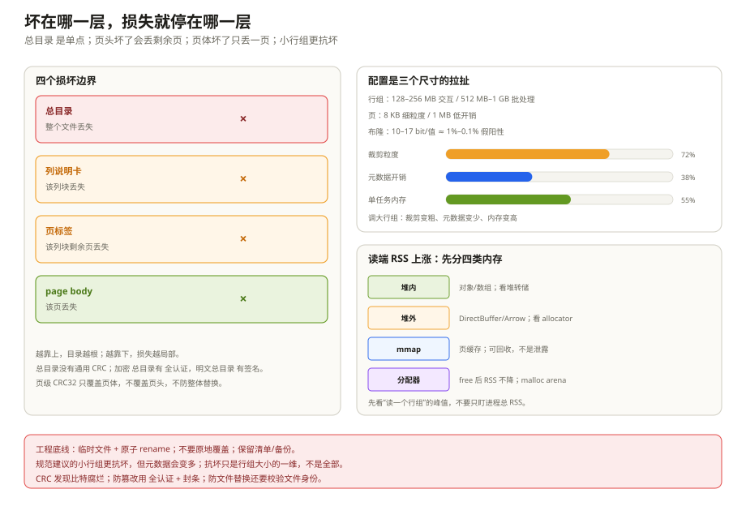
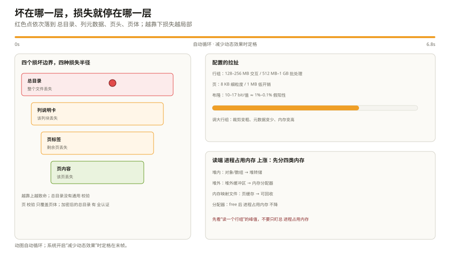

# 错误恢复与配置：坏在哪一层，损失到哪一层

一个 Parquet 文件写到一半，进程被 kill；另一个文件在对象存储里放久了，某个页的字节被悄悄改坏；还有一个文件能打开，但读某一列时校验失败。三件事看起来都是「文件坏了」，实际损失范围完全不同：

- 第一个可能整个文件都打不开；
- 第二个可能只丢一页，其他页还能读；
- 第三个可能只丢一个列块，其他列没事。

Parquet 没有事务日志，也没有副本机制，它的恢复能力来自「分层」：footer、列元数据、页头、页体各自独立，坏哪一层，损失就停在哪一层。这一章先把这四层讲清楚，再讲 CRC 能发现什么、配置怎么配，最后解释一个经常被误判成「内存泄露」的现象。

---

## 一、四层损坏，四种损失

`README.md:230-244` 把错误恢复写得很直接：

| 坏在哪 | 损失范围 | 还能读什么 |
| --- | --- | --- |
| 文件元数据（footer） | 整个文件 | 没有 footer 就没有 schema、行组、偏移，基本读不了 |
| 列元数据（ColumnMetaData） | 该列块 | 同一行组的其他列、其他行组还能读 |
| 页头（PageHeader） | 该列块剩余页 | 坏页头之前的页还能读；之后因为不知道页长，走不下去 |
| 页数据（page body） | 该页 | 其他页还能读；有 CRC 时能定位到具体页 |

可以想成一本被撕坏的书：目录没了，整本书找不到；某章的目录没了，只丢一章；页眉没了，后面的页码接不上；某一页破了，只丢一页。

这张表的顺序不是随意的：**越靠近 footer，损失越大**。因为 footer 是整棵目录的根，列元数据是子树的目录，页头是单页的目录，页体才是数据本身。

### 1.1 行存的恢复靠日志，Parquet 的恢复靠分层

普通行数据库（MySQL/PostgreSQL 的行页，LSM 的 memtable + WAL）处理的是另一类问题：单行更新、删除、事务回滚。它敢原地改页，是因为前面有 WAL/redo/undo：崩溃后重放日志，把页恢复到一致状态。

Parquet 是**不可变文件**：写入后不原地改，更新/删除意味着重写行组或整个文件，或者交给 Iceberg/Delta 做 merge-on-read。它没有 WAL，恢复能力来自「footer → 列元数据 → 页头 → 页体」的分层：坏哪一层，损失停在哪一层。

| 动作 | 普通行数据库（MySQL/PostgreSQL） | Parquet |
| --- | --- | --- |
| 单行更新 | 原地改页 + WAL/undo | 重写行组/文件，或 merge-on-read |
| 删除一行 | 标记删除/清页 + 日志 | 重写或标记文件，compaction 再清 |
| 崩溃恢复 | 重放 WAL/redo | 没有 WAL；按四层边界丢数据 |
| 并发写 | 锁/MVCC | 单写者生成新文件，清单原子切换 |
| 小批量写 | 追加即可 | 攒行组，太小就合并 |

这解释了为什么 Parquet 不适合当 OLTP 表：不是它「读得慢」，而是它**不提供单行原地写和事务日志**。反过来，行存也不适合「扫宽表里的两列」：它没有列裁剪和页索引，只能整块整块读。

行组大小在这里还有一笔账：更新一行要重写整个行组，行组越大，改写成本越高；行组越小，footer 元数据越多。第八章后面那张配置表，本质上就是在「读裁剪、写放大、元数据体积」三者之间找平衡。

### footer 为什么是单点

footer 在文件尾部，写它是最后一步。如果 writer 在写 footer 之前崩了，数据可能都已经落盘，但没有目录，读取器不知道 schema、不知道行组在哪、不知道每页多大。这个文件在标准读取器眼里就是「不完整」。

规范给了一个扩展思路：每 N 个行组写一次累积元数据，每个元数据包含到目前为止的所有行组，再配合 RCFile/Avro 那种 sync marker，读取器就能恢复部分写入的文件。但这是「potential extension」，不是当前标准。今天能用的办法是工程手段：

- **先写临时文件，写完再原子 rename。** 对象存储用「先上传临时对象，再 copy/rename」；本地文件用 `rename`。这样读取器永远看不到半成品。
- **不要原地覆盖。** 覆盖写会把旧 footer 先截断，崩溃后新旧都读不了。
- **保留 footer 副本/清单。** Iceberg、Delta 这类表格式会在清单里存文件统计和 schema；即使单个文件坏了，也能从清单知道它应该是什么。
- **写入幂等。** 失败重试写同一个分区时，用唯一文件名或先删旧文件，避免留下两个半成品。

### 列元数据坏了

`ColumnMetaData` 在 footer 里，正常情况下不会单独坏；如果 footer 的某个字节被改，Thrift 解析可能整体失败，而不是只坏一列。真正会出现「只坏一个列块」的场景，是列元数据被单独加密/复制到别处，或者老 writer 在列块附近复制了一份 `ColumnMetaData`（`ColumnChunk.file_offset` 的历史用法）。

thrift 注释已经说了，`file_offset` 的语义历史不一致，很多实现指向的位置是错的。所以「从列块附近恢复一份 ColumnMetaData」并不可靠；能依赖的还是 footer 里的那份。

### 页头坏了

页头是 Thrift 结构，包含 `compressed_page_size`。读取器靠它跳到下一页。如果页头坏了，解析失败，读取器不知道这一页有多长，也就不知道下一页从哪开始。规范因此说「该列块剩余页丢失」——不是后面的页真的坏了，而是「找不到它们了」。

这也是为什么有些工具在页头损坏后还能「扫描恢复」：它们按已知的页头模式/压缩特征去猜下一个页边界。但这是启发式，不是格式保证。

### 页体坏了

页体坏了，页头还在，读取器知道这一页多长，可以跳过它继续读下一页。如果有 CRC，读取器能确认「这一页确实坏了」，而不是解出垃圾数据。没有 CRC，解压可能失败，也可能「成功」但值是错的——后者更危险。

### 小行组为什么更抗坏

规范建议「文件用更小的行组会更抗损坏」。原因很直接：footer 里的每个 `ColumnChunk` 是独立的；一个行组的列块坏了，其他行组不受影响。行组越小，单次损坏波及的行数越少。

但行组不能无限小：

- footer 里的元数据随行组数线性增长；
- 每个行组都有固定开销（页头、索引、布隆过滤器）；
- 太小的行组会让并行任务变碎，调度成本上升。

所以「抗坏」只是行组大小的一个维度，不是唯一维度。下一节把它和读端内存、页大小放在一起看。

---

## 二、CRC32：能发现什么，不能发现什么

页头里有一个可选的 `crc` 字段（`parquet.thrift:830-858`）：

- 算法是标准 CRC32（多项式 `0x04C11DB7`，和 GZIP 一样）；
- 计算范围是「写到磁盘上的页体字节」，**不包括页头**；
- 如果页体被压缩/加密，CRC 是在压缩/加密之后算的；
- 所有页类型都可以有 CRC：v1/v2 数据页、字典页等。

读取器的校验顺序是：读页头 → 读页体 → 算 CRC → 和页头里的值比 → 通过才解压/解密。这样能在解压之前发现传输/存储损坏。

CRC 能发现：

- 页体里的比特翻转；
- 页体被截断；
- 压缩/加密后的字节被改动（未加密时）。

CRC 不能发现：

- **页头本身的损坏。** 页头没有 CRC；页头坏了，读取器可能连 `compressed_page_size` 都信不过。
- **页被整体替换。** 如果把另一页的页体换过来，CRC 可能仍然匹配（如果那一页的 CRC 也一起换）；只有加密 + AAD 才能防这种掉包。
- **footer 的损坏。** footer 没有通用 CRC；加密 footer 有 GCM 认证，明文 footer 有签名，未加密文件没有。
- **逻辑错误。** 值被写成错的但 CRC 正确的数据，CRC 发现不了。
- **跨页的结构错误。** 比如行组边界错位、offset 错，CRC 只保证「这一页的字节没变」，不保证「这一页属于这个位置」。

所以 CRC 是「防比特腐烂」，不是「防篡改」。要防篡改，用加密的 GCM/AAD；要防文件替换，用 AAD prefix + 文件身份校验。两者的威胁模型不同。

`README.md:224-229` 还提了一个实用点：页级 CRC 让你可以关掉 HDFS 的文件级校验和，只对真正读的页做校验，单行查找更快。但关掉 HDFS 校验和之前，要确认页级 CRC 真的被 writer 写了——很多 writer 默认不写 CRC。

---

## 三、配置：四个尺寸互相牵制

Parquet 的配置看起来很多，核心其实就四个尺寸：行组、页、字典、布隆过滤器。它们互相牵制，不能单独调。

### 3.1 行组大小

规范建议 512 MB–1 GB（`README.md:250-263`），理由是「一个行组可能要被完整读入，最好落在一个 HDFS block 里」。这是 HDFS 时代的默认：大行组 → 大顺序 I/O → 高吞吐。

但今天的场景变了：

- 对象存储（S3/OSS）的随机读成本比 HDFS 高，大行组不一定更快；
- 交互查询希望更快返回首批结果，大行组会让单任务内存峰值变高；
- 很多引擎默认行组是 128 MB 左右，而不是 1 GB。

所以「规范建议」是起点，不是教条。选择行组大小时，先问三个问题：

1. **单任务能接受多大内存？** 行组越大，读取器为了还原行组要缓存的列块/页越多。
2. **查询的选择性多高？** 行组越大，统计裁剪的粒度越粗；高选择性查询希望行组小一点。
3. **写入端能缓存多少？** 单遍写要在内存里攒够一个行组；行组越大，写端内存越高，或者需要两遍写。

一个常见的折中：交互表 128–256 MB，批处理/归档 512 MB–1 GB；再根据实际查询的裁剪率和内存峰值调。

### 3.2 页大小

规范建议 8 KB（`README.md:258-263`），理由是「页越小，单行查找和页级跳过越细；页越大，页头开销越小」。但很多实现默认页大小是 1 MB（加密文档里也按 1 MB 页估算开销）。这两个数字不矛盾，只是出发点不同：

- **8 KB 页**：适合细粒度跳过、单行查找；页头/索引开销占比高。
- **1 MB 页**：适合顺序扫描、高压缩比；页级跳过粒度粗，加密的每页 nonce/tag 开销占比低。

页大小还影响压缩：压缩算法需要足够的窗口才能找到重复模式，太小的页压不动；太大的页解压慢、内存峰值高。没有通用最优值，只有「你的查询模式 + codec + 页索引」的组合最优。

### 3.3 字典

字典适合低基数列。配置时要看：

- **字典大小上限**：字典超过阈值，writer 回退到 PLAIN；回退后同一列块里可能有字典页和 PLAIN 页。
- **字典页内存**：读取器通常要把字典读进内存/建哈希表；字典太大，读端内存会上升。
- **高基数列**：UUID、`event_id` 这类列，字典的收益很低，不如直接 PLAIN + ZSTD。

### 3.4 布隆过滤器与页索引

这两个都是「用空间换跳过」：

- 布隆过滤器按列块建，适合高基数等值查询；位/值比例 10:1 大约是 1% 假阳性，16.9:1 大约是 0.1%。
- 页索引按页建，适合范围查询和细粒度跳过；页越多，索引越大。
- 两者都只对「能下推的谓词」有用；`LIKE '%x%'`、函数包一层，就白建。

### 3.5 一张配置对照表

| 查询/数据特征 | 行组 | 页 | 编码 | 布隆 | 页索引 |
| --- | --- | --- | --- | --- | --- |
| 交互式点查、高选择性 | 128–256 MB | 8–64 KB | 字典/Delta | 高基数列开 | 开 |
| 全表扫描、批处理 | 512 MB–1 GB | 256 KB–1 MB | 字典 + ZSTD | 一般不开 | 可关 |
| 高基数等值（event_id） | 128–256 MB | 64–256 KB | PLAIN + ZSTD | 开，10–17 bit/值 | 可选 |
| 低基数枚举 | 任意 | 任意 | 字典 + RLE | 不需要 | 可选 |
| 浮点小数型 | 128–256 MB | 64–256 KB | ALP（reader 支持） | 不需要 | 开 |
| 冷归档 | 512 MB–1 GB | 1 MB | 字典 + GZIP/ZSTD | 不开 | 关 |
| 频繁小文件 | 合并后再调 | — | — | — | — |

这张表是起点。真正的配置要靠测量：用真实查询跑一遍，看看「读了多少页 / 命中了多少行 / 内存峰值多少」，再调。

---

## 四、读端内存为什么看起来像「泄露」

这一节专门说一个常见误判：服务读 Parquet，RSS 一直涨，重启就好；于是有人断定「Parquet 有内存泄露」。

大多数时候不是泄露，是**持有**。读取器为了还原一个行组，会同时持有：

- 压缩后的页缓冲；
- 解压后的页缓冲；
- 字典（可能很大）；
- definition/repetition level 数组；
- 解码后的值数组 / 向量化批次；
- 上层引擎的行对象、缓存、Arrow buffer。

这些对象在「行组读完」之后应该被释放，但释放时机取决于实现和调用方。如果调用方把整个行组 `collect()` 到内存、把 reader 放在长生命周期缓存里、或者把 `RecordBatch` 一直挂在某个列表上，RSS 就会涨。

更麻烦的是，RSS 不降不等于内存没释放：

- **JVM**：堆内存释放后，RSS 不一定立刻还给操作系统；要看 `-Xmx`、GC、Native Memory Tracking。
- **glibc**：free 后的内存可能留在 malloc arena 里，RSS 不降；`malloc_trim` 才会还。
- **mmap**：文件页缓存计入 RSS，但可回收；看起来像进程占用，实际不是堆泄露。
- **DirectByteBuffer / Arrow**：堆外内存不受 JVM 堆监控，`jcmd VM.native_memory` 或 Arrow 的 allocator 才能看到。
- **页缓存/对象存储客户端**：SDK 的连接池、缓冲区也会占内存。

排查顺序应该是：

```text
1. 先分清：堆内 / 堆外 / mmap / 页缓存
2. 看「读一个行组」的峰值，而不是进程总 RSS
3. 确认 reader / InputStream / RecordBatch 是否在 finally 里关闭/释放
4. 确认批次大小（batch size / vector size）是否过大
5. 确认有没有把整表 collect 到内存，或把 reader 缓存在长生命周期对象里
6. 用堆转储/分配采样看对象归属，别只看 RSS 曲线
```

几个常见的「假泄露」：

- **读大行组 + 大页**：单次峰值高，GC 后 RSS 不降，看起来像泄露；
- **字典常驻**：读取器缓存字典以加速后续页，缓存大小随文件数增长；
- **对象池/连接池**：为复用保留的 buffer 不会释放；
- **查询引擎的缓存**：元数据缓存、文件句柄缓存、页缓存，都是「有意持有」。

真正的泄露通常有明确的归属：某个静态 Map 一直 put、某个 listener 没移除、某个线程池没 shutdown、某个 `ByteBuffer` 被切分后仍被引用。用堆转储对比两次快照，比盯 RSS 有效。

如果确认是 Parquet 读取路径的内存问题，优先调这三件事：

1. **减小行组/页/批次**，让单次峰值降下来；
2. **流式读取**，不要 `readAll` / 全量 `collect`；
3. **及时关闭/释放** reader、InputStream、RecordBatch、Arrow allocator。

这三件事解决的是「持有」，不是「泄露」。真正的泄露要靠代码审查和堆分析，不是靠调 Parquet 参数。





*动图：红色点依次落到总目录、列说明卡、页标签、页内容；系统开启“减少动态效果”时定格。*

---

## 五、故障排查手册

| 症状 | 先判断 | 再动作 |
| --- | --- | --- |
| 文件打不开，报 footer 解析失败 | footer 是否完整、魔数是否 `PAR1`/`PARE` | 检查文件大小、末尾 8 字节、写入是否原子；从清单/备份恢复 |
| 能打开，但某列读不了 | 列元数据或列块损坏 | 只读其他列；从备份恢复该列；检查是否加密列缺 key |
| 读到某页报 CRC 错 | 页体损坏 | 跳过该页/行组；从副本恢复；检查存储层是否有静默损坏 |
| 读到某页报解压错 | 页体/页头损坏，或 codec 不匹配 | 检查 `PageHeader.codec`、页体长度；尝试跳过 |
| 行数比预期少 | 页/行组被裁掉，或 NULL 语义错 | 检查谓词下推、统计、页索引；对比全扫 |
| 查询扫描量很大 | 统计/页索引/布隆没生效 | 检查 `column_orders`、谓词是否 sargable、文件是否排序 |
| 读端内存持续上涨 | 持有 vs 泄露 | 按上一节的顺序排查；看堆转储，不要只看 RSS |
| 小文件查询慢 | footer 解析成本 | 合并小文件、用清单/`_metadata`、减少文件数 |

---

## 六、踩坑清单

| 现象 | 更可能的原因 | 先看哪里 |
| --- | --- | --- |
| writer 崩溃后文件完全读不了 | footer 没写完 | 原子写、临时文件、清单恢复 |
| 以为「小行组一定更好」 | 元数据/固定开销随行组数增长 | footer 大小、文件数、查询模式 |
| 以为「页越大压缩越好」 | 页级跳过变粗、解压内存高 | 页大小、页索引、codec |
| 开了 CRC 但读不到校验 | writer 没写 `PageHeader.crc` | 页头、writer 配置 |
| 用 CRC 防篡改 | CRC 不防整体替换 | 加密 + AAD |
| 读端 RSS 不降就判定泄露 | 分配器/页缓存/堆外内存 | 堆转储、NMT、allocator |
| 行组调大后 OOM | 单任务缓存整个行组 | 行组大小、批次大小、并发 |
| 布隆过滤器全开但查询没变快 | 谓词不是等值，或假阳性高 | 查询类型、位/值比例 |

---

## 七、这一章留下的线索

- 损坏分四层：footer → 列元数据 → 页头 → 页体；越靠前损失越大；
- 小行组更抗坏，但元数据更多；行组大小要跟内存、裁剪率一起调；
- CRC 防比特腐烂，不防篡改/替换；加密 + AAD 才防掉包；
- 页大小 8 KB 是规范建议，1 MB 是很多实现的默认，两者出发点不同；
- 读端 RSS 上涨，先分「持有 / 分配器 / 页缓存 / 堆外」，再谈泄露；
- 配置没有全局最优，只有「查询模式 + 数据分布 + 资源」的组合最优。

八章到这里就完整了。回到最开始那条查询：它只读三页，不是因为 Parquet 会魔法，而是因为文件布局、footer 元数据、Dremel 层级、编码压缩、页索引和布隆过滤器一起把「不用读的数据」排除掉了。理解这条链，比记住任何一个参数都值钱。

---

## 附：这一章的源码入口

> 除特别注明外，本节引用的 `README.md`、`*.md` 与 `src/main/thrift/parquet.thrift` 都来自 apache/parquet-format（2.15.0-SNAPSHOT）。

- `README.md:224-229`：页级 CRC32
- `README.md:230-244`：四层损坏边界、footer 单点、周期性元数据扩展
- `README.md:245-249`：元数据与列数据分离
- `README.md:250-263`：行组 512 MB–1 GB、页 8 KB、HDFS block 建议
- `Encryption.md:532-543`：加密开销（按 1 MB 页估算）
- `src/main/thrift/parquet.thrift:830-858`：`PageHeader.crc` 的计算范围
- `src/main/thrift/parquet.thrift:908-973`：`ColumnMetaData` 的偏移/大小/统计
- `src/main/thrift/parquet.thrift:991-1047`：`ColumnChunk` 的 `file_offset` 废弃说明
- `src/main/thrift/parquet.thrift:1407-1472`：`FileMetaData`

---

## 思考题

1. 一个文件的行组切得很小（比如 4 MB），抗坏能力更强，但为什么线上不一定更快？你会用哪些指标判断？
2. 页头没有 CRC，页体有 CRC。这个设计能防住「页头被改、页体没变」吗？如果防不住，应该靠什么？
3. 规范建议 8 KB 页，很多实现默认 1 MB。分别适合什么查询？如果一张表既要单行查找又要全表扫描，你会怎么折中？
4. 服务 RSS 持续上涨，但堆转储里没有明显的大对象。你会先查哪三类内存？
5. 一个 writer 在写 footer 前崩溃，数据其实已经落盘。有没有办法恢复？标准支持吗？工程上应该怎么避免？
