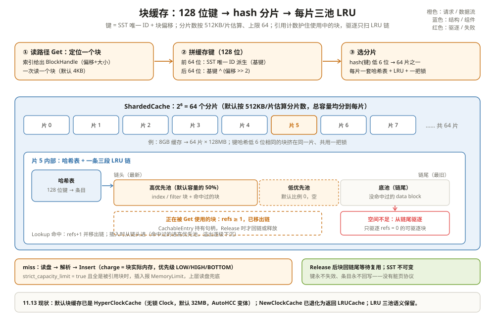

# 块缓存架构：读过的块留在内存里

一条 500 QPS 的点查压测，QPS 死活上不去，`iostat -x` 里 NVMe 的读 IOPS 打满——可这些 key 十秒内都被读过一遍了，明明是「重复读」。换个视角看 STATS：`BLOCK_CACHE_MISS` 一路涨，`BLOCK_CACHE_HIT` 几乎不动。

差别不在盘慢，而在**每次 Get 都真的去读了盘**：块缓存没接住。读路径的最小 I/O 单位是「块」，SST 里一个 4KB 的 data block；这一章讲读回来的块在内存里怎么安家、怎么被找到、怎么在容量不够时被礼貌地请走。

把块缓存想成**阅览室的书架**：SST 是库房，读过的块复印一份上架；下次再有人要同一页，直接在架上拿。因为 SST（和 Parquet 文件一样）写完就不再改，架上永远是最新的复印本——不存在「书改版了架上还是旧的」的问题，也就不需要任何失效协议。



---

## 一、为什么缓存「块」而不是行

读路径的最小 I/O 单位就是块。Get 的动作是：索引定位到 `BlockHandle`（块在 SST 里的偏移和大小，默认块 4KB，`include/rocksdb/table.h:400`）→ 一次预读整个块 → 在块内二分找 key。行在磁盘上没有独立地址，块有；**能寻址才能做缓存键**。

```text
举例：一次 Get 在缓存里的三个分岔
Get("device_47") → 索引给出 data block 的 BlockHandle(offset=0x12000)
① 命中：拿到句柄直接在内存块里找 key，盘一次没碰；
② miss：读盘 → 解析成内存对象 → Insert 进缓存，下次就在 ①；
③ fill_cache=false（如压实读）：跳过 ①②，读完就丢，不污染缓存
   （table/block_based/block_based_table_reader.cc:2407、:2487）。
```

**SST 不可变，缓存键就永不失效**。一个块写进 SST 之后内容永远不变，键（下一节讲它怎么拼）到任何时刻都指向同一段字节。这是与可变页缓存最大的差别：OS page cache 要处理脏页回写、文件被改后失效整页；块缓存没有脏数据概念，驱逐就是纯粹的空间回收，不需要回写。

谁被缓存？不止 data block。块缓存是个通用仓库，登记在册的住户看 `CacheEntryRole` 枚举（`include/rocksdb/cache.h:55-88`）：

| 块类型 | 进缓存？ | 优先级倾向 |
| --- | --- | --- |
| data block | 是 | LOW |
| index block、分区索引 | 是（分区索引总进） | HIGH（选项开时） |
| full/partitioned filter block | 是 | HIGH |
| range-del 块、压缩字典块 | 是 | LOW |
| TableProperties、hash index 元数据 | 不进（helper 表里标 `nullptr`，`block_cache.cc:74-89`） | — |
| 占位条目（WriteBufferManager（WBM）等记账） | 是，不存数据只占额度 | 第三篇展开 |

接口本身是通用的 `Cache`（`include/rocksdb/advanced_cache.h:44`）：键是字节串、值是 `void*` 对象、每条目带 charge。不配的话默认建一个 **32MB 的 HyperClockCache**（`table/block_based/block_based_table_factory.cc:627-630`）——注意这个默认值只够玩具场景，生产上几乎一定要显式给容量。

还有一个默认值容易误读：`cache_index_and_filter_blocks` 默认 **false**（`include/rocksdb/table.h:238`）——index/filter 默认**不进缓存**，而是随 table reader 常驻内存（打开时预载，`block_based_table_reader.cc:761` 的 `preload_all`）。这份内存不在 block cache 的 capacity 口径里，第三篇会把它记账的事讲清。

---

## 二、缓存键：128 位怎么拼出来的

块缓存可能跨重启存活（持久化二级缓存甚至跨机器搬运），所以键必须满足两条：**跨重启可重复、跨 DB 全局唯一**。`advanced_cache.h` 的注释把要求写得很直白：键要「repeatable across restarts/reboots, and globally unique if multiple DBs share the same cache」（`include/rocksdb/advanced_cache.h:226-230`）。

拼键的原料有三个：`db_id`（建库时生成的 UUID）、`db_session_id`（本次 DB::Open 的会话 ID）、`file_number`（SST 文件号）——前两个持久在 TableProperties 里，所以重启后还能拼出同样的键。三样先经 `GetSstInternalUniqueId` 压成 128 位内部 ID（`table/unique_id.cc:60-117`），再经 `OffsetableCacheKey::FromInternalUniqueId` 做一次可逆变换得到「文件基键」（`cache/cache_key.cc:310-348`）。最后任何偏移的键 = 基键第二字与偏移的异或：

```text
举例：真拼一遍
输入：db_id="d42c8a3f-…"（UUID）、
      db_session_id="4DDCB3F0C6A57A632F81"（20 字符，~103 位熵）、
      file_number=7、block offset=0x12000

① GetSstInternalUniqueId（unique_id.cc:100、:114）
   internal[0] = session_lower                ← 会话 ID 低 64 位原样保留
   internal[1] = Hash2x64(db_id, session_upper) ^ 7

② FromInternalUniqueId（cache_key.cc:332-334）
   file_num_etc64 = DownwardInvolution(internal[0]) ^ ReverseBits(internal[1])
   offset_etc64   = ReverseBits(internal[0])        ← 这就是「文件基键」

③ WithOffsetForMinSizeRecord(0x12000)（cache/cache_key.h:144-146）
   key = ( file_num_etc64, offset_etc64 ^ (0x12000 >> 2) )   ← 0x12000>>2 = 0x4800
```

三个细节值得停一下。**第一**，偏移要先右移 2 位：SST 里每个可缓存区域至少 5 字节，低 2 位丢弃是无损的，换来 data block 和嵌入式 blob 记录共用一个键空间而不撞键（`cache/cache_key.h:130-146`）。**第二**，同一文件所有键共享前 8 字节（`CommonPrefixSlice`，`cache/cache_key.h:151-158`），按文件失效或统计时有捷径。**第三**，拼键全程只有异或、位反转和一个固定函数，SST reader 打开时算一次基键，之后每次查缓存只是一条异或指令——这是热路径，`cache_key.h` 注释原话是「designed to make this hot code extremely fast」。

128 位键空间还有两个不经过文件的邻居（`cache/cache_key.cc:18-25` 的值空间规划）：`CreateUniqueForCacheLifetime`（缓存生命周期内唯一，给占位条目用）和 `CreateUniqueForProcessLifetime`（进程内唯一，从 UINT64_MAX 往下数，避开文件键的区间）。记账型条目不指向任何文件字节，占一个永不与块键冲突的角落——这也是第三篇占位条目能放心乱插的前提。

---

## 三、分片 LRU：把一把锁拆成 64 把

LRU 有个绕不开的代价：**读也要拿锁**。命中一个块要把它在 LRU 链上挪个位置（挪到最新端），这条链全体线程共用，一把锁锁住。几百个并发读挤在一条链上，锁竞争比缓存省下的 I/O 还贵。

解法是分片：**总容量切成 2^N 片，每片独立哈希表、独立 LRU、独立锁**。键的哈希值取低 32 位再低 N 位选中分片（`cache/sharded_cache.h:159-165`，分片用哈希低位、哈希表索引用高位，两不干扰，见 `sharded_cache.h:127-131` 的注释），总容量均分给每片（`cache/sharded_cache.cc:68-71`）。

```text
举例：默认分片数怎么算出来
GetDefaultCacheShardBits(capacity, min_shard_size=512KB)（sharded_cache.cc:129-139）：
num_shards = capacity / 512KB，数 num_shards 能右移几次，数满 6 次立刻封顶。
8GB 缓存：8GB/512KB = 16384 份 → 数到第 6 次就封顶 → 64 片，每片 128MB；
32MB 缓存：32MB/512KB = 64 份 → 恰好数 6 次 → 也是 64 片，每片 512KB；
1GB 缓存：2048 份 → 数满 6 次 → 64 片，每片 16MB。
一句话：**分片数 = 2^min(log2(容量/512KB), 6)，永远不超过 64 片**
（sharded_cache.h:324-326 注释：512KB 是「传统最小片大小」）。
```

分片还有个防「齐步走倒霉」的机制：哈希种子默认按主机名派生（`ShardedCacheOptions::hash_seed`，`include/rocksdb/cache.h:163-190`）。如果全机房用同一个种子，某个大 filter block 在所有机器上都会哈希进同一个分片，齐刷刷把那一片挤爆；种子按主机随机化后，倒霉是独立的。

分片也不是万能药，`cache.h:212-218` 的注释点了两条底线：**单个热块**无论分多少片都要抢同一把锁（同一个键必然落同一片）；**缓存只有 MB 级**时片会小到几个大块（尤其非分区 filter）就能把一片搅得鸡犬不宁——这正是 512KB 最小片与 HCC 大分片设计试图缓解的场景。分片解决的是「多键并发」，不解决「单键并发」。

---

## 四、优先级：高、低、底三个池

缓存里的块不是生而平等：index/filter 丢了要整段重读，data block 丢了只多一次读。`Cache::Priority` 有三级（`include/rocksdb/advanced_cache.h:68`）：HIGH、LOW、BOTTOM。

| 块类型 | 优先级 | 依据 |
| --- | --- | --- |
| index / filter 块（开了 high_priority 时） | HIGH | `block_based_table_reader.cc:2116-2133`，选项默认 true（`table.h:244`） |
| data block、TableProperties | LOW | 同上，`:2124-2126` |
| 压实预热（prepopulate）的块 | BOTTOM | `block_based_table_builder.cc:1005-1007` |
| blob 值 | BOTTOM | `advanced_cache.h:67` 注释 |

LRUCache 把一条链划成三段：高优先池（默认容量的 50%，`high_pri_pool_ratio=0.5`，`include/rocksdb/cache.h:245-246`）、低优先池（默认 0，关闭）、底池。插入规则在 `LRU_Insert`（`cache/lru_cache.cc:256-296`）：**命中过的块进最高可用池**（`e->HasHit()`，`:259`），没命中的按自身优先级落位；池满了往下一级溢出（`MaintainPoolSize`，`:298-321`）。于是驱逐顺序天然是：底池最旧 → 低池 → 高池——没被读过一次的 data block 最先出局，读热的数据块和高优先的元数据块活得最久。

```text
举例：一个 8KB 块的一生（high_pri=0.5，某片容量 128MB）
T0：miss，读盘，Insert(Priority::LOW) → 没命中过 → 进底池链头；
T1：被 Get 命中 → 移出链，refs=1；
T2：Release → 回链，HasHit=true → 进高优先池；
T3：高优先池超 64MB → MaintainPoolSize 把池尾最旧的挤到低池/底池；
T4：整片满 → 驱逐从底池链尾开始，这个 8KB 块大概率还活着。
```

---

## 五、LRU vs Clock：取舍与现状

11.13 的头文件里写着一句立场鲜明的话：**HYPERCLOCKCACHE IS NOW GENERALLY RECOMMENDED OVER LRUCACHE**（`include/rocksdb/cache.h:220-221`）。而更老的 Clock 缓存已经死了：`NewClockCache()` 在 `cache/clock_cache.cc:3601-3611` 里只剩下「返回一个 LRUCache」的兼容壳，头文件注释明说老实现有未解决的 bug、已删除（`cache.h:479-487`）。

| 维度 | LRUCache | HyperClockCache（HCC） |
| --- | --- | --- |
| 并发模型 | 每片一把互斥锁，读写都要锁 | 无锁，靠原子引用计数 |
| 热块竞争 | 单热块也要抢锁，分片救不了 | 单条目原子计数，无明显热点 |
| 优先级 | 三池链，强隔离 | 有优先级但执行较宽松（`cache.h:384-386`） |
| 附加要求 | 无 | 只能用于块缓存（键定长 128 位）；HCC 变体依赖匿名 mmap（`cache.h:380-387`） |
| 记账型条目（WBM 等） | 支持 | 不定长 charge 场景建议配 `estimated_entry_charge=0` 的 AutoHCC（`cache.h:396-408`） |

Clock 的淘汰思路在 `clock_cache.cc` 的 `GetInitialCountdown` 里能看到骨架：每个条目带一个倒计时，HIGH 给多、LOW 给少、BOTTOM 最少（`clock_cache.cc:37-55`），扫描到倒计时归零且无人引用就驱逐——用「近似」换「不用锁」。取舍很清楚：高并发点查选 HCC，需要严格优先级隔离或拿 Cache 当通用记账本（第三篇的主角）时 LRUCache 更稳。

HCC 还有两个工程补充。它的分片只是「适度增强」（`cache.h:372-374`），片可以比 LRUCache 大得多，大块挤爆单片的风险随之缩小；压力场景下有个 `eviction_effort_cap`（默认 30，`cache.h:427-462`）：全是 pinned 条目时 Clock 会整库扫描找可驱逐者，这个参数限制了扫描力度——宁可让内存略超（注释估 3~5%），也不把 CPU 烧在注定空手的扫描上。

---

## 六、正在用的块为什么不会被挤走

缓存条目有两种状态：躺在链上等人来用（可驱逐），或被人握在手里（被引用）。实现是 `LRUHandle` 的引用计数 `refs`，`cache/lru_cache.h:32-48` 的注释把状态机写得很清楚：

| 状态 | refs | 在哈希表 | 在 LRU 链 | 含义 |
| --- | --- | --- | --- | --- |
| 被引用 | ≥1 | 在 | **不在** | 有人正在用，驱逐碰不到 |
| 可驱逐 | 0 | 在 | 在 | 只被缓存持有，随时可请走 |
| 游离 | ≥1 | 不在 | 不在 | 已被 Erase/覆盖，等最后一个引用放手 |

Lookup 命中时 `refs+1` 并**移出 LRU 链**（`cache/lru_cache.cc:439-445`）；驱逐只扫链（`EvictFromLRU`，`:323-336`），而使用中的块根本不在链上。读取方握着的句柄包在 `CachableEntry<T>` 里（`table/block_based/cachable_entry.h:44`），它有三种持有方式：缓存句柄、独占对象、只借用不持有（`:21-41` 的注释），析构或 `TransferTo` 时把 `Release` 挂到迭代器的清理链上（`:126-137`）——迭代器活多久，块就被 pin 多久。

```text
举例：pin 住的块挤不走
某片 4MB，可驱逐链上有 3.8MB。
T1 Get("device_47")：命中块 B(8KB) → LRU_Remove(B)，B.refs=1（lru_cache.cc:442-444）
T2 同时 Insert 新块 C(512KB)：EvictFromLRU 只扫链（:325-335），
   B 不在链上——T2 顶掉的是链尾 512KB 的别人，碰不到 B；
T1 用完 Release(B)：refs=0 → usage 未超限则回链（:491-494），继续服务下一次读。
结论：**引用计数就是免死金牌**，代价是全被 pin 住时缓存暂时「超卖」。
```

超卖怎么办？这就是 `strict_capacity_limit`（`include/rocksdb/cache.h:140-145`）：

```text
举例：预算 10MB、已用 9.9MB 且全部被引用，再插 0.5MB
默认（strict=false）：没人可驱逐 → 照样插入，usage=10.4MB 短暂超限，
                     等 Release 时顺手回收（lru_cache.cc:485-490）；
strict=true：EvictFromLRU 空手 → Insert 直接失败，返回
             Status::MemoryLimit("Insert failed due to LRU cache being full.")
             （lru_cache.cc:394），上层放弃缓存改为直接读盘。
```

默认 false 是有意的：**宁可超一点内存，也不要让读路径失败**。开了 true 的典型动机是把缓存当内存总账本用（第三篇），那时插不进就该报错而不是悄悄超支。

---

## 七、charge：每个条目都要报账

Insert 时每个条目带一个 `charge`（`advanced_cache.h:269-273`），按字节记账，`GetUsage()` 是全部条目的和。记账有个容易忽略的细节：条目本身（哈希节点、键）也占内存，默认策略 `kFullChargeCacheMetadata` 把这部分也算进 charge（`include/rocksdb/cache.h:114-124`，实现在 `lru_cache.h:192-195` 的 `CalcTotalCharge`）——8GB 的配置真就只吃 8GB，而不是 8GB 数据 + 一笔没算的隐性开销。

```text
举例：charge 是多少
PutDataBlockToCache 里 charge = 块对象 ApproximateMemoryUsage()（reader:2222），
即解压后块的真实内存；一个 4KB 压缩块解压到 4KB，charge≈4KB+条目元数据。
同理 index 块几十 MB 就报几十 MB——驱逐它腾出的空间是真实的。
```

还有一类「不存数据只占额度」的条目：`CreateStandalone` 和占位符条目（`advanced_cache.h:284-286`），第三篇的 CacheReservationManager 全靠它工作。

引用释放还有一个 Clock 才用到的变体：`Release(handle, useful, erase_if_last_ref)`（`advanced_cache.h:462-465`）多带一个「这次数据真被用了吗」——Clock 靠倒计时决定生死，这条信息能帮它把「取了没用」的块和真热块区分开；LRU 实现里暂时忽略它。API 在这里留了口子，两个实现各自取舍。

---

## 八、踩坑清单

| 现象 | 更可能的原因 | 先看哪里 |
| --- | --- | --- |
| 缓存命中率高但 CPU 涨 | LRUCache 锁竞争（热块或分片太少） | 换 HyperClockCache；检查 num_shard_bits |
| 大 filter 进缓存后命中率跳水 | 大块挤进同一片（分片太小） | 片大小 ≥512KB；hash_seed 别写死相同值 |
| 内存用量超 capacity | 全是 pinned 条目 + strict=false | GetPinnedUsage；确认无泄漏的迭代器 |
| 点查长尾毛刺 | index/filter 被挤出（未开 high priority） | cache_index_and_filter_blocks 系列选项（`table.h:238-244`） |
| 换 HCC 后内存涨几个点 | eviction_effort_cap 允许压力下略超 | 3~5% 属预期，持续超支查 pinned |
| strict=true 后报 MemoryLimit | 记账型条目吃满额度 | 第三篇的 CacheReservationManager |
| 缓存 32MB 不够用 | 用了默认块缓存 | 显式配 NewLRUCache/HCC 并给足容量 |

---

## 九、和 Parquet 摆在一起看：都在缓存不可变文件的连续区间

湖计算引擎有一套和块缓存同构的东西：Spark executor 的本地缓存、Alluxio、甚至 OS page cache——都在缓存「不可变文件的一段连续字节」。

| 维度 | RocksDB 块缓存 | 湖侧本地缓存（Spark/Alluxio/page cache） |
| --- | --- | --- |
| 缓存单位 | 解压后的块（对象），charge 显式记账 | 字节区间/文件块（page cache 是黑盒页） |
| 键 | 128 位：全局唯一 SST ID + 偏移，跨重启稳定 | 通常是 (文件路径, 偏移)；改名、复制、重组即失效 |
| 失效 | 不需要——SST 不可变，键永不撞旧数据 | 依赖文件版本/元数据比对，Iceberg 要靠快照 |
| 容量 | 显式 capacity，逐条 charge，可 strict 超支即报错 | page cache 由 OS 统管，应用无感 |
| 优先级 | HIGH/LOW/BOTTOM 分池 | 通常没有（page cache 只有 LRU 近似） |

差异的本质在两处。**键的强度**：RocksDB 把「全局唯一 ID」做进键里，同一份数据被备份、导入导出到别的机器，键照样不撞；OS page cache 拿路径当键，一个 `cp` 出来的副本就是两套缓存。**记账的显性程度**：块缓存的每个字节都报过 charge，超支可以当场报错；page cache 是「用了多少算多少」，应用层无法承诺。Alluxio 介于两者之间——键和容量都显式，但失效要靠上层元数据（Iceberg/Delta 快照）喂给它。

还有一层镜像关系值得点破：Parquet 文件进了缓存层之后，湖计算引擎面对的问题和这一章一模一样——驱逐留谁（热列块优先，对应 HIGH/LOW）、大 footer 对象怎么安置（对应 index/filter 的优先级）、扫描时怎么不把缓存洗冷（对应 fill_cache=false）。**不可变文件 + 显式记账 + 粒度化优先级**，这三件事在任何一边都成立。

---

## 十、和 InnoDB Buffer Pool、HBase BlockCache 比一比

三者都在缓存「读过的磁盘块」，但缓存单位和失效协议差得很远：

| 维度 | RocksDB Block Cache | InnoDB Buffer Pool | HBase BlockCache |
| --- | --- | --- | --- |
| 缓存单位 | 解压后的 block/对象 | 16KB 数据页 | HFile block |
| 键 | 128 位 SST ID + 偏移 | 表空间 + 页号 | HFile + 偏移 |
| 失效 | 不需要，SST 不可变 | 脏页回写 + LRU，页可原地改 | HFile 不可变，随文件删除 |
| 写入角色 | 读缓存，不承载写 | 读写都走 buffer pool | 读缓存；写走 MemStore |
| 记账 | 逐条 charge，可 strict 超支报错 | 固定 pool 大小，页为单位 | 堆内/堆外，按 block 计 |
| 最适合 | 读多、块级局部性强 | OLTP 事务负载 | HBase 随机读 |

一句话：InnoDB 的 buffer pool 是**写路径的一部分**（脏页、redo、刷盘都绕着它转），所以它有失效/回写协议；RocksDB 和 HBase 的缓存是**纯读缓存**，因为磁盘文件不可变，缓存条目没有「过期」问题。RocksDB 把全局唯一 ID 编进缓存键，跨重启、跨备份都不撞旧数据；HBase 用 HFile 标识 + 偏移，文件被压实删除时缓存自然失效——两者都比「拿路径当键」的 file cache 更稳，但 RocksDB 的键能做跨副本复用，HBase 的更贴近单文件模型。

---

## 这一章留下的线索

- 读路径最小 I/O 单位是块，块可寻址才能做缓存键；SST 不可变让键永不失效——没有脏页、没有失效协议；
- 缓存键 = 128 位：SST 唯一 ID（db_id + db_session_id + file_number 派生）派生基键，偏移右移 2 位参与异或；
- 分片 LRU：哈希低位选片、每片一套哈希表 + LRU + 锁，默认按 512KB/片、最多 64 片；优先级分高/低/底三池，命中过则升池；
- 老的 Clock 缓存已删除，`NewClockCache` 退化为 LRUCache；11.13 默认块缓存已是 HyperClockCache（32MB）；
- 引用计数护住使用中的块：pinned 条目不在 LRU 链上，驱逐碰不到；`strict_capacity_limit` 决定超支是「短暂超限」还是「当场报错」；
- charge 是显式记账：条目元数据默认一并计入（kFullChargeCacheMetadata），配置多少就真吃多少。

到这里，热块在内存里有了家。但内存终究有限：**热数据比缓存大时，被挤出去的块是直接扔掉，还是找个便宜地方收着？** 下一章看块缓存的「桌边文件柜」：[二级缓存与分层缓存：内存装不下的去哪](02-二级缓存与分层缓存.md)。

---

## 附：这一章的源码入口

> 除特别注明外，本节引用的源码文件与行号都来自 facebook/rocksdb 主分支（11.13.0）。

- `include/rocksdb/cache.h:128-205`：ShardedCacheOptions——capacity、num_shard_bits、strict_capacity_limit、hash_seed 的语义与默认值
- `include/rocksdb/cache.h:55-88`：CacheEntryRole 全枚举——块缓存实际记的不只是数据块的账
- `include/rocksdb/advanced_cache.h:269-302`：Insert/Lookup 接口——charge、优先级、二级缓存挂钩
- `cache/cache_key.h:83-159` 与 `cache/cache_key.cc:300-348`：OffsetableCacheKey 与 WithOffset 家族，偏移右移 2 位的原因
- `table/unique_id.cc:60-117`：GetSstInternalUniqueId——db_id/db_session_id/file_number 如何压成 128 位
- `cache/sharded_cache.cc:60-71、129-139`：分片容量均分与默认分片数算法（512KB/片、封顶 6 位）
- `cache/lru_cache.h:32-48`：LRUHandle 三状态注释——refs 与 in_cache 的组合
- `cache/lru_cache.cc:256-336`：LRU_Insert 三池落位、MaintainPoolSize 逐级下沉与 EvictFromLRU
- `cache/lru_cache.cc:372-428、430-518`：InsertItem（MemoryLimit 在 `:394`）、Lookup 的 ref/移链、Release 的回链
- `table/block_based/block_based_table_reader.cc:708-714、2116-2133、2190-2244`：GetCacheKey、GetCachePriority 与 PutDataBlockToCache 的 charge
- `table/block_based/cachable_entry.h:21-41、126-137`：CachableEntry 三种持有语义与 TransferTo
- `cache/clock_cache.cc:37-55、3601-3611`：Clock 倒计时按优先级取值；NewClockCache 已退化为 LRUCache
- `table/block_based/block_based_table_factory.cc:627-630`：默认块缓存 = 32MB AutoHCC

---

## 思考题

1. 一个 8GB 的 LRUCache 配 `num_shard_bits=-1`，会得到几片、每片多大？如果工作负载里有 20MB 的巨型 filter block，显式配 `num_shard_bits=7`（128 片）是解药还是新麻烦？提示：算一算每片容量。
2. 把 `cache_index_and_filter_blocks` 从默认 false 打开、并保持 `cache_index_and_filter_blocks_with_high_priority=true`，点查型负载的内存构成和驱逐行为会怎么变？压实型负载呢？
3. `strict_capacity_limit=true` 的缓存上，WBM 把 memtable 内存记成了占位条目（第三篇展开）。压测高峰时大量块被迭代器 pin 住，写入端会发生什么？这条链路和不开 strict 有什么本质区别？
4. OS page cache 拿「文件路径 + 偏移」当键也工作得不错，为什么 RocksDB 一定要付「db_id + session_id + 文件号 + 两趟可逆变换」的代价？找一个 page cache 会出错而块缓存不会的具体场景。
