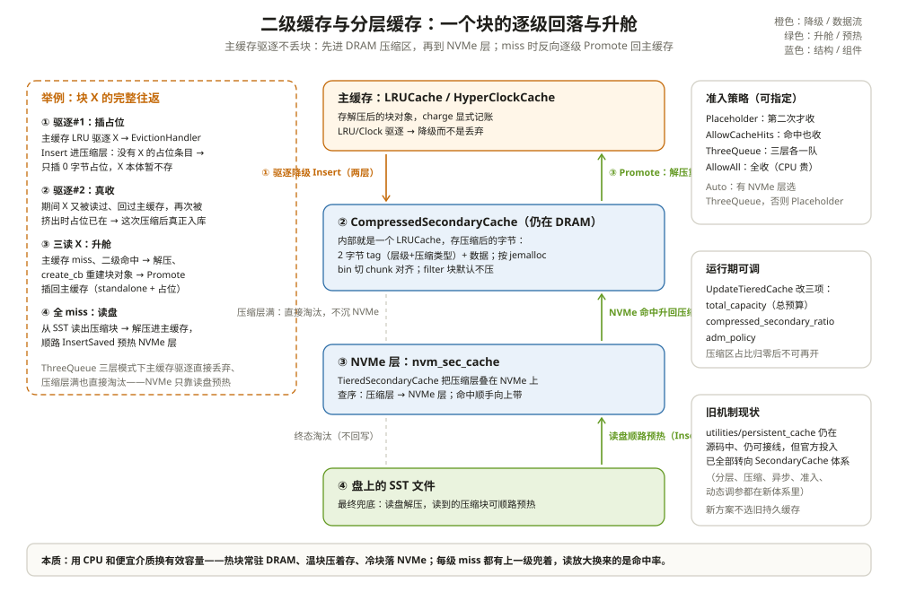

# 二级缓存与分层缓存：内存装不下的去哪

一台 128GB 内存的节点，block cache 配了 40GB，实测热数据集有 60GB。命中率停在 85%，剩下 15% 的读每次都直接砸到 NVMe 上冷读——而且这些 key 一分钟前才被读过，只是彼时被缓存挤出去、随手扔了。

差别不在盘不够快，而在**挤出去的字节全被扔了**。主缓存驱逐是一刀切：腾地方而已，被挤的块就地蒸发，下次要再从盘上读。这一章讲 RocksDB 的「桌边文件柜」：挤下来的块先收进一个便宜的地方，再要时从柜里拿，别急着回库房。

把二级缓存想成**办公桌边的文件柜**：桌面（主缓存）只放正在用的；桌上放不下的塞进柜子（压缩区）——压扁了存，占地小；柜子也满了才进走廊货架（NVMe）。桌面找得到就用桌面，找不到翻柜子，柜子没有才走回库房。



---

## 一、为什么需要二级：热数据比缓存大

块缓存的账很好算：容量 C，热数据 H。H < C 时命中率高；H > C 时，多出来的部分注定反复「读盘 → 进缓存 → 被挤走 → 再读盘」。这时有两个选择：加内存，或者给被挤出的块找个**每字节更便宜**的容身之处。

RocksDB 选了后者，并且把「便宜的地方」做成了接口：`SecondaryCache`（`include/rocksdb/secondary_cache.h:66`）。主缓存驱逐不扔、塞给它；主缓存 miss 时回头问它。官方实现是**内存里的压缩缓存**（省的是压缩比）和 **NVMe 层**（省的是介质价格），用户也可以自己实现接到 S3、分布式缓存上。

什么工作负载值得配？拿三个数算一下就知道：

| 场景 | 热数据/缓存比 | 建议 |
| --- | --- | --- |
| 热点集中，H < C | 50% 以下 | 二级缓存的命中贡献小，纯加 CPU 税 |
| 温热混合，H ≈ 1~3×C | 2~3 倍 | 压缩二级缓存的甜点区：挤出的块压着存，命中率再抬一截 |
| 数据远大于内存，但访问局部 | 10 倍以上 | 三层：NVMe 承接温块，DRAM 只留真热块 |

还有一个隐藏收益：**压缩二级缓存存的是压缩字节**，同样 32MB 能装下相当于 100MB 块的内容——对「命中第二多的那批块」来说，等于免费扩容。代价是把解压 CPU 挪到了读路径上，不可压的数据（大 filter、已被压缩的 blob）白付这笔钱。

---

## 二、SecondaryCache 接口：五个方法一张契约

接口不长，逐个看（`include/rocksdb/secondary_cache.h:66-154`）：

| 方法 | 行号 | 语义 |
| --- | --- | --- |
| `Insert` | :82-84 | **建议性**插入：驱逐降级用；实现可以拒绝（准入），返回 OK 不代表真存了 |
| `InsertSaved` | :96-99 | 直接存「可持久化的字节」（通常就是 SST 里的压缩块），预热用 |
| `Lookup` | :114-117 | 查询；`wait=false` 可异步——立刻返回 pending 句柄，不阻塞读线程 |
| `SupportForceErase` | :120 | 支持升舱后从二级删除（避免一份块两处存） |
| `WaitAll` / `SetCapacity` / `Deflate` / `Inflate` | :127-153 | 批量等结果；容量管理，Deflate/Inflate 做小幅伸缩 |

`Lookup` 返回的句柄有三态（`:21-31` 的注释）：pending（还没好）、ready+miss、ready+hit。**异步**就藏在 pending 里：`wait=false` 发起 I/O，主线程继续干别的，回头 `WaitAll` 收割——预取（第六节）靠这个把读延迟藏进流水线。

主缓存怎么接上它？`ShardedCacheOptions.secondary_cache` 挂一个实例（`include/rocksdb/cache.h:159-161`），`LRUCacheOptions::MakeSharedCache` 会把主缓存包进 `CacheWithSecondaryAdapter`（`cache/lru_cache.cc:722-724`）——驱逐、查找的钩子都织在这个包装层里。

还有一条约定的前提值得注意：二级缓存里流动的是「扁平字节」，而主缓存里是 C++ 对象。两边的换算靠条目自带的 `CacheItemHelper` 三个回调（size/saveto/create，`include/rocksdb/advanced_cache.h:132-186`）——没有这组回调的条目（`IsSecondaryCacheCompatible()==false`）不参与二级缓存。`kSliceCacheItemHelper`（`secondary_cache.h:216-218`）是最简实现：对象本来就是一段字节（如压缩块），拷走即可。

---

## 三、一个块的完整往返：挤出、真收、升舱

先看两层模式（主缓存 + CompressedSecondaryCache）。三个动作在 `CacheWithSecondaryAdapter` 里：

**驱逐降级**：主缓存淘汰块时回调 `EvictionHandler`（`cache/secondary_cache_adapter.cc:136-156`），把块对象连同 helper 交给 `secondary_cache_->Insert`——注意这是「建议」：CompressedSecondaryCache 第一次只会插一个 0 字节**占位条目**，块本体不存（`cache/compressed_secondary_cache.cc:285-299` + `MaybeInsertDummy :160-174`）。

**真收**：块被挤出第二次时（中间又被读过一次、回过主缓存），占位条目已经在——这次才压缩入库。**第二次才收**就是准入：只收反复被驱逐的块，路过的冷块不收。

**升舱**：读 miss 时 `CacheWithSecondaryAdapter::Lookup`（`:290-315`）先查主缓存，miss 再查二级；二级命中后 `Promote`（`:176-243`）调 `create_cb` 从压缩字节重建块对象，插回主缓存。主缓存里没有占位时走「standalone + 占位」双条目（`:208-222`），有时则走普通插入（`:224-241`）。

```text
举例：块 X（8KB data block）的完整往返
主缓存 64MB + CompressedSecondaryCache 32MB（LZ4）。
① X 第一次被挤出：二级里没有占位 → 只插 0 字节占位，X 不存，
   X 直接没了——下次还得读盘；
② X 被读：主缓存 miss、二级查到的是占位（value==nullptr，计一次
   DUMMY_HIT）→ 仍读盘，X 回主缓存；
③ X 第二次被挤出：占位已在 → LZ4 压成 3KB（压缩率不到才存原样，
   compressed_secondary_cache.cc:224-231）→ 入库；
④ X 第三次被读：主缓存 miss → 二级真命中 → 解压重建 → Promote 回主缓存。
一次「挤出→升舱」的完整循环，盘只在 ② 碰过一次。
```

升舱的细节有两处值得看源码。**命中按角色统计**：`Promote` 里按条目的 `CacheEntryRole` 分别记 `SECONDARY_CACHE_DATA_HITS / INDEX_HITS / FILTER_HITS`（`cache/secondary_cache_adapter.cc:188-202`），排障时能直接看出二级缓存救的是点查还是索引。**占位条目的接力**：主缓存里如果已经躺着二级插的占位（「这块刚被挤出」的标记），Lookup 先把它清掉再升舱（`ProcessDummyResult`，`secondary_cache_adapter.cc:158-167`）；升舱时还通过 `without_secondary_compat` 换一个不支持二级的 helper（`advanced_cache.h:145-149`），刚从二级拿上来的块不会立刻又被塞回去。

同步路径走完了，还有一条**异步**的：MultiGet 批量读不会站在原地等二级缓存。`StartAsyncLookup` 先查主缓存，miss 且 helper 支持时向二级发起 `wait=false` 的查询，立刻带着 pending 句柄返回（`secondary_cache_adapter.cc:373-388`）；调用方攒一批后 `WaitAll` 统一收割，完成的句柄逐个 `Promote`（`:390-465`）。把「发 I/O」和「等结果」拆开，一批 key 的二级缓存查询开销就摊平了。

---

## 四、CompressedSecondaryCache：用 CPU 换容量

它是 DRAM 里的压缩层：**内部就是一个 LRUCache**（`compressed_secondary_cache.cc:45-52`），存的不是块对象而是压缩后的字节。格式（`:19-43`）：2 字节 tag（一级管解压、一级记压缩类型）+ 数据；开关 `enable_custom_split_merge` 开启时按 chunk 链存。

三个工程细节值得抄走：

**压缩谁不压谁**：默认 `kLZ4Compression`，但 `do_not_compress_roles = {kFilterBlock}`（`include/rocksdb/cache.h:304、313-315`）——布隆过滤基本不可压，压了白烧 CPU。压缩结果不比原文小就放弃（`compressed_secondary_cache.cc:224-231`）。

**对齐 jemalloc bin**：开了 `enable_custom_split_merge` 后，值被切成 128B 到 16KB 的 8 档 chunk（`compressed_secondary_cache.h:114-115`），每块落到 jemalloc 的 size class 上，消除碎片（`SplitValueIntoChunks :367-409`）。读时 `MergeChunksIntoValue` 拼回去（`:411-429`）。

```text
举例：压缩换容量的算术
一个 8KB data block，LZ4 压到 3KB：
两层都配 64MB 时，压缩层能装 64MB/3KB ≈ 21000 个块，
相当于主缓存容量的 2.6 倍（按 8KB 计）——
多出来的容量全部来自 CPU：每次命中多付一次解压（微秒级）。
反过来，如果这批块是 filter（压不动），压缩层按原样存，
容量收益归零、CPU 白付——这就是 do_not_compress_roles 存在的理由。
```

**校验与容错**：查到的数据解压失败就地销毁该条目（`:114-118`）——二级缓存里坏一块的代价只是回盘读，不能让它污染主缓存。

参数表（`CompressedSecondaryCacheOptions`，`include/rocksdb/cache.h:302-342`）：

| 参数 | 默认 | 一句话 |
| --- | --- | --- |
| compression_type | kLZ4Compression | 压缩算法 |
| enable_custom_split_merge | false | chunk 切分对齐 jemalloc bin |
| do_not_compress_roles | {kFilterBlock} | 这些角色只存不压 |
| capacity / num_shard_bits / strict_capacity_limit | 同 LRUCacheOptions | 它继承 LRUCacheOptions |

---

## 五、NewTieredCache：DRAM + NVMe 的三层组合

这套组合的老名字叫 `NewTieredVolatileCache`（HISTORY.md 里能看到更名记录，`include/rocksdb/cache.h:551` 还残留一处旧名注释），11.13 的真实入口是 `NewTieredCache`（`cache/secondary_cache_adapter.cc:651-726`）：把前面所有零件拧成一个整体——一个主缓存（LRU 或 HCC）+ 一个 CompressedSecondaryCache + 可选的 NVMe 层。总预算 `total_capacity` 显式切分：压缩层拿 `compressed_secondary_ratio` 比例，主缓存拿剩下的（`:710-712`），记账由适配层统一分配（`distribute_cache_res=true`，`:724-725`）。

挂上 NVMe 层后行为有个关键变化：**准入策略自动切成 `kAdmPolicyThreeQueue`**（`:661-669`），此时主缓存驱逐**不再**塞进压缩层（`EvictionHandler` 直接跳过，`secondary_cache_adapter.cc:139-140`），压缩层的 Insert 也变成 no-op（`cache/tiered_secondary_cache.h:45-49`，注释明说「不允许降级」）。三层各自的粮食来源是：

| 层 | 怎么被喂饱 |
| --- | --- |
| 主缓存 | 读 miss 后插入、二级升舱 |
| 压缩层 | NVMe 命中时顺手带上（`MaybeInsertAndCreate`，`tiered_secondary_cache.cc:22-42`） |
| NVMe 层 | **读盘顺路**：从 SST 读出的压缩块原样 `InsertSaved`（`secondary_cache_adapter.cc:278-285`） |

查序也是自底向上：`TieredSecondaryCache::Lookup` 先问压缩层、再问 NVMe 层（`tiered_secondary_cache.cc:48-100`）。这条「读盘时把压缩块灌进 NVMe」的设计很省：SST 里的块本来就是压缩的，落 NVMe 不用二次压缩，代价几乎只有一次写。

准入策略全集（`include/rocksdb/cache.h:495-515`）：Placeholder（二次命中才收，默认自动选）、AllowCacheHits（命中也强制收）、ThreeQueue（三层三队列）、AllowAll（全收，命中率换 CPU）。运行期还能动态调总预算、比例和策略：`UpdateTieredCache`（`secondary_cache_adapter.cc:728-749`，`include/rocksdb/cache.h:558-561`）——压缩占比调成 0 之后不能再开回来，注释里写明了这个单向门。

拼装一套三层缓存时的选择项长这样（`TieredCacheOptions`，`include/rocksdb/cache.h:526-545`）：

```text
TieredCacheOptions
  cache_type      = kCacheTypeLRU 或 kCacheTypeHCC   ← 主缓存引擎
  cache_opts      → LRUCacheOptions / HyperClockCacheOptions
                    （其中的 capacity、secondary_cache 字段忽略，由 total_capacity 接管）
  total_capacity  = 24GB        ← DRAM 总预算，主缓存与压缩层分这笔钱
  comp_cache_opts → 压缩算法 / split-merge / 不压角色
  compressed_secondary_ratio = 0.2   ← 压缩层拿 20%：4.8GB
  nvm_sec_cache   → 自定义 SecondaryCache（如 NVMe 实现）← 不设则只有两层
  adm_policy      = kAdmPolicyAuto（有 NVMe 自动切 ThreeQueue）
注意：这些容量都是「charge 口径」——WBM 的记账（下一篇）按同一预算分摊。
```

两层和三层的喂饱路径不同，排障前先分清自己处在哪种形态：

| 行为 | 两层（主 + 压缩） | 三层（+ NVMe，ThreeQueue） |
| --- | --- | --- |
| 主缓存驱逐 | 降级进压缩层（占位准入） | **直接丢弃**，不进压缩层（`secondary_cache_adapter.cc:139-140`） |
| 压缩层的粮食 | 主缓存反复挤出的块 | NVMe 命中时顺手带上 |
| NVMe 层的粮食 | — | 读盘顺路 `InsertSaved`（SST 原生压缩块，零再压缩） |
| 满了怎么办 | LRU 淘汰，不回主缓存 | 各层独立淘汰，没有自上而下的降级 |


---

## 六、预热：prepopulate 与预取

二级缓存的命中率是攒出来的，头几轮冷读躲不掉，但有两个手段把冷读变少。

**写路径预热**：`prepopulate_block_cache`（`include/rocksdb/table.h:992-1003`，默认 `kDisable`）让 flush/压实把**刚写进 SST 的块直接灌进缓存**——这些块此刻就在内存里（memtable 刚倒出来），不预热就得等第一次读再从盘上买回来。三档语义：

| 档位 | 行为 | 优先级 |
| --- | --- | --- |
| kDisable | 不预热 | — |
| kFlushOnly | 只预热 flush 输出 | LOW |
| kFlushAndCompaction | flush + 压实输出都预热 | 压实块给 **BOTTOM**，最先被挤 |

压实块给 BOTTOM 是个精细的判断：压实的输出没人读过，全灌进去等于让冷数据霸占缓存，所以给最低优先级、被挤时先走（`block_based_table_builder.cc:989-1016` 的 `WarmCacheConfig::Compute`）。灌入动作本身是 `WarmInCache`：拿 SST 里现成的压缩字节调 `create_cb` 重建对象、按优先级 Insert（`block_based_table_builder.cc:3367-3394`）。

```text
举例：kFlushOnly 的一次 flush 预热
memtable 32MB 写满 → flush 产出约 28MB 的 SST（压缩后）；
prepopulate_block_cache=kFlushOnly 时，构建 SST 的过程中每写完一个块
（data/index/filter/dict）就顺手调 WarmInCache 灌进缓存；
缓存 128MB：这 28MB 的块全部以 LOW 优先级占位，
工作集若是「最近写入的数据」，接下来这批 key 的第一轮读全部命中——
对 Direct IO 场景，这正是 table.h:970-979 注释里说的省一次回读。
```

**读路径预取**：迭代器发现连续读了两个块（`num_file_reads_for_auto_readahead=2`，`table.h:1049`）且方向顺序，自动预读就启动：从 8KB（`initial_auto_readahead_size`，`table.h:1025`）起步、每次翻倍、封顶 256KB（`max_auto_readahead_size`，`table.h:968`）。逻辑在 `BlockPrefetcher::PrefetchIfNeeded`（`table/block_based/block_prefetcher.cc:15-20`），翻倍在 `:158`，开异步 I/O 时用双缓冲（`:30`，`num_buffers=2`）——上一块还在读，下一块已经发出去，读延迟被藏进流水线。预取的数据落在 `FilePrefetchBuffer`，与缓存是两回事：它省的是 I/O 往返，缓存省的是第二次 I/O。

预取和缓存协作的分界还有一个开关：`ReadOptions.fill_cache`。压实的读全部 `fill_cache=false`（`block_based_table_reader.cc:2407、:2487` 的 `no_insert`），读到的块既不进主缓存也不触发升舱——**搬数据的后台任务不配占用前台的热点**。自己写扫描工具时同样建议带上这个选项，否则一次全表扫就能把缓存洗成冷水澡。

---

## 七、旧 persistent_cache 的现状

`utilities/persistent_cache/` 这套旧的持久化缓存（RAM 层 + NVM 层 + 文件管理的多级设计）**在 11.13 里仍在源码树中**，`BlockBasedTableOptions::persistent_cache` 选项也还挂着（`include/rocksdb/table.h:390-394`），读取路径仍在接线（`block_based_table_reader.cc:961-963` 的 `PersistentCacheOptions`）。它的架构是自底向上叠层：RAM 的 volatile tier → NVM 的 block cache tier → 更慢的 SSD tier（`utilities/persistent_cache/persistent_cache_tier.h:22-42` 的 ASCII 图），每层一个 `next` 指针。

但新的分层、压缩、异步、准入、动态调参能力全部长在 SecondaryCache 体系里，官方的投入方向已经明确。对比一下就清楚差在哪：旧体系没有压缩准入、没有异步 Lookup（会阻塞读线程）、不认识 CacheEntryRole、不能动态调容量。**新方案直接配 `secondary_cache`，别把旧持久缓存当推荐项写进新架构。**

---

## 八、踩坑清单

| 现象 | 更可能的原因 | 先看哪里 |
| --- | --- | --- |
| 二级命中率永远是 0 | 冷块只被挤出一次就再没被驱逐过（占位准入） | 看是不是真有「反复挤出」的温热数据 |
| CPU 涨、压缩收益小 | 工作负载不可压（filter/已压缩块） | do_not_compress_roles；统计压缩前后字节数 |
| 三层模式下主缓存驱逐快、压缩层空 | ThreeQueue 不降级，压缩层只吃 NVMe 命中 | 分清两层/三层两种喂饱路径 |
| NVMe 写放大高 | AllowAll 全收 + 读盘预热双重写入 | 换 Placeholder/ThreeQueue 准入 |
| 压实预热后命中率反降 | 冷的压实输出霸占缓存 | kFlushAndCompaction 的 BOTTOM 优先级是否生效 |
| 动态调参不生效 | compressed_secondary_ratio 调成 0 后不可再开 | UpdateTieredCache 的单向门 |
| 异步查找结果错乱 | AsyncLookupHandle 跨线程复用（它不是线程安全的） | 一个句柄一条线程，键的缓冲要活到 WaitAll |

---

## 九、和 Parquet 摆在一起看：湖上的 NVMe 缓存远端对象存储

对象存储上的 Parquet 表，查询引擎都会配一层本地缓存：Alluxio、Trino 的 hive.cache、Spark 的磁盘缓存。和这一章的三层结构逐条对上：

| 维度 | RocksDB 二级/分层缓存 | 湖侧本地缓存（Alluxio/Trino/Spark） |
| --- | --- | --- |
| 层级 | 主缓存（DRAM）→ 压缩区（DRAM）→ NVMe → 对象存储/SST | execution 内存 → 本地磁盘/NVMe → 对象存储 |
| 预热 | 读盘顺路 InsertSaved；写路径 prepopulate | 首次扫描落盘缓存；无写路径预热 |
| 准入 | Placeholder 二次准入、ThreeQueue 队列 | 各家自带 LRU/LFU，Trino 有 partition 级逐出 |
| 数据形态 | 压缩层存的是 SST 原生压缩块，零再压缩成本 | 缓存远端已压缩的列块，同样零转换 |
| 失效 | SST 不可变，键全局唯一，无需失效 | 靠表格式快照/文件版本比对 |

最有意思的同构是**压缩换容量**的对称性。Parquet 在「写侧」压缩：列块压了再落盘，省的是盘和 I/O，读时解压；CompressedSecondaryCache 在「缓存侧」压缩：块对象压了再进二级缓存，省的是 DRAM，命中时解压。两边信的是同一条经济学：**CPU 比存储介质便宜，且这批字节大概率只被解压一两次**。差异也实际：RocksDB 的压缩发生在进程内、key 粒度上，可以按角色跳过（filter 不压）；湖侧缓存通常整块整文件地缓存，压缩策略跟着 Parquet 文件走，缓存层自己不再压。

---

## 这一章留下的线索

- 主缓存驱逐不必然丢弃：SecondaryCache 让「挤出的块」有个便宜的容身之处，miss 时反向升舱；
- CompressedSecondaryCache = DRAM 里的压缩层：2 字节 tag + 压缩字节，占位条目做「第二次才收」的准入，filter 默认不压，解压失败就地销毁；
- 三层组合（NewTieredCache）把总预算显式切给主缓存与压缩层，NVMe 层靠读盘顺路预热——ThreeQueue 下没有自上而下的降级；
- 预热两条路：prepopulate 在写路径直接灌缓存（压实块给 BOTTOM 优先级），预取把顺序扫描的 I/O 藏进流水线；fill_cache=false 让搬数据的后台任务不碰缓存；
- 旧 persistent_cache 仍在源码里但已不是发展方向，新方案配 secondary_cache。

但注意：压缩区在 DRAM 里，NVMe 层也是要花钱的内存带宽和页缓存——**缓存体系里的每一层都直接或间接吃内存**。主缓存的 capacity、压缩区的 capacity、WBM 记过来的 memtable 账、index/filter 的预留……这些数字加起来才是进程的真实内存水位。下一章把这本总账摊开：[内存管理：每一块内存都要有人记账](03-内存管理.md)。

---

## 附：这一章的源码入口

> 除特别注明外，本节引用的源码文件与行号都来自 facebook/rocksdb 主分支（11.13.0）。

- `include/rocksdb/secondary_cache.h:21-56、66-154`：结果句柄三态与 Insert/InsertSaved/Lookup/WaitAll/Deflate/Inflate 逐方法契约
- `include/rocksdb/cache.h:302-342、495-515、526-561`：CompressedSecondaryCacheOptions、TieredAdmissionPolicy 四种准入与 TieredCacheOptions
- `cache/lru_cache.cc:700-726`：MakeSharedCache 把 secondary_cache 包成 CacheWithSecondaryAdapter
- `cache/secondary_cache_adapter.cc:136-156、176-243、290-315`：驱逐降级钩子、Promote 双路径、同步 Lookup 的两级查询
- `cache/secondary_cache_adapter.cc:278-285、651-726、728-749`：ThreeQueue 读盘预热、NewTieredCache 的预算切分与策略自动选择、UpdateTieredCache
- `cache/compressed_secondary_cache.cc:19-43、62-158、160-174、285-299`：tag 格式、Lookup 的解压与容错、MaybeInsertDummy 占位准入、Insert
- `cache/compressed_secondary_cache.cc:367-429、472-478`：chunk 切分对齐 jemalloc bin 与 Deflate/Inflate
- `cache/tiered_secondary_cache.cc:22-42、48-100` 与 `cache/tiered_secondary_cache.h:13-25、45-56`：NVMe 命中带升压缩层、降级 no-op、两级查序
- `include/rocksdb/table.h:968-1003、1025-1049`：预取三参数与 PrepopulateBlockCache 三档
- `table/block_based/block_based_table_builder.cc:989-1016、3367-3394`：WarmCacheConfig 的优先级判断与 WarmInCache 灌缓存
- `table/block_based/block_prefetcher.cc:15-30、123-129、158`：预取触发条件、双缓冲与翻倍
- `include/rocksdb/table.h:386-394` 与 `utilities/persistent_cache/`：旧持久缓存的存留现状

---

## 思考题

1. 一个块要「被挤出两次」才会真正进 CompressedSecondaryCache。对「每 key 只读一次然后永不回头」的扫描型负载，这个准入会怎么表现？换成 `kAdmPolicyAllowAll` 呢？各自付出什么代价？
2. 三层模式（ThreeQueue）下压缩层唯一的粮食是「NVMe 命中」。如果你的 NVMe 命中率本身很低，压缩层会发生什么？这提示你先调哪个参数？
3. `kFlushAndCompaction` 把压实输出按 BOTTOM 优先级灌缓存。一个 500GB 的库全量压实一轮，会灌进去多少？什么工作负载该用 kFlushOnly？
4. 湖侧把远端对象存储的 Parquet 缓存到本地 NVMe，和 RocksDB 把 SST 缓存到 NVMe 层，谁的键失效问题更麻烦？为什么 RocksDB 靠「SST 不可变」就把这个问题消灭了，而湖侧还要靠快照？
