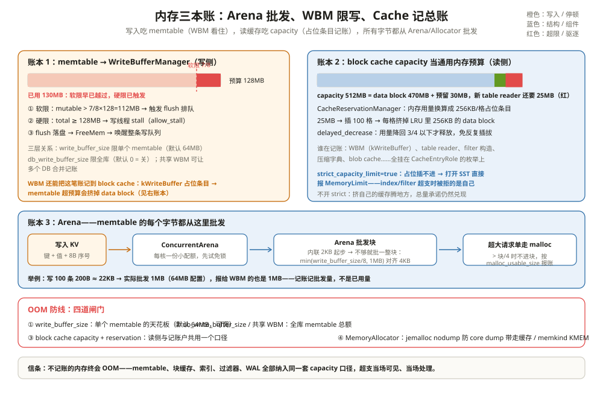

# 内存管理：每一块内存都要有人记账

一次 OOM 排查：一个写多读少的埋点服务，进程 RSS 一路涨到 32GB，被 OOM killer 干掉。参数复盘：block cache 配了 8GB，`write_buffer_size` 64MB，列族 12 个，双实例跑一机。把账摆开：8GB（缓存）+ 64MB × 4（写缓冲数）× 12（列族）× 2（实例）≈ 14GB，还有 18GB 没对上。

差别不在「漏配了某个参数」，而在**RocksDB 里至少三户人吃内存，每一户都要单独限、单独报账**：memtable 族只受 `write_buffer_size` 约束时，12 个列族就是 12 份预算；index/filter 常驻的 table reader 不在 block cache 的账本里，除非你让它记账。这一章把三本账摊开，配上各自的闸门。

把 RocksDB 的内存管理想成**一家公司跑预算**：Arena 是采购部（批发办公用品，不一件件零买）；WriteBufferManager 是写入部门的部门预算（超了先加班 flush，再超就冻结招聘——停写）；CacheReservationManager 是全公司唯一的费用中心（读缓存、索引、过滤器、甚至写入部门的超支部都要记到同一本账上，超支就裁人——驱逐）。



---

## 一、内存三大户

排查 OOM 先分清钱花在哪，`DB::GetProperty` 提供了对应的窗口（`include/rocksdb/db.h:1710-1740、1846`）：

| 户头 | 内容 | 主要参数 | 典型规模 |
| --- | --- | --- | --- |
| memtable 族 | 活跃 + 等待 flush 的 memtable | write_buffer_size × max_write_buffer_number × 列族数 | 每列族几百 MB 级 |
| block cache 族 | data/index/filter 块 + 记账型条目 | capacity（显式） | 配多少占多少 |
| table reader / WAL / 临时缓冲 | 索引常驻对象、WAL 缓冲、构建期临时块 | cache reservation / 各种 buffer | 碎而杂，最易失控 |

第三户最阴险：SST reader 打开后索引常驻内存，每个 reader 几 MB 到几十 MB，文件多时轻松吃掉几个 GB——**它默认不在 block cache 的 capacity 里**。治它的药就是本章的主角之一：cache reservation。

还有半个户头：WAL。它平时在盘上，但写路径的缓冲、以及恢复时要装回内存的日志都会经过进程堆。它的规模被 memtable 参数间接决定：`max_total_wal_size` 缺省时按「所有列族的 write_buffer_size × max_write_buffer_number 之和 × 4」动态计算（`include/rocksdb/options.h:831-852`）——15 个列族 × 128MB × 6 的例子在注释里直接给了 45GB。**memtable 参数调大时，WAL 的隐性预算跟着翻倍**，这是排 OOM 时最容易漏的一笔。

排查时还有个原则：**RSS 不等于记账值**。Arena 的块、缓存的条目都是 malloc 出来的，glibc 未归还给 OS 的空闲页照样计入 RSS；记账超限 ≠ RSS 立刻回落。看趋势，别看瞬时值。

---

## 二、Arena：不零买，只批发

memtable 里的每个字节（键、值、8 字节序号、跳表节点）都从 Arena 领。Arena 的策略是**批发**：起步有一个 2KB 的内联块（`memory/arena.h:33`），用完了就 malloc 一整块——块大小取 `min(write_buffer_size/8, 1MB)` 并对齐到 4KB（`db/column_family.cc:242-249`）；单个请求超过块的 1/4 就不进块、单独 malloc（`memory/arena.cc:63-68`），免得大请求把剩余空间撑出碎片。

两个省内存的细节：块的一端发给对齐请求、另一端发给不对齐请求（`arena.h:103-110` 的注释），对齐浪费减半；批发块按 `malloc_usable_size` 报账（`arena.cc:152-163`），glibc/jemalloc 实际给了多少就记多少，不留隐性差额。

```text
举例：写入 100 个 100B 的 key，实际吃多少内存
每条：key 100B + 值 100B + 8B 序号/类型 + 跳表与对齐开销 ≈ 220B
100 条 ≈ 22KB。
Arena 的动作：头 2KB 内联块装满 → 批发一块新块；
write_buffer_size=64MB 时块大小 = min(64MB/8, 1MB) = 1MB（对齐 4KB）。
→ 进程实际为这 100 条付出 2KB + 1MB ≈ 1MB，剩下的 978KB 留给后续写入；
→ 报给 WBM 的账也是这 1MB（AllocTracker 在每次 AllocateNewBlock 时上报）。
零售记账是 22KB，批发记账是 1MB——**OOM 时信后者**。
```

并发写入怎么批发？包一层 `ConcurrentArena`：每核一份小配额（`shard_block_size = min(128KB, 块/8)`，`memory/concurrent_arena.cc:26-32`），小分配先在自己的配额里免锁切；配额用尽才回主 Arena 进锁补货（`memory/concurrent_arena.h:130-201`），补货时还会按主 Arena 剩余量调整请求，避免碎片。写路径最热的内存操作因此几乎无锁。

两个反直觉的细节：**空 memtable 很便宜**——主 Arena 还没耗尽内联块时，各核的小配额不预占批发块（`concurrent_arena.h:169-181`），几千个刚创建的 memtable 各只占 1KB 上下，而不是几千个 1MB；**huge page 可选**——Arena 支持从 huge page TLB 批发（`arena.h:41-45`、`arena.cc:95-106`），页表开销和 TLB miss 随之下降，代价是系统要预留 `vm.nr_hugepages`，失败自动回退普通 malloc。

---

## 三、AllocTracker 与 WriteBufferManager：写入部门的预算

每个 memtable 出生时挂一个 `AllocTracker`，Arena 每批一块就 `Allocate` 上报（`memtable/alloc_tracker.cc:31-52`）→ `WBM::ReserveMem`；memtable 转 immutable 时 `ScheduleFreeMem`（`:99-111`，从「活跃」挪到「等待释放」）；flush 落盘后 `FreeMem`（`:113-127`）真正销账。

WBM 的三层关系：

| 层 | 参数 | 默认 | 管什么 |
| --- | --- | --- | --- |
| 单 memtable | `write_buffer_size` | 64MB（`include/rocksdb/options.h:192`） | 单列族单个 memtable 满了就切 |
| 全库 | `db_write_buffer_size` | 0 = 关（`options.h:1279`） | 所有列族 memtable 总额 |
| 跨库共享 | 传一个共享 `WriteBufferManager` | 空（`options.h:1296`） | 多个 DB 实例合并记账 |

`db_write_buffer_size` 和共享 WBM 是「总额预算」：12 个列族各写各的，谁先撞线谁 flush。多实例合库部署时共享 WBM 是防 OOM 的第一闸门。

```text
举例：12 个列族，总预算怎么算
不配 db_write_buffer_size（默认关）：
  每列族独立预算 64MB，理论 memtable 上限 = 12 × 64MB × 4（max_write_buffer_number）
  = 3GB——没人管「12 个列族加起来」；
配 db_write_buffer_size = 1GB：
  12 个列族共享 1GB 总额，谁先把总额吃到线，下一个写入就触发谁的 flush——
  热列族多吃、冷列族少吃，总额封顶；
换共享 WBM（buffer_size=1GB，allow_stall=true）：
  同样的总额，外加跨 DB 合并记账与硬停顿——多实例同机的终极方案。
```

限流是分级的。**软限**：活跃用量超过 7/8（`mutable_limit_`，`include/rocksdb/write_buffer_manager.h:107`）就触发 flush 排队（`ShouldFlush`，`:144-160`）——写不停，只是后台开始赶工。**硬限**：总用量 ≥ 预算且 `allow_stall=true`，写线程挂起（`ShouldStall`，`:169-185`；挂起实现在 `db/db_impl/db_impl_write.cc:2986-3019`，把整条写队列按住，flush 腾出空间后由 `MaybeEndWriteStall` 唤醒，`memtable/write_buffer_manager.cc:832-855`）。

软限和硬限的分工画成表：

| | 软限 ShouldFlush | 硬限 ShouldStall |
| --- | --- | --- |
| 触发线 | 活跃用量 > 7/8 × 预算；或总量 ≥ 预算且活跃 ≥ 预算/2 | 总用量 ≥ 预算（需 allow_stall=true） |
| 动作 | 触发 flush 排队，写不阻塞 | 写线程挂起，flush 腾空间后唤醒 |
| 指标 | flush 队列变长 | STALL_MICROS / WRITE_STALL 上升 |
| 目的 | 让 flush 追上写入 | flush 追不上时兜住总量 |

flush 谁先挨刀也有讲究：`WriteBufferFlushPolicy` 三选一（`include/rocksdb/write_buffer_manager.h:29-36`）——kFlushOldest（最老的先 flush，历史默认）、kFlushLargest（当前 DB 里最大的 memtable 先 flush）、kFlushLargestAcrossDBs（所有共享这个 WBM 的 DB 里挑能释放最多内存的那个）。共享 WBM 的多实例部署配最后一种，预算才真的全局最优。

```text
举例：预算 128MB、已用 130MB（allow_stall=true）
一个写线程提交 Put：
① 软限检查：活跃用量早过了 112MB（7/8），flush 早已排队——但 flush
   速度 < 写入速度，账还在涨；
② 硬限检查：130MB ≥ 128MB → 写线程在 WriteBufferManagerStallWrites
   挂起，后续写线程直接排在这条队列后面（写停顿，STALL_MICROS 开始计时）；
③ flush 落盘、AllocTracker::FreeMem → 用量降到 128MB 以下 →
   MaybeEndWriteStall 唤醒，写入恢复。
没开 allow_stall：② 不发生，写继续冲——预算失去硬保证，OOM 风险自负。
```

---

## 四、把内存记到 block cache 账上：CacheReservationManager

WBM 有个选项：构造时传一个 cache（`memtable/write_buffer_manager.cc:662-682`），memtable 的账就不记在 WBM 自己的原子变量上，而是**换算成 block cache 里的占位条目**。这个机制由 `CacheReservationManager` 实现，是 11.13 里最聪明的记账设计：

**记账方式**：每 256KB 内存用一条 256KB 的占位条目（dummy entry）顶进 block cache（`cache/cache_reservation_manager.h:206`，插入循环在 `cache/cache_reservation_manager.cc:112-127`）。占位条目是真条目——有键、有 charge、参与 LRU。于是 memtable 多吃 1MB，block cache 里就真有 1MB 的额度被占住，data block 可用空间等量减少。

**滞回**：内存回落时不是马上撤占位——`delayed_decrease` 模式下降到已预留量的 3/4 以下才释放（`:78-84`；WBM 构造时开启，`:675-681`），免得 memtable 用量抖动导致占位条目反复插拔。

```text
举例：滞回怎么省插拔
memtable 用量在 96MB ↔ 112MB 之间抖动（预留量 = 用量向上取整到 256KB）。
不开滞回：每回落 16MB 就撤 64 条占位，每回涨就重插——来回折腾 LRU；
开滞回：预留量 112MB（448 条），用量降到 112MB × 3/4 = 84MB 以下才撤。
在 96~112MB 区间抖动时占位纹丝不动——**多占 16MB 额度，换 LRU 安稳**。
```

这个机制不只 WBM 在用：CompressedSecondaryCache 的容量伸缩（上一章的 `Deflate`/`Inflate`）底层就是同一个管理器的加减（`cache/compressed_secondary_cache.cc:472-478`）。

把 WBM 记账后的一次写入风暴走完整条链，各账本的反应顺序是：

```text
写入风暴：40MB/s 持续写入，WBM 预算 128MB（挂 cache），cache 512MB
T+0s：memtable 涨，WBM::ReserveMem → 占位条目逐格进 cache，
      data block 开始被挤（命中率缓慢下滑）；
T+3s：mutable 过软限 112MB → flush 排队，但写入还在涨；
T+6s：硬限触发 → 写线程 stall（若 allow_stall）；
     —— 若没开 allow_stall：写入继续，占位条目把 cache 的 data block
        顶掉一大片，命中率大跌，总量仍被 capacity 封死；
T+8s：flush 完成 → FreeMem → 占位条目撤掉 → data block 逐渐回填。
信号链：BLOCK_CACHE_DATA_HITS 下跌 → STALL_MICROS 上升 → 该降 WBM 预算
或提 flush 速度了。命中率是写入部门越权的告警器。
```

**超支怎么办**：占位条目插进去时，block cache 满了就按 LRU 驱逐——**被挤的是 data block**。memtable 超预算的代价自动转嫁为缓存命中率下降，而不是静默超内存。

```text
举例：index/filter 记账超出预算
block cache capacity = 512MB；已用 500MB（data block 470MB + 各类预留 30MB）。
新开一个 SST：table reader 要 25MB（索引 + 常驻元数据）
→ MakeCacheReservation(25MB)（table/block_based/block_based_table_reader.cc:988-991）
→ 换算成 100 条 256KB 占位条目，逐条 Insert；
→ cache 满了：每插一条，LRU 驱逐 256KB data block——index/filter 的内存
   挤占的是同一个缓存，总量承诺 512MB 仍然成立；
→ 若 strict_capacity_limit=true 且全是 pinned 条目腾不出地方：
   MakeCacheReservation 返回 MemoryLimit，打开这个 SST 直接失败
   （reader:992-999，错误消息里点名 kBlockBasedTableReader）。
```

记账的普及程度看模板实例化清单就知道：`cache_reservation_manager.cc:175-183` 列出 kBlockBasedTableReader（table reader 常驻内存）、kFilterConstruction（布隆构建期缓冲）、kWriteBuffer（WBM）、kFileMetadata、kBlobCache、kCompressionDictionaryBuildingBuffer——枚举全集在 `include/rocksdb/cache.h:55-88`。开 `cache_capacity` 当总预算后，`BlockBasedTableOptions` 里 `cache_usage_options` 还能按角色开关记账（`table/block_based/block_based_table_factory.cc:605-616`）。

想看账本实况，两个窗口：`CacheReservationManager::GetTotalReservedCacheSize()` 返回当前占位总量（`cache_reservation_manager.h:184-192`）；DB 侧的 block cache entry stats 按 `CacheEntryRole` 给出每类条目的数量与字节（`BlockCacheEntryStatsMapKeys`，`include/rocksdb/cache.h:98-110`）——「谁在吃我的缓存」一查便知。

---

## 五、MemoryAllocator：换一个 malloc

缓存条目从哪块内存里来，可以指定：`ShardedCacheOptions.memory_allocator`（`include/rocksdb/cache.h:147-153`）。内置四个实现（`memory/memory_allocator.cc:22-60` 注册）：

| 实现 | 用途 | 什么时候选它 |
| --- | --- | --- |
| DefaultMemoryAllocator | 标准 malloc | 默认 |
| CountedMemoryAllocator | 计数包装 | 需要自数分配次数的实验 |
| JemallocNodumpAllocator | jemalloc 专用 arena + MADV_DONTDUMP | 缓存大、core dump 怕被撑爆（大多数生产推荐） |
| MemkindKmemAllocator | memkind DAX KMEM | 有持久内存/分层内存硬件，想把缓存搬出 DRAM |

JemallocNodumpAllocator 是防 OOM 连坐的：8GB 块缓存一崩，core dump 就得写 8GB+——把缓存内存全部标上 `MADV_DONTDUMP`，core dump 自动瘦身（接口注释 `include/rocksdb/memory_allocator.h:65-85`，实现 `memory/jemalloc_nodump_allocator.cc:249-253`）。MemkindKmemAllocator 则把缓存搬到 KMEM 介质（`memory/memkind_kmem_allocator.cc:24-38`），DRAM 让给更热的东西。

接入方式是字符串化的：`MemoryAllocator::CreateFromString` 注册了四个内置名字（`memory/memory_allocator.cc:22-60`），缓存侧直接 `LRUCacheOptions.memory_allocator` 挂上即可（`include/rocksdb/cache.h:147-153`）。注意一个边角：压缩库内部自管的内存（注释点名 XPRESS）不受它管（`cache.h:147-152`）——记账的边界到这里为止。

---

## 六、三本账对照表

| 账本 | 记什么 | 记账单位 | 超支后果 | 谁在盯 |
| --- | --- | --- | --- | --- |
| Arena + AllocTracker | memtable 每一笔批发 | 实际分配的字节 | 汇入 WBM 的水位 | WBM |
| WriteBufferManager | memtable 总额（单列族/全库/跨库） | 字节（或转 cache 占位） | 软限 flush → 硬限 stall 写入 | ShouldFlush / ShouldStall |
| CacheReservationManager | index/filter/WBM/blob 等 | 256KB 占位条目 | 驱逐自己的缓存；strict 下报 MemoryLimit | block cache capacity |

还有一个口径细节：配了二级缓存的 TieredCache（上一篇），总预算由适配层在主缓存与压缩层之间**按比例分摊**——WBM 的记账会被拆成两份、两边各占一段（`include/rocksdb/cache.h:523-525` 的注释写明「distributed proportionally across both the primary and secondary」）。三本账在分层缓存里依然是一本总账，只是页码多了几张。

三本账最后都汇到一个口径：**block cache 的 capacity**。把缓存配够大、把 WBM 挂到 cache 上、把 table reader 记账打开，全库内存就有了单一预算口——这是 RocksDB 给出的 OOM 终极答案：不是再加一个参数，而是把所有内存塞进同一本账。

一份最小化的预算清单，照抄即可起步：`write_buffer_size` 与列族数相乘的积 ≤ memtable 总预算；全库配 `db_write_buffer_size` 或共享 WBM；block cache capacity 覆盖「数据块 + index/filter 预留 + WBM 记账」三者之和；严格场景再加 `strict_capacity_limit=true`。

最后是一张排查对照表——OOM 复盘时，现象到账本的映射：

| 现象 | 更可能的原因 | 先动哪本账 |
| --- | --- | --- |
| RSS 随写入线性涨 | 列族多、write_buffer_size × 数量失控 | 共享 WBM / db_write_buffer_size |
| 写入周期性卡顿 | WBM 硬限 stall（没开 allow_stall 时是 flush 跟不上） | 软限阈值、flush 速度 |
| 缓存命中率与内存同时异常 | WBM/filter 构造的占位条目挤掉 data block | 看按角色的 cache stats（`cache.h:98-110`） |
| 打开 DB 或新 SST 报 MemoryLimit | strict_capacity_limit + 记账占满 | capacity 或关 strict |
| core dump 巨大 | 缓存没走 nodump allocator | MemoryAllocator |
| 多实例部署一方 OOM 连坐 | 各 DB 独立记账，没有共享预算 | 共享 WriteBufferManager |
| 账面对不上 RSS | malloc 未归还页、WAL 动态预算 | 看趋势；查 max_total_wal_size |

---

## 七、和 Parquet 摆在一起看：不记账的内存终会 OOM

| 维度 | RocksDB | Parquet 生态 |
| --- | --- | --- |
| 写侧预算 | WBM 限 memtable 总额，软限 flush / 硬限 stall | Parquet writer 的 RowGroup 内存预算：攒到 128MB 就封组落盘，不能无限攒 |
| 写侧超支表现 | 写停顿（STALL_MICROS 飙升） | writer 落盘（文件更碎、行组更小） |
| 读侧预算 | cache capacity + 占位条目记账 | 计算引擎 execution/storage memory 统一记账（Spark 的 unified memory） |
| 读侧超支表现 | 驱逐自己的缓存 / 报 MemoryLimit | spill 到盘 / OOM kill |
| 批发分配 | Arena 大块批发，报批发量 | 计算引擎的页式内存管理（Spark TaskMemoryManager、Velox MemoryPool 一类）同理 |

两边信同一条工程铁律：**不记账的内存终会 OOM**。Parquet writer 要是允许 RowGroup 无限攒下去，一个宽表大字段就能把 writer 吃死，所以「攒到阈值就封组」是 writer 的纪律，对应 RocksDB 的 WBM 硬限。计算引擎要是允许算子各拿各的内存，shuffle 一来全场崩盘，所以有统一的 memory manager 仲裁，对应 RocksDB 把 WBM、table reader、filter 构造全塞进 cache capacity 的统一记账。差别只在「超支的惩罚」：RocksDB 可以选择停写入（有 WAL 兜底，停一下不丢数据），Parquet writer 封组落盘即可，而计算引擎的 spill 成本最高——它没有 LSM 那种「先记账后花钱」的天然结构。

---

## 这一章留下的线索

- 内存三大户：memtable 族、block cache 族、table reader/WAL/临时缓冲——OOM 先分清钱花在哪户（GetProperty 的四个属性是窗口）；
- Arena 只批发：内联 2KB 起步、块取 min(write_buffer_size/8, 1MB)、超大请求单走 malloc，报账报批发量；ConcurrentArena 每核小配额让写路径几乎无锁；
- WBM 分级限流：7/8 软限排 flush，硬限 stall 写队列；write_buffer_size（单 memtable）→ db_write_buffer_size（全库）→ 共享 WBM（跨库）三层预算；
- CacheReservationManager 用 256KB 占位条目把 index/filter/WBM 的内存记进 block cache capacity，超支挤的是 data block，strict 下当场报错——一个 capacity 管住全库；
- 记账值是批发口径：Arena 报批发量、占位条目取整到 256KB、滞回少撤多占——看账别只盯着「已用字节数」；
- MemoryAllocator 换 malloc：nodump 防 core dump 连坐，KMEM 把缓存搬出 DRAM；
- 排障入口固定四样：按角色的 cache stats、GetTotalReservedCacheSize、WBM 的 STALL_MICROS、GetProperty 的内存四属性。

到这里，这条轨道的故事线合上了。第一篇概述里那条 KV：**写入**时它攒进 memtable（Arena 批发、WBM 记账、WAL 护航）→ 满了 flush 成 SST，**压实**一层层搬走旧版本、控制放大 → **读取**从新到旧层层合并，块缓存和二级缓存扛住热点 → 全程由**内存账本**看住，超支就 flush、停写、驱逐，绝不无声超支。LSM 把随机写变顺序写，Parquet 把随机读变顺序读——一套写优化的过程存储，一套读优化的终态格式，互为镜像。理解了任何一边，另一边的每个设计都能在对称位置找到答案。

---

## 附：这一章的源码入口

> 除特别注明外，本节引用的源码文件与行号都来自 facebook/rocksdb 主分支（11.13.0）。

- `include/rocksdb/db.h:1710-1740、1846`：内存排查用的四个属性（memtable/reader/block-cache 各一扇窗）
- `memory/arena.h:33、103-110` 与 `memory/arena.cc:63-68、152-163`：内联块、两端分配、大请求单走 malloc、按 usable size 报账
- `db/column_family.cc:238-250`：arena 块大小 = min(write_buffer_size/8, 1MB) 对齐 4KB
- `memory/concurrent_arena.cc:26-32` 与 `memory/concurrent_arena.h:130-201`：每核 128KB 小配额与免锁分配路径
- `memtable/alloc_tracker.cc:31-52、99-127`：Allocate/ScheduleFreeMem/FreeMem 三个上报点
- `include/rocksdb/options.h:186-192、1269-1296`：write_buffer_size、db_write_buffer_size、共享 WBM 三层预算
- `include/rocksdb/write_buffer_manager.h:107、144-185`：mutable_limit 7/8、ShouldFlush、ShouldStall
- `memtable/write_buffer_manager.cc:662-682、721-807、809-855`：构造挂 cache、ReserveMem/FreeMem（含记账路径）、停写队列
- `db/db_impl/db_impl_write.cc:2986-3019`：WriteBufferManagerStallWrites——写线程挂在哪、怎么醒
- `cache/cache_reservation_manager.h:184-206` 与 `cache/cache_reservation_manager.cc:58-147、175-183`：256KB 占位、3/4 滞回、按角色实例化的记账清单
- `table/block_based/block_based_table_reader.cc:988-1000`：table reader 记账，超支报 MemoryLimit
- `table/block_based/block_based_table_factory.cc:605-616`：table reader 记账的开关（cache_usage_options）
- `include/rocksdb/memory_allocator.h:42-85` 与 `memory/jemalloc_nodump_allocator.cc:249-253`：nodump/KMEM 两个内置 allocator
- `cache/charged_cache.cc:12-35`：blob cache 给 block cache 记账的包装层

---

## 思考题

1. 12 个列族、每列族 `write_buffer_size=64MB`、`max_write_buffer_number=4`，未配 `db_write_buffer_size`。理论上 memtable 族最多吃多少？把 `db_write_buffer_size` 配成 2GB 后，高峰写入的行为会怎么变？
2. 「预算 128MB、已用 130MB、allow_stall=false」时写入完全不被拦。画出接下来五分钟的内存水位曲线：flush 速度 60MB/s、写入速度 80MB/s 时，多少秒后撞上别的天花板？哪个天花板先到？
3. 把 WBM 挂到 block cache 上记账后，一次大写入风暴同时推高 memtable 用量。推演 block cache 里接下来发生的驱逐链：谁先被挤、点查命中率怎么走、最终什么信号告诉你「写入部门的预算该降了」？
4. table reader 记账（kBlockBasedTableReader）默认关闭时，8GB block cache + 4000 个 SST（平均每个 reader 5MB）意味着什么？打开记账并配 strict_capacity_limit=true 后，最坏情况下打开新 SST 会发生什么？你会选哪种组合？
