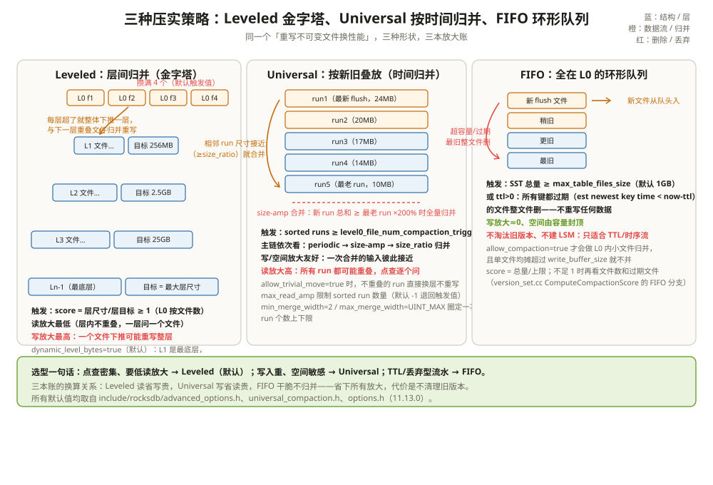

# 压实策略：Level、Universal、FIFO 三本账

一次写入压测：四线程持续灌 `device_*` 指标，前 30 分钟写入 P99 稳定在 2 ms，之后开始抖，40 分钟后掉到 500 ms，磁盘却只用了不到 20%。看 STATS，L0 文件数在 20 和 36 之间来回打摆，`soft_pending_compaction_bytes_limit`（默认 64GB）的减速逻辑已经触发——写入线程在等后台收拾账本。

差别不在写入路径，而在压实策略。写入永远是把账「先记下来」，压实负责「把账理清」；策略决定了后台按什么形状理账：层的金字塔、按时间的叠放，还是只管丢弃的环形队列。形状选错，读放大、写放大、空间放大这三本账就会有一本爆掉。这一章把三种形状各自的触发条件、算账方式和选型标准拆开讲清。

把压实想成**整理一间不断有人往里塞文件的档案室**：Leveled 是把每层柜子按容量定期倒腾进更大的柜子；Universal 是把积压的一摞文件按新旧整摞合并；FIFO 是门口放个大箱子，装满了直接把箱底最旧的扔掉。



---

## 一、为什么必须有压实：LSM 攒出来的乱账

前几章说过：写入只落在 memtable，满了 flush 成 L0 的 SST，全程不碰旧文件。好处是写永远顺序；代价是**同一个键的多个版本、墓碑、Merge 操作数会在磁盘上到处堆**。不收拾，会发生三件坏事：

1. **读放大失控**：读取要从新到旧问一圈（读取路径篇的「问一群按资历排座的师傅」），重复版本越多，问的人越多；
2. **墓碑永生**：Delete 只是一条写入，不压实它就一直占地方，读路径每次还得停下来看一眼；
3. **空间账没法收**：删掉的旧版本、被覆盖的值全躺在底层，盘越用越满。

```text
举例：不压实会攒出什么账
同一分钟对 device_47 写了 3 次、删了 1 次：
L0 f1: device_47 seq=7 (Put 61.2)
L0 f2: device_47 seq=8 (Put 61.5)
L0 f3: device_47 seq=9 (Put 61.3)
L0 f4: device_47 seq=10 (Delete)
4 条记录、0 个活值、4 条死数据。
压实后：什么都没有（键已删）。磁盘少 4 条，读路径不用再挨个问这 4 个 L0 文件。
```

压实的三件事由此而来：**去重**（同键只留快照需要的版本）、**消墓碑**（确认安全后把删除标记和被删数据一起扔掉）、**控制读放大**（把 L0 压平、把层数收紧）。三件事怎么排优先级，就是三种策略的分岔口。策略在 `include/rocksdb/advanced_options.h:27-37` 的 `CompactionStyle` 里定型：`kCompactionStyleLevel`（0）、`kCompactionStyleUniversal`（1）、`kCompactionStyleFIFO`（2）、`kCompactionStyleNone`（3，关掉后台压实，只能手动 `CompactFiles`）。默认 Level（`advanced_options.h:720`），CF 在构造时按它选对应的 Picker（`db/column_family.cc:690-713`）。

---

## 二、Leveled：层间归并，读最省写最贵

Leveled 的形状是金字塔：L0 允许重叠，L1 及以下**层内按键范围有序、互不重叠**。每个非底层都有一个目标尺寸，超了就把文件往下压一层，和下一层重叠的文件一起归并重写。因为层内不重叠，一次点查每层最多碰一个文件——这是三种策略里读放大最低的形状；代价是每次下推都可能把下一层的一大片文件重写一遍——写放大最高。

**触发靠打分。** `VersionStorageInfo::ComputeCompactionScore`（`db/version_set.cc:3664-3886`）给每个可压实的层算一个 score：L0 特殊，按文件数除以阈值（`:3758-3759`），阈值是 `level0_file_num_compaction_trigger`（默认 4，`include/rocksdb/options.h:256`）；L1+ 按层实际尺寸除以层目标尺寸。**score ≥ 1 就是该层该压了**，Picker 每轮挑分数最高的层动手（`db/compaction/compaction_picker_level.cc:207-260`，注释写明 L0 score = 文件数/触发值、L1+ score = 层尺寸/层目标，见 `:228-234`）。L0 积压还有软硬两道闸：`level0_slowdown_writes_trigger`（默认 20）减速写入、`level0_stop_writes_trigger`（默认 36）停写（`advanced_options.h:547、554`）。

L1+ 的层目标尺寸怎么定，由 `level_compaction_dynamic_level_bytes` 决定，**11.13 默认 true**（`advanced_options.h:666`）。开与关的差别值得单独说：

- **关（旧规则）**：L1 永远是「基座」，目标 `max_bytes_for_level_base`（默认 256MB，`options.h:305`），L2 及以上按 `max_bytes_for_level_multiplier`（默认 10，`advanced_options.h:671`）逐层翻十倍。小库也得维护 6 层空壳；
- **开（默认，`CalculateBaseBytes`，`db/version_set.cc:5071-5215`）**：基座不固定在 L1，而是浮动。空库时基座直接是最底层——L0 flush 出来的文件压进 L6（`:5135`）；数据先在底层堆着，长到 `max_bytes_for_level_base`（256MB）的量级基座才上移一层，给最底层腾出 10 倍空间；每层目标反着推：最底层目标 = 现有最大非 L0 层尺寸，往上每层除以 10（`:5143-5147、5202-5212`），每层目标的下限是 `base_bytes_min = base/multiplier`（25.6MB，`:5138-5140`）。

源码注释（`advanced_options.h:608-631`）给了一个现成的算例，6 层、base=10MB、multiplier=10：

```text
举例：dynamic_level_bytes 下 LSM 怎么长大（base=10MB，6 层）
空库：      目标 [- - - - - 10MB]      ← 基座=L5，L0 直接压进最底层
L5 涨到 11MB：目标 [- - - 1.1MB 11MB]  ← 基座上移到 L4
L5 涨到 50MB：目标 [- - - 5MB  50MB]
L5 涨到 101MB：目标 [- - 1.01MB 10.1MB 101MB] ← 基座=L3
要点：只用了 3 层就把 6 层 LSM 的空间安排完，
小库不养空层，层与层之间始终是 10 倍。
```

这套规则顺带解决了「删除大扫除后旧层不动」的难题：基座浮动意味着小库只有一两层有数据，墓碑从 flush 那一刻起离最底层最多几步。代价是 L1 的含义变了——**排障时看到「L1 很大」先想想基座是不是就在 L1**，别拿旧规则硬套。

L0 的账还有一处特殊性：L0 文件之间可能重叠，压 L0 时要把范围撞上的**所有** L0 文件拉进来（`compaction_picker_level.cc:341-347`）。所以 L0 的计分不用字节数、用文件数（源码注释给的理由在 `db/version_set.cc:3684-3694`：写缓冲可能很大，L0 文件又会在每次读取时被全量合并，太多小文件读不起）。如果 L0→基座的压实被在途任务挡住（`skipped_l0_to_base`，`:215-219、239-253`），Picker 会退而求其次做 **L0 内部归并**：只把新 flush 的几个小文件互相合并，不动基座，先给读路径减负（`PickIntraL0Compaction`，`:119-128`，至少 4 个文件才值得做，常量见 `:169`）。日志里对应的压实原因是 `kLevelL0FilesNum`——看到它，就是「文件数到 4 了」触发的。

```text
举例：一次 L0 压实为什么贵
L0 有 4 个文件，key 范围都盖住 device_47：
f1[device_01, device_99] f2[device_20, device_80] …
压 device_47 所在的那份必须 4 个全带上，还要加上
L1（基座）里所有重叠文件 → 一次重写的输入远大于单文件。
这就是 L0 用「文件数」而非「字节数」计分的原因。
```

---

## 三、Universal：按新旧叠放，写省读贵

Universal 把整个 LSM 想成一摞**按写入时间叠放的「有序数据源」（sorted run）**：每次 flush 是一个新 run，L1+ 每层也是一个 run。run 之间允许大面积重叠，所以点查可能要问遍所有 run——读放大高；但一次压实合并的是「尺寸彼此接近」的相邻 run，重写的字数少——写放大友好。

触发和挑选全部在 `UniversalCompactionBuilder::PickCompaction`（`db/compaction/compaction_picker_universal.cc:768-869`）：先统计 sorted run 数，不足 `level0_file_num_compaction_trigger` 且没有标记文件就没事可做（`:786-796`）；然后按固定顺序尝试五种候选（`:806-813`）——periodic（文件太老）、size-amp（空间放大超限）、按 file-ratio 收 run 数、按 size_ratio 收 run 数、删除触发、读触发。前两个是主菜：

**size_ratio 归并**（`:909-1028`）：从最新的 run 往旧走，只要「已选中累计尺寸 ×（100+size_ratio）/100」装得下下一个 run，就把它拉进候选（`:990-993`）；候选数达到 `min_merge_width`（默认 2，但下限硬编码为 2，`:923、1014`）就动手，`max_merge_width`（默认 UINT_MAX）封顶。直觉是：**尺寸接近的 run 重叠代价小，合了不亏**。

```text
举例：size_ratio=1（默认）时哪些 run 会合并
runs（新→旧）：24 / 20 / 17 / 14 / 10（MB），min_merge_width=2
候选从 24 开始：24×1.01=24.24 ≥ 20 → 拉进，累计 44
44×1.01=44.4 ≥ 17 → 拉进，累计 61
61.6 ≥ 14 → 累计 75；75.8 ≥ 10 → 累计 85，共 5 个 run ≥ 2
→ 五个 run 整摞归并成一个新 run。
若 runs 是 24 / 60：24×1.01=24.24 < 60 → 停，不合并。
```

**size-amp 归并**（`:1145-1252`）：拿最老 run 当基准，如果「其余 run 的总尺寸 ×100」超不过「最老 run × `max_size_amplification_percent`」（`:1217`，默认 200，`include/rocksdb/universal_compaction.h:38-48、137`），说明空间放大还可控；超了就做一次把所有 run 拖下水的大归并。这个百分比的定义写在注释里：**存 100 字节用户数据最多额外占多少字节**——200% 意味着 100 字节数据最多占 300 字节盘面。

```text
举例：space amp 到了就该大扫除
runs（新→旧）：30 / 28 / 27 / 10（MB）
最老 run = 10，其余总和 = 85
85×100 = 8500 ≥ 200×10 = 2000 → 触发 size-amp 大归并
归并完只剩一个 run，空间放大归零（代价是这次写放大高）。
```

Universal 的账本还有两个旋钮要认识：`max_read_amp`（默认 -1，退回用 `level0_file_num_compaction_trigger` 当 run 数上限，`universal_compaction.h:79-96`、`compaction_picker_universal.cc:110-168`）；`allow_trivial_move`（默认 false）——开了之后不重叠的 run 直接换层不重写（`compaction_picker_universal.cc:823-827`，trivial move 机制下一篇展开）。TTL 在 Universal 下不叫 ttl，用 `periodic_compaction_seconds`（`advanced_options.h:906-916`）。

---

## 四、FIFO：不归并的环形队列，写放大≈0

FIFO 最省事：所有数据都待在 L0，按新旧排成一队，**超过容量或过期就整文件删，一个字节都不重写**。它不做去重、不消墓碑、没有层级——省下全部写放大，代价是旧版本永远不清，所以只适合「写完不久就会整体作废」的负载：监控指标、消息轨迹、TTL 缓存。

两条触发线都在 `FIFOCompactionPicker::PickCompaction`（`db/compaction/compaction_picker_fifo.cc:732-766`）里按序尝试：

- **TTL 线**（`:66-192`）：配置了 `ttl`（`advanced_options.h:894`，默认哨兵值 30 天，仅 block-based table）时，从最旧的文件开始，凡是**文件里最新的键**都早于「当前时间 − ttl」的，直接标记删除（`:102-121`）。注意判据是键的时间不是文件创建时间——半新半旧的文件不会误删；
- **容量线**（`:194-342`）：SST 总量超过 `max_table_files_size`（默认 1GB，`CompactionOptionsFIFO` 构造函数，`advanced_options.h:177`）时，从最旧开始删到低于上限为止（`:267-286`）。开了 BlobDB 还可以用 `max_data_files_size` 把 blob 文件一起算进容量（`:40-49`，默认 0 不启用）。

```text
举例：FIFO 的一天
上限 1GB，ttl=1 天，监控指标只写 30 分钟前的数据
09:00  L0: [f1 300MB] [f2 300MB] [f3 400MB]   总量 1GB → 到顶
09:01  容量线：f1 最旧 → 删。剩 700MB，继续收新数据
14:00  ttl 线：f8 里最新的键也是 26 小时前的 → f8 整文件删
全程没有一次数据重写：写放大≈0，读放大=f 文件数逐个布隆。
```

FIFO 的打分同样在 `ComputeCompactionScore` 里走专属分支（`db/version_set.cc:3720-3752`）：score = 总量/上限；不足 1 且开了 `allow_compaction`，再看 L0 文件数/触发值；有过期文件也能顶成 1。`allow_compaction`（默认 false）是唯一的「归并」开关：允许把 L0 里的小文件合大一点，但有保护——单文件均摊超过 `write_buffer_size` 就不合，防止刚写出来的大文件被反复翻动（`advanced_options.h:77-83` 注释）。

---

## 五、CompactionPri：同层里先挑哪个文件

策略决定「哪一层该压」，`CompactionPri`（`advanced_options.h:42-63`，默认 `kMinOverlappingRatio`，`:725`）决定「这一层里先动谁」。五种排序策略在 `VersionStorageInfo::UpdateFilesByCompactionPri` 的 switch 里逐一落码（`db/version_set.cc:4418-4448`）：

| 取值 | 排序依据（源码行为） | 适合的负载 |
| --- | --- | --- |
| `kByCompensatedSize` | 补偿后尺寸从大到小（`:4419-4421`） | 老默认，偏大文件先行 |
| `kOldestLargestSeqFirst` | 文件最大 seq 越小越先（`:4423-4428`） | 想优先清最老的数据 |
| `kOldestSmallestSeqFirst` | 文件最小 seq 越小越先（`:4430-4435`） | 随机写全键空间的写放大略好 |
| `kMinOverlappingRatio` | 与下一层重叠字节/自身尺寸最小者先（`:4437-4440`） | 通用推荐，压写放大 |
| `kRoundRobin` | 维护「上次压到哪个键范围」的游标，轮流开压（`:4442-4444`） | TTL 大扫除类负载，防止旧数据饿死 |

`kMinOverlappingRatio` 的算式在 `SortFileByOverlappingRatio`（`db/version_set.cc:4266-4334`）：`file_to_order = 重叠字节 × 1024 / 补偿尺寸 / ttl 加分`（`:4306-4308`）。分母里的 ttl 加分来自 `db/compaction/file_pri.h:43-93` 的 `FileTtlBooster`：文件寿命过半（ttl/2）后开始加分，越接近越猛——**同层里「快过期」的文件会被优先选中**，防止 TTL 压实永远排队。并列时再按最小键打破平局，让 trivial move 有更多可延展的相邻文件（`:4317-4332` 注释）。

```text
举例：kMinOverlappingRatio 怎么挑
L3 有三个文件，L4 重叠情况：
f1: 100MB，与 L4 重叠 5MB  → 5×1024/100 = 51.2
f2: 60MB，与 L4 重叠 40MB → 40×1024/60 = 682.7
f3: 80MB，与 L4 重叠 0MB  → 0            ← 最小，先压 f3
重叠为零就是白捡：f3 很可能能整文件 trivial move 下层，零重写。
```

---

## 六、三本放大账：拿 1GB 数据真算一遍

三本账的定义先摆正：

- **写放大（WA）**：写 1 字节用户数据，实际落盘多少字节 = 总写盘量/用户数据量；
- **读放大（RA）**：一次点查最多要问多少个有序数据源（memtable 之外，主要是 L0 文件数 + 层数）；
- **空间放大（SA）**：存 N 字节活数据，盘上占多少 = 盘面占用/活数据量。

假设净活数据 1GB，在 WA=10、RA=4、SA=1.2 的参数组合下，各发生什么：

```text
举例：写 1GB 数据，WA=10 / RA=4 / SA=1.2
写入侧：应用以为写了 1GB，磁盘实际写了 1GB × 10 = 10GB。
        多出来的 9GB 是压实反复重写：每个 key 平均被
        重写 10 遍（flush 1 次 + 每层下推约 9 次）。
读取侧：一次冷点查最坏问 4 个数据源（比如 L0 的 2 个文件
        + L1 + L2），每个候选一次布隆 + 一次块读。
盘面侧：数据删光前的峰值盘面 ≈ 1GB × 1.2 = 1.2GB，
        多出的 200MB 是「已写未清」的旧版本和墓碑。
```

同样的 1GB，三种策略的账完全不同：

| 账本 | Leveled（dynamic，7 层） | Universal（默认参数） | FIFO（默认参数） |
| --- | --- | --- | --- |
| 写放大 | 最高：单层 WA≈层扇出（multiplier=10 时下推一层≈10 倍重写），全链路 WA 常到两位数 | 中低：只合并尺寸接近的 run，size-amp 大归并偶发 | ≈0：从不重写 |
| 读放大 | 最低：L0 ≤4 文件 + 每层 1 文件，4~7 层约 5~10 个候选 | 高：run 之间全重叠，候选数 = run 数（可用 `max_read_amp` 压到 N） | 最高：N 个 L0 文件逐个问 |
| 空间放大 | 低：层形状约束在 multiplier 倍内 | 可配：默认最多 200%（`max_size_amplification_percent`），即 100 字节数据占 300 字节 | 由 `max_table_files_size`（1GB）硬封顶 |
| 去重/消墓碑 | 每次压实都做 | 每次压实都做 | 不做（靠整体删除） |

两笔账之间有一条硬约束值得记住：**压得越勤，写放大越高、读放大越低；压得越懒，反之**。三本账没有同时全低的策略，选型就是挑「哪本账贵」。

三本账在监控里各有落点，排障时按账找债主：

- **写放大**：压实收尾日志里的 `write-amplify` 字段就是现成的账（`db/compaction/compaction_job.cc:1269-1291`，= 本次写盘字节/读入的下游字节）；长期看用 `COMPACT_WRITE_BYTES` 除以写入字节数；
- **读放大**：读取路径篇的 `GET_HIT_L0/L1/L2_AND_UP` 三个计数器说明命中层深度；L0 命中占比越高说明压得越懒；
- **空间放大**：`EstimateCompactionBytesNeeded`（`db/version_set.cc:3885`，score 计算的收尾步骤）估的是「压完能省多少」，它高企就是压实欠账；`soft/hard_pending_compaction_bytes_limit`（默认 64GB/256GB，`advanced_options.h:709、717`）欠到阈值就减速、停写——开头那个压测卡顿正是这一闸。

---

## 七、选型决策表

| 场景 | 推荐 | 理由 |
| --- | --- | --- |
| 点查密集、随机 key、长期在线的服务 | Leveled（默认） | 层内不重叠，点查候选最少 |
| 大批量写、偶发大范围扫描、空间敏感 | Universal | 写放大友好，扫描按 run 顺序读也顺 |
| TTL 流水：监控、轨迹、消息暂存 | FIFO | 数据整体作废，不值得归并 |
| 大值为主（图片/文档） | Leveled + BlobDB 或 FIFO | 大值压实重写贵（存储层篇展开） |
| 完全手动控制（离线批处理） | `kCompactionStyleNone` | 只走 `CompactFiles` |
| 同层内还想再省写放大 | Leveled + `kMinOverlappingRatio`（默认）或 `kRoundRobin` | 前者挑重叠少的，后者防饿死 |

---

## 八、和 Parquet 摆在一起看：后台重写不可变文件，两边是同款

数据湖的 compaction 和 LSM 的压实是同一个思想在两个世界里的名字：**文件不可变，性能问题靠后台重写新文件、原子换清单来解决**。Iceberg 的 `rewrite_data_files`、Delta 的 OPTIMIZE、Hive 的「小文件合并」，都是把一堆小文件读出来、合并去重、写出大文件，再原子切换元数据指向——和压实读旧 SST、归并、写新 SST、写 MANIFEST 的流水线逐段对应。

| 视角 | RocksDB 压实 | 数据湖 compaction |
| --- | --- | --- |
| 触发 | score ≥ 1（尺寸/文件数/超时） | 小文件数、扫描性能劣化、快照过期 |
| 输入 | 不可变 SST | 不可变 Parquet/ORC 文件 |
| 输出 | 归并后的新 SST + VersionEdit | 重写后的新数据文件 + 新快照 |
| 原子提交 | MANIFEST LogAndApply | manifest/Delta log 原子切换 |
| 去重与删除 | 消旧版本、消墓碑 | 按快照可见性裁剪行、删分区 |
| Leveled ≈ | 逐层归并金字塔 | 按分区滚动重写（热分区常写常合，冷分区下沉不动） |
| FIFO ≈ | 超容量删最旧文件 | 按保留期整分区删除（`expire_snapshots`/删分区） |
| 三本放大账 | 读放大=候选文件数，写放大=重写倍数，空间放大=新旧共存 | 同款：小文件多=读放大（每个文件一次 footer+计划），重写频繁=写放大，未清理快照=空间放大 |

湖上也有自己的「写停顿」：重写任务排不开，小文件继续堆，查询元数据开销压过数据本身——和 L0 积压把写入逼停是同构的债。差别在粒度与频率：LSM 的压实是秒级常驻后台，湖上的 compaction 通常是小时级/天级的批任务；LSM 用 WAL 和 memtable 挡住了在线写入，湖上在线写进来的东西本来就要等下一轮 compaction 才「整理好」。机制同款，节奏不同。

---

## 九、和 LevelDB、HBase、TiKV 的压实比一比

| 维度 | RocksDB | LevelDB | HBase | TiKV |
| --- | --- | --- | --- | --- |
| 策略 | Leveled / Universal / FIFO | 只有 Leveled | minor / major / stripe | 复用 RocksDB 策略，按 Region 管理 |
| 并行度 | 多线程 compaction | 单线程 | RegionServer 多 Region 并行 | 多线程 + 多 Region |
| 触发 | 每层 score、L0 文件数、欠账字节 | 每层尺寸 | 文件数/大小/手动 major | RocksDB 层 score + Region 调度 |
| 删除收敛 | 墓碑到底层且无遮挡即丢 | 同 RocksDB 前身逻辑 | major compaction 清墓碑/TTL | 同 RocksDB |
| 运维手感 | 参数多、可细调 | 简单、能力有限 | major compaction 是重活 | 自动分片，压实和 Region 调度互相影响 |
| 最适合 | 写多、可调优的单机 LSM | 轻量嵌入 | Hadoop 生态宽表 | 分布式事务 KV |

一句话：RocksDB 的压实是「可编程的后台归并」——策略、线程、限流都能调；LevelDB 只给你一套最小实现；HBase 把压实藏在 RegionServer 里，major compaction 是周期性重活；TiKV 则把 RocksDB 的压实装进 Region 调度。同一套 LSM，越往上走，压实越不只是「后台线程」，而是**和复制、分片、运维窗口绑在一起**的系统行为。

---

## 这一章留下的线索

- 压实收拾三笔账：去重、消墓碑、控读放大；策略就是三本账之间的取舍，没有同时全低的形状；
- Leveled：L0 按 `level0_file_num_compaction_trigger`（4）计分，L1+ 按层尺寸/层目标计分，score≥1 触发；`level_compaction_dynamic_level_bytes` 默认开后，基座浮动、目标尺寸按 10 倍从最大层反推，小库不养空层；
- Universal：整个库是一摞按时间叠放的 sorted run，size_ratio 挑「尺寸接近的相邻 run」，`max_size_amplification_percent`（200）兜底空间放大，`allow_trivial_move` 让不重叠的 run 白捡一次换层；
- FIFO：全在 L0，超 `max_table_files_size`（1GB）删最旧，`ttl` 到期整文件删，写放大≈0 但不清理旧版本；
- `CompactionPri`（默认 `kMinOverlappingRatio`）决定同层先压谁：重叠越少越先压，TTL 快过期的文件还有额外加分。

策略说清了「谁该压」，但「谁来执行、怎么把一个文件安全地换掉」还是黑盒。下一章把一次压实任务的流水线拆开：[压实任务与选择器：谁该搬、谁来搬、怎么搬](02-压实任务与选择器.md)。

---

## 附：这一章的源码入口

> 除特别注明外，本节引用的源码文件与行号都来自 facebook/rocksdb 主分支（11.13.0）。

- `include/rocksdb/advanced_options.h:27-37`：`CompactionStyle` 四种取值，默认 Level（`:720`）
- `include/rocksdb/advanced_options.h:42-63`：`CompactionPri` 五种取值与注释里的适用场景，默认 `kMinOverlappingRatio`（`:725`）
- `include/rocksdb/advanced_options.h:538-585`：`num_levels=7`、L0 减速/停写 20/36、`target_file_size_base=64MB`
- `include/rocksdb/advanced_options.h:587-666`：`level_compaction_dynamic_level_bytes` 默认 true，608-631 是注释里的层尺寸生长算例
- `include/rocksdb/advanced_options.h:894-942`：`ttl` 与 `periodic_compaction_seconds` 的默认值与各策略语义差异
- `include/rocksdb/advanced_options.h:71-183`：`CompactionOptionsFIFO`——`max_table_files_size` 默认 1GB（`:177`）、`allow_compaction=false`、`max_data_files_size=0`
- `include/rocksdb/universal_compaction.h:133-143`：`CompactionOptionsUniversal` 全部默认值——size_ratio=1、min_merge_width=2、max_size_amplification_percent=200、allow_trivial_move=false
- `include/rocksdb/options.h:244-256、292-305`：`level0_file_num_compaction_trigger=4`、`max_bytes_for_level_base=256MB`
- `db/version_set.cc:3664-3886`：`ComputeCompactionScore`——L0 按文件数（3758）、FIFO 分支（3720-3752）、dynamic 下 L0 与 LBase 的比较（3769-3798）、score 排序（3854-3867）
- `db/version_set.cc:5071-5215`：`CalculateBaseBytes`——dynamic 模式下基座与各层目标尺寸的计算
- `db/compaction/compaction_picker_level.cc:207-260、341-347`：`SetupInitialFiles` 按最高分选层；L0 需要拉齐所有重叠文件
- `db/compaction/compaction_picker_universal.cc:768-869、909-1028、1145-1252`：Universal 的触发链、size_ratio 归并、size-amp 归并
- `db/compaction/compaction_picker_fifo.cc:66-192、194-342、732-766`：FIFO 的 TTL 线、容量线与总调度
- `db/version_set.cc:4266-4334、4392-4458` + `db/compaction/file_pri.h:43-93`：五种 `CompactionPri` 排序的实现与 `FileTtlBooster` 加分

---

## 思考题

1. 一个 CF 用默认配置（dynamic_level_bytes=true、base=256MB、multiplier=10、7 层）。空库启动后第一批 flush 出 3 个 64MB 文件，它们会被压到哪一层？数据涨到多大、基座才会离开最底层？
2. Universal 配置 size_ratio=10、min_merge_width=2，runs 从新到旧是 50 / 54 / 55 MB。第一轮候选从 50 开始，55 会被拉进来吗？55MB 的 run 要等什么时候才有机会合并？
3. 监控发现某个 FIFO CF 的 L0 有 500 个文件但总量只有 200MB（上限 1GB），`allow_compaction=false`。点查延迟会怎样？把 `allow_compaction` 打开就能解决吗，还差什么条件？
4. 同样写 1GB 数据：Leveled 每层 multiplier=10 时的写放大为什么比 Universal 高得多？用「一个 key 平均被重写几次 × 每次重写多少字节」把两边的账各估一遍。
