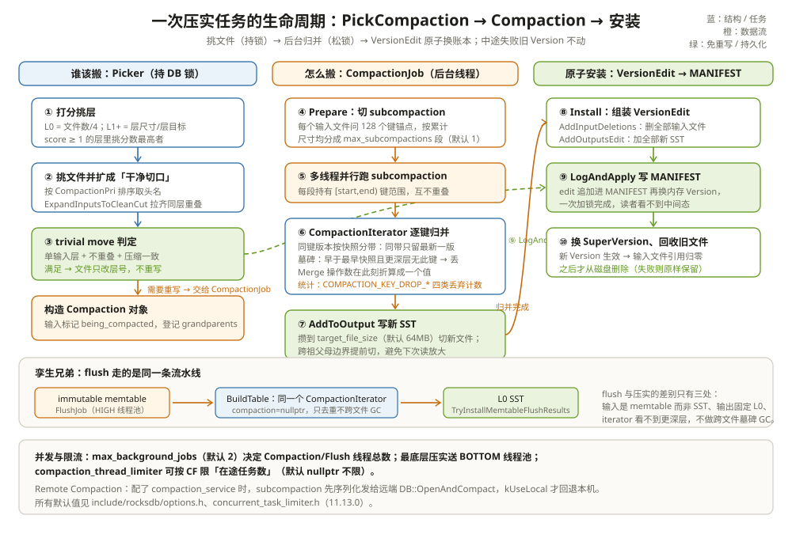

# 压实任务与选择器：谁该搬、谁来搬、怎么搬

一次手动 `CompactRange` 压一个 12GB 的 CF，值班同学盯着日志皱眉：十几条 "compaction" 完成记录里，好几条只花了几毫秒、写了 0 字节，日志写的是 `event: "trivial_move"`。他怀疑压实没干活，甚至想提工单。

这几毫秒恰恰是引擎在省钱。策略层（上一章）决定了「哪层该压」，但把一个文件安全地从账本上换掉，还隔着三个问题：**谁该搬**——Picker 每轮怎么从一堆文件里挑出互不冲突的一小撮；**谁来搬**——后台线程池和每个 CF 的限流怎么分蛋糕；**怎么搬**——从按 key range 切分、快照分带归并、到 VersionEdit 原子换账本的完整流水线。trivial move 就是流水线上的一条捷径：判断出「根本不用搬数据」，两行账就完事。这一章把三个问题依次拆开。

把一次压实想成**一场搬家公司的工作流**：Picker 是排单员（决定哪些箱子今天搬、搬去哪层楼），CompactionJob 是搬运队（分几个小组并行），CompactionIterator 是打包员（拆开旧箱、扔掉废品、按序装新箱），MANIFEST 是物业台账（搬家完成后一次改好，绝不改一半）。



---

## 一、谁该搬：Picker 每轮怎么挑文件

CF 构造时按 `compaction_style` 装配对应的 Picker（`db/column_family.cc:690-713`：Level/Universal/FIFO/None 四家）。后台线程每次问它一句「有没有活干」，Level 系的回答在 `LevelCompactionBuilder`（`db/compaction/compaction_picker_level.h:18-33`）里分三步：

**第一步选层。** 按上一章的 score 从高到低过一遍（`compaction_picker_level.cc:207-260`），score ≥ 1 的最高分层入选，输出层 = L0 则是基座、否则是下一层。

**第二步选文件并扩边。** 在入选层里按 `CompactionPri` 的排序（`files_by_compaction_pri`）取头名文件（`compaction_picker_level.cc:172-205`），然后 `ExpandInputsToCleanCut` 把它扩成「干净切口」：一直扩到**输入文件的键范围与层内其他文件完全没有半键重叠**为止（`db/compaction/compaction_picker.cc:278 起`，注释写明目的是「no parts of a key are lost during compaction」）。L0 特殊：文件彼此重叠，一次要把范围撞上的所有 L0 文件拉齐（`GetOverlappingL0Files`，`compaction_picker_level.cc:341-347`）。最后 `SetupOtherInputs` 把输出层重叠文件也纳入输入、登记 grandparents（下一层的隔壁文件，用来限制输出尺寸）（`compaction_picker_level.cc:482-530`）。

```text
举例：为什么要「干净切口」
L2 文件按 key 排序：f5[aaa~kkk] f6[kkk~zzz]
f6 的第一个键 kkk 与 f5 的最后一个键 kkk 相同。
若只挑 f6 压实，kkk 的旧版本在 f5 里没被合并，
f5、f6 的顺序还可能压坏 → 扩边把 f5 一起带上，直到
切口两端都是不同的 user key。
```

**第三步查 trivial move。** 输入凑齐后，`Compaction::IsTrivialMove`（`db/compaction/compaction.cc:557-635`）判断这次「压实」能不能退化成改名换层，条件全部满足才行：L0 输入不能与其他 L0 重叠（`:565-570`）、手动压实配了 compaction filter 不行（`:572-578`，过滤器必须真的执行）、起止层不能相同（`:580-584`）、**只有一个输入层且压缩算法与输出层一致**（`:599-603`）、且加上隔层祖父母的总尺寸不超过 `max_compaction_bytes`（`:607-618`）。

任务正式生成前还有一道并发闸：新任务的键范围若与**在途压实**的输出层范围相撞，直接放弃本轮（`FilesRangeOverlapWithCompaction`，`compaction_picker_level.cc:513-521`）——两个任务往同一层写重叠的键，装回来账就乱了。任务登记进在途名单（`RegisterCompaction`，`:591`），输入文件的 `being_compacted` 标记随之生效，紧接着重算一遍 score（`:595-598`）——下一轮 Picker 看到的分数已经是「扣除在途任务」之后的。

```text
举例：并发闸拦下的是什么
L2 的 f6 正被压实 → 输出将写进 L3 的 k1~k100 段。
此时 Picker 又挑中 L2 的 f7（k50~k200）想压向 L3：
范围与在途任务的输出重叠 → 放弃，等下一轮。
若放行：两批输出都写 L3 的 k50~k100，键序冲突，
无法保证层内不重叠的 L1+ 不变式。
```

```text
举例：trivial move 省了什么
L2 的 f9（20MB，键范围 k1~k100），L3 的缺口正对它：
  L2:  … [f9: k1~k100] …
  L3:  [f20: k150~k300]
IsTrivialMove 各条件全过 → 不读、不写、不重开文件，
只在 MANIFEST 里写两行账（db/db_impl/db_impl_compaction_flush.cc:1698-1732）：
  DeleteFile(L2, f9)
  AddFile(L3, f9)
20MB 数据零字节搬运，几毫秒完成。省下的是一次完整的
读 20MB + 归并 + 写 20MB——Leveled 写放大里最冤的那份。
```

安装走绿色捷径：`BackgroundCompaction` 里 `IsTrivialMove()` 为真就跳过 CompactionJob，直接 `PrepareTrivialMoveEdit` + `CommitTrivialMove` → `LogAndApply`（`db/db_impl/db_impl_compaction_flush.cc:5293-5349、1734-1750`），事件日志打出 `event: "trivial_move"`。开头场景里的「0 字节压实」就是这么来的——**不是没干活，是发现不用搬**。

---

## 二、谁来搬：线程池与限流

压实不占前台写入线程，全部在 Env 的后台线程池里跑：

| 层级 | 控制项 | 默认 | 作用 |
| --- | --- | --- | --- |
| DB 总闸 | `max_background_jobs` | 2（`include/rocksdb/options.h:919-924`） | flush + 压实共享的线程总数；flush 走 HIGH 池、压实走 LOW 池 |
| 压实细分 | `max_background_compactions` | -1（自动，`options.h:926-942`） | 旧参数，按 `max_background_jobs` 自动拆分 |
| 单任务并行 | `max_subcompactions` | 1（`options.h:944-950`） | 一个压实任务最多切几个并行子任务 |
| 目标池 | （自动） | — | 压到非零最大输出层的任务转投 BOTTOM 池，不与前台抢带宽（`db_impl_compaction_flush.cc:5355-5364`） |
| CF 级限流 | `compaction_thread_limiter` | nullptr（`options.h:332-338`） | 限制单个 CF 的**在途压实任务数**，多个 CF 可共享同一个 limiter |

`ConcurrentTaskLimiter` 的接口很小：`SetMaxOutstandingTask`（0 = 不放新任务，负数 = 不限）、`GetOutstandingTask`（`include/rocksdb/concurrent_task_limiter.h:22-39`），用 `NewConcurrentTaskLimiter(name, limit)` 创建。任务真正开跑前先领令牌（`db_impl_compaction_flush.cc:100-112` 的 `GetToken`），领不到就排队。它和 `max_background_jobs` 的分工：**总闸管机器上有多少条流水线，limiter 管某个 CF 最多占几条**——十个 CF 共享 16 线程时，给大 CF 配 limiter=1，小 CF 就不会被挤饿。

```text
举例：max_background_jobs=2（默认）开箱即用意味着什么
GetBGJobLimits 的拆分公式（db_impl_compaction_flush.cc:3763-3782）：
  max_flushes     = max(1, max_background_jobs / 4)
  max_compactions = max_background_jobs - max_flushes
默认 2 → flush 池 1 条（HIGH），压实池 1 条（LOW）；
开库时按此扩池（db_impl_open.cc:78-84）。
想有 2 条压实线并发，至少 max_background_jobs=5（flush 占 1）；
再考虑单任务切 subcompaction，一条线还能内部分裂并行。
```

---

## 三、怎么搬：从切分到写出新 SST

任务主体是 `CompactionJob`，生命周期四段：`Prepare` → `Run` → `Install` → 清理。

**切分（Prepare，`db/compaction/compaction_job.cc:273-325`）。** 如果允许子任务并行（`Compaction::ShouldFormSubcompactions`，`db/compaction/compaction.cc:918-945`：`max_subcompactions > 1` 且 Leveled 要求 L0→下压或手动压实、Universal 要求输出层非 L0），`GenSubcompactionBoundaries` 就按 key range 把任务切开（`compaction_job.cc:573-673`）。切法在源码注释里写得很直白（`:574-598`）：每个输入文件问 TableReader 要 **128 个均匀分布的键锚点**（扫索引块估算），全部锚点合起来按序累计尺寸，在总量的 1/N 处下刀。

```text
举例：源码注释里的切分算例（compaction_job.cc:576-598）
File1 锚点：(a1,1000) (b1,1200) (c1,1100)
File2 锚点：(a2,1100) (b2,1000) (c2,1000)
合并排序后累计：1000,2100,3300,4300,5400,6400
切成 2 段 → 目标 3200 → 在累计首次过线的 b1 处下刀
subcompaction0 = [~b1)，subcompaction1 = [b1~]。
边界是 user key：同键的所有版本永远在同一段里。
```

每个子任务领到 `[start, end)` 范围，多线程同时跑（`RunSubcompactions`，`compaction_job.cc:756-783`，`:766` 处起线程）。

**归并（ProcessKeyValueCompaction，`compaction_job.cc:1940-2021`）。** 每个子任务三步：`CreateInputIterator` 把所有输入文件叠成 MergingIterator（读取路径篇那台小顶堆机器，这次从新到旧问的是文件）；外面套 `CompactionIterator` 做语义归并（下一节展开）；然后 `ProcessKeyValue` 主循环逐键把 iterator 吐出的记录交给 `AddToOutput` 写进输出文件（`:1693-1801`，AddToOutput 调用在 `:1773`）。输出文件切多大、何时切，由 `CompactionOutputs::ShouldStopBefore` 决定（`db/compaction/compaction_outputs.cc:238-377`）：攒到 `target_file_size`（默认 64MB，`advanced_options.h:568`）就切；即将跨过祖父母文件边界时也切，并预留下刀余地——**现在的切口决定下一次压实的输入规模**，这是 Leveled 写放大的隐形调节阀。

切口的作用源码注释里有一个现成的例子（`compaction_outputs.cc:327-356`）：L0+L1 压向 L2 时，L2 铺着三个文件 `[2,4] [11,15] [22,24]`。若输出一直不切，写出 `[1,23]` 一整个大文件；在中间那个「跳得过去」的 L2 文件边界处切一刀，输出是 `[1,3] [21,23]` 两段——下一次 L1→L2 压实遇到 `[11,15]` 时，两段输出都不与它重叠，**它就不必被拉进来陪跑**。为这刀付出的代价只是文件更碎。

```text
举例：切口如何给下一次压实省输入
L2: [2,4] [11,15] [22,24]（三个文件）
不切：输出 [1,3, 21,23] 一个文件，罩住 [11,15]
     → 下次压实输入 = 输出(大) + [11,15]
切：  输出 [1,3] [21,23] 两段，[11,15] 落在缺口里
     → 下次压实输入 = 某一段 + 无重叠文件，或 trivial move
```

---

## 四、CompactionIterator：快照分带怎么算

CompactionIterator 是压实的裁判，核心概念是**快照分带（snapshot stripes）**：把每个版本映射到「最早能看见它的那个快照」，同一个带里的版本对快照而言不可区分，于是**同带只留最新一版**。映射在 `findEarliestVisibleSnapshot`（`db/compaction/compaction_iterator.cc:1970-2015`）：快照列表升序，`lower_bound` 找到第一个 ≥ 该版本 seq 的快照，那就是它所属的带。落带在主循环里完成（`:849-854`）。

**版本去重靠规则 A**（`:1121-1152`）：同一 user key 的相邻两个版本，如果落在同一个带，旧版本就被新版本盖住，直接丢——**没有任何快照能区分它们**。没有快照时 `visible_at_tip_` 为真，所有版本都算在「尖端」带里，只留最新（`visible_at_tip_` 分支在 `:852-853`）。

```text
举例：seq=1..5、两个快照，哪些版本能丢
key=k 的版本（新→旧）：seq=5(Put C)  seq=4(Put B)  seq=2(Put A)
现存快照（升序）：s1=3、s2=8
seq=5：第一个 ≥5 的快照是 8 → 带 8
seq=4：带 8   ← 与 seq=5 同带 → 丢（规则 A）
seq=2：第一个 ≥2 的快照是 3 → 带 3  ← 不同带 → 必须留
结果：留下 C 和 A。B 没了——没有任何快照能看见它：
     s1=3 只见 seq≤3，s2=8 见到的 k 已是 seq=5 的 C。
快照 s1 释放后，下一轮压实里 seq=2 也落进带 8 → 一并丢。
```

**墓碑什么时候才能真删**，源码里有三道判据（`:1153-1234`）：

1. **推干净**：墓碑早于**最早**的快照（`DefinitelyInSnapshot(seq, earliest_snapshot_)`，即所有快照都看得见它），且 `KeyNotExistsBeyondOutputLevel` 确认**更深层和更高层都没有这个键**——丢掉它不影响任何人（`:1153-1188`）；
2. **在最底层**：压实输出层就是最底层时，同带里墓碑之后的旧版本全部跳过（`:1217-1225`）；若更老的带里还有这个键的版本（老快照还要看见「它被删了」的状态），墓碑本体要保留（`kKeepDel`，`:1228-1234`）；
3. **否则保留**：不满足 1、2 的墓碑原样写进输出——它还要继续往深处走。

```text
举例：同一个墓碑的三种命运（bottommost 压实）
情形一：无任何快照，k 只有 seq9=Delete 和 seq7=Put
  → 全带重合，更深层无 k → Delete 和 Put 全消失。
情形二：快照 s=3，k 有 seq9=Delete seq7=Put seq2=Put
  seq9、seq7 都落「无快照盖不住」的远端带；seq2 落带 3
  → Delete 保留（kKeepDel），seq2 保留，seq7 丢。
  老读者用 s 看 k：仍是「删除后」状态，正确。
情形三：快照 s=12，k 有 seq9=Delete seq7=Put
  seq9 ≤ 12 → 所有快照都见过 Delete；更深层无 k
  → Delete 与 seq7 一起丢。墓碑到此退休。
```

Merge 键也在这一站了结：`kTypeMerge` 会触发 MergeHelper 把同带内的操作数从头归并成一个值再输出——读取路径篇里 DBIter 的 `MergeValuesNewToOld` 是「读时现算」，这里是「一次性结清」。每类丢弃都有计数：`COMPACTION_KEY_DROP_USER/NEWER_ENTRY/OBSOLETE/RANGE_DEL`（`compaction_job.cc:2055-2090`），压实日志里 `records dropped` 的明细就是它们。

CompactionIterator 还顺手执行**压缩过滤**：若配置了 compaction filter，每个 user key 的第一个已提交版本会过一遍过滤器（`compaction_iterator.cc:807-812`），返回「删」就当场把记录变成墓碑或直接跳段——业务用它做服务端 TTL 和数据修补。注意它与 trivial move 的互斥：过滤器要「真的执行」，所以手动压实带过滤器时一律禁止 trivial move（`compaction.cc:572-578`），想白捡改名换层就得先摘掉过滤器。

---

## 五、安装：VersionEdit 原子换账本

所有子任务跑完，先过一道自检：`Run()` 在收尾时按 `verify_output` 配置回读输出文件，校验块校验和与键序（`compaction_job.cc:1161-1213`，回读校验在 `:1188`）。这一步把「写坏的输出」挡在安装之前——装进 Version 的坏文件要靠重启才发现，代价完全不同。

自检通过后，`Install`（`compaction_job.cc:1215-1319`）收拢结果：`InstallCompactionResults`（`:2372-2471`）组装一个 `VersionEdit`——`AddInputDeletions` 把全部输入文件记删除（`:2408`），`AddOutputsEdit` 把全部新 SST 记新增（`:2413`）——然后 `LogAndApply` 把 edit 顺序追加进 MANIFEST 并在**同一次持锁**里替换内存 Version（`:2465-2468`）。读侧拿到新 SuperVersion 才能看见新文件，拿不到就还看旧账本；**不存在「看见一半」的中间态**。新 Version 生效后，输入文件的引用计数归零，旧文件随后由后台从磁盘删除；中途失败则输出全部作废、旧 Version 纹丝不动。

```text
举例：一段压实收尾日志怎么读
[default] [JOB 12] Compacted (L1 8 files + L2 23 files) => 19 files, 620MB
[default] compacted to: ... level 2, files in(8, 23) ... out(19 +0 blob)
          read-write-amplify(2.3) write-amplify(1.4), ... 
          records in: 5800000, records dropped: 1230000
write-amplify 1.4：读了 440MB 下游数据，写了 620MB；
records dropped 123 万：规则 A、墓碑退休、范围删除共同贡献，
对应 COMPACTION_KEY_DROP_* 四个计数。
```

这就是 LSM 的原子提交：SST 是不可变的，变化的只有「哪些文件属于哪个层」这本账，账的每次变更是 MANIFEST 里一条不可变的 edit 记录。flush 的收尾也走同款协议。

---

## 六、flush 是压实的孪生兄弟

memtable 转 L0 的 `FlushJob` 与压实的流水线几乎逐段相同：`FlushJob::Run` → `WriteLevel0Table` → `BuildTable` → `TryInstallMemtableFlushResults` 写 MANIFEST（`db/flush_job.cc:223-341`，写账在 `:333-339`）。`BuildTable` 里套的也是同一个 `CompactionIterator`（`db/builder.cc:237-246`），只是传 `compaction=nullptr`。差别只有三处：输入是 memtable 而非 SST、输出固定是 L0、iterator 看不到更深层的数据，所以**flush 不做跨文件的墓碑 GC**（`compaction_iterator.cc:1161-1163` 的注释明确说那是 compaction 才有的机会）。看懂了压实，flush 就是白送的。

---

## 七、Remote Compaction：把计算搬到远端

压实的输入是文件、输出是文件、中间只有 CPU——天生适合搬出去跑。配了 `compaction_service` 后，每个子任务在开跑前先问一句 `ShouldUseLocalCompaction`（`compaction_job.cc:1445-1457`）：把任务描述序列化成二进制，交给用户实现的 `CompactionService` 接口（`include/rocksdb/options.h:535-576`，`Schedule` 在 `:543`、`Wait` 在 `:563`）。远端 worker 用 `DB::OpenAndCompact`（`db/db_impl/db_impl_secondary.cc:1977-1996`：反序列化输入 → 按只读方式打开同一批 SST → 压实 → 返回输出文件清单）干完活，主端拿到结果把新文件导入本地再走一遍正常安装。

`CompactionServiceJobStatus` 四态（`options.h:461-466`）里最关键的是 `kUseLocal`：Schedule 排不上、Wait 等不到、结果解析不了，任何一个环节远端掉链子，**任务原路回退本机执行**（`db/compaction/compaction_service_job.cc:88、144、217`）——远端压实是加速器，不是正确性依赖。整条链走下来是六步：

```text
一次远端压实的完整时序
① 主端：subcompaction 输入序列化成 CompactionServiceInput 二进制
② 主端 → service：Schedule(info, input) 拿 scheduled_job_id
③ worker：DB::OpenAndCompact —— 反序列化 → 只读方式打开
   同一批 SST → 压实 → 返回输出文件清单与统计
④ 主端 ← service：Wait(id) 阻塞拿结果二进制
⑤ 主端：解析 CompactionServiceResult，把输出文件导入本地
⑥ 主端：走正常 Install（VersionEdit + LogAndApply），
   最后回调 OnInstallation 向 service 报账
②④⑤ 任一步报错或 service 返回 kUseLocal → ⑥ 前回退本机重跑。
```

---

## 八、和 Parquet 摆在一起看：compaction job ≈ Spark 重写任务

把一次压实任务的五段流水线和湖上重写任务对齐看，几乎是逐行翻译：

| 流水线阶段 | RocksDB 压实 | 数据湖 |
| --- | --- | --- |
| 排单 | Picker 按 score 挑层挑文件，扩边防冲突 | 调度器挑分区/文件集（小文件多、统计失效的优先） |
| 切分 | GenSubcompactionBoundaries 按 key range 均分 128 锚点 | Spark 按 key/分区范围切 split 并行 |
| 归并 | CompactionIterator 快照分带去重、消墓碑、Merge 结算 | 读 N 个 Parquet → 去重/合并 → 写 M 个大文件 |
| 提交 | VersionEdit 追加 MANIFEST，一次持锁换 Version | 新 manifest/Delta log 原子提交，旧快照作废 |
| 回收 | 引用归零后删旧 SST | expire_snapshots 清旧数据文件 |

三个对应关系值得点破：**MANIFEST ≈ manifest 文件**——两边都用「不可变日志 + 原子切换」提交元数据，都因此获得「失败即全弃」的免费回滚；**Subcompaction ≈ Spark split**——都是按 key range 把一份大任务切成并行小任务，边界都取在 user key 上；**Remote Compaction ≈ 湖上独立的 compaction 服务**——把重写计算从在线存储节点挪到弹性算力上，主端只做提交。差别仍在节奏：LSM 的这套流水线是秒级常驻、每次只处理一小撮文件，湖上重写是小时级批任务、一次吃整个分区。

---

## 这一章留下的线索

- Picker 三步走：打分选层 → 按 `CompactionPri` 选头名文件并扩成「干净切口」→ 拉 L0 重叠与输出层重叠；冲突文件永远不同场；
- trivial move 是流水线的绿色捷径：单输入层 + 不重叠 + 压缩一致 + 祖父母不超限，就只改 MANIFEST 两行、零字节搬运；日志里的 `event: "trivial_move"` 不是没干活；
- 线程预算三层：`max_background_jobs`（2）总闸 → `max_subcompactions`（1）单任务并行度 → `compaction_thread_limiter`（nullptr）按 CF 限在途任务数；最底层压实自动转 BOTTOM 池；
- CompactionIterator 按「最早可见快照」分带，同带只留最新；墓碑要「早于最早快照 + 更深层无此键」或「已在最底层且无更老带引用」才能真删；
- 安装 = 一个 VersionEdit（删输入 + 加输出）+ 一次 LogAndApply；flush 与压实共用同一套 BuildTable/CompactionIterator/原子提交，Remote Compaction 只是把中间那段搬到远端，`kUseLocal` 随时兜底。

压实的产出物是一批新 SST——它们在磁盘上到底长什么样、footer 里藏了什么账，下一章走进存储层：[SST 表格式：磁盘上的有序账本](../storage/01-SST表格式.md)。

---

## 附：这一章的源码入口

> 除特别注明外，本节引用的源码文件与行号都来自 facebook/rocksdb 主分支（11.13.0）。

- `db/column_family.cc:690-713`：按 `compaction_style` 装配 Level/Universal/FIFO/Null 四种 Picker
- `db/compaction/compaction_picker_level.cc:207-260、341-347、482-530`：`SetupInitialFiles` 选层；L0 拉齐重叠文件；`SetupOtherInputs` 收输出层输入与 grandparents
- `db/compaction/compaction_picker.cc:278 起、534 起`：`ExpandInputsToCleanCut` 干净切口扩边；`SetupOtherInputs` 组装多层输入
- `db/compaction/compaction.cc:557-635、918-945`：`IsTrivialMove` 的全部判定条件；`ShouldFormSubcompactions` 的切分开关
- `db/db_impl/db_impl_compaction_flush.cc:5293-5349、1698-1732、1734-1750`：trivial move 分支、`PrepareTrivialMoveEdit` 两行账、`CommitTrivialMove` 直接 LogAndApply
- `include/rocksdb/options.h:332-338、919-950`：`compaction_thread_limiter`、`max_background_jobs=2`、`max_subcompactions=1`
- `include/rocksdb/concurrent_task_limiter.h:22-49`：limiter 接口与工厂；领令牌在 `db/db_impl/db_impl_compaction_flush.cc:100-112`
- `db/compaction/compaction_job.cc:273-325、573-673、756-783`：`Prepare` 建 subcompaction 状态；128 锚点切分与注释算例（576-598）；多线程执行
- `db/compaction/compaction_job.cc:1161-1213、1693-1801、1940-2021、2055-2090、2372-2471`：`Run` 收尾自检回读（1188）；`ProcessKeyValueCompaction` 组装 iterator；主循环与 `AddToOutput`；四类丢弃计数；`Install` 与 `InstallCompactionResults`
- `db/compaction/compaction_outputs.cc:238-377`：`ShouldStopBefore` 的全部切文件条件——目标尺寸、祖父母边界、预切（327-356 是切口示例注释）
- `db/compaction/compaction_iterator.cc:807-812、849-854、1970-2015、1121-1152、1153-1234`：过滤器只处理每个键的首个已提交版本；分带落点、`findEarliestVisibleSnapshot`、规则 A、墓碑三道判据
- `db/db_impl/db_impl_compaction_flush.cc:3763-3782` + `db/db_impl/db_impl_open.cc:78-84`：`max_background_jobs` 按 1/4 拆分给 flush、余下给压实的公式与开库扩池
- `db/flush_job.cc:223-341、1059-1071` + `db/builder.cc:237-246`：FlushJob 流水线、BuildTable 调用、flush 复用 CompactionIterator（compaction=nullptr）
- `db/compaction/compaction_service_job.cc:88、144、217` + `include/rocksdb/options.h:461-466、535-576` + `db/db_impl/db_impl_secondary.cc:1977-1996`：远端压实的 Schedule/Wait/回退、状态枚举与 `DB::OpenAndCompact`

---

## 思考题

1. L2 有两个相邻文件 f5[aaa~kkk]、f6[kkk~zzz]，f6 被选中压实。扩边一定会把 f5 拉进来吗？如果 f5 正在被另一个压实使用，这次任务会怎样？
2. 一个 20GB 的 L0→L1 压实，`max_subcompactions=4`。四个 subcompaction 各拿到什么？如果某个键的全部 5 个版本恰好横跨两条切分线，切割时会发生什么？为什么源码规定边界必须落在 user key 上？
3. 无快照时，L4→L5 压实遇到了 seq=9 的 Delete，且 L6（最底层）里还有该键 seq=2 的旧值。这个墓碑这次会被丢掉吗？推演：什么时候它才能退休？
4. 把 16 线程的实例分给 10 个 CF：只设 `max_background_jobs=16` 和给最大 CF 设 `compaction_thread_limiter=2`，其余不设。高峰期会发生什么？如果反过来给小 CF 全部配 limiter，又会出现什么新问题？
