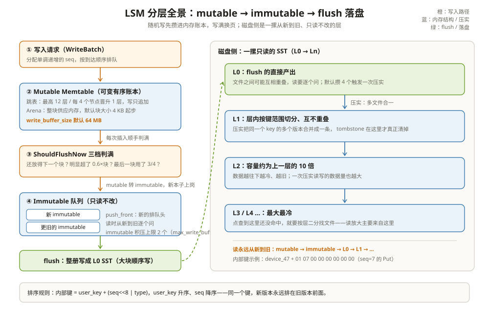

# LSM Tree 与 Memtable：先把改动攒在内存里

一台压测机，盘是 NVMe，顺序写能跑到 1.2 GB/s，业务却把吞吐卡在了 4 万 QPS 的随机写上。DBA 第一反应是换更好的盘，换完盘提升不到一成。iostat 里看到的是大量 4 KB 的散乱写，扇区号毫无规律。

差别不在盘，而在写路径的形态。关系型数据库把数据组织成一棵 B+ 树，每次更新都要原地改某个叶子页：页在磁盘上东一个西一个，写多少次就散乱多少次。RocksDB 走的是另一条路——**先把改动攒在内存里排好队，攒满一笔写成一个大文件，之后谁也不再原地修改它**。这套「攒内存、写不可变文件」的结构就叫 LSM Tree（Log-Structured Merge Tree），内存里那个排队的地方叫 Memtable。

把 LSM 想成一个**记账的收银台**：客人每下一单（一次随机写），收银员不跑去仓库改货架（原地更新），而是先把单子按顺序记在面前的小本子上（Memtable）；小本子写满了，撕下来钉成一册放到旁边的架子上（SST 文件）；架子上的册子太乱了，后台再定期把几册重新誊抄、归并成整齐的几大册（压实）。全程只有两件事会写盘：整本写满的册子，和重新誊抄的整册——全是顺序写。

---

## 一、LSM 为什么存在：把随机写换成顺序写

一棵 B+ 树上更新一行，路径是这样的：查根页、查内部页、查叶子页、改叶子页、可能分裂、写 WAL、刷脏页。前三步是读，第四步是**原地写**。数据量一大，叶子页在磁盘上的位置就没有规律了，N 个键的随机写就是 N 个不相邻的 4 KB I/O。

```text
B+ 树写 3 个键（只算数据页）：       LSM 写 3 个键（只算数据页）：
  改页 #a7f2（随机）                    追加到内存账本尾部（顺序）
  改页 #01bc（随机）                    追加到内存账本尾部（顺序）
  改页 #f3d0（随机）                    追加到内存账本尾部（顺序）
  → 3 个不相邻的 4 KB 写               → 0 次数据页写（WAL 另算，顺序追加）；
                                          满 64 MB 后一次顺序写 SST
```

LSM 的取舍是：**读变复杂了（要从新到旧查好几层），换来写永远落在当前账本的末尾**。这正对着「写多读也不少」的在线业务。第 03 篇会算读这笔账，这里先把写这条链立起来。

两种结构把「写」这一个动词拆成了完全不同的动作序列：

| 维度 | B+ 树 | LSM（RocksDB） |
| --- | --- | --- |
| 更新一行的动作 | 定位叶子页 → 原地改 → 可能分裂 | 追加一条更大 seq 的新版本 |
| 随机写盘 | 每次更新都随机碰页 | 落盘只有整册顺序写 |
| 空间回收 | 就地复用空闲槽 | 靠压实把旧版本和墓碑清掉 |
| 写放大形态 | 页分裂 + WAL | 压实反复重写（第 04 篇算账） |
| 点查路径 | 树高 3~4 次页访问 | 层数 × 布隆/索引（第 03 篇算账） |

还有一个常被追问的点：**覆盖写为什么便宜**。B+ 树改同一个键 100 次，是在同一个页里原地改 100 次（WAL 记 100 条，脏页最后由 checkpoint 批量刷）；memtable 追加 100 个版本，是 100 个节点挂进跳表，外加 100 条 WAL 顺序追加，磁盘上的数据页谁都没碰。前 99 个旧版本要等压实才消失——这就是「写省下的每一分钱，都要在读或压实上找补回来」的最早出处。

---

## 二、Memtable：一份可变的有序账本

Memtable 就是内存里的一份**按内部键排好序、还能继续改**的数据。每个列族（column family）同一时刻只有一个 mutable memtable。它同时干两件事：接住写入，服务点查。

一条记录在 memtable 里的物理形态很朴素，`MemTable::Add` 的注释写得明明白白（`db/memtable.cc:1127-1132`）：key_size、internal_key、value_size、value 依次拼成一条 buffer，最后还可以跟一个校验字节段。

```text
举例：Put("device_47", "61.2")
┌──────────┬─────────────────────────┬───────────┬────────┐
│ varint32 │ device_47 + 8字节尾巴    │ varint32  │ 61.2   │
│ 17       │ (internal_key，见第五节) │ 4         │        │
└──────────┴─────────────────────────┴───────────┴────────┘
一次 memcpy 进一块 arena 大内存，再插进有序结构——就这两步。
```

注意最后一行：**key 和 value 先拼成一整条，再一次性分配**。分配这件事由 Arena 负责，下一节展开。

---

## 三、Skip List 为什么赢：无锁读、天然有序、删改便宜

Memtable 里面装键的容器默认是跳表。`SkipListFactory` 是默认工厂（`include/rocksdb/memtablerep.h:20-22`），`SkipListRep` 里包的是一个 `InlineSkipList`（`memtable/skiplistrep.cc:17`）。为什么不是红黑树、不是哈希表？

| 候选 | 无锁读 | 天然有序（范围扫/flush） | 覆盖写（同 key 新版本） |
| --- | --- | --- | --- |
| 跳表 | 好，读只需沿前向指针走 | 好，就是有序链表 | 追加一个新节点即可，旧节点不动 |
| 红黑树 | 差，旋转会改别人的指针 | 好 | 插入可能引发旋转，并发要大锁 |
| 哈希表 | 好 | 差，flush 前还得整体排序 | 追加即可 |

三条要求凑齐，跳表是唯一的交集。RocksDB 的跳表把「写优化」做进了细节里：

- **读不加锁。** 写线程用 `InsertConcurrently` 做无锁插入（`memtable/inlineskiplist.h:919`），读线程只沿指针走。memtable 一旦 immutable，读更是连竞争都没有。
- **参数很克制。** 默认最高 12 层、每 4 个节点晋升 1 个（`memtable/skiplist.h:54-55`），查找复杂度 O(log N)，空间开销只有每节点一个 12 层的指针数组上限。

```text
举例：在跳表里找 device_47（seq=9）
L3:  head ────────────────────────────────────► nil
L2:  head ────────► device_12 ────► device_47 ─► nil   ← 命中，走 2 步
L1:  head ─► device_01 ─► device_12 ─► device_47 ─► nil
```

节点高度怎么定？源码用几何分布：从第 1 层开始掷骰子，连续通过 1/4 概率就再升一层，直到 12 层封顶（`memtable/skiplist.h:290-294`）。期望结果：4 个节点里 1 个上 L2，16 个里 1 个上 L3，100 万节点的 memtable 高度通常停在 9~11 层——查找路径长度稳定在 20 次指针跳转上下，这也是「点查 O(log N)」的真实含义。

### 3.1 Arena：一次性大块分配

几百万个节点如果每个都 `malloc` 一次，分配器的锁和碎片就把 CPU 吃光了。Arena 的做法是**一次要一大块，节点在块里排队领**。Arena 里有三个常数（`memory/arena.h:33-35`）：2 KB 的内联块、4 KB 的最小块、2 GB 的最大块；默认块大小是 4 KB 起步、按需调优。节点尺寸对齐后从当前块里切，切不下了才换下一块。

```text
举例：一块 64 KB 的 arena block
┌────────────────────── 64 KB ──────────────────────┐
│ [node device_01][node device_47][node device_99]… │
│                                      ▲ 还剩 8 KB  │
└──────────────────────────────────────────────────┘
新节点 5 KB？放不下 → 整块补 64 KB；200 KB？→ 单独给它一块「不规则块」
```

这个「整块供应」的模式还有个副作用：memtable 的实际内存占用会略超 `write_buffer_size`，第四节判断是否 flush 时要专门把这笔零头算进去（`db/memtable.cc:310-317`）。

### 3.2 并发写进来时，块怎么分：ConcurrentArena

默认配置允许并发写 memtable（`allow_concurrent_memtable_write`），多个线程同时往跳表插节点，也就同时在 arena 里领内存。给每个线程发全局锁会把组提交的收益吃光，ConcurrentArena 的答案是**两级锁**：每个线程先抢一根缓存行对齐的私有自旋锁，从自己的「配额」里切内存；私有配额用完了，才去抢全局的 `arena_mutex_` 补货（`memory/concurrent_arena.h:42-162`，`AllocateImpl` 在 `:130`）。绝大多数分配只碰自己那根锁，cache line 不互相弹跳——这是组提交能并发灌 memtable 的内存侧前提。

### 3.3 备选容器：什么时候不用跳表

跳表是默认，不是唯一。`MemTableRepFactory` 还有两件内置备选（`include/rocksdb/memtablerep.h:20-34`）：

| Rep | 结构 | 适用 | 代价 |
| --- | --- | --- | --- |
| SkipListRep（默认） | 跳表，范围有序 | 通用 | 无明显短板 |
| HashSkipListRep | 哈希分桶 + 桶内跳表 | 键长 `prefix:suffix`、前缀内扫描多 | 跨前缀的全量扫要拉通排序，flush 前还要整体归并 |
| VectorRep | 无序 vector，转只读时一次性排序 | 写后基本不改、随机写极重 | 读取前整体排序一次 |

判定标准就一条：**memtable 会不会在活着的时候被按序读**。会（在线业务几乎都会），跳表赢；不会（攒完就走），VectorRep 的顺序追加更省 CPU。



---

## 四、mutable → immutable 队列：满了怎么办

`write_buffer_size` 默认 64 MB（`include/rocksdb/options.h:192`）。谁来判断 memtable 写满了？答案藏在每次插入的尾部：`MemTable::UpdateFlushState` 调 `ShouldFlushNow`（`db/memtable.cc:379-388`）。这个判断不是「超过 64 MB 就刷」这么粗糙，源码里有三档（`db/memtable.cc:296-368`）：

1. **还能放下一个块**：`已用 + block < 64MB + 0.6×block`，不刷；
2. **已经明显超了**：`已用 > 64MB + 0.6×block`，刷；
3. **卡在中间**：看最后一块的剩余空间，低于块大小的 1/4 就刷——避免给一条大记录单独开新块造成过度分配。

```text
举例：write_buffer_size = 64 MB，arena block = 64 KB
已用 63.98 MB：63.98 + 0.064 < 64 + 0.0384？否（64.044 < 64.0384 不成立）。已用 > 64.0384？否。
最后一块只剩 12 KB < 16 KB（1/4）→ 判满，进 flush。
```

判满之后发生的事是一次「换本子」：mutable 变成 immutable，新 mutable 上岗。旧的本子排进一个**队头插入**的链表——`MemTableListVersion::AddMemTable` 用 `push_front` 把新 immutable 放在最前面（`db/memtable_list.cc:106-111`），所以这个链表天然是「新的在前、旧的在后」。后台 flush 线程从队尾开始，`PickMemtablesToFlush` 把要刷的 memtable 挑出来（`db/memtable_list.h:343-345`），写成 L0 的 SST 文件。`max_write_buffer_number` 默认 2（`include/rocksdb/advanced_options.h:271`），管的是**等待 flush 的 immutable 最多几个**——mutable 不算在内，但正在写的 mutable 加上 2 个刷不动的 immutable，就是三份 64 MB 白白占着内存；immutable 积压到上限就触发写停顿，停顿的完整机制在第 02 篇展开。

```text
举例：换本子前后，读 device_47 要问几个人
换本子前：只问 mutable（有 device_47 的旧值 seq=7）
换本子后：先问 mutable（新值 seq=9），没有再问 immutable（seq=7）
flush 后：先问 mutable，没有再问 L0 文件（seq=7 落盘了）
顺序永远是「从新到旧」，这是 LSM 读正确性的全部秘密。
```

两处容易忽略的细节。

**第一，flush 完成的 memtable 不会立刻消失。** 还有读流（长事务、迭代器）引用它。RocksDB 把刷完的 memtable 挪进一个历史链表 `memlist_history_`（`db/memtable_list.h:243`），等 `max_write_buffer_size_to_maintain` 允许的额度腾出来才真正释放（`:247`）。历史链表也参与点查（`db/memtable_list.cc:218-227` 的 `GetFromHistory`），所以「刚 flush 完的数据」在引用它的读者眼里依然可见。

**第二，范围删除单独有一个表。** `DeleteRange` 的墓碑不进点键跳表，而是进独立的 `range_del_table_`（`db/memtable.cc:209-212`，构造时同样用跳表工厂）。读路径和 flush 都要先问这张表「有没有盖住这个键的范围墓碑」，它的存在是 memtable 读路径里那个 `max_covering_tombstone_seq` 的来源。

---

## 五、InternalKey：同一个 user_key 的多个版本怎么排队

前面的 8 字节「尾巴」还没有拆开。Memtable 和 SST 里真正排序的键不是 `device_47`，而是内部键（InternalKey）：**user_key 原样放前面，后面拼 8 字节**（`db/dbformat.h:171` 把这 8 字节定为 `kNumInternalBytes`）。这 8 字节是 `seq` 左移 8 位、或上 1 字节 type（`db/dbformat.h:218-223`）：

```text
举例：user_key="device_47"，seq=7，type=kTypeValue(0x1)
packed = (7 << 8) | 1 = 0x0701
按小端写进磁盘的 8 字节：01 07 00 00 00 00 00 00
完整内部键 = "device_47" + 01 07 00 00 00 00 00 00   （共 17 字节）
```

seq 是 RocksDB 给每次写操作发的单调递增序号，56 位可用（`db/dbformat.h:129`）。type 说明这条记录是什么，常见值类型：

| type | 值 | 含义 |
| --- | --- | --- |
| kTypeDeletion | 0x0 | 点删除（墓碑） |
| kTypeValue | 0x1 | 普通 Put |
| kTypeMerge | 0x2 | Merge 操作，读时由 merge operator 归并 |
| kTypeSingleDeletion | 0x7 | 只删一个版本的单删 |
| kTypeRangeDeletion | 0xF | 范围删除，进 memtable 单独的表 |
| kTypeBlobIndex | 0x11 | BlobDB 的指针，值本体在 blob 文件里 |

（完整枚举在 `db/dbformat.h:41-78`；`0x4`、`0x5` 这类带 ColumnFamily 前缀的只出现在 WAL 里。）

排序规则是整个 LSM 的地基（`db/dbformat.cc:199-218`）：**user_key 升序，seq 降序，type 降序**。seq 参与比较用的是 packed 后的整数——seq 越大，packed 值越大，反而排得越靠前：

```text
举例：device_47 有两个版本，谁排前面？
  seq=9 的 Put  → packed 0x0901
  seq=7 的 Put  → packed 0x0701
user_key 相同，0x0901 > 0x0701，按 seq 降序 → seq=9 排在 seq=7 前面。
memtable 里扫到 user_key 就等于先看到最新版本，读和压实都占这个便宜。
```

seq 相同时 type 也是「大的排前面」（`db/dbformat.cc:211-215`）。这几乎只在同一个 batch 内同键双写时出现——正常路径下每条记录独占一个 seq，这条规则只是给排序一个全序兜底，别把它当成「Put 和 Delete 争位」的机制。

写路径只追加新版本、从不改旧版本，靠的就是这套编码：**「更新」在 LSM 里是「插入一条更大的 seq」**。读的时候也不裸查：`LookupKey` 把「user_key + 快照 seq + 类型」拼成一个比任何现存版本都大一号的查找键（`db/dbformat.cc:245-269`），一 Seek 就落在「该 user_key 在快照可见范围内的最新版本」上。

```text
举例：LookupKey 为什么「大一号」
快照 seq=5。查找键 = device_47 + (5<<8 | kValueTypeForSeek)。
seek 类型取 kValueTypeForSeek = kTypeValuePreferredSeqno
（db/dbformat.cc:28，真实值类型里序号最大的那个），
保证查找键不小于同 seq 的任何真实记录。
于是 Seek 的落点要么是 seq=5 的版本（可见），要么是 seq=6 的
第一个不可见版本——读路径从这个落点开始往后过滤即可。
```

---

## 六、和 Parquet 摆在一起看：攒内存这步两边都在做

Parquet 的 writer 也是攒够了才落盘：行数据先进 RowGroup 缓冲，攒到几百 MB 才按列编码、压缩、写成一个不可变文件。Memtable 攒数和这一步几乎同构。

| 维度 | RocksDB Memtable | Parquet Writer 缓冲 |
| --- | --- | --- |
| 攒什么 | KV，按内部键有序（跳表） | 行，按列拆进 RowGroup 缓冲 |
| 落盘出口 | 满了 flush 成 L0 SST，仍不可变 | RowGroup 满/文件收尾，写成不可变文件 |
| 攒的同时服务读 | 要：Get 直接查跳表 | 不要：写完之前没人读 |
| 攒的同时服务覆盖写 | 要：同 key 追加新版本（seq 更大） | 不要：行进去就不改 |
| 内部排序时机 | 写入即有序（跳表维护） | flush/收尾时一次性排序 |
| 崩溃恢复 | 有 WAL 兜底（第 02 篇） | 缓冲丢了就丢，文件没写完整个读不出 |

关键差异就一行：**memtable 是「活的」，parquet 缓冲是「死的」**。RocksDB 必须让攒数据的地方同时服务点查和覆盖写，所以它得是有序多版本结构；Parquet 的缓冲只服务一个目的——攒够一批，写成不可变文件。两者的共同点在更上游：**都把「随机到达的写」攒成「一次性的顺序大块」，都要求写出来的文件从此不再改**。LSM 后续的每一层（SST、压实）都建立在这个「不可变」上，Parquet 的列统计、页索引同样建立在它上面。

```text
举例：同一串到达序列，两边各自的形态
到达顺序（乱序键）：device_99, device_01, device_47, device_12, …
Parquet writer：按到达顺序填 RowGroup 的行（不排序也可写），
  收尾时按列切块；要不要按键排，是分区/分桶层的事，文件不强制。
Memtable：每条到达就插进跳表——落点由键序决定，攒的每一刻都有序。
满 64MB 后：Parquet 写出一个 64MB 的列存文件（不可再改）；
  RocksDB flush 出一个 64MB 的有序 SST（同样不可再改）。
「攒批 → 不可变大文件」这一步，两边字字相同；「攒的过程中
要不要现查现改」，是 KV 引擎和数据文件的分水岭。
```

---

## 这一章留下的线索

- LSM 的本质是**用读的复杂度换写的顺序性**：随机写全部落在内存账本尾部，落盘只有整册写出和整册誊抄；
- Memtable 默认是跳表（最高 12 层、4 分支），赢在无锁读、天然有序、覆盖写只是追加新节点；节点内存由 Arena 整块供应；
- memtable 判满不是简单的 `>64MB`，是「还能放一个块 / 明显超了 / 最后一块用了 3/4」三档判断（`db/memtable.cc:296-368`）；满了 mutable 转 immutable，进队头插入的等待 flush 队列；
- **内部键 = user_key + 8 字节（seq<<8 \| type）**，排序规则 user_key 升序、seq 降序，于是最新版本永远排在同键最前；更新＝追加更大 seq，不改旧数据；
- Memtable 攒数和 Parquet writer 攒 RowGroup 同构：都是「攒够一批、写成不可变文件」，区别在 memtable 还得同时服务读和覆盖写。

memtable 满了之后，写请求并没有直接走完：中间还有 WAL、排队、组提交、写停顿几道关。下一章把一次 Put 的完整关卡序列拆开——[写入路径与 WAL：一次 Put 要过几道关](02-写入路径与WAL.md)。

---

## 附：这一章的源码入口

> 除特别注明外，本节引用的源码文件与行号都来自 facebook/rocksdb 主分支（11.13.0）。

- `db/memtable.cc:1121-1220`：`MemTable::Add`——entry 的四段式编码（1127-1132 注释）、一次 memcpy 进 arena、插入跳表并累计 data_size/num_entries
- `db/memtable.cc:296-388`：`ShouldFlushNow` 三档判满（0.6 过量分配比率、最后一块 1/4 停写规则）+ `UpdateFlushState` 的 CAS 置位
- `db/memtable.cc:209-212`：`range_del_table_`——范围删除的独立跳表
- `db/memtable.h:656-667`：`ShouldScheduleFlush` / `MarkFlushScheduled`——flush 状态机的两次握手
- `db/memtable_list.cc:106-111、218-227`：`AddMemTable` 用 `push_front` 维护「新的在前」；`GetFromHistory`——历史链表仍参与点查
- `db/memtable_list.h:243-247、343-345`：`memlist_history_` 与 `max_write_buffer_size_to_maintain` 的缓冲期；`PickMemtablesToFlush`——后台 flush 挑 memtable
- `memtable/skiplist.h:46-68、54-55、290-294`：`SkipList` 类与接口、默认 max_height=12 / branching=4、节点高度的几何分布
- `memtable/inlineskiplist.h:919`：`InsertConcurrently`——无锁并发插入入口
- `memtable/skiplistrep.cc:17-43`：`SkipListRep`——默认 memtable rep，内部包 `InlineSkipList`
- `include/rocksdb/memtablerep.h:20-34`：SkipListRep 是默认、HashSkipListRep/VectorRep 是备选的官方说明
- `memory/arena.h:33-35` 与 `memory/concurrent_arena.h:42-162`：Arena 三个块常数；`ConcurrentArena` 私有自旋锁先切、全局锁补货的两级分配
- `db/dbformat.h:41-78、129、171、218-223`：`ValueType` 枚举、56 位 seq 上限、`kNumInternalBytes=8`、`(seq << 8) | t`
- `db/dbformat.cc:199-218`：`InternalKeyComparator::Compare`——user_key 升序、seq 降序、type 降序
- `db/dbformat.cc:245-269`：`LookupKey` 构造——查询键 = user_key + 快照 seq + seek 类型

---

## 思考题

1. 一台机器上把 `write_buffer_size` 从 64 MB 调到 512 MB，`max_write_buffer_number` 不变。写吞吐先升后降，flush 的单次耗时也变长了。用「攒批大小 → flush 时长 → immutable 积压 → 写停顿」这条链解释先升后降各发生在哪一段。
2. `device_47` 先后写入 Put(seq=9)、Delete(seq=12)。两条内部键的字节分别是多少？在 memtable 里谁排前面？如果把这批数据原样 flush 成一个 L0 文件，读 device_47 时为什么能确定「已删除」而不是「值是 seq=7 的旧值」？
3. 跳表节点全从 arena 块里切。如果把 memtable 的 arena 换成每个节点独立 malloc，读、写、flush 各会付出什么额外代价？哪些代价在 memtable 转 immutable 后会消失、哪些不会？
4. Parquet writer 攒 RowGroup 时不需要跳表，Memtable 却必须有序。假设有人给 RocksDB 换上哈希表做 memtable，列出至少三个会坏掉的环节（提示：flush 出口、LookupKey 的 Seek、范围迭代）。
