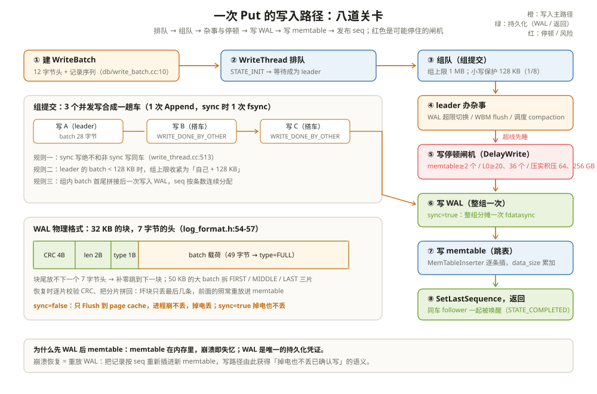

# 写入路径与 WAL：一次 Put 要过几道关

大促当晚，写入 P99 从 2 ms 抬到 80 ms。日志里反复出现一行：`Stopping writes because we have 2 immutable memtables (waiting for flush), max_write_buffer_number is set to 2`，以及统计里暴涨的 `STALL_MICROS`。业务方第一反应是「盘满了」「写入线程不够」——都不是：盘很闲，线程也不忙，只是 compaction 跟不上写入，RocksDB 在写入路径上主动踩了刹车。

这个刹车不是缺陷，是设计。要读懂它，得先知道一次 Put 并不是「写进去」一个动作，而是要过一串关卡：**建 WriteBatch → 排队 → 组队（组提交）→ 办杂事 → 停顿检查 → 写 WAL → 写 memtable → 发布 seq → 返回**。任何一关都可能成为 P99 的来源。这一章按顺序把每道关卡走一遍，走完你就知道该去日志和监控里找什么。

把写路径想成**进站上火车**：每个写请求先领票（WriteBatch），在候车室排队（WriteThread），凑够一班就发一趟车（组提交）；进站前有一道闸机（写停顿），高峰期闸机故意放慢；上车后先在车票上打孔（写 WAL，凭这个凭证车丢了能找回行李），再把行李搬上车（写 memtable），最后开车（发布 seq、唤醒同行乘客）。



---

## 一、关卡总览：从 Put 到返回

入口是 `DBImpl::WriteImpl`（`db/db_impl/db_impl_write.cc:881`），它先做一轮合法性检查：`sync` 和 `disableWAL` 不能同时为 true（`:955-957`），流水线写和部分模式互斥（`:958-976`）。随后主干流程是：

1. **排队**：每个写线程构造一个 `Writer` 节点，`JoinBatchGroup` 挂进队列，等状态机宣判自己是不是 leader（状态机定义在 `db/write_thread.h:34-82`）；
2. **leader 办杂事**：leader 调 `PreprocessWrite`（`:1193`，函数体在 `:2157-2266`），顺手处理 WAL 超限切换、写缓冲全局 flush、compaction 调度这些「路政工程」；
3. **组队**：`EnterAsBatchGroupLeader` 把队列里能同车的写聚成一个 `WriteGroup`（`:1210`）；
4. **写 WAL**：`WriteGroupToWAL` 把整组合成一个 batch 追加进日志（`:1377-1387`）；
5. **写 memtable**：`WriteBatchInternal::InsertInto` 驱动 `MemTableInserter` 把每条记录插进跳表（`:1466-1495`）；
6. **发布与返回**：`SetLastSequence` 让这批写对读者可见（`:1572`），`ExitAsBatchGroupLeader` 唤醒同车线程（`:1584`）。

排队的每个线程在状态机里走这四个站（`db/write_thread.h:34-82`）：

| 状态 | 含义 | 谁把你挪过去 |
| --- | --- | --- |
| STATE_INIT | 挂进队列，等 | 自己（JoinBatchGroup） |
| STATE_GROUP_LEADER | 队头，负责开车 | 前一个 leader 或队空时自封 |
| STATE_PARALLEL_MEMTABLE_WRITER | 并行写 memtable（开了 `allow_concurrent_memtable_write` 且同车 >1 人时，各写各的 batch） | leader（LaunchParallelMemTableWriters） |
| STATE_COMPLETED | 完成，返回 | leader（ExitAsBatchGroupLeader 逐个唤醒） |

```text
举例：一个 Put("device_47","61.2") 在 default.cf 的关票根
① WriteBatch：1 条记录      ② 排队：等 leader
③ 组队：和另外 2 个并发写同车（WRITE_DONE_BY_OTHER=2）
④ WAL：合成的 batch 追加进 000011.log，sync=false 则只进 page cache
⑤ memtable：跳表多 1 个节点，data_size +59 字节
⑥ SetLastSequence：seq=9 可见，函数返回
```

这条链上每个阶段都有独立的计时器，`perf context` 里按名可查：排队加杂事是 `write_scheduling_flushes_compactions_time` 和 `write_pre_and_post_process_time`（计时守卫见 `db/db_impl/db_impl_write.cc:2168`），停顿是 `write_delay_time`（`:2210`），WAL 是 `write_wal_time`（`:1382`），memtable 是 `write_memtable_time`（`:1467`）。开头场景里 P99 抬到 80 ms，用这四个数字一拆，「慢在哪一关」就不是猜的了。

---

## 二、WriteBatch 与组提交：小写攒成大写

### 2.1 WriteBatch 是什么

用户的多次写（哪怕是一次 Put）都先装进一个 WriteBatch。它的内存布局是一段连续字节（`db/write_batch.cc:10-37`）：**8 字节起始 seq + 4 字节条数 + N 条记录**，每条记录是「1 字节类型 + 键值对（长度前缀式字符串）」，带列族的写会多一个 varint32 的列族 ID。头部固定 12 字节（`db/write_batch_internal.h:82`）。

```text
举例：Put("device_47","61.2") 的 batch
12 字节头：00 00 00 00 00 00 00 00（seq 占位）| 01 00 00 00（1 条）
1 条记录：01（kTypeValue）| 09 device_47 | 04 61.2
总长 = 12 + 1 + 1+9 + 1+4 = 28 字节
```

batch 还可以给每条记录配 8 字节校验信息（`WriteOptions::protection_bytes_per_key`，`include/rocksdb/options.h:2767-2772`），memtable 落盘和恢复重放时逐条核对，防的是存储介质的静默损坏——把「内容没被盘悄悄改坏」也纳入写路径的承诺。这是可靠性维度的另一道关，默认关闭。

### 2.2 组提交：一趟车带一串人

WAL 最贵的操作不是写，是 fsync。让每个并发写各自 fsync 一次，磁盘会被小请求切碎。RocksDB 的做法是**让 leader 把排队的写打包成一趟车**：`EnterAsBatchGroupLeader` 从队头沿链往队尾收编，收编规则写在 `db/write_thread.cc:443-530`——

- 组的总字节上限是 `max_write_batch_group_size_bytes`，默认 1 MB（`include/rocksdb/options.h:1473`）；
- leader 自己的 batch 小于上限的 1/8（默认 128 KB）时，组上限收紧为「自己 + 128 KB」，避免小写被大写拖住（`db/write_thread.cc:454-458`）；
- **sync 写绝不和非 sync 写同车**（`db/write_thread.cc:513`）——sync 语义是按请求承诺的，混车会把不承诺持久化的写一起 fsync，或者反过来。

```text
举例：3 个并发写怎么合成一次 fsync
时刻 T：A(sync=false) 当上 leader；B、C 还在队列里
组队：B、C 与 A 兼容 → WriteGroup{A,B,C}，MergeBatch 把三个 batch
      首尾拼成一个临时 batch（db_impl_write.cc:2268-2289）
写 WAL：1 次 Append + 0 次 fsync（sync=false 时只 Flush 到 page cache）
写 memtable：InsertInto 逐个 batch 分配 seq 并插跳表（:1469-1475）
返回：A 走 ExitAsBatchGroupLeader，B、C 被标记 STATE_COMPLETED 一起醒
全程 1 次「车次」，3 个请求分摊；fsync 只有 sync=true 时发生 1 次。
```

车翻了怎么办，路径也是全的。WAL 写失败（`io_s` 非 OK）在写 memtable 之前就被拦下；memtable 写失败则会**把 WAL 截回本次写之前的位置**——`wal_context.prev_size` 记着写 WAL 前的文件大小，失败时 `SetAttemptTruncateSize` 把日志尾部这批「没有对应内存数据」的记录剪掉（`db/db_impl/db_impl_write.cc:1575-1583`），再 `HandleMemTableInsertFailure` 收尾（`:1582`）。这保证恢复时重放的都是「内存里真实存在过」的写，不会多也不会少。

组里有没有人「搭了别人的车」，监控里看 `WRITE_DONE_BY_SELF` 和 `WRITE_DONE_BY_OTHER`（`db/db_impl/db_impl_write.cc:1360-1368`）。搭车率高说明组提交在起作用；如果都是 SELF，要么并发低，要么 sync 混杂把车拆散了。

同车之后，seq 是一次性领一串的：`current_sequence = last_sequence + 1` 起，到 `last_sequence += seq_inc` 止，本次占用区间就是 `[current_sequence, last_sequence]`（`db/db_impl/db_impl_write.cc:1401-1404`）。默认每条记录吃一个 seq（`:1460-1462`，按 batch 条数累加）；事务模式下改成每 batch 吃一个（`seq_per_batch`，`:1331`）。开 `allow_concurrent_memtable_write` 且同车超过 1 人时，memtable 写不排队了——leader 释放其余线程各自插自己的 batch（`LaunchParallelMemTableWriters`，`:1478`），WAL 仍只有一份，这就是「日志串行、内存并行」的分层。

### 2.3 三种进阶写模式

`DBOptions` 里有三个改写路径拓扑的开关（默认全关）：`two_write_queues`（`include/rocksdb/options.h:1582`）、`enable_pipelined_write`（`:1422`）、`unordered_write`（`:1448`）。

| 模式 | 拓扑变化 | 适合 | 互斥 |
| --- | --- | --- | --- |
| two_write_queues | 一条队列管 WAL，另一条管 memtable | 写前 WAL 是瓶颈的高并发 | 与 pipelined_write 互斥（`db/db_impl/db_impl_write.cc:958-961`） |
| pipelined_write | WAL 阶段和 memtable 阶段流水线化，两组交替 | 把「写日志等内存写」的重叠省出来 | 与 two_write_queues、unordered_write 互斥（`:958-971`） |
| unordered_write | 先领 seq 写 WAL，memtable 落后乱序补，最后统一发布 | 削平「等前一批 memtable 写完」的尖刺 | 与 pipelined_write 互斥（`:967-971`） |

三个都是「把一次串行的两步改成两条流水线」的变体，代价是 seq 发布语义更绕（unordered_write 下 readers 可能看到已领号未发布的窗口）。默认全关的路径最简单也最常用；除非 profile 明确指向 WAL 或 memtable 阶段的空转，不建议先动它们。

---

## 三、WAL：先打孔再搬行李

### 3.1 为什么先 WAL 后 memtable

如果直接写 memtable，进程一崩，内存账本连人带数据全没了。WAL（Write Ahead Log）是**先于数据本身的持久化凭证**：每次写先把 batch 追加进日志文件，之后才动 memtable。崩溃恢复时把 WAL 重放一遍，把 seq 赋回去、逐条插 memtable，数据就回来了。这也解释了为什么 WAL 里有些 memtable 见不到的记录类型（事务的 prepare/commit 标记、列族绑定等，见 `db/dbformat.h:41-78` 里标着 "WAL only" 的那一批）。

WAL 可以关：`WriteOptions::disableWAL`（`include/rocksdb/options.h:2721`）。批量导入、可由上游重建的数据经常这么干——省掉每次 fsync 的开销，代价是进程崩了这批写就没了。`sync=true` 时 disableWAL 直接被拒绝（`db/db_impl/db_impl_write.cc:955-957`）。

### 3.2 WAL 的物理格式：32 KB 的块、7 字节的头

WAL 文件被切成**一个个 32 KB 的块**（`kBlockSize = 32768`，`db/log_format.h:54`）。每条记录在块里的头是 7 字节：4 字节 CRC + 2 字节长度 + 1 字节类型（`db/log_format.h:57`）。类型有四兄弟（`db/log_format.h:22-30`）：`FULL`（整条在一个块里放得下）、`FIRST`/`MIDDLE`/`LAST`（一条大记录跨块拆成的三段）。写文件时按块对齐：块尾剩的空间连 7 字节头都放不下，就补零跳到下一个块（`db/log_writer.cc:113-127`）；一条记录放不下就拆片，逐片标记 FIRST/MIDDLE/LAST（`db/log_writer.cc:157-175`）。每片的 CRC 覆盖「类型 + 载荷」，由 `EmitPhysicalRecord` 算好写进头（`db/log_writer.cc:308` 起）。

```text
举例：一条 49 字节 batch 记录在块内的布局（普通文件，非 recyclable）
┌── 32 KB 块 ──────────────────────────────────────────┐
│ …前面的记录… │ CRC(4) | len=0x31(2) | 0x01(1)│ 49字节 │
│              └─ 7 字节物理头 ────────────────┘ FULL  │
└──────────────────────────────────────────────────────┘
若 batch 有 50 KB：块内剩 20 KB → FIRST(20KB)，下块 LAST(30KB)。
只有超过「剩余空间 + 32KB」的记录才需要 MIDDLE 片；恢复时把两片拼回一条，CRC 逐片校验。
```

读取端按同样的规则逐块解析，读到不完整或 CRC 不对的片就截断重放（`db/log_reader.cc:549` 起的 `ReadPhysicalRecord`）。所以 WAL 坏了只会丢「最后没写完整的那几条」，前面的照常恢复。

### 3.3 sync 的语义：什么时候落盘

`WriteOptions::sync` 默认 false（`include/rocksdb/options.h:2696-2713`）。官方注释把差别讲得很直白：sync=false 等价于一次 `write()`——数据进了操作系统的 page cache，**进程崩了不丢，机器（或 OS）崩了丢**；sync=true 等价于 `write()` + `fdatasync()`，掉电也不丢。sync=true 的代价由整组写分摊：`WalContext` 带着请求的 sync 意图（`db/db_impl/db_impl.h:2380-2388`），`WriteGroupToWAL` 写完整个组后，若 `need_wal_sync`，对当前所有日志做一次 `Sync`（`db/db_impl/db_impl_write.cc:2406-2459`）。同车的 N 个 sync 写，只付一次 fsync。具体是 `fdatasync` 还是更重的 `fsync`（连文件元数据一起刷），由 `DBOptions::use_fsync` 切换（`db/db_impl/db_impl_write.cc:2437-2439`）；另外首次 sync 前还要对 WAL 目录做一次目录 sync（`:2451-2458`），保证「日志文件存在」这件事本身也落了盘。

另外 `DBOptions::manual_wal_flush`（默认 false，`include/rocksdb/options.h:1587`）可以把「写日志」和「可见化」进一步解耦：开了之后 WAL 只由用户调 `FlushWAL`/`SyncWAL` 才真正落盘，写路径连 Flush 都省了。

### 3.4 WAL 的生老病死

一个 WAL 文件的一生是：**创建（新 memtable 上岗时）→ 追加 → flush 完成后标记可回收 → 删除或复用**。切换的时机在写路径里能直接看到：leader 办杂事时发现所有日志总大小超过 `max_total_wal_size`，就把当前日志封口、开新文件（`db/db_impl/db_impl_write.cc:2170-2183`）——单列族库在 memtable 满时切换，多列族库得等所有列族的 flush 跟上才能换，所以总大小才是切换的判据。

老文件的去向有两种。默认直接删。配了 `recycle_log_file_num` 则改名复用——省一次文件创建的元数据开销，代价是格式变体：复用文件的记录头从 7 字节变 11 字节，多 4 字节存 log number（`kRecyclableHeaderSize`，`db/log_format.h:59-61`），类型也换成 Recyclable 系（`db/log_format.h:33-36`），防止旧文件残留的记录被当成新文件的开头误读。

崩溃恢复时 `log_reader` 按同样的块规则逐块读入、逐片验 CRC，把完整记录交给 MemTableInserter 重放进 memtable——`MemTableInserter` 身上那两个为恢复准备的成员（`recovering_log_number_`，`db/write_batch.cc:2051`）就是这条路的痕迹。恢复读到哪里算哪里：**坏块之后的数据按「未写入」处理**，所以 WAL 的损坏边界就是 32 KB 块边界。

---

## 四、写停顿：闸机什么时候踩刹车

组提交管效率，写停顿管生死。当后台的 flush/compaction 消化不过来时，RocksDB 会主动压住前台写入，让后台有时间追上。执行者是 `WriteController`（`db/write_controller.h:24-108`），一个**信用制限速器**：每毫秒按 `delayed_write_rate` 补一笔信用，写入按字数扣；信用不够就按「超支字节 ÷ 限速」算出要睡多久，最低睡 1 ms。限速上限默认 32 MB/s（`db/write_controller.h:25`）。

刹车有两挡：`NeedsDelay`（慢放行）和 `IsStopped`（红灯），都由 `DelayWrite` 落地——前者按微秒睡（`db/db_impl/db_impl_write.cc:2882-2930`），后者在条件变量上等到解除（`:2934-2954`）。什么条件踩刹车？判据集中在一个函数里（`db/column_family.cc:1020-1056`），三类触发源各有一慢一停两条线：

| 触发源 | 慢（delay） | 停（stop） | 例子（默认值） |
| --- | --- | --- | --- |
| immutable memtable 个数 | ≥ max-1 且 max>3 | ≥ max_write_buffer_number（默认 2） | 2 个未刷 immutable → 直接停 |
| L0 文件数 | ≥ 20（level0_slowdown_writes_trigger） | ≥ 36（level0_stop_writes_trigger） | L0 涨到 20 个开始减速 |
| 压实积压字节 | ≥ 64 GB（soft_pending_compaction_bytes_limit） | ≥ 256 GB（hard_pending_compaction_bytes_limit） | 压实欠账 64 GB 开始减速 |

每踩一次刹车都会留下计数：`MEMTABLE_LIMIT_STOPS`、`L0_FILE_COUNT_LIMIT_STOPS`、`PENDING_COMPACTION_BYTES_LIMIT_STOPS`（`db/column_family.cc:1080`、`:1090`、`:1103`），delay 对应 `*_DELAYS` 一族。日志里同时会打一行 WARN，写明是哪类原因、当时的限速值（`:1081-1086` 等）。排障时先看这些计数落在哪一族，再回到上表对号入座，比翻压测曲线快得多。

```text
举例：默认配置下 memtable 停写的推导
max_write_buffer_number = 2 → stop 线是「≥2」，
而 delay 线要求 max>3，默认配置直接跳过 delay。
所以默认配置的体验是：flush 正常时没感觉；
flush 一旦卡住、第二个 immutable 出现，写入瞬间归零——
这就是「一停就全停」的观感来源。想要渐进减速，把
max_write_buffer_number 调到 4 以上即可。
```

还有一道**全局**闸机：多个 DB/列族共享一个 `WriteBufferManager` 时，内存预算超了会停所有库的写。`ShouldFlush` 在「可变 memtable 超过预算 7/8」或「总用量超预算且超过一半还在可变区」时触发 flush（`include/rocksdb/write_buffer_manager.h:144-160`）；`ShouldStall` 在总用量 ≥ 预算时把写全部拦下，直到 flush 把水位降下来（`include/rocksdb/write_buffer_manager.h:169-185`；写路径的接入点在 `db/db_impl/db_impl_write.cc:2185-2191` 和 `:2226-2236`）。

```text
举例：WBM 的两道线
预算 buffer_size = 128 MB。
水位 110 MB：ShouldFlush 看可变区，> 112 MB（7/8）？没有 → 不 flush。
水位 130 MB：> 128 MB → ShouldStall 命中，写线程进 WriteBufferManagerStallWrites
排队等 flush；一旦 flush 把水位降回 128 MB 以下（IsStallThresholdExceeded
不再成立），MaybeEndWriteStall 唤醒排队线程，写继续。
```

这一关的完整逻辑链在 `PreprocessWrite` 里可以一次看全：WAL 超限就切换日志文件（`db/db_impl/db_impl_write.cc:2170-2183`）、WBM 触发 flush（`:2185-2191`）、写控制器停顿检查（`:2207-2218`）、WBM 全局停顿（`:2226-2236`）。P99 突刺时按这四行顺序排查，基本能定位是哪根线被碰了。

刹车还有**自动回松**的一面：条件恢复正常后，限速不是立刻回满，而是按 1.4 倍逐步放宽（`kDelayRecoverSlowdownRatio`，`db/column_family.cc:879`，用在 `:1215-1218`）。这是为了避免「停顿刚解除，涌入的写又把后台打垮」的振荡——代价是恢复期的吞吐爬坡是渐近的，监控上看到的是一条斜线而不是台阶。

### 4.2 不想被刹车：no_slowdown 与 low_pri

停顿默认是「等」，两个 `WriteOptions` 让调用方改主意。`no_slowdown=true` 时，`DelayWrite` 不睡，直接返回 `Status::Incomplete("Write stall")`（`db/db_impl/db_impl_write.cc:2902-2904`、`:2938-2940`）——把「等闸机」换成「当场退票」，适合上游有重试队列的场景。`low_pri=true` 则把这笔写挂到写控制器内置的限速器上排队（默认配额 1 MB/s，`db/write_controller.h:26-27`；`include/rocksdb/options.h:2740-2741`），后台批量回填、top-up 任务这类流量用它，避免自己触发停顿也避免被停顿误伤。

```text
举例：两类写混跑的分工
在线下单写：默认选项，被停顿就硬等——用户请求必须成功。
夜间全表回填：low_pri=true，先被限到 1 MB/s；
  compaction 一积压，low_pri 的令牌先枯竭，回填自动让路。
两个旋钮配合，写入路径的「公平」是业务自己声明的，不是引擎猜的。
```

### 4.3 写路径的仪表盘：看这几个计数器

| 计数器 | 记录位置（`RecordTick`） | 读出来什么 |
| --- | --- | --- |
| NUMBER_KEYS_WRITTEN / BYTES_WRITTEN | `db/db_impl/db_impl_write.cc:1356、1359` | 写入总量；配合 QPS 估 batch 均摊 |
| WRITE_DONE_BY_SELF / BY_OTHER | `:1362、1367` | 组提交搭车率，低于预期查 sync 混杂 |
| WRITE_WITH_WAL / WAL_FILE_BYTES | `:2473、2471` | 走 WAL 的写比例、日志流量 |
| WAL_FILE_SYNCED | `:2468` | 真实 fsync 次数——和 sync 写 QPS 对比看分摊效果 |
| STALL_MICROS / WRITE_STALL | `:2961-2962` | 停顿总时长与分布，P99 的头号嫌疑 |

这五个数按顺序看：先看 STALL_MICROS 有没有突刺（停顿），再看 WRITE_DONE_BY_OTHER（组提交有没有失效），再看 WAL_FILE_SYNCED 对比 sync 请求量（fsync 分摊是否生效）。多数「写入 P99 抬升」在这三步内就能锁定关卡。

---

## 五、和 Parquet 摆在一起看：WAL 就是数据湖的 commit log

数据湖写入 Delta/Iceberg 表时，也是**先追加一条 commit log，再让数据文件对外可见**。WAL 和它干的是同一件事：把「数据已发生」这件事本身先持久化下来。

| 维度 | RocksDB WAL | 数据湖 commit log（如 Delta log） |
| --- | --- | --- |
| 记什么 | 每一条 KV 操作（记录级） | 一批数据文件 + 元数据（事务级） |
| 粒度 | 单机单 DB | 表级，多引擎共享 |
| 谁消费 | 本进程重启时重放进 memtable | 计算引擎读快照时重放提交历史 |
| 可否关闭 | 可（disableWAL，自行承担丢数据） | 不可，关了表就没了一致性 |
| 格式 | 32 KB 块 + CRC 分片，专防尾部截断 | JSON/Parquet 提交文件 + 原子重命名 |
| 截断时机 | memtable flush 完成、日志可回收 | 定期 checkpoint |

有两个反向的差别值得记。其一，**WAL 服务单机崩溃恢复，且可以关**——它只为这一个 DB 兜底；commit log 关不掉，它本身就是表的「真相」。其二，**Parquet 数据文件自己没有任何恢复语义**：writer 崩在半路，文件没有 footer 就整个读不出来，丢的是「整批」；WAL 坏了按块、按 CRC 逐条判定，丢的是「最后几条」。RocksDB 把恢复边界磨到记录级，靠的就是这套 32 KB 块 + 四种分片类型的格式设计。

---

## 这一章留下的线索

- 一次 Put 的关卡序列：WriteBatch → WriteThread 排队 → 组队 → PreprocessWrite（杂事+停顿检查）→ 写 WAL → 写 memtable → SetLastSequence → 返回；P99 排查就沿这条链找最慢的一关；
- WriteBatch 是「8 字节 seq + 4 字节条数 + 记录序列」的连续字节；组提交把同车的写合成一次 Append、至多一次 fsync，sync 写绝不和非 sync 写同车；
- WAL 是**先打孔再搬行李**：32 KB 块、7 字节头（CRC+len+type）、FULL/FIRST/MIDDLE/LAST 分片；sync=false 只进 page cache（进程崩不丢、掉电丢），sync=true 由整组分摊一次 fdatasync；
- 写停顿是**信用制限速**：三类触发源（memtable 个数、L0 文件数、压实积压字节）各有一条 delay 线一条 stop 线；默认 `max_write_buffer_number=2` 时 memtable 一积压就直接停，没有渐进段；
- WAL 之于 RocksDB ≈ commit log 之于数据湖，但 WAL 记录级、可关闭、只为单机恢复服务；Parquet 文件本身没有恢复语义，坏在哪一层丢哪一层。

写进来、留得住之后，该谈怎么读出来了。读路径是 LSM 的还债侧：[读取路径与迭代器：从新到旧，一层一层问](03-读取路径与迭代器.md)。

---

## 附：这一章的源码入口

> 除特别注明外，本节引用的源码文件与行号都来自 facebook/rocksdb 主分支（11.13.0）。

- `db/db_impl/db_impl_write.cc:881-936`：`WriteImpl` 入口的合法性检查（sync/disableWAL 互斥、模式互斥）
- `db/db_impl/db_impl_write.cc:2157-2266`：`PreprocessWrite` 全文——WAL 超限切换（2170-2183）、WBM flush（2185-2191）、停顿检查（2207-2218）、WBM 全局停顿（2226-2236）
- `db/db_impl/db_impl_write.cc:1377-1399、2365-2459、2268-2289`：组提交写 WAL 的分派、`WriteGroupToWAL`（合批、SetSequence、追加、按需 Sync 与目录 sync）、`MergeBatch`
- `db/db_impl/db_impl_write.cc:1466-1495`：`InsertInto` 写 memtable 与并行写 memtable 的分派
- `db/db_impl/db_impl_write.cc:1284-1298、1360-1368、1401-1404`：并行写 memtable 的判定、`WRITE_DONE_BY_SELF/OTHER` 搭车统计、seq 占用区间
- `db/db_impl/db_impl_write.cc:1553-1589`：`SetLastSequence`、失败时 `SetAttemptTruncateSize` 截断 WAL、`ExitAsBatchGroupLeader`
- `db/db_impl/db_impl_write.cc:2882-2963`：`DelayWrite`——no_slowdown 退票、1 ms 步进睡眠、stop 等待
- `db/write_thread.h:34-82` 与 `db/write_thread.cc:443-530`：`Writer` 状态机四站；`EnterAsBatchGroupLeader`——1 MB 上限、128 KB 小写保护、sync 隔离
- `db/write_batch.cc:10-37、2045-2101、3296-3328` 与 `db/write_batch_internal.h:82`：WriteBatch 字节布局（权威注释）、`MemTableInserter`、组内逐 batch 分配 seq 的 `InsertInto`、12 字节头
- `db/log_format.h:22-61`：RecordType 四兄弟与 Recyclable 系、kBlockSize=32768、7/11 字节两种头
- `db/log_writer.cc:87-188、308 起` 与 `db/log_reader.cc:549 起`：写端——块尾补零、按剩余空间分片、`EmitPhysicalRecord` 算 CRC；读端——`ReadPhysicalRecord` 逐块解析与校验
- `db/write_controller.h:24-108、26-27` 与 `db/write_controller.cc:51-99`：信用制限速器（32 MB/s 默认上限、low_pri 1 MB/s）、`GetDelay` 每 1 ms 补信用、按超支字节算睡眠、最低 1 ms
- `db/column_family.cc:1020-1056、879、1080-1103、1215-1218`：三类触发源的 delay/stop 判据、`kDelayRecoverSlowdownRatio=1.4` 自动回松、`*_STOPS/*_DELAYS` 计数
- `include/rocksdb/write_buffer_manager.h:144-185` 与 `include/rocksdb/options.h:2696-2784、1422/1448/1582`：WBM 的 `ShouldFlush` 两道线与 `ShouldStall`；`WriteOptions`（sync/disableWAL/no_slowdown/low_pri）与三个写模式开关

---

## 思考题

1. 同一批 1 KB 的 Put，`sync=false` 吞吐 40 万 QPS，`sync=true` 掉到 1.2 万 QPS。列出 sync=true 额外付出的动作，并解释为什么并发越高掉得越少（提示：组提交与 fsync 分摊，以及 sync 写不可与非 sync 写同车）。
2. 默认配置（`max_write_buffer_number=2`）下观测到「写入突然归零几十秒后恢复」。按 64 MB write_buffer 算一算：flush 速度低于多少 MB/s 时会出现这个现象？把 `max_write_buffer_number` 调成 6、`level0_slowdown_writes_trigger` 保持 20，停顿形态会发生什么变化？
3. 一条 70 KB 的 batch 在 WAL 里占几个物理记录？每片的 type 是什么？假设最后一个 32 KB 块写到一半断电，恢复时这条 batch 的哪些部分还能用？
4. 数据湖的 commit log 不可关闭，RocksDB 的 WAL 可以。列两个适合 `disableWAL=true` 的场景，并说明各自「丢了怎么办」的兜底；再说明为什么 Parquet 文件写完后不需要 commit log 也能被安全读取。
