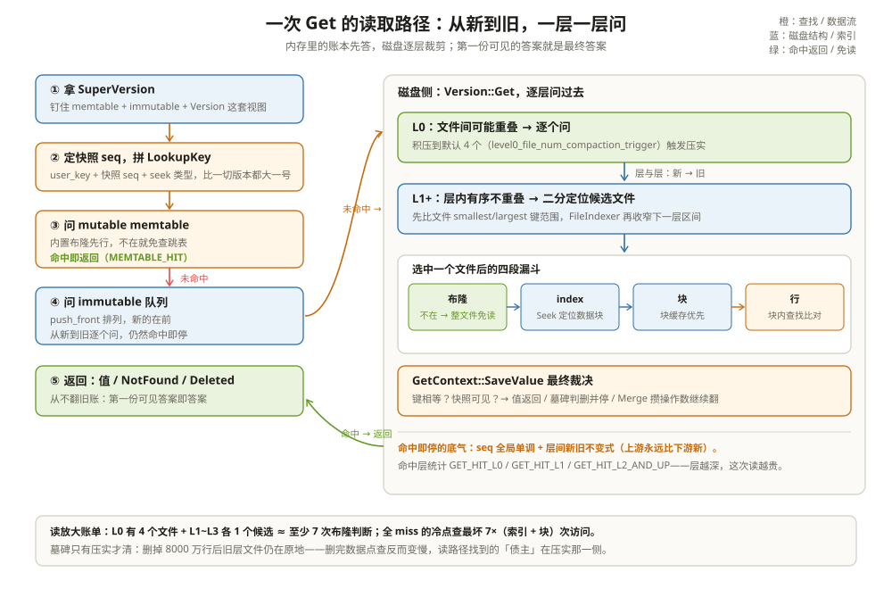

# 读取路径与迭代器：从新到旧，一层一层问

一个 KV 集群跑了三个月后值班同学发现一个怪现象：删掉 8000 万行旧数据之后，点查 P99 不降反升，从 0.8 ms 涨到 4 ms。数据明明变少了。日志和 STATS 里能看到 `GET_HIT_L0` 占比下降、布隆过滤器命中正常，盘也不忙。

差别不在缓存冷热，而在 LSM 读路径的形状。写入永远落在 memtable，读取却要**从新到旧、一层一层问过去**：内存账本、等待 flush 的旧账本、L0 的几个文件、L1 及以下每层的某个文件。数据变少不等于层数变浅——那 8000 万行删除只留下了满地的墓碑，旧层的文件还在原地，每次点查照样要问到最后一层。这一章把「一次 Get 到底问了几个人、每人怎么回答」拆开讲清，把读放大的账算明白。

把读路径想成**问一群按资历排座的师傅**：先问最新的师傅（mutable memtable），他没见过再问退休的老先生（immutable memtable），然后问 L0 的每个文件，再一层层往下问。**规矩只有一条：先被问到的答案就是最终答案**，因为座次就是新旧次序。



---

## 一、一次 Get 的关卡序列

入口在 `DBImpl::GetImpl`（`db/db_impl/db_impl_sync_and_async.h:155-458`），去掉协程样板后主干是六步：

1. **拿 SuperVersion**：`GetAndRefSuperVersion` 把「当前 memtable + immutable 队列 + 当前 Version」打包引用起来（`:237-246`）。读全程持着这一份快照视图，flush/压实换视图不影响这次读；
2. **定快照 seq**：用户没给 snapshot 就用 `GetLastPublishedSequence()`（`:279`）；给了就用快照自己的 seq（`:271`）；
3. **拼 LookupKey**：把 `user_key + 快照 seq + seek 类型` 拼成一个内部键（`:342`；构造见 `db/dbformat.cc:245-269`），它比该 user_key 在快照内的一切版本都大，一 Seek 就落在目标位置；
4. **问 memtable**：`sv->mem->Get`（`:374`），带 memtable 内置布隆过滤（`db/memtable.cc:1646-1660`）；
5. **问 immutable 队列**：`sv->imm->Get`（`:392`），队列按 `push_front` 排列（`db/memtable_list.cc:106-111`），所以遍历天然是从新到旧（`db/memtable_list.cc:229-268`）；
6. **问磁盘**：`sv->current->Get`，即 `Version::Get`（`db/version_set_sync_and_async.h:14-120`），逐层找文件。

```text
举例：Get("device_47") 的答话顺序（不同时间点）
时刻 A：写到 seq=9、还没写 seq=10 的删除
mutable（seq=9 的 Put 在里面）→ 直接返回 seq=9 的值，结束。
时刻 B：只写到 seq=7，seq=7 已转成 immutable、还没 flush
mutable 没有 → immutable（seq=7）→ 命中，结束。
时刻 C：seq=7 所在 memtable 已 flush 成 L0 文件 F2
L0 文件 F2（seq=7）→ 命中。
memtable 一次命中的统计叫 MEMTABLE_HIT，落到磁盘才叫 MEMTABLE_MISS。
```

SuperVersion 这层包装是「读不阻塞写」的关键。后台随时可能换 memtable、装新 Version，读者却拿着一套钉死的旧视图在跑——两不相扰靠引用计数：读结束时 `ReturnAndCleanupSuperVersion` 把引用还回去（`:244`），计数归零的旧视图才被后台回收。代价是读者每 Get 一次要付两次原子操作，这也是 RocksDB 对超热点键建议「少量长读、别疯狂短 Get」的底层原因之一。

---

## 二、为什么先问的一定是对的

整个正确性建立在两个不变式上。

**不变式一：seq 全局单调。** 每次写入从 LastSequence 起点连续领号（`db/db_impl/db_impl_write.cc:1401-1404` 的注释明确写下「本次写占用的 seq 区间是 [current_sequence, last_sequence]」）。同一个 user_key 的两个版本，seq 大的一定是后写的。

**不变式二：层间新旧不变。** 数据只朝一个方向流：memtable flush 出 L0，压实把第 n 层的第 n+1 层合出新的更深层。**同一 key 永远是「上游的 seq 比下游大」**。flush 和压实只做「丢弃被覆盖的旧版本」，不产生更旧的版本。

于是「从新到旧问」就有了一条铁律：**第一次命中即终止**。`Version::Get` 里每层查完按 `GetContext` 的状态分派——`kFound` 直接停、`kNotFound` 继续下一层（`db/version_set_sync_and_async.h:108-120`），命中层还顺手记一笔统计：L0 命中是 `GET_HIT_L0`，L1 是 `GET_HIT_L1`，L2 以下归 `GET_HIT_L2_AND_UP`（`:121-128`）。命中层越深，这次读越贵。

```text
举例：device_47 在三处有拷贝
L0 文件 F2：seq=7（新）
L2 文件 F9：seq=4（旧）
L3 文件 F17：seq=2（最旧）
Get 按序问 mutable → immutable → F2 → 命中 seq=7 停止。
F9、F17 里的旧版本永远不会被读路径看到，它们只能等压实来清理。
```

---

## 三、磁盘侧每一关怎么裁剪：层 → 文件 → 块 → 行

`Version::Get` 的主循环里真正干活的是 FilePicker（`db/version_set.cc:330-535`）。它把「这一层哪些文件可能含此键」尽量压到一：

- **L0 特殊：逐个问。** L0 文件之间可能互相重叠，源码写明「On Level-0, we read through all files to check for overlap」（`db/version_set.cc:488-490`）；
- **L1+ 二分。** 层内文件按键范围有序不重叠，先二分定位（`db/version_set.cc:491-526`），FileIndexer 再用上一层的比较结果收窄下一层的搜索区间（`:401-405`），于是多数层连二分都省了；
- **键范围过滤。** 每个候选文件先比 `smallest_key/largest_key`（`:392-397`），范围外直接跳过。

选中文件后进入表内部，`BlockBasedTable::Get`（`table/block_based/block_based_table_reader_sync_and_async.h:507-708`）是四段漏斗：

1. **布隆挡点查**：`FullFilterKeyMayMatch`（`:535-538`），布隆说「肯定没有」就整文件返回，零块读取；
2. **index 定位块**：索引迭代器 `Seek` 找到目标数据块的 BlockHandle（`:573`）；
3. **读块**：`NewDataBlockIterator` 优先命中块缓存（`:594-598`）；
4. **块内查找**：`SeekForGet` 定位（`:614`），逐条调 `GetContext::SaveValue`（`:648`）。

在进漏斗之前还有一道便宜的第 0 关：**row cache**。`TableCache::Get` 先查行缓存（`db/table_cache_sync_and_async.h:28-38`），命中连布隆和索引都省了——它缓存的是「这个键在这套文件版本下的最终答案」。代价是失效粗粒度：数据一 flush 就作废，所以它只对「同一个键被反复点查、写又不频繁」的负载划算。

L1+ 层的文件定位还有一层乘法值得单独说：FileIndexer 记住「上一层第 i 个文件覆盖的键范围」与「下一层哪些文件相交」的对应关系，`Version::Get` 查完一层就把搜索区间传给下一层（`db/version_set.cc:401-405`），头文件里的注释概括得很准：**On Version::Get(), it uses binary search to find a potential file**（`db/file_indexer.h:28`）。正常平稳的 LSM 里，多数层连二分都省了，直接按上层的落点推进一步。

`SaveValue`（`table/get_context.cc:370-686`）是读路径的最终裁判：user_key 相等才算数（`:377`），快照不可见的版本跳过继续往前（`:383-387`），然后按 type 分派——`kTypeValue` 类返回值（`:447-502`），`kTypeDeletion` 类把状态打成 `kDeleted` 并终止（`:623-641`），`kTypeMerge` 把操作数攒进 MergeContext 继续往前翻（`:643` 起）。**所以 Get 是一次「带方向的扫描」：沿内部键序前进，直到撞上墓碑或命中值。**

整条路径收敛为 `GetContext` 的几个终态（`table/get_context.h:74-82`）：`kFound`（有值）、`kDeleted`（可见范围内是墓碑）、`kNotFound`（问了一圈没人认识这个键）、`kMerge`（攒了操作数待归并）。对用户而言，kDeleted 和 kNotFound 都表现为「查无此键」——语义等价，代价不同：kDeleted 走到过墓碑所在的那一层才停，kNotFound 通常走完了全程。

还有一个特殊结局：「可能存在但没核实」。把 `read_tier` 设成 `kBlockCacheTier`（只准读缓存、不准碰盘）时，若目标块不在缓存里，Get 直接返回 `MayExist` 而不是去读盘（`table/block_based/block_based_table_reader_sync_and_async.h:600-608` 的 `MarkKeyMayExist`）。这是给「能用缓存答就答、答不了别把 P99 打穿」的场景准备的，代价是这个答案不保证真假。

另外，批量点查 `MultiGet` 复用同一条漏斗，只是把「每个键各读各的块」改成一批键的块收集起来集中读（`db/table_cache_sync_and_async.h:120` 起、`table/block_based/block_based_table_reader_sync_and_async.h:1001` 起）。键的空间局部性越好，集中读省下的往返越多；随机散布的键批量，收益就只剩开表和布隆那部分的均摊。

```text
举例：布隆省掉多少次块读
L0 有 4 个文件，device_47 只在 F2 里。
无布隆：每个文件 index→block 至少 1 次读 = 4 次（key 不存在时更糟）。
有布隆：F1/F3/F4 被布隆挡掉（0 次块读），只有 F2 走 index→block = 1 次。
代价是每个文件多读一次布隆块（有块缓存时几乎免费）。
```

范围删除（range tombstone）在这里只是登记不判死：每个数据源先贡献一个「盖住此 key 的最大墓碑 seq」（`db/version_set_sync_and_async.h:66-70` 提前终止、`db/memtable.cc:1624-1639` 取最大值），交给 `SaveValue` 与点墓碑比大小。展开留到压实篇。

---

## 四、snapshot 与可见性：快照只是「不许把我的 seq 压没」

读请求如果带着 snapshot，唯一的区别是第 2 步：快照 seq 代替当前 seq。此后所有比较——LookupKey 里的 seq、`SaveValue` 里的可见性判断——都用它。**快照机制对读路径只有「一个 seq 数字」这么轻**，重的那半在压实侧：快照登记进 SnapshotList 后，压实清理旧版本时必须保留「所有快照里可见的最新版本」。

还有一个精妙的顺序约束：快照 seq 必须在引用 SuperVersion **之后**取。源码注释把原因写在原地——如果反过来，两次动作之间发生的 flush 可能把快照需要的数据压实掉，读者将「既看不见旧数据，也看不见新数据」（`db/db_impl/db_impl_sync_and_async.h:273-279`）。先钉住视图、再取快照号，两步之间才没有空窗。

```text
举例：快照的语义
时刻 T1：业务拿到 snapshot（seq=7，看得见 seq≤7 的版本）
时刻 T2：另一线程 Put("device_47")，seq=9
T3：Get("device_47") 带 T1 的快照 → LookupKey 尾巴是 seq=7 的 seek 键，
    seq=8、seq=9 的版本排在查找键后面 → 读到的是 seq=7 的旧值。
T4：压实看到「有快照止于 7」，哪怕最新版本已是 9，seq≤7 可见的
    版本不能丢。快照释放后，下一轮压实才能把 seq=7 清掉。
```

这也解释了开头那个场景的另一半：墓碑为什么清得慢——只要有快照或读流在引用旧层，压实就得保守。读、压实两边通过 seq 对齐节奏，这是 LSM 全局设计的轴心。

---

## 五、迭代器是另一个世界：小顶堆 + 二次过滤

Get 是「找一个键」，迭代器是「按顺序走一段区间」。两种玩法在 RocksDB 里是完全不同的两套机器。

**第一层机器：MergingIterator。** 它把所有数据源（mutable memtable、每个 immutable、L0 每个文件、L1+ 每层的构建器）各发一个子迭代器，全部塞进一个**小顶堆**（`table/merging_iterator.cc:54`，堆定义 `:579-580`）。`Next()` 永远三步：取堆顶 → 堆顶自己 `Next()` → `replace_top` 恢复堆序（`:354-391`）。`key()` 就是堆顶的 key（`CurrentForward`，`:691-696`）。反向遍历换大顶堆（`:404-433`）。

```text
举例：迭代器打开时叠出的三明治
DBIter                          ← 给用户看 user key、过滤墓碑
 └ MergingIterator              ← 小顶堆，管全局有序
    ├ MemTableIterator          ← mutable（点键跳表 + 范围墓碑表）
    ├ MemTableIterator ×N       ← 每个 immutable 一个
    ├ TableIterator ×M          ← 每个 L0 文件一个
    └ LevelIterator ×K          ← L1+ 每层一个，按层内文件拼接
memtable 侧的收集在 MemTableListVersion::AddIterators
（db/memtable_list.cc:289-301），上层是 DBImpl::NewIterator。
```

**第二层机器：DBIter。** MergingIterator 吐的是内部键（带 seq、带墓碑），不能直接给用户。DBIter 骑在它上面做两件事（`db/db_iter.cc:482` 起的 `FindNextUserEntryInternal`）：

- **seq 过滤**：快照之后写入的版本跳过（可见性判断在 `:558`）；
- **方向与去重**：同一个 user_key 的多个版本只对外露出一个——撞上墓碑就把该 user_key 全部跳掉（`:578-604`），撞上 Put 就返回（`:605-641`），撞上 Merge 就进入 `MergeValuesNewToOld` 把操作数从头归并（`:774-894`，底层归并在 `db/merge_helper.cc:280` 起的 `MergeUntil`）。

```text
举例：MergingIterator + DBIter 怎么输出 device_* 一段
三个子迭代器堆里的当前键：
  memtable:  device_47@seq9   L0-F2: device_47@seq7   L2-F9: device_20@seq4
第一轮堆顶 device_47@seq9 → DBIter：可见，类型 Put → 返回值，
        内部把 memtable 迭代器 Next()，堆里换上 device_47@seq7。
第二轮堆顶 device_47@seq7 → DBIter：同 user_key 且已输出过 → 跳过，Next()。
第三轮堆顶 device_20@seq4 → 返回。
用户视角：device_20 出现一次，device_47 出现一次——多版本和墓碑全程隐身。
```

块层面的两段式导航由 `table/two_level_iterator.cc` 提供：索引迭代器在外层，数据块迭代器在内层，换块、跳空块都藏在 `SkipEmptyDataBlocksForward/Backward`（`table/two_level_iterator.cc:83-157`）里，上层完全无感。

### 5.1 方向切换是迭代器的隐形税

小顶堆和大顶堆是**两副牌**：正向用小顶堆，反向要临时重建大顶堆。从 `Next()` 突然来一次 `Prev()`，MergingIterator 得先 `SwitchToBackward`（`table/merging_iterator.cc:1395`）——把所有子迭代器 `SeekForPrev` 到当前位置、重建反向堆——然后才能走反向三步；换回正向同样要 `SwitchToForward`（`:1327`）。来回翻转的随机访问迭代器（`Prev`/`Next` 交替）每次都在付重建税，业务上「先 Seek 再单向遍历」比「来回抖动」快一个量级，根子在这里。

### 5.2 Get 还是迭代器：选错接口也是一种读放大

两条机器都能「读数据」，但成本结构不同：

| 场景 | 该用 | 原因 |
| --- | --- | --- |
| 点查一个键、高 QPS | Get | 布隆 + 块缓存 + row cache 全是为它修的路 |
| 精确前缀的一小段 | 迭代器 + `iterate_upper_bound` | 一次 Seek 摊销整段，别用循环 Get |
| 模糊前缀、要 count | 迭代器 | Get 没有计数语义 |
| 大范围导出 | 迭代器（可能加 read_tier） | 顺序盘读 + 一次堆构建 |
| 判断「存在性」且能容忍不精确 | Get（`read_tier=kBlockCacheTier`） | 缓存答不了就不碰盘 |

最贵的组合是「用循环 Get 模拟范围扫」：每个键都付一次完整的漏斗成本，N 个键就是 N 次。迭代器一次 Seek 的堆构建虽然贵（所有子迭代器都要定位），之后每步只动一个子迭代器——范围越大，均摊越便宜。这是两类接口在设计动机上的分野，也是本章末尾「布隆挡点查」对 Parquet「布隆挡整页」差异的另一个注脚。

---

## 六、读放大从哪来：把账摊开算一次

读放大 = 一次逻辑读实际碰了多少存储。对点查，它是三层乘积的期望值：

| 环节 | 最好情况 | 最坏情况 | 由谁决定 |
| --- | --- | --- | --- |
| memtable / immutable | 0（布隆挡掉或空） | 2 次跳表查找 | memtable 布隆（`db/memtable.cc:1646-1660`） |
| L0 文件 | 1 次布隆 + 1 块 | N×（布隆 + index + 块） | flush 频率、L0 积压 |
| L1+ 每层 | 1 次布隆 + 1 块 | 同左（层内不重叠） | 层数、FileIndexer 精度 |
| 块缓存 miss | 0 | 每块一次盘读 | 缓存大小（缓存与内存篇） |

```text
举例：4 层 LSM 的一次冷点查
L0 有 4 个文件（都含该 key 范围）+ L1~L3 各 1 个候选文件 =
7 次布隆判断 + 命中前 2 个文件实际读块 = 9 次「布隆/索引/块」访问；
全 miss 时再乘一遍。这就是「P99 = 层数 × 2ms」这类经验公式的出处。
压实把 L0 压平、拉深层数、生成布隆，都是在给这张表做减法。
```

还有一类放大只在迭代器里发生：**Merge 键**。`kTypeMerge` 没有终值时，DBIter 要沿内部键序把同 user_key 的操作数全部读完才能归并出一个值（`db/db_iter.cc:774-894`），一条攒了 1 万个操作数的键能把一次迭代卡成一次小扫描。业务上控制 merge 操作数长度，比调任何参数都直接。

### 6.1 这条路径上的计数器：排障时的路标

读路径在每一关都埋了计数器，P99 排障时按关卡顺序读它们就能定位：

| 计数器 | 位置 | 读出来什么 |
| --- | --- | --- |
| MEMTABLE_HIT / MEMTABLE_MISS | GetImpl 两个出口 | 数据还在内存的比例；MISS 多说明 memtable 快、flush 频繁 |
| GET_HIT_L0 / L1 / L2_AND_UP | Version::Get 命中层 | 数据「冷」到了哪一层；L2+ 占比高 = 读放大高 |
| bloom_memtable_hit/miss_count | MemTable::Get | memtable 布隆有没有白查跳表 |
| BLOOM_FILTER_FULL_TRUE_POSITIVE | BlockBasedTable::Get | 布隆放行后真命中了——配 miss 计数看误判率 |
| BLOCK_CACHE_* | 块缓存侧（缓存与内存篇） | 磁盘块读有没有被缓存兜住 |

回到开头那个场景，路标是这样用的：`GET_HIT_L2_AND_UP` 占比从 12% 涨到 47%——候选文件全在深层；memtable 与 L0 布隆计数正常——排除「点查在浅层白扫」；STATS 里压实欠账（pending compaction bytes）高企——删除留下的墓碑把「待合并」的账撑大了，旧层文件原地没动，读路径每层照付过路费。收敛手段是手动触发一次全量压实，或等分层压实把墓碑逐步推到底层（第 04 篇讲怎么挑文件）。一句话：**删除只是一次写，回收要靠一次压实**——读路径的债，永远记在压实那本账上。

---

## 七、和 Parquet 摆在一起看：合并找一行，还是裁剪扫一列

两个系统读的「默认姿势」是镜像的：RocksDB 的 Get 是**多层合并找一行**——从新到旧问一圈，第一个答案胜出；Parquet 的读是**单层裁剪扫一列**——footer 目录、行组统计、页索引层层裁剪，剩下的全部顺序扫。RocksDB 靠「层间新旧不变式」保证正确性，Parquet 靠「文件不可变」保证读到的就是写到的。

| 维度 | RocksDB 点查 | Parquet 读取 |
| --- | --- | --- |
| 问题形状 | 一行 KV 是否存在、值是什么 | 一批行的几列 |
| 定位手段 | 跳表 / 布隆 + index + 块内查找 | footer → 行组统计 → 页索引 |
| 多版本 | 有，seq 排序 + 快照过滤，读路径可见 | 无，文件里只有一版数据 |
| 布隆过滤器的用途 | **挡点查**：这个键大概率不在，文件免读 | **挡整页/行组**：这批值大概率不命中，页免读 |
| 读放大来源 | 层数 × 文件数 × 块数 | 扫描行数 × 无谓列（靠列裁剪压掉） |
| 数据变少的收益 | 只有压实真的合并/清理后才兑现 | 立刻兑现（文件就是数据的全集） |

布隆在两边都叫 bloom，但站位不同：RocksDB 的布隆守在「点查的文件入口」，一次否决一个键；Parquet 的布隆守在「行组的列入口」，一次否决的是一段取值范围。一个服务随机访问，一个服务扫描裁剪——还是读写模式决定机制位置。

把轨道的故事线接回第 01 篇的那句结论：Parquet 是读优化的终态，RocksDB 是写优化的过程。读路径就是「过程」二字的账单——引擎为了把写攒成顺序大块，欠下的每一次「多问几层」，都要在 Get、迭代器和压实上连本带利地还。哪些债值得欠、怎么还得快，就是接下来两章压实系统的主题。

---

## 这一章留下的线索

- 一次 Get = 拿 SuperVersion → 定快照 seq → 拼 LookupKey → 问 memtable → 问 immutable 队列 → `Version::Get` 逐层找文件；第一次命中即终止；
- 正确性靠两个不变式：**seq 全局单调** + **同 key 上游永远比下游新**；命中层越深读越贵，`GET_HIT_L0/L1/L2_AND_UP` 三个计数器直接反映数据「冷」到哪层；
- 磁盘侧是四段漏斗：层（L0 逐个、L1+ 二分）→ 文件键范围 → 布隆挡点查 → index 定位块 → 块内 `SeekForGet` + `SaveValue` 按类型裁决；
- 快照对读路径只是一个 seq 数字，重的那半（不许压实丢掉可见版本）记在压实侧的账上；墓碑清得慢、删完数据点查反而慢，都是这笔账的表现；
- 迭代器是两台机器：MergingIterator 小顶堆出全局有序内部键，DBIter 做 seq 过滤、同 key 去重和方向翻转；Merge 键的归并成本是迭代器特有的读放大。

读路径问了一圈还找不到答案、或者每层都留着一堆旧版本时，就该后台出场了。下一章进入压实系统：[压实策略：Level、Universal、FIFO 三本账](../compaction/01-压实策略.md)。

---

## 附：这一章的源码入口

> 除特别注明外，本节引用的源码文件与行号都来自 facebook/rocksdb 主分支（11.13.0）。

- `db/db_impl/db_impl_sync_and_async.h:155-458`：`DBImpl::GetImpl` 主干——SuperVersion 引用、快照 seq、LookupKey、三段查找
- `db/db_impl/db_impl_sync_and_async.h:237-246、260-298`：`GetAndRefSuperVersion` 钉住视图；快照 seq 的来源，以及「先引用再取号」的顺序约束（273-279 注释）
- `db/db_impl/db_impl_sync_and_async.h:371-431、435-458`：`sv->mem->Get` → `sv->imm->Get` → `sv->current->Get` 的先后与短路、MEMTABLE_HIT/MISS
- `db/memtable.cc:1584-1673`：`MemTable::Get`——范围墓碑登记（1624-1639）、memtable 布隆过滤（1646-1660）、进 GetFromTable
- `db/memtable_list.cc:106-111、229-268`：`AddMemTable` 用 `push_front` 维护「新的在前」；`GetFromList` 按新到旧逐个问
- `db/version_set_sync_and_async.h:14-140`：`Version::Get`——GetContext 组装、FilePicker 主循环、命中层统计（121-128）、墓碑提前终止（66-70）
- `db/version_set.cc:330-535`：`FilePicker`——L0 逐文件（488-490）、L1+ 二分加 FileIndexer 收窄（401-405、491-526）
- `db/table_cache_sync_and_async.h:14-117、28-38、120 起`：`TableCache::Get`——row cache 先行、开表（FindTable）、委托 `t->Get`；MultiGet 走同一漏斗
- `db/file_indexer.h:28`：FileIndexer 的自我说明——用二分找「下一层的候选文件」
- `table/block_based/block_based_table_reader_sync_and_async.h:507-708`：`BlockBasedTable::Get` 四段漏斗——布隆（535-538）、索引 Seek（573）、读块（594-598）、块内 `SeekForGet`（614）+ `SaveValue`（648）；`kBlockCacheTier` 的 `MarkKeyMayExist`（600-608）；MultiGet（1001 起）
- `table/get_context.h:74-82` 与 `table/get_context.cc:370-686`：终态枚举；`SaveValue`——键相等（377）、快照可见性（383-387）、按 type 分派（447-502 值、623-641 墓碑、643 起 Merge）
- `table/merging_iterator.cc:54-704、1327/1395`：`MergingIterator` 小顶堆/大顶堆、`Next` 的取顶-前进-回堆循环（354-391）、方向切换重建堆
- `db/db_iter.cc:476-680、774-894、1859`：`FindNextUserEntry(Internal)` 墓碑跳过（578-604）、Put 返回（605-641）、Merge 转归并；`MergeValuesNewToOld`；`IsVisible`
- `db/merge_helper.cc:280` 起 与 `table/two_level_iterator.cc:83-157`：`MergeUntil` 归并底层；索引层/数据层的两段式导航与空块跳过

---

## 思考题

1. 删掉 8000 万行后点查 P99 从 0.8 ms 涨到 4 ms。用本章的读放大表格定位：哪一层最可能是瓶颈？`GET_HIT_L0` 占比、布隆命中率、层数三个指标分别应该怎么验证？
2. 一个业务线程 A 在 T1 拿了快照（seq=7），另一个线程 T2 写入 seq=9。T3 时 compaction 想把 seq=7 的旧值合并掉，为什么被拦？快照释放前后，`SaveValue` 的可见性判断和压实的保留判断各自用什么 seq 做分界？
3. MergingIterator 的堆里为什么不需要「把 immutable memtable 排在 L0 文件前面」这样的显式规则？用内部键比较规则推导一下堆序天然就是新旧序的条件；什么配置会破坏这个条件（提示：`unordered_write`）？
4. 布隆过滤器误判率 1% 时，一次冷点查在 L2 仍可能白读一个块。估算：1000 万键、10 层深（实际 4 层 LSM）、块缓存 10% 命中的集群，一次全 miss 点查的平均物理读次数；再说明为什么「每层一个布隆」比「只在 L0 有布隆」收益大得多。
