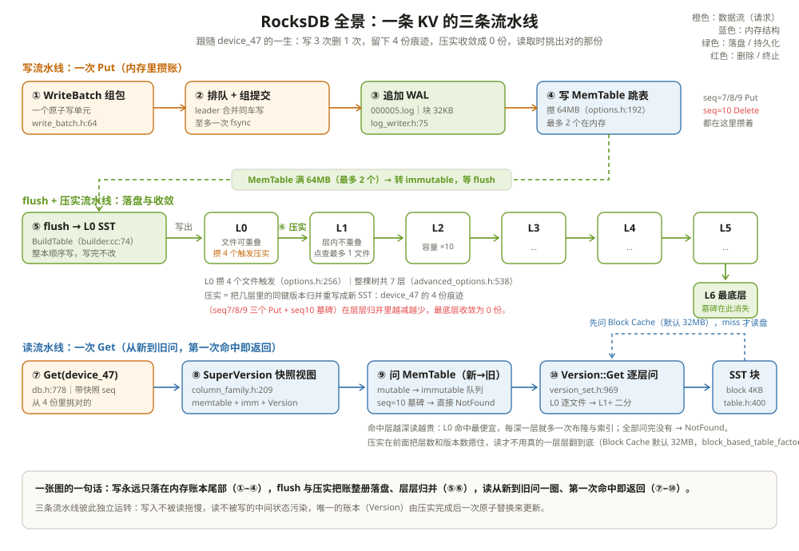

# 架构概述：一条 KV 的进来与出去

先看一个让人发毛的现场。一个刚接手埋点服务的工程师，第一次翻 RocksDB 的数据目录：明明 `device_47` 这个键只「写过一次」，目录里却翻出好几个 SST 文件里都有它的影子；删掉的键过了一个小时还占着盘；`du` 看到的空间是业务估算量的两倍。他怀疑遇到了 bug，提了工单。

不是 bug。差别不在「代码写错了」，而在 RocksDB 的根本工作方式：**它从不原地修改数据，一切都是追加**。写入是追加一条记录，更新是追加一条更大的新版本，删除是追加一条墓碑（一条写着「这个键没了」的特殊记录）。一个键的一生会在系统里留下多份痕迹，由后台的压实慢慢收敛。看懂这套「先攒账、再并账」的流水线，上面三个「怪现象」会翻转成三个特性：写入永远不等旧数据、删除永远不挡新写入、盘上的空间永远有人负责收拾。

全章跟一条 KV 走。它叫 `device_47`，来自一台温度传感器：

```text
贯穿全章的 4 条记录：
seq=7   Put    device_47 -> {"temp":61.2}   ← 第一次写
seq=8   Put    device_47 -> {"temp":61.5}   ← 更新 1
seq=9   Put    device_47 -> {"temp":61.3}   ← 更新 2
seq=10  Delete device_47                    ← 删除

同一时刻，系统里最多同时存在这 4 份痕迹；
读取的任务是从 4 份里挑出「对的那份」；
压实的终点是让它们收敛成 0 份。
```

seq 是全库递增的序号，每写一条领一个号。它就是「谁更新」的唯一裁判——后面对哪个版本算数，全看它。

四个词先钉死，后面不再重复解释：**SST（Sorted String Table，排序字符串表）** 是磁盘上的有序不可变文件；**L0（Level 0）** 是最新的一层，文件之间可能重叠；**WAL（Write-Ahead Log，预写日志）** 是崩溃后把内存账本补回来的日志；**LSM-Tree（Log-Structured Merge Tree，日志结构合并树）** 是「内存攒写、磁盘追加、后台归并」这一整套结构。

---

## 一、先说定位：它是一个库，不是一台数据库

RocksDB 的自我介绍写在 README 的第一段：**「This code is a library that forms the core building block for a fast key-value server」**（`README.md:9-10`）——它是组成 KV 服务的**核心构件**，是个库，不是服务。没有端口、没有网络协议、没有 SQL 解析层，你要用的是自己进程里的几个函数调用：

```cpp
DB* db = nullptr;
DB::Open(options, "/data/metrics", &db);            // db.h:258
db->Put(WriteOptions(), "device_47", R"({"temp":61.2})");   // db.h:582
std::string v;
db->Get(ReadOptions(), "device_47", &v);            // db.h:778
delete db;
```

`include/rocksdb/db.h:245-248` 的注释把它的本质说得很准：**一个持久的、带版本的、有序的键值映射**。拆开看每个词：持久——数据落盘，进程重启还在；带版本——同一个键可以有多个版本共存，靠 seq 排先后；有序——按键排序存储，范围扫描天然支持。Kafka Streams、Flink 的 RocksDB StateBackend、TiKV、MyRocks，全都是把这个库嵌进自己的进程里用。

它 fork 自 LevelDB（`README.md:5-7`），但针对服务器负载做了脱胎换骨的改造：多线程压实、单库支撑 TB 级数据（`README.md:11-15`）。LevelDB 像一台单缸发动机，RocksDB 把它改成了为多核、大内存、SSD/HDD 混布的服务器机器设计的引擎。

它和 MySQL InnoDB 的分工一句话说清：**InnoDB 把数据组织成 B+ 树，更新一行要原地改某个叶子页；RocksDB 把更新攒在内存里、追加成不可变文件**。所以「写多、读也不少、模型就是 KV、能接受后台慢慢整理」的负载交给 RocksDB，强事务、复杂 SQL、点查为主的负载留给 InnoDB——这就是 MyRocks 把 RocksDB 挂在 MySQL 后面当存储引擎、Flink 把它挂在算子后面当状态后端的共同逻辑。

| 维度 | InnoDB（B+ 树） | RocksDB（LSM） |
| --- | --- | --- |
| 更新一行的动作 | 定位叶子页 → 原地改 → 可能分裂 | 追加一条更大 seq 的新版本 |
| 随机写的盘上形态 | 每次更新散乱地碰页 | 攒内存，落盘只有整册顺序写 |
| 查询能力 | SQL、二级索引、事务 | Get / 迭代器 / 列族 |
| 擅长 | 点查、强事务、复杂查询 | 高吞吐写入、压缩比、TB 级单库 |

---

## 二、全景部件表：每样东西住在哪个文件



RocksDB 的部件不多，一张表放得下。每个部件只记一句话职责，细节留给后面各章：

| 部件 | 住在哪 | 职责一句话 |
| --- | --- | --- |
| DB 接口 | `include/rocksdb/db.h:250` | 对外的全部 API：Open/Put/Get/Delete/迭代器，上层只见它 |
| DBImpl | `db/db_impl/db_impl.h:221` | DB 的唯一主实现，三条流水线的总调度台 |
| ColumnFamilyData | `db/column_family.h:301` | 一个列族的全部家当（memtable、Version、压实状态）；不指定就用 `default` 族（`db.h:68`） |
| SuperVersion | `db/column_family.h:209` | 把「当前 memtable + immutable 队列 + Version」打包成一份只读视图，读路径拿它 |
| MemTable | `db/memtable.h:582` | 内存账本，跳表实现，写的第一落点 |
| WAL Writer | `db/log_writer.h:75` | 追加式日志，崩溃后把 memtable 补回来的凭据 |
| BuildTable | `db/builder.cc:74` | 把一批有序数据写成一本 SST，flush 和压实共用 |
| FlushJob | `db/flush_job.h:57` | memtable → L0 的搬运工 |
| Compaction / CompactionJob | `db/compaction/compaction.h:83`、`db/compaction/compaction_job.h:143` | 层与层之间的归并重写，去旧版本、消墓碑 |
| Version / VersionSet | `db/version_set.h:969`、`db/version_set.h:1327` | 「当前数据由哪些 SST 组成」的账本，全库一份 |
| TableCache / Block Cache | `db/table_cache.h:64`、`include/rocksdb/advanced_cache.h:44` | 开表句柄的缓存 / 读回来的块在内存的家 |
| BlobFileCache | `db/blob/blob_file_cache.h:28` | 大值单独安家时的读侧管家 |

把部件和文件对上号之后，开一个库再看数据目录，每个文件都有了主：

```text
/data/metrics/
├── CURRENT            ← 指着当前生效的 MANIFEST（file/filename.h:91-96）
├── MANIFEST-000001    ← VersionSet 的持久化账本：现在有哪些 SST、各在哪层
├── 000005.log         ← WAL：memtable 里还没落盘的数据先记在这
├── 000006.sst         ← 第一本 SST（第一个 memtable 满 flush 出来的）
├── OPTIONS-xxxx       ← 打开时的参数快照
└── LOCK               ← 同一目录只许一个读写实例（DB::Open 的承诺）
```

三条流水线就跑在这些部件上：**写**走 ①②③④，**flush + 压实**走 ⑤⑥，**读**走 ⑦⑧⑨⑩——对应上图的三条泳道。下面三节把每条流水线放电影。

---

## 三、写流水线：先在内存里攒账，SST 一个字节都还没动

写入口是 `DBImpl::WriteImpl`（`db/db_impl/db_impl_write.cc:881`）。一次 Put 的四步，步步有名字：

1. **① 组包**：请求装进一个 `WriteBatch`（`include/rocksdb/write_batch.h:64`），它是「一批写」的原子单位，批内多条记录共用一次 seq 分配；
2. **② 排队 + 组提交**：写线程在队列里等号，轮到时由 leader 把同时到达的写合成一辆车——整趟车只做一次日志追加、至多一次 fsync；
3. **③ 追加 WAL**：整车记录顺序写进 `000005.log`。WAL 按 32KB 的块分片（`db/log_format.h:54`），写端是 `db/log_writer.h:75` 的 `Writer`。它是崩溃恢复的凭据：memtable 在内存里，进程挂了就没了，能把它补回来的只有这份日志；
4. **④ 写 MemTable**：记录插进内存跳表，同键按 user_key 升序、seq 降序排——**最新版本永远排在最前**。随后发布 seq，写请求返回。

```text
举例：Put("device_47", {"temp":61.2}) 返回时，世界是什么样
WAL：多了一行 seq=7 的记录（顺序追加，几十字节）；
MemTable：多了一个跳表节点（device_47, seq=7, value=61.2）；
SST：一个都没有。device_47 此刻只活在内存账本里。
返回 OK。此刻进程崩溃？重启后拿 WAL 回放，seq=7 回来了。
```

接着写 seq=8、seq=9，删一次写 seq=10——**四条记录并排躺在 memtable 里，谁也不覆盖谁**。注意第四条：RocksDB 里的「删除」不是把旧值抹掉，而是追加一条 type 为 deletion 的记录（墓碑），它和 Put 走完全相同的写路径。旧值此刻还在，只是被墓碑「标记为作废」，等压实来收。

这四条记录什么时候离开内存？看两个出厂值：`write_buffer_size = 64MB`（`include/rocksdb/options.h:192`）——memtable 攒到 64MB 就转成 immutable，等后台 flush；`max_write_buffer_number = 2`（`include/rocksdb/advanced_options.h:271`）——它管的是**等待 flush 的 immutable 个数**，正在写的 mutable 另算。停写线是 immutable 达到 2，所以最坏情况是一个列族同时有 1 本 mutable + 2 本 immutable。

```text
举例：这两行默认值决定了内存的一笔底账
单个列族：64MB × (2 + 1 本 mutable) = 192MB 上限；
12 个列族：192MB × 12 ≈ 2.3GB，这是一项，还不算块缓存。
后面第 12 篇会算整本内存总账，这里先记住乘法。
```

---

## 四、flush 与压实流水线：4 份痕迹收敛成 0 份

memtable 满了，`FlushJob`（`db/flush_job.h:57`）接手，调 `BuildTable`（`db/builder.cc:74`）把整本账**顺序写成一个 L0 SST 文件**，然后腾出内存。整个过程中旧文件一个字节都不改——这是 LSM 的纪律：**文件一旦写完就不可变，所有修改都发生在新文件里**。

device_47 的 4 份痕迹是怎么随时间铺开的：

| 时刻 | device_47 的痕迹 | 痕迹在哪 |
| --- | --- | --- |
| 写完 seq=7 | 1 条 Put | memtable |
| 又写 seq=8/9、删 seq=10 | 4 条记录 | 新 memtable（旧的已 flush 则在前几本 SST 里） |
| 4 个 memtable 都 flush 后 | 4 条记录 | 分散在 L0 的 4 个文件里 |
| 压实走到底层后 | 0 条 | —— |

L0 的文件彼此键范围重叠（它们来自四个互不知情的 memtable），点查要逐个问。所以 L0 攒够 `level0_file_num_compaction_trigger = 4` 个文件（`include/rocksdb/options.h:256`）就触发压实：`Compaction`（`db/compaction/compaction.h:83`）选定文件，`CompactionJob`（`db/compaction/compaction_job.h:143`）执行归并——把几层的输入**按内部键排序归并**，同键从新到旧只留该留的，输出一批新的、层内互不重叠的 SST。整棵 LSM 树共 7 层（`num_levels = 7`，`include/rocksdb/advanced_options.h:538`）。

```text
举例：device_47 的 4 份痕迹如何一层层收敛（Leveled，dynamic 基座）
L0：f1[seq7] f2[seq8] f3[seq9] f4[seq10]
    ↓ L0 → 最底层（level_compaction_dynamic_level_bytes 默认开，
      空库的基座就是 L6，不是 L1）
L6：seq7/8/9 被更新的记录作废，丢弃；
    墓碑 seq10 要留还是能退休，取决于两件事：
    底下还有没有更老的版本、有没有快照需要看见删除前的状态。
    ├─ 都没有 → 墓碑当场退休，四条记录一次清干净
    └─ 还有 → 墓碑留着继续遮挡，等更深层确认干净再丢
最终：device_47 在盘上 0 份痕迹。删除此刻才真正完成。
```

注意压实的双重身份：它既是**空间回收**（4 份痕迹收成 0 份），更是**读优化**——不压实，每次 Get 都得把 4 个 L0 文件挨个问一遍；压实之后，该键在每层最多一份，问的人少了一大截。写路径把账搞乱，压实负责把账理清，这是 LSM 用「读的复杂度」换「写的顺序性」之后，自己给自己还债的方式。

---

## 五、读流水线：从 4 份里挑出对的那份

读入口是 `DBImpl::GetImpl`（`db/db_impl/db_impl_sync_and_async.h:155`）。一次 Get 四步：

1. **⑦ 发起**：`DB::Get`（`include/rocksdb/db.h:778`），用户视角只有一个键；
2. **⑧ 钉住视图**：拿一份 `SuperVersion`（`db/column_family.h:209`）——memtable、immutable 队列、当前 Version 三者的打包快照。此后无论 flush、压实怎么换视图，这次读看到的是同一个世界；
3. **⑨ 问 memtable**：先问 mutable，再按新到旧问 immutable 队列；
4. **⑩ 问磁盘**：`Version::Get`（`db/version_set.h:969`）逐层找文件——L0 按文件从新到旧逐个问，L1 及以下每层至多一个文件能命中（层内不重叠的回报）；每个文件先用布隆过滤器和键范围裁剪，真要读时以块为单位（`block_size = 4KB`，`include/rocksdb/table.h:400`），读回来的块先住进块缓存（默认 32MB，`table/block_based/block_based_table_factory.cc:627-630`），下次同块直接命中内存。

整条读路径只有一条排序规矩：**座次即新旧，第一个答案算数**。memtable 比 immutable 新，immutable 比 L0 新，L0 的 4 号文件比 3 号新——顺着问，第一次命中就返回。

```text
举例：Get("device_47") 在两个时刻的答案与成本
时刻 A（4 份痕迹都在 L0，删完还没压实）：
  memtable 没有 → L0 从新到旧问：f4 里有 seq=10 的墓碑
  → 直接返回 NotFound，f1/f2/f3 一个都不用碰。
时刻 B（压实收走全部 4 条之后）：
  memtable 没有 → 每层问一圈，谁都没有 → NotFound。
两种 NotFound 结果相同、成本天差地别：
A 被墓碑提前终止，B 要把所有层问到底才知道「真没有」。
```

这条流水线最贵的情形是「命中在很深的层」：每深一层就多一次布隆检查、一次索引查找、可能多一次读盘。所以监控里 `GET_HIT_L0` 占比下降，通常不是读路径退化了，而是数据冷下去了——治它的药不在读路径，在上游压实把热数据保持在浅层。

---

## 六、关键默认值：出厂设置里藏着形状

这一章出现的数集中摆一次，后面各章会反复回来对账：

| 参数 | 默认值 | 定义在哪 | 它决定了什么 |
| --- | --- | --- | --- |
| write_buffer_size | 64MB | `include/rocksdb/options.h:192` | 内存账本攒多大才 flush |
| max_write_buffer_number | 2 | `include/rocksdb/advanced_options.h:271` | 等待 flush 的 immutable 上限（mutable 另算） |
| level0_file_num_compaction_trigger | 4 | `include/rocksdb/options.h:256` | L0 攒几个文件开始压实 |
| level0_slowdown / stop_writes_trigger | 20 / 36 | `include/rocksdb/advanced_options.h:547`、`:554` | L0 太厚的减速线与停写线 |
| num_levels | 7 | `include/rocksdb/advanced_options.h:538` | LSM 树一共几层 |
| block_size | 4KB | `include/rocksdb/table.h:400` | SST 里 I/O、缓存、压缩的共同单位 |
| block cache | 32MB | `table/block_based/block_based_table_factory.cc:627-630` | 读块的内存预算（未显式配置时） |
| WAL 块大小 | 32KB | `db/log_format.h:54` | 日志追加的分片单位 |

这些数不是随手拍的：64MB × 2（两本待 flush 的 immutable）给 flush 留了两本的时间窗，正在写的 mutable 另算；4 个 L0 文件给点查封了顶（最多多问 4 个文件）；7 层让数据从 L0 沉到底层要走足够多趟、每趟都顺手清掉一些旧版本。改动任何一个之前，先想清楚它牵动哪两条流水线。

---

## 七、和 Parquet 摆在一起看：互为镜像的两条流水线

| 维度 | RocksDB | Parquet |
| --- | --- | --- |
| 定位 | 嵌入式 KV 引擎（库，长在应用进程里） | 独立文件格式（给任意引擎读的文件） |
| 优化方向 | 写优化：随机写摊成内存追加 + 整册顺序落盘 | 读优化：随机读摊成整列顺序扫描 |
| 典型负载 | 点查、短范围、覆盖写 | 扫描、聚合、只读分析 |
| 数据可变性 | 可变：更新 = 追加新版本，压实收敛 | 不可变：改一行 = 重写行组/文件 |
| 谁在记账 | WAL（崩溃恢复）+ MANIFEST（版本账本） | footer + Iceberg/Delta 清单 |
| compaction 的含义 | 常态后台任务，不停地重写过程数据 | 批量运维作业，把小文件收成大文件 |
| 最小读写单位 | 4KB block（I/O/缓存/压缩三合一） | ~8KB 页（编码/压缩单位，非 I/O 单位） |

两者互为镜像。**LSM 把随机写摊成顺序写，代价是读要从新到旧问好几层；列存把随机读摊成顺序读，代价是更新要重写整摞**。一个把写变便宜、把读变贵；一个把读变便宜、把写变贵。

更本质的区别在「过程」与「终态」：RocksDB 管的是**过程数据**——同一个键被改一百次，引擎有义务自己收拾出一个答案，compaction 是生存必需，不做读路径就垮；Parquet 管的是**终态数据**——写下去时就认定它不再改，compaction 只是收小文件的运维优化，不做系统照样对，只是元数据开销高。所以 RocksDB 的压实永远在跑，Parquet 的 compaction 想跑才跑。

清单层的对照也工整：RocksDB 用 WAL 兜「memtable 还没落盘」的窗口，用 MANIFEST 记「现在由哪些 SST 组成」；数据湖用 Iceberg/Delta 清单记「现在由哪些 Parquet 文件组成」，用提交日志保证原子切换。两边都在用「不可变文件 + 一本可原子替换的账」这同一个套路。事实上两者经常出现在同一条链路的两端：Flink 用 RocksDB 存算子状态（写优化，过程数据），算完输出 Parquet 进数据湖（读优化，终态数据）。

---

## 八、和 LevelDB、MyRocks、TiKV、HBase 摆在一起看：同是 LSM，边界不同

RocksDB 不是孤岛。它 fork 自 LevelDB，又被 MyRocks、TiKV 这类系统当作积木，HBase 则用另一套 LSM 实现解决相似问题。把边界摊开：

| 维度 | RocksDB | LevelDB | MyRocks | TiKV | HBase |
| --- | --- | --- | --- | --- | --- |
| 定位 | 嵌入式 KV 库 | 嵌入式 KV 库（RocksDB 前身） | MySQL 存储引擎 | 分布式事务 KV | 分布式宽表 |
| 事务/MVCC | 单库原子写 + 快照，无跨行事务 | 无事务 | MySQL 事务 | 分布式事务 + MVCC | 单行原子，跨行有限 |
| 压实 | 多线程、策略可插拔 | 单线程 Leveled | 复用 RocksDB 压实 | RocksDB 之上按 Region 管理键范围 | RegionServer 压实 HFile |
| 扩展 | 单机 | 单机 | 单机（靠 MySQL 分片） | 自动分片 + Raft | HDFS 分片 + RegionServer |
| 最适合 | 写多、状态后端、KV | 轻量嵌入、读多写少 | MySQL 上写多读少的表 | 分布式事务 KV | Hadoop 生态宽表 |

一句话：**RocksDB 把「单机 LSM」这一层做到了可嵌入、可调优；再往上，谁需要 SQL 就套 MyRocks/InnoDB，谁需要分布式就套 TiKV/HBase。** 读 RocksDB 源码的价值也在这里：TiKV 的 Region 管理、HBase 的 HFile 压实、MyRocks 的事务，底层都能看到同一套「内存表 + WAL + 不可变文件 + 后台归并」的影子；把这套影子看懂，换到哪个系统都不算从零开始。

---

## 这一章留下的线索

- **RocksDB 是一个库，不是一台数据库**：`DB` 接口就是进程内的函数调用（Open/Put/Get），没有端口和协议；fork 自 LevelDB，为服务器负载（多核压实、TB 级单库）改造；
- **一切皆追加**：写是追加、更新是追加更大 seq 的新版本、删除是追加墓碑；一个键一生留下多份痕迹，压实负责收敛；
- **三条流水线**：写（WriteBatch → 组提交 → WAL → memtable）、flush+压实（memtable 满 → L0 → 逐层归并去重）、读（SuperVersion → memtable → Version 逐层，第一次命中即返回）；
- **Version/VersionSet 是全库唯一的数据账本**：记录「当前由哪些 SST 组成」，flush 与压实都以一次原子替换收尾——这是「不可变文件」能成立的前提；
- **出厂默认值里藏着引擎的形状**：64MB 写缓冲、2 个、4 个 L0 文件触发、7 层、4KB 块、32MB 块缓存——后面每章都会回到这几个数。

下一章把写流水线的第 ④ 步拆开：内存账本本身怎么组织、怎么判满、满了之后写请求去哪等——[LSM Tree 与 Memtable：先把改动攒在内存里](../engine/01-LSM-Tree与Memtable.md)。

### 后续章节地图

| 篇 | 章节 | 它在故事线的哪一段 |
| --- | --- | --- |
| 02 | [LSM Tree 与 Memtable](../engine/01-LSM-Tree与Memtable.md) | 写流水线第 ④ 步：内存账本怎么攒、怎么判满 |
| 03 | [写入路径与 WAL](../engine/02-写入路径与WAL.md) | 写流水线第 ①–③ 步：一次 Put 的每道关卡与写停顿 |
| 04 | [读取路径与迭代器](../engine/03-读取路径与迭代器.md) | 读流水线第 ⑦–⑩ 步：Get 与迭代器怎么问、快照怎么算 |
| 05 | [压实策略](../compaction/01-压实策略.md) | 压实流水线选形状：Level、Universal、FIFO 三本账 |
| 06 | [压实任务与选择器](../compaction/02-压实任务与选择器.md) | 压实流水线第 ⑥ 步：谁该搬、谁来搬、怎么安全换账本 |
| 07 | [SST 表格式](../storage/01-SST表格式.md) | flush/压实的产出物：磁盘上那本有序账本的骨架 |
| 08 | [基于块的表内部机制](../storage/02-基于块的表内部机制.md) | 4KB 块里面：编码、restart point、布隆与索引 |
| 09 | [Blob 文件存储](../storage/03-Blob文件存储.md) | 大值不跟着键走 LSM 的支线 |
| 10 | [块缓存架构](../cache/01-块缓存架构.md) | 读流水线的内存兜底：读过的块怎么安家 |
| 11 | [二级缓存与分层缓存](../cache/02-二级缓存与分层缓存.md) | 内存装不下时：压缩层与 NVMe 层 |
| 12 | [内存管理](../cache/03-内存管理.md) | 全程记账：memtable、缓存、索引的内存总账 |

---

## 附：这一章的源码入口

> 除特别注明外，本节引用的源码文件与行号都来自 facebook/rocksdb 主分支（11.13.0）。

- `README.md:5-15`：项目自我定位——LevelDB 的后继、库而非服务、LSM 设计与多线程压实
- `include/rocksdb/db.h:245-260`：DB 类注释「持久的、带版本的、有序的键值映射」与 `DB::Open`
- `include/rocksdb/db.h:582-590、778-782`：Put 与 Get 的入口签名
- `db/db_impl/db_impl.h:221-224`：`DBImpl : public DB`——唯一主实现
- `db/db_impl/db_impl_open.cc:2370、2690`：`DB::Open` 与 `DBImpl::Open` 两级入口
- `db/db_impl/db_impl_write.cc:881`：写流水线入口 `WriteImpl`
- `db/db_impl/db_impl_sync_and_async.h:155-157`：读流水线入口 `GetImpl`
- `db/column_family.h:209-213、299-301`：SuperVersion 的打包视图；ColumnFamilyData 的家当
- `db/memtable.h:582` 与 `db/log_writer.h:40-75`、`db/log_format.h:54`：内存账本、WAL 写端与 32KB 块格式
- `db/builder.cc:74`、`db/flush_job.h:57`、`db/compaction/compaction.h:83`、`db/compaction/compaction_job.h:143`：产出 SST 的四件套
- `db/version_set.h:143-146、967-969、1321-1327`：VersionStorageInfo、Version、VersionSet 三级账本
- `db/table_cache.h:64`、`include/rocksdb/advanced_cache.h:44`、`db/blob/blob_file_cache.h:28`：三处缓存管家
- `include/rocksdb/options.h:176-192、244-256` 与 `include/rocksdb/advanced_options.h:259-271、537-554`：本章全部默认值的出处
- `include/rocksdb/table.h:395-400` 与 `table/block_based/block_based_table_factory.cc:624-630`：4KB 块与 32MB 默认块缓存
- `file/filename.h:87-96`：MANIFEST 与 CURRENT 的命名规则

---

## 思考题

1. 把 `write_buffer_size` 调到 640MB、`max_write_buffer_number` 保持 2。一个 12 列族的库，memtable 一项最多占多少内存？进程崩溃后重启，恢复时要多回放什么？代价落在哪条流水线上？
2. device_47 的 4 条记录分散在 L0 的 4 个文件里时，一次 `Get("device_47")` 最多要问几个文件？压实到 L1 收成一份之后呢？删除（墓碑还在 L1、底下无数据）的第三种情况呢？
3. 「没有 compaction 的 LSM 不是完整引擎」，但「不做 compaction 的 Parquet 数据湖还能跑」。用「过程数据 / 终态数据」解释这两句话为什么同时成立。
4. 嵌入式意味着每个进程自带一份引擎。两个进程同时对同一个目录调 `DB::Open` 会发生什么？（提示：`include/rocksdb/db.h:252-259` 的注释和目录里的 LOCK 文件。）
