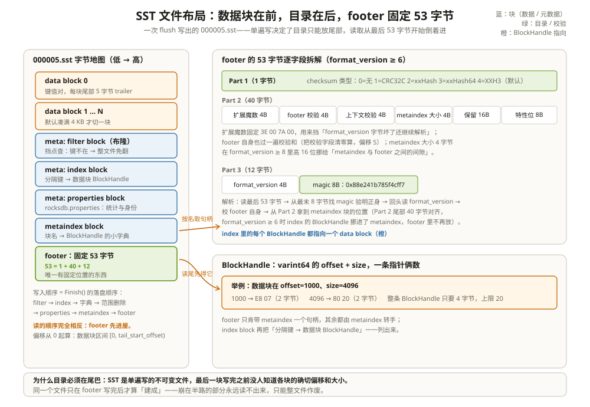

# SST 表格式：磁盘上的有序账本

凌晨两点，一台机器上的备份脚本「顺手」把数据目录同步到了远端，断点续传逻辑出了偏差，某个 SST 文件被截短了几百字节。文件大小看起来一切正常，RocksDB 重启后却直接拒绝打开，报错里出现 `Corruption: Input is too short to be an SST file` 和 `block checksum mismatch` 这类字样。用 `sst_dump` 一查，坏的不是某个数据块，而是文件最尾部的一段。

差别不在「文件坏了多少」，而在**这个格式的命门恰好长在尾巴上**。SST 把全部目录信息放在文件最后固定的 53 字节里，尾巴一缺，前面的数据块纵然完好也一张地图都没有。这一章把这 53 字节和它背后整套布局拆开：SST 是什么、块怎么排、footer 怎么解析、每块的校验和怎么工作——并且时时和 Parquet 文件对照着看，因为这两个格式在骨架上是同一个思路的两次实现。

把 SST 想成**一本按页码装订的账本**：正文一页页写下去（data blocks），写完以后在封底贴一张目录卡（footer），目录卡上只有一个地址——仓库保管员（metaindex）的柜号，保管员手里才有全书其余部分的钥匙。

---

## 一、SST 是什么：一个不可变的有序块集合

SST 的全名是 Sorted String Table，来历是它的两个硬约束：

1. **按键有序**。文件里的键值对按比较器升序排列，一个乱序的输入根本写不进去。外部文件工具 `SstFileWriter` 把这条规矩写成了报错：上一个键之后来的键必须严格更大，否则直接返回 `InvalidArgument("Keys must be added in strict ascending order.")`（`table/sst_file_writer.cc:262-267`）；
2. **不可变**。文件一旦写完（footer 落盘）就再也不改：删除是追加墓碑，更新是新版本写进新文件，旧文件只能等压实整体退役。

```text
举例：为什么不可变是全系统的地基
memtable 满 → flush 出 000005.sst，里面是 device_47@seq7
之后 Put(device_47) → 进新 memtable → flush 出 000009.sst，里面是 device_47@seq12
两个文件同时存在，谁也不改谁；
读路径靠「从新到旧问，第一个答案算数」消解多版本（读取路径篇讲过）；
块缓存里的页永远不会过期——文件不变，页就不变。
```

不可变带来一连串免费的好处：**读不用加锁**（读的人拿着旧文件看，写的人生成新文件）；**缓存键永远有效**（这一章第五节会看到唯一 ID 怎么保证跨进程也不撞）；**压实只增不改**（输出新文件、在 MANIFEST 里原子换名，崩了就把半成品删掉重来回放）。文件名也简单到只有编号：`000005.sst`，六位数字编号加 `.sst` 后缀，由 `file/filename.cc:66-71` 的 `MakeFileName` 用 `%06llu` 格式拼出来（后缀定义在 `file/filename.cc:31`）。

---

## 二、摊开文件：块排在前，目录在后

一个 BlockBasedTable 格式的 SST，从低地址到高地址依次是：

```text
[data block 0][data block 1]...[data block N]
[meta block: filter]          ← 布隆过滤器
[meta block: index]           ← 分隔键 → 数据块 BlockHandle
[meta block: properties]      ← rocksdb.properties，统计与身份
[metaindex block]             ← 块名 → BlockHandle 的小字典
[footer: 53 字节]             ← 固定位置，整个文件唯一可靠的入口
```

这个顺序不是设计癖，是写入顺序的自然结果。表构建器收尾时按固定次序落盘（`table/block_based/block_based_table_builder.cc:4055-4062` 的注释把七步写得明明白白）：filter → index → 压缩字典 → 范围删除 → properties → metaindex → footer（字典与范围删除块按需出现，图里省略）。**数据块在写键值对的过程中就流式写掉了，目录只能等所有块写完才有内容可写**——这就是 footer 必须在尾部的全部原因。

```text
举例：给 000005.sst 标一次尺（数字是示意，结构是真的）
offset 0        data block 0（4 KB）          ← tail_start_offset 之前都是数据块
offset 4096     data block 1
...
offset 630,000  data block N
offset 631,000  filter block（布隆，比如 120 KB）
offset 751,000  index block（比如 40 KB）
offset 791,000  properties block
offset 791,500  metaindex block（几十字节：几条"块名→句柄"）
offset 791,640  footer（53 字节）→ 文件总长 791,693
footer 只透露一件事：metaindex 在 791,500、大小 140；
metaindex 再透露 properties 和 index 在哪；index 最后把 150 多个数据块的
地址交出来。三层接力，每一层的钥匙都在上一层手里。
```



meta blocks 是一个集合名，装的都是「不是键值对、但要跟着文件走」的块：filter、properties、压缩字典（`rocksdb.compression_dict`）、范围删除墓碑（`rocksdb.range_del`），块名字符串定义在 `table/meta_blocks.cc:32-36`。metaindex block 则是这张清单的目录——它本身也是一个块，内容是「块名 → BlockHandle」的键值对（`table/meta_blocks.cc:125-137`）。format_version ≥ 6 起，index block 的句柄也登记进 metaindex（`table/format.h:248-251`，写入点 `table/block_based/block_based_table_builder.cc:3559-3563`），footer 里只留 metaindex 一个句柄。

---

## 三、footer：53 字节怎么逐字段解析

footer 是整个文件里唯一有固定位置、固定大小的结构。`table/format.h:391-393` 给出算式：

```text
kNewVersionsEncodedLength = 1 + 2 * BlockHandle::kMaxEncodedLength + 4 + 8
                          = 1 + 2 * 20                    + 4 + 8
                          = 53
```

其中 `BlockHandle::kMaxEncodedLength = 2 * kMaxVarint64Length = 20`（`table/format.h:83`，`kMaxVarint64Length=10` 定义于 `util/coding.h:36`）。53 字节分三段，`table/format.cc:233-272` 有一段权威的格式注释，翻译成字段表：

| 段 | 字节 | 字段 | 说明 |
| --- | --- | --- | --- |
| Part 1 | 1 | checksum 类型 | 0/1/2/3/4，见第五节 |
| Part 2 | 4 | 扩展魔数 | 固定 `3E 00 7A 00`（`table/format.cc:270`） |
| Part 2 | 4 | footer 自身校验和 | 算之前把本字段清零（`table/format.cc:486`） |
| Part 2 | 4 | base_context_checksum | 防错位校验的种子（fv ≥ 6 新增） |
| Part 2 | 4 | metaindex 块大小 | fv ≥ 8 时高 16 位改记 metaindex 与 footer 间的间隙 |
| Part 2 | 16 | 保留零填充 | 为未来文件级校验和留位 |
| Part 2 | 8 | 不兼容特性位 | 读到未知非零位直接拒绝打开 |
| Part 3 | 4 | format_version | 当前最新 8（`include/rocksdb/table.h:822`） |
| Part 3 | 8 | 魔数 | `0x88e241b785f4cff7`（`table/block_based/block_based_table_builder.cc:289`，取 `sha1("rocksdb.table.block_based")` 的前 64 位） |

解析顺序是**从后往前**：`ReadFooterFromFile` 先算好 `read_offset = 文件大小 - 53`（`table/format.cc:629-631`，读 53 字节到缓冲），`Footer::DecodeFrom` 再从缓冲最末 8 字节读出魔数验明正身（`table/format.cc:421-422`），回头读 Part 3 的 format_version，校 footer 自身的校验和，最后从 Part 2 解出 metaindex 块的确切位置（`table/format.cc:496-539`）。那个看起来多余的「扩展魔数」是道保险丝：如果 format_version 字节本身坏了，后面的字段会被错误地当参数解析，先用 4 个已知字节挡一下，错误就在门口被拦住（`table/format.cc:497-503`）。

```text
举例：一次"短了 100 字节"的文件会死在哪一步
备份脚本截掉了 footer 的最后 100 字节。
第 1 步：文件大小 - 53 处起读 → 只读到 0 字节可用 → 读到的长度 < 28
（最老 footer 都要 28 字节，table/format.h:383-385）→ "too short to be an SST"。
就算运气好读满了，最末 8 字节不是魔数 → "Bad table magic number"。
两条路都走不到数据块——这正是设计意图：别让残缺文件被当成"少了几条数据"。
```

---

## 四、BlockHandle：一条指针就是两个 varint64

文件里所有「指向某块」的位置都叫 BlockHandle，内容朴素到只有两个数：offset 和 size（`table/format.h:53-97`）。编码用 varint64：每个字节只用低 7 位放数据，最高位当「后面还有」的续位标记（`table/format.cc:51-65` 的 `EncodeTo` 就是连续两次 varint64 编码）。

```text
举例：offset=1000、size=4096 的 BlockHandle 长什么样
1000  = 0b111_1101000 → 低 7 位 1101000 → 0xE8（续位 1），剩 0b111 → 0x07
4096  = 0b1_0000_0000_0000 → 低 7 位全 0 → 0x80（续位 1），剩 0b100000 → 0x20
编码结果：E8 07 80 20，共 4 字节。
footer 里给句柄留 20 字节上限位、不足补零（老格式放 metaindex + index 两个，fv≥6 只放 metaindex）——这是 53 字节能「固定」的原因：
把变长的句柄塞进固定长度的槽，读取端就永远知道每个字段在哪。
```

这种「指针极小、上限极大」的设计直接影响了索引的尺寸预算：一个百万块的文件，仅索引项里的句柄就只要几 MB。代价是单个 varint64 最多表达 2^64-1 需要 10 字节，于是 footer 必须给句柄留满 20 字节上限位（老格式的两个句柄共 40 字节；fv≥6 只放 metaindex，腾出的空间给校验和字段）——用空间换解析的确定性。

---

## 五、校验和：每一块都自证清白

SST 的完整性和它的分块结构绑在一起：**每个块（数据块和元数据块一视同仁）末尾都跟一个 5 字节 trailer**——1 字节压缩类型 + 4 字节校验和，常量 `kBlockTrailerSize = 5` 定义在 `table/block_based/block_based_table_reader.h:133`。校验和覆盖「块体 + 压缩类型字节」，读块时逐块验（`table/block_based/reader_common.cc:26-64`：`len = block_size + 1`，末尾 4 字节是存储值）。压缩类型放在 trailer 而不是块头，意味着**先读完整个块才能知道它是怎么被压缩的**——和 Parquet「页头不压缩、页头告诉页体怎么解」的取舍正好相反。

类型有五档（`include/rocksdb/table.h:117-123`），默认 XXH3：

| 值 | 类型 | 特点 |
| --- | --- | --- |
| 0 | kNoChecksum | 完全不校验，省 CPU 赌硬件 |
| 1 | kCRC32c | 传统选择，硬件加速，误检概率 1/2^32 |
| 2 | kxxHash | XXH32，比 CRC32c 快 |
| 3 | kxxHash64 | XXH64 取低 32 位 |
| 4 | kXXH3 | 当前默认（`include/rocksdb/table.h:374`），大块更快 |

format_version ≥ 6 做了两件加强（`include/rocksdb/table.h:798-801` 的版本说明）：**footer 自身也有校验和**；每个块的校验和再混入一个「上下文修饰值」，由 footer 里的 base_context_checksum 和块的 offset 推导（`table/format.h:154-181`）。修的是一类真实事故——**块被挪了位置**：错位读到的块本身可能完好，普通校验和验不出来；混入偏移后，「这 4KB 到底是不是这个位置的数据」有了明确答案。

```text
举例：读一个块的收尾五个字节
一次"4 KB 块"实际从盘上拿回 4101 字节：
[ ........ 4096 字节块体 ........ ][ 1B 压缩类型 ][ 4B 校验和 ]
第 4097 字节是压缩类型（比如 0x00 = kNoCompression，块体原样）；
随后 4 字节是校验和。读取器按 footer 里记录的 checksum 类型对
「块体 + 类型字节」共 4097 字节重算，和存储值对不上就报
Corruption("block checksum mismatch")，这一块整块作废——
没有"只重读坏的一半"这回事，块的边界就是损坏的边界。
```

---

## 六、TableProperties：块的自述档案

properties block（键名 `rocksdb.properties`）是这个文件的体检报告。它也是用块编码装的一个大键值表——键是属性名，值是 varint64 或字符串；因为注定被整个顺序读、整块缓存，构建时把 restart interval 设成 int32 上限，等于放弃了块内前缀压缩（`table/meta_blocks.cc:142-145` 的注释明说「无需 restart points」）。字段全集在 `include/rocksdb/table_properties.h:279-512`，常用的挑出来：

| 属性 | 记什么 | 谁在用 |
| --- | --- | --- |
| num_entries / num_deletions / num_range_deletions | 键值数、点删数、范围删数 | 压实决策、运维排查 |
| raw_key_size / raw_value_size / data_size | 原始键值字节数、数据块总大小 | 压缩比估算、空间账 |
| index_size / filter_size | 索引、布隆的尺寸 | 缓存预算 |
| key_smallest_seqno / key_largest_seqno | 文件内 seq 范围 | 读路径快速短路 |
| db_id / db_session_id / orig_file_number | 数据库身份三件套 | 生成唯一 ID（下节） |
| column_family_name / comparator_name / filter_policy_name | 建档配置 | 跨版本打开时的自检 |

属性表的写入口在 `table/meta_blocks.cc:167-260` 的 `AddTableProperty`。用户还可以挂自定义收集器（`TablePropertiesCollector`，`include/rocksdb/table_properties.h:115-176`），在构建时逐键回调、把业务统计写进同一个块——比如「这个文件里过期数据占比」，给压实的删除策略当输入。

---

## 七、唯一 ID：db_id + session_id + 文件号

块缓存的键要回答一个问题：「这 4KB 到底是哪个文件的哪一块」。文件名会变（复制、迁移、重开库后编号重排），所以 RocksDB 从 properties 里的三件套派生出一个稳定 ID：`db_id`（建库时生成、终身不变）、`db_session_id`（每次打开重置）、`orig_file_number`。算法在 `table/unique_id.cc:60-122`：session 的低 64 位直接占第一槽位，`db_id` 与 session 高位做 64 位哈希、再异或文件号，得到 128 位；对外再过一层双向哈希散列分布（`:133-154`），编码成 16 字节（`:156-164`）。`db_session_id` 本身是 20 个 base36 字符，由 128 位随机数编码而来（`:15-27`）。

```text
举例：这个 ID 怎么防串台
库 A 和库 B 各有一个 000005.sst，块内容天差地别。
db_id 不同 → 派生 ID 不同 → 块缓存键不同 → 混进同一个缓存也不撞。
同一个库重启后文件号重排？db_session_id 每次打开都换 → 新 session 的键
不可能撞上旧 session 残留的缓存项。
块缓存键的构造点在 cache/cache_key.cc:296-308；表打开时还会拿
预期 ID 和文件 properties 里重算的 ID 对账（table/block_based/
block_based_table_reader.cc:885-897），对不上直接报 Corruption。
```

这套机制和 Parquet 生态里「文件路径即身份」的思路形成对照：Parquet 靠清单服务（Iceberg/Hive Metastore）给文件发身份证，SST 把身份证刻在自己的 properties 块里，走到哪带到哪。

---

## 八、不可变性被谁吃干榨净

「SST 不可变」在第一章是一句设计声明，在这里值得把受益方一个一个点名，因为**文件布局的每个便宜都由某个模块在兑现**：

| 受益方 | 拿到的便宜 | 靠的机制 |
| --- | --- | --- |
| 块缓存 | 缓存条目永不过期，不用失效协议 | 块内容 + 文件不变；唯一 ID 保证键永不撞 |
| 读路径 | 读一个文件不用加锁、不用等写者 | 读者拿的是旧文件的引用，写者只碰新文件 |
| 压实 | 输入随便读、输出随便写，崩了就弃 | 半成品文件不在 MANIFEST 里就不存在 |
| 备份/迁移 | `cp` 就是备份，硬链接就是快照 | 文件不再改，拷贝时刻即一致点 |
| 校验和 | 每块校验一次即可终身有效 | 没有原地修改，就没有「校验完又变了」 |

反过来看它收的账单：**更新一行 = 重写一层**（新版本永远在新文件里，旧版本要等压实清理）；**空间放大**（多版本共存期间，同一个键占多份盘）；**读放大**（上一章的「从新到旧问一圈」就是它的账单）。LSM 的所有参数调优，本质上都是在这三笔账之间挪钱。

---

## 九、和 Parquet 摆在一起看：同一套骨架的两次实现

把两个文件摊开，骨架几乎是逐项对应的：

| 部件 | RocksDB SST | Parquet | 同构点 |
| --- | --- | --- | --- |
| 魔数 | 尾部 8 字节 `0x88e241b785f4cff7` | 首尾各 4 字节 `PAR1` | 都用魔数验明正身；SST 放尾部因为入口在尾 |
| 数据单元 | data block（默认 4 KB，键值对） | Row Group → Column Chunk → Page | 都把大数据切成小读写单元 |
| 有序性 | 键全序，块间有序 | 行组内按行、按列聚簇 | 都靠排序/聚簇让「先看小抄再翻页」划算 |
| 目录 | metaindex + index + footer（53 字节） | FileMetaData（Thrift，尾部）+ 尾部 8 字节定位 | **目录后置**，尾部入口 + 反向解析 |
| 块定位 | BlockHandle（varint64 offset+size） | ColumnChunk 的 offset/size 字段 | 「偏移+长度」的二段式指针 |
| 布隆 | filter block，挡点查 | 列级布隆，挡行组/页 | 同一种概率结构，两种过滤粒度 |
| 统计 | TableProperties | RowGroup.statistics | 都给「跳过」提供依据 |
| 逐块校验 | 每块 5 字节 trailer + 上下文校验 | 页级 CRC32C（可选） | 都在页/块粒度自证清白 |

同构的原因可以一句话点透：**两者都是单遍写的不可变文件**。单遍写意味着写最后一块时才有完整的块清单，目录只能放尾部；不可变意味着所有优化都往「让读的人少碰盘」上堆——布隆、统计、页索引这些「小抄」才会出现。差异同样来自读写模式：SST 的目录服务「找一个键」（index 是键 → 块的映射），Parquet 的目录服务「裁剪一批列」（footer 是 schema + 统计树）；SST 的 footer 固定 53 字节是给「每次 Get 都要过一遍」的延迟做的妥协，Parquet 的 footer 是一整个 Thrift 树，反正分析查询只在开头付一次。

---

## 十、排障速查：报错对着布局找位置

SST 的报错信息几乎都带着布局坐标，按报错定位到本章的哪一节：

| 现象 / 报错 | 病灶在布局的哪一段 | 先看哪里 |
| --- | --- | --- |
| `too short to be an SST file` | footer 区（文件尾 53 字节） | 文件大小是否 ≥ 28/53，尾部有没有被截 |
| `Bad table magic number` | footer Part 3 的 8 字节魔数 | 文件是不是 SST（可能拷错了文件） |
| `Corrupt or unsupported format_version` | footer Part 3 的 4 字节版本号 | 老版本 RocksDB 读新格式文件 |
| `Bad extended magic number` | footer Part 2 的 4 字节保险丝 | format_version 字节级损坏 |
| `block checksum mismatch ... offset N` | 偏移 N 处那个块的 5 字节 trailer | 磁盘坏块；注意报错带 block_type |
| `Invalid blob offset`（blob 篇） | BlobIndex 指向的位置越界 | blob 文件与 SST 不同步 |
| properties 里 `db_session_id` 解析失败 | properties 块的身份三件套 | 文件来自极老版本，缓存键走兼容路径 |

---

## 这一章留下的线索

- SST = 按键有序的不可变块集合；不可变是缓存安全、无锁读、压实「只增不改」的地基；
- 文件布局：data blocks → meta blocks（filter/properties/字典/范围删除）→ metaindex → index → footer，写入顺序即落盘顺序；
- footer 固定 53 字节（1 + 40 + 12），从文件尾反向解析，扩展魔数挡住 format_version 损坏；BlockHandle = varint64 的 offset+size，上限 20 字节；
- 每块带 5 字节 trailer（压缩类型 + 校验和），format_version ≥ 6 起 footer 也有校验、偏移也参与校验；
- TableProperties 是文件的体检报告，db_id + db_session_id + 文件号派生出跨库不撞、跨重启不撞的唯一 ID，撑起块缓存键。

SST 的骨架到此齐了，但骨架里每个格子的内部还没拆：data block 里的键怎么压缩、restart point 怎么让二分成立、index 为什么要「缩短」、布隆和 Ribbon 怎么选——下一章把 SST 拆成一块一块：[基于块的表内部机制：把 SST 拆成一块一块](02-基于块的表内部机制.md)。

---

## 附：这一章的源码入口

> 除特别注明外，本节引用的源码文件与行号都来自 facebook/rocksdb 主分支（11.13.0）。

- `file/filename.cc:31、66-71`：SST 后缀 `.sst` 与 `000005.sst` 式命名（`%06llu`）
- `table/sst_file_writer.cc:262-267、275`：外部文件要求键严格升序；SstFileWriter 写入的 seq 固定为 0
- `table/block_based/block_based_table_builder.cc:4055-4062`：Finish 的七步落盘顺序——filter → index → 字典 → 范围删除 → properties → metaindex → footer
- `table/block_based/block_based_table_builder.cc:281-289`：魔数来历注释与 `0x88e241b785f4cff7` 的定义
- `table/format.cc:233-272`：footer 三段式格式权威注释；`:270` 扩展魔数、`:271` Part2 尺寸 40 字节
- `table/format.h:383-393`：`kVersion0EncodedLength=28`、`kNewVersionsEncodedLength=53` 的算式
- `table/format.cc:629-631、421-422、496-539`：读最后 53 字节 → 末 8 字节找魔数 → 解析 Part2/Part3 的完整链路
- `table/format.cc:51-65` 与 `table/format.h:83`：BlockHandle 的 varint64 编码与 20 字节上限（`util/coding.h:36` 的 kMaxVarint64Length=10）
- `table/block_based/block_based_table_reader.h:133` 与 `table/block_based/reader_common.cc:26-60`：块 trailer 5 字节布局与逐块校验和验证
- `include/rocksdb/table.h:117-123、374、798-801、822`：校验和类型枚举、默认 XXH3、format_version 6 的校验加强、最新版本 8
- `table/meta_blocks.cc:32-36、121-137、142-145、167-260`：meta 块名、MetaIndexBuilder、properties 块免 restart、属性逐项登记
- `include/rocksdb/table_properties.h:279-512`：TableProperties 字段全集（统计、身份、seq 边界等）
- `table/unique_id.cc:15-27、60-122、156-164`：db_session_id 编码、唯一 ID 派生算法、16 字节编码
- `cache/cache_key.cc:296-308` 与 `table/block_based/block_based_table_reader.cc:885-897`：唯一 ID 进块缓存键；打开文件时的 ID 对账

---

## 思考题

1. 备份工具截短了一个 SST 文件的尾部 100 字节，报错是 `too short to be an SST`；如果它改在文件**中间**挖掉 4 KB，RocksDB 打开时还能报出这个错吗？第一次读数据时会发生什么？校验和的哪一层会先拦住它？
2. 一个文件里 data block 的数量是 25 万。假设平均块大小 4 KB，估算 index block 至少多大；为什么 format_version ≥ 6 把 index 的 BlockHandle 从 footer 挪进了 metaindex，也不影响解析？
3. 把 `checksum` 从默认的 XXH3 换成 kNoChecksum 能省多少 CPU？结合「上下文校验」（base_context_checksum + offset）说明：哪些 corruption 是 kNoChecksum 也躲不掉、必须靠校验和才能发现的？
4. 两个库各自 flush 出了 `000005.sst`，被运维误拷到了同一个共享的二级缓存目录里。块缓存为什么不会读串？如果其中一个是老版本 RocksDB 生成的、properties 里缺 `db_session_id`，会发生什么？
