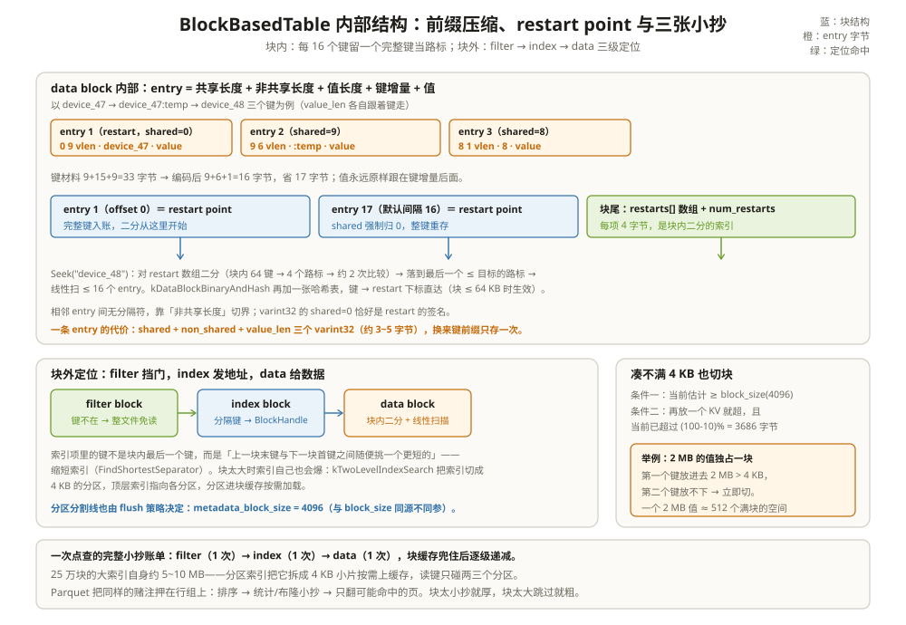

# 基于块的表内部机制：把 SST 拆成一块一块

一次压测里有个尖刺：点查一个 40 字节的键，盘上却落了 4 KB 的读；把 `block_size` 调大到 64 KB 想「一次多读点少跑几趟」，点查 P99 反而从 0.9 ms 涨到 3 ms。团队里有人怀疑缓存坏了，有人怀疑盘，最后 `sst_dump --show_properties` 给出答案：块平均 63 KB，单次点查解压的字节翻了 15 倍。

差别不在「读了多少数据」，而在**块是 I/O、缓存和压缩共同的最小单位**——它的内部编码决定了块内二分能不能成立，它的大小决定了每次点查、每次迭代要背多少额外字节。这一章把 SST 的格子拆开看：entry 怎么编码、restart point 是什么、index 和 filter 这两张小抄怎么工作、块什么时候切、什么值得压缩。

把 data block 想成**一页只写连续账号的账页**：每行只写「和上一行不同的部分」，但每隔 16 行重新誊一遍完整账号——这样翻页查账时，先看页边的行号目录（restart 数组）二分定位，再顺着誊清的行往下对。



---

## 一、data block 内部：前缀压缩加路标

块里的 entry 格式在 `table/block_based/block_builder.cc:21-36` 的注释里写得清清楚楚：

```text
shared_bytes:   varint32   ← 和上一个 entry 的键共享多少字节
unshared_bytes: varint32   ← 键剩下的部分
value_length:   varint32   ← 值长度
key_delta:      key 增量字节
value:          value 原始字节
```

```text
举例：三个键省了多少字节（delta encoding 打开时）
键按序：device_47（9B）、device_47:temp（14B）、device_48（9B）
entry 1：无前键可共享 → shared=0，存全键            → 键材料 9 字节
entry 2：与 device_47 共享 9 字节，只存 ":temp"      → 键材料 5 字节（省 9）
entry 3：与 device_47:temp 共享 8 字节，只存 "8"     → 键材料 1 字节（省 8）
32 字节的键材料压成 15 字节，省 53%。
代价：每个 entry 3 个 varint32 长度头（约 3~5 字节），共享越少越不划算。
```

把第一个 entry 的字节摊开在桌上（值假设 2 字节 `61 62`）：

```text
entry 1（restart）： 00 09 02 64 65 76 69 63 65 5F 34 37 61 62
                    │  │  │  └────── key_delta "device_47" ──────┘ └ value "ab"
                    │  │  └ value_length = 2
                    │  └ non_shared = 9（键剩下要存的字节）
                    └ shared = 0（和上一个键共享 0 字节）
entry 2（正常）  ： 09 05 02 3A 74 65 6D 70 62 62
                    └ shared=9 → key_delta 只剩 ":temp"（3A 74 65 6D 70），value "bb"
键的"地址"只在 restart 处重新出现一次，中间的 entry 全靠前一个键接力还原。
```

前缀压缩有个致命副作用：**第 N 个键的内容依赖第 N-1 个键**。要想在块内定位，必须能从某个确定位置开始解码——这就是 restart point（`table/block_based/block_builder.cc:326-330`）：每隔 `block_restart_interval`（默认 16，`include/rocksdb/table.h:413`）个 entry，强制 shared=0 存一个完整键，并把它的偏移记进块尾的 restarts 数组（每项 uint32，`table/block_based/block_builder.cc:228-247`）。块尾布局依次是 restart 数组、`num_restarts`、可选的块内哈希索引和块 footer。

```text
举例：restart interval 是一笔空间换时间的账
1 万个 20 字节的键、值 10 字节，全部装进块（示意）：
interval=16：约 625 个 restart 重存全键 → 键材料 ≈ 20KB×1.0 - 压缩节省，
             少存的是每个非 restart entry 的前缀（本例约省 40%）；
interval=1： 每个键都是 restart → 前缀压缩完全失效，回到全键存储。
interval 调大的收益是块更小、调大的代价是 Seek 的线性段变长：
interval=64 时二分后最多扫 64 个 entry，点查敏感的负载别调。
默认 16 是"压缩收益"与"块内扫描长度"的折中点。
```

```text
举例：restart 让二分成可能
一块 64 个键、间隔 16 → 4 个 restart：键 1、17、33、49。
Seek("device_48")：对 4 个路标二分 ≈ 2 次比较 → 落到键 33 的路标 →
线性扫最多 16 个 entry。没有 restart 就只能从头线性解 64 个 entry，
且每个 entry 都要先把前缀拼回来才能比。
```

读侧的对应实现是 `Block::Iter`：`BinarySeekRestartPointIndex` 对 restart 数组做标准二分，命中后再线性推进（`table/block_based/block.cc:914-982`）。块解析时先读块尾拿 `num_restarts`，再回推 restart 数组的位置（`table/block_based/block.cc:1553-1600`）。块太小、键太散时，这套压缩赚不到钱——所以还有一条可选路：`optimize_key_common_prefix`（format_version ≥ 8）把**整块所有键的公共前缀只在块头存一次**，restart 键里也把它剥掉（`table/format.h:291-294`，写侧 `table/block_based/block_builder.cc:337-370`）。对 `device_47xxx` 这种超级前缀的数据，块还能再瘦一圈。

---

## 二、块内的第二张小抄：哈希索引

二分加线性扫描对点查来说还是绕。`data_block_index_type = kDataBlockBinaryAndHash` 可以给每个数据块额外建一个哈希表：键哈希到桶，桶里直接放 restart 下标，一步跳到目标路标附近（构建 `table/block_based/data_block_hash_index.cc:16-68`，查找 `:98-104`）。两个硬上限保护它不失控：restart 数超过 253 就放弃（`kMaxRestartSupportedByHashIndex`，`table/block_based/data_block_hash_index.h:68`），块超过 64 KB 也放弃（`:71`）。默认关闭（`include/rocksdb/table.h:362`），因为它的收益只在前缀点查、代价是每块多一张表。

```text
举例：哈希索引省掉的是什么
一块 64 键、4 个 restart。Seek("device_48")：
仅二分：2 次路标比较 + 最多 16 次线性 entry 比较 ≈ 18 次键比较；
带哈希：hash("device_48") % 桶数 → 桶里直接是 restart 下标 →
        跳到附近 restart，线性段大幅缩短（碰撞时退回普通二分）。
省的是 CPU 上的键比较，不是盘 I/O——所以它只对"CPU 是瓶颈的
高频点查"有意义，普通负载默认关着。
```

---

## 三、index block：缩短索引与分区索引

index block 本身也是个块，每个数据块一条索引项：**键 → BlockHandle**。但索引项里的键有讲究——它不必是数据块里的最后一个键，只要落在「上一块末键（含）与下一块首键（不含）」之间即可（`table/format.h:109-115` 的注释）。构建器用 `FindShortestSeparator` 在这个区间里挑个**更短的键**：块 n 末键 `device_47:temp`、块 n+1 首键 `device_60` 时，第 8 个字节 `'4'` 递增一位就落在区间内，索引键可以缩短成 `device_5`（`table/block_based/index_builder.cc:81-104`）。索引项又由 `index_block_restart_interval = 1`（`include/rocksdb/table.h:416`）保证每项都是完整键，而值部分在 format_version ≥ 4 起做 delta：相邻块通常背靠背，句柄只存「和上一块差多少」（`table/format.cc:103-141`）。

```text
举例：1 GB 文件的索引有多大
25 万个 4 KB 块 → 25 万条索引项。
每项 = 缩短键(~10B) + 句柄(~6B) + 长度头 ≈ 20B → 约 5 MB。
全量塞内存没问题；但 256 GB 的文件索引就 1 GB+ 了。
```

大文件的问题交给**分区索引** `kTwoLevelIndexSearch`：索引先按 `metadata_block_size`（默认 4 KB，`include/rocksdb/table.h:423`）切成一个个分区块，顶层索引只存「分区分隔键 → 分区块 BlockHandle」（构建在 `table/block_based/index_builder.cc:139-224`，两层结构在 `:325-391` 收口）。分区块按需进块缓存，顶层索引常驻——一次点查从「读整个大索引」变成「读顶层 + 读一两个分区」。代价是点查多一次间接；索引类型还有 `kBinarySearchWithFirstKey`（索引额外记每块首键，短范围扫少读块，`include/rocksdb/table.h:312-323`）和 `kHashSearch`，默认是最省空间的 `kBinarySearch`（`:326`）。

缩短的力度本身也是个旋钮。`index_shortening` 有三档（`include/rocksdb/table.h:936-947`，默认 `kShortenSeparators`）：

| 档位 | 索引键怎么取 | 代价 |
| --- | --- | --- |
| kNoShortening | 用块内真实的末键（I=A） | 索引最大；Seek 精度最高，绝不误翻块 |
| kShortenSeparators（默认） | 块间键缩短，文件上界键保留全键 | 折中：省空间，偶尔多读一个块 |
| kShortenSeparatorsAndSuccessor | 块间键和上界键都缩短 | 索引最小；上界被高估，每次 Seek 可能多翻末块 |

`table.h:921-930` 的注释把这个权衡讲得透彻：索引键落在 `[A, B)` 区间（A 是上一块末键，B 是下一块首键），Seek 的目标若落在 `(A, I]` 里就会白读 A 所在的块再落到下一块——索引键越短，白读的概率越高。短范围扫多、又开着 direct IO 的负载可以把档位调回 kNoShortening，用索引尺寸换掉白读。

---

## 四、filter：点查的第一道闸

读取路径篇已经看到布隆在 Get 漏斗最前段挡门。这里看它的三个形态：

| 形态 | 开法 | 特点 |
| --- | --- | --- |
| 全量布隆（默认策略） | `filter_policy=bloomfilter:9.9` | 每文件一块，约 1% 误判率；整块进缓存 |
| 分区布隆 | `partition_filters=true`（默认 false，`include/rocksdb/table.h:519`） | 布隆也按 `metadata_block_size` 切片，顶层索引找片，大文件不必整块布隆常驻 |
| Ribbon | `ribbonfilter:10` | 同误判率省约 30% 空间，构建 CPU 高 3~4 倍（`include/rocksdb/filter_policy.h:180-221`） |

三个事实值得记住。**第一**，9.9 bits/key 是经验最优：再往上误判率下降有限，空间却线性涨（`include/rocksdb/filter_policy.h:151-160`）。**第二**，format_version ≥ 5 起布隆实现换成 FastLocalBloom（`table/block_based/filter_policy.cc:1494-1504`），老实现的 builder 在同版本里只留给测试。**第三**，布隆记什么取决于 `whole_key_filtering`（默认 true）和 `prefix_extractor`：两者都开时，前缀域内的键会「整键 + 前缀」各记一次，让点查和前缀扫都享受过滤（写侧 `table/block_based/full_filter_block.cc:67-80`，读侧 `:94-99`）。Ribbon 的 `bloom_before_level` 还能按层混搭：浅层（flush、L0，默认 cutoff 0）用布隆求快，深层换 Ribbon 求省（`table/block_based/filter_policy.cc:1853-1903`）。分区布隆的读路径多一跳：先查顶层索引拿分区句柄，再在分区上做 `KeyMayMatch`（`table/block_based/partitioned_filter_block.cc:502-536`）。

```text
举例：读一个键到底翻几张小抄
Get("device_47") 在一个文件内：
1) filter block：布隆说"可能有" → 放行（说不存在就到此为止，0 次数据读）
2) index block：二分找分隔键 → 拿到目标块 BlockHandle
3) data block：块内二分 + 线性 → 命中或确认没有
三张小抄各读一次（缓存热了全是内存操作）；分区索引/分区布隆各多一跳顶层查询。
```

这三次读的字节量差着量级，缓存策略也差别对待：filter 和 index 属于「一次读、反复用」的元数据，可以常驻或高优先级（`cache_index_and_filter_blocks` 等选项，`include/rocksdb/table.h:238-244`）；data block 才是按 LRU 淘汰的「正文」。**一次点查的最好情况是三次内存查找，最坏情况是三次盘读加解压**——读取路径篇的漏斗，落到文件内部就是这三步，每一步的工件都是本章拆过的块。

---

## 五、flush_block_policy：凑不满 4 KB 的时候

块不是数满 16 键切，而是按字节切。默认策略 `FlushBlockBySizePolicy` 只有两个触发条件（`table/block_based/flush_block_policy.cc:37-70`）：

1. 当前块估计大小已达 `block_size`（默认 4096，`include/rocksdb/table.h:400`）；
2. 再塞一个 KV 就会超，且当前已超过 `block_size * (100 - block_size_deviation) / 100`（deviation 默认 10，`include/rocksdb/table.h:407`，即 3686 字节）——避免「超一点点也硬切出个几乎满的块」。

```text
举例：大值什么时候也切块
写入 2 MB 的值：第一个 entry 进块后估计 2 MB+，远超 4 KB；
下一个 entry 判断"再塞就超且已远超 3686" → 立即切。
于是 2 MB 的值独占一块（+前后的边界块），这就是大值撑爆块结构的第一现场——
blob 篇的引子。
```

---

## 六、压缩：块级独立与跨块字典

压缩以块为单位，每块各自选择压或不压：压完若没省出足够字节（`max_compressed_bytes_per_kb` 的比例线），这块就放弃压缩原样落盘，并在 TableProperties 里记一笔 `num_data_blocks_compression_rejected`（`include/rocksdb/table_properties.h:314-320`）。被压的块在 trailer 里记下压缩类型（上一章的 5 字节 trailer），读时逐块解压。

小键值还有个块级压缩吃不到的福利：**字典压缩**。ZStd 这类算法对「相似内容」压缩率高，但 4 KB 的块彼此独立、键又只有十几字节，单块训练不出好字典。于是写路径把前面若干块攒成样本训练出一本字典，序列化成 meta block（块名 `rocksdb.compression_dict`，`table/meta_blocks.cc:35`），后续数据块带着这本字典一起压（字典生成时机在 `table/block_based/block_based_table_builder.cc:3918-3931`，写盘在 `:3748-3762`）。读侧先取字典块再解数据块——又是一张小抄。

```text
举例：字典为什么能救小键值
键全是 "device_47:temp"、"device_47:humidity"、"device_48:temp" ...
单块 4 KB 里重复模式只有十几种，LZ77 的滑窗还没学会模式块就写完了；
用前 100 块训练一本 16 KB 字典后，后续每个块压过去时
"device_"、"device_47:" 这些模式直接命中字典槽位，
压缩比从"聊胜于无"变成实打实的 2~3 倍。
代价：读侧每个块解压前都要先把字典块读进来（缓存兜住后免费），
且小数据集上字典本身可能比省下的空间还大——训练器会自己放弃
（源码注释："might opt not to use a dictionary and that's ok"）。
```

---

## 七、块大小怎么选：一张权衡表

| 参数 | 默认 | 调大 | 调小 |
| --- | --- | --- | --- |
| block_size | 4096（`include/rocksdb/table.h:400`） | 顺序扫/压实更快、缓存条目少；点查解压浪费大、缓存粒度粗 | 点查省、块缓存命中更精准；索引和块数膨胀、小读变多 |
| block_restart_interval | 16（`:413`） | 压缩更狠、块内扫描更长 | 二分路标多、点查快；每 16 键一个完整键的空间开销变大 |
| block_size_deviation | 10（`:407`） | 块更满、尾部空洞少 | 切得更碎 |
| metadata_block_size | 4096（`:423`） | 分区更少、顶层索引小 | 分区多、间接跳更多但缓存更友好 |

经验法则仍是那句话：**块大小匹配访问模式**。点查为主选 4 KB 甚至更小；大扫描为主可以放大到 16~64 KB，让「一次顺序读」的单位变大；混合负载默认 4 KB 最稳。顺带一提，迭代器侧还有一层与块大小无关的补偿：连续多次块读会触发自动预取，从 8 KB 起步、每次翻倍，上限默认 256 KB（`include/rocksdb/table.h:949-968`）——顺序扫的负载靠它把「很多个小块读」并成少量大读，这也是把 block_size 调大收益递减的原因之一。

---

## 八、踩坑清单

三个最容易搞混的误解先摆平。**误解一：「block_size=4KB 就是每次读 4KB」。** 读的单位是「块体 + 5 字节 trailer」，块体是压缩后的字节数——高压缩比数据一个块实际可能只占 2 KB 盘空间，低压缩数据（已压缩的图片）一个块可能 4 KB 原样落盘；`block_size` 限的是**未压缩**的内容量（`include/rocksdb/table.h:396-400` 注释写明）。**误解二：「restart interval 调小一定更快」。** 线性段变短是真，但每 16 键一次的全键重存让块变大、缓存命中率下降、二分的路标也变多，账要一起算。**误解三：「布隆误判率 1% 意味着 1% 的点查变慢」。** 误判只发生在「键不存在」的查询上；命中的查询布隆总是放行，所以热键负载几乎感觉不到布隆的存在。

| 现象 | 更可能的原因 | 先看哪里 |
| --- | --- | --- |
| 点查慢，`BLOCK_CACHE_DATA_MISS` 高但盘不忙 | 块调得太大，解压占住 CPU | `block_size`、块平均大小（sst_dump） |
| 布隆命中率 100% 却还是慢 | 布隆放行了，慢在 index/块读；或键是前缀域外 | `BLOOM_FILTER_*` 计数、prefix_extractor 配置 |
| 前缀扫描退化成全文件翻 | prefix_extractor 没配，前缀布隆没生效 | `prefix_extractor`、`ReadOptions::prefix_same_as_start` |
| 索引/布隆把内存吃爆 | 大文件 + 全量索引/全量布隆常驻 | `kTwoLevelIndexSearch`、`partition_filters` |
| 索引尺寸远超估算 | 上界键没缩短 + 长键 + restart interval 小 | `index_shortening`、`index_block_restart_interval` |
| 压实变慢、CPU 全在压缩 | 小块太多 + 字典压缩训练开销 | `max_compressed_bytes_per_kb`、字典开关 |
| 迭代器 Seek 频繁白读块 | 缩短索引把上界/分隔键压得太狠 | `index_shortening=kNoShortening` 试点 |

---

## 九、和 Parquet 摆在一起看：两边都在赌同一件事

| 机制 | RocksDB 块 | Parquet 页/行组 | 对照点 |
| --- | --- | --- | --- |
| 块内压缩 | restart interval：每 16 键重存完整键，块内前缀差分 | 页内字典编码 + RLE/Delta：列内重复只存一次 | 都利用「相邻内容相似」，都需要一张小抄支持随机定位 |
| 随机定位 | restart 数组二分 + 线性扫 16 条 | 无逐行定位：读整页再解 | SST 服务点查，粒度细；Parquet 服务扫描，粒度粗 |
| 块间索引 | 缩短分隔键索引（键→BlockHandle），大索引分区分层 | RowGroup 统计 + ColumnIndex/OffsetIndex 页索引 | 都是「键/值区间 → 该读哪个单元」的裁剪；Parquet 没有逐键索引 |
| 大元数据 | 分区索引/分区布隆（4 KB 分片进块缓存） | footer 里的页索引树（集中在尾部，读时整棵解析） | 分区思想同源；Parquet 依赖「开头付一次」的批处理预算 |
| 布隆 | 挡**点查**：键大概率不在 → 整文件免读 | 挡**行组**：值大概率不在 → 整行组免读 | 同一结构，过滤粒度差三个数量级 |

两边其实押了同一个赌注：**数据被排序或聚簇之后，「先看小抄再翻页」才是划算的**。SST 靠写路径有序 + 前缀压缩 + 布隆，把随机点查压到 3 次 I/O；Parquet 靠行组内聚簇 + 统计 + 页索引，把全表扫压成几页。反过来，乱序写入的 SST 会让分隔键索引失效、布隆永远放行；未排序的 Parquet 行组 min/max 覆盖整个值域，统计形同虚设——机制的收益全部建立在同一种数据性质上。

还有一个不那么显眼的共同点：**两边的「块」都是压缩的边界，不是业务的边界**。SST 的块可能把一条宽列族的记录切开吗？不会——但两个相邻的键完全没有语义关系；Parquet 的页也可能正好切在两行之间。想在块/页边界上做业务语义的优化（比如按租户聚簇、按时间分页），只能靠把数据先排成那个顺序——这又回到了赌注本身。

---

## 这一章留下的线索

- entry = shared/non_shared/value_len 三个 varint32 + 键增量 + 值；restart point（默认每 16 键）用「每 16 键存一次完整键」换块内二分（`BinarySeekRestartPointIndex`）；
- index 用缩短分隔键把索引项压小；索引自身变大时，分区索引（kTwoLevelIndexSearch）把它拆成 4 KB 分片按需进缓存；
- filter 三形态：全量布隆（默认 bloomfilter:9.9 ≈ 1% 误判）、分区布隆、Ribbon（省 30% 空间）；prefix_extractor 让前缀扫也享受过滤；
- 块按字节切（block_size 4096 + deviation 10），大值独占块是块结构对大值的第一声警报；
- 一次点查 = filter → index → data 三张小抄，各读一次；块大小的账要在点查浪费与扫描放大之间平衡。

账算到这里出现一个绕不过去的坎：2 MB 的值独占一块，压实每过一层就把这 2 MB 重写一遍——**值太大、块装不下、还不许它安静待着**。下一章看 RocksDB 怎么把大值从这套块结构里迁出去：[Blob 文件存储：大值单独安家](03-Blob文件存储.md)。

---

## 附：这一章的源码入口

> 除特别注明外，本节引用的源码文件与行号都来自 facebook/rocksdb 主分支（11.13.0）。

- `table/block_based/block_builder.cc:21-36`：entry 与块尾（restart 数组 + num_restarts）格式的权威注释
- `table/block_based/block_builder.cc:299-438`：`AddWithLastKeyImpl`——shared 计算、restart 强制归零、键增量与值的落位
- `table/block_based/block_builder.cc:326-330、228-247`：restart 的登记与块尾数组写出
- `table/block_based/block.cc:914-982`：`BinarySeekRestartPointIndex`——restart 上的二分与线性扫描衔接
- `table/block_based/block.cc:1553-1600`：`Block` 构造——从块尾解出 num_restarts、回推 restart 数组
- `table/block_based/data_block_hash_index.cc:16-68、98-104` 与 `table/block_based/data_block_hash_index.h:68、71`：块内哈希索引的构建、查找与两个上限
- `table/block_based/index_builder.cc:81-104、139-224、325-391`：缩短分隔键的推导；分区索引的构建与两层收口
- `table/format.cc:103-141` 与 `table/format.h:109-115`：IndexValue 的句柄 delta 编码；「y → h, [x]」索引项语义
- `include/rocksdb/table.h:298-326、354-362、400-423、519、817`：index_type 四种、块内索引类型、block_size/deviation/restart/metadata_block_size 默认值、分区布隆开关、format_version 默认 7
- `include/rocksdb/filter_policy.h:147-160、180-221`：bloomfilter:9.9 的语义与 Ribbon 的空间/CPU 权衡、bloom_before_level
- `table/block_based/filter_policy.cc:1494-1504、1853-1903`：布隆 builder 的版本分派；Ribbon 按层混搭的决策
- `table/block_based/full_filter_block.cc:67-80、94-99`：整键 + 前缀双重入滤；读侧 whole_key_filtering 的短路
- `table/block_based/partitioned_filter_block.cc:502-536`：分区布隆的顶层索引 → 分区 → KeyMayMatch 两跳
- `table/block_based/flush_block_policy.cc:37-70`：块切分的两个触发条件
- `table/block_based/block_based_table_builder.cc:3748-3762、3918-3931`：压缩字典 meta block 的生成与落盘

---

## 思考题

1. `block_restart_interval` 从 16 调成 1（等价于每键都存完整键），块会变大多少？什么负载下这笔开销反而是划算的？提示：想想 `index_block_restart_interval` 为什么默认就是 1。
2. 一个 256 GB 的 SST 用默认二分索引，点查会先发生什么？换成 `kTwoLevelIndexSearch` 后，同一次点查的块缓存占用从多少变成多少？`kBinarySearchWithFirstKey` 在什么扫描模式下能再省一次块读？
3. 把 `partition_filters=true` 打开后，一个 1 GB 文件 1% 误判率的布隆在内存里从「整块常驻」变成「按需加载」。写出点查多出的那一跳；什么负载下这一跳的代价会被完全摊平？
4. 你的键都是 `tenant_003:user_000123:...` 这类长公共前缀。分别估算 restart 方案和 `optimize_key_common_prefix`（fv ≥ 8）方案下，一个 4 KB 块能多装百分之几的 entry？两种方案对 Seek 的 CPU 各有什么影响？
